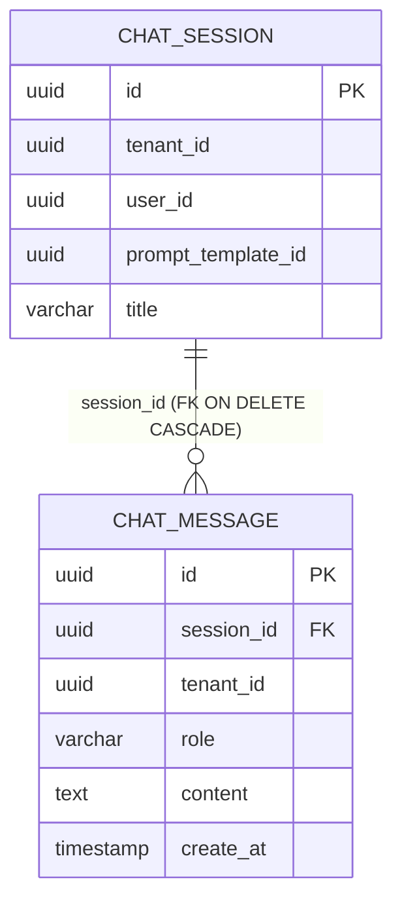
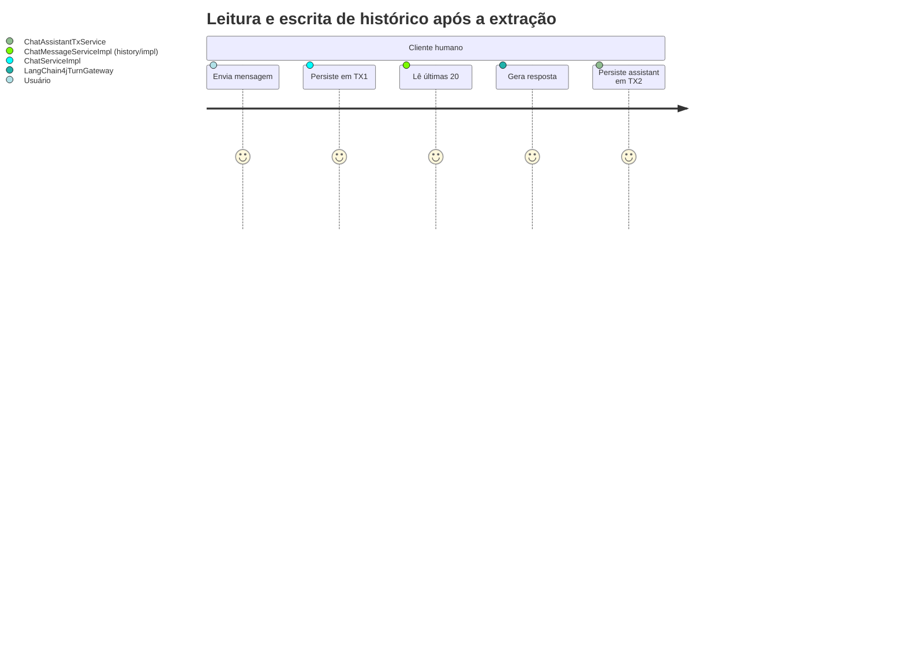

# SPEC — ADR-016: Extrair adapter JPA de histórico para módulo `history`

> Escopo: **apenas a decisão do ADR-016**. Esta SPEC não especifica o produto inteiro,
> nem a migração de `publicapi/impl` (Gate B do ADR — ADR separado).
> Rastreabilidade: cada `RF`/`NFR` aponta para a cláusula do `ADR.md` que a origina.

## 1. Architecture Decision Records (ADRs)

### ADR-016 (este ciclo)
- **Decision**: módulo `backend/history/` (agregador + `history/impl`) passa a ser o dono do
  adapter JPA de histórico. Domínio (`ChatMessage`, `ChatSession`), porta `ChatMessageService`
  e conversão ADR-001 permanecem em `agent/api`.
- **Context**: `agent/impl` hoje concentra adapter de histórico junto de política de turno,
  retry e telemetria (`TECH-BRIEF.md:78`); `publicapi/impl` depende de `agent/impl`
  (`publicapi/impl/pom.xml:33-37`), ainda que por classes de política — ver ADR §8.
- **Trade-offs**: centralizar persistência x não criar `history/api` vazio; resolver a faceta
  de histórico de K3 x não prometer `grep = zero`; coesão de schema x custo de mover Flyway
  (mantido em `agent/dbupdate`, débito aceito na ADR §5).

ADRs que permanecem intactos (não emendados): ADR-001 (`agent/api` dono da conversão,
ordem template-primeiro), ADR-003 (JPA fonte de verdade; sem `ChatMemory`/`@MemoryId`),
ADR-007 (TX1/TX2, window 20), ADR-012 (porta `ChatTurnGateway`; gatilho #3 não dispara),
ADR-013 (sessão é aggregate root; gatilho #2 não dispara).

## 2. Domain Context, Tenant Strategy & Provisioning

- **Bounded Context**: persistência de histórico de chat (`chat_session`/`chat_message`).
  O contexto de decisão permanece em `agent/api`; o novo módulo é o **adaptador de
  persistência**, não um novo domínio.
- **System Type**: backend Java 25 preview / Spring Boot 4.1.0 / LangChain4j 1.19.0
  (`backend/pom.xml:36-39`, `backend/dependencies/pom.xml:8-10,37`).
- **Tenant Provisioning**: N/A — nenhum tenant novo é criado; o adapter herda o isolamento
  existente (`@Filter` de `AbstractEntity`, `TenantContext`).
- **Tenant Lifecycle**: N/A — nenhuma transição de tenant é alterada neste ciclo.

## 3. Identity & Access Management (IAM)

- **Identity Provider**: N/A — nenhum provedor de identidade é tocado neste ciclo.
- **Protocol**: N/A — nenhum protocolo de autenticação é alterado.
- **MFA Strategy**: N/A — nenhum fluxo MFA é tocado; restrição explícita do ADR §10.
- **Session & Token Management**: N/A — nenhum token, sessão de autenticação ou revogação é alterada.
- **RBAC Matrix**: N/A — nenhum `@HasPermission` é adicionado, removido ou alterado.
  Os endpoints atuais continuam com as mesmas anotações (`commons/api-tools`).

## 4. Security, Key Management & Disaster Recovery

- **Key Management**: N/A — nenhuma chave é criada, rotacionada ou lida neste ciclo.
- **Key Lifecycle**: N/A — nenhuma chave é criada, rotacionada ou lida neste ciclo.
- **Backup & DR**: N/A — nenhuma alteração de schema ou dado; backups existentes permanecem.
- **RTO/RPO**: N/A — inalterados.

## 5. Data Model & Concurrency

### Entity-Relationship Diagram (ERD)

Schema **congelado**: as entidades acima são as atuais (`ADR_007_Chat_Persistence.md:24-25`);
nenhuma coluna, FK, índice ou constraint muda neste ciclo.

### Concurrency & Consistency

| Entity | Operation | Strategy | Rationale |
|---|---|---|---|
| `ChatMessage` | `save` | `@Transactional` existente em `ChatMessageServiceImpl.java:38-40`, preservado | TX1/TX2 (ADR-007) não são movidas para dentro do adapter |
| `ChatMessage` | `findLast20` | leitura sem transação nova; `DESC createAt` + `reverse` (`ChatMessageServiceImpl.java:68-74`) | Window 20 e ordem ASC final são invariantes (ADR-003, ADR-007) |

## 6. Event Model, Integrations & Messaging Isolation

- **Messaging Isolation**: N/A — nenhum tópico, fila ou evento é introduzido.
- **Delivery Guarantee**: N/A — nenhum event de domínio é publicado neste ciclo.
- **Event Registry**: N/A — sem eventos novos.

## 7. Invariants & Property-Based Testing

### 7.1 Entity Invariants

| Entity | Property | Description |
|---|---|---|
| `ChatMessage` | `content` entre 1 e 4000 chars | `ChatMessageServiceImpl.java:41-45`; exceção `IllegalArgumentException()` preservada |
| `ChatMessage` | `tenant_id` em toda consulta | repositórios derivados com tenant (`ChatMessageRepository.java`) + `@Filter` |
| `ChatSession` | ausência → `ChatSessionNotFoundException` | `ChatMessageServiceImpl.java:44-45,59-60` |
| `ChatMessage` | `findLast20` = 20 mensagens, ASC final | ADR-003 item 3; ADR-007 `window 20` |

### 7.2 Workflow & State Invariants

- **TX1/TX2 (ADR-007)**: mensagem do usuário persistida **antes** da chamada ao provider;
  `findLast20` fora de transação; resposta do assistant + touch da sessão gravados juntos em TX2.
  O adapter continua participando só como leitura/escrita.
- **Sem segunda implementação**: exatamente um bean `ChatMessageService` no contexto
  (ADR-016 §4 item 2).
- **Sem aresta nova**: `history/impl` não depende de `agent/impl`; `publicapi/impl` não passa
  a depender de `history/impl` (ADR-016 §4 item 8).

### 7.3 Generator Constraints (Testing Data)

| Field | Type | Range | PBT Goal |
|---|---|---|---|
| `content` | String | 1..4000, não blank | rejeitar vazio e >4000; aceitar limites |
| `tenantId`/`sessionId` | UUID | não nulo | nenhuma query sem tenant |
| `window` | int | fixo 20 | `findLast20` sempre devolve no máximo 20, em ordem ASC |

## 8. Functional Requirements & Core Journeys

### RF-01 — Módulo `history` (ADR §1.1, §6 passo 1)
Criar `backend/history/pom.xml` (agregador) e `backend/history/impl/pom.xml`, e registrar
`<module>history</module>` no agregador raiz (`backend/pom.xml:16-27`). `history/impl`
depende de `agent/api`, `commons/impl`, `provider/api`, JPA e MapStruct — **sem**
`hive-agent-impl`. `history/api` **não** é criado.

### RF-02 — Migração das classes adapter (ADR §1.1, §4 item 5)
Mover para `br.com.systec.hive.history.impl.*`: `ChatMessageServiceImpl`,
`ChatMessageEntity`, `ChatSessionEntity`, `ChatMessageMapperDomain`,
`ChatMessageRepository`, `ChatSessionRepository`. Rename de pacote `agent.impl` → `history.impl`
sem alterar lógica, `@Filter`, `@Enumerated`, FK ou índice.

### RF-03 — Porta e domínio intactos (ADR §4 itens 1, 9)
`ChatMessageService` e `ChatMessage`/`ChatSession` permanecem em `agent/api` com as mesmas
4 assinaturas (`ChatMessageService.java:11-20`). A conversão de ADR-001 permanece função
pura em `agent/api`. Nenhum consumidor passa a invocar `history/impl` diretamente.

### RF-04 — Wiring e imports (ADR §6 passos 3-4)
Ajustar imports em `agent/impl` e testes; `bootstrap` inclui o novo módulo no runtime;
`ChatServiceImpl` continua injetando a porta. `publicapi/impl` não ganha dependência de
`history/impl`.

### RF-05 — Schema congelado (ADR §4 item 6, §5)
Zero mudança em `*.sql`, zero migration nova, zero `flyway_schema_history_*` novo.
Migrations de `chat_message` continuam em `agent/dbupdate`.

### RF-06 — Testes movidos com as classes (ADR §7 risco "package rename")
Mover `ChatMessageServiceImplTest` e `ChatMessageMapperDomainTest` junto com as classes,
preservando guardas e o baseline de `findLast20`. Nenhuma guarda é apagada
(precedente ADR-012:86).

### NFR-01 — Isolamento de tenant (ADR §4 itens 5, 6; ADR-003)
Toda consulta continua com tenant explícito; `TenantContext`/`TenantAspect` inalterados;
nenhum callback assíncrono é introduzido. `ScopedValue` não propaga para thread pool
(`TenantContext.java:8-16`) — nenhum offload entra neste ciclo.

### NFR-02 — Ausência de memória (ADR §4 item 7)
`grep` por `ChatMemory|ChatMemoryStore|ChatMemoryProvider|@MemoryId|chatMemory(` em
`backend/**` = zero.

### NFR-03 — Restrição MFA (ADR §10)
`git diff --name-only` filtrado por `backend/security/**/Mfa*` e
`backend/identity/**/Mfa*` = zero.

### NFR-04 — Suíte e review (ADR §9 Gate A)
`commands.suiteFull` (`npm test`) com 0 falhas, 0 erros, 0 skips não autorizados;
`code-reviewer` sem 🔴. Baseline desta data: `EXIT=0`, 376/376 frontend, 62 surefire
reports backend sem falhas (`/tmp/opencode/ai-services-tests-2026-11-21.log`).

## 9. Critérios de Aceite Executáveis

| ID | Asserção | Comando / verificação |
|---|---|---|
| AC-01 | Módulo compila e agregador o reconhece | `mvn -f backend/pom.xml -q -DskipTests compile` exit 0; `grep '<module>history</module>' backend/pom.xml` |
| AC-02 | Um único bean da porta | `grep -rl 'implements ChatMessageService' backend/**/src/main/java` → 1 arquivo (`history/impl`) |
| AC-03 | Sem aresta nova para `agent/impl` | `grep -r 'agent.impl' backend/history/**` → zero; `grep 'hive-agent-impl' backend/history/impl/pom.xml` → zero |
| AC-04 | Schema intacto | `git diff --name-only -- '*.sql' '**/flyway_schema_history*'` → zero linhas |
| AC-05 | Sem memória | `grep -rE 'ChatMemory|@MemoryId|chatMemory\(' backend/**/src` → zero |
| AC-06 | MFA intacto | `git diff --name-only -- 'backend/security/**/Mfa*' 'backend/identity/**/Mfa*'` → zero linhas |
| AC-07 | Suíte verde | `npm test` exit 0; 0 falhas/erros/skips não autorizados |
| AC-08 | Baseline `findLast20` | `ChatMessageServiceImplTest`/`ChatMessageMapperDomainTest` passam com 20 mensagens, ordem ASC final |
| AC-09 | Gate B **não** reivindicado | `grep -r 'br.com.systec.hive.agent.impl' backend/publicapi/**` ainda retorna 4 ocorrências (`ProviderResolution`, `TurnOutcomeMapper`); registrado como débito, não como falha deste ADR |

## 10. Test Strategy

- **Unitários**: testes movidos com as classes (RF-06), sem perda de guardas.
- **Integração**: suíte completa `commands.suiteFull`; ITs de caracterização existentes
  cobrem a fronteira do gateway/fábrica e o caminho de chat.
- **Estática**: AC-01..AC-06 e AC-09.
- **Review**: `code-reviewer` — veredito é parecer; bloqueio é o gate de evidência
  (`always-on.md` I5, âncora B lendo `code_review_status`).

## 11. Fora do escopo

Implementação em si (é feita pelo `backend-engineer` com TASKS), `ChatMemory`/Agent,
mudança de contrato HTTP, retry, telemetria, classificação de erro, cota, migrations de
dados, branch/PR, `workflow-state.json`, e a remoção integral da aresta `publicapi → agent/impl`
(Gate B — ADR separado).
