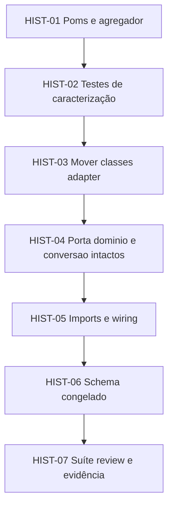

<!-- scope: adr/ADR-016 -->
# TASKS — ADR-016: Extrair adapter JPA de histórico para módulo `history`

> Backlog TDD-ready derivado 1:1 da `SPEC.md` deste ADR.
> Ordem: **teste antes da implementação** em toda tarefa.
> Gate B (`grep agent.impl` em `publicapi` = zero) **não** faz parte destas tarefas —
> é ADR separado (ADR §8/§9). Não reescrever critério como satisfeito.

| ID | RF/NFR | Prioridade | Risco | Tipo | Depende de |
|---|---|---|---|---|---|
| HIST-01 | RF-01 | P0 | Médio | infra (pom) | — |
| HIST-02 | RF-06 | P0 | Alto | teste | — |
| HIST-03 | RF-02 | P0 | Alto | refactor | HIST-01, HIST-02 |
| HIST-04 | RF-03 | P0 | Alto | verificação | HIST-03 |
| HIST-05 | RF-04 | P0 | Médio | integração | HIST-03 |
| HIST-06 | RF-05 | P0 | Alto | verificação | HIST-02 |
| HIST-07 | NFR-01..04, AC-07..09 | P0 | Médio | qualidade | HIST-04, HIST-05, HIST-06 |

---

### HIST-01 — Criar módulo `history` (poms + agregador)

- **RF**: RF-01 · **Prioridade**: P0 · **Risco**: Médio · **Tipo**: infra (pom)
- **Arquivos**: `backend/pom.xml`, `backend/history/pom.xml`, `backend/history/impl/pom.xml`
- **Teste primeiro**: asserção estática — `grep '<module>history</module>' backend/pom.xml` e
  presença dos dois poms novos (falha antes da criação).
- **Cenários**:
  - Sucesso: agregador raiz declara `history`; `history/pom.xml` declara `impl`.
  - Falha: `mvn -f backend/pom.xml -q -DskipTests compile` falha se dependência faltar.
  - Borda: `history/impl/pom.xml` **sem** `hive-agent-impl` (AC-03).
- **DoD**: poms criados; `history/impl` depende de `agent/api`, `commons/impl`, `provider/api`,
  JPA e MapStruct; zero dependência de `agent/impl`; compile exit 0.

### HIST-02 — Fixar baseline de caracterização do adapter

- **RF**: RF-06 · **Prioridade**: P0 · **Risco**: Alto · **Tipo**: teste
- **Arquivos**: `backend/agent/impl/src/test/.../ChatMessageServiceImplTest.java`,
  `backend/agent/impl/src/test/.../ChatMessageMapperDomainTest.java`
- **Teste primeiro**: executar os dois testes **antes** de mover qualquer classe e registrar
  contagem verde (baseline). Nenhum teste é apagado ou `@Disabled`.
- **Cenários**:
  - Sucesso: `findLast20` devolve 20 mensagens em ordem ASC final.
  - Falha: `content` vazio ou >4000 → `IllegalArgumentException` (mantida).
  - Borda: sessão inexistente → `ChatSessionNotFoundException` com o mesmo `sessionId`.
- **DoD**: baseline registrado no relatório; guardas preservadas; zero `@Disabled` novo.

### HIST-03 — Mover classes adapter para `history/impl`

- **RF**: RF-02 · **Prioridade**: P0 · **Risco**: Alto · **Tipo**: refactor
- **Arquivos**: `backend/history/impl/src/main/java/br/com/systec/hive/history/impl/{service,entity,mapper,repository}/`
  (6 classes da ADR §1.1), e remoção dos originais em `agent/impl`.
- **Teste primeiro**: HIST-02 reproduzido contra as classes movidas (deve falhar até o move).
- **Cenários**:
  - Sucesso: 6 classes em `history.impl.*`; `ChatMessageServiceImpl implements
    br.com.systec.hive.agent.api.service.ChatMessageService`.
  - Falha: classe deixada em `agent.impl` → AC-02 falha (dois beans ou bean errado).
  - Borda: lógica de mapper, `@Filter`, `@Enumerated`, FK e índices **byte a byte** iguais.
- **DoD**: rename de pacote aplicado; nenhuma lógica alterada; compilação verde.

### HIST-04 — Preservar porta, domínio e conversão em `agent/api`

- **RF**: RF-03 · **Prioridade**: P0 · **Risco**: Alto · **Tipo**: verificação
- **Arquivos**: `backend/agent/api/.../ChatMessageService.java`, `ChatMessage.java`,
  `ChatSession.java`, `util/ProviderMessages.java` (somente leitura — zero diff esperado).
- **Teste primeiro**: `git diff --name-only` sobre esses caminhos → zero antes de começar.
- **Cenários**:
  - Sucesso: 4 assinaturas intactas; conversão de ADR-001 permanece em `agent/api`.
  - Falha: qualquer diff nesses arquivos → revertir.
  - Borda: nenhum consumidor chama `history/impl` diretamente.
- **DoD**: `git diff` zero nos paths; `grep -rl 'implements ChatMessageService'` → 1 arquivo.

### HIST-05 — Ajustar imports e wiring

- **RF**: RF-04 · **Prioridade**: P0 · **Risco**: Médio · **Tipo**: integração
- **Arquivos**: imports em `backend/agent/impl/**` e testes; `backend/bootstrap/pom.xml`;
  `ChatServiceImpl` (somente conferência do *inject by port*).
- **Teste primeiro**: compilação com imports antigos deve falhar após HIST-03 (prova do acoplamento).
- **Cenários**:
  - Sucesso: `bootstrap` inclui `history/impl`; `ChatServiceImpl` continua injetando a porta.
  - Falha: `publicapi/impl/pom.xml` ganhar `history/impl` → revertir (AC-03).
  - Borda: `grep -r 'agent.impl' backend/history/**` = zero.
- **DoD**: compile + suíte parcelar verde; `publicapi/impl` sem nova dependência.

### HIST-06 — Garantir schema congelado

- **RF**: RF-05 · **Prioridade**: P0 · **Risco**: Alto · **Tipo**: verificação
- **Arquivos**: nenhum `.sql` (verificação somente).
- **Teste primeiro**: `git diff --name-only -- '*.sql' '**/flyway_schema_history*'` → zero
  antes de começar.
- **Cenários**:
  - Sucesso: zero diff SQL; `agent/dbupdate` continua dono das migrations.
  - Falha: qualquer `.sql` modificado ou migration nova → revertir.
  - Borda: nenhum `flyway_schema_history_history` criado; nenhum `repair()`/`DROP SCHEMA`.
- **DoD**: AC-04 verde; débito de coesão registrado no relatório (schema owner ≠ code owner).

### HIST-07 — Suíte, review e evidência

- **RF/NFR**: NFR-01..04, AC-07..09 · **Prioridade**: P0 · **Risco**: Médio · **Tipo**: qualidade
- **Arquivos**: `harness/adr-016.json` (via `qa-engineer`, não pelo implementador —
  `isHarnessScoped` gate.js:565); relatório de review.
- **Teste primeiro**: rodar `npm test` no baseline (já verde nesta data) e comparar.
- **Cenários**:
  - Sucesso: `npm test` exit 0; AC-01..AC-08 verdes; `code-reviewer` sem 🔴.
  - Falha: qualquer 🔴 → loop de correção (implementador → reviewer, máx. 3 iterações).
  - Borda: AC-09 permanece **vermelho por design** (4 ocorrências em `publicapi`) — registrar
    como débito, não corrigir neste ADR.
- **DoD**: veredito `passed` em `code_review_status`; `harness_status: passed`; zero diff MFA;
  Brain atualizado; **PARAR e pedir "Posso avançar?"** antes de qualquer próxima fase.
