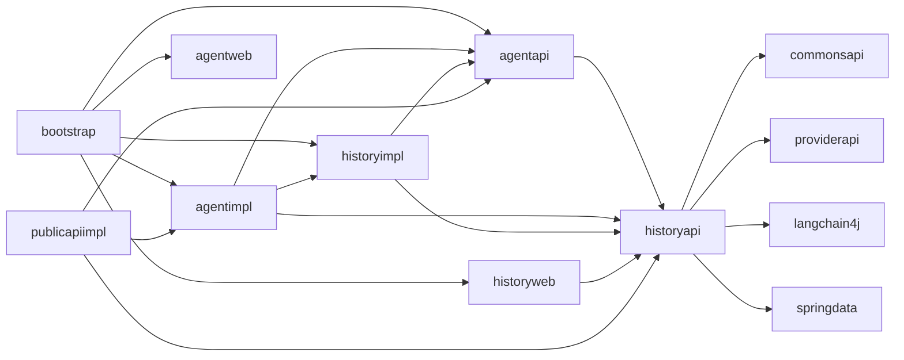

# ADR-017 — Reorganizar histórico em `history/api` + `history/impl` + `history/web`

> **Ciclo de execução aberto em 2026-11-21** (aprovação humana): `unit: adr` + `status: in-progress`. SPEC/TASKS nascem neste diretório com marcador `<!-- scope: adr/ADR-017 -->` no TASKS (F4). Código/pom/config/teste só na delegação ao `backend-engineer`. `workflow-state.json`, branch/PR e ADR-016/001/003 seguem fora deste ciclo.
> Amparo para ADR sem PRD: `.agents/rules/prd-adr-pipeline.md:43-45` — "Arquitetural sem valor de produto novo ⇒ ADR sem PRD". O teto de 5 ADRs do PRD `langchain4j-ai-services` está gasto (ADR-001..005); este ADR **não** entra no `ADR-INDEX.md` daquele PRD e não cria 6º ADR lá.
> Forma `unit: legacy` + `status: todo` conforme `.agents/rules/prd-adr-pipeline.md:51-54`.

- **depende-de**: ADR-001 (conversão — **emendada** no item 1), ADR-003 (JPA fonte de verdade — **inalterado**), ADR-007 (TX1/TX2, window 20), ADR-016 (**supersedido** por este ADR).
- **Status**: in-progress

---

## 1. Decisão

Organizar o histórico em três fronteiras, com a porta e o domínio de mensagem possuídos pelo próprio módulo:

| Módulo | Possui | Não possui |
|---|---|---|
| `history/api` | `ChatMessage`, `ChatMessageService`, `ProviderMessages` (conversão ADR-001) | `ChatSession`, `ChatSessionService`, `ChatSessionNotFoundException`, implementação JPA |
| `history/impl` | adapter JPA: entity/repository/mapper/`ChatMessageServiceImpl` | `agent/impl`, controller, DTO web |
| `history/web/internal/v1` | endpoint `GET /{id}/messages`, `ChatMessageDTO`, `ChatMessageMapperDTO` | CRUD de sessão, `ChatSessionService`, regras de turno |
| `agent/api` | `ChatSession`, `ChatSessionService`, `ChatSessionNotFoundException`, `TurnRequest`, `ChatTurnGateway` | domínio/porta/conversão de mensagem |
| `agent/web/internal/v1` | CRUD de sessão (`ChatSessionControllerV1` sem o método `messages`) | endpoint de mensagens |

### 1.1 `history/api` — porta, domínio de mensagem e conversão

Mover de `agent/api` para `history/api` (rename de pacote `br.com.systec.hive.agent.api.*` → `br.com.systec.hive.history.api.*`):

- `domain/ChatMessage.java` (`ChatMessage.java:1-71` — 7 campos, `extends AbstractDomain`, `ChatRole` de `provider/api`).
- `service/ChatMessageService.java` (`ChatMessageService.java:11-20` — 4 métodos).
- `util/ProviderMessages.java` (`ProviderMessages.java:39-64` — conversão pura ADR-001).
  - **Não mover** `agent/impl/util/ProviderMessages.java`: é a classe *leitora* de mensagens do adapter LangChain4j, função distinta (`ProviderMessages.java:31-38` documenta a divisão).

Dependências permitidas de `history/api`: `hive-commons-api`, `hive-provider-api`, `langchain4j-core` (`agent/api/pom.xml:18-40`), `spring-data-commons` (`agent/api/pom.xml:45-48` — `Page`/`Pageable` da porta). **Proibida**: dependência de `hive-agent-api` (§3).

### 1.2 `ChatSession` fica em `agent/api` — decisão e justificativa

`ChatSession` **não** vai para `history/api`. Fica em `agent/api`, junto de `ChatSessionService` (`ChatSessionService.java:13-44`) e de todo o aggregate de sessão/turno.

Evidência:

- `ChatSession.java:11-93` é o aggregate root da conversa: `userId`, `promptTemplateId`, `provider`/`model` (par atômico V7), `title`, `summary`, `updateAt`.
- `ChatSessionService.java:3,13-44` e `ChatSessionServiceImpl.java:3,46,52,80,88,123` consomem o tipo em todos os métodos.
- `ChatServiceImpl.java:6,141` e `ChatSessionMapperDomain.java:3,11-16` (em `agent/impl`) usam `ChatSession` na orquestração do turno.
- `ChatSessionMapperDTO.java:3,17`, `ChatSessionDTO`, `ChatSessionControllerV1.java:4,59,78,89,128` (em `agent/web`) e três suítes de teste (`ChatSessionServiceImplTest.java:3`, `ChatSessionMapperDomainTest.java:3`, `ChatServiceImplTest.java:8`) fixam esse tipo no contexto de sessão.

Mover `ChatSession` para `history/api` exigiria `history/api → provider.api` (já existe) mas deixaria o domínio da sessão separado da porta, do mapper, dos DTOs e dos testes que o usam — fragmentação sem ganho: o endpoint movido lê **mensagens**, não sessão (`ChatMessageService.java:15`). ADR-013 mantém sessão como aggregate root; nada aqui cria entidade nova.

`ChatSessionNotFoundException` também **fica em `agent/api`** (`ChatSessionNotFoundException.java:8,15`): é erro de sessão, lançado por `ChatSessionServiceImpl.java:90,98,108,116,125` e `ChatAssistantTxService.java:7,30`, além de `history/impl/ChatMessageServiceImpl.java:4,45,60`. Duplicá-lo em `history/api` quebraria `isInstanceOf` nos testes (`ChatMessageServiceImplTest.java:78,144`); movê-lo faria `agent/impl` depender de `history/api` para um erro de sessão. A aresta residual `history/impl → agent/api` por **um único símbolo** é permitida e não se confunde com `history/impl → agent/impl` (proibida).

### 1.3 `history/impl` implementa a porta do próprio módulo

`ChatMessageServiceImpl` passa a `implements br.com.systec.hive.history.api.service.ChatMessageService` (`history/impl/.../ChatMessageServiceImpl.java:24`). `@Service`, `@Transactional` em `save` (`:38-40`), validação `1..4000` (`:41-43`), `findLast20` (`:68-74`) e `getMessages` ASC (`:57-66`) permanecem. `history/impl/pom.xml:37-45` troca `hive-agent-api` por `hive-history-api` e mantém `hive-agent-api` apenas para `ChatSessionNotFoundException` (§1.2). **Nenhuma** dependência de `hive-agent-impl`.

### 1.4 `history/web` recebe o endpoint; rota, DTO e envelope idênticos

**"Mover o controller" = mover a responsabilidade do endpoint, não a classe inteira.** A classe `ChatSessionControllerV1` também contém 5 endpoints de sessão (`ChatSessionControllerV1.java:53-91,112-130`) que dependem de `ChatSessionService` (em `agent/api`) e de DTOs de sessão. Movê-la inteira arrastaria CRUD de sessão para `history/web` e criaria `history/web → agent/api`, destruindo a fronteira. Portanto:

- Nasce `history/web/internal/v1/.../controller/ChatMessageControllerV1` com **somente** `GET /{id}/messages`.
- `ChatSessionControllerV1` perde o método `messages` (`:93-110`), o campo `chatMessageService` (`:39,48`), o campo `messageMapper` (`:41,50`) e os imports de mensagem (`:3,5,11`). Mantém CRUD e os helpers `currentUserId()`/`currentTenantId()` (`:132-150`).
- `ChatMessageDTO` (`agent/web/.../dto/ChatMessageDTO.java:6-12`) e `ChatMessageMapperDTO` (`agent/web/.../mapper/ChatMessageMapperDTO.java:12-32`) são movidos para `history/web/internal/v1`. `ChatSessionDTO`/`ChatSessionMapperDTO` e `publicapi/web/.../ChatMessageDTO` **não** são tocados.
- Os helpers `currentUserId()`/`currentTenantId()` são replicados no controller novo com o mesmo corpo (`SecurityContextHolder` → principal `User`; fallback `TenantContext.getCurrentTenant()`; `AccessDeniedException`): mudar isso mudaria anti-IDOR e tenant (§7 R5).

Contrato HTTP inalterado: mesmo path `/v1/chat/sessions/{id}/messages`, mesmos query params, mesma permissão, mesmo DTO, mesmo envelope. Duas classes com `@RequestMapping(RestPath.V1 + "/chat/sessions")` coexistem sem ambiguidade porque os paths concretos são distintos — desde que o controller novo **não** repita outro mapping do controller de sessão (§7 R1).

---

## 2. Supersessão e emendas

| ADR | Efeito deste ADR | O que muda / o que fica |
|---|---|---|
| **ADR-016** | **Superseded por ADR-017** (decisão de organização) | A variante B ("domínio em `agent/api`, sem `history/api`": `ADR-016:17,36,64`) é substituída. O adapter JPA já implementado em `history/impl` é aproveitado; a divisão `api`/`impl`/`web` e o controller passam a ser donos do módulo. A declaração `ADR-016:15` de que "não emenda ADR-001/003" é revertida **apenas** pelo que está registrado abaixo. O arquivo `ADR-016/ADR.md` **não é editado** por este ADR. |
| **ADR-001** | **Emendado no item 1 da interface congelada** (`ADR-001:47`) | Local da conversão: `agent/api` → `history/api`. Todo o resto do item 1 permanece: função pura estática, pacote `util`, sem collaborators, sem I/O, sem `TenantContext`. Mapa de conversão (`ADR-001:48`) e ordem "template primeiro, histórico depois" (`ADR-001:49`, regra K4) ficam **byte a byte** — só a linha de `package` e os imports mudam. Item 5 (`ADR-001:51`) passa a ler: a função mora em `history/api`; `publicapi/impl` ganha `hive-history-api`, **nenhum** import novo de `agent/impl` (Gate B segue fora). Arquivo `ADR-001/ADR.md` **não é editado** por este ADR. |
| **ADR-003** | **Inalterado** | JPA/`chat_message` continua fonte de verdade (`ADR-003:43`); nenhum `.chatMemory(...)`, `.chatMemoryProvider(...)`, `ChatMemoryStore`, `@MemoryId` (`ADR-003:44-46,67`). Item 4 de `ADR-003` (ordem de ADR-001) continua válido com a conversão em `history/api`. Arquivo `ADR-003/ADR.md` **não é editado**. |
| ADR-012 / ADR-013 | Intocados | Gatilhos #3 (biblioteca gerencia histórico) e #2 (múltiplas conversas/memória de longo prazo) não disparam: troca-se apenas o dono do código, não o mecanismo de persistência. |

Registro de honestidade: ADR-016 foi **implementado** na branch corrente (6 classes + 2 testes movidos para `history/impl`, suíte 376/376 + 62 reports/503 testes). Este ADR **não nega** esse trabalho; ele o **estende** — o custo de refazer/estender está em §7 R8.

---

## 3. Grafo de dependências

Setas = "depende de". Evidências de estado atual entre parênteses; estados novos marcados como **novo**.

| Aresta | Evidência / motivo |
|---|---|
| `agent/api → history/api` (**novo**) | `agent/api/domain/TurnRequest.java:49` usa `ChatMessage` na assinatura; a classe sai de `agent/api`. `agent/api/pom.xml` ganha `hive-history-api`. |
| `history/impl → history/api` (**novo**) | `history/impl/.../ChatMessageServiceImpl.java:3,5` e `ChatMessageMapperDomain.java:3` passam a importar a porta e o domínio do próprio módulo. `history/impl/pom.xml:37-40` troca `hive-agent-api` por `hive-history-api`. |
| `history/impl → agent/api` (residual, permitida) | **Único** símbolo restante: `ChatSessionNotFoundException` (`ChatMessageServiceImpl.java:4`). Sem `agent/impl`. |
| `history/web → history/api` (**novo**) | Controller injeta `ChatMessageService` e usa `ChatMessage` via mapper. `history/web/internal/v1/pom.xml` espelha `agent/web/internal/v1/pom.xml:33-61` (`commons-api-tools`, `commons-api`, `commons-impl`, `identity-api`, `mapstruct`, spring web/security/validation, springdoc), trocando `hive-agent-api` por `hive-history-api`. **Sem** `agent/api`, **sem** `agent/impl`. |
| `publicapi/impl → history/api` (**novo**) | `PublicChatServiceImpl.java:8` importa `agent.api.util.ProviderMessages`; `:152` declara `List<agent.api.domain.ChatMessage>`. Ambos os símbolos mudam de módulo ⇒ `publicapi/impl/pom.xml` precisa de dependência **direta** em `hive-history-api` (a transitiva via `agent/api` não basta se `agent/api` deixar de reexportar; e mesmo que reexportasse, contrato explícito é exigido). `hive-agent-api` permanece (`:3-7,19`). Aresta `publicapi/impl → agent/impl` (`:33-37`) **não é alterada** — Gate B fora (§8). |
| `agent/impl → history/api` (**novo**) | `agent/impl/.../ChatServiceImpl.java:3,12,15`, `TurnOutcomeMapper.java:5`, `ProviderMessagesTest.java:3-4`, `TurnOutcomeMapperTest.java:5`, `ChatServiceImplTest.java:5,16`. |
| `agent/impl → history/impl` (já existe) | Wiring runtime (`agent/impl/pom.xml:41-45`, `bootstrap/pom.xml:165-172`) — inalterado. |
| `bootstrap → history/web/internal/v1` (**novo**) | Padrão de `bootstrap/pom.xml:173-177` para `hive-agent-web-internal-v1`; necessário para o `@RestController` novo ser descoberto. `hive-history-impl` (`:167-172`) permanece. |
| `history/api → commons/api, provider/api, langchain4j-core, spring-data-commons` | Mesmas deps de `agent/api/pom.xml:18-48` necessárias aos 3 tipos movidos. |

**Prova de ausência de ciclo**: `history/api` não tem nenhum import de `br.com.systec.hive.agent.*` — `ChatMessage.java:3-4` usa apenas `provider.api` e `commons.api`; `ChatMessageService.java:3-6` usa `ChatMessage`, `ChatRole`, `Page`, `Pageable`; `ProviderMessages.java:3-10` usa `ChatMessage`, `ChatRole`, `dev.langchain4j.*`, `java.util.*`. `ChatSession` fica em `agent/api` (§1.2), então não há tipo compartilhado a possuir. DAG resultante: `history/api` é folha (exceto libs); todo o resto aponta para ela. `agent/api → history/api` + `history/impl → agent/api` **não** é ciclo (são módulos distintos; o ciclo seria `history/api → agent/api`).

**Ordem de construção Maven**: `commons-api`, `provider-api` → `history-api` → `agent-api` → `{agent-impl, history-impl, history-web}` → `bootstrap`/`publicapi-impl`.

---

## 4. Alternativas consideradas

| # | Alternativa | Veredito | Evidência / fonte |
|---|---|---|---|
| a | Manter ADR-016 como está (domínio em `agent/api`, sem `history/api`, endpoint em `agent/web`) | **Rejeitada** | Usuário revisou e exigiu organização correta: `history/api` (porta + domínio + conversão), `history/impl` (JPA), `history/web` (endpoint). Manter contraria a decisão de organização; `ADR-016:36,64`. |
| b | `history/api` + `history/impl` + `history/web` com rota mantida | **Escolhida** | `GET /{id}/messages` continua em `/v1/chat/sessions/{id}/messages` com mesmo DTO/permissão/envelope; zero quebra de contrato; DAG sem ciclo (§3). |
| c | Nova rota `/v1/history/...` | **Rejeitada** | Quebra contrato HTTP; decisão explícita do usuário: mover controller, manter rota. `ChatSessionControllerV1.java:34,93`. |
| d | Duplicar controller (manter em `agent/web` e criar em `history/web`) | **Rejeitada** | Duas fontes de verdade para o mesmo `@GetMapping("/{id}/messages")` sob o mesmo `@RequestMapping` base ⇒ mapping ambíguo em Spring + divergência futura de DTO/permissão. |

---

## 5. Interface congelada

Nada abaixo pode mudar sem novo ADR:

1. **Porta** — `br.com.systec.hive.history.api.service.ChatMessageService`, exatamente quatro métodos (`ChatMessageService.java:11-20`):
   - `ChatMessage save(UUID sessionId, UUID tenantId, ChatRole role, String content)`
   - `Page<ChatMessage> getMessages(UUID sessionId, UUID tenantId, UUID userId, Pageable pageable)`
   - `List<ChatMessage> findLast20(UUID sessionId, UUID tenantId)`
   - `long countBySessionIdAndTenantId(UUID sessionId, UUID tenantId)`
   - `ChatMessage` = `br.com.systec.hive.history.api.domain.ChatMessage`; `ChatRole` = `br.com.systec.hive.provider.api.ChatRole`. Exceções de validação e sessão inalteradas (`ChatMessageServiceImpl.java:41-45,59-60`).
2. **DTO da resposta** — `br.com.systec.hive.history.web.internal.v1.dto.ChatMessageDTO`, record com componentes exatos e ordem idêntica (`agent/web/.../ChatMessageDTO.java:6-12`): `(UUID id, UUID sessionId, String role, String content, Instant createAt)`. Mapper congelado (`ChatMessageMapperDTO.java:15-32`): `role` → `"assistant"` quando contém "assistant", senão `"user"`; `content` com fallback para `message`; `createAt` = `LocalDateTime → Instant` em `ZoneOffset.UTC`.
3. **Rota** — `@RestController` em `ChatMessageControllerV1`, `@RequestMapping(RestPath.V1 + "/chat/sessions")` (`RestPath.java:4` ⇒ `/v1`), `@GetMapping(value = "/{id}/messages", produces = MediaType.APPLICATION_JSON_VALUE)` (`ChatSessionControllerV1.java:34,93`). Path final: **`/v1/chat/sessions/{id}/messages`**. `@RequestParam(defaultValue = "0") int page`, `@RequestParam(defaultValue = "50") int size`; `size > 100` → `IllegalArgumentException("size must be <= 100")`; `size <= 0` → `50`; `PageRequest.of(page, size, Sort.by(Sort.Direction.ASC, "createAt"))`; chamada `chatMessageService.getMessages(id, tenantId, userId, pageable)` (`:96-108`).
4. **Segurança** — `@HasPermission("CHAT_SESSION_MANAGE")` no método (`:95`), preservado. Helpers `currentUserId()`/`currentTenantId()` byte-equivalentes (`:132-150`).
5. **Envelope** — `RestControllerTool.of().buildSuccessResponse(dtoPage)` (`:109`), que é `ResponseEntity.ok(object)` (`RestControllerTool.java:14-24`). HTTP 200, corpo = `Page<ChatMessageDTO>` direto, sem wrapper custom, sem status diferente. `@Operation`/`@Tag` preservados.
6. **`findLast20`** — 20 mensagens, ordem ASC final: `PageRequest.of(0, 20, DESC createAt)` → `findBySessionIdAndTenantIdOrderByCreateAtDesc` → `Collections.reverse` → `mapper::toDomain` (`ChatMessageServiceImpl.java:68-74`; ADR-003:66). TX1/TX2 de ADR-007 inalteradas.
7. **ADR-001 / K4** — conversão `ProviderMessages.toProviderMessages` permanece pura; ordem "SystemMessage do template primeiro, histórico depois" byte a byte (`ProviderMessages.java:48-63`; `LangChain4jTurnGateway.java:121-128`; ADR-001:49). Nenhuma reordenação por memória (ADR-003:47).
8. **Zero** — zero SQL/migration, zero `flyway_schema_history_*` novo, zero `ChatMemory`/`ChatMemoryStore`/`ChatMemoryProvider`/`@MemoryId`/`chatMemory(`/`chatMemoryProvider(`, zero diff em MFA, zero mudança em cota/retry/classificação/telemetria, zero `agent/impl` em `history/api`, `history/impl` e `history/web`.

---

## 6. Sequência de migração (alto nível — sem código)

1. **Poms**: criar `history/api/pom.xml`, `history/web/pom.xml` (`hive-history-web`), `history/web/internal/pom.xml` (`hive-history-web-internal`), `history/web/internal/v1/pom.xml` (`hive-history-web-internal-v1`); registrar `<module>api</module>` e `<module>web</module>` em `history/pom.xml:15-17` (hoje só `impl`); padrão de agregador em `agent/web/pom.xml:13-19` e `agent/web/internal/pom.xml:13-19`. Ajustar `history/impl/pom.xml:37-45` → `hive-history-api` (mantendo `hive-agent-api` por `ChatSessionNotFoundException`). Acrescentar `hive-history-api` em `agent/api/pom.xml`, `agent/impl/pom.xml`, `publicapi/impl/pom.xml`. Acrescentar `hive-history-web-internal-v1` em `bootstrap/pom.xml:173-177`.
2. **Mover domínio/porta/conversão**: os 3 arquivos de §1.1 de `agent/api` para `history/api`, com rename de pacote. `ChatSession`, `ChatSessionService`, `ChatSessionNotFoundException`, `TurnRequest`, `ChatTurnGateway` **ficam**.
3. **Repontar imports**: `agent/api/domain/TurnRequest.java:49`; `agent/impl/.../ChatServiceImpl.java:3,12,15`, `TurnOutcomeMapper.java:5`, `ProviderMessagesTest.java:3-4`, `TurnOutcomeMapperTest.java:5`, `ChatServiceImplTest.java:5,16`; `history/impl/.../ChatMessageServiceImpl.java:3,5`, `ChatMessageMapperDomain.java:3` e os 2 testes movidos (`ChatMessageMapperDomainTest.java:3`, `ChatMessageServiceImplTest.java:3`); `publicapi/impl/PublicChatServiceImpl.java:8,152`. Conferir que nenhum `agent.api.domain.ChatMessage`/`agent.api.service.ChatMessageService`/`agent.api.util.ProviderMessages` sobrevive (`grep` de fechamento).
4. **Mover web**: criar `ChatMessageControllerV1` em `history/web/internal/v1` com apenas o endpoint; mover `ChatMessageDTO`/`ChatMessageMapperDTO` de `agent/web`; remover método `messages` + campos/imports de mensagem de `ChatSessionControllerV1.java:3,5,11,39,41,48,50,93-110`. Replicar helpers de `:132-150`. Validar que não há mapping duplicado.
5. **Ajustar bootstrap**: confirmar component scan alcança `br.com.systec.hive.history.web.internal.v1`; manter `hive-agent-web-internal-v1` (CRUD de sessão) e `hive-history-impl` (`@Service`).
6. **Suíte**: `mvn clean` **antes** de medir (sem clean, reports velhos inflam a contagem para 64/514 — registro de sessão ADR-016); `npm test` EXIT=0; baseline 376/376 front, 62 reports/503 testes back, 0 falhas/erros/skips (H0/H1, `.agents/rules/always-on.md` §5). IT de caracterização da rota (path/DTO/permissão/envelope) e do `findLast20` (20 ASC).
7. **Review**: `code-reviewer` sem 🔴; 🟡 corrigidos/justificados; `brain_store` da decisão; verificação estática das §5.7-5.8 e da matriz de dependências (`dependency:tree` ou equivalente) sem ciclo.

---

## 7. Riscos e débitos

| # | Risco | Evidência | Tratamento |
|---|---|---|---|
| R1 | Quebra acidental de contrato HTTP: esquecer o `@RequestMapping` base no controller novo, duplicar `@GetMapping("/{id}")`, alterar componentes do record, trocar envelope | `ChatSessionControllerV1.java:34,93-110`; `ChatMessageDTO.java:6-12`; `RestControllerTool.java:22-24` | Copiar anotações byte a byte; IT de caracterização da rota; `curl`/MockMvc para `/v1/chat/sessions/{id}/messages` com `CHAT_SESSION_MANAGE`; checar mapping ambíguo no log de startup. |
| R2 | Cycle Maven: `history/api → agent/api` acidental (se `ChatSession` migrar junto) somado a `agent/api → history/api` | `TurnRequest.java:49`; `ChatSession.java:11-93`; `ChatMessageService.java:3-6` | Congelar `ChatSession` em `agent/api` (§1.2); `history/api` sem nenhum import `agent.*`; `dependency:tree` na verificação. |
| R3 | Testes que fixavam a decisão morrerem com o move | `ProviderMessagesTest.java:3-4`, `ChatMessageMapperDomainTest.java:3`, `ChatMessageServiceImplTest.java:3`, `ChatServiceImplTest.java:5,16`, `TurnOutcomeMapperTest.java:5`; precedente ADR-012:86 e ADR-016:118 | Mover testes junto, não apagar guarda, não usar `@Disabled`; baseline `findLast20` 20 ASC preservado. |
| R4 | `ChatSessionNotFoundException` duplicado/movido | `ChatMessageServiceImpl.java:4,45,60`; `ChatSessionServiceImpl.java:90,98,108,116,125`; `ChatMessageServiceImplTest.java:78,144` | Manter em `agent/api`; aresta `history/impl → agent/api` residual declarada; proibida segunda classe com mesmo nome simples. |
| R5 | `TenantContext`/`ScopedValue`: helper divergente no controller novo muda tenant/anti-IDOR | `ChatSessionControllerV1.java:132-150`; `TenantContext.java:8-16` (não propaga); `TECH-BRIEF.md:167-172` | Replicar helpers byte-equivalentes; nenhum callback assíncrono; nenhum store de memória (ADR-003). |
| R6 | Dupla fonte de verdade se `ChatMemory` entrar depois | ADR-003:43-47,67; A8/A12/A13 | Bloqueio estático `grep = zero` (§8); reabertura só com ADR + IT de corrida; `@MemoryId`, se reaberto, = `sessionId` (UUID), nunca `turnId` (ADR-003:19). |
| R7 | Migração de `publicapi/impl` esquecida: contrato de `ProviderMessages`/`ChatMessage` quebrado em tempo de compilação | `PublicChatServiceImpl.java:8,152`; `publicapi/impl/pom.xml:23-37` | Incluir dependência direta `hive-history-api` no passo 1; não confiar em transitividade. |
| R8 | Retrabalho do ADR-016 (já implementado) | 6 classes + 2 testes em `history/impl`; `history/impl/pom.xml:17-19` ainda diz que porta/domínio ficam em `agent/api`; `bootstrap/pom.xml:165-166` cita ADR-016 | Aceito: este ADR estende o trabalho (troca de dep, reponte de imports, 4 poms novos, controller/DTO). Atualizar comentários de pom que citam ADR-016 como vigente na implementação, sem reescrever o ADR-016. |
| R9 | Gate B tratado como se este ADR o satisfizesse | `publicapi/impl/pom.xml:33-37`; `PublicChatServiceImpl.java:9-10` | Declarar explicitamente fora (§9); nova aresta `publicapi/impl → history/api` é distinta da aresta `publicapi → agent/impl` e **não** conta como quitação. |

---

## 8. Como verificar

**Gate A — obrigatório, alcançável por este ADR:**

1. Suíte: `npm test` EXIT=0; baseline 376/376 front, 62 surefire reports backend / 503 testes, 0 falhas, 0 erros, 0 skips não autorizados. Rodar `mvn clean` antes de medir.
2. **AC de rota**: `GET /v1/chat/sessions/{id}/messages` — mesmo path, mesmos defaults `page=0`/`size=50`, teto `size=100`, `Sort ASC createAt`, DTO record `(id, sessionId, role, content, createAt)`, `@HasPermission("CHAT_SESSION_MANAGE")`, envelope `RestControllerTool.of().buildSuccessResponse(...)` (HTTP 200). Nenhum outro endpoint muda de status/path.
3. Estático: `grep -rE 'ChatMemory|ChatMemoryStore|ChatMemoryProvider|@MemoryId|chatMemory\(|chatMemoryProvider\(' backend/**` = zero.
4. Estático: `git diff --name-only -- '*.sql' '**/Mfa*'` = zero (zero migration, zero `flyway_schema_history_*`, zero MFA).
5. Estático: `grep -r 'agent\.api\.\(domain\.ChatMessage\|service\.ChatMessageService\|util\.ProviderMessages\)' backend/**` = zero; `grep -r 'br\.com\.systec\.hive\.agent\.impl' backend/history/**` = zero; `history/api/pom.xml` sem `hive-agent-api`.
6. Matriz de dependências: `history/api` não depende de `agent/api`; `agent/api → history/api` existe; `history/impl → history/api` existe; `publicapi/impl → history/api` existe; nenhum ciclo no `dependency:tree`.
7. ITs de caracterização preservadas: `findLast20` (20 mensagens ASC) e conversão ADR-001 (ordem template-primeiro, descarte de conteúdo nulo, ramo `SYSTEM`).
8. Code review: `code-reviewer` sem 🔴; 🟡 corrigidos/justificados.

**Gate B — explicitamente fora**: aresta `publicapi → agent/impl` (`ProviderResolution`/`TurnOutcomeMapper`/`FailureClassifier`/`CredentialResolver`) permanece. Não marcar verde por este ADR; trata-se em ADR separado.

---

## 9. Fora desta decisão

- Implementação, criação/edição de poms, rename efetivo de arquivos, ajuste de imports, wiring, branch/PR, `workflow-state.json` — §6 descreve, não executa.
- `ChatMemory`, `ChatMemoryStore`, `@MemoryId`, agent/tools/RAG, starter de Spring Boot — ADR-003/012/013 permanecem.
- Mudança de contrato HTTP: path, DTO, query params, permissão, envelope, status code.
- `agent/impl`: `ChatSessionService`/`ChatSessionServiceImpl`, `ChatSessionMapperDomain`, `ProviderResolution`, `TurnOutcomeMapper`, `FailureClassifier`, `ChatAssistantTxService` — nenhum migra para `history`.
- `ChatSession`, `ChatSessionDTO`, `ChatSessionMapperDTO`, `publicapi/web/.../ChatMessageDTO` — permanecem onde estão.
- Migrations de dados, `DROP SCHEMA`, `flyway.repair()`, novo `flyway_schema_history_*`; ownership de Flyway segue em `agent/dbupdate` (ADR-016:§5, inalterado).
- MFA: `backend/security/**/Mfa*`, `backend/identity/**/Mfa*`.
- Edição de `ADR-016/ADR.md`, `ADR-001/ADR.md`, `ADR-003/ADR.md`: a supersessão e a emenda são **declaradas aqui**, não aplicadas nos arquivos dos ADRs anteriores.
- Criação de SPEC/TASKS/VERIFY/ADR-INDEX, de 6º ADR no PRD `langchain4j-ai-services`, e alteração do `ADR-INDEX.md` daquele PRD.
- Gate B (aresta `publicapi → agent/impl`) — ADR separado, não reivindicado.
