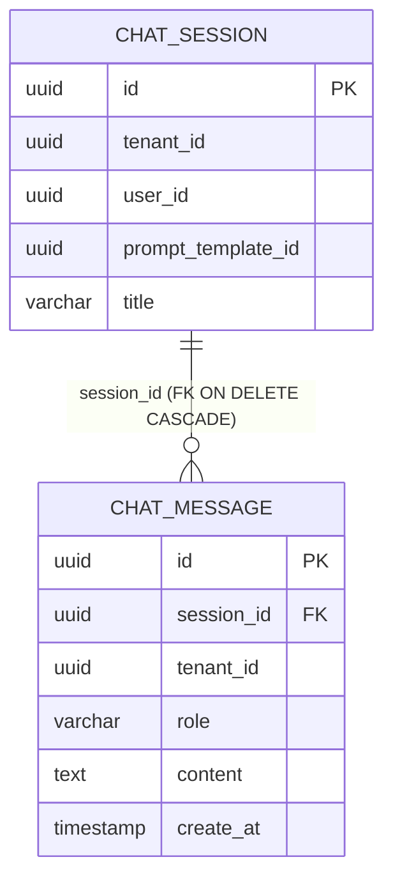
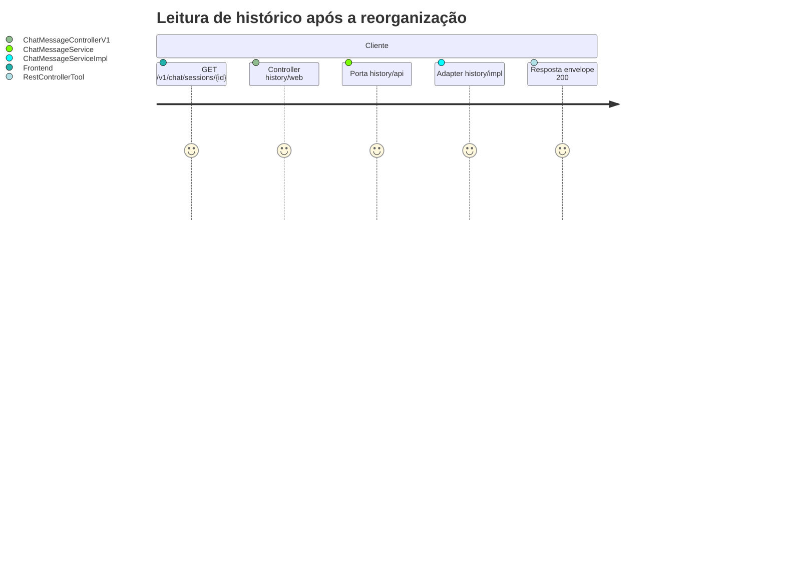

# SPEC — ADR-017: Reorganizar histórico em `history/api` + `history/impl` + `history/web`

> Escopo: **apenas a decisão do ADR-017**. Não especifica produto inteiro, não resolve Gate B
> (`publicapi → agent/impl` — ADR separado). Rastreabilidade: cada `RF`/`NFR` aponta para a
> cláusula do `ADR.md` que a origina.

## 1. Architecture Decision Records (ADRs)

### ADR-017 (este ciclo)
- **Decision**: `history/api` possui `ChatMessage`, `ChatMessageService` e `ProviderMessages`;
  `history/impl` implementa a porta do próprio módulo; `history/web/internal/v1` recebe
  `GET /v1/chat/sessions/{id}/messages` com rota/DTO/permissão/envelope idênticos.
- **Context**: ADR-016 entregou só `history/impl` com porta e domínio ainda em `agent/api`
  — adaptador órfão, sem contrato próprio. Usuário exigiu organização correta (`api`/`impl`/`web`).
- **Trade-offs**: fronteira hexagonal própria x retrabalho do ADR-016; rota mantida (zero quebra)
  x dividir controller; `ChatSession` em `agent/api` (sem cycle) x aresta residual por uma exceção.

ADRs afetados: ADR-016 **superseded**; ADR-001 **emendado** no item 1 (conversão → `history/api`,
K4 byte a byte); ADR-003 inalterado (sem memória); ADR-007 inalterado (TX1/TX2, window 20);
ADR-012/013 inalterados (gatilhos não disparam).

## 2. Domain Context, Tenant Strategy & Provisioning

- **Bounded Context**: histórico de mensagens de chat. `history/api` é a borda do domínio
  (porta + tipo + conversão); `history/impl` é o adaptador JPA; `history/web` é o adaptador de entrada.
- **System Type**: backend Java 25 preview / Spring Boot 4.1.0 / LangChain4j 1.19.0.
- **Tenant Provisioning**: N/A — nenhum tenant novo. Isolamento existente (`@Filter`,
  `TenantContext`) é herdado byte a byte.
- **Tenant Lifecycle**: N/A — nenhuma transição alterada.

## 3. Identity & Access Management (IAM)

- **Identity Provider / Protocol**: N/A — nenhum provedor ou protocolo é tocado.
- **MFA Strategy**: N/A — nenhum fluxo MFA é tocado (restrição explícita do ADR §5.8).
- **Session & Token Management**: N/A — sessão de autenticação inalterada; `ChatSession`
  (domínio da conversa) permanece em `agent/api`.
- **RBAC Matrix**: `@HasPermission("CHAT_SESSION_MANAGE")` no endpoint movido — **preservado**
  (ADR §5.4). Nenhuma outra permissão é adicionada ou removida.

## 4. Security, Key Management & Disaster Recovery

- **Key Management / Lifecycle**: N/A — nenhuma chave é criada, rotacionada ou lida.
- **Backup & DR / RTO/RPO**: N/A — nenhum dado, schema ou backup é alterado.

## 5. Data Model & Concurrency

### Entity-Relationship Diagram (ERD)

Schema **congelado**: nenhuma coluna, FK, índice ou constraint muda (ADR §5.8).

### Concurrency & Consistency

| Entity | Operation | Strategy | Rationale |
|---|---|---|---|
| `ChatMessage` | `save` | `@Transactional` existente, preservado | TX1/TX2 (ADR-007) não se movem para dentro do adapter |
| `ChatMessage` | `findLast20` | leitura sem transação nova; `DESC createAt` + `reverse` | Window 20 e ordem ASC final são invariantes |

## 6. Event Model, Integrations & Messaging Isolation

- **Messaging Isolation / Delivery Guarantee / Event Registry**: N/A — nenhum evento,
  tópico ou fila é introduzido.

## 7. Invariants & Property-Based Testing

### 7.1 Entity Invariants

| Entity | Property | Description |
|---|---|---|
| `ChatMessage` | `content` 1..4000 chars, não blank | validação em `ChatMessageServiceImpl.java:41-43`, preservada |
| `ChatMessage` | `tenant_id` em toda consulta | repositórios derivados + `@Filter` |
| `ChatMessage` | `findLast20` = 20 mensagens, ASC final | ADR-003 item 3; ADR-007 window 20 |
| `ChatSession` | permanece aggregate root | ADR-013; fica em `agent/api` (ADR-017 §1.2) |

### 7.2 Workflow & State Invariants

- **TX1/TX2 (ADR-007)**: inalteradas. `getMessages`/`findLast20` continuam fora da TX de geração.
- **Fronteira**: `history/api` não importa `br.com.systec.hive.agent.*` — sem cycle.
- **Rota única**: apenas um `@GetMapping("/{id}/messages")` sob `/v1/chat/sessions`;
  mapping ambíguo é falha de build/startup (R1).
- **Gate B fora**: aresta `publicapi/impl → agent/impl` permanece — não é quitação deste ADR.

### 7.3 Generator Constraints (Testing Data)

| Field | Type | Range | PBT Goal |
|---|---|---|---|
| `content` | String | 1..4000, não blank | rejeitar vazio/>4000, aceitar limites |
| `page`/`size` | int | `page>=0`, `size<=100`, `size<=0 → 50` | defaults e teto do endpoint preservados |
| `tenantId`/`sessionId` | UUID | não nulo | nenhuma query sem tenant |

## 8. Functional Requirements & Core Journeys

### RF-01 — Poms e Grafo (ADR §6 passo 1, §3)
Criar `history/api/pom.xml`, `history/web/pom.xml`, `history/web/internal/pom.xml`,
`history/web/internal/v1/pom.xml`; registrar `<module>api</module>` e `<module>web</module>`
em `history/pom.xml`. `history/impl` troca `hive-agent-api` por `hive-history-api` (mantém
`hive-agent-api` só por `ChatSessionNotFoundException`). Acrescentar `hive-history-api` em
`agent/api`, `agent/impl`, `publicapi/impl`; `hive-history-web-internal-v1` em `bootstrap`.
**Zero** dependência de `agent/impl` em qualquer módulo `history/**`. Ordem Maven:
`commons-api, provider-api → history-api → agent-api → {agent-impl, history-impl, history-web} → bootstrap/publicapi-impl`.

### RF-02 — Mover domínio, porta e conversão (ADR §1.1)
Mover de `agent/api` para `history/api` (rename de pacote): `domain/ChatMessage.java`,
`service/ChatMessageService.java`, `util/ProviderMessages.java`. **Não mover**
`agent/impl/util/ProviderMessages.java` (leitor do adapter, função distinta). Conversão
permanece pura; ordem "template primeiro" byte a byte (K4).

### RF-03 — `ChatSession` permanece em `agent/api` (ADR §1.2)
`ChatSession`, `ChatSessionService`, `ChatSessionNotFoundException` **não** migram.
Aresta residual `history/impl → agent/api` por `ChatSessionNotFoundException` é permitida;
proibida segunda classe com mesmo nome. Nenhum `history/**` com `agent.impl.*`.

### RF-04 — `history/impl` implementa a porta própria (ADR §1.3)
`ChatMessageServiceImpl implements br.com.systec.hive.history.api.service.ChatMessageService`.
`@Service`, `@Transactional` em `save`, validação 1..4000, `findLast20` (20, DESC+reverse),
`getMessages` ASC — todos inalterados.

### RF-05 — `history/web` recebe o endpoint (ADR §1.4, §5.2-5.5)
Criar `ChatMessageControllerV1` em `history/web/internal/v1` com **somente**
`GET /{id}/messages`. Mover `ChatMessageDTO` e `ChatMessageMapperDTO` de `agent/web`.
Remover método `messages`, campos `chatMessageService`/`messageMapper` e imports de mensagem
de `ChatSessionControllerV1` (`agent/web`) — que mantém CRUD de sessão. Replicar helpers
`currentUserId()`/`currentTenantId()` byte-equivalentes.

### RF-06 — Contrato HTTP inalterado (ADR §5.3)
Path final `/v1/chat/sessions/{id}/messages`; `page=0`, `size=50`, teto 100, `size<=0 → 50`;
`Sort ASC createAt`; `@HasPermission("CHAT_SESSION_MANAGE")`; DTO record
`(UUID id, UUID sessionId, String role, String content, Instant createAt)`; mapper com fallback
`role`/`content` e `LocalDateTime → Instant` em UTC; envelope `RestControllerTool` (HTTP 200).

### NFR-01 — Sem cycle e sem aresta proibida (ADR §3)
`history/api` não importa `agent.*`; `grep` por `agent.impl` em `backend/history/**` = zero;
`dependency:tree` sem ciclo.

### NFR-02 — Sem memória (ADR §5.8)
`grep -rE 'ChatMemory|ChatMemoryStore|ChatMemoryProvider|@MemoryId|chatMemory\(' backend/**` = zero.

### NFR-03 — Schema e MFA intactos (ADR §5.8)
`git diff --name-only -- '*.sql' '**/flyway_schema_history*'` = zero;
`git diff --name-only -- 'backend/security/**/Mfa*' 'backend/identity/**/Mfa*'` = zero.

### NFR-04 — Suíte e review (ADR §8)
`mvn clean` antes de medir; `npm test` EXIT=0; 0 falhas/erros/skips; baseline 376/376 front,
62 reports/503 testes back; `code-reviewer` sem 🔴.

## 9. Critérios de Aceite Executáveis

| ID | Asserção | Comando / verificação |
|---|---|---|
| AC-01 | Módulos compilam e grafo é DAG | `mvn -f backend/pom.xml -q -DskipTests compile` exit 0; `dependency:tree` sem ciclo |
| AC-02 | Porta e domínio em `history/api` | `grep -rl 'interface ChatMessageService' backend/**/src/main/java` → 1 arquivo em `history/api` |
| AC-03 | Zero `agent.impl` em history | `grep -r 'agent.impl' backend/history/**` → zero |
| AC-04 | Rota única e idêntica | MockMvc `GET /v1/chat/sessions/{id}/messages` → 200, DTO idêntico, permissão presente; `grep` de `@GetMapping.*messages` → 1 ocorrência |
| AC-05 | CRUD de sessão intacto em `agent/web` | `ChatSessionControllerV1` compila sem método `messages`; endpoints de sessão respondem como antes |
| AC-06 | Schema intacto | `git diff --name-only -- '*.sql' '**/flyway_schema_history*'` → zero |
| AC-07 | Sem memória e sem MFA | greps de NFR-02 e NFR-03 → zero |
| AC-08 | Suíte verde | `mvn clean && npm test` exit 0; 376/376; 62 reports/503 testes; 0/0/0 |
| AC-09 | `findLast20` preservado | testes movidos passam: 20 mensagens, ASC final |
| AC-10 | Gate B não reivindicado | `grep -r 'br.com.systec.hive.agent.impl' backend/publicapi --include='*.java'` = 4 — registrado como débito |

## 10. Test Strategy

- **Unitários**: testes movidos junto com as classes (RF-02, RF-05); nenhuma guarda apagada
  nem `@Disabled` (precedente ADR-012:86 / ADR-016:118).
- **Integração/characterization**: rota `GET /{id}/messages` (path, DTO, permissão, envelope)
  e `findLast20` (20 ASC) — ITs no módulo `integration-test` ou MockMvc equivalente.
- **Estática**: AC-01..03, AC-06, AC-07, AC-10.
- **Review**: `code-reviewer` sem 🔴; veredito é parecer, bloqueio é gate de evidência.

## 11. Fora do escopo

Gate B (`publicapi → agent/impl`), `ChatMemory`/Agent/RAG, mudança de path/DTO/permissão,
migrations de dados, contrato OpenAI/cota/retry/telemetria, branch/PR, `workflow-state.json`,
`code-reviewer`/`qa-engineer` (fases seguintes).
