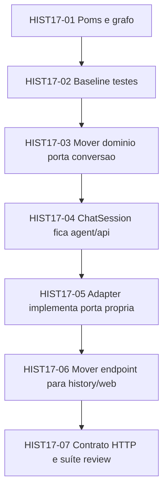

<!-- scope: adr/ADR-017 -->
# TASKS — ADR-017: Reorganizar histórico em `history/api` + `history/impl` + `history/web`

> Backlog TDD-ready derivado 1:1 da `SPEC.md` deste ADR. Teste **antes** da implementação em toda tarefa.
> Gate B (`publicapi → agent/impl` = zero) **não** faz parte — ADR separado. Não reescrever como satisfeito.

| ID | RF/NFR | Prioridade | Risco | Tipo | Depende de |
|---|---|---|---|---|---|
| HIST17-01 | RF-01, NFR-01 | P0 | Alto | infra (pom) | — |
| HIST17-02 | RF-02, RF-05 | P0 | Alto | teste | — |
| HIST17-03 | RF-02, NFR-01 | P0 | Alto | refactor | HIST17-01, HIST17-02 |
| HIST17-04 | RF-03 | P0 | Alto | verificação | HIST17-03 |
| HIST17-05 | RF-04 | P0 | Médio | refactor | HIST17-03 |
| HIST17-06 | RF-05 | P0 | Alto | refactor (web) | HIST17-03, HIST17-04 |
| HIST17-07 | RF-06, NFR-02..04, AC-04..10 | P0 | Alto | qualidade | HIST17-05, HIST17-06 |

---

### HIST17-01 — Criar poms e validar grafo DAG

- **RF/NFR**: RF-01, NFR-01 · **Prioridade**: P0 · **Risco**: Alto · **Tipo**: infra (pom)
- **Arquivos**: `history/pom.xml`, `history/api/pom.xml`, `history/web/pom.xml`,
  `history/web/internal/pom.xml`, `history/web/internal/v1/pom.xml`, `history/impl/pom.xml`,
  `agent/api/pom.xml`, `agent/impl/pom.xml`, `publicapi/impl/pom.xml`, `bootstrap/pom.xml`
- **Teste primeiro**: asserção estática — `grep '<module>api</module>' history/pom.xml` e
  `grep '<module>web</module>' history/pom.xml` falham antes da criação.
- **Cenários**:
  - Sucesso: 4 poms novos; `history/impl` troca `hive-agent-api` por `hive-history-api`
    (mantém o primeiro só por `ChatSessionNotFoundException`); `agent/api`, `agent/impl`,
    `publicapi/impl` ganham `hive-history-api`; `bootstrap` ganha `hive-history-web-internal-v1`.
  - Falha: qualquer módulo `history/**` declarando `hive-agent-impl` → revertir (AC-03).
  - Borda: `mvn -f backend/pom.xml -q -DskipTests dependency:tree` sem ciclo; ordem
    `commons-api, provider-api → history-api → agent-api → {agent-impl, history-impl, history-web} → bootstrap`.
- **DoD**: compile exit 0; DAG provado; zero `agent/impl` em `history/**`.

### HIST17-02 — Fixar baseline de caracterização

- **RF**: RF-02, RF-05 · **Prioridade**: P0 · **Risco**: Alto · **Tipo**: teste
- **Arquivos**: testes em `agent/api` (`ProviderMessagesTest`), `agent/impl`
  (`ChatServiceImplTest`, `TurnOutcomeMapperTest`), `history/impl`
  (`ChatMessageServiceImplTest`, `ChatMessageMapperDomainTest`), `agent/web` (se houver teste do controller).
- **Teste primeiro**: rodar `mvn clean && npm test` **antes de mover qualquer arquivo** e registrar
  376/376 front, 62 reports/503 testes back. Nenhum teste apagado nem `@Disabled`.
- **Cenários**:
  - Sucesso: baseline verde e registrado.
  - Falha: qualquer guarda removida → restaurar.
  - Borda: `findLast20` = 20 mensagens ASC; conversão "template primeiro" (K4) com baseline capturado.
- **DoD**: baseline documentado; guardas preservadas.

### HIST17-03 — Mover domínio, porta e conversão para `history/api`

- **RF/NFR**: RF-02, NFR-01 · **Prioridade**: P0 · **Risco**: Alto · **Tipo**: refactor
- **Arquivos**: mover `agent/api/.../domain/ChatMessage.java`, `service/ChatMessageService.java`,
  `util/ProviderMessages.java` → `history/api/...` com rename de pacote `agent.api` → `history.api`.
  **`agent/impl/util/ProviderMessages.java` NÃO se move** (leitor do adapter).
- **Teste primeiro**: `grep -rl 'interface ChatMessageService' backend/**/src/main/java` deve
  apontar para `agent/api` antes do move e para `history/api` depois (AC-02).
- **Cenários**:
  - Sucesso: 3 arquivos em `history/api`; lógica da conversão byte a byte (só package/import).
  - Falha: `history/api` importando `agent.*` → revertir (cycle, R2).
  - Borda: ordered "template primeiro" inalterada (K4); ordem dos componentes de `ChatMessage` intacta.
- **DoD**: AC-02 verde; zero `agent.*` em `history/api`; conversão pura mantida.

### HIST17-04 — Confirmar `ChatSession` e exceção em `agent/api`

- **RF**: RF-03 · **Prioridade**: P0 · **Risco**: Alto · **Tipo**: verificação
- **Arquivos**: `agent/api/.../domain/ChatSession.java`, `service/ChatSessionService.java`,
  `exceptions/ChatSessionNotFoundException.java` — zero diff esperado.
- **Teste primeiro**: `git diff --name-only` sobre esses paths → zero antes de começar.
- **Cenários**:
  - Sucesso: nenhum desses tipos migra; aresta residual `history/impl → agent/api` declarada.
  - Falha: `ChatSessionNotFoundException` duplicado em `history/api` → revertir (R4).
  - Borda: nenhum `agent.impl.*` em `history/**`.
- **DoD**: `git diff` zero nos paths; 1 única classe `ChatSessionNotFoundException`; AC-03 verde.

### HIST17-05 — Adapter implementa a porta do próprio módulo

- **RF**: RF-04 · **Prioridade**: P0 · **Risco**: Médio · **Tipo**: refactor
- **Arquivos**: `history/impl/.../ChatMessageServiceImpl.java`, `ChatMessageMapperDomain.java`,
  entidades/repositórios e 2 testes movidos no ADR-016.
- **Teste primeiro**: compilação com `implements agent.api.service.ChatMessageService` deve
  falhar após HIST17-03 (prova do acoplamento).
- **Cenários**:
  - Sucesso: `implements br.com.systec.hive.history.api.service.ChatMessageService`.
  - Falha: `@Transactional` de `save`, validação 1..4000 ou `findLast20` alterados → revertir.
  - Borda: `getMessages` ASC; `ChatSessionNotFoundException` ainda vem de `agent/api`.
- **DoD**: AC-09 verde; zero lógica mudada; teste único da porta.

### HIST17-06 — Mover endpoint para `history/web`, rota idêntica

- **RF**: RF-05 · **Prioridade**: P0 · **Risco**: Alto · **Tipo**: refactor (web)
- **Arquivos**: novo `history/web/internal/v1/.../controller/ChatMessageControllerV1.java`;
  mover `ChatMessageDTO` e `ChatMessageMapperDTO` de `agent/web`; editar
  `agent/web/.../ChatSessionControllerV1.java` (remover método `messages` + campos + imports).
- **Teste primeiro**: MockMvc `GET /v1/chat/sessions/{id}/messages` no baseline (antes do move)
  captura status 200, DTO e envelope; repetir depois (AC-04).
- **Cenários**:
  - Sucesso: rota `/v1/chat/sessions/{id}/messages` idêntica; DTO record idêntico;
    `@HasPermission("CHAT_SESSION_MANAGE")`; envelope `RestControllerTool`; helpers replicados.
  - Falha: mapping ambíguo (dois `@GetMapping("/{id}/messages")`) → falha de startup; remover duplicata.
  - Borda: `page=0`, `size=50`, teto 100, `size<=0 → 50`, `Sort ASC createAt`; CRUD de sessão segue em `agent/web`.
- **DoD**: AC-04 e AC-05 verdes; zero mudança de contrato HTTP.

### HIST17-07 — Suíte, estática, review e evidência

- **RF/NFR**: RF-06, NFR-02..04, AC-04..10 · **Prioridade**: P0 · **Risco**: Alto · **Tipo**: qualidade
- **Arquivos**: nenhum de código; evidência harness é do `qa-engineer`.
- **Teste primeiro**: `mvn clean && npm test` (baseline 376/376, 62 reports/503 testes).
- **Cenários**:
  - Sucesso: AC-01..09 verdes; AC-10 (Gate B) permanece 4 — débito registrado.
  - Falha: qualquer 🔴 do reviewer → loop de correção (implementador → reviewer, máx. 3 iterações).
  - Borda: se `mvn clean` não for rodado, reports velhos inflam 62→64/503→514 — medir sempre com clean.
- **DoD**: `code_review_status: passed`; `harness_status: passed`; zero diff MFA; Brain atualizado;
  **PARAR e pedir "Posso avançar?"** antes de qualquer próxima fase.
