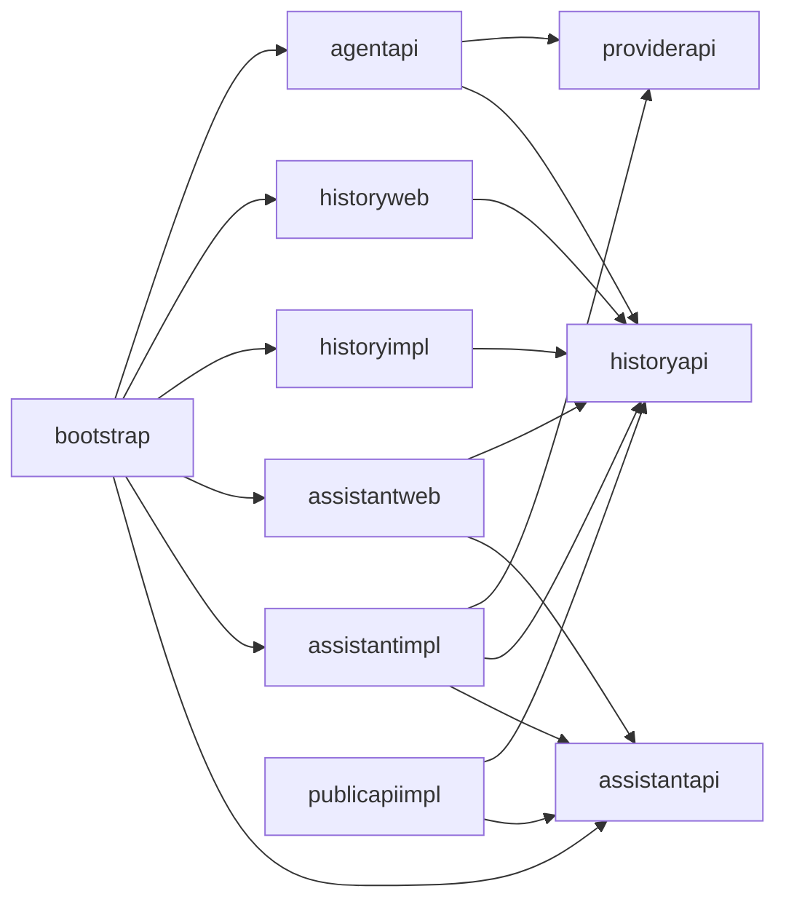

# ADR-019 — Reorganizar módulos: `assistant` (v1) e `agent` (v2) como irmãos, sem tipos novos de domínio

> **Ciclo de execução aberto em 2026-11-21** (aprovação humana): `unit: adr` + `status: in-progress`. SPEC/TASKS nascem neste diretório com marcador `<!-- scope: adr/ADR-019 -->` no TASKS (F4). Código/pom/config/teste só na delegação ao `backend-engineer`. `workflow-state.json`, branch/PR e ADR-012/013/017 seguem fora deste ciclo.
> Amparo: `.agents/rules/prd-adr-pipeline.md:43-45` (arquitetural sem valor de produto novo ⇒ ADR sem PRD).
> Teto de 5 ADRs do PRD `langchain4j-ai-services` está gasto; este ADR não entra naquele ADR-INDEX.

- **depende-de**: ADR-012 (revisado com restrição), ADR-013 (revisado parcialmente), ADR-017 (history separado), ADR-001..005 (estudo ai-services).
- **Status**: in-progress

## 1. Decisão

Organizar o backend em módulos com fronteiras explícitas, **sem criar nenhum tipo novo de domínio**:

| Módulo | Papel | Estado |
|---|---|---|
| `assistant/` | a conversa que já funciona (prompt, turno, histórico, resposta) | **v1 — rename mecânico do módulo `agent` atual** |
| `agent/` | lugar reservado para a estratégia de turno autônoma | **v2 — esqueleto vazio, sem tipos de domínio novos** |
| `history/` | sessão + mensagens persistidas | já existe (ADR-017) |
| `provider/` | infra de LLM | já existe |

**Regras de ouro:**
1. `assistant` e `agent` são **irmãos** — nenhum depende do outro. Ambos dependem de `history` e `provider`.
2. **Nenhum tipo novo chamado `Assistant` ou `Agent`.** ADR-012:103 é explícito: "sem tipo novo chamado 'assistant' ou 'agent'"; o eixo é **estratégia de turno**. Os nomes `assistant`/`agent` são **apenas nomes de módulo/artefato**, não classes de domínio.
3. `agent/` nasce com **poms e diretórios apenas** — sem `AgentService`, sem `AgentTurn`, sem `@Service`, sem `@Tool`, sem `ToolSpecification`. É o lugar reservado, não uma implementação.
4. Nenhuma regra de negócio do assistant migra para `agent`. O rename é mecânico.

## 2. Renomeação `agent` → `assistant` (mecânica)

- `backend/agent/` → `backend/assistant/` (agregador + `api`, `impl`, `dbupdate`, `web`, `web/internal`, `web/internal/v1`).
- Pacotes Java: `br.com.systec.hive.agent.*` → `br.com.systec.hive.assistant.*`.
- Artefatos Maven: `hive-agent-*` → `hive-assistant-*`.
- `<module>agent</module>` → `<module>assistant</module>` no agregador raiz (`backend/pom.xml:23`).
- Repontar imports nos consumidores — `publicapi/impl` (`PublicChatServiceImplTest.java:3-8,45-46`), `bootstrap`, `integration-test`.
- **Contrato HTTP inalterado**: rotas `/v1/chat/**`, DTOs, `@HasPermission`, envelopes não mudam.

**Consequência no Gate B**: a aresta `publicapi/impl → agent/impl` (4 refs de `ProviderResolution`/`TurnOutcomeMapper` — `PublicChatServiceImpl.java:9-10`) passa a ser `publicapi/impl → assistant/impl`. Continua **débito**, agora com nome novo; não é quitação.

## 3. Esqueleto `agent/` (v2 — vazio por decisão)

Criar **somente** os poms:

```
backend/agent/pom.xml
backend/agent/api/pom.xml
```

Sem `src/main/java`. Sem classe. Sem bean. A criação de tipos de domínio fica para o ADR da v2, cujo gatilho é a **primeira tool real** (ADR-012:93) — hoje não existe nenhuma referência a `@Tool`/`ToolSpecification` no backend (ADR-012:69).

`agent/api` declara dependência apenas de `provider/api` e `history/api` — nunca de `assistant/*`. Isso garanta que a v2 não reintroduza o acoplamento atual.

## 4. Supersessões e emendas

| ADR | Efeito |
|---|---|
| **ADR-012** | **Revisado com restrição.** A opção D deixa de ser "especulativa" apenas como *organização de módulos*; continua sem tipos novos e sem implementação. O item "O que este ADR não decide" (`:103`) permanece **integralmente válido**: nenhum tipo `Assistant`/`Agent` nasce aqui. Gatilhos #1 e #5 seguem para a v2. |
| **ADR-013** | **Revisado parcialmente.** Decisão de produto permanece: Assistant é o que funciona; sem entidade `Agent`, sem tabela, sem tools em produção. O que muda é só o **nome do módulo** (`agent` → `assistant`, mais honesto) e a **reserva de namespace vazia** `agent/` para a v2. Nenhuma entidade nova. |
| **ADR-017** | Inalterado — `history/` continua com api/impl/web. |
| **ADR-001..005** | Inalterados no mérito; referências a `agent/api` leem `assistant/api` onde aplicável (a conversão já está em `history/api` por ADR-017). |

## 5. Grafo de dependências (resultado)



`assistant` e `agent` não têm aresta entre si. `agent/api` é folha (só history + provider). Sem ciclo.

## 6. Interface congelada

1. Rotas `/v1/chat/**` idênticas (path, DTO, `@HasPermission`, envelope).
2. Contrato `ChatTurnGateway` idêntico (1 método, `TurnReply` como valor de falha).
3. Conversão `ProviderMessages` em `history/api` (ADR-017) — ordem template-primeiro (K4) byte a byte.
4. TX1/TX2 (ADR-007) inalteradas.
5. `ChatSession` acompanha o rename: de `agent/api` para `assistant/api` (antigo aggregate root, ADR-017 §1.2).
6. **`agent/` sem código**: zero classes, zero beans, zero `@Tool`/`ToolSpecification`, zero `AgentService`/`AgentTurn`.
7. Zero `ChatMemory`/`@MemoryId` (ADR-003). Zero MFA. Zero migration SQL.
8. Nenhum import de `assistant.*` em `agent/**` e vice-versa.

## 7. Alternativas consideradas

| # | Alternativa | Veredito | Motivo |
|---|---|---|---|
| a | Manter módulo `agent` único (status quo) | Rejeitada | assistant, futuro agent e persistência misturados — a confusão atual |
| b | Rename `agent → assistant` + esqueleto `agent/` vazio | **Escolhida** | Separa sem inventar comportamento; respeita ADR-012:103 (sem tipos novos) |
| c | Criar `AgentService`/`AgentTurn` já | Rejeitada | Viola ADR-012:103; gatilho da primeira tool não ocorreu |
| d | Mover `ChatSession` para `history/api` junto | Rejeitada | Inverte o grafo e mexe no aggregate root (ADR-013); débito separado |

## 8. Riscos

| Risco | Evidência | Tratamento |
|---|---|---|
| Rename mecânico quebrar imports | `PublicChatServiceImplTest.java:3-8,45-46` e dezenas de arquivos | `grep -rl 'br.com.systec.hive.agent' backend/**` = zero (exceto o novo namespace vazio); compile + suíte |
| Contrato HTTP mudar sem querer | controllers em `agent/web/internal/v1` | IT de caracterização das rotas `/v1/chat/**` antes e depois |
| Esqueleto `agent/` virar implementação por acidente | nenhuma tool real hoje (ADR-012:69) | proibição explícita no item 6; review |
| `agent/api` depender de `assistant/api` | tendência de reuso de `TurnRequest` | proibição no item 8; se a v2 precisar, novo ADR |
| Gate B esquecido com o rename | `publicapi → agent/impl` (4 refs) | passa a `publicapi → assistant/impl`, continua débito, ADR separado |
| ADR-012:103 violado por tipo novo | "sem tipo novo chamado assistant ou agent" | nomes são só de módulo; zero classes novas (item 6) |

## 9. Como verificar

1. `grep -r 'br.com.systec.hive.agent' backend/** --include='*.java'` → zero.
2. `grep -r 'hive-agent-' backend/**/pom.xml` → zero (artefatos viraram `hive-assistant-*`).
3. `find backend/agent -name '*.java'` → zero (esqueleto vazio).
4. `grep -r 'assistant' backend/agent/**` → zero e vice-versa (irmãos sem aresta).
5. `mvn -f backend/pom.xml -q clean && npm test` → EXIT=0; baseline 376/376 front + 62 reports/503 back; 0 falhas/erros/skips.
6. Rotas `/v1/chat/**` com mesmo status/DTO/permissão (IT de caracterização).
7. `grep -rE 'ChatMemory|@MemoryId|@Tool|ToolSpecification' backend/**` → zero.
8. Zero diff em `*.sql`, `backend/security/**/Mfa*`, `backend/identity/**/Mfa*`.
9. `code-reviewer` sem 🔴.

## 10. Fora desta decisão

Implementação do Agent v2 (tools, planner, loop, tipos de domínio), migração de `ChatSession` para `history/api`, Gate B, ChatMemory/RAG, contrato HTTP novo, migrations de dados, branch/PR, `workflow-state.json`.
