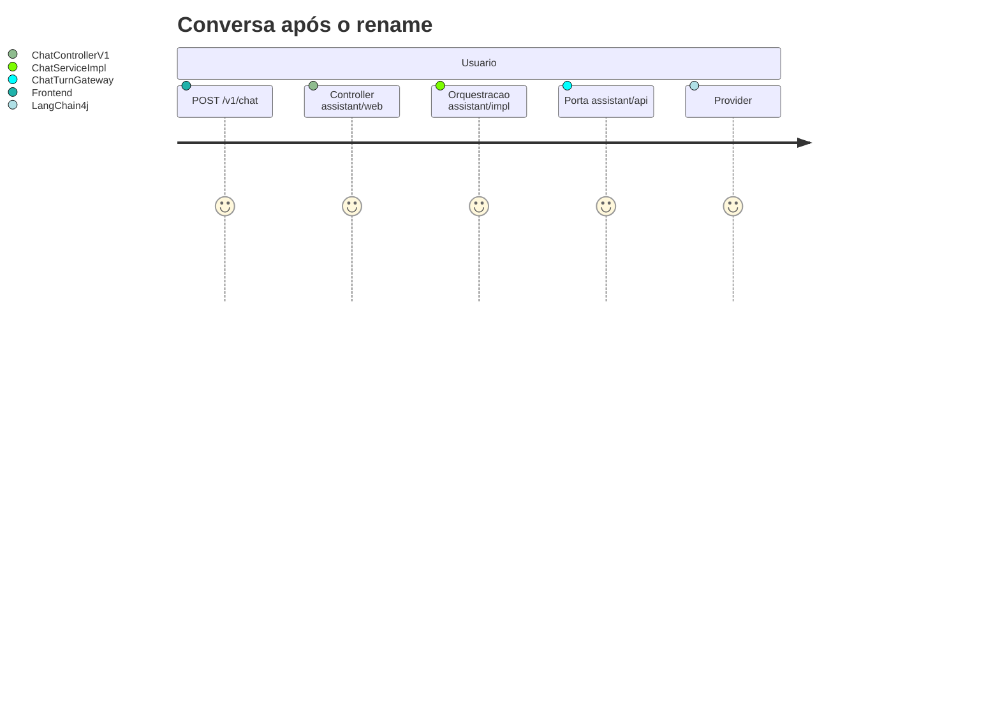

# SPEC — ADR-019: Separar `assistant` (v1) e `agent` (v2) por módulos

> Escopo: **apenas a decisão do ADR-019**. Não especifica o Agent v2 (sem tools, sem planner),
> não resolve Gate B (ADR separado). Rastreabilidade: cada `RF`/`NFR` aponta para a cláusula do `ADR.md`.

## 1. Architecture Decision Records (ADRs)

### ADR-019 (este ciclo)
- **Decision**: rename do módulo `agent` → `assistant` (v1) e criação de esqueleto vazio `agent/` (v2), sem tipos novos de domínio.
- **Context**: módulo `agent` mistura conversa (assistant), futuro agent e persistência; confusão explícita do usuário. ADR-012:103 proíbe tipos `Assistant`/`Agent` — nomes são só de módulo.
- **Trade-offs**: rename honesto x custo mecânico de imports/poms; esqueleto reservado x risco de virar implementação por acidente.

ADRs afetados: ADR-012 revisado com restrição (item `:103` permanece); ADR-013 revisado parcialmente (produto inalterado); ADR-017 inalterado; ADR-001..005 inalterados no mérito.

## 2. Domain Context, Tenant Strategy & Provisioning

- **Bounded Context**: inalterado. O rename não cria domínio novo — apenas realoca os pacotes existentes.
- **System Type**: backend Java 25 preview / Spring Boot 4.1.0 / LangChain4j 1.19.0.
- **Tenant Provisioning / Lifecycle**: N/A — nenhum tenant ou fluxo de tenant é alterado.

## 3. Identity & Access Management (IAM)

- **Identity Provider / Protocol / MFA**: N/A — nenhum fluxo de autenticação é tocado.
- **Session & Token Management**: N/A — nem sessão de autenticação nem token são alterados.
- **RBAC Matrix**: `@HasPermission("CHAT_SESSION_MANAGE")` e demais permissões permanecem idênticas nas rotas `/v1/chat/**`.

## 4. Security, Key Management & Disaster Recovery

- **Key Management / Lifecycle / Backup / RTO/RPO**: N/A — nenhuma chave, dado ou backup é alterado.

## 5. Data Model & Concurrency

### Entity-Relationship Diagram (ERD)

N/A — nenhuma entidade é criada, removida ou alterada. `chat_session`/`chat_message` permanecem com o mesmo schema (ADR-017, ADR-007).

### Concurrency & Consistency

| Entity | Operation | Strategy | Rationale |
|---|---|---|---|
| `ChatSession` | permanece aggregate root | `assistant/api` (rename de `agent/api`) | ADR-013, ADR-017 §1.2 |
| `ChatMessage` | TX1/TX2 inalteradas | adapter em `history/impl` | ADR-007 |

## 6. Event Model, Integrations & Messaging Isolation

- **Messaging Isolation / Delivery Guarantee / Event Registry**: N/A — nenhum evento é introduzido.

## 7. Invariants & Property-Based Testing

### 7.1 Entity Invariants

| Entity | Property | Description |
|---|---|---|
| Domínio | zero tipos novos | nenhuma classe `Assistant`/`Agent` (ADR-012:103) |
| `ChatSession` | aggregate root inalterado | acompanha rename para `assistant/api` |

### 7.2 Workflow & State Invariants

- **Irmãos sem aresta**: `assistant` e `agent` não dependem um do outro.
- **Esqueleto vazio**: `agent/` sem `src/main/java`, sem beans, sem `@Tool`.
- **Gate B permanece débito**: `publicapi → assistant/impl` (4 refs), não quitação.

### 7.3 Generator Constraints (Testing Data)

N/A — nenhum dado novo; suíte existente é a fonte de verdade (baseline 376/376 + 62/503).

## 8. Functional Requirements & Core Journeys

### RF-01 — Rename do módulo `agent` → `assistant` (ADR §2)
Renomear diretório `backend/agent/` → `backend/assistant/` com todos os submódulos (`api`, `impl`, `dbupdate`, `web`, `web/internal`, `web/internal/v1`). Atualizar `<module>agent</module>` → `<module>assistant</module>` em `backend/pom.xml:23`.

### RF-02 — Rename de pacotes e artefatos (ADR §2)
`br.com.systec.hive.agent.*` → `br.com.systec.hive.assistant.*` em todo `backend/**`. Artefatos Maven `hive-agent-*` → `hive-assistant-*` em todos os poms que os declaram (raiz, bootstrap, agent/impl, publicapi/impl, integration-test).

### RF-03 — Repontar imports de consumidores (ADR §2, §8 R1)
Atualizar imports em `publicapi/impl` (`PublicChatServiceImplTest.java:3-8,45-46`), `bootstrap`, `integration-test` e qualquer outro arquivo que referencie o namespace antigo. Meta: `grep -rl 'br.com.systec.hive.agent' backend/**` = zero.

### RF-04 — Esqueleto `agent/` vazio (ADR §3)
Criar somente `backend/agent/pom.xml` (agregador) e `backend/agent/api/pom.xml`. Registrar `<module>agent</module>` no agregador raiz. **`agent/api` sem `src/main/java`** — zero classes, zero beans, zero `@Tool`/`ToolSpecification`. Declarar dependência apenas de `provider/api` e `history/api`.

### RF-05 — Contrato HTTP inalterado (ADR §6.1)
Rotas `/v1/chat/**`, DTOs, `@HasPermission` e envelopes idênticos. O rename é interno — nenhuma anotação de controller muda de valor.

### NFR-01 — Sem aresta entre irmãos (ADR §1, §6.8)
`grep -r 'assistant' backend/agent/**` = zero; `grep -r 'br.com.systec.hive.agent' backend/assistant/**` = zero. Grafo DAG: `agent/api` é folha (só history + provider).

### NFR-02 — Sem tipos novos (ADR §6.6)
`grep -rE 'class Assistant|class Agent|@Tool|ToolSpecification|AgentService|AgentTurn' backend/**` = zero.

### NFR-03 — Sem ChatMemory e sem MFA (ADR §6.7)
`grep -rE 'ChatMemory|@MemoryId|chatMemory\(' backend/**` = zero; zero diff em `backend/security/**/Mfa*` e `backend/identity/**/Mfa*`.

### NFR-04 — Suíte e review (ADR §9)
`mvn -f backend/pom.xml -q clean` antes de medir; `npm test` EXIT=0; baseline 376/376 front + 62 reports/503 back; 0/0/0; `code-reviewer` sem 🔴.

## 9. Critérios de Aceite Executáveis

| ID | Asserção | Comando / verificação |
|---|---|---|
| AC-01 | Namespace antigo eliminado | `grep -rl 'br.com.systec.hive.agent' backend/** --include='*.java'` → zero |
| AC-02 | Artefatos renomeados | `grep -r 'hive-agent-' backend/**/pom.xml` → zero |
| AC-03 | Módulo no agregador | `grep '<module>assistant</module>' backend/pom.xml` e `<module>agent</module>` → ambos presentes |
| AC-04 | Esqueleto vazio | `find backend/agent -name '*.java'` → zero |
| AC-05 | Irmãos sem aresta | `grep -r 'assistant' backend/agent/**` → zero e vice-versa |
| AC-06 | Rotas idênticas | IT de caracterização `/v1/chat/**` — mesmo status/DTO/permissão |
| AC-07 | Sem memória/tipos/MFA | greps de NFR-02 e NFR-03 → zero; zero diff `*.sql` e MFA |
| AC-08 | Suíte verde | `mvn clean && npm test` → EXIT=0; 376/376; 62/503; 0/0/0 |
| AC-09 | Gate B reetiquetado, não quitado | `grep -r 'br.com.systec.hive.assistant.impl' backend/publicapi --include='*.java'` = 4 — registrado como débito |

## 10. Test Strategy

- **Caracterização**: rotas `/v1/chat/**` antes e depois do rename (status, DTO, permissão).
- **Estática**: AC-01..05, AC-07, AC-09.
- **Suíte**: `commands.suiteFull` — baseline 376/376 + 62/503.
- **Review**: `code-reviewer` sem 🔴; parecer é parecer, bloqueio é gate de evidência.

## 11. Fora do escopo

Agent v2 (tools/planner/loop/tipos), mover `ChatSession` para `history/api`, Gate B (resolução), ChatMemory/RAG, contrato HTTP novo, migrations, branch/PR, `workflow-state.json`.
