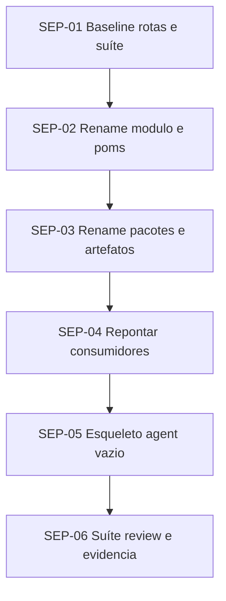

<!-- scope: adr/ADR-019 -->
# TASKS — ADR-019: Separar `assistant` (v1) e `agent` (v2)

> Backlog TDD-ready derivado 1:1 da `SPEC.md` deste ADR. Teste **antes** da implementação em toda tarefa.
> Gate B (4 refs `publicapi → agent/impl`) **não** faz parte — só reetiquetado para `assistant/impl`, ADR separado.

| ID | RF/NFR | Prioridade | Risco | Tipo | Depende de |
|---|---|---|---|---|---|
| SEP-01 | RF-05, AC-06 | P0 | Alto | teste | — |
| SEP-02 | RF-01 | P0 | Alto | refactor (poms) | SEP-01 |
| SEP-03 | RF-02, AC-01, AC-02 | P0 | Alto | refactor (packages) | SEP-02 |
| SEP-04 | RF-03, AC-01 | P0 | Alto | integração | SEP-03 |
| SEP-05 | RF-04, NFR-01, NFR-02 | P0 | Médio | infra | SEP-02 |
| SEP-06 | NFR-03, NFR-04, AC-04..09 | P0 | Alto | qualidade | SEP-04, SEP-05 |

---

### SEP-01 — Fixar baseline de caracterização das rotas e da suíte

- **RF/NFR**: RF-05, AC-06 · **Prioridade**: P0 · **Risco**: Alto · **Tipo**: teste
- **Arquivos**: testes de controller em `agent/web/internal/v1/src/test` (se houver) + suíte.
- **Teste primeiro**: `mvn -f backend/pom.xml -q clean && npm test` ANTES de qualquer rename — registrar 376/376 front, 62 reports/503 back, e o comportamento das rotas `/v1/chat/**` (status/DTO/permissão).
- **Cenários**:
  - Sucesso: baseline verde e registrado.
  - Falha: qualquer guarda removida → restaurar.
  - Borda: rotas `/v1/chat/**` respondem com mesmo envelope.
- **DoD**: baseline documentado; nenhum teste apagado ou `@Disabled`.

### SEP-02 — Renomear módulo e agregador

- **RF**: RF-01 · **Prioridade**: P0 · **Risco**: Alto · **Tipo**: refactor (poms)
- **Arquivos**: `backend/agent/` → `backend/assistant/` (todos os submódulos); `backend/pom.xml:23`.
- **Teste primeiro**: `grep '<module>assistant</module>' backend/pom.xml` falha antes do rename.
- **Cenários**:
  - Sucesso: diretório renomeado; `<module>assistant</module>` no agregador raiz.
  - Falha: submódulo órfão (`api`, `impl`, `dbupdate`, `web`, `web/internal`, `web/internal/v1`) → corrigir agregadores internos.
  - Borda: contrato HTTP inalterado — nenhuma anotação de controller muda.
- **DoD**: `mvn -f backend/pom.xml -q -DskipTests validate` exit 0.

### SEP-03 — Renomear pacotes e artefatos Maven

- **RF/NFR**: RF-02, AC-01, AC-02 · **Prioridade**: P0 · **Risco**: Alto · **Tipo**: refactor (packages)
- **Arquivos**: todo `backend/**` — `br.com.systec.hive.agent.*` → `br.com.systec.hive.assistant.*`; `hive-agent-*` → `hive-assistant-*` em todos os poms.
- **Teste primeiro**: `grep -rl 'br.com.systec.hive.agent' backend/** --include='*.java'` mostra ocorrências antes; meta zero depois (AC-01).
- **Cenários**:
  - Sucesso: zero ocorrências do namespace antigo; `grep -r 'hive-agent-' backend/**/pom.xml` = zero.
  - Falha: qualquer pacote misto (metade `agent`, metade `assistant`) → corrigir.
  - Borda: nomes de classes `ChatAssistantTxService` permanecem — são helpers transacionais, não tipos `Assistant` novos (ADR-012:69).
- **DoD**: AC-01 e AC-02 verdes; compile exit 0.

### SEP-04 — Repontar imports de consumidores

- **RF/NFR**: RF-03, AC-01 · **Prioridade**: P0 · **Risco**: Alto · **Tipo**: integração
- **Arquivos**: `publicapi/impl` (`PublicChatServiceImplTest.java:3-8,45-46` e main), `bootstrap`, `integration-test`, qualquer outro consumidor.
- **Teste primeiro**: compile com imports antigos falha após SEP-03 (prova do acoplamento).
- **Cenários**:
  - Sucesso: `grep -rl 'br.com.systec.hive.agent' backend/**` = zero; suíte parcelar verde.
  - Falha: Gate B tratado como resolvido → NÃO corrigir; só reetiquetar (`assistant/impl`), registrar débito.
  - Borda: `bootstrap` continua wiring via artefatos `hive-assistant-*`.
- **DoD**: AC-01 verde; AC-09 = 4 refs em `publicapi` (débito, não falha).

### SEP-05 — Criar esqueleto `agent/` vazio

- **RF/NFR**: RF-04, NFR-01, NFR-02 · **Prioridade**: P0 · **Risco**: Médio · **Tipo**: infra
- **Arquivos**: `backend/agent/pom.xml` (agregador), `backend/agent/api/pom.xml`, `backend/pom.xml:23`.
- **Teste primeiro**: `find backend/agent -name '*.java'` deve retornar vazio (AC-04).
- **Cenários**:
  - Sucesso: 2 poms; `<module>agent</module>` no agregador; `agent/api` declara só `provider/api` + `history/api`.
  - Falha: qualquer `.java` criado em `backend/agent` → remover (ADR-012:103).
  - Borda: `grep -r 'assistant' backend/agent/**` = zero e vice-versa (AC-05).
- **DoD**: AC-03, AC-04, AC-05 verdes; `mvn validate` exit 0.

### SEP-06 — Suíte, estática, review e evidência

- **RF/NFR**: NFR-03, NFR-04, AC-04..09 · **Prioridade**: P0 · **Risco**: Alto · **Tipo**: qualidade
- **Arquivos**: nenhum de código; evidência harness é do `qa-engineer`.
- **Teste primeiro**: `mvn -f backend/pom.xml -q clean && npm test` (baseline 376/376 + 62/503).
- **Cenários**:
  - Sucesso: AC-01..08 verdes; AC-09 = débito reetiquetado; `code-reviewer` sem 🔴.
  - Falha: qualquer 🔴 → loop de correção (implementador → reviewer, máx. 3 iterações).
  - Borda: sem `clean`, reports velhos inflam contagem — medir sempre com clean.
- **DoD**: `code_review_status: passed`; `harness_status: passed`; zero diff MFA/SQL; Brain atualizado; **PARAR e pedir "Posso avançar?"** antes de qualquer próxima fase.
