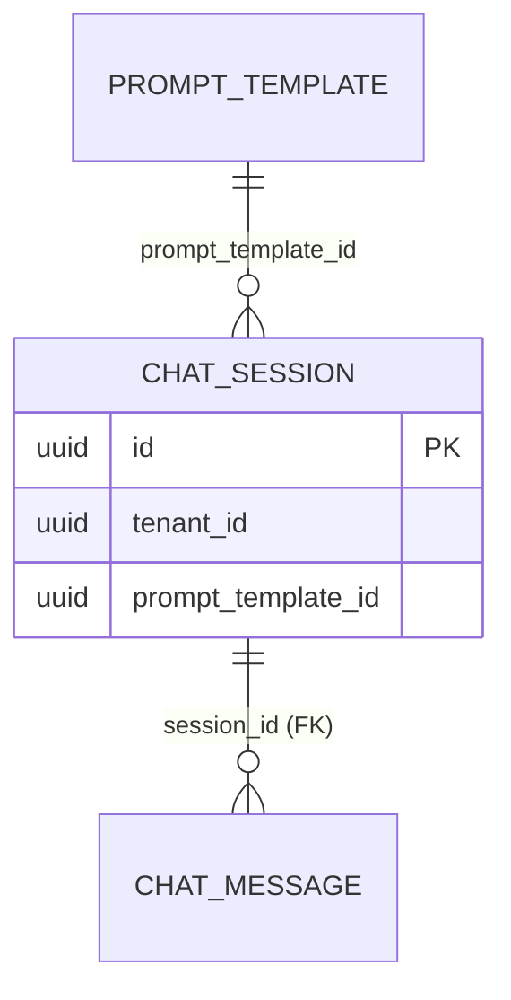
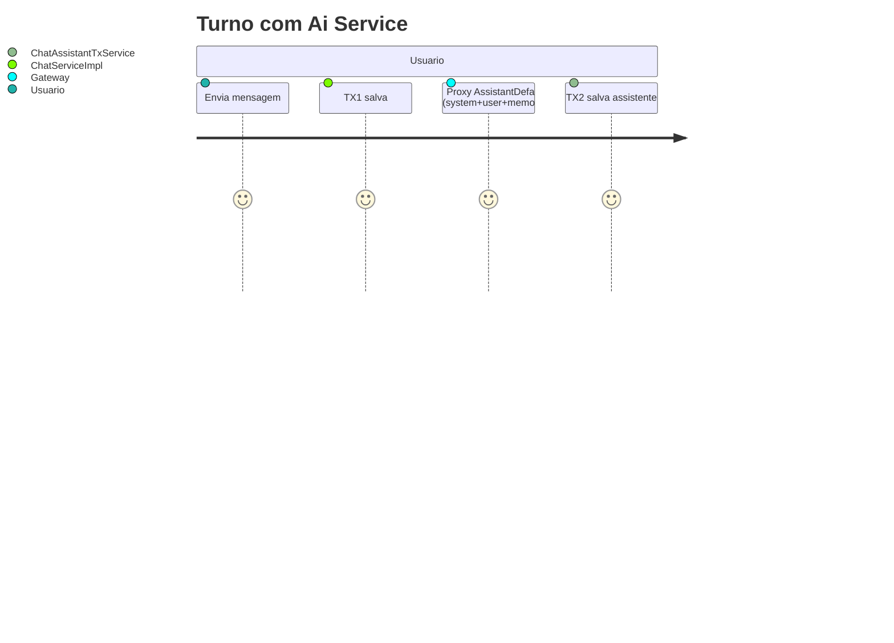

# SPEC — ADR-001 + ADR-020: Migração para Ai Service com `AssistantDefault`, memória por sessão e conversão unificada

> Escopo: **a decisão conjunta dos ADRs 001 e 020**. Não especifica Agent v2, RAG, starter, contrato HTTP novo, cota ou classificação de erro. Rastreabilidade: cada `RF`/`NFR` aponta para a cláusula do `ADR.md`.

## 1. Architecture Decision Records (ADRs)

### ADR-020 (+ ADR-001, ciclo único)
- **Decision**: proxy Ai Service (`AssistantDefault`) substitui a montagem manual de mensagens; gateway via classe abstrata com proxy injetado; `chatMemoryProvider` com `@MemoryId = sessionId (UUID)`; seed removido; conversão unificada nos 2 chamadores (K11).
- **Context**: gateway hoje chama `client.chat(prompt)` (`LangChain4jTurnGateway.java:83`) com system montado em `:120-129`; prompt padrão em SQL (V6:65-67); conversão pública divergente (`PublicChatServiceImpl.java:151-162`).
- **Trade-offs**: Ai Service elimina boilerplate x risco de perder K4/K5/A8; memória por sessão x stateless do ADR-003 (revisado); seed removido x tenants existentes.

ADRs revisados: ADR-001 (conversão deixa de ser necessária no caminho interno), ADR-002 (stateless → proxy com memória), ADR-003 (zero memória → memória por sessão). ADR-017/019 inalterados.

## 2. Domain Context, Tenant Strategy & Provisioning

- **Bounded Context**: geração de turno do assistant. `history/` permanece dono do histórico integral (JPA); `ChatMemory` é deriva volátil por sessão.
- **System Type**: backend Java 25 preview / Spring Boot 4.1.0 / LangChain4j 1.19.0.
- **Tenant Provisioning / Lifecycle**: N/A — nenhum tenant é criado ou alterado; isolamento via `TenantContext` herdado.

## 3. Identity & Access Management (IAM)

- **Identity Provider / Protocol / MFA / Token**: N/A — nenhum fluxo de autenticação é tocado.
- **RBAC Matrix**: permissões das rotas `/v1/chat/**` inalteradas.

## 4. Security, Key Management & Disaster Recovery

- **Key Management / Backup / RTO/RPO**: N/A — nenhuma chave, dado ou backup é alterado.

## 5. Data Model & Concurrency

### Entity-Relationship Diagram (ERD)

Schema inalterado — exceto a migration V8+ que **remove dados** (`DELETE FROM prompt_template WHERE code='default_general'`), sem criar/alterar tabela.

### Concurrency & Consistency

| Recurso | Operação | Estratégia | Rationale |
|---|---|---|---|
| `ChatMemory` por `sessionId` | leitura/escrita no proxy | serialização por `sessionId` (lock map) | A8: chamada concorrente corrompe memória (javadoc 1.19.0) |
| `chat_message` (JPA) | TX1/TX2 | inalterada (ADR-007) | histórico integral preservado |
| `TenantContext` | callback do provider | nenhum callback assíncrono | `ScopedValue` não propaga (K9) |

## 6. Event Model, Integrations & Messaging Isolation

- **Messaging / Event Registry**: N/A — nenhum evento introduzido.

## 7. Invariants & Property-Based Testing

### 7.1 Entity Invariants

| Entity | Property | Description |
|---|---|---|
| Sessão | `PromptTemplate` > `AssistantDefault.PROMPT` | sessão é autoridade do prompt (ADR-013:2) |
| System message | sempre antes do user/histórico | K4; `alwaysKeepSystemMessageFirst(true)` |
| `ChatMemory` | volátil, por `sessionId` | nunca substitui `history/` JPA |

### 7.2 Workflow & State Invariants

- **Turno**: TX1 salva usuário → proxy gera (com memória) → TX2 salva assistente + touch (ADR-007 inalterado).
- **Métricas**: `TurnReply` continua com `Status`, exceção desembrulhada e números medidos.
- **Concorrência**: no máximo 1 chamada ao proxy por `sessionId` por vez.

### 7.3 Generator Constraints

| Campo | Tipo | Restrição |
|---|---|---|
| `sessionId` (`@MemoryId`) | UUID | não nulo, estável entre turnos; nunca `turnId` |
| `system` | String | template da sessão ou fallback `AssistantDefault.PROMPT` |
| `user` | String | texto do turno; histórico vem da memória |

## 8. Functional Requirements & Core Journeys

### RF-01 — `AssistantDefault` (ADR §5.1)
Criar interface Ai Service com `chat(@MemoryId UUID sessionId, @SystemMessage("{{system}}") @V("system") String system, @UserMessage("{{user}}") @V("user") String user)`. Constante `PROMPT` com o texto exato do seed (`V6:65-67`). Precedência: `PromptTemplate` da sessão > `PROMPT`.

### RF-02 — Abstract do gateway (ADR §5.2)
Criar `AbstractLangChain4jTurnGateway implements ChatTurnGateway` com proxy injetado + método abstrato; concreta mantém retry (`LlmRetryPolicy`), criação de cliente (`LlmClientFactory`), `TurnReply` e métricas. Gateway em `assistant/impl`.

### RF-03 — `chatMemoryProvider` (ADR §5.3)
Configurar `AiServices.builder(...).chatMemoryProvider(id -> MessageWindowChatMemory...)` com `alwaysKeepSystemMessageFirst(true)`. Store em memória (sem persistência nova). Serialização por `sessionId`.

### RF-04 — Remover seed (ADR §5.4)
Migration V8+ em `assistant/dbupdate`: `DELETE FROM prompt_template WHERE code='default_general'`. `PromptSeedIT` reescrito/removido. V6 permanece no histórico Flyway (imutável).

### RF-05 — Unificar conversão K11 (ADR-001)
`PublicChatServiceImpl.java:151-162` deixa de converter manualmente e passa a chamar o mesmo proxy/caminho do humano. `grep client.chat(prompt)` = zero nos 2 chamadores.

### RF-06 — Preservar métricas (K5)
`TurnReply` mantém `promptTokens/completionTokens/totalTokens/finishReason/promptChars` medidos via `Result<T>`/`ChatResponse` final do proxy. IT de paridade contra baseline.

### NFR-01 — Ordem K4
`@SystemMessage` precede `@UserMessage` e histórico; `alwaysKeepSystemMessageFirst(true)`; IT de caracterização da sequência exata.

### NFR-02 — Concorrência A8
Lock por `sessionId` antes da chamada ao proxy; IT de corrida (2 threads) sem corrupção.

### NFR-03 — Sem starter e sem memória compartilhada
`grep langchain4j-spring-boot-starter` = zero; `grep .chatMemory(` = zero (só `chatMemoryProvider`); `@MemoryId` só em `AssistantDefault`.

### NFR-04 — Suíte e review
`mvn -f backend/pom.xml -q clean` antes de medir; `npm test` EXIT=0; baseline 376/376 front + 62 reports/503 back; 0/0/0; `code-reviewer` sem 🔴.

## 9. Critérios de Aceite Executáveis

| ID | Asserção | Comando / verificação |
|---|---|---|
| AC-01 | Proxy em uso | `grep -r 'client.chat(prompt)' backend/assistant/**` → zero; `grep -rl 'interface AssistantDefault' backend/**` → 1 |
| AC-02 | Ordem K4 | IT: com template + histórico SYSTEM/ASSISTANT/USER, sequência exata system→...; `alwaysKeepSystemMessageFirst(true)` presente |
| AC-03 | Métricas K5 | IT: `promptTokens/totalTokens/finishReason/promptChars` idênticos ao baseline |
| AC-04 | Memória por sessão | `grep -r 'chatMemoryProvider' backend/assistant/**` ≥ 1; `@MemoryId UUID`; zero `.chatMemory(` compartilhada; zero starter |
| AC-05 | Concorrência | IT de corrida 2 threads mesmo `sessionId` → sem corrupção |
| AC-06 | Seed removido | migration V8+ presente com `DELETE FROM prompt_template WHERE code='default_general'`; `grep` do literal em **V6** permanece (migration imutável); nenhuma migration **nova** reintroduz o seed; `PromptSeedIT` reescrito para fallback em código |
| AC-07 | K11 unificado | `PublicChatServiceImpl` chama o mesmo proxy; conversão manual removida |
| AC-08 | Precedência prompt | IT: com PromptTemplate → system = template; sem → system = `AssistantDefault.PROMPT` |
| AC-09 | Suíte verde | `mvn clean && npm test` → EXIT=0; 376/376; 62/503; 0/0/0 |
| AC-10 | Restrições | zero diff MFA, contrato HTTP, `*.sql` de criação de tabela; `code-reviewer` sem 🔴 |

## 10. Test Strategy

- **Caracterização (antes/depois)**: ordem do system (K4) e métricas (K5) — capturar baseline ANTES de trocar o gateway.
- **Corrida**: 2 threads, mesmo `sessionId` (A8).
- **IT de seed**: prompt removido; fallback em código.
- **Estática**: AC-01, AC-04, AC-06, AC-10.
- **Review**: `code-reviewer` sem 🔴.

## 11. Fora do escopo

Agent v2 (tools/planner), RAG, starter Spring Boot, contrato HTTP novo, cota, classificação de erro, telemetria nova, branch/PR, `workflow-state.json`, Gate B.
