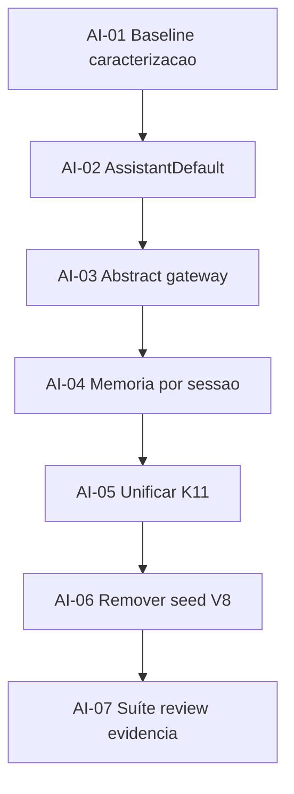

<!-- scope: adr/ADR-020 -->
# TASKS — ADR-001 + ADR-020: Migração Ai Service

> Backlog TDD-ready derivado 1:1 da `SPEC.md`. Teste **antes** da implementação em toda tarefa.
> Baseline de caracterização (AI-01) é pré-requisito de todas. Gate B fica fora (ADR separado).

| ID | RF/NFR | Prioridade | Risco | Tipo | Depende de |
|---|---|---|---|---|---|
| AI-01 | NFR-01, NFR-02, AC-02, AC-03 | P0 | Alto | teste | — |
| AI-02 | RF-01, AC-01, AC-08 | P0 | Alto | contrato | AI-01 |
| AI-03 | RF-02, AC-01 | P0 | Alto | refactor | AI-02 |
| AI-04 | RF-03, NFR-02, NFR-03, AC-04, AC-05 | P0 | Alto | integração | AI-03 |
| AI-05 | RF-05, AC-07 | P0 | Alto | refactor | AI-03 |
| AI-06 | RF-04, AC-06 | P0 | Médio | migration | AI-02 |
| AI-07 | NFR-04, AC-09, AC-10 | P0 | Alto | qualidade | AI-04, AI-05, AI-06 |

---

### AI-01 — Fixar baseline de caracterização (ordem + métricas)

- **RF/NFR**: NFR-01, NFR-02, AC-02, AC-03 · **Prioridade**: P0 · **Risco**: Alto · **Tipo**: teste
- **Arquivos**: `assistant/impl/src/test/.../LangChain4jTurnGatewayTest.java` e novos testes de caracterização.
- **Teste primeiro**: capturar ANTES da migração, com provider mockado: (a) sequência exata `List<ChatMessage>` com template + histórico SYSTEM/ASSISTANT/USER + vazio; (b) `promptTokens/completionTokens/totalTokens/finishReason/promptChars`. Rodar `mvn -q clean && npm test` → baseline 376/376 + 62/503.
- **Cenários**:
  - Sucesso: baseline verde e registrado.
  - Falha: guarda removida → restaurar.
  - Borda: reasoning model com content vazio → `EMPTY_RESPONSE` com métricas.
- **DoD**: baseline documentado; zero teste apagado ou `@Disabled`.

### AI-02 — Criar `AssistantDefault`

- **RF/NFR**: RF-01, AC-01, AC-08 · **Prioridade**: P0 · **Risco**: Alto · **Tipo**: contrato
- **Arquivos**: `assistant/impl/src/main/java/.../AssistantDefault.java` (ou pacote ai).
- **Teste primeiro**: `grep -rl 'interface AssistantDefault' backend/**` falha antes da criação.
- **Cenários**:
  - Sucesso: interface com `chat(@MemoryId UUID, @SystemMessage("{{system}}") @V("system"), @UserMessage("{{user}}") @V("user"))`; constante `PROMPT` com texto exato de `V6:65-67`.
  - Falha: `@MemoryId` com `turnId` → revertir (deve ser `sessionId`).
  - Borda: precedência — com `PromptTemplate`, system = template; sem, system = `PROMPT` (IT AC-08).
- **DoD**: AC-01 (1 arquivo), AC-08 verde; fonte da constante citada em comentário (`V6:65-67`).

### AI-03 — Abstract do gateway

- **RF/NFR**: RF-02, AC-01 · **Prioridade**: P0 · **Risco**: Alto · **Tipo**: refactor
- **Arquivos**: `assistant/impl/.../AbstractLangChain4jTurnGateway.java` (novo) + `LangChain4jTurnGateway.java` (concreta).
- **Teste primeiro**: IT de caracterização AI-01 reproduzida contra a abstract (deve falhar até o proxy ser injetado).
- **Cenários**:
  - Sucesso: abstract com proxy injetado + método abstrato; concreta mantém `@Component`, retry, cliente por turno, `TurnReply`.
  - Falha: retry migrado para dentro do builder do AiService → revertir (NFR ADR-002).
  - Borda: `grep -r 'client.chat(prompt)' backend/assistant/**` = zero.
- **DoD**: AC-01 verde; contrato `ChatTurnGateway` inalterado (1 método, 2 chamadores).

### AI-04 — Memória por sessão no builder

- **RF/NFR**: RF-03, NFR-02, NFR-03, AC-04, AC-05 · **Prioridade**: P0 · **Risco**: Alto · **Tipo**: integração
- **Arquivos**: construção do proxy em `assistant/impl`; novo `ChatMemoryProvider` (se necessário).
- **Teste primeiro**: IT de corrida AI-01 (2 threads mesmo `sessionId`) — deve falhar sem serialização.
- **Cenários**:
  - Sucesso: `.chatMemoryProvider(id -> MessageWindowChatMemory...)` com `alwaysKeepSystemMessageFirst(true)`; lock por `sessionId`; store em memória.
  - Falha: `.chatMemory(...)` compartilhada ou starter → revertir.
  - Borda: `TenantContext` não propaga — nenhum callback assíncrono no provider.
- **DoD**: AC-04 e AC-05 verdes; grafo sem aresta nova indevida.

### AI-05 — Unificar conversão nos 2 chamadores (K11)

- **RF/NFR**: RF-05, AC-07 · **Prioridade**: P0 · **Risco**: Alto · **Tipo**: refactor
- **Arquivos**: `publicapi/impl/.../PublicChatServiceImpl.java:151-162`, `assistant/impl/.../ChatServiceImpl.java`.
- **Teste primeiro**: IT de paridade — mesmo histórico nos 2 chamadores produz o mesmo prompt (falha hoje: conversão manual divergente).
- **Cenários**:
  - Sucesso: ambos chamam o mesmo proxy; conversão manual removida; `history` em `PublicChatServiceImpl.java:152` (código morto) removido.
  - Falha: `role=system` do cliente aceito → revertir (rejeição 400 preservada, ADR-001 item 4).
  - Borda: `metadata.hive` ausente na resposta de erro (ADR-001 item 4).
- **DoD**: AC-07 verde; `grep -r 'new AiMessage' publicapi/impl/**` = zero.

### AI-06 — Remover seed

- **RF/NFR**: RF-04, AC-06 · **Prioridade**: P0 · **Risco**: Médio · **Tipo**: migration
- **Arquivos**: `assistant/dbupdate/.../V8__remove_default_prompt_seed.sql` (novo), `PromptSeedIT.java`, `ChatDbUpdateConfig.java` (se necessário).
- **Teste primeiro**: `grep -r 'default_general' backend/**/dbupdate/**` mostra V6; meta zero após V8.
- **Cenários**:
  - Sucesso: migration `DELETE FROM prompt_template WHERE code='default_general'`; V6 intacta no histórico Flyway; `PromptSeedIT` reescrito para o novo comportamento (fallback em código).
  - Falha: migration tentar `DROP TABLE` ou alterar schema → revertir.
  - Borda: tenants que tinham o prompt seedado passam a usar `AssistantDefault.PROMPT` via fallback.
- **DoD**: AC-06 verde; zero `.sql` de criação/alteração de tabela (só DELETE).

### AI-07 — Suíte, estática, review e evidência

- **RF/NFR**: NFR-04, AC-09, AC-10 · **Prioridade**: P0 · **Risco**: Alto · **Tipo**: qualidade
- **Arquivos**: nenhum de código; evidência harness é do `qa-engineer`.
- **Teste primeiro**: `mvn -f backend/pom.xml -q clean && npm test` (baseline 376/376 + 62/503).
- **Cenários**:
  - Sucesso: AC-01..09 verdes; `code-reviewer` sem 🔴.
  - Falha: qualquer 🔴 → loop de correção (implementador → reviewer, máx. 3 iterações).
  - Borda: sem `clean`, reports velhos inflam contagem — medir sempre com clean.
- **DoD**: `code_review_status: passed`; `harness_status: passed`; zero diff MFA/contrato HTTP; Brain atualizado; **PARAR e pedir "Posso avançar?"** antes de qualquer próxima fase.
