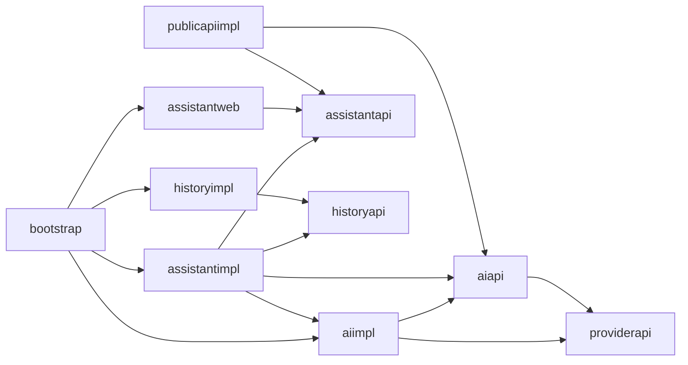

# ADR-021 — Extrair infra de IA para módulo `ai` (memória, concorrência, contrato do turno)

> **Ciclo de execução aberto em 2026-11-21** (aprovação humana, após pareceres architect + engineer): `unit: adr` + `status: in-progress`. SPEC/TASKS nascem neste diretório com marcador `<!-- scope: adr/ADR-021 -->` no TASKS (F4). Código/pom/config/teste só na delegação ao `backend-engineer`. Ajustes dos pareceres (§1) são pré-condição. `workflow-state.json`, branch/PR e ADRs seguem fora deste ciclo.
> Amparo: `.agents/rules/prd-adr-pipeline.md:43-45` (arquitetural sem valor de produto novo ⇒ ADR sem PRD).
> Teto de 5 ADRs do PRD `langchain4j-ai-services` está gasto; este ADR não entra naquele ADR-INDEX.

- **depende-de**: ADR-019 (rename `agent` → `assistant`), ADR-020 (AiService com memória).
- **Status**: in-progress

## 1. Decisão

Extrair para um módulo `ai/` (com `ai/api` + `ai/impl`) tudo o que é **infra de IA reutilizável** e hoje está chumbado em `assistant/impl`/`assistant/api`:

| O que sai | De | Para |
|---|---|---|
| `ChatTurnGateway` (porta do turno) | `assistant/api` | `ai/api` |
| `TurnRequest`, `TurnReply` (domínio do turno) | `assistant/api` | `ai/api` |
| `TurnPrompt` (NOVO — `templateId` + texto + limites de inferência) | — | `ai/api` |
| `AssistantDefault` (contrato do AiService, **sem** a constante `PROMPT`) | `assistant/impl/ai` | `ai/api` |
| `AssistantDefault.PROMPT` (política do assistant) | `assistant/impl/ai` | fica em `assistant/impl` — consumidor entrega `TurnPrompt.text` já preenchido |
| `AbstractLangChain4jTurnGateway` (abstrata) | `assistant/impl/service` | `ai/impl` |
| `SessionChatMemoryProvider`, `sessionLocks`, `seedMemory` (memória/concorrência) | abstrata | `ai/impl` |
| `ProviderMessages` (leitor: `textOf`/`totalChars`) | `assistant/impl/util` | `ai/impl` |

`assistant/impl` fica só com a **política do turno do assistant**: `AssistantTurnGateway` (retry, cliente por turno, métricas), `systemFor`/`userFor`/`priorHistoryFor` (regras de prompt do assistant — **extraídas da abstrata para a concreta**, senão `ai/impl → assistant/api`) e a constante `AssistantDefault.PROMPT` (fallback em português, movida para cá — decisão pós-parecer).

**Ajustes obrigatórios dos pareceres (architect PROCEDE COM AJUSTES / engineer COMPLETO COM ADIÇÕES, 2026-11-21):**
1. **`TurnRequest.history` removido** — campo morto (zero leitores, só `toString():80`); `historySize` do trace vem do argumento separado ao `TurnOutcomeMapper` (`ChatServiceImpl:224`). Elimina `ai/api → history/api`.
2. **`AssistantDefault` sem `PROMPT`** — contrato genérico em `ai/api`; a política do fallback fica em `assistant/impl` e chega ao proxy via `TurnPrompt.text`.
3. **`systemFor` sai da abstrata** — antes em `Abstract...:73-76`, vai para `AssistantTurnGateway` (ou lê `TurnPrompt.text`); evita `ai/impl → assistant/api`.
4. **`TurnPrompt` com `UUID templateId`** (decisão humana) — preserva `promptTemplateId=` no `toString` e o teste `LangChain4jTurnGatewayTest:297`.
5. **Poms inventariados**: `ai/pom.xml`, `ai/api/pom.xml`, `ai/impl/pom.xml`, `<module>ai</module>` na raiz; `ai/impl` precisa do agregado `langchain4j` (não só core) para `@SystemMessage/@UserMessage/@V/Result/InMemoryChatMemoryStore`; `bootstrap` precisa `hive-ai-api`+`hive-ai-impl`; `publicapi/impl` precisa `hive-ai-api`.
6. **`ProviderMessages` (leitor) move mantendo o nome** — rename para `ConversationMessages` fica em commit separado; conversor em `history/api` não é tocado.
7. **Conversão aditiva** — `PromptTemplate` permanece no chamador para `TurnOutcomeMapper`/fingerprint/`metadata.hive`; `TurnPrompt` é cópia pura via factory nomeada `TurnPrompts.from(...)`, nunca construtor posicional (ordem `topP/maxTokens` trocada em `InferenceParams:23,31,39`).

## 2. Motivo

- O `AbstractLangChain4jTurnGateway` mistura duas camadas: memória/concorrência (genéricas de IA) e regras de prompt (específicas do assistant). O Agent v2 teria que duplicar `ChatMemoryProvider`, `sessionLocks` e `seedMemory`.
- `AssistantDefault` é um contrato de modelo (o que o LLM recebe/devolve), mas vive na implementação.
- Existem dois `ProviderMessages` com nomes idênticos e funções distintas (leitor em `assistant/impl`, conversor em `history/api`). Unificar reduz confusão.

## 3. Quebra da dependência `TurnRequest → PromptTemplate` (decisão crítica)

`TurnRequest.java:39,48` referencia `PromptTemplate` (domínio persistido do assistant: `code`, `version`, `status`, `tenant`). Se `TurnRequest` subisse para `ai/api` com esse tipo, `ai/api` dependeria de `assistant/api` — inversão proibida.

**Solução**: `ai/api` define `TurnPrompt` — um record genérico com só o que o turno de IA precisa:

```java
public record TurnPrompt(UUID templateId, String text, Double temperature, Integer maxTokens, Double topP) {}
```

`assistant/api` continua dono de `PromptTemplate` (entidade persistida). A conversão `PromptTemplate → TurnPrompt` acontece no chamador (`ChatServiceImpl`/`PublicChatServiceImpl`), antes de montar o `TurnRequest`. Nenhum tipo de `assistant` aparece em `ai/**`.

## 4. Regras de ouro

1. `ai/**` **não** depende de `assistant/**`, `history/**` nem `publicapi/**` — só `provider/api` e `langchain4j`.
2. `assistant` e o futuro `agent` implementam `ChatTurnGateway` (de `ai/api`) — são irmãos, ambos dependem de `ai`.
3. `history/` continua dono do histórico integral (JPA). `ChatMemory` em `ai/impl` é volátil, reconstruída do `TurnRequest.conversation()` (ADR-020).
4. Contrato HTTP `/v1/chat/**` inalterado. `ChatTurnGateway.execute(TurnRequest)` mantém 1 método, 2 chamadores.
5. K4 (ordem system→user) e K5 (métricas) preservados byte a byte — IT de caracterização existente (AI-01) continua válida após o move.

## 5. Grafo de dependências (resultado)



Sem ciclo. `ai/api` é folha (só `provider/api` + langchain4j — **`history` removido de `TurnRequest`**, ajuste 1). `ai/impl` depende de `ai/api` + `provider/api`. `assistant`/`agent` apontam para `ai`, nunca o contrário.

> Nota de honestidade (parecer architect): a aresta `agentapi → aiapi` desenhada na versão inicial era **aspiracional** — o esqueleto `agent/api` (ADR-019) hoje só depende de `provider/api` + `history/api`. Foi removida do grafo; quando a v2 nascer, a decisão de depender de `ai/api` será tomada em ADR próprio. O grafo acima retrata o estado pós-implementação deste ADR, exceto pelo Gate B pré-existente (`publicapiimpl → assistantimpl`, 4 refs de `ProviderResolution`/`TurnOutcomeMapper`) que permanece como débito fora de escopo (§10).

## 6. Interface congelada

1. `ChatTurnGateway` em `ai/api` — 1 método `execute(TurnRequest)`, falha é valor (`TurnReply.Status`), nunca exceção.
2. `TurnRequest` em `ai/api` com `TurnPrompt` (não `PromptTemplate`, sem campo `history`); `conversation` renderizado uma vez no chamador. `TurnPrompt` = `(templateId, text, temperature, maxTokens, topP)`, factory nomeada `TurnPrompts.from`, conversão aditiva.
3. `TurnReply` em `ai/api` — `Status`, exceção desembrulhada, métricas medidas.
4. `AssistantDefault` em `ai/api` — `@SystemMessage`/`@UserMessage` no método, `Result<String>`, `@MemoryId = sessionId (UUID)`. **Sem** constante `PROMPT` (fica em `assistant/impl`); `ai/api` não carrega política de assistant.
5. `AbstractLangChain4jTurnGateway` em `ai/impl` — memória por sessão, `alwaysKeepSystemMessageFirst(true)`, lock por `sessionId`, `seedMemory` dentro do retry.
6. Zero dependência de `ai/**` para `assistant/**` ou `history/**`.
7. Zero `ChatMemory` substituindo `history/` JPA. Zero mudança de contrato HTTP, cota, retry, MFA.
8. Nomes: o conversor em `history/api/util/ProviderMessages` e o leitor em `ai/impl/util/ProviderMessages` — se mantidos separados, renomeie para nomes distintos (`ConversationMessages` vs `ProviderMessages`) para evitar colisão.

## 7. Alternativas consideradas

| # | Alternativa | Veredito | Motivo |
|---|---|---|---|
| a | Manter tudo em `assistant/impl` | Rejeitada | Memória/locks chumbados — Agent v2 duplicaria infra |
| b | Só extrair memória + locks para `ai/impl` | Rejeitada | Usuário escolheu módulo completo; botar só parte deixaria abstrata dependente de `assistant/api` |
| c | Mover `PromptTemplate` para `ai/api` | Rejeitada | É entidade persistida do assistant (code/version/status/tenant) — invalida a fronteira |
| d | `TurnPrompt` genérico em `ai/api` + conversão no chamador | **Escolhida** | Quebra a dependência sem mover domínio persistido |

## 8. Riscos

| Risco | Evidência | Tratamento |
|---|---|---|
| R1 | `TurnRequest` com `PromptTemplate` cria ciclo | `TurnPrompt` genérico + conversão no chamador (§3) |
| R2 | Move de porta/domínio quebra imports em massa | `grep -r 'assistant.api.domain.TurnRequest'` → zero; compile + suíte |
| R3 | IT AI-01 de caracterização pare de provar K4/K5 | IT continua com o mesmo baseline (4 mensagens/59 chars, 120/340/460/STOP) após o move |
| R4 | `ai/impl` acidentalmente dependa de `assistant` | verificação estática: `grep -r 'assistant' ai/**` → zero |
| R5 | Colisão de nomes `ProviderMessages` | renomear leitor/conversor com nomes distintos (item 6.8) |
| R6 | Retry perca o ressemento (fix do ADR-020) | `seedMemory` dentro do `retryPolicy.call` preservado no move; teste de regressão continua |
| R7 | ITs não compilam após move de pacote | `PromptSeedIT.java:3,120,132-133` importa `AssistantDefault` de `assistant.impl.ai`; AI-01/`:149-158`, `LangChain4jTurnGatewayTest:285`, `ChatServiceImplTest`, `PublicChatServiceImplTest` constroem `TurnRequest` com `PromptTemplate` — repontar imports e helpers para `TurnPrompt`/`ai.api`; `ChatCallerParityIT` (injeta por tipo) só reexecuta |
| R8 | Conversão posicional troca `maxTokens`/`topP` | `InferenceParams` é `(temperature, topP, maxTokens)` (`:23,31,39`), `TurnPrompt` é `(templateId, text, temperature, maxTokens, topP)` — factory nomeada `TurnPrompts.from`, nunca construtor posicional |
| R9 | `systemFor`/fallback mudem de lugar e baseline divirja | `systemFor` vai para `AssistantTurnGateway` com `TurnPrompt.text`; regra "blank → PROMPT" preservada; AI-01 + ChatCallerParityIT como gates, baseline 4/59 e 120/340/460/STOP |
| R10 | escopo `provided` do langchain4j quebre runtime | `ai/impl` declara agregado `langchain4j` `provided` como os demais; `bootstrap` carrega `compile` — copiar padrão de `assistant/impl/pom.xml`, nunca importar só `core` |

## 9. Como verificar

1. `grep -r 'br.com.systec.hive.assistant' backend/ai/**` → zero (sem dependência inversa).
2. `grep -rl 'interface ChatTurnGateway' backend/**` → 1 arquivo em `ai/api`.
3. `grep -rl 'record TurnRequest\|record TurnReply\|record TurnPrompt\|interface AssistantDefault' backend/**` → todos em `ai/api`.
4. `mvn -f backend/pom.xml -q clean && npm test` → EXIT=0; 376/376 front + 65 reports/513+ back; 0/0/0.
5. `mvn -Pintegration verify` → EXIT=0; 101+ IT; 0/0/0 (IT AI-01, ChatCallerParityIT, corrida A8).
6. Baseline inalterado: 4 mensagens/59 chars, 120/340/460/STOP.
7. Zero diff MFA, contrato HTTP, migrations; `code-reviewer` sem 🔴.

## 10. Fora desta decisão

Agent v2 (tools/planner/loop), RAG, starter Spring Boot, Gate B (`publicapi → assistant/impl`), ChatMemory persistente, contrato HTTP novo, migrations de dados, branch/PR, `workflow-state.json`.
