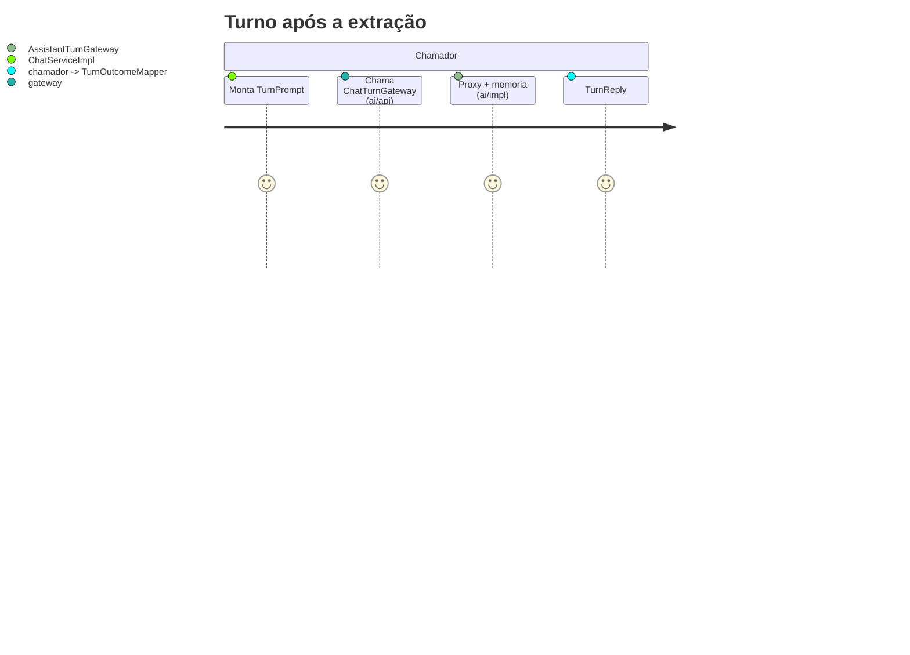

# SPEC — ADR-021: Extrair infra de IA para módulo `ai`

> Escopo: **apenas a decisão do ADR-021** (com os 7 ajustes dos pareceres). Não especifica Agent v2, RAG, ChatMemory persistente, Gate B, contrato HTTP novo. Rastreabilidade: cada `RF`/`NFR` aponta para a cláusula do `ADR.md`.

## 1. Architecture Decision Records (ADRs)

### ADR-021 (este ciclo)
- **Decision**: módulo `ai/` (`ai/api` + `ai/impl`) recebe porta/domínio do turno e infra de IA; `assistant/impl` fica só com a política do turno.
- **Context**: abstrata misturava memória/concorrência (genéricas) com regras de prompt (assistant); `AssistantDefault` com `PROMPT` na impl; dois `ProviderMessages`.
- **Trade-offs**: separação correta x custo de mover porta+domínio+testes; `TurnPrompt` genérico quebra `TurnRequest → PromptTemplate` sem mover entidade persistida.

ADRs afetados: ADR-019 (rename prévio), ADR-020 (garantias K4/K5 a preservar). ADR-012/013/017/018 inalterados.

## 2. Domain Context, Tenant Strategy & Provisioning

- **Bounded Context**: `ai/` é a camada genérica de geração (porta do turno + memória volátil); `assistant/` é a política do turno do assistente; `history/` continua dono do histórico integral (JPA).
- **System Type**: backend Java 25 preview / Spring Boot 4.1.0 / LangChain4j 1.19.0.
- **Tenant Provisioning / Lifecycle**: N/A — nenhum tenant é criado ou alterado.

## 3. Identity & Access Management (IAM)

- **Identity Provider / Protocol / MFA / Token / RBAC**: N/A — nenhum fluxo de autenticação ou permissão é tocado.

## 4. Security, Key Management & Disaster Recovery

- **Key Management / Backup / RTO/RPO**: N/A — nenhuma chave, dado ou backup é alterado.

## 5. Data Model & Concurrency

### Entity-Relationship Diagram (ERD)

N/A — nenhuma entidade persistida é criada/alterada. `TurnPrompt` é um record em memória (não entidade).

### Concurrency & Consistency

| Recurso | Operação | Estratégia | Rationale |
|---|---|---|---|
| `ChatMemory` por `sessionId` | leitura/escrita no proxy | serialização por `sessionId` + `seedMemory` dentro do retry | A8 (javadoc 1.19.0); ADR-020 |
| `chat_message` (JPA) | TX1/TX2 | inalterada (ADR-007) | `history/` fonte de verdade |

## 6. Event Model, Integrations & Messaging Isolation

- **Messaging / Event Registry**: N/A — nenhum evento introduzido.

## 7. Invariants & Property-Based Testing

### 7.1 Entity Invariants

| Tipo | Propriedade | Descrição |
|---|---|---|
| `TurnPrompt` | `templateId` preservado | diagnóstico do `toString` e teste `LangChain4jTurnGatewayTest:297` |
| `TurnRequest` | sem campo `history` | campo morto removido; `historySize` vem do chamador ao `TurnOutcomeMapper` |
| `AssistantDefault` | sem `PROMPT` | política do fallback fica em `assistant/impl` |
| `ai/**` | zero dependência de `assistant/**` | folha, só `provider/api` + langchain4j |

### 7.2 Workflow & State Invariants

- **Turno**: `ChatTurnGateway.execute(TurnRequest)` — 1 método, 2 chamadores, falha como valor (`TurnReply.Status`).
- **K4/K5**: ordem system→histórico→user e métricas idênticas ao baseline (4/59, 120/340/460/STOP).
- **Retry**: `seedMemory` dentro de `retryPolicy.call` (fix do ADR-020) preservado.

### 7.3 Generator Constraints

| Campo | Tipo | Restrição |
|---|---|---|
| `templateId` | UUID | não nulo no diagnóstico |
| `text` | String | blank → fallback `AssistantDefault.PROMPT` (em `assistant/impl`) |
| limites | Double/Integer | cópia fiel de `InferenceParams` (temperature, maxTokens, topP) |

## 8. Functional Requirements & Core Journeys

### RF-01 — Esqueleto `ai/` e poms (ADR ajuste 5)
Criar `ai/pom.xml` (agregador), `ai/api/pom.xml`, `ai/impl/pom.xml`; registrar `<module>ai</module>` em `backend/pom.xml`. `ai/impl` declara agregado `langchain4j` **`provided`** (não só core) por `@SystemMessage/@UserMessage/@V/Result/InMemoryChatMemoryStore`; `bootstrap` carrega `compile`. `assistant/impl` ganha `hive-ai-api`+`hive-ai-impl`; `publicapi/impl` ganha `hive-ai-api`.

### RF-02 — `TurnPrompt` em `ai/api` (ADR §3, ajuste 4, 7)
Record `(UUID templateId, String text, Double temperature, Integer maxTokens, Double topP)`. Factory nomeada `TurnPrompts.from(PromptTemplate)` em `assistant/api` — conversão **aditiva** (cópia pura, sem fallback, sem construtor posicional). `PromptTemplate` permanece no chamador para `TurnOutcomeMapper`/fingerprint/`metadata.hive`. Cuidado: ordem de `InferenceParams` é `(temperature, topP, maxTokens)` — usar nomes, não posição.

### RF-03 — Mover porta e domínio (ADR §1, ajuste 1)
`ChatTurnGateway`, `TurnRequest`, `TurnReply` → `ai/api`. `TurnRequest` **sem** campo `history` (remover de `:49` e do `toString():80`). `historySize` continua vindo do argumento separado ao `TurnOutcomeMapper` (`ChatServiceImpl:224`). Repontar imports em `assistant/impl`, `publicapi/impl` e testes.

### RF-04 — Mover `AssistantDefault` (ajuste 2)
Interface → `ai/api` **sem** a constante `PROMPT`. Constante vai para `assistant/impl` (produtor), entregue via `TurnPrompt.text` já com fallback aplicado. `ai/api` não carrega política de assistant.

### RF-05 — Mover abstrata + extrair `systemFor` (ajuste 3)
`AbstractLangChain4jTurnGateway` → `ai/impl`. **`systemFor` sai da abstrata** para `AssistantTurnGateway` (antes em `:73-76`); `userFor`/`priorHistoryFor` acompanham a concreta. Preservar na abstrata: `chatMemoryProvider`, `sessionLocks`, `seedMemory` (dentro do retry), `alwaysKeepSystemMessageFirst(true)`, `MAX_MEMORY_MESSAGES=64`.

### RF-06 — Mover leitor `ProviderMessages` (ajuste 6)
`assistant/impl/util/ProviderMessages.java` (leitor `textOf`/`totalChars`) → `ai/impl/util`, **mantendo o nome**. Renomear para `ConversationMessages` fica em commit separado (fora deste ciclo). Não tocar no conversor `history/api/util/ProviderMessages.java`.

### NFR-01 — Fronteira `ai/**`
`grep -r 'br.com.systec.hive.assistant' backend/ai/**` = zero; `grep -r 'br.com.systec.hive.history' backend/ai/**` = zero. `ai/api` folha (só `provider/api` + langchain4j).

### NFR-02 — Contrato e métricas inalterados
`ChatTurnGateway` 1 método, 2 chamadores; `TurnReply.Status` intacto; baseline AI-01 (4 mensagens/59 chars, 120/340/460/STOP); ChatCallerParityIT (paridade humano/público).

### NFR-03 — Suíte e review
`mvn -f backend/pom.xml -q clean` antes de medir; `npm test` EXIT=0; `mvn -Pintegration verify` EXIT=0 (101 IT); `code-reviewer` sem 🔴.

## 9. Critérios de Aceite Executáveis

| ID | Asserção | Comando / verificação |
|---|---|---|
| AC-01 | Fronteira limpa | `grep -r 'br.com.systec.hive.assistant\|br.com.systec.hive.history' backend/ai/**` → zero |
| AC-02 | Tipos em `ai/api` | `grep -rl 'interface ChatTurnGateway\|record TurnRequest\|record TurnReply\|record TurnPrompt\|interface AssistantDefault' backend/**` → todos em `ai/api` |
| AC-03 | `history` fora | `grep -n 'history' backend/ai/api/.../TurnRequest.java` → zero; `historySize` ainda no trace |
| AC-04 | `PROMPT` fora de `ai` | `grep -r 'Você é um assistente' backend/ai/**` → zero; constante em `assistant/impl` |
| AC-05 | `systemFor` na concreta | `grep -rn 'systemFor' backend/ai/**` → zero; presente em `AssistantTurnGateway` |
| AC-06 | Retry preservado | `seedMemory` dentro de `retryPolicy.call` em `AssistantTurnGateway`; teste `when_firstAttemptIsRateLimited...` verde |
| AC-07 | ITs e baseline | AI-01 + ChatMemorySerializationTest + ChatCallerParityIT verdes com 4/59 e 120/340/460/STOP |
| AC-08 | Poms e escopo | `<module>ai</module>` na raiz; `ai/impl` com agregado `langchain4j` `provided`; bootstrap `compile` |
| AC-09 | Suíte verde | `mvn clean && npm test` → 376/376 + 65 reports/513+; `mvn -Pintegration verify` → 101+ IT; 0/0/0 |
| AC-10 | Restrições | zero diff MFA/HTTP/migrations; `code-reviewer` sem 🔴 |

## 10. Test Strategy

- **Baseline primeiro**: congelar AI-01/ChatCallerParityIT ANTES do move (ADR-020 in-progress sem mudança em voo).
- **Move por camadas** (engineer §5): esqueleto → `TurnPrompt` em `assistant/api` → mover porta/domínio → mover `AssistantDefault` → mover abstrata (após extrair `systemFor`) → mover leitor → poms finais.
- **Reescrita local**: `AiServiceCharacterizationTest`, `ChatMemorySerializationTest`, `AssistantDefaultTest`, `LangChain4jTurnGatewayTest`, `PromptSeedIT` — imports e helpers para `TurnPrompt`/`ai.api`; `ChatCallerParityIT` só reexecuta.
- **Estática**: AC-01..06, AC-08, AC-10.
- **Review**: `code-reviewer` sem 🔴.

## 11. Fora do escopo

Agent v2 (tools/planner/loop), RAG, starter Spring Boot, Gate B (`publicapi → assistant/impl`), ChatMemory persistente, rename de `ProviderMessages`, contrato HTTP novo, migrations de dados, branch/PR, `workflow-state.json`.
