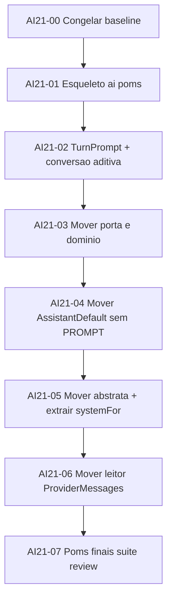

<!-- scope: adr/ADR-021 -->
# TASKS — ADR-021: Extrair infra de IA para módulo `ai`

> Backlog TDD-ready derivado 1:1 da `SPEC.md`. Teste **antes** da implementação em toda tarefa.
> Move por camadas (parecer engineer §5): cada passo compila antes do próximo. Gate B fora (ADR separado).

| ID | RF/NFR | Prioridade | Risco | Tipo | Depende de |
|---|---|---|---|---|---|
| AI21-00 | NFR-02 | P0 | Alto | teste | — |
| AI21-01 | RF-01 | P0 | Médio | infra (pom) | AI21-00 |
| AI21-02 | RF-02 | P0 | Alto | contrato | AI21-01 |
| AI21-03 | RF-03, AC-03 | P0 | Alto | refactor | AI21-02 |
| AI21-04 | RF-04, AC-04 | P0 | Alto | refactor | AI21-03 |
| AI21-05 | RF-05, NFR-02, AC-05, AC-06 | P0 | Alto | refactor | AI21-04 |
| AI21-06 | RF-06 | P0 | Médio | refactor | AI21-05 |
| AI21-07 | NFR-01, NFR-03, AC-01..10 | P0 | Alto | qualidade | AI21-06 |

---

### AI21-00 — Congelar baseline ANTES do move

- **RF/NFR**: NFR-02 · **Prioridade**: P0 · **Risco**: Alto · **Tipo**: teste
- **Arquivos**: nenhum de código; registrar baseline.
- **Teste primeiro**: `mvn -f backend/pom.xml -q clean && npm test` (376/376 + 65/513, 0/0/0) e `mvn -Pintegration verify` (101 IT). Capturar baseline AI-01: 4 mensagens / 59 chars, 120/340/460/STOP; ChatCallerParityIT paridade humano/público. Confirmar ADR-020 sem mudança em voo.
- **Cenários**:
  - Sucesso: baseline verde registrado.
  - Falha: qualquer divergência → parar, não mover.
  - Borda: `git status` sem mudança em voo do ciclo anterior.
- **DoD**: baseline documentado; zero teste apagado/`@Disabled`.

### AI21-01 — Esqueleto `ai/` e poms

- **RF**: RF-01 · **Prioridade**: P0 · **Risco**: Médio · **Tipo**: infra (pom)
- **Arquivos**: `backend/ai/pom.xml`, `backend/ai/api/pom.xml`, `backend/ai/impl/pom.xml`, `backend/pom.xml`.
- **Teste primeiro**: `grep '<module>ai</module>' backend/pom.xml` falha antes da criação.
- **Cenários**:
  - Sucesso: agregador + 2 submódulos; `ai/impl` declara agregado `langchain4j` **`provided`** (não só core — `@SystemMessage/@UserMessage/@V/Result/InMemoryChatMemoryStore`); `ai/api` declara `provider/api` + langchain4j.
  - Falha: escopo `compile` em `ai/impl` → corrigir para `provided` (runtime é `bootstrap`).
  - Borda: zero `.java` ainda — esqueleto vazio neste passo.
- **DoD**: `mvn -f backend/pom.xml -q -DskipTests validate` exit 0.

### AI21-02 — `TurnPrompt` + conversão aditiva

- **RF**: RF-02 · **Prioridade**: P0 · **Risco**: Alto · **Tipo**: contrato
- **Arquivos**: `ai/api/.../TurnPrompt.java` (NOVO), `assistant/api/.../TurnPrompts.java` (factory), `assistant/api/.../TurnRequest.java` (ainda aqui).
- **Teste primeiro**: `TurnPrompts.from(template)` — asserção de `templateId`, `text`, `temperature`, `maxTokens`, `topP` (cópia fiel de `InferenceParams:23,31,39` — ordem topP/maxTokens trocada, usar nomes).
- **Cenários**:
  - Sucesso: `TurnPrompt(templateId, text, temperature, maxTokens, topP)`; factory nomeada, nunca construtor posicional; conversão aditiva (`PromptTemplate` fica no chamador).
  - Falha: `inferenceParams == null` → campos null (equivalente ao fallback `new InferenceParams()`).
  - Borda: `text` blank tratado pelo chamador (`TurnPrompt.text` já com fallback `PROMPT` — constante ainda em `assistant/impl`).
- **DoD**: factory testada; zero perda de `code/version/fingerprint` no chamador.

### AI21-03 — Mover porta e domínio; remover `history`

- **RF/NFR**: RF-03, AC-03 · **Prioridade**: P0 · **Risco**: Alto · **Tipo**: refactor
- **Arquivos**: mover `ChatTurnGateway`, `TurnRequest`, `TurnReply` de `assistant/api` → `ai/api`; `TurnRequest.java` perde campo `history` (`:49`) e linha do `toString` (`:80`); repontar imports em `assistant/impl`, `publicapi/impl`, testes.
- **Teste primeiro**: `grep -r 'history' ai/api/.../TurnRequest.java` mostra o campo antes; meta zero. `grep -rl 'interface ChatTurnGateway' backend/**` → 1 em `ai/api`.
- **Cenários**:
  - Sucesso: 3 tipos em `ai/api`; `historySize` ainda no trace (`ChatServiceImpl:224` ao `TurnOutcomeMapper`).
  - Falha: `ai/api` importando `history.api` → revertir (AC-01).
  - Borda: `LangChain4jTurnGatewayTest:297` (`promptTemplateId=`) sobrevive via `TurnPrompt.templateId` no `toString`.
- **DoD**: AC-02 e AC-03 verdes; compile + suíte parcelar.

### AI21-04 — Mover `AssistantDefault` sem `PROMPT`

- **RF/NFR**: RF-04, AC-04 · **Prioridade**: P0 · **Risco**: Alto · **Tipo**: refactor
- **Arquivos**: mover `assistant/impl/ai/AssistantDefault.java` → `ai/api/.../ai/AssistantDefault.java` **sem** a constante; criar constante `PROMPT` em `assistant/impl` (produtor); mover `AssistantDefaultTest` ou repontar import; repontar `PromptSeedIT.java:3,120,132-133`.
- **Teste primeiro**: `grep -r 'Você é um assistente' backend/ai/**` falha antes (constante em ai); meta zero após.
- **Cenários**:
  - Sucesso: `AssistantDefault` em `ai/api` com `@SystemMessage`/`@UserMessage`/`Result<String>`; `PROMPT` em `assistant/impl`; fallback resolvido no chamador via `TurnPrompt.text`.
  - Falha: `ai/api` carregando texto em português → revertir (AC-04).
  - Borda: `AssistantDefaultTest` deixa de depender da constante movida — reescrever asserção de precedência no chamador.
- **DoD**: AC-04 verde; ITs compilam.

### AI21-05 — Mover abstrata + extrair `systemFor`

- **RF/NFR**: RF-05, NFR-02, AC-05, AC-06 · **Prioridade**: P0 · **Risco**: Alto · **Tipo**: refactor
- **Arquivos**: mover `AbstractLangChain4jTurnGateway.java` → `ai/impl`; extrair `systemFor` (`:73-76`) para `AssistantTurnGateway`; `userFor`/`priorHistoryFor` também para a concreta; repontar imports.
- **Teste primeiro**: IT de caracterização (AI-01) + `ChatMemorySerializationTest` reproduzidos contra a abstrata movida.
- **Cenários**:
  - Sucesso: `grep -rn 'systemFor' backend/ai/**` = zero; abstrata mantém `chatMemoryProvider`, `sessionLocks`, `seedMemory` (dentro do retry), `alwaysKeepSystemMessageFirst(true)`, `MAX_MEMORY_MESSAGES=64`.
  - Falha: `ai/impl` importando `PromptTemplate`/`assistant.api` → revertir (AC-01).
  - Borda: teste `when_firstAttemptIsRateLimited...` continua verde — `seedMemory` dentro de `retryPolicy.call`.
- **DoD**: AC-05 e AC-06 verdes; baseline 4/59 e 120/340/460/STOP inalterado.

### AI21-06 — Mover leitor `ProviderMessages`

- **RF**: RF-06 · **Prioridade**: P0 · **Risco**: Médio · **Tipo**: refactor
- **Arquivos**: mover `assistant/impl/util/ProviderMessages.java` → `ai/impl/util/ProviderMessages.java` (mesmo nome); repontar imports em `AssistantTurnGateway:7`, abstrata:8, `AiServiceCharacterizationTest:7`, `ProviderMessagesTest:4`.
- **Teste primeiro**: `grep -rl 'assistant.impl.util.ProviderMessages' backend/**` mostra os 4 antes; meta zero.
- **Cenários**:
  - Sucesso: leitor em `ai/impl/util`; conversor `history/api/util/ProviderMessages.java` **intacto**.
  - Falha: rename para `ConversationMessages` neste passo → desfazer (vai em commit separado, fora do escopo).
  - Borda: `totalChars` continua só comprimento, nunca texto do prompt em log.
- **DoD**: 4 imports repontados; zero mudança no conversor de `history/api`.

### AI21-07 — Poms finais, suíte, review e evidência

- **RF/NFR**: NFR-01, NFR-03, AC-01..10 · **Prioridade**: P0 · **Risco**: Alto · **Tipo**: qualidade
- **Arquivos**: poms finais; nenhum de código novo; evidência harness é do `qa-engineer`.
- **Teste primeiro**: `mvn -f backend/pom.xml -q clean && npm test` e `mvn -Pintegration verify`.
- **Cenários**:
  - Sucesso: AC-01..09 verdes; `code-reviewer` sem 🔴.
  - Falha: qualquer 🔴 → loop de correção (implementador → reviewer, máx. 3 iterações).
  - Borda: `assistant/api` perde `history-api`/`langchain4j-core` se sem uso; `bootstrap` mantém agregado `compile`.
- **DoD**: `code_review_status: passed`; `harness_status: passed`; zero diff MFA/HTTP/migrations; Brain atualizado; **PARAR e pedir "Posso avançar?"** antes de qualquer próxima fase.
