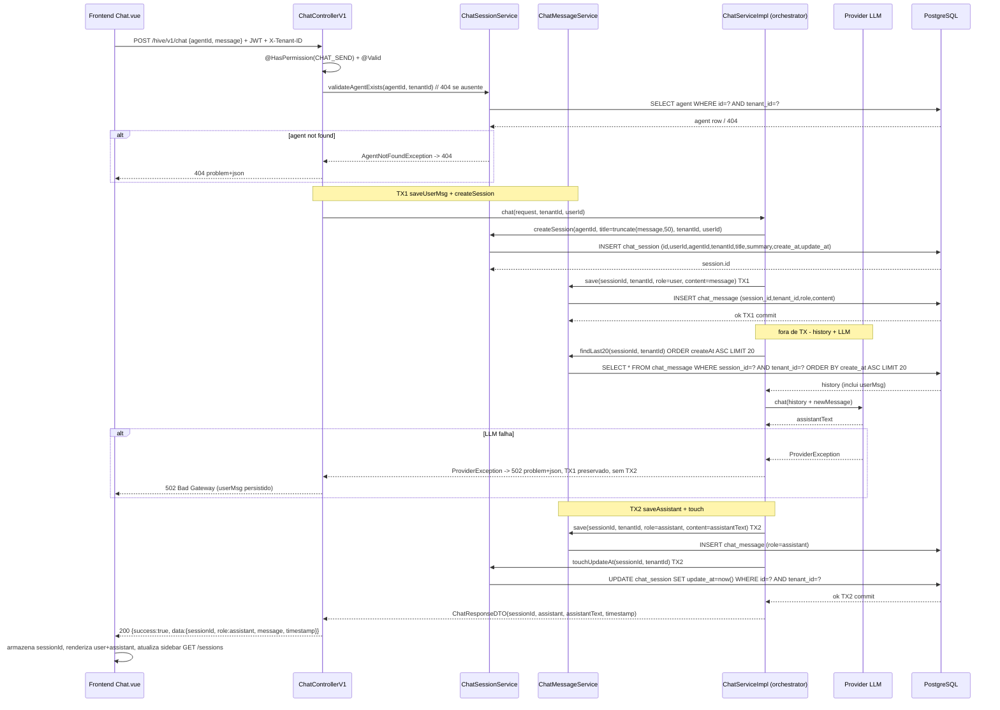

# PLAN — mvp-chat: Chat Persistente + Multi-Turn + Session CRUD

## 1. Header

| Campo | Valor |
|-------|-------|
| **Feature** | `mvp-chat` |
| **Módulo** | `agent` (`api` / `impl` / `dbupdate` / `web/internal/v1`) + `frontend` |
| **Tipo** | Feature |
| **Prioridade** | P0 |
| **Status** | PLAN APROVADO — pronto para TASKS / Execution |
| **Fase SDD** | Fase 1 — Planning (SPEC APROVADO com ressalvas 2026-08-26) |
| **Data** | 2026-08-26 |
| **SPEC ref** | `.spec/backend/mvp-chat/SPEC.md` (831 linhas, RF1-RF8, RN1-RN10, CA1-CA10) |
| **Autores** | sdd-orquestrador |
| **Context path** | `/hive` — endpoints sob `/hive/v1/chat` |
| **Dependência bloqueante** | V4 `chat_session` + `chat_message` sem wiring — exige V5 corretiva |

> Fonte única: `SPEC.md` §§1-13 + Apêndices A-C. Nenhum requisito além de F1-F8 / RF1-RF8 / RN1-RN10 / CA1-CA10 / contratos §6 / V5 §7.3 / TX split §9 acrescentado. EXTRA `PATCH` opcional documentado mas não bloqueia MVP.

---

## 2. Estratégia de Implementação

### 2.1 Ordem das camadas (bottom-up, sem forward-reference)

```
domain (api VOs) → entity (impl) → repository → mapper domain → V5 dbupdate → service → DTO + mapper DTO → controller → frontend
```

Motivo: cada camada só depende da anterior; permite `mvn compile -pl {modulo} -am` verde a cada batch; TDD exige VOs/entities antes de services.

### 2.2 Sequência prescritiva

1. **Batch 1 — Fundação persistência** (sem comportamento): VOs `ChatSession`/`ChatMessage` em `agent/api`, revisar `ChatSessionEntity`/`ChatMessageEntity` (V4 diverge do SPEC), criar `ChatSessionRepository`/`ChatMessageRepository`, `ChatSessionMapperDomain`/`ChatMessageMapperDomain` (MapStruct `spring`), migration V5 idempotente.
2. **Batch 2 — Domínio services**: `ChatSessionService` (interface api) + `ChatSessionServiceImpl` + `ChatMessageService`/`ChatMessageServiceImpl` (ou métodos em `ChatSessionServiceImpl` — decisão: separar para SRP), `ChatSessionNotFoundException`, `ChatAgentImmutableException` (opcional RN2), lógica `truncate(title,50)`, `touchUpdateAt`, `findLast20`, `delete cascade`.
3. **Batch 3 — API + refator chat multi-turn**: DTOs `ChatRequestDTO`/`ChatResponseDTO`/`CreateSessionDTO`/`ChatSessionDTO`/`ChatMessageDTO` com Bean Validation, DTO mappers, `ChatControllerV1` (POST /v1/chat) refatorado com TX split RN4 + `ChatSessionControllerV1` (CRUD sessions), `@HasPermission`, `ControllerExceptionHandler` mapping, integração `GET /v1/agents`.
4. **Batch 4 — Frontend real**: `session.service.ts`, `agent.service.ts` (ou estender existente), `chat.service.ts` refatorado com `sessionId`, `ChatSidebar.vue`, `AgentSelector.vue`, refator `Chat.vue` (sessionId param, history ASC, Nova Conversa, delete, reload CA10), stores.

### 2.3 Princípios transversais

- **TDD obrigatório**: teste unitário (`@ExtendWith(MockitoExtension.class)`, naming `when_{action}_with_{scenario}_then_{result}`) antes/de par com impl; IT `*IT.java` em `integration-test/` para todo controller.
- **Multi-tenant first**: cada método de repo/service/controller filtra por `tenantId`; code review checklist R1.
- **TX split documentado**: `ChatServiceImpl.chat()` anota `@Transactional` apenas em `saveUserMsg()` e `saveAssistantMsg()+touch()` — método orquestrador **sem** `@Transactional`.
- **Nenhum `findAll()` sem tenantId** exposto (RN10).
- **V5 idempotente**: `IF NOT EXISTS` / `IF EXISTS`, re-executável sem erro.

---

## 3. Arquitetura Detalhada

### 3.1 Diagrama de componentes (mermaid)

```mermaid
graph TB
    subgraph FE [Frontend Vue 3]
        ChatVue[views/Chat.vue]
        Sidebar[components/ChatSidebar.vue]
        AgentSel[components/AgentSelector.vue]
        ChatSvc[services/chat.service.ts]
        SessionSvc[services/session.service.ts]
        AgentSvc[services/agent.service.ts]
        AuthStore[stores/auth.store.ts]
    end
    subgraph BE [Backend agent module]
        ChatCtrl[web: ChatControllerV1<br/>POST /v1/chat]
        SessionCtrl[web: ChatSessionControllerV1<br/>/v1/chat/sessions]
        ChatSessionSvc[impl: ChatSessionServiceImpl]
        ChatMsgSvc[impl: ChatMessageServiceImpl]
        ChatSvcBE[impl: ChatServiceImpl<br/>refator TX split]
        DomainMapper[impl: ChatSessionMapperDomain<br/>ChatMessageMapperDomain]
        DTOMapper[web: ChatSessionMapperDTO<br/>ChatMessageMapperDTO]
        SessionRepo[impl: ChatSessionRepository]
        MsgRepo[impl: ChatMessageRepository]
        SessionEntity[impl: ChatSessionEntity<br/>AbstractEntity]
        MsgEntity[impl: ChatMessageEntity<br/>AbstractEntity]
        AgentRepo[impl: AgentRepository]
        Provider[provider: LLM Provider]
    end
    subgraph DB [PostgreSQL 16 + pgvector]
        TSession[(chat_session)]
        TMsg[(chat_message)]
        TAgent[(agent)]
        Flyway[(flyway_schema_history_agent)]
    end
    subgraph Infra [Cross-cutting]
        TenantFilter[AbstractEntity @Filter tenantFilter]
        HasPerm[@HasPermission<br/>CHAT_SEND / CHAT_SESSION_MANAGE]
        ExHandler[ControllerExceptionHandler<br/>RFC7807]
        JWT[Auth0 java-jwt]
    end

    ChatVue --> Sidebar
    ChatVue --> AgentSel
    ChatVue --> ChatSvc
    Sidebar --> SessionSvc
    AgentSel --> AgentSvc
    ChatSvc --> ChatCtrl
    SessionSvc --> SessionCtrl
    AgentSvc --> SessionCtrl
    AuthStore -.-> ChatSvc
    AuthStore -.-> SessionSvc

    ChatCtrl --> ChatSessionSvc
    ChatCtrl --> ChatMsgSvc
    ChatCtrl --> ChatSvcBE
    SessionCtrl --> ChatSessionSvc
    SessionCtrl --> ChatMsgSvc
    ChatSessionSvc --> SessionRepo
    ChatMsgSvc --> MsgRepo
    ChatSvcBE --> Provider
    SessionRepo --> SessionEntity
    MsgRepo --> MsgEntity
    SessionEntity --> TSession
    MsgEntity --> TMsg
    SessionRepo -.-> TenantFilter
    MsgRepo -.-> TenantFilter
    ChatCtrl -.-> HasPerm
    SessionCtrl -.-> HasPerm
    ChatCtrl -.-> ExHandler
    SessionCtrl -.-> ExHandler
    JWT -.-> HasPerm
    SessionEntity -.-> AgentRepo
    TSession -.-> TAgent
    TMsg -.-> TSession
    Flyway -.-> TSession
    Flyway -.-> TMsg
```

### 3.2 Diagrama de sequência FU1 — POST /v1/chat sem sessionId (criação implícita)



> FU2-FU5 (append multi-turn, lista sidebar, history, delete cascade) seguem SPEC §9.2-§9.5 sem alteração; PLAN não duplica diagramas para brevidade — TASKS referenciam SPEC FU2-FU5 diretamente.

### 3.3 Decisões arquiteturais (ADRs a criar no Archive)

- **ADR-XXX-flyway-agent-v5**: V5 corretiva idempotente vs recriar V4 (rejeitado — imutabilidade migrations).
- **ADR-XXX-chat-tx-split**: TX split RN4 vs TX única (rejeitado — lock longo, rollback indevido de userMsg).
- **RN2 imutável**: `POST /v1/chat` com `sessionId` existente **ignora** `request.agentId` divergente (estratégia escolhida: ignorar silenciosamente, não 400). Alternativa 400 `CHAT_AGENT_IMMUTABLE` documentada como opcional mas não adotada no MVP para simplificar frontend. Se implementador preferir 400, registrar desvio no PR e atualizar SPEC Delta.

---

## 4. Plano por Camada

### 4.1 Backend `agent/api` — VOs (Batch 1)

| Artefato | Path | Conteúdo |
|----------|------|----------|
| `ChatSession` | `agent/api/src/main/java/com/hive/agent/api/domain/ChatSession.java` | VO `UUID id, UUID userId, UUID agentId, String title (max 50), String summary (nullable), Instant createAt, Instant updateAt, UUID tenantId`. Manual getters/setters, sem Lombok. Construtor `ChatSession(UUID userId, UUID agentId, UUID tenantId, String title)`. Invariante título truncado? Não — service trunca, VO apenas carrega. |
| `ChatMessage` | `agent/api/src/main/java/com/hive/agent/api/domain/ChatMessage.java` | VO `UUID id, UUID sessionId, UUID tenantId, ChatMessageRole role (enum user/assistant), String content (1..4000), Instant createAt`. Enum `ChatMessageRole {USER, ASSISTANT}` ou String validada — usar `EnumType.STRING` na entity, VO com enum. |
| `ChatSessionService` | `agent/api/src/main/java/com/hive/agent/api/service/ChatSessionService.java` | Interface `extends CrudService<ChatSession>` se aplicável ou métodos próprios: `create(agentId,title,tenantId,userId)`, `listSessions(tenantId,userId,Pageable)`, `getSession(id,tenantId,userId)`, `getMessages(sessionId,tenantId,Pageable)`, `deleteSession(id,tenantId,userId)`, `touchUpdateAt(id,tenantId)`, `findLast20(sessionId,tenantId)`. |
| `ChatMessageService` | `agent/api/src/main/java/com/hive/agent/api/service/ChatMessageService.java` | Opcional separar; se não, métodos de mensagem ficam em `ChatSessionService`. Decisão PLAN: criar `ChatMessageService` separado para SRP (lista + save + findLast20). |
| Exceptions | `agent/api/src/main/java/com/hive/agent/api/exceptions/` | `ChatSessionNotFoundException extends RuntimeException`, `ChatAgentNotFoundException`, `ChatAgentImmutableException` (opcional), `ProviderException` (ou reuse existente). |

**Dependências**: nenhuma (api sem framework deps).

### 4.2 Backend `agent/impl` — Entities, Repos, Mappers, Services (Batch 1-2)

#### Entities (revisar V4)

| Entity | Path | Revisão V4 vs SPEC |
|--------|------|---------------------|
| `ChatSessionEntity` | `agent/impl/src/main/java/com/hive/agent/impl/entity/ChatSessionEntity.java` | Estende `AbstractEntity` (UUID id, createAt, updateAt, tenantId + `@Filter`). V4 criou `title VARCHAR(255)` nullable, `agent_id UUID` nullable, `summary VARCHAR(2000)` — SPEC exige `title VARCHAR(50) NOT NULL`, `agent_id NOT NULL FK→agent`, `summary TEXT NULL`. Entity deve mapear `title` com `@Column(nullable=false,length=50)`, `agentId` `@ManyToOne(fetch=LAZY) @JoinColumn(name="agent_id",nullable=false)` ou `UUID agentId` + FK via DDL V5. Manter `summary` como `TEXT`. V5 corrige DDL; entity reflete SPEC. |
| `ChatMessageEntity` | `agent/impl/src/main/java/com/hive/agent/impl/entity/ChatMessageEntity.java` | Estende `AbstractEntity` mas **não** deve herdar `tenantId` duplicado? `AbstractEntity.tenantId` já cobre. V4 já tem `tenant_id`, `session_id`, `metadata JSONB`. Adicionar `role @Enumerated(STRING) @Column(length=20)`, `content TEXT NOT NULL`, `@ManyToOne(fetch=LAZY) ChatSessionEntity session @JoinColumn(name="session_id",nullable=false)`. `@JdbcTypeCode(SqlTypes.JSON)` para `metadata` se mantido. `FetchType.LAZY` obrigatório (N3.4). |

**Validação**: `ChatSessionEntity`/`ChatMessageEntity` devem ter `@Filter(name="tenantFilter")` via `AbstractEntity` — verificar `commons/impl/AbstractEntity.java`.

#### Repositories (Batch 1)

| Repo | Path | Métodos |
|------|------|---------|
| `ChatSessionRepository` | `agent/impl/src/main/java/com/hive/agent/impl/repository/ChatSessionRepository.java` | `extends JpaRepository<ChatSessionEntity,UUID>` + `@Repository`. Métodos: `Optional<ChatSessionEntity> findByIdAndTenantId(UUID id, UUID tenantId)`, `Page<ChatSessionEntity> findByTenantIdAndUserId(UUID tenantId, UUID userId, Pageable pageable)`, `Optional<ChatSessionEntity> findByIdAndTenantIdAndUserId(UUID id, UUID tenantId, UUID userId)` (para anti-IDOR estrito), `void deleteByIdAndTenantId(UUID id, UUID tenantId)` (ou `deleteByIdAndTenantIdAndUserId`). Nunca expor `findAll()` sem tenant. |
| `ChatMessageRepository` | `agent/impl/src/main/java/com/hive/agent/impl/repository/ChatMessageRepository.java` | `extends JpaRepository<ChatMessageEntity,UUID>` + `@Repository`. Métodos: `Page<ChatMessageEntity> findBySessionIdAndTenantIdOrderByCreateAtAsc(UUID sessionId, UUID tenantId, Pageable pageable)`, `List<ChatMessageEntity> findTop20BySessionIdAndTenantIdOrderByCreateAtDesc(UUID sessionId, UUID tenantId)` (para window 20 — depois reverse para ASC), ou `@Query("SELECT m FROM ChatMessageEntity m WHERE m.session.id=:sid AND m.tenantId=:tid ORDER BY m.createAt ASC")` com `Pageable`. `long countBySessionIdAndTenantId(UUID sid, UUID tid)` para testes. |

**Query parametrizada**: JPQL com `:param` — nunca concatenação (A03).

#### Mappers domain (Batch 1)

| Mapper | Path | Detalhe |
|--------|------|---------|
| `ChatSessionMapperDomain` | `agent/impl/src/main/java/com/hive/agent/impl/mapper/ChatSessionMapperDomain.java` | `@Mapper(componentModel="spring")`. `ChatSession toDomain(ChatSessionEntity)`, `ChatSessionEntity toEntity(ChatSession)`. `@Mapping(target="createAt",ignore=true)`, `@Mapping(target="updateAt",ignore=true)`, `@Mapping(target="tenantId",ignore=true)` no `toEntity` quando criado via service (service seta tenantId). `agentId` mapping `entity.agent.id` vs `entity.agentId` conforme entity model. |
| `ChatMessageMapperDomain` | `agent/impl/src/main/java/com/hive/agent/impl/mapper/ChatMessageMapperDomain.java` | `@Mapper(componentModel="spring")`. `ChatMessage toDomain(ChatMessageEntity)`, `ChatMessageEntity toEntity(ChatMessage)`. `role` enum mapping, `sessionId` via `entity.session.id`. Ignorar `createAt/updateAt/tenantId` no `toEntity`. |

**Teste**: via `Mappers.getMapper()` — nunca mockar.

#### Services (Batch 2)

| Service | Path | Responsabilidade |
|---------|------|------------------|
| `ChatSessionServiceImpl` | `agent/impl/src/main/java/com/hive/agent/impl/service/ChatSessionServiceImpl.java` | `@Service`, constructor injection `ChatSessionRepository`, `ChatMessageRepository`, `AgentRepository`, `ChatSessionMapperDomain`, `ChatMessageMapperDomain`. Métodos: `create()`: valida `agentId` existe no tenant (`agentRepository.findByIdAndTenantId` → 404), `title=truncate(titleOrFirstMessage,50)`, `save(entity)`; `listSessions()`: `findByTenantIdAndUserId(tenantId,userId, Pageable Sort updateAt DESC)`; `getSession()`: `findByIdAndTenantId` + ownership check → 404 anti-IDOR; `deleteSession()`: `findByIdAndTenantId` → 404 se não existe, `deleteByIdAndTenantId` (FK cascade); `touchUpdateAt()`: `entity.setUpdateAt(Instant.now())` + save; `getMessages()`: valida session ownership, depois `findBySessionIdAndTenantIdOrderByCreateAtAsc` com `Pageable Sort createAt ASC`; `findLast20()`: query últimas 20 `ORDER BY createAt DESC LIMIT 20` + reverse para ASC. `@Transactional` em `create`, `delete`, `touchUpdateAt`, `saveMessage`. |
| `ChatMessageServiceImpl` | `agent/impl/src/main/java/com/hive/agent/impl/service/ChatMessageServiceImpl.java` | Se separado: `save(sessionId, tenantId, role, content)` valida session ownership, `content` 1..4000, cria entity; `findLast20` idem. Se unificado, métodos dentro de `ChatSessionServiceImpl`. PLAN recomenda separar para SRP, mas aceita unificado se justificado no PR. |
| `ChatServiceImpl` (refator) | `agent/impl/src/main/java/com/hive/agent/impl/service/ChatServiceImpl.java` | **Refator TX split RN4**: método público `ChatResponseDTO chat(ChatRequestDTO req, UUID tenantId, UUID userId)` **SEM** `@Transactional`. Internamente chama `saveUserMsg()` (`@Transactional` TX1) → fora de TX chama `findLast20()` + `provider.chat(history)` → chama `saveAssistantMsg()+touch()` (`@Transactional` TX2). Falha provider → TX1 preservado, TX2 não executado, lança `ProviderException` mapeada para 502. RN2: se `sessionId` presente e `req.agentId != session.agentId`, **ignora** `req.agentId`. RN1: `title=truncate(message,50)` na criação implícita. History window 20 RN3. |

**Dependência provider**: injetar `ProviderService` ou `AgentLlmProvider` existente — verificar `agent/impl` provider wiring antes de codar (grep `Provider`).

### 4.3 Backend `agent/dbupdate` — V5 (Batch 1)

| Artefato | Path |
|----------|------|
| `V5__fix_chat_session_message_constraints_and_indexes.sql` | `agent/dbupdate/src/main/resources/db/migration/agent/V5__fix_chat_session_message_constraints_and_indexes.sql` |

Conteúdo idempotente (SPEC §7.3 adaptado ao V4 real descoberto):

```sql
CREATE EXTENSION IF NOT EXISTS "uuid-ossp";

-- V4 criou chat_session com title VARCHAR(255) nullable, agent_id nullable, summary VARCHAR(2000)
-- V5 corrige para SPEC: title 50 NOT NULL, agent_id NOT NULL, summary TEXT, tenant_id já NOT NULL
-- Ajustes idempotentes: usar IF EXISTS / IF NOT EXISTS onde suportado, senão blocos DO $$

-- Garantir tenant_id NOT NULL (V4 já NOT NULL, mas idempotente)
ALTER TABLE chat_session ALTER COLUMN tenant_id SET NOT NULL;
ALTER TABLE chat_message ALTER COLUMN tenant_id SET NOT NULL;

-- Corrigir title: 255 -> 50, NOT NULL, truncar existentes >50
UPDATE chat_session SET title = LEFT(title, 50) WHERE LENGTH(title) > 50;
ALTER TABLE chat_session ALTER COLUMN title TYPE VARCHAR(50) USING LEFT(title, 50);
ALTER TABLE chat_session ALTER COLUMN title SET NOT NULL;
-- Se title nullable e nulls existem, preencher com 'Nova conversa' antes
UPDATE chat_session SET title = 'Nova conversa' WHERE title IS NULL;

-- Corrigir agent_id NOT NULL (se nulls existem, falha proposital — dados V4 sem agente devem ser limpos manualmente)
-- ALTER TABLE chat_session ALTER COLUMN agent_id SET NOT NULL; -- aplicar após garantir sem nulls; se houver nulls em dev, preencher ou deletar

-- Recriar FK chat_message.session_id com ON DELETE CASCADE idempotente
ALTER TABLE chat_message DROP CONSTRAINT IF EXISTS fk_chat_message_session;
ALTER TABLE chat_message ADD CONSTRAINT fk_chat_message_session
  FOREIGN KEY (session_id) REFERENCES chat_session(id) ON DELETE CASCADE;

-- FK chat_session.agent_id -> agent(id) se não existir
DO $$ BEGIN
  IF NOT EXISTS (SELECT 1 FROM pg_constraint WHERE conname='fk_chat_session_agent') THEN
    ALTER TABLE chat_session ADD CONSTRAINT fk_chat_session_agent FOREIGN KEY (agent_id) REFERENCES agent(id);
  END IF;
END $$;

-- Índices paginação e isolamento (IF NOT EXISTS)
CREATE INDEX IF NOT EXISTS idx_chat_message_session_id ON chat_message(session_id);
CREATE INDEX IF NOT EXISTS idx_chat_message_tenant_session ON chat_message(tenant_id, session_id);
CREATE INDEX IF NOT EXISTS idx_chat_session_tenant_user ON chat_session(tenant_id, user_id);
CREATE INDEX IF NOT EXISTS idx_chat_session_agent ON chat_session(agent_id);
CREATE INDEX IF NOT EXISTS idx_chat_session_update_at ON chat_session(update_at DESC);
CREATE INDEX IF NOT EXISTS idx_chat_session_create_at ON chat_session(create_at DESC);
CREATE INDEX IF NOT EXISTS idx_chat_message_create_at ON chat_message(create_at);

-- CHECK role se não existir (V4 não criou)
DO $$ BEGIN
  IF NOT EXISTS (SELECT 1 FROM pg_constraint WHERE conname='chk_chat_message_role') THEN
    ALTER TABLE chat_message ADD CONSTRAINT chk_chat_message_role CHECK (role IN ('user','assistant'));
  END IF;
END $$;
```

Histórico Flyway: `flyway_schema_history_agent`, `locations=classpath:/db/migration/agent`, `baselineOnMigrate=true` (config existente `AgentDbUpdateConfig.java`).

**Verificação**: `SELECT * FROM flyway_schema_history_agent WHERE version='5'` após migrate; `EXPLAIN SELECT ... WHERE tenant_id=? AND user_id=? ORDER BY update_at DESC` deve mostrar Index Scan.

### 4.4 Backend `agent/web/internal/v1` — DTOs, Mappers, Controllers (Batch 3)

#### DTOs

| DTO | Path | Validação |
|-----|------|-----------|
| `ChatRequestDTO` | `agent/web/internal/v1/src/main/java/com/hive/agent/web/internal/v1/dto/ChatRequestDTO.java` | `record ChatRequestDTO(@NotNull UUID agentId, UUID sessionId, @NotBlank @Size(max=4000) String message)` — SPEC §6.2 |
| `ChatResponseDTO` | `.../dto/ChatResponseDTO.java` | `record ChatResponseDTO(UUID sessionId, String role, String message, Instant timestamp)` — `role="assistant"` |
| `CreateSessionDTO` | `.../dto/CreateSessionDTO.java` | `record CreateSessionDTO(@NotNull UUID agentId, @Size(max=50) String title)` |
| `UpdateSessionDTO` | `.../dto/UpdateSessionDTO.java` | `record UpdateSessionDTO(@NotBlank @Size(max=50) String title)` — EXTRA PATCH |
| `ChatSessionDTO` | `.../dto/ChatSessionDTO.java` | `record ChatSessionDTO(UUID id, UUID userId, UUID agentId, String title, String summary, Instant createAt, Instant updateAt)` |
| `ChatMessageDTO` | `.../dto/ChatMessageDTO.java` | `record ChatMessageDTO(UUID id, UUID sessionId, String role, String content, Instant createAt)` |

**Paginação**: usar `Pageable` com `@RequestParam int page, size` + `Page<T>` response via `RestControllerTool.of().buildPaginatedResponse()` ou `buildSuccessResponse(Page)` conforme projeto.

#### Mappers DTO

| Mapper | Path |
|--------|------|
| `ChatSessionMapperDTO` | `agent/web/internal/v1/src/main/java/com/hive/agent/web/internal/v1/mapper/ChatSessionMapperDTO.java` |
| `ChatMessageMapperDTO` | `agent/web/internal/v1/src/main/java/com/hive/agent/web/internal/v1/mapper/ChatMessageMapperDTO.java` |

`@Mapper(componentModel="spring")`, `ChatSessionDTO toDto(ChatSession domain)`, `ChatSession toDomain(CreateSessionDTO dto)` etc.

#### Controllers

| Controller | Path | Endpoints |
|------------|------|-----------|
| `ChatControllerV1` | `agent/web/internal/v1/src/main/java/com/hive/agent/web/internal/v1/controller/ChatControllerV1.java` | `@RestController @RequestMapping(RestPath.V1 + "/chat") @Tag("chat")`. `POST /v1/chat` → `@HasPermission("CHAT_SEND") @Valid ChatRequestDTO` → delega para `ChatServiceImpl.chat()` → `RestControllerTool.of().buildSuccessResponse(ChatResponseDTO)` 200. `ProviderException` → 502 via `ControllerExceptionHandler`. |
| `ChatSessionControllerV1` | `agent/web/internal/v1/src/main/java/com/hive/agent/web/internal/v1/controller/ChatSessionControllerV1.java` | `@RequestMapping(RestPath.V1 + "/chat/sessions")`. `POST /` → `@HasPermission("CHAT_SESSION_MANAGE") @Valid CreateSessionDTO` → 201; `GET /` → `Pageable` → 200 `Page<ChatSessionDTO>`; `GET /{id}` → 200/404 anti-IDOR; `GET /{id}/messages` → `Pageable` → 200 `Page<ChatMessageDTO>`; `DELETE /{id}` → 204/404; `PATCH /{id}` EXTRA → `@Valid UpdateSessionDTO` → 200. Alternativa: unificar ambos controllers em `ChatControllerV1` com sub-paths — aceito, mas PLAN recomenda separar para coesão. |

**Auth**: `tenantId`/`userId` extraídos de `SecurityContext` / `JwtAuthenticationToken` / `TenantContext` — verificar padrão existente em `agent/web` controllers (grep `TenantContext` / `SecurityContextHolder`).

**Exception handling**: `ChatSessionNotFoundException` → 404, `ChatAgentNotFoundException` → 404, `ProviderException` → 502, `MethodArgumentNotValidException` → 400 `application/problem+json` — tudo via `ControllerExceptionHandler` existente.

### 4.5 Frontend (Batch 4)

| Artefato | Path | Responsabilidade |
|----------|------|------------------|
| `session.service.ts` | `frontend/src/services/session.service.ts` | `axios` `baseURL /hive/v1` (via `api.ts`). Métodos: `listSessions(page,size) => Page<ChatSessionDTO>`, `createSession(agentId,title?)`, `getSession(id)`, `getMessages(sessionId,page,size) => Page<ChatMessageDTO>`, `deleteSession(id)`, `updateSession(id,title)` EXTRA. Headers `Authorization: Bearer {hive_token}` auto via interceptor `api.ts`. |
| `agent.service.ts` | `frontend/src/services/agent.service.ts` | Se não existir: `listAgents(page,size) => Page<Agent>` via `GET /v1/agents`. Se existir, estender. |
| `chat.service.ts` (refator) | `frontend/src/services/chat.service.ts` | Antes hard-coded; refator: `sendMessage(agentId, sessionId, message) => ChatResponseDTO` via `POST /v1/chat`. |
| `auth.store.ts` (ajuste) | `frontend/src/stores/auth.store.ts` | Expor `userId` (decode JWT `sub` ou `GET /me`). Necessário para `ChatSession.userId`? Backend deriva de JWT, frontend não precisa enviar, mas store deve expor para testes. |
| `ChatSidebar.vue` | `frontend/src/components/ChatSidebar.vue` | Consome `session.service.listSessions()`, renderiza `title + updateAt` DESC, paginado (scroll infinito ou paginação simples), click → emit `select:sessionId` → `GET /messages` ASC, botão "Nova Conversa" → emit `newChat` (limpa sessionId), ação delete por item → `DELETE` + remove da lista sem reload, estados vazio/loading/erro. PrimeVue `Button`, `ScrollPanel`, `Skeleton`. |
| `AgentSelector.vue` | `frontend/src/components/AgentSelector.vue` | Consome `agent.service.listAgents()`, popula PrimeVue `Dropdown`/`Select`, v-model `agentId`, desabilitado quando `sessionId` presente (RN2 imutável — mostra agente da sessão). |
| `Chat.vue` (refator) | `frontend/src/views/Chat.vue` | Integra `ChatSidebar` + `AgentSelector` + área mensagens. Estado `sessionId: UUID\|null`, `messages: ChatMessageDTO[]`, `loading`. Fluxo: `onMounted` lista sessions; `selectSession(id)` → `getMessages(id)` ASC render; `sendMessage()` → `chat.service.sendMessage(agentId, sessionId, message)` → armazena `sessionId` retornado, append user+assistant, atualiza sidebar; `newChat()` limpa `sessionId` + `messages`; `deleteSession(id)`; reload CA10: `onMounted` refaz `listSessions` + `getMessages` se `sessionId` persistido (localStorage ou route param). Scroll bottom, loading skeletons, erro toast. |

**Roteamento**: se `Chat.vue` usar route param `/:sessionId`, atualizar `router/index.ts` — opcional no MVP (localStorage suficiente para CA10).

**Design**: tokens `DESIGN_SYSTEM.md` Deep Indigo + Amber, PrimeVue Aura, `.p-dark` compatível, PrimeFlex.

---

## 5. Estratégia de Testes

### 5.1 Unit tests (obrigatório, TDD)

**Framework**: JUnit 5 + Mockito `mockito-inline` 5.11.0 + AssertJ. `@ExtendWith(MockitoExtension.class)`, `@Mock` + `@InjectMocks`, `Mappers.getMapper()` para MapStruct — nunca mockar mapper.

**Naming**: `when_{action}_with_{scenario}_then_{result}()` — ex: `when_chat_with_noSessionId_then_createsSessionAndPersistsTwoMessages()`.

**Coverage mínima**: 80% service, 90% domain, 70% frontend novas funções.

| Target | Arquivo de teste | Casos obrigatórios |
|--------|------------------|--------------------|
| `ChatSessionServiceImpl` | `agent/impl/src/test/java/.../service/ChatSessionServiceImplTest.java` | happy `create` (CA1), `listSessions` filtra tenant+user (CA3), `getSession` anti-IDOR 404 (CA8), `delete` cascade (CA5), `touchUpdateAt`, `findLast20` window 20 ASC (CA2), `create` title truncate 50 (RN1), `create` agent 404 (CA9), `delete` idempotente 404 segundo call (CA5). |
| `ChatMessageServiceImpl` | `agent/impl/src/test/java/.../service/ChatMessageServiceImplTest.java` | `save` user/assistant, `findLast20` limit 20, `getMessages` paginado ASC (CA4). |
| `ChatServiceImpl` (refator) | `agent/impl/src/test/java/.../service/ChatServiceImplTest.java` | `when_chat_with_noSessionId_then_createsSession` (CA1), `when_chat_with_sessionId_then_appends` (CA2), `when_chat_with_divergentAgentId_then_ignoresNewAgent` (RN2/CA7), `when_chat_with_providerFailure_then_preservesUserMsgAndThrows502` (RN4/RN9), `when_chat_with_historyMoreThan20_then_sendsOnlyLast20` (RN3), `when_chat_with_nonExistingSessionId_then_throws404` (CA8). Mock `Provider` para controlar resposta e falha. Verificar `verify(repository).save` e `verify(provider).chat(historyCaptor)`. |
| `ChatSessionMapperDomain` | `agent/impl/src/test/java/.../mapper/ChatSessionMapperDomainTest.java` | field mapping, ignore `createAt/updateAt/tenantId`. |
| `ChatMessageMapperDomain` | `agent/impl/src/test/java/.../mapper/ChatMessageMapperDomainTest.java` | role enum, sessionId, content. |

**Proibido em unit**: `@SpringBootTest`, `@WebMvcTest`, DB, H2, `Thread.sleep`.

### 5.2 Integration tests (obrigatório, `*IT.java`)

**Framework**: JUnit 5 + `@SpringBootTest(webEnvironment=RANDOM_PORT)` + `MockMvc` (sem RestAssured) + Testcontainers PostgreSQL 16.3-alpine + pgvector. Localização `backend/integration-test/src/test/java/.../Chat*IT.java`. Base class `WebIntegrationTest` (SAAS) ou `WebOnPremiseIntegrationTest`. Limpeza `DatabaseCleaner.reset()` com `TRUNCATE ... CASCADE`. Auth `JwtTestHelper.loginAndGetToken()` ou `TestUserFactory`/`TestTenantFactory`.

| Target | Arquivo IT | Cenários (CA vinculados) |
|--------|------------|---------------------------|
| `ChatControllerV1` | `integration-test/src/test/java/com/hive/agent/ChatControllerIT.java` | `POST /v1/chat` sem sessionId → 200 + session criada (CA1), `POST /v1/chat` com sessionId → 200 multi-turn history 4 msgs (CA2), `POST /v1/chat` session de outro tenant → 404 (CA8), `POST /v1/chat` sem JWT → 401 (CA8), sem permissão → 403 (CA8), `POST /v1/chat` body inválido → 400 RFC7807 (CA9), `POST /v1/chat` agent inexistente → 404 (CA9), `POST /v1/chat` message >4000 → 400 (CA9), provider falha → 502 e userMsg preservado (RN9). |
| `ChatSessionControllerV1` | `integration-test/src/test/java/com/hive/agent/ChatSessionControllerIT.java` | `POST /sessions` → 201 (CA1), `GET /sessions` paginado filtra tenant+user (CA3), `GET /sessions/{id}` 200/404 anti-IDOR (CA8), `GET /sessions/{id}/messages` ASC paginado (CA4), `DELETE /sessions/{id}` → 204 + cascade 0 msgs + segundo DELETE 404 (CA5), `PATCH /sessions/{id}` EXTRA 200/400, `GET /sessions` sem JWT 401, sem permissão 403. |
| `Flyway V5` | `integration-test/src/test/java/com/hive/agent/FlywayV5IT.java` ou bootstrap smoke | `flyway_schema_history_agent` contém V5, tabelas têm FK cascade, índices existem (`pg_indexes` check), `tenant_id` NOT NULL, `title` VARCHAR(50). |

**Proibido em IT**: H2, `@WebMvcTest`, `repository.deleteAll()` (usar `DatabaseCleaner`), RestAssured.

### 5.3 Frontend tests

**Framework**: Vitest + `vue-test-utils` + `happy-dom` (ou `jsdom` conforme `vite.config.ts`). Localização `frontend/src/components/__tests__/*.spec.ts`, `frontend/src/services/__tests__/*.spec.ts`.

| Target | Arquivo | Casos |
|--------|---------|-------|
| `ChatSidebar.vue` | `src/components/__tests__/ChatSidebar.spec.ts` | render lista title+data DESC, click emite select, delete remove da lista, estado vazio, loading, Nova Conversa limpa. Mock `session.service`. |
| `AgentSelector.vue` | `src/components/__tests__/AgentSelector.spec.ts` | dropdown populado via `GET /v1/agents` mock, v-model, desabilitado com sessionId. |
| `Chat.vue` | `src/views/__tests__/Chat.spec.ts` ou `src/components/__tests__/ChatView.spec.ts` | history ASC render, sendMessage com sessionId null vs existente, reload CA10 (mock localStorage/route), Nova Conversa. |
| `session.service.ts` | `src/services/__tests__/session.service.spec.ts` | axios mock `GET /sessions`, `POST /chat`, `DELETE`. |
| `stores/auth.store.ts` | `src/stores/__tests__/auth.store.spec.ts` | expose userId via JWT decode. |

**Coverage frontend**: 70% novas funções/componentes. `npm run test:run` zero falhas novas; `npm run build` (`vue-tsc --noEmit && vite build`) passa.

### 5.4 Execução

```bash
mvn test -pl agent/impl -am                    # unit batch 1-2
mvn test -pl agent/web -am                     # unit DTO mappers (se houver)
mvn verify -pl integration-test -Dit.test=ChatControllerIT,ChatSessionControllerIT  # IT batch 3
mvn clean install                              # final gate (zero erros)
npm run test:run                               # frontend
npm run build                                  # vue-tsc + vite
```

---

## 6. Estratégia de Migração (Flyway V5 idempotente)

### 6.1 Arquivo

`agent/dbupdate/src/main/resources/db/migration/agent/V5__fix_chat_session_message_constraints_and_indexes.sql`

### 6.2 Idempotência

- `CREATE EXTENSION IF NOT EXISTS "uuid-ossp"`
- `ALTER TABLE ... DROP CONSTRAINT IF EXISTS ...` antes de `ADD CONSTRAINT`
- `CREATE INDEX IF NOT EXISTS ...`
- `DO $$ ... IF NOT EXISTS (SELECT 1 FROM pg_constraint WHERE conname=...) THEN ALTER ... END IF; $$` para CHECK/FK condicionais (PostgreSQL não tem `ADD CONSTRAINT IF NOT EXISTS`)
- `UPDATE ... SET title=LEFT(title,50) WHERE LENGTH(title)>50` antes de `ALTER COLUMN TYPE VARCHAR(50)`
- Re-executável: segunda `migrate` não falha; Flyway history `V5` com `success=true` único.

### 6.3 Ordem de aplicação

1. `V2__create_agent_tables.sql` (existente)
2. `V3__prompt_template_versioning.sql` (existente)
3. `V4__fix_agent_and_message_and_create_session.sql` (existente — baseline divergente)
4. `V5__fix_chat...` (novo — corrige V4)

`baselineOnMigrate=true` no `AgentDbUpdateConfig` — já configurado.

### 6.4 Validação

- `mvn spring-boot:run -pl bootstrap` sobe sem `FlywayException`
- `SELECT version, description, success FROM flyway_schema_history_agent ORDER BY installed_rank` contém `5`
- `SELECT conname, contype FROM pg_constraint WHERE conrelid='chat_message'::regclass` contém `fk_chat_message_session` com `confdeltype='c'` (cascade)
- `SELECT indexname FROM pg_indexes WHERE tablename='chat_session'` contém `idx_chat_session_tenant_user`, `idx_chat_session_update_at`
- `EXPLAIN` queries filtra tenant+user e tenant+session usam Index Scan.

### 6.5 Risco V4 com dados sujos

Se `chat_session` já contém `title=null` ou `agent_id=null` em ambiente dev, V5 falha ao aplicar `SET NOT NULL`. Mitigação: `UPDATE ... SET title='Nova conversa' WHERE title IS NULL` antes de `SET NOT NULL`; para `agent_id=null`, deletar linhas órfãs ou preencher com agente default — decidir em dev e documentar. Em produção limpa, sem dados, V5 aplica direto.

---

## 7. Riscos e Mitigação (R1-R7)

| ID | Risco | Prob. | Impacto | Mitigação prescrita neste PLAN | Verificação |
|----|-------|-------|---------|-------------------------------|-------------|
| **R1** | Tenant filter esquecido em query | Alta | Vazamento cross-tenant A01 | `AbstractEntity` + `findByIdAndTenantId` obrigatório; todo repo sem `findAll` sem tenant; code review checklist; IT CA8 com 2 tenants. | Grep `findAll\(\)` deve retornar 0; IT `when_getSession_with_otherTenant_then_404`. |
| **R2** | LAZY + N+1 ao carregar history | Média | Latência, OOM | `FetchType.LAZY` em `ChatMessageEntity.session`; single query `findTop20...` com `LIMIT 20` (sem `EntityGraph`); teste de query count (Mockito `verify(repo, times(1)).findTop20...`). | `EXPLAIN` mostra 1 query; unit verifica `times(1)`. |
| **R3** | History sem paginação / window >20 | Média | Prompt gigante, custo LLM, timeout | Window 20 fixo em `ChatServiceImpl.findLast20` (RN3); `GET /messages` paginado `size` default 50 max 100 (RN8); índice `tenant_session`. | Unit `when_chat_with_historyMoreThan20_then_sendsOnlyLast20` com captor `history.size()==20`. |
| **R4** | TX única engloba LLM (lock longo) | Alta | Deadlock, rollback indevido de userMsg | **TX split RN4**: `saveUserMsg()` `@Transactional` TX1, LLM fora, `saveAssistantMsg()+touch()` `@Transactional` TX2; método orquestrador sem `@Transactional`; IT provider falha preserva userMsg. | Unit `when_chat_with_providerFailure_then_preservesUserMsg` + IT 502. |
| **R5** | V4 incompleta sem V5 | Alta | FK sem cascade, tenant nullable, sem índices → delete não cascadeia, queries lentas | **V5 obrigatória** idempotente §6; Flyway `baselineOnMigrate`; smoke IT `FlywayV5IT`. | `mvn clean install` passa; `pg_constraint` confdeltype=c. |
| **R6** | AuthZ ausente (`@HasPermission`) | Média | Acesso não autorizado A01/API5 | Anotar todo controller `CHAT_SEND` / `CHAT_SESSION_MANAGE`; IT cobre 401/403; `security-review` gate. | Grep `@HasPermission` em todo `*ControllerV1.java`; IT 401/403. |
| **R7** | Provider quebrado derruba chat | Média | 500 em toda chamada | RN9: `ProviderException` → 502 `problem+json`, preservar TX1, sem retry no MVP; log sem `content`. | Unit mock provider throws + IT 502. |

> Riscos produto (reload perde conversa, sidebar fake, agente hard-coded, history não enviado) mitigados por F1-F6 + CA1-CA10 — não duplicados aqui.

---

## 8. Cronograma por Batch

| Batch | Escopo | PLAN § | Tasks | Duração estimada | Gate |
|-------|--------|--------|-------|------------------|------|
| **Batch 1** | Fundação persistência | §4.1 + §4.2 entities/repos/mappers + §4.3 V5 | BE-01..BE-06, INFRA-01 | 1 dia | `mvn compile -pl agent/impl,agent/dbupdate -am` verde; `flyway:migrate` V5 aplica; unit mappers passam |
| **Batch 2** | Services domínio | §4.2 services | BE-07..BE-10, INFRA-02 (exceptions) | 1 dia | `mvn test -pl agent/impl` verde; services cobrem RN1-RN10; `findLast20` window 20 verificado |
| **Batch 3** | API + refator chat multi-turn | §4.4 DTOs/mappers/controllers + refator `ChatServiceImpl` TX split | BE-11..BE-14 | 1.5 dias | `mvn verify -pl integration-test` com `Chat*IT` verde (CA1-CA10, RN4, R1-R7); `ControllerExceptionHandler` 400/401/403/404/502 |
| **Batch 4** | Frontend real | §4.5 | FE-01..FE-05 | 1 dia | `npm run test:run` + `npm run build` verde; Chrome DevTools Network+Console zero erros; CA6/CA10 manuais |

**Total**: ~4.5 dias (1 dev). Paralelizável: Batch 4 pode iniciar após Batch 3 DTOs definidos (contratos §6).

**Dependência entre batches**: Batch 2 depende de Batch 1 (VOs/entities/repos); Batch 3 depende de Batch 2 (services); Batch 4 depende de Batch 3 (contratos API) mas pode mockar.

---

## 9. Critérios de Pronto por Batch

### Batch 1 — Fundação

- [ ] `ChatSession`/`ChatMessage` VOs em `agent/api` com manual getters/setters, sem Lombok
- [ ] `ChatSessionEntity`/`ChatMessageEntity` estendem `AbstractEntity`, `FetchType.LAZY`, `@Enumerated(STRING)`, `@JdbcTypeCode(JSON)` se metadata
- [ ] `ChatSessionRepository` + `ChatMessageRepository` com métodos `findByIdAndTenantId`, `findByTenantIdAndUserId`, `findBySessionIdAndTenantId...` paginados, sem `findAll` exposto
- [ ] `ChatSessionMapperDomain` + `ChatMessageMapperDomain` `@Mapper(componentModel="spring")` com `ignore createAt/updateAt/tenantId`
- [ ] V5 `V5__fix_chat_session_message_constraints_and_indexes.sql` idempotente, `mvn compile -pl agent/dbupdate -am` passa, `flyway_schema_history_agent` com V5
- [ ] Unit mappers via `Mappers.getMapper()` passam

### Batch 2 — Services

- [ ] `ChatSessionService` interface em `api` + `ChatSessionServiceImpl`/`ChatMessageServiceImpl` em `impl` com `@Service`, constructor injection, `@Transactional` em writes
- [ ] Lógica `truncate(title,50)` RN1, `agentId` imutável RN2 (ignora divergente), `findLast20` window 20 RN3, `touchUpdateAt` RN4, anti-IDOR 404 RN5, hard delete cascade RN6, paginação determinística RN8, tenant filter RN10
- [ ] Exceptions `ChatSessionNotFoundException`/`ChatAgentNotFoundException` com `404 problem+json`
- [ ] `mvn test -pl agent/impl` 80% service coverage, naming `when_then`, `verify()` em repos, provider mockado

### Batch 3 — API + refator chat

- [ ] DTOs `ChatRequestDTO`/`ChatResponseDTO`/`CreateSessionDTO`/`ChatSessionDTO`/`ChatMessageDTO` com `@Valid` (`@NotNull`, `@NotBlank`, `@Size`)
- [ ] DTO mappers MapStruct `spring`
- [ ] `ChatControllerV1` `POST /v1/chat` `CHAT_SEND` + `ChatSessionControllerV1` CRUD `CHAT_SESSION_MANAGE`, `RestControllerTool` responses, `Pageable` com defaults/max
- [ ] `ChatServiceImpl` refatorado TX split RN4 (TX1 userMsg, LLM fora, TX2 assistantMsg+touch), window 20, RN2, RN9 `ProviderException→502`
- [ ] `ControllerExceptionHandler` cobre 400 RFC7807, 401, 403, 404 anti-IDOR, 502
- [ ] `mvn verify -pl integration-test` com `ChatControllerIT` + `ChatSessionControllerIT` verdes (CA1-CA10, R1-R7, paginação, isolamento)
- [ ] `fullstack-code-reviewer` zero 🔴

### Batch 4 — Frontend

- [ ] `session.service.ts` + `agent.service.ts` + `chat.service.ts` refatorado com `sessionId`, `baseURL /hive/v1`, `Authorization` interceptor
- [ ] `ChatSidebar.vue` lista DESC, click carrega ASC, Nova Conversa, delete sem reload, estados vazio/loading/erro, paginado
- [ ] `AgentSelector.vue` dropdown `GET /v1/agents`, imutável com session
- [ ] `Chat.vue` refatorado sessionId param, history ASC, input, reload CA10 (refaz `GET /sessions` + `GET /messages`), scroll bottom
- [ ] `auth.store.ts` expose `userId`
- [ ] `src/components/__tests__/*.spec.ts` + `src/services/__tests__/*.spec.ts` Vitest 70% coverage, `npm run test:run` + `npm run build` verde
- [ ] Chrome DevTools: Network URLs sob `/hive/v1/chat`, métodos corretos, `Authorization` header, 200/201/204, Console zero `[ERROR]`/`[WARN]`, UI render correta, sem tela branca (workflow-rules §3 Fase 3.4)
- [ ] `mvn clean install` na raiz backend zero erros, `workflow-state.json` `code_review_status: passed` antes de `Completed`

### DoD final (SPEC §2.3)

- [ ] `POST /v1/chat` com `sessionId` opcional persiste user+assistant, retorna `sessionId` real, reenvia history window 20 ao provider
- [ ] CRUD `/v1/chat/sessions` completo, filtrado tenant+user, paginado, anti-IDOR
- [ ] Frontend consome APIs reais (sidebar, history, Nova Conversa, delete, agent selector)
- [ ] V5 aplicada; `mvn clean install` passa; Verify 3 dimensões ✅; `workflow-state.json` em `Completed` após Archive (Delta Specs em `.doc/` + ADRs)

---

## 10. Dependências

| ID | Dependência | Tipo | Impacto se falhar | Mitigação |
|----|-------------|------|-------------------|-----------|
| D1 | `agent` module + V4 tables (`chat_session`, `chat_message`) | Interna | V5 falha (FK cascade) | Verificar `V4__*.sql` antes de codar (feito §4.3); V5 idempotente com `IF EXISTS` |
| D2 | `identity` / `tenant` (JWT `tenantId`/`userId`, `TenantContext`, `AbstractEntity @Filter`) | Interna | Isolamento falha (R1) | Usar `SecurityContextHolder` + `TenantContext` existente; IT isolamento CA8 prova |
| D3 | `provider` module (LLM `chat(history)`) | Interna | Chat sem resposta | RN9 isola falha → 502; mock provider em unit/IT; sem retry no MVP |
| D4 | PostgreSQL 16 + pgvector + `uuid-ossp` | Infra | `uuid_generate_v4()` falha | `CREATE EXTENSION IF NOT EXISTS`; Testcontainers `pgvector/pgvector:pg16` em IT; `docker-compose-vetor.yml` |
| D5 | `GET /v1/agents` (existente) | Interna | Agent selector fake permanece | Verificar endpoint antes de FE-02; se ausente, criar stub ou desabilitar selector com TODO |
| D6 | `auth.store.ts` expose `userId` (JWT `sub` ou `/me`) | Frontend | `ChatSession.userId` incorreto | Backend deriva `userId` de JWT server-side; frontend não envia, mas store expõe para teste; decode `atob(JWT.split('.')[1])` |
| D7 | `commons/api-tools` `RestControllerTool`, `RestPath.V1`, `ControllerExceptionHandler` | Interna | Responses fora do padrão | Reusar `RestControllerTool.of().buildSuccessResponse()` / `buildPaginatedResponse()`; verificar `commons/impl` `BaseEntity`/`AbstractEntity` |
| D8 | `bootstrap` depende de `agent/dbupdate` | Build | V5 não migra no `spring-boot:run` | Verificar `bootstrap/pom.xml` depende de `agent/dbupdate`; se não, adicionar |

> Ordem de implementação respeita D1→D2→D3→D5→D6.

---

## Apêndice — Mapa de arquivos validado contra SPEC Apêndice A

```
agent/
├── api/src/main/java/com/hive/agent/api/
│   ├── domain/ChatSession.java, ChatMessage.java, ChatMessageRole.java
│   ├── service/ChatSessionService.java, ChatMessageService.java
│   └── exceptions/ChatSessionNotFoundException.java, ChatAgentNotFoundException.java, ProviderException.java
├── impl/src/main/java/com/hive/agent/impl/
│   ├── entity/ChatSessionEntity.java, ChatMessageEntity.java
│   ├── mapper/ChatSessionMapperDomain.java, ChatMessageMapperDomain.java
│   ├── repository/ChatSessionRepository.java, ChatMessageRepository.java
│   └── service/ChatSessionServiceImpl.java, ChatMessageServiceImpl.java, ChatServiceImpl.java (refator)
├── dbupdate/src/main/resources/db/migration/agent/
│   └── V5__fix_chat_session_message_constraints_and_indexes.sql
└── web/internal/v1/src/main/java/com/hive/agent/web/internal/v1/
    ├── controller/ChatControllerV1.java, ChatSessionControllerV1.java
    ├── dto/ChatRequestDTO.java, ChatResponseDTO.java, CreateSessionDTO.java, UpdateSessionDTO.java, ChatSessionDTO.java, ChatMessageDTO.java
    └── mapper/ChatSessionMapperDTO.java, ChatMessageMapperDTO.java

integration-test/src/test/java/com/hive/agent/
├── ChatControllerIT.java, ChatSessionControllerIT.java, FlywayV5IT.java

frontend/src/
├── services/session.service.ts, agent.service.ts, chat.service.ts (refator)
├── stores/auth.store.ts (ajuste expose userId)
├── components/ChatSidebar.vue, AgentSelector.vue
├── components/__tests__/ChatSidebar.spec.ts, AgentSelector.spec.ts
└── views/Chat.vue (refator) + services/__tests__/session.service.spec.ts
```

---

## Checklist de Validação (sdd-compiler + spec-review)

- [x] Header com SPEC ref, data, fase, autores, context path
- [x] Estratégia domain→entity→repo→mapper→service→controller→frontend
- [x] Mermaid component + sequence FU1 (FU2-FU5 referencia SPEC)
- [x] Plano por camada: api VOs, impl entities V4 revisitadas, repos, mappers, services refator, dbupdate V5, web DTOs/mappers/controllers, frontend services/stores/components
- [x] Testes unit (Mockito+AssertJ, when_then, Mappers.getMapper) + integração (MockMvc+Testcontainers `*IT.java`) + frontend (Vitest) com coverage e execução
- [x] Migração V5 idempotente com `IF NOT EXISTS`/`IF EXISTS`, `DO $$`, validação `EXPLAIN`/`pg_indexes`
- [x] Riscos R1-R7 com mitigação e verificação
- [x] Cronograma Batch 1-4 com gates `mvn compile`/`mvn test`/`mvn verify`/`npm run build`
- [x] Critérios de pronto por batch + DoD final
- [x] Dependências D1-D8 com mitigação e ordem
