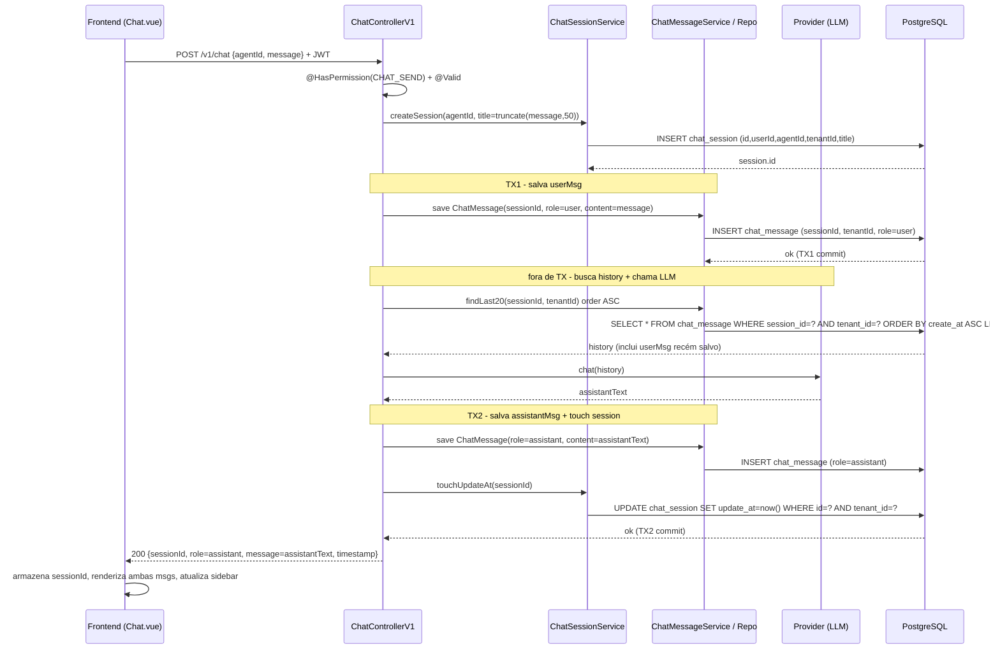
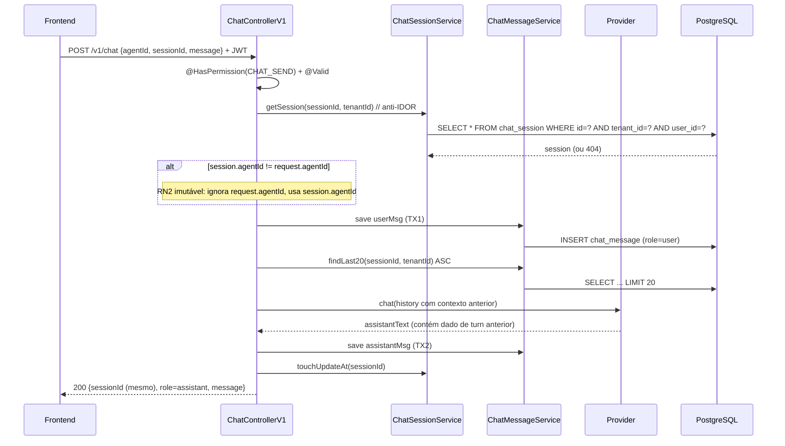
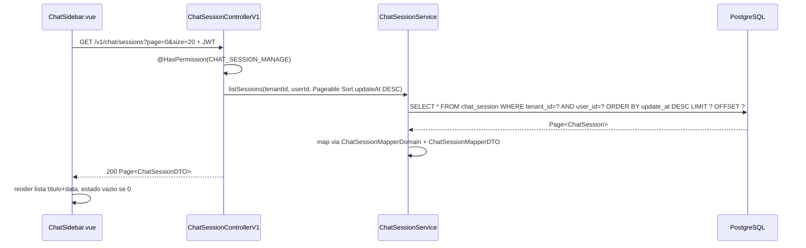
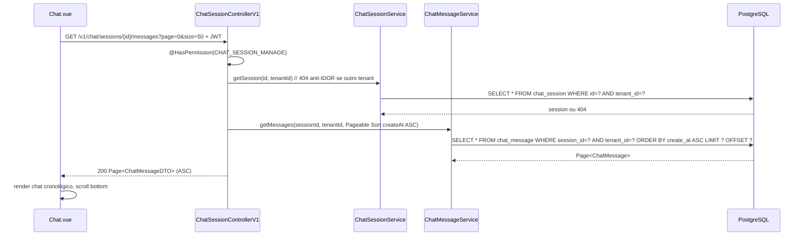
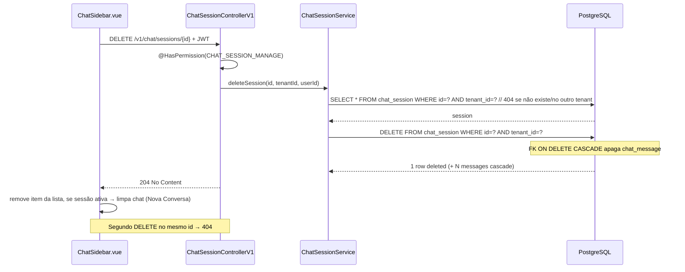

# SPEC — mvp-chat: Chat Persistente + Multi-Turn + Session CRUD

## 1. Header

| Campo | Valor |
|-------|-------|
| **Feature** | `mvp-chat` |
| **Módulo** | `agent` (`api` / `impl` / `dbupdate` / `web/internal/v1`) |
| **Tipo** | Feature |
| **Prioridade** | P0 |
| **Status** | APROVADO com ressalvas |
| **Fase SDD** | Fase 0 — SPEC (Proposal aprovado, sem PLAN/TASKS ainda) |
| **Data** | 2026-08-26 |
| **Autores** | Architect + PM + Roadmap (compilado por sdd-orquestrador) |
| **Dependência bloqueante** | V4 (`chat_session` + `chat_message` criadas sem wiring) — exige V5 corretiva |
| **Context path** | `/hive` — todos os endpoints sob `/hive/v1/chat` |

> Fonte única da verdade: seção "Fonte: Architect + PM + Roadmap" do pedido. Nenhum requisito além de F1-F8, R1-R7, CA1-CA10 e contratos listados foi adicionado. Extrapolações marcadas como `EXTRA` (PATCH rename) quando presentes.

---

## 2. Objetivo & Contexto

### 2.1 Problema atual

- `ChatServiceImpl` é **stateless**: não persiste `ChatSession` nem `ChatMessage`; cada chamada ao LLM é isolada.
- Frontend `Chat.vue` / sidebar hard-coded: lista fake, sem paginação, sem carregamento de histórico, sem `sessionId`.
- `Agent` selector hard-coded: não consome `GET /v1/agents`.
- V4 criou `chat_session` e `chat_message` via Flyway mas **sem wiring**: sem `Repository`, sem `Service`, sem `Mapper`, sem `Controller`, sem FK/índices corretivos.
- Consequências P0: reload perde conversa (CA10 falha), sidebar fake (CA3/CA6 falham), agente imutável não respeitado, history não enviado ao LLM (CA2 falha).

### 2.2 Objetivo

Entregar **chat persistente multi-turn com CRUD de sessões**, isolamento por `tenantId`, autenticação/autorização, paginação e integração real frontend↔backend, reaproveitando tabelas V4 e corrigindo-as com V5.

### 2.3 Definição de pronto (DoD)

- `POST /v1/chat` com `sessionId` opcional persiste user+assistant, retorna `sessionId` real, reenvia history window 20 ao provider.
- CRUD ` /v1/chat/sessions` completo, filtrado por `tenantId + userId`, paginado, com anti-IDOR.
- Frontend consome APIs reais: sidebar lista, click carrega history, Nova Conversa, delete, agent selector via `GET /v1/agents`.
- V5 aplicada; `mvn clean install` passa; `workflow-state.json` em `Completed` após Verify.

### 2.4 Fora de objetivo (reafirmação)

Ver §3.2. Qualquer item fora do escopo exige novo SPEC.

---

## 3. Escopo

### 3.1 In (MUST — MoSCoW)

| ID | Enunciado |
|----|-----------|
| F1 | Persistência `chat_session` + `chat_message` (`title`, `userId`, `agentId`, `tenantId`, `createAt`, `updateAt`) |
| F2 | Multi-turn: salva `user` → busca history → envia ao LLM → salva `assistant` |
| F3 | `POST /v1/chat` com `sessionId` opcional (ausente→cria session, presente→append) + título auto 50 chars |
| F4 | Session CRUD: `POST /sessions`, `GET /sessions` paginado por `user+tenant`, `GET /sessions/{id}/messages`, `DELETE /sessions/{id}` |
| F5 | Sidebar real (lista título+data, click carrega history ASC, Nova Conversa, delete) |
| F6 | Agent selector real (`GET /v1/agents` → dropdown, `session.agentId` imutável no MVP) |
| F7 | Isolamento tenant (filtro `tenantId` em toda query) |
| F8 | Auth `@HasPermission` + JWT, 401/403 corretos, 404 anti-IDOR |

Contratos, V5, regras de negócio, TX split e window 20 (§8-§9) são parte do In.

### 3.2 Out (explicitamente NÃO incluído)

- Streaming / SSE / WebSocket de resposta do LLM.
- Sumarização automática (`summary` coluna existe mas não populada no MVP).
- Busca full-text / semântica em mensagens.
- Compartilhamento de sessão entre usuários.
- Rename via `PATCH` — **EXTRA opcional** (se implementado, seguir contrato §6; não bloqueia MVP).
- Soft-delete / lixeira / restauração (MVP usa hard delete cascade).
- RAG / embeddings / tools / function calling.
- Rate limiting dedicado de chat (usa o global existente).
- Paginação cursor-based (MVP usa `Pageable` offset).

### 3.3 EXTRA (não-MUST, não bloqueia aceite)

- `PATCH /v1/chat/sessions/{id}` `{title}` → rename. Se entregue, deve respeitar validação, tenant filter e `@HasPermission(CHAT_SESSION_MANAGE)`.

---

## 4. Requisitos Funcionais

| ID | Nome | Prioridade | Descrição prescritiva | Critérios de aceite vinculados |
|----|------|------------|-----------------------|--------------------------------|
| **RF1** | Persistência Session + Message | MUST P0 | Persistir `ChatSession` (`id UUID PK`, `userId UUID NOT NULL`, `agentId UUID NOT NULL FK→agent`, `tenantId UUID NOT NULL`, `title VARCHAR(50) NOT NULL`, `summary TEXT NULL`, `createAt`, `updateAt`) e `ChatMessage` (`id`, `sessionId FK→chat_session ON DELETE CASCADE`, `tenantId NOT NULL`, `role ENUM user/assistant`, `content TEXT NOT NULL`, `createAt`, `updateAt`). `tenantId` vem do contexto autenticado (JWT/tenant filter), nunca do body. Entidades estendem `AbstractEntity`. | CA1, CA5, CA10 |
| **RF2** | Multi-turn com history | MUST P0 | `ChatServiceImpl.chat()` deve: (TX1) salvar `ChatMessage(role=user)`, (fora de TX) carregar history da sessão (`order createAt ASC`, window 20 últimas), montar prompt com history + nova mensagem, chamar `Provider`/`Agent` LLM, (TX2) salvar `ChatMessage(role=assistant)`, atualizar `chat_session.updateAt = now()`. Falha do provider não desfaz `userMsg` (TX split). | CA2 |
| **RF3** | `POST /v1/chat` sessionId opcional | MUST P0 | Request `{agentId: UUID required, sessionId: UUID optional, message: String 1..4000 required}`. Se `sessionId` ausente: criar `ChatSession` (`agentId=request.agentId`, `userId=currentUser`, `tenantId=currentTenant`, `title=truncate(message,50)`), usar novo `id` para ambas as mensagens. Se presente: validar existência + ownership (`tenantId`+`userId`), 404 se não pertencer ao tenant (anti-IDOR). Retorna `{sessionId, role:"assistant", message, timestamp}` 200. Validação `@Valid` → 400 RFC7807. | CA1, CA2, CA8, CA9 |
| **RF4** | Session CRUD | MUST P0 | `POST /v1/chat/sessions {agentId, title?}` → 201 `ChatSessionDTO` (title truncado 50 ou gerado). `GET /v1/chat/sessions?page&size` → `Page<ChatSessionDTO>` filtrado `tenantId + userId`, `order updateAt DESC`. `GET /v1/chat/sessions/{id}` → 200 ou 404 anti-IDOR. `GET /v1/chat/sessions/{id}/messages?page&size` → `Page<ChatMessageDTO>` `order createAt ASC`. `DELETE /v1/chat/sessions/{id}` → 204, cascade delete messages, idempotente por tenant (segundo DELETE no mesmo id retorna 404). Todos `@HasPermission`. | CA3, CA4, CA5, CA8, CA9 |
| **RF5** | Sidebar real | MUST P0 | Frontend `ChatSidebar.vue` (ou equivalente) consome `GET /sessions`, renderiza `title + data (updateAt)` ordenado DESC, paginado. Click em item → `GET /messages` + renderiza history ASC. Botão "Nova Conversa" limpa `sessionId` local. Ação delete por item → `DELETE /sessions/{id}` + remove da lista sem reload. Estados vazio/loading/erro cobertos. | CA3, CA4, CA6 |
| **RF6** | Agent selector real | MUST P0 | `AgentSelector.vue` consome `GET /v1/agents` (paginado ou lista), popula dropdown. `session.agentId` é **imutável** no MVP: `POST /v1/chat` com `sessionId` existente deve ignorar `agentId` divergente (ou 400 com `CHAT_AGENT_IMMUTABLE` — decisão implementador, documentar). `POST /sessions` e `POST /chat` sem session exigem `agentId` válido (404 se agent não existir no tenant). | CA7 |
| **RF7** | Isolamento tenant | MUST P0 | Toda query de `ChatSessionRepository` e `ChatMessageRepository` filtra por `tenantId` (via `@Filter` de `AbstractEntity` + `WHERE tenant_id = :tenantId` explícito onde necessário). `GET`/`DELETE` de recurso de outro tenant retorna **404** (não 403) para não vazar existência. | CA8 |
| **RF8** | Auth & Autz | MUST P0 | Todo endpoint ` /v1/chat/**` anotado `@HasPermission(CHAT_SEND)` para `POST /v1/chat` e `@HasPermission(CHAT_SESSION_MANAGE)` para CRUD sessions (ou permissão única `CHAT_MANAGE` se RBAC do projeto assim definir — manter constante centralizada). Sem JWT → 401. JWT válido sem permissão → 403. `@Valid` em todo DTO de entrada. | CA8, CA9 |

> Permissões nominais: usar `CHAT_SEND` e `CHAT_SESSION_MANAGE` conforme contrato §6. Se o projeto já expõe `CHAT_MANAGE` única, mapear ambas para ela e registrar em Delta Specs.

---

## 5. Requisitos Não-Funcionais

### 5.1 Segurança

- **N1.1** JWT validado via Auth0 `java-jwt` (assinatura, `iss`, `aud`, `exp`). `alg` nunca `none`.
- **N1.2** `@HasPermission` em **todos** os endpoints ` /v1/chat/**` — inclusive `GET` de lista (API5).
- **N1.3** Bean Validation `@Valid` em todo DTO de entrada; 400 com `application/problem+json` (RFC 7807) via `ControllerExceptionHandler`.
- **N1.4** DTOs de resposta com projeção explícita — nunca serializar entidade JPA direta (API3).
- **N1.5** Sem segredos em logs; `content` de mensagem não logado em nível INFO em produção.
- **N1.6** `ddl-auto=none`; Flyway única fonte de schema.
- **N1.7** Ver OWASP Top 10 A01/A03/A05: controle de acesso server-side, JPQL parametrizado, sem verbose errors em prod (`server.error.include-stacktrace=never`).

### 5.2 Multi-tenant & Isolamento

- **N2.1** Entidades `ChatSessionEntity` e `ChatMessageEntity` estendem `AbstractEntity` (UUID `id`, `createAt`, `updateAt`, `tenantId` + `@Filter(name="tenantFilter")`).
- **N2.2** Todo `Repository` expõe métodos com `tenantId` (`findByTenantIdAndUserId`, `findByIdAndTenantId`, etc.) ou usa `@Query` parametrizada — nunca concatenação.
- **N2.3** `DatabaseCleaner` / `TenantContext` em testes de integração deve provar isolamento (ver CA8).

### 5.3 Performance & Paginação

- **N3.1** `GET /sessions` paginado obrigatório (`Pageable`, `size` default 20, max 50). Ordenação `updateAt DESC` com índice `idx_chat_session_create_at`.
- **N3.2** `GET /messages` paginado obrigatório (`size` default 50, max 100). Ordenação `createAt ASC` com índice `idx_chat_message_session_id` + `idx_chat_message_tenant_session`.
- **N3.3** History window para LLM: **20 últimas mensagens** (`order createAt ASC`, `limit 20` das mais recentes). Evita N+1: carregar via single query `findBySessionIdAndTenantIdOrderByCreateAtAsc` com `Pageable` ou `LIMIT`.
- **N3.4** `FetchType.LAZY` em `@ManyToOne ChatSessionEntity session` dentro de `ChatMessageEntity`. Evitar `EntityGraph` desnecessário em lista.
- **N3.5** Índices V5 obrigatórios (ver §7.3) — `EXPLAIN` deve mostrar Index Scan em filtros `tenant_id + user_id` e `tenant_id + session_id`.

### 5.4 Confiabilidade & Transações

- **N4.1** TX split: TX1 salva `userMsg`; chamada LLM **fora** de transação; TX2 salva `assistantMsg` + `touch session.updateAt`. Falha do provider → `userMsg` permanece, `assistantMsg` não criado, erro 502/500 mapeado sem rollback de TX1.
- **N4.2** Hard delete cascade via FK `ON DELETE CASCADE` (V5). Sem soft-delete no MVP.
- **N4.3** Idempotência de `DELETE`: segundo delete no mesmo `id+tenant` → 404 (não 500).

### 5.5 Observabilidade

- **N5.1** Logar `sessionId`, `userId`, `tenantId`, `agentId` em `chat()` (sem `content`); correlação via `requestId` se disponível.
- **N5.2** Métricas opcionais: contador `chat.messages.saved` por `role`.

---

## 6. Contratos de API

Base: `RestPath.V1 = "/v1"` sob context path `/hive`. Logo URL efetiva `POST /hive/v1/chat`. `api.ts` `baseURL /hive/v1`. Autenticação `Authorization: Bearer <JWT>` + `X-Tenant-ID` quando exigido pelo gateway.

Permissões:

| Endpoint | Permissão |
|----------|-----------|
| `POST /v1/chat` | `CHAT_SEND` |
| `POST /v1/chat/sessions` | `CHAT_SESSION_MANAGE` |
| `GET /v1/chat/sessions` | `CHAT_SESSION_MANAGE` |
| `GET /v1/chat/sessions/{id}` | `CHAT_SESSION_MANAGE` |
| `GET /v1/chat/sessions/{id}/messages` | `CHAT_SESSION_MANAGE` |
| `DELETE /v1/chat/sessions/{id}` | `CHAT_SESSION_MANAGE` |
| `PATCH /v1/chat/sessions/{id}` (EXTRA) | `CHAT_SESSION_MANAGE` |

### 6.1 Tabela de endpoints

| # | Método | Path | Auth | Request DTO | Response | Status |
|---|--------|------|------|-------------|----------|--------|
| 1 | POST | `/v1/chat` | `CHAT_SEND` + `@Valid` | `ChatRequestDTO {agentId UUID req, sessionId UUID opt, message String 1..4000 req}` | `ChatResponseDTO {sessionId UUID, role="assistant", message String, timestamp Instant}` | 200 / 400 / 401 / 403 / 404 (session/agent) |
| 2 | POST | `/v1/chat/sessions` | `CHAT_SESSION_MANAGE` + `@Valid` | `CreateSessionDTO {agentId UUID req, title String 1..50 opt}` | `ChatSessionDTO` | 201 / 400 / 401 / 403 / 404 (agent) |
| 3 | GET | `/v1/chat/sessions?page&size&sort` | `CHAT_SESSION_MANAGE` | `Pageable` | `Page<ChatSessionDTO>` (`updateAt DESC`) | 200 / 401 / 403 |
| 4 | GET | `/v1/chat/sessions/{id}` | `CHAT_SESSION_MANAGE` | — | `ChatSessionDTO` | 200 / 401 / 403 / 404 anti-IDOR |
| 5 | GET | `/v1/chat/sessions/{id}/messages?page&size` | `CHAT_SESSION_MANAGE` | `Pageable` | `Page<ChatMessageDTO>` (`createAt ASC`) | 200 / 401 / 403 / 404 |
| 6 | DELETE | `/v1/chat/sessions/{id}` | `CHAT_SESSION_MANAGE` | — | — | 204 / 401 / 403 / 404 |
| 7 | PATCH | `/v1/chat/sessions/{id}` EXTRA | `CHAT_SESSION_MANAGE` + `@Valid` | `UpdateSessionDTO {title String 1..50 req}` | `ChatSessionDTO` | 200 / 400 / 401 / 403 / 404 |

### 6.2 DTOs

```java
// Request
record ChatRequestDTO(
  @NotNull UUID agentId,
  UUID sessionId,                          // nullable
  @NotBlank @Size(max=4000) String message
) {}

record CreateSessionDTO(
  @NotNull UUID agentId,
  @Size(max=50) String title               // nullable, se null → derivado da 1ª mensagem
) {}

record UpdateSessionDTO(
  @NotBlank @Size(max=50) String title
) {}

// Response
record ChatResponseDTO(
  UUID sessionId,
  String role,        // "assistant"
  String message,
  Instant timestamp   // createAt do assistantMsg
) {}

record ChatSessionDTO(
  UUID id,
  UUID userId,
  UUID agentId,
  String title,
  String summary,     // null no MVP
  Instant createAt,
  Instant updateAt
) {}

record ChatMessageDTO(
  UUID id,
  UUID sessionId,
  String role,        // "user" | "assistant"
  String content,
  Instant createAt
) {}
```

`Page<DTO>` segue envelope padrão do projeto (`content`, `totalElements`, `totalPages`, `number`, `size`). Se o projeto usa `RestControllerTool.of().buildSuccessResponse(Page)` / `buildPaginatedResponse`, manter padrão existente.

### 6.3 Exemplos JSON

**POST /v1/chat — sem sessionId (criação implícita)**

Request:
```json
{
  "agentId": "3fa85f64-5717-4562-b3fc-2c963f66afa6",
  "message": "Explique RAG em 2 frases"
}
```
Response 200:
```json
{
  "success": true,
  "data": {
    "sessionId": "0c9a1e1e-7f9e-4b0a-9c1a-1a2b3c4d5e6f",
    "role": "assistant",
    "message": "RAG combina recuperação vetorial com geração LLM...",
    "timestamp": "2026-08-26T12:34:56.123Z"
  }
}
```

**POST /v1/chat — com sessionId (append multi-turn)**

Request:
```json
{
  "agentId": "3fa85f64-5717-4562-b3fc-2c963f66afa6",
  "sessionId": "0c9a1e1e-7f9e-4b0a-9c1a-1a2b3c4d5e6f",
  "message": "E como isso difere de fine-tuning?"
}
```
Response 200: mesmo envelope, `sessionId` idêntico ao enviado.

**POST /v1/chat/sessions**

Request:
```json
{ "agentId": "3fa85f64-5717-4562-b3fc-2c963f66afa6", "title": "Dúvidas RAG" }
```
Response 201:
```json
{
  "success": true,
  "data": {
    "id": "0c9a1e1e-7f9e-4b0a-9c1a-1a2b3c4d5e6f",
    "userId": "9e2c9a1e-7f9e-4b0a-9c1a-1a2b3c4d5e6f",
    "agentId": "3fa85f64-5717-4562-b3fc-2c963f66afa6",
    "title": "Dúvidas RAG",
    "summary": null,
    "createAt": "2026-08-26T12:34:56.123Z",
    "updateAt": "2026-08-26T12:34:56.123Z"
  }
}
```

**GET /v1/chat/sessions?page=0&size=20**

Response 200:
```json
{
  "success": true,
  "data": {
    "content": [
      {
        "id": "0c9a1e1e-7f9e-4b0a-9c1a-1a2b3c4d5e6f",
        "userId": "9e2c9a1e-7f9e-4b0a-9c1a-1a2b3c4d5e6f",
        "agentId": "3fa85f64-5717-4562-b3fc-2c963f66afa6",
        "title": "Explique RAG em 2 frases",
        "summary": null,
        "createAt": "2026-08-26T12:34:56.123Z",
        "updateAt": "2026-08-26T12:40:00.000Z"
      }
    ],
    "totalElements": 1,
    "totalPages": 1,
    "number": 0,
    "size": 20
  }
}
```

**GET /v1/chat/sessions/{id}/messages?page=0&size=50**

Response 200 (ASC):
```json
{
  "success": true,
  "data": {
    "content": [
      { "id": "aaa...", "sessionId": "0c9...", "role": "user", "content": "Explique RAG em 2 frases", "createAt": "2026-08-26T12:34:56.123Z" },
      { "id": "bbb...", "sessionId": "0c9...", "role": "assistant", "content": "RAG combina...", "createAt": "2026-08-26T12:34:57.000Z" }
    ],
    "totalElements": 2,
    "totalPages": 1,
    "number": 0,
    "size": 50
  }
}
```

**Erros (RFC 7807 via ControllerExceptionHandler)**

- 400 validação:
```json
{ "type": "about:blank", "title": "Bad Request", "status": 400, "detail": "message: must not be blank", "instance": "/hive/v1/chat" }
```
- 401 sem JWT: `{ "status": 401, "detail": "Unauthorized" }`
- 403 sem permissão: `{ "status": 403, "detail": "Forbidden: missing CHAT_SEND" }`
- 404 anti-IDOR: `{ "status": 404, "detail": "ChatSession not found" }` (mesmo quando existe em outro tenant)

---

## 7. Modelo de Dados

### 7.1 Tabelas V4 (baseline existente — não recriar, apenas corrigir)

> V4 criou `chat_session` e `chat_message`. Estrutura assumida pelo Architect (confirmar via `V4__*.sql` antes de implementar; se divergir, V5 deve ser idempotente com `IF NOT EXISTS` / `IF EXISTS`).

**`chat_session` (V4)**

| Coluna | Tipo | Constraints | Notas |
|--------|------|-------------|-------|
| `id` | `UUID NOT NULL DEFAULT uuid_generate_v4()` | `PK chat_session` | |
| `tenant_id` | `UUID` | `NOT NULL` (V5 corrige se nullable) | FK lógica tenant, filtrado via AbstractEntity |
| `user_id` | `UUID NOT NULL` | | owner da sessão |
| `agent_id` | `UUID NOT NULL` | `FK → agent(id)` | imutável no MVP |
| `title` | `VARCHAR(50) NOT NULL` | | truncado 50 |
| `summary` | `TEXT NULL` | | não populado MVP |
| `create_at` | `TIMESTAMP WITHOUT TIME ZONE NOT NULL DEFAULT now()` | | |
| `update_at` | `TIMESTAMP WITHOUT TIME ZONE NOT NULL DEFAULT now()` | | tocado a cada mensagem |

**`chat_message` (V4)**

| Coluna | Tipo | Constraints | Notas |
|--------|------|-------------|-------|
| `id` | `UUID NOT NULL DEFAULT uuid_generate_v4()` | `PK chat_message` | |
| `session_id` | `UUID NOT NULL` | `FK → chat_session(id) ON DELETE CASCADE` (V5 corrige) | |
| `tenant_id` | `UUID` | `NOT NULL` (V5 corrige) | redundante para filtro |
| `role` | `VARCHAR(20) NOT NULL` | `CHECK role IN ('user','assistant')` | |
| `content` | `TEXT NOT NULL` | | 1..4000 validado em DTO |
| `create_at` | `TIMESTAMP WITHOUT TIME ZONE NOT NULL DEFAULT now()` | | ordenação ASC |
| `update_at` | `TIMESTAMP WITHOUT TIME ZONE NOT NULL DEFAULT now()` | | |

### 7.2 ER textual

```
[tenant] 1--* [chat_session] 1--* [chat_message]
[agent]  1--* [chat_session]
[user (identity)] 1--* [chat_session]

chat_session --(FK ON DELETE CASCADE)--> chat_message.session_id
chat_message.tenant_id = chat_session.tenant_id  (invariante, validado em service)
```

### 7.3 V5 migration — corretiva idempotente (obrigatória)

Arquivo: `agent/dbupdate/src/main/resources/db/migration/agent/V5__fix_chat_session_message_constraints_and_indexes.sql`

```sql
CREATE EXTENSION IF NOT EXISTS "uuid-ossp";

-- Garantir NOT NULL em tenant_id (se V4 deixou nullable)
ALTER TABLE chat_message ALTER COLUMN tenant_id SET NOT NULL;

-- Recriar FK com ON DELETE CASCADE de forma idempotente
ALTER TABLE chat_message DROP CONSTRAINT IF EXISTS fk_chat_message_session;
ALTER TABLE chat_message ADD CONSTRAINT fk_chat_message_session
  FOREIGN KEY (session_id) REFERENCES chat_session(id) ON DELETE CASCADE;

-- Índices para paginação e isolamento
CREATE INDEX IF NOT EXISTS idx_chat_message_session_id ON chat_message(session_id);
CREATE INDEX IF NOT EXISTS idx_chat_message_tenant_session ON chat_message(tenant_id, session_id);
CREATE INDEX IF NOT EXISTS idx_chat_session_tenant_user ON chat_session(tenant_id, user_id);
CREATE INDEX IF NOT EXISTS idx_chat_session_agent ON chat_session(agent_id);
CREATE INDEX IF NOT EXISTS idx_chat_session_create_at ON chat_session(create_at DESC);
```

> `idx_chat_session_create_at DESC` atende `order updateAt DESC` se o planner usar `create_at` como proxy; se `updateAt` for coluna distinta, adicionar `idx_chat_session_update_at` (`update_at DESC`). Manter ambos se houver divergência — custo desprezível.

Histórico Flyway: `flyway_schema_history_agent`, `locations = classpath:/db/migration/agent`, `baselineOnMigrate=true`.

### 7.4 Constraints e invariantes

- `chat_session.title` `NOT NULL`, `VARCHAR(50)` — truncado em service, nunca falha por overflow.
- `chat_message.role` `CHECK IN ('user','assistant')` ou `EnumType.STRING` mapeado.
- `chat_message.session_id` `NOT NULL` + FK cascade — delete de session apaga messages atomicamente no DB.
- `tenant_id` presente em ambas as tabelas; service valida `message.tenantId == session.tenantId` antes de persistir.

---

## 8. Regras de Negócio

| ID | Regra | Especificação prescritiva |
|----|-------|---------------------------|
| **RN1** | Título 50 chars | `title = truncate(trim(message), 50)` na criação implícita (`POST /chat` sem session) ou explícita (`POST /sessions` sem title). `truncate` corta em 50 sem quebrar surrogate, sem adicionar "...". Se `title` fornecido em `POST /sessions`, validar `@Size(max=50)` e usar literal. `PATCH` (EXTRA) também `@Size(max=50)`. |
| **RN2** | agentId imutável no MVP | Após criação, `chat_session.agentId` nunca muda. `POST /v1/chat` com `sessionId` existente: se `request.agentId != session.agentId`, **ignorar** `request.agentId` e usar `session.agentId` para LLM; opcionalmente retornar 400 `CHAT_AGENT_IMMUTABLE` — escolher uma estratégia e documentar no PLAN. `GET/DELETE` não aceitam `agentId`. |
| **RN3** | History window 20 | Ao chamar LLM, carregar **até 20 últimas mensagens** da sessão (`order createAt ASC`, `limit 20` das mais recentes). Se sessão tem ≤20 msgs, envia todas. Ordem no prompt: cronológica ASC. Paginação de `GET /messages` é independente (size 50 default). |
| **RN4** | TX split | `chat()` executa **TX1**: `save(userMsg)` + `save(session)` se nova / `touch updateAt` se existente → commit. **Fora de TX**: `history = findLast20(sessionId)` + `llm.chat(history + newMessage)` (pode lançar). **TX2**: `save(assistantMsg)` + `session.updateAt = now()` → commit. Falha do LLM → TX1 permanece, TX2 não executa, controller retorna 502/500 com `problem+json`, sem rollback de `userMsg`. |
| **RN5** | Anti-IDOR 404 | Todo acesso por `id` (`GET /sessions/{id}`, `GET /messages`, `DELETE`, `POST /chat` com `sessionId`) filtra por `tenantId` do contexto. Se `id` existe em outro tenant → **404** `ChatSessionNotFoundException` (não 403). Mensagem uniforme, sem vazar existência. |
| **RN6** | Hard delete cascade | `DELETE /sessions/{id}` executa `deleteByIdAndTenantId(id, tenantId)`; FK `ON DELETE CASCADE` apaga `chat_message`s no DB. Sem soft-delete, sem `deleted_at`, sem restauração. Operação idempotente por tenant: segundo DELETE → 404. |
| **RN7** | Validação 400 RFC7807 | `@Valid` em `ChatRequestDTO`, `CreateSessionDTO`, `UpdateSessionDTO`. Violação → 400 `application/problem+json` via `ControllerExceptionHandler`. Campos: `agentId` obrigatório UUID existente, `message` 1..4000, `title` 1..50. `sessionId` se fornecido deve ser UUID. |
| **RN8** | Paginação determinística | `GET /sessions` → `PageRequest.of(page,size, Sort.by(DESC,"updateAt"))` filtrado `tenantId+userId`. `GET /messages` → `Sort.by(ASC,"createAt")` filtrado `tenantId+sessionId`. `page` 0-indexed, `size` default 20/50, max 50/100; acima do max → 400. |
| **RN9** | Provider quebrado isolado | Exceção do provider LLM não derruba TX1 nem corrompe sessão. Mapear `ProviderException` → 502 `Bad Gateway` com `problem+json`. Circuit breaker / retry fora de escopo MVP. |
| **RN10** | Tenant filter em toda query | Nenhum `Repository` expõe `findAll()` sem `tenantId`. `findById` sempre `findByIdAndTenantId`. `listSessions` sempre `findByTenantIdAndUserId`. Auditoria via code review (R1). |

---

## 9. Fluxos de Sequência

### FU1 — POST /v1/chat sem sessionId (criação implícita)



### FU2 — POST /v1/chat com sessionId (append multi-turn)



### FU3 — GET /v1/chat/sessions paginado (sidebar)



### FU4 — GET /v1/chat/sessions/{id}/messages paginado (carregar history)



### FU5 — DELETE /v1/chat/sessions/{id} cascade



---

## 10. Critérios de Aceite (Gherkin — CA1-CA10)

### CA1 — Criação implícita de sessão

```gherkin
Funcionalidade: Criação implícita de sessão via POST /v1/chat
  Cenário: usuário envia primeira mensagem sem sessionId
    Dado usuário autenticado com tenant T1 e user U1
    E agente A1 existe no tenant T1
    Quando POST /v1/chat {agentId:A1, message:"Explique RAG em 2 frases"}
    Então status 200
    E response contém sessionId UUID não nulo
    E chat_session criada com userId=U1, tenantId=T1, agentId=A1, title="Explique RAG em 2 frases" (truncado 50)
    E 2 chat_message persistidas (role user + assistant) com mesmo sessionId e tenantId=T1
    E GET /v1/chat/sessions contém a nova sessão
```

### CA2 — Multi-turn com contexto LLM

```gherkin
Funcionalidade: Multi-turn — LLM recebe history
  Cenário: segunda mensagem na mesma sessão usa contexto anterior
    Dado sessão S1 criada com 1 turno (user:"Meu nome é João" / assistant:"Olá João")
    Quando POST /v1/chat {agentId:A1, sessionId:S1, message:"Qual meu nome?"}
    Então provider LLM foi chamado com history contendo "Meu nome é João" + "Qual meu nome?"
    E response assistant contém "João"
    E chat_message count de S1 = 4 (2 turnos)
    E history enviado tem no máximo 20 mensagens ordenadas ASC
```

### CA3 — Listagem sidebar filtrada por tenant+user

```gherkin
Funcionalidade: Listagem de sessões filtrada
  Cenário: sidebar lista apenas sessões do usuário no tenant
    Dado tenant T1 com user U1 (2 sessões) e user U2 (1 sessão), tenant T2 com 1 sessão
    Quando GET /v1/chat/sessions?page=0&size=20 com JWT de U1/T1
    Então status 200 com totalElements=2, content ordenado por updateAt DESC
    E nenhuma sessão de U2 ou T2 aparece
    Quando GET /v1/chat/sessions com JWT de T2
    Então totalElements=1 (isolamento)
```

### CA4 — Carregar history ordenado ASC

```gherkin
Funcionalidade: Carregar mensagens de sessão ordenadas
  Cenário: click na sidebar carrega history cronológico
    Dado sessão S1 com 3 turnos (6 mensagens) criadas em sequência
    Quando GET /v1/chat/sessions/S1/messages?page=0&size=50 com JWT dono
    Então status 200 com content ordenado por createAt ASC
    E primeira mensagem é a mais antiga (role user da criação)
    E paginação funciona: ?page=0&size=2 retorna 2 primeiras, page=1 retorna próximas 2
```

### CA5 — Delete cascade

```gherkin
Funcionalidade: Delete de sessão com cascade
  Cenário: deletar sessão remove mensagens
    Dado sessão S1 com 4 mensagens
    Quando DELETE /v1/chat/sessions/S1
    Então status 204
    E GET /v1/chat/sessions/S1 retorna 404
    E GET /v1/chat/sessions/S1/messages retorna 404
    E SELECT COUNT(*) FROM chat_message WHERE session_id=S1 = 0
    Quando DELETE /v1/chat/sessions/S1 novamente
    Então status 404 (idempotente anti-IDOR)
```

### CA6 — Nova Conversa (frontend)

```gherkin
Funcionalidade: Botão Nova Conversa
  Cenário: iniciar nova conversa limpa contexto
    Dado usuário com sessão S1 ativa e history renderizado
    Quando clica "Nova Conversa" na sidebar
    Então sessionId local é limpo (null)
    E área de chat é esvaziada (sem history)
    E próximo POST /v1/chat sem sessionId cria nova sessão (CA1)
    E sidebar não recarrega página inteira
```

### CA7 — Agent selector real

```gherkin
Funcionalidade: Seletor de agente real
  Cenário: dropdown populado via API
    Dado 3 agentes A1,A2,A3 no tenant T1
    Quando frontend monta Chat.vue
    Então GET /v1/agents é chamado e dropdown contém 3 opções com nome
    Quando cria nova sessão com A2
    Então chat_session.agentId = A2
    Quando envia segunda mensagem na mesma sessão com agentId A3 no body
    Então sessão permanece com agentId A2 (imutável RN2) e LLM usa A2
```

### CA8 — Isolamento + Auth (anti-IDOR, 401/403)

```gherkin
Funcionalidade: Isolamento tenant e autorização
  Cenário: acesso cruzado retorna 404, sem JWT 401, sem permissão 403
    Dado sessão S1 pertence a tenant T1
    Quando GET /v1/chat/sessions/S1 com JWT de tenant T2
    Então status 404 (não 403, não vaza existência)
    Quando GET /v1/chat/sessions/S1 sem Authorization header
    Então status 401
    Quando GET /v1/chat/sessions/S1 com JWT válido mas sem CHAT_SESSION_MANAGE
    Então status 403
    E POST /v1/chat sem CHAT_SEND também 403
```

### CA9 — Validação 400 RFC7807

```gherkin
Funcionalidade: Validação de entrada
  Cenário: payload inválido retorna 400 problem+json
    Quando POST /v1/chat {agentId:null, message:""} 
    Então status 400 com Content-Type application/problem+json e detail menciona agentId/message
    Quando POST /v1/chat {agentId:UUID_inexistente, message:"oi"}
    Então status 404 (agent não encontrado no tenant)
    Quando POST /v1/chat {agentId:A1, message:"x".repeat(4001)}
    Então status 400 (Size max 4000)
    Quando POST /v1/chat/sessions {title:"x".repeat(51)}
    Então status 400
```

### CA10 — Reload com persistência

```gherkin
Funcionalidade: Reload não perde conversa
  Cenário: refresh do browser mantém history
    Dado sessão S1 com 2 turnos persistidos
    Quando usuário recarrega página (F5)
    Então frontend refaz GET /v1/chat/sessions e GET /v1/chat/sessions/S1/messages
    E chat renderiza 4 mensagens idênticas ao estado pré-reload
    E Nenhuma mensagem é perdida ou duplicada
```

---

## 11. Dependências & Riscos

### 11.1 Dependências

| ID | Dependência | Tipo | Impacto se falhar |
|----|-------------|------|-------------------|
| D1 | `agent` module + V4 tables | Interna | Sem V4, V5 falha (FK). Verificar `V4__*.sql` antes. |
| D2 | `identity` / `tenant` (JWT, tenant filter) | Interna | Sem `tenantId` no contexto, isolamento falha. |
| D3 | `provider` module (LLM call) | Interna | Chat sem resposta; RN9 isola falha, mas UX degradada. |
| D4 | PostgreSQL 16 + pgvector + `uuid-ossp` | Infra | `uuid_generate_v4()` falha sem extensão. |
| D5 | `GET /v1/agents` (existente) | Interna | Agent selector fake permanece se endpoint ausente. |
| D6 | `auth.store.ts` expose `userId` | Frontend | Sem `userId`, `ChatSession.userId` incorreto. |

### 11.2 Riscos (R1-R7 do Architect)

| ID | Risco | Probabilidade | Impacto | Mitigação prescrita |
|----|-------|---------------|---------|---------------------|
| **R1** | Tenant filter esquecido em query | Alta | Vazamento cross-tenant (A01) | `AbstractEntity` + `findByIdAndTenantId` obrigatório; code review checklist; IT de isolamento (CA8). |
| **R2** | LAZY + N+1 ao carregar history | Média | Latência, OOM | `FetchType.LAZY` + single query com `LIMIT 20`; sem `EntityGraph` em lista; teste de query count. |
| **R3** | History sem paginação / window >20 | Média | Prompt gigante, custo LLM, timeout | Window 20 fixo em service; `Pageable` em `GET /messages`; índice `tenant_session`. |
| **R4** | TX única engloba LLM (lock longo) | Alta | Deadlock, timeout, rollback de userMsg | **TX split** RN4: TX1 userMsg, LLM fora, TX2 assistantMsg; documentar em service com `@Transactional` em métodos privados `saveUser`/`saveAssistant`. |
| **R5** | V4 incompleta sem V5 | Alta | FK sem cascade, `tenant_id` nullable, sem índices → delete não cascadeia, queries lentas | **V5 obrigatória** §7.3 com `IF NOT EXISTS`/`IF EXISTS` idempotente; Flyway `baselineOnMigrate`. |
| **R6** | AuthZ ausente (`@HasPermission`) | Média | Acesso não autorizado (A01/API5) | Anotar todo controller; IT cobre 401/403; security-review gate. |
| **R7** | Provider quebrado derruba chat | Média | 500 em toda chamada | RN9: isolar exceção → 502, preservar TX1; não retry no MVP. |

### 11.3 Riscos de produto (PM)

| Risco produto | Mitigação |
|---------------|-----------|
| Reload perde conversa | Persistência + CA10 |
| Sidebar fake | F5 + CA3/CA4 |
| Agente hard-coded | F6 + CA7 |
| History não enviado ao LLM | F2 + RN3 + CA2 |

---

## 12. Delta Specs (impacto em `.doc/` e `docs/adr`)

> SPEC inclui Delta Specs por obrigação SDD Fase 1. Alterações abaixo devem ser mescladas em `.doc/` no Archive (sdd-compiler modo archive).

| Documento alvo | Tipo de delta | Conteúdo a mesclar |
|---------------|---------------|-------------------|
| `.doc/arquitetura-backend.md` | Update | Seção `agent` module: adicionar `ChatSession`/`ChatMessage` entidades, `ChatSessionService`, `ChatMessageRepository`, `ChatSessionRepository`, TX split pattern, history window 20. |
| `.doc/especificacao-sistema.md` | Update | Use case "Chat persistente multi-turn": contrato `POST /v1/chat` com sessionId opcional + CRUD sessions; regra título 50, agentId imutável, anti-IDOR 404. |
| `.doc/stacks.md` | No-op | Sem nova stack; confirma Java 21, Spring Boot 4.1.0, PostgreSQL 16 + pgvector, Flyway, MapStruct. |
| `docs/adr/ADR-XXX-flyway-agent-v5.md` | **Novo ADR** | Decisão: V5 corretiva para `chat_message`/`chat_session` (FK cascade + NOT NULL + índices). Alternativas: recriar V4 (rejeitado — imutabilidade de migrations). |
| `docs/adr/ADR-XXX-chat-tx-split.md` | **Novo ADR** | Decisão: TX split em `ChatServiceImpl.chat()` para isolar falha de provider. Alternativa TX única (rejeitada — lock longo). |
| `docs/design/DESIGN_SYSTEM.md` | No-op | ChatSidebar/AgentSelector seguem tokens existentes (Deep Indigo + Amber). |
| `.doc/api-contracts.md` (se existir) | Update | Adicionar tabela §6.1 + exemplos JSON; versionamento permanece `/v1`. |

---

## 13. Checklist de Validação (Asserts — sdd-compiler + spec-review)

### 13.1 SPEC gate (antes de PLAN)

- [ ] Header completo (feature, status APROVADO com ressalvas, fase, data, autores)
- [ ] Objetivo & Contexto descreve stateless atual + V4 sem wiring
- [ ] Escopo In/Out/EXTRA sem ambiguidade; nada além de F1-F8 inventado
- [ ] RF1-RF8 mapeados para F1-F8 MUST com prioridade P0
- [ ] RNF cobre segurança (JWT, @HasPermission, @Valid, RFC7807), multi-tenant (AbstractEntity + tenantId), paginação (defaults/max), TX split, performance (índices, window 20)
- [ ] Contratos API tabela 7 endpoints + DTOs com Bean Validation + exemplos JSON + status codes + permissões
- [ ] Modelo de Dados: V4 baseline + V5 DDL idempotente + ER + constraints + índices nomeados
- [ ] Regras de Negócio RN1-RN10 (título 50, imutável, window 20, TX split, anti-IDOR 404, cascade, 400 RFC7807, paginação determinística, provider isolado, tenant filter)
- [ ] Fluxos FU1-FU5 em mermaid sequenceDiagram cobrindo criação implícita, append, lista, history, delete
- [ ] Critérios CA1-CA10 em Gherkin testáveis (Given/When/Then) sem contradição com RF/RN
- [ ] Dependências & Riscos D1-D6 + R1-R7 + riscos produto com mitigação
- [ ] Delta Specs lista `.doc/` e `docs/adr` impactados
- [ ] Checklist de asserts presente

### 13.2 Gates seguintes (PLAN → TASKS → Verify)

- [ ] PLAN derivado deste SPEC sem novo requisito (sdd-compiler generate-plan)
- [ ] TASKS TDD-ready (1 task por RF/RN/CA, com arquivo:linha alvo)
- [ ] Code review `fullstack-code-reviewer` com zero 🔴 antes de Verify
- [ ] Verify 3 dimensões: Completeness (TASKS checkboxes), Correctness (`mvn clean install` + ITs), Coherence (ADRs refletidos, sem vazamento de camada)

### 13.3 Critérios de rejeição do SPEC

Falha em qualquer item acima com 🔴 bloqueia avanço para PLAN. Corrigir gaps 🔴 e 🟠 antes de `ask_user` aprovação.

---

## Apêndice A — Mapa de arquivos (prescritivo para PLAN)

```
agent/
├── api/src/main/java/.../agent/api/domain/
│   ├── ChatSession.java          # VO id, userId, agentId, title, summary, createAt, updateAt
│   └── ChatMessage.java          # VO estendido com sessionId, role, content
├── impl/src/main/java/.../agent/impl/
│   ├── entity/ChatSessionEntity.java
│   ├── entity/ChatMessageEntity.java
│   ├── mapper/ChatSessionMapperDomain.java   # MapStruct spring, ignore createAt/updateAt/tenantId
│   ├── mapper/ChatMessageMapperDomain.java
│   ├── repository/ChatSessionRepository.java  # JpaRepository<ChatSessionEntity,UUID> @Repository
│   ├── repository/ChatMessageRepository.java
│   └── service/
│       ├── ChatSessionService.java (interface em api) + ChatSessionServiceImpl.java
│       └── ChatServiceImpl.java (refator chat())
├── dbupdate/src/main/resources/db/migration/agent/
│   └── V5__fix_chat_session_message_constraints_and_indexes.sql
└── web/internal/v1/src/main/java/.../agent/web/internal/v1/
    ├── controller/ChatControllerV1.java       # @RequestMapping(RestPath.V1 + "/chat")
    ├── controller/ChatSessionControllerV1.java # ou unificado — decisão PLAN
    ├── dto/ChatRequestDTO.java, ChatResponseDTO.java, ChatSessionDTO.java, ChatMessageDTO.java
    └── mapper/ChatSessionMapperDTO.java, ChatMessageMapperDTO.java

frontend/src/
├── services/session.service.ts   # GET/POST/DELETE /v1/chat/sessions
├── services/chat.service.ts      # POST /v1/chat
├── stores/auth.store.ts          # expose userId (decode JWT ou /me)
├── components/ChatSidebar.vue    # lista título+data, Nova Conversa, delete
├── components/AgentSelector.vue  # GET /v1/agents → dropdown
└── views/Chat.vue                # sessionId param, history ASC, input
```

## Apêndice B — Convenções de código aplicáveis

- Entidades: `extends AbstractEntity`, manual getters/setters, sem Lombok.
- Repositories: `extends JpaRepository<Entity,UUID>` direto, `@Repository`.
- Mappers: `@Mapper(componentModel="spring")`, dois níveis (domain↔entity, DTO↔domain).
- Controllers: constructor injection, `RestControllerTool.of().buildSuccessResponse()` / `buildPaginatedResponse`, `@Valid`, `@HasPermission`.
- Services: interface em `api`, impl em `impl` com `@Service`, `@Transactional` em writes, domínio VO não entidade.
- Testes: `when_{action}_with_{scenario}_then_{result}` com Mockito + AssertJ.

## Apêndice C — Referências

- Roadmap V4: tabelas `chat_session` / `chat_message` criadas.
- Architect: R1-R7, V5 DDL, API contracts, TX split, window 20.
- PM: F1-F8 MoSCoW MUST, CA1-CA10 BDD, riscos produto P0.
- Regras: `.agents/rules/backend-coding-standards.md`, `db-migration-flyway.md`, `security-standard.md`, `sdd-workflow-standard.md`.
