# PLAN — admin-prompt-agent: Administração de Prompts e Agentes + Agente Padrão

## 1. Header

| Campo | Valor |
|-------|-------|
| **Feature** | `admin-prompt-agent` |
| **SPEC fonte única** | `.spec/backend/admin-prompt-agent/SPEC.md` v2026-08-26 (1549 linhas, RF1-RF8, NFR N1-N6, 12 endpoints §6, V6/V7/V8 idempotentes, RN1-RN12, FU1-FU5 mermaid, CA1-CA8 +2 extras, ADRs 01-06, Invariantes §7.6/7.7, Test Strategy §7.8) |
| **PROPOSAL** | `.spec/backend/admin-prompt-agent/PROPOSAL.md` v341 linhas (3 subdomínios, R1-R8, ADRs, O1-O7) |
| **UX-SPEC vinculante** | `.spec/frontend/admin-prompt-agent/UX-SPEC.md` v1.0 — 5 telas §4, 8 inovações I1-I8, grid §5, tokens Pulse §7 |
| **Spec-review fixes incorporados** | V7 split (V6/V7/V8 C1), tenant fill C2 `RAISE EXCEPTION` não `uuid_generate_v4`, JPQL `CASE WHEN` C3 sem `@Transactional` em repository, FK `RESTRICT` C4/G7 prescritivo, code imutável C5/G5 `UNIQUE(tenant,code,version)` + partial `WHERE ACTIVE`, TX service C6 |
| **Security-review fixes incorporados** | G1 RBAC bypass `authorities.isEmpty→proceed` removido + `PROMPT_MANAGE/AGENT_MANAGE` constantes, G2 `GET /agents anyOf={CHAT_SEND,AGENT_MANAGE}`, G3 rate limiting Bucket4j+Redis task dedicada, G4 RFC7807 `StandardError` reformulado + handlers `422/409` branch |
| **Módulos afetados** | `agent/{api,impl,dbupdate,web/internal/v1}` + `provider/api` (LLMModel) + `security` (HasPermissionAspect, SecurityFilter, ControllerExceptionHandler) + `commons` (StandardError, RateLimit) + `frontend` (views/components/admin) |
| **Tipo** | Feature composta — 3 subdomínios (`prompt-admin` → `agent-admin` → `default-agent`) + `frontend` |
| **Prioridade** | P0 must-have |
| **Status** | PLAN aprovado — pronto para `generate-tasks` |
| **Data** | 2026-08-26 |
| **Autor** | `sdd-orquestrador` via `sdd-compiler generate-plan` |
| **Stack** | Java 21, Spring Boot 4.1.0, PostgreSQL 16 + pgvector, Flyway por módulo, MapStruct `spring`, JUnit5 + Mockito + Testcontainers, Vue 3.5 + PrimeVue 4 + Pinia + Vite 8 |

> Fonte única: SPEC corrigida. Nenhum requisito além de RF1-RF8 / RN1-RN12 / CA1-CA8 foi inventado. EXTRA (`PATCH/duplicate`) não entra no MVP.

---

## 1.1 SPEC Validation Report

| Item | Status | Comentário |
|------|--------|------------|
| SPEC 1549 linhas, RF1-RF8 prescritivos, RN1-RN12 com CASE WHEN | ✅ Validado | JPQL `CASE WHEN a.id=:targetId THEN true ELSE false END`, fallback 422/404 A4, sole 409 |
| 12 endpoints §6 + DTOs Bean Validation + exemplos JSON | ✅ Validado | `code` imutável sem campo em UpdateDTO, `avatarUrl` `@Pattern ^https?://.*` não `@URL` |
| V6/V7/V8 idempotentes `DO $$ IF NOT EXISTS` + `CREATE INDEX IF NOT EXISTS` | ✅ Validado | C1 split: V6 agent core, V7 prompt_template + agent extras, V8 FK RESTRICT |
| FU1-FU5 mermaid sequenceDiagram + CA1-CA8 Gherkin +2 extras | ✅ Validado | Herdado integralmente |
| ADRs 01-06, Invariantes §7.6/7.7, Test Strategy §7.8 | ✅ Validado | Sem H2, sem @SpringBootTest em unit, paginação default 20 max 50 |
| Gaps remanescentes | ⚠️ Warning | G3 rate limiting Bucket4j+Redis marcado como débito A04 até entrega — TASK dedicada INFRA-01 cobre; não bloqueia MVP |
| Assunções adotadas | — | A1-A5 aprovadas (avatar URL, playground mock, LLMModel enum, tools string[], herança snapshot); `inferenceParams` sem defaults mágicos (null se ambos null, RN6) |

---

## 2. Estratégia de Implementação

### 2.1 Ordem dos 3 subdomínios + frontend (dependências dirigidas)

```
prompt-admin ──▶ agent-admin ──▶ default-agent ──▶ frontend
     │                  │                  │
     │ FK prompt_id     │ is_default flag  │ contratos REST
     │ template TEXT    │ partial index    │ DTOs + RBAC
     │ extractParams    │ fallback resolver│ I1-I8
     ▼                  ▼                  ▼
```

| Ordem | Subdomínio | Dependência | Motivo da ordem | Desacoplável? |
|-------|------------|-------------|-----------------|---------------|
| **1** | `prompt-admin` | Nenhuma (independente) | Base para `agent.promptTemplate` FK; `extractParams` autoritativo | ✅ Entrega isolada: CRUD prompts sem agentes |
| **2** | `agent-admin` | `prompt-admin` (FK opcional + herança `inferenceParams`) | `AgentEntity.promptTemplate @ManyToOne LAZY`; validação `promptId` via `findByIdAndTenantId` | Parcial — pode criar agente sem prompt |
| **3** | `default-agent` | `agent-admin` (`is_default` + `uniq_agent_default_per_tenant`) | `DefaultAgentResolver` / `DefaultAgentService` opera sobre `agent` table; `ChatServiceImpl` injeta resolver | Depende de `agent-admin` completo |
| **4** | `frontend` | Todos os contratos BE (12 endpoints + DTOs + RBAC) | Views `PromptsView/AgentsView` consomem `prompt.service.ts` / `agent-admin.service.ts` | Bloqueado até BE Batch3 |

**Regra de sequenciamento:** nenhum batch abre se dependência não tem `mvn compile -pl agent/impl -am` verde + ITs do batch anterior passando.

### 2.2 Estratégia por camada (vertical slice)

- **api → impl → dbupdate → web** por subdomínio (domain-first).
- `PLAN` segue `Execution Graph` do `plan-gate`: `Infra → Domain → Data → App → Interface → Frontend`.
- `provider/api` não é alterado (LLMModel enum fixo A3).
- `security` e `commons` são INFRA bootstrap (G1/G4) e precedem domínio (plan-gate Infra Bootstrap First).

---

## 3. Arquitetura Detalhada

### 3.1 Diagrama de componentes (mermaid — PLAN prescreve)

```mermaid
flowchart TB
  subgraph FE[Frontend Vue 3 + PrimeVue Pulse]
    V1[PromptsView.vue / PromptsView listagem I1]
    V2[PromptEditorView.vue Split 60/40 I2]
    V3[AgentsView.vue badge ⭐ I6]
    V4[AgentEditorView.vue Accordion I7/I8]
    C1[PromptDataTable.vue]
    C2[TemplateEditor.vue highlight cyan I3]
    C3[PlaygroundPanel.vue mock I4]
    C4[AgentDataTable.vue]
    C5[DefaultAgentToggle.vue toggle+dialog I7]
    S1[prompt.service.ts]
    S2[agent-admin.service.ts]
  end

  subgraph WEB[agent/web/internal/v1]
    PC[PromptTemplateControllerV1 @/v1/prompt-templates 5 endpoints]
    AC[AgentControllerV1 @/v1/agents 7 endpoints]
    DC[DefaultAgentControllerV1 @/v1/agents/default + POST /{id}/default]
    CC[ChatControllerV1 fallback agentId nullable]
    MP[DTOMappers MapStruct PromptTemplateDTOMapper AgentDTOMapper]
    EH[ControllerExceptionHandler RFC7807 400/404/409/422]
  end

  subgraph IMPL[agent/impl]
    PS[PromptTemplateServiceImpl + PromptVariableExtractor regex]
    AS[AgentServiceImpl herança RN6 + sole check RN3]
    DS[DefaultAgentServiceImpl / DefaultAgentResolver setDefault/getDefault/requireDefault]
    PE[PromptTemplateEntity AbstractEntity]
    AE[AgentEntity AbstractEntity isDefault avatarUrl systemPrompt]
    PR[PromptTemplateRepository]
    AR[AgentRepository updateDefaultFlag CASE WHEN]
  end

  subgraph DB[agent/dbupdate Flyway]
    V6[V6 is_default + avatar_url + system_prompt + uniq partial index]
    V7[V7 prompt_template description/tags/inference_params TEXT + agent top_p/maxTokens/tools/KBs]
    V8[V8 FK agent.prompt_template_id ON DELETE RESTRICT]
    PG[(PostgreSQL 16 pgvector)]
  end

  subgraph PROV[provider/api]
    LLM[LLMModel enum OPENAI/OPENCODE/GEMINI/OLLAMA]
    APT[AiProviderType]
  end

  subgraph SEC[security + commons]
    HPA[HasPermissionAspect RBAC fix G1]
    SF[SecurityFilter popula authorities JWT]
    SC[SecurityConstants PROMPT_MANAGE AGENT_MANAGE]
    SE[StandardError RFC7807 type/title/status/detail/instance/code]
    RL[RateLimit Bucket4j+Redis G3]
  end

  FE -- "REST /hive/v1 Bearer JWT + X-Tenant-ID" --> WEB
  WEB --> IMPL
  IMPL --> DB --> PG
  IMPL -- "LLMModel enum" --> PROV
  CC -- "injeta DefaultAgentResolver" --> DS
  DS -- "findByTenantIdAndIsDefaultTrue + updateDefaultFlag" --> AR
  WEB -- "HasPermission anyOf GET /agents" --> SEC
  SEC -. "valida" .-> WEB
```

**Fluxo crítico (Critical Execution Path — MVP sem frontend):**

`V6/V7/V8 → PromptTemplateEntity/AgentEntity → Repositories CASE WHEN → PromptVariableExtractor → Services (extract + herança + sole) → DefaultAgentResolver injetado em ChatServiceImpl → Controllers 12 endpoints + HasPermission anyOf → ExceptionHandler RFC7807`

Frontend é `Phase 4` após BE verde.

### 3.2 Constraint Mapping

| SPEC Ref | Constraint | Enforcement Point | Failure Mode | Implementation Strategy |
|----------|------------|-------------------|--------------|-------------------------|
| **ADR-03 / RN1** | Exclusividade 1 default por tenant atômica | `AgentRepository.updateDefaultFlag` JPQL `CASE WHEN` + `uniq_agent_default_per_tenant WHERE is_default=true` | Race gera 2 defaults | Single-statement `UPDATE agent SET is_default=(id=:id) WHERE tenant_id=:tid` + partial unique barreira DB; `DataIntegrityViolation → 409 CONCURRENT_DEFAULT_UPDATE` |
| **RN2 / FU4** | Fallback null→default determinístico | `DefaultAgentResolver.requireDefault(tenantId)` injetado em `ChatServiceImpl.chat()` | 500 NPE sem default | `findByTenantIdAndIsDefaultTrue` → `Optional.empty → DefaultAgentNotFoundException → 422` (command) / 404 (query) distinção `isCommand` |
| **RN3 / FU5** | Sole default nunca deletado/desativado | `AgentServiceImpl.delete/update` `@Transactional` count check | Zero defaults após delete | `countByTenantIdAndIsDefaultTrue==1 && isDefault → 409 SOLE_DEFAULT_AGENT`; FE disabled complementar |
| **RN4 / CA7** | Regex `{{var}}` autoritativa | `PromptVariableExtractor` BE + `extractVars` TS FE | Divergência front/back 400 inesperado | Regex canônica `\{\{\s*([a-zA-Z_][a-zA-Z0-9_]*)\s*\}\}` única; `params` sempre `extract` server-side, ignorar client |
| **RN6** | Herança inferenceParams snapshot | `AgentServiceImpl.create/update` manual merge | Sobrescrita confusa | Campo-a-campo: `agentDto non-null → sobrescreve`, `null → herda prompt`, ambos null → null (sem default mágico); não reativo |
| **RN8 / RN12** | Tenant isolation + FK RESTRICT | `AbstractEntity @Filter` + `findByIdAndTenantId` + `existsByPromptTemplateIdAndTenantId` mesma TX | Vazamento cross-tenant (A01) / órfão | Toda query com `tenantId` explícito; `ON DELETE RESTRICT` + service `409 PROMPT_IN_USE` + `DataIntegrityViolation → 409` |
| **RF1 / RN9** | Code único por tenant, version increment, imutável | `PromptTemplateServiceImpl` + `UNIQUE(tenant,code,version)` + partial `WHERE ACTIVE` | Dup code / code mutável | `POST` check `existsByTenantIdAndCode` → 409; `UpdateDTO` sem campo `code` (ignorar/400 CODE_IMMUTABLE); `version old+1` monotônico |
| **N1.2 / G1** | RBAC bypass fix | `HasPermissionAspect` + `SecurityFilter` + `SecurityConstants` | `authorities.isEmpty→proceed` bypass HIGH | Remover bypass, popular `authorities` via `JWT claims[permissions]` ou `User.getAuthorities()`, constantes `PROMPT_MANAGE/AGENT_MANAGE/CHAT_SEND`, IT 403 para 12 endpoints |
| **N3.1 / API4** | Paginação obrigatória | Controllers `Pageable` | Unrestricted Resource Consumption | `size` default 20 max 50 → 400 se >50; índices `tenant_update_at` / `tenant_create_at`; `EXPLAIN Index Scan` |
| **N1.3 / G4** | RFC7807 `application/problem+json` | `StandardError` + `ControllerExceptionHandler` | Stack trace vazado / status errado 422/404 | Reformular para `type/title/status/detail/instance/code`; branch `DataIntegrityViolation` → 409 vs `DefaultAgentNotFoundException` → 422/404 via `isCommand` |
| **G3 / A04** | Rate limiting admin | `commons` Bucket4j + Redis | Brute force em POST/PUT admin | Task dedicada INFRA-01: `Bucket4j+Redis` por tenant/IP em `POST/PUT /prompt-templates` e `/agents`; documentar se débito até entrega |

### 3.3 Module & Code Structure

| Módulo | Responsabilidades | Boundaries & Communication |
|--------|------------------|----------------------------|
| `agent/api` | Domain VOs `PromptTemplate`, `Agent`, `InferenceParams`; `PromptTemplateService`/`AgentService`/`DefaultAgentService` interfaces; exceptions `DefaultAgentNotFoundException`, `SoleDefaultAgentException`, `PromptInUseException`, `ConcurrentDefaultUpdateException`, `InvalidTemplateVariableException` | Sem deps framework; `agent/impl` implementa; `web` consome via constructor injection |
| `agent/impl` | Entities `extends AbstractEntity`, repos `JpaRepository`, `PromptVariableExtractor` regex, `DefaultAgentResolver`, services `@Service @Transactional`, mappers `MapStruct spring` | Depende de `api` + `provider/api` (LLMModel); `dbupdate` aplica DDL |
| `agent/dbupdate` | Flyway `V6/V7/V8` idempotentes, índices, constraints | `AgentDbUpdateConfig` `Flyway baselineOnMigrate=true` history `flyway_schema_history_agent` |
| `agent/web/internal/v1` | Controllers `RestPath.V1 + /prompt-templates` `/agents`, DTOs `CreateDTO/UpdateDTO/DTO`, `InferenceParamsDTO`, mappers DTO↔domain, `ControllerExceptionHandler` RFC7807 | Usa `RestControllerTool.of().buildSuccessResponse()` / `buildPaginatedResponse`; `@HasPermission` + `@Valid` |
| `provider/api` | `LLMModel` enum (`OPENAI`, `OPENCODE`, `GEMINI`, `OLLAMA`), `AiProviderType` | Já existe; sem alteração MVP (A3) |
| `security` / `commons` | `HasPermissionAspect` fix, `SecurityFilter`, `SecurityConstants`, `StandardError` RFC7807, `RateLimit` Bucket4j | INFRA bootstrap; `web` depende |
| `frontend` | `views/PromptsView`, `PromptEditorView`, `AgentsView`, `AgentEditorView`; `components/admin/*`; `services/prompt.service.ts` / `agent-admin.service.ts`; `stores` se necessário; `router` | `api.ts` baseURL `/hive/v1` Bearer injection; PrimeVue Aura Pulse zinc/amber/cyan |

---

## 4. Plano por Camada (prescritivo — 100% SPEC)

### 4.1 Camada `api` (domain + service interfaces)

**Prompt:**

- Estender `PromptTemplate.java` (domain VO): `description TEXT 0..2000`, `tags List<String> 0..20`, `inferenceParams InferenceParams VO`, `params Set<String>` (extraído), `status PromptStatus`, `version Integer`, `tenantId UUID`, `createAt/updateAt`. Sem Lombok, manual getters/setters.
- Novo `InferenceParams.java` VO: `Double temperature 0.0-2.0`, `Double topP 0.0-1.0`, `Integer maxTokens 256-4096`. Usado em `PromptTemplate` e `Agent`.
- Estender `PromptTemplateService.java`: `Set<String> extractParams(String template)`, `Page<PromptTemplate> list(UUID tenantId, Pageable, String q, PromptStatus status)`, `PromptTemplate create/update/delete`.

**Agent:**

- Estender `Agent.java` (domain VO): `String avatarUrl 2048 URL`, `String description`, `String systemPrompt TEXT 0..20000`, `UUID promptId` (FK opcional), `LLMModel model` obrigatório, `AiProviderType providerType`, `Double temperature/topP`, `Integer maxTokens`, `List<String> tools 0..20`, `List<String> knowledgeBases 0..20`, `boolean isDefault`, `boolean active`.
- Estender `AgentService.java`: `Page<Agent> list`, `Agent getById`, `Agent create/update/delete`, `Agent setDefault(UUID tenantId, UUID agentId)`.
- Novo `DefaultAgentService.java` (ou `DefaultAgentResolver.java` em `impl`): `Optional<Agent> findDefault(UUID tenantId)`, `Agent requireDefault(UUID tenantId)` throws `DefaultAgentNotFoundException`, `Agent setDefault(...)` com `InactiveAgentCannotBeDefault → 422`.
- Exceptions novas em `agent/api/exceptions/`: `DefaultAgentNotFoundException.java` (boolean `isCommand` ou dois subtipos), `SoleDefaultAgentException.java`, `PromptInUseException.java`, `ConcurrentDefaultUpdateException.java`, `InvalidTemplateVariableException.java` (carrega token inválido).

### 4.2 Camada `impl` (entities, repos, services, extractor, resolvers)

**Entities:**

- `PromptTemplateEntity.java` `extends AbstractEntity` (UUID id, createAt, updateAt, tenantId `@Filter`): `code VARCHAR(100) NOT NULL`, `name VARCHAR(200) NOT NULL`, `template TEXT NOT NULL 1..20000`, `params TEXT[]`, `description TEXT`, `tags TEXT[]`, `inferenceParams JSONB (@JdbcTypeCode(SqlTypes.JSON) InferenceParams)`, `status VARCHAR(20) CHECK DRAFT/ACTIVE/ARCHIVED @Enumerated(STRING)`, `version INT NOT NULL`. Manual getters/setters.
- `AgentEntity.java` `extends AbstractEntity`: `name VARCHAR(200)`, `description VARCHAR(2000)`, `avatarUrl VARCHAR(2048) @Pattern`, `systemPrompt TEXT`, `promptTemplate @ManyToOne LAZY @JoinColumn(name="prompt_template_id") nullable`, `llmModel VARCHAR(50) @Enumerated(STRING) NOT NULL`, `providerType VARCHAR(50)`, `temperature DOUBLE`, `topP DOUBLE PRECISION column top_p`, `maxTokens INT column max_tokens`, `tools TEXT[]`, `knowledgeBases TEXT[] column knowledge_bases`, `isDefault BOOLEAN NOT NULL DEFAULT false column is_default`, `active BOOLEAN NOT NULL DEFAULT true`. `tools/KBs` via `@JdbcTypeCode(SqlTypes.ARRAY)` ou `columnDefinition="text[]"`.

**Repositories:**

- `PromptTemplateRepository.java` `extends JpaRepository<PromptTemplateEntity, UUID> @Repository`: `Optional<PromptTemplateEntity> findByIdAndTenantId(UUID id, UUID tenantId)`, `Page<PromptTemplateEntity> findByTenantId(UUID tenantId, Pageable)`, `boolean existsByTenantIdAndCode(UUID tenantId, String code)`, `boolean existsByTenantIdAndCodeAndStatus(UUID tenantId, String code, PromptStatus status)` se partial, `Page<PromptTemplateEntity> findByTenantIdAndStatus(...)` com `@Query` ilike `name/code/description`.
- `AgentRepository.java` `extends JpaRepository<AgentEntity, UUID>`: `Optional<AgentEntity> findByIdAndTenantId`, `Page<AgentEntity> findByTenantId(UUID, Pageable)`, `Optional<AgentEntity> findByTenantIdAndIsDefaultTrue(UUID tenantId)`, `long countByTenantIdAndIsDefaultTrue(UUID)`, `boolean existsByPromptTemplateIdAndTenantId(UUID promptId, UUID tenantId)`, 
  ```java
  @Modifying
  @Query("UPDATE AgentEntity a SET a.isDefault = CASE WHEN a.id = :targetId THEN true ELSE false END WHERE a.tenantId = :tenantId")
  int updateDefaultFlag(@Param("tenantId") UUID tenantId, @Param("targetId") UUID targetId);
  ```
  Sem `@Transactional` aqui (C3) — TX no service. `count/find` com `tenantId` explícito (RN12).

**Extractor & Resolver:**

- `PromptVariableExtractor.java` (ou `PromptTemplateServiceImpl.extractParams` estático): `public static final Pattern VAR_PATTERN = Pattern.compile("\\{\\{\\s*([a-zA-Z_][a-zA-Z0-9_]*)\\s*\\}\\}")`; `Set<String> extract(String template)` com `LinkedHashSet`, `Collections.unmodifiableSet`. Se `template.contains("{{") && result.isEmpty()` → throw `InvalidTemplateVariableException` com token bruto `{{[^}]*}}`.
- `DefaultAgentResolver.java` `@Component` ou `DefaultAgentServiceImpl @Service`: `setDefault` valida `active==true` senão `422 INACTIVE_AGENT_CANNOT_BE_DEFAULT`, chama `updateDefaultFlag` single-statement, captura `DataIntegrityViolationException` → `ConcurrentDefaultUpdateException → 409 CONCURRENT_DEFAULT_UPDATE`, retorna `findByIdAndTenantId` atualizado. `requireDefault` chama `findByTenantIdAndIsDefaultTrue` → `orElseThrow DefaultAgentNotFoundException`.

**Services:**

- `PromptTemplateServiceImpl.java` `@Service`: `@Transactional` em `create/update/delete`; `extractParams` autoritativo, ignorar `params` do client, `code` imutável (UpdateDTO sem campo; se enviado via JSON extra → 400 CODE_IMMUTABLE via validator ou ignorado), `version old+1`, `existsByTenantIdAndCode` → 409 `PROMPT_CODE_DUPLICATE`.
- `AgentServiceImpl.java` `@Service`: `@Transactional` em writes; `findByIdAndTenantId` 404 anti-IDOR; `promptId` → `promptRepo.findByIdAndTenantId` 404 se outro tenant; herança RN6 campo-a-campo manual (se `dto.temperature==null && prompt.inferenceParams.temperature!=null → herda`); `avatarUrl` `@Pattern` já validado em DTO mas re-validar; sole check `count==1 && entity.isDefault → 409 SOLE_DEFAULT_AGENT` antes de `delete` ou `active=false`; `PROMPT_IN_USE` same TX via `existsByPromptTemplateIdAndTenantId`.
- `DefaultAgentServiceImpl.java` injeta `AgentRepository`; `ChatServiceImpl.java` estendido: `ChatRequestDTO.agentId` nullable; `agentId==null → defaultAgentService.requireDefault(tenantId)` ; `agentId!=null → findByIdAndTenantId` 404 se não pertence.

**Mappers:**

- `PromptTemplateDomainMapper.java` `@Mapper(componentModel="spring")`: `PromptTemplate ↔ PromptTemplateEntity`; `@Mapping(target="createAt",ignore=true) @Mapping(target="updateAt",ignore=true) @Mapping(target="tenantId",ignore=true)` preenchido via service `TenantContext`; `inferenceParams` JSONB mapeado; `params` via `extract` não mapeado automaticamente.
- `AgentDomainMapper.java` similar + herança manual (não MapStruct automático); `promptTemplate` LAZY → `promptId` mapping `source="promptTemplate.id" target="promptId"`.

**Validators:**

- Bean Validation nos DTOs (web) + `InvalidTemplateVariableException` no service para regex; `avatarUrl` regex, `tools/KBs` `@Size`.

### 4.3 Camada `dbupdate` (Flyway V6/V7/V8 idempotentes, PG16)

**V6 — `V6__add_is_default_avatar_systemprompt_to_agent.sql`:**

- `CREATE EXTENSION IF NOT EXISTS "uuid-ossp"`; `DO $$ IF NOT EXISTS columns is_default/avatar_url/system_prompt THEN ALTER TABLE ADD COLUMN` (idempotente); `CREATE UNIQUE INDEX IF NOT EXISTS uniq_agent_default_per_tenant ON agent(tenant_id) WHERE is_default=true`; `CREATE INDEX IF NOT EXISTS idx_agent_tenant_update_at ON agent(tenant_id, update_at DESC)`; `DO $$ IF EXISTS agent WHERE tenant_id IS NULL THEN RAISE EXCEPTION 'tenant_id null...'` (C2 — não `uuid_generate_v4` random).
- History `flyway_schema_history_agent`, `locations classpath:/db/migration/agent`, `baselineOnMigrate=true` em `AgentDbUpdateConfig.java`.

**V7 — `V7__extend_prompt_template.sql`:**

- Prompt `description TEXT`, `tags TEXT[]`, `inference_params JSONB`, `template TYPE TEXT` se `character varying`; `tenant_id SET NOT NULL` com `RAISE EXCEPTION` se nulls; `UNIQUE(tenant_id,code,version)` + `CREATE UNIQUE INDEX IF NOT EXISTS uniq_prompt_active_code_per_tenant ON prompt_template(tenant_id,code) WHERE status='ACTIVE'` (G5 — sem UNIQUE plain); índices `idx_prompt_template_tenant_code/status/create_at`; Agent `top_p DOUBLE PRECISION`, `max_tokens INT`, `tools TEXT[]`, `knowledge_bases TEXT[]` idempotentes.

**V8 — `V8__add_prompt_template_fk.sql`:**

- FK `fk_agent_prompt_template FOREIGN KEY (prompt_template_id) REFERENCES prompt_template(id) ON DELETE RESTRICT` idempotente `DO $$ IF NOT EXISTS conname THEN ADD CONSTRAINT`; se `delete_rule='SET NULL'` → `DROP + ADD RESTRICT`; `WHEN others THEN WARNING`.

Todas com `IF NOT EXISTS` / `DO $$` para re-run seguro e lock mínimo (`IF NOT EXISTS` evita recriação; partial index `WHERE is_default=true` locka subset).

### 4.4 Camada `web` (DTOs, mappers, controllers, exception handlers)

**DTOs (`web/internal/v1/dto/`):**

- `PromptTemplateCreateDTO` record: `@NotBlank @Size(max=200) name`, `@NotBlank @Size(max=100) @Pattern(^[a-zA-Z0-9_-]+$) code`, `@Size(max=2000) description`, `@Size(max=20) List<@NotBlank @Size(max=50) String> tags`, `@NotBlank @Size(max=20000) template`, `InferenceParamsDTO inferenceParams`, `PromptStatus status` nullable default DRAFT. **Sem campo `params`** (ignorado se enviado).
- `PromptTemplateUpdateDTO` record: mesmos campos sem `code` (se `code` enviado → 400 `CODE_IMMUTABLE` via `@JsonProperty` strict ou validação manual).
- `InferenceParamsDTO` record: `@DecimalMin(0.0) @DecimalMax(2.0) Double temperature`, `@DecimalMin(0.0) @DecimalMax(1.0) Double topP`, `@Min(256) @Max(4096) Integer maxTokens`.
- `PromptTemplateDTO` record: `UUID id, String name, code, description, List<String> tags, String template, Set<String> params, InferenceParamsDTO inferenceParams, PromptStatus status, Integer version, Instant createAt/updateAt`.
- `AgentCreateDTO` / `AgentUpdateDTO` records: `@NotBlank @Size(max=200) name`, `@Pattern(regexp="^https?://.*") @Size(max=2048) avatarUrl`, `@Size(max=2000) description`, `@Size(max=20000) systemPrompt`, `UUID promptId`, `@NotNull LLMModel model`, `AiProviderType providerType`, `@DecimalMin... temperature/topP`, `@Min @Max maxTokens`, `@Size(max=20) List<@NotBlank @Size(max=100) String> tools/knowledgeBases`, `Boolean isDefault`, `Boolean active`.
- `AgentDTO` record: `UUID id, name, avatarUrl, description, systemPrompt, UUID promptId, LLMModel model, AiProviderType providerType, Double temperature/topP, Integer maxTokens, List<String> tools/knowledgeBases, boolean isDefault, boolean active, Instant createAt/updateAt`.
- `ChatRequestDTO` ajuste: `UUID agentId` nullable (antes `@NotNull` removido).
- `Page` envelope segue `RestControllerTool` do projeto (`content`, `totalElements`, `totalPages`, `number`, `size`).

**Mappers DTO:**

- `PromptTemplateDTOMapper.java` `@Mapper(componentModel="spring")`: `PromptTemplateCreateDTO → PromptTemplate` (ignore `params/version/tenantId/createAt`), `PromptTemplate → PromptTemplateDTO` (params via extractor).
- `AgentDTOMapper.java` similar `isDefault/active` boolean mapping, `promptId` ↔ `promptTemplate`.

**Controllers:**

- `PromptTemplateControllerV1.java` `@RestController @RequestMapping(RestPath.V1 + "/prompt-templates") @Tag(name="PromptTemplates")` constructor injection `PromptTemplateService` + mappers: 5 endpoints `POST 201` `@HasPermission("PROMPT_MANAGE") @Valid`, `GET page&q&status` paginado `Pageable default 20 max 50` (validar `size>50 → 400`), `GET /{id}`, `PUT /{id}`, `DELETE /{id} 204`. `RestControllerTool.of().buildSuccessResponse/buildPaginatedResponse/buildCreatedResponse`.
- `AgentControllerV1.java` `@RequestMapping(RestPath.V1 + "/agents")`: `POST 201`, `GET page&q` com `@HasPermission(anyOf={"CHAT_SEND","AGENT_MANAGE"})` (G2), `GET /default 200/404`, `GET /{id}`, `PUT /{id}`, `DELETE /{id} 204`, `POST /{id}/default 200`. `GET /default` exige `AGENT_MANAGE` estrito; `POST/PUT/DELETE` estrito; `GET /agents` listagem anyOf para chat selector.
- `ChatControllerV1` existente: `@HasPermission("CHAT_SEND")`, `agentId` nullable → fallback via `DefaultAgentService`.
- `DefaultAgentControllerV1.java` opcional separado ou métodos em `AgentControllerV1`; `DELETE /{id}/default` opcional se existir → sole check.

**Exception handlers:**

- `ControllerExceptionHandler.java` (ou `AgentExceptionHandler` dedicado): reformular `StandardError.java` de `{success,error}` para RFC7807 `type/title/status/detail/instance/code` (G4) com `Content-Type application/problem+json`.
- Handlers: `MethodArgumentNotValidException → 400` com `code VALIDATION_ERROR`, `InvalidTemplateVariableException → 400 INVALID_TEMPLATE_VARIABLE` com token, `PromptInUseException/DataIntegrityViolation FK → 409 PROMPT_IN_USE`, `SoleDefaultAgentException → 409 SOLE_DEFAULT_AGENT`, `ConcurrentDefaultUpdateException/DataIntegrityViolation uniq partial → 409 CONCURRENT_DEFAULT_UPDATE`, `DefaultAgentNotFoundException → 422` se `isCommand=true` (`POST /chat`) senão `404` se query (`GET /default`) — inspeção `request.getRequestURI().contains("/chat")` ou parâmetro `isCommand`, `AgentNotFoundException/PromptTemplateNotFoundException → 404` anti-IDOR, `InactiveAgentCannotBeDefault → 422`.

### 4.5 Camada `frontend` (views, components, stores, services, routes, PrimeVue)

**Views (prescritivo UX-SPEC §4):**

- `PromptsView.vue` `/prompts` — I1 `DataTable` lazy `rows=10` skeleton 3-5, paginação `page/size`, filtro `q` + `status` dropdown, coluna `name/code/status/tags`, ação edit/delete, `AdminEmptyState` se vazio, `Button "Novo Prompt"` → `/prompts/new`.
- `PromptEditorView.vue` `/prompts/new` e `/prompts/:id/edit` — I2 Splitter 60/40 desktop stacked mobile: esquerda `TemplateEditor.vue` (textarea monospace) + `InferenceParams.vue` sliders; direita `PlaygroundPanel.vue` mock. Botões Salvar/Cancelar, `Testar no Chat →` navega `/chat?promptId=:id`.
- `AgentsView.vue` `/agents` — I1 DataTable + I6 badge `Tag severity=warn Amber #f97316` "⭐ Padrão" quando `isDefault`, avatar `<Avatar shape=circle size=32>`, `model` chip, `active` toggle disabled se sole.
- `AgentEditorView.vue` `/agents/new` e `/agents/:id/edit` — Accordion sections (Básico, Modelo, Prompt vinculado, Tools/KBs), `DefaultAgentToggle.vue` I7 toggle + Dialog confirmação "Definir como padrão? Isso removerá o padrão atual.", `knowledgeBases` `MultiSelect` chips I8, `tools` `Chips` max 20.

**Components `src/components/admin/`:**

- `PromptDataTable.vue` I1 — PrimeVue `DataTable lazy paginator rows=10` + `Column` sortable `updateAt`.
- `TemplateEditor.vue` I3 — overlay regex highlight `{{var}}` cyan `#06b6d4` sem `v-html` não sanitizado (overlay `div` absolute + `mark`); `Textarea` monospace.
- `InferenceParams.vue` I5 — 3× `Slider` + `InputNumber` editável + tooltip `temperature 0.0-2.0 step 0.1`, `topP 0.0-1.0 step 0.05`, `maxTokens 256-4096 step 128`.
- `PlaygroundPanel.vue` I4 — inputs dinâmicos `v-for var in extractVars(template)` `label=varName` + `preview = template.replaceAll(regex, values[var] ?? '{{var}}')` reativo sem chamada BE.
- `AgentDataTable.vue` I1+I6 — badge Padrão, avatar fallback iniciais se `avatarUrl` inválida.
- `DefaultAgentToggle.vue` I7 — `ToggleSwitch` + `Dialog` confirmação + toast.
- `AdminEmptyState.vue` — ilustração + CTA "Criar primeiro prompt/agente".
- Extras: `AgentEditor.vue` composição Accordion PrimeVue.

**Services:**

- `prompt.service.ts` — `axios baseURL /hive/v1` (já `api.ts`): `listPrompts(page,size,q,status) → Page<PromptDTO>`, `getPrompt(id)`, `createPrompt(PromptCreateDTO)`, `updatePrompt(id, PromptUpdateDTO)`, `deletePrompt(id)`, `extractVars(template)` `const VAR_RE = /\{\{\s*([a-zA-Z_][a-zA-Z0-9_]*)\s*\}\}/g`.
- `agent-admin.service.ts` — `listAgents(page,size,q)`, `getAgent(id)`, `createAgent(dto)`, `updateAgent(id,dto)`, `deleteAgent(id)`, `setDefault(id)`, `getDefault()`.
- Tipos `types/prompt.ts` `AgentAdminDTO` conforme UX-SPEC §12.
- `router/index.ts` — `path: /prompts` `component: PromptsView` `meta: {requiresAuth:true}`, `/prompts/new`, `/prompts/:id/edit`, `/agents` etc. lazy `() => import('../views/PromptsView.vue')`; nav `MainLayout` já expõe; auth guard redirect `/login` se sem `hive_token`.
- `stores` — não necessário store global; local state em views; se usar `auth.store.ts` já existe.

**Tokens & Estilo:**

- PrimeVue Aura preset Deep Indigo + Amber: `--p-primary-color amber`, zinc `#18181b` headings, cyan `#06b6d4` para `{{var}}`, `Tag` âmbar linha 2px, `surface #ffffff`, `dataTable` striped.
- Dark mode `.p-dark`, `aria-live` toast, `label+for`, touch 44px, WCAG AA 16.75:1.

### 4.6 Validação de contratos e segurança (G1-G4)

- **G1 RBAC fix bloqueante:** `HasPermissionAspect.java` remover `if (authorities.isEmpty()) return pjp.proceed();` → `if (authorities.isEmpty()) throw AccessDeniedException`; `SecurityFilter.java` popular `Authentication` com `authorities = jwt.getClaim("permissions").asList(String.class).stream().map(SimpleGrantedAuthority::new)` ou `userRepository.findById → user.getAuthorities()`; `SecurityConstants.java` centraliza `PROMPT_MANAGE`, `AGENT_MANAGE`, `CHAT_SEND`; `agent/web` controllers anotar conforme §6.1; IT `when_get_with_noPermission_then_403` para cada dos 12 endpoints.
- **G2 anyOf `GET /agents`:** `@HasPermission(anyOf={"CHAT_SEND","AGENT_MANAGE"})` em `AgentControllerV1.list()`; `POST/PUT/DELETE/POST /{id}/default` permanecem `AGENT_MANAGE` estrito; alternativa `GET /v1/admin/agents` documentada em Delta Specs se RBAC fino exigir; `ControllerExceptionHandler` deve preservar `anyOf` sem bypass.
- **G3 rate limiting:** `commons/impl/RateLimitService.java` Bucket4j `Bucket4jConfiguration` + `Redis` `Jedis`/`Lettuce`; `RateLimitFilter` intercepta `POST /v1/prompt-templates`, `POST /v1/agents`, `POST /v1/agents/{id}/default` por `tenantId+IP` `60 req/min`; se não entregue no batch INFRA, registrar débito `A04` em `workflow-state.json` e abrir bugfix separado; SPEC §3.2 já marca como débito até entrega.
- **G4 RFC7807:** `commons/api/StandardError.java` era `{success,error}` → `ProblemDetail` compatível `{type:"about:blank", title, status, detail, instance, code}`; `ControllerExceptionHandler.java` `@ExceptionHandler` para `DefaultAgentNotFoundException` distingue `isCommand` (se `request.getRequestURI().contains("/chat")` → 422 else 404), `DataIntegrityViolationException` branch por `constraintName.contains("uniq_agent_default") → 409 CONCURRENT` vs `contains("fk_agent_prompt") → 409 PROMPT_IN_USE` vs `SOlE`, `MethodArgumentNotValidException → 400`.

### 4.7 Mapa de arquivos completo (Apêndice A do SPEC refletido)

```
agent/api/src/main/java/.../agent/api/domain/{PromptTemplate.java, Agent.java, InferenceParams.java}
agent/api/service/{PromptTemplateService.java, AgentService.java, DefaultAgentService.java}
agent/api/exceptions/{DefaultAgentNotFoundException.java, SoleDefaultAgentException.java, PromptInUseException.java, ConcurrentDefaultUpdateException.java, InvalidTemplateVariableException.java}
agent/impl/entity/{PromptTemplateEntity.java, AgentEntity.java}
agent/impl/repository/{PromptTemplateRepository.java, AgentRepository.java}
agent/impl/mapper/{PromptTemplateDomainMapper.java, AgentDomainMapper.java}
agent/impl/service/{PromptTemplateServiceImpl.java, AgentServiceImpl.java, DefaultAgentServiceImpl.java}
agent/impl/util/PromptVariableExtractor.java
agent/dbupdate/resources/db/migration/agent/{V6__add_is_default..., V7__extend_prompt_template.sql, V8__add_prompt_template_fk.sql}
agent/web/internal/v1/controller/{PromptTemplateControllerV1.java, AgentControllerV1.java}
agent/web/internal/v1/dto/{PromptTemplateCreateDTO.java, PromptTemplateUpdateDTO.java, PromptTemplateDTO.java, AgentCreateDTO.java, AgentUpdateDTO.java, AgentDTO.java, InferenceParamsDTO.java}
agent/web/internal/v1/mapper/{PromptTemplateDTOMapper.java, AgentDTOMapper.java}
security/{HasPermissionAspect.java, SecurityFilter.java, SecurityConstants.java}
commons/{StandardError.java, RateLimitConfig.java}
frontend/src/{views/{PromptsView.vue, PromptEditorView.vue, AgentsView.vue, AgentEditorView.vue}, components/admin/{...}, services/{prompt.service.ts, agent-admin.service.ts}, types/{prompt.ts, agent-admin.ts}, router/index.ts}
```

---

## 5. Estratégia de Testes (80% service, IT, FE)

### 5.1 Unit (service layer — 80% `*ServiceImpl`)

- **Framework:** JUnit5 `@ExtendWith(MockitoExtension.class)`, `@Mock` repos/mappers, `@InjectMocks` service, AssertJ `assertThat`, `ArgumentCaptor`, `verify`. **Proibido** `@SpringBootTest`, H2, `repository.deleteAll`, `Thread.sleep`.
- **Mappers:** nunca mockar; `Mappers.getMapper(PromptTemplateDomainMapper.class)` e verificar `ignore` fields `createAt/updateAt/tenantId`.
- **Naming:** `when_{action}_with_{scenario}_then_{result}()` — ex: `when_create_with_validTemplate_then_extractsParamsAndSaves()`, `when_setDefault_with_inactiveAgent_then_throws422()`.
- **Casos por service:**
  - `PromptTemplateServiceImplTest`: happy create com `{{nome}} {{tarefa}}` → params `["nome","tarefa"]`, 400 `{{1bad}}`/`{{}}`/`{{var com espaço}}`, code dup 409, `code` imutável ignore em update, `version old+1`, `findByIdAndTenantId` 404 anti-IDOR.
  - `AgentServiceImplTest`: happy create com herança `topP` herdado, `avatarUrl` inválida 400, `promptId` outro tenant 404, sole delete 409, `updateDefaultFlag` CASE WHEN chamado, `DataIntegrityViolation` → `CONCURRENT_DEFAULT_UPDATE`.
  - `DefaultAgentServiceImplTest`: `requireDefault` empty → 422 `DEFAULT_AGENT_NOT_FOUND`, `setDefault` inactive → 422, concorrência `CountDownLatch(2)` — um 200 outro 409 ou ambos 200 mas COUNT=1.
- **Coverage alvo:** 80% service, 90% domain (`InferenceParams` VO ranges).

### 5.2 Integration Tests (Testcontainers pgvector PG16 — `*IT.java` em `integration-test/`)

- **Base:** `@SpringBootTest(webEnvironment=RANDOM_PORT) @AutoConfigureMockMvc @ActiveProfiles("test")`, `PostgreSQLContainer pgvector/pgvector:pg16` real, `DatabaseCleaner.reset() TRUNCATE ... CASCADE` entre testes, `JwtTestHelper.loginAndGetToken()` + `TestTenantFactory/TestUserFactory`.
- **Obrigatórios (12+1 endpoints, todos RBAC 401/403, cross-tenant 404, paginação, fallback, concorrência):**
  - `PromptTemplateControllerIT`: `POST 201` + `400 INVALID_TEMPLATE_VARIABLE` + `409 PROMPT_CODE_DUPLICATE` + `PUT version++` + `GET page size>50 →400` + `DELETE 409 PROMPT_IN_USE` (agent vinculado) + 401 sem JWT + 403 sem PROMPT_MANAGE + cross-tenant 404.
  - `AgentControllerIT`: `POST 201` herança + `400 avatarUrl` + `404 promptId outro tenant` + `POST /{id}/default 200` troca atômica + `GET /default 200/404` + `DELETE sole 409` + `PUT active=false sole 409` + `GET /agents page` anyOf `CHAT_SEND` 200 e sem permissão 403.
  - `ChatFallbackIT` (ou `ChatControllerIT` estendido): `POST /chat agentId=null com padrão →200`, `agentId=null sem padrão →422 DEFAULT_AGENT_NOT_FOUND`, `agentId=T2 com JWT T1 →404`, `GET /agents/default sem padrão 404` vs `POST /chat 422` mesmo code status divergente.
  - `ConcurrencyIT`: 2 threads `POST /agents/{id}/default` simultâneo com `CountDownLatch(2)` → COUNT=1 após.
- **Headers validados:** `Content-Type application/problem+json` em 400/409/422, `Authorization Bearer` presente, nunca `/api/api/` duplicado.
- **Proibido:** RestAssured (usar MockMvc), H2, `@WebMvcTest`, `repository.deleteAll()`.

### 5.3 Frontend (Vitest + vue-test-utils + happy-dom)

- **Location:** `src/components/__tests__/*.spec.ts`, `src/views/__tests__/*.spec.ts`.
- **Casos:** `PromptDataTable` render paginado, `TemplateEditor` highlight `{{var}}` cyan, `PlaygroundPanel` mock `template.replaceAll` reativo, `AgentDataTable` badge ⭐ quando `isDefault`, `DefaultAgentToggle` dialog confirmação, `extractVars` TS regex dedup.
- **Build check:** `npm run build` (`vue-tsc --noEmit && vite build`) + `npm run test:run` zero falhas novas.

### 5.4 Observabilidade & Logs (N5)

- Logar `promptId`, `agentId`, `tenantId`, `isDefault` em `INFO` em `PromptTemplateServiceImpl`/`AgentServiceImpl`/`DefaultAgentServiceImpl`; nunca logar `template`/`systemPrompt` em `INFO` (N1.6); usar `DEBUG` com `isDebugEnabled` se necessário.
- Métricas opcionais Micrometer: `admin.prompts.created` `Counter` tag `tenantId`, `admin.agents.created`, `admin.agents.default_switched` incrementados em `create` e `setDefault` (N5.2); não bloqueia MVP se não entregue.

### 5.5 Cobertura e gates

| Camada | Gate | Comando | Esperado |
|--------|------|---------|----------|
| Backend unit | `mvn test -pl agent/impl` | `when_*` naming, `MockitoExtension`, `Mappers.getMapper` | 80% service, 0 failures |
| Backend IT | `mvn verify -pl integration-test -Dit.test=PromptTemplateControllerIT,AgentControllerIT,ChatFallbackIT,ConcurrencyIT` | Testcontainers pg16 + DatabaseCleaner | 100% endpoints 401/403/404/409/422 + race COUNT=1 |
| Frontend | `npm run test:run && npm run build` | Vitest + vue-tsc | 70% components, 0 console.error |
| E2E harness | Chrome DevTools `take_snapshot` + `list_network_requests` + `list_console_messages` | Vite proxy `/hive` → `:8080` | Network 2xx, Console zero ERROR, UI badge/playground renderizado |

### 5.6 Frontend (Vitest + vue-test-utils + happy-dom) — duplicado removido (ver §5.3)

- **Location:** `src/components/__tests__/*.spec.ts`, `src/views/__tests__/*.spec.ts`.
- **Casos:** `PromptDataTable` render paginado, `TemplateEditor` highlight `{{var}}` cyan, `PlaygroundPanel` mock `template.replaceAll` reativo, `AgentDataTable` badge ⭐ quando `isDefault`, `DefaultAgentToggle` dialog confirmação, `extractVars` TS regex dedup.
- **Build check:** `npm run build` (`vue-tsc --noEmit && vite build`) + `npm run test:run` zero falhas novas.

---

## 6. Migração Idempotente (Flyway V6/V7/V8)

- **Engine:** `Flyway.configure().dataSource(...).locations("classpath:/db/migration/agent").table("flyway_schema_history_agent").baselineOnMigrate(true).load()` em `AgentDbUpdateConfig.java` (já existe).
- **Idempotência prescritiva:** todo DDL com `IF NOT EXISTS` / `DO $$ IF NOT EXISTS` / `CREATE INDEX IF NOT EXISTS` / `CREATE UNIQUE INDEX IF NOT EXISTS` / `ADD CONSTRAINT IF NOT EXISTS` + `EXCEPTION WHEN duplicate_object THEN NULL`.
- **PG16:** `CREATE EXTENSION IF NOT EXISTS "uuid-ossp"` para `uuid_generate_v4()`; `text[]`/`jsonb` nativos PG14+; `TIMEZONE TIMESTAMP WITHOUT TIME ZONE`.
- **Re-run seguro:** reaplicar `mvn spring-boot:run` não falha se V6/V7/V8 já aplicadas (gate C1/C2).
- **Lock mínimo:** partial index `WHERE is_default=true` locka subset; `CREATE INDEX IF NOT EXISTS` evita lock longo; 3 migrações separam `agent` core (V6) / `prompt_template` (V7) / FK (V8) — `One migration per logical change`.
- **Validação:** `mvn flyway:info` antes/depois; testar contra PG16 real via `integration-test` (não H2).

---

## 7. Riscos R1-R8 + Mitigação

| ID | Risco | Prob. | Impacto | Mitigação prescritiva | Batch |
|----|-------|-------|---------|-----------------------|-------|
| **R1** | Race `is_default` → 2 `true` por tenant | Alta | Alto | Single-statement `CASE WHEN` + partial unique `uniq_agent_default_per_tenant` + `DataIntegrityViolation → 409` + IT `CountDownLatch(2)` verifica `COUNT=1` | Batch2 |
| **R2** | Migração V6/V7 lock longo / não-idempotente | Média | Alto | `IF NOT EXISTS`/`DO $$` idempotente + `CREATE INDEX IF NOT EXISTS` + `RAISE EXCEPTION` se `tenant_id null` (não random UUID) + teste PG16 real | Batch1 |
| **R3** | Fallback sem default → 500 NPE | Média | Alto | `DefaultAgentResolver.requireDefault` → `DefaultAgentNotFoundException → 422` handler; nunca `null.get()`; teste CA4 `agentId=null sem padrão 422` | Batch2 |
| **R4** | Tenant filter esquecido → vazamento cross-tenant | Alta | Crítico | `AbstractEntity` + todo repo método com `tenantId` explícito (RN12); `findById` sempre `findByIdAndTenantId`; IT cross-tenant T1 vs T2 404 para todos GET/PUT/DELETE | Todos |
| **R5** | Divergência regex front/back | Média | Médio | Regex canônica única `\{\{\s*([a-zA-Z_][a-zA-Z0-9_]*)\s*\}\}` em `PromptVariableExtractor.java` e `prompt.service.ts extractVars`; `params` autoritativo BE; teste contrato 20 casos | Batch1+4 |
| **R6** | Sole default deletado → zero padrões | Média | Alto | `count==1 && isDefault → 409 SOLE_DEFAULT_AGENT` em `@Transactional` antes de delete/update; FE disabled complementar; IT CA5 | Batch2 |
| **R7** | Herança `inferenceParams` confusa / sobrescrita errada | Média | Médio | Regra RN6 campo-a-campo documentada + merge manual + MapStruct `ignore` + teste paramétrico matriz D | Batch2 |
| **R8** | `tools/KBs` sem validação → payload gigante | Baixa | Médio | `@Size(max=20)` por lista + `@Size(max=100)` por item + `@Valid` em DTO; `DB TEXT[]` sem `GIN` MVP; documentar P1 catálogo | Batch2 |

**Herança `AbstractEntity` + Mockito:** entidades estendem `AbstractEntity` com `tenantId` via `@Filter`; unit tests mockam repo sem carregar Hibernate — risco de mock não refletir `tenantId` null skip; mitigar com ITs reais.

---

## 8. Cronograma — 4 Batches (delegáveis isoladamente via `task` tool → `developer-engineer`)

| Batch | Subdomínio | Tasks | Entregáveis | Depende de | Critério de pronto |
|-------|------------|-------|-------------|------------|-------------------|
| **INFRA** | bootstrap | INFRA-01, INFRA-02 | G1 RBAC fix + G4 RFC7807 + G3 rate limit (ou débito registrado) | — | `HasPermissionAspect` sem bypass + `StandardError` RFC7807 + IT 403 para 12 endpoints verdes |
| **Batch1** | `prompt-admin` backend | BE-01..BE-07 | `InferenceParams` VO, `PromptTemplateEntity` estendida, `PromptVariableExtractor`, `PromptTemplateRepository`, `PromptTemplateServiceImpl`, `V6/V7` prompt parte | INFRA | `mvn compile -pl agent/impl -am` verde + unit `PromptTemplateServiceImplTest` 80% + `PromptTemplateControllerIT` paginado 200 + `mvn clean install -DskipTests` |
| **Batch2** | `agent-admin` + `default-agent` backend | BE-08..BE-16 | `AgentEntity` estendida, `AgentRepository updateDefaultFlag CASE WHEN`, `AgentServiceImpl` herança+sole, `DefaultAgentResolver` + `ChatServiceImpl` fallback, V6/V8 | Batch1 | `AgentServiceImplTest` herança + sole + `DefaultAgentServiceImplTest` fallback 422 + `ConcurrencyIT` COUNT=1 + `ChatFallbackIT` 422 vs 404 |
| **Batch3** | `web` API | BE-17..BE-20 | DTOs Bean Validation, MapStruct `PromptTemplateDTOMapper/AgentDTOMapper`, `PromptTemplateControllerV1` 5 endpoints, `AgentControllerV1` 7+1 endpoints `anyOf`, `ControllerExceptionHandler` RFC7807 400/409/422 | Batch2 | Todos 12 endpoints MockMvc IT 200/201/204 + 400/404/409/422 + paginação + `anyOf` + `application/problem+json` |
| **Batch4** | `frontend` | FE-01..FE-06 | `prompt.service.ts`/`agent-admin.service.ts`, `PromptsView/PromptEditorView/AgentsView/AgentEditorView`, `components/admin/*` I1-I8, `router` | Batch3 | `npm run build` verde + `vitest run` componentes + harness Chrome Network 2xx + Console zero errors + badge/highlight/playground renderizados |

**Dependências hard:** `INFRA → Batch1 → Batch2 → Batch3 → Batch4`. `Batch2` não abre sem `Batch1` IT verde; `Batch3` não abre sem `Batch2` `updateDefaultFlag` validado; `Batch4` não abre sem `Batch3` contratos 12 endpoints estáveis.

**Validação por batch:** `fullstack-code-reviewer` após cada batch (workflow-rules §6) — zero 🔴 para avançar.

### 8.1 Critical Execution Path (MVP sem frontend)

`INFRA-01 (RBAC fix) → BE-03 (PromptVariableExtractor regex) → BE-04 (PromptTemplateRepository) → BE-05 (PromptTemplateServiceImpl) → BE-09 (AgentRepository CASE WHEN) → BE-10 (AgentServiceImpl sole+herança) → BE-12 (DefaultAgentResolver fallback) → BE-17 (DTOs) → BE-19 (Controllers 12 endpoints) → BE-20 (ExceptionHandler RFC7807)` → MVP BE completo sem UI.

### 8.2 Detalhamento por batch — arquivos e linhas alvo

**INFRA — Bootstrap (G1/G4 + G3):**
- `backend/security/.../HasPermissionAspect.java:XX` remover `if (authorities.isEmpty()) return pjp.proceed()`; ler `authorities` de `SecurityContextHolder` populado por `SecurityFilter.java` via `JWT claims["permissions"]` ou `User.getAuthorities()`.
- `backend/security/.../SecurityConstants.java:10` criar `PROMPT_MANAGE="PROMPT_MANAGE"`, `AGENT_MANAGE="AGENT_MANAGE"`, `CHAT_SEND="CHAT_SEND"`.
- `backend/commons/.../StandardError.java` reformular para `type String, title String, status int, detail String, instance String, code String` RFC7807.
- `backend/commons/.../RateLimitConfig.java` novo — Bucket4j + Redis `Bucket.builder().addLimit(Bandwidth.simple(60, Duration.ofMinutes(1)))` por `tenantId+IP` em `POST/PUT /prompt-templates` e `/agents`.

**Batch1 — prompt-admin (RF1/RN4/RN9/RN7):**
- `agent/api/domain/InferenceParams.java:1` record VO.
- `agent/api/domain/PromptTemplate.java:1` estendido com `description, tags, inferenceParams, params, status, version`.
- `agent/impl/entity/PromptTemplateEntity.java:22` estendida `description TEXT`, `tags TEXT[]`, `inferenceParams JSONB`, `template TEXT`, `params TEXT[]`.
- `agent/impl/util/PromptVariableExtractor.java:10` `VAR_PATTERN` + `extractParams`.
- `agent/impl/repository/PromptTemplateRepository.java:10` `findByIdAndTenantId`, `findByTenantId(Pageable)`, `existsByTenantIdAndCode`.
- `agent/impl/service/PromptTemplateServiceImpl.java:30` `@Service @Transactional` `extract` + `code unique` + `version old+1`.
- `agent/impl/mapper/PromptTemplateDomainMapper.java:15` `MapStruct spring ignore createAt/updateAt/tenantId`.
- `agent/dbupdate/.../V7__extend_prompt_template.sql:10` idempotente prompt parte.

**Batch2 — agent-admin + default-agent (RF2-RF5/RN1-RN3/RN5-RN6/RN10-RN12):**
- `agent/api/domain/Agent.java:11` estendido `isDefault, avatarUrl, systemPrompt, topP, maxTokens, tools, KBs`.
- `agent/impl/entity/AgentEntity.java:21` estendida `is_default, avatar_url, system_prompt, top_p, max_tokens, tools, knowledge_bases`.
- `agent/impl/repository/AgentRepository.java:15` `findByTenantIdAndIsDefaultTrue`, `countByTenantIdAndIsDefaultTrue`, `existsByPromptTemplateIdAndTenantId`, `@Modifying @Query CASE WHEN updateDefaultFlag`.
- `agent/impl/service/AgentServiceImpl.java:40` herança RN6 + sole 409 + PROMPT_IN_USE mesma TX.
- `agent/impl/service/DefaultAgentServiceImpl.java:20` `setDefault/getDefault/requireDefault` + `updateDefaultFlag` single-statement + `DataIntegrityViolation → 409 CONCURRENT`.
- `agent/impl/service/ChatServiceImpl.java:80` injeção `DefaultAgentResolver` via constructor `if (request.agentId==null) agentId = defaultAgentResolver.requireDefault(tenantId).getId()`.
- `agent/dbupdate/.../V6__add_is_default_avatar_systemprompt_to_agent.sql:10` + `V8__add_prompt_template_fk.sql:10`.

**Batch3 — web API (RF1-RF8 web, N1.3/N2/N3):**
- `agent/web/internal/v1/dto/PromptTemplateCreateDTO.java:10` `UpdateDTO` sem `code`, `InferenceParamsDTO.java:10` ranges, `PromptTemplateDTO.java`.
- `agent/web/internal/v1/dto/AgentCreateDTO.java:10` `AgentUpdateDTO` `AgentDTO`, `ChatRequestDTO.java` `agentId` nullable.
- `agent/web/internal/v1/mapper/PromptTemplateDTOMapper.java:10` `AgentDTOMapper.java`.
- `agent/web/internal/v1/controller/PromptTemplateControllerV1.java:20` 5 endpoints `@HasPermission(PROMPT_MANAGE)`.
- `agent/web/internal/v1/controller/AgentControllerV1.java:20` 7 endpoints `anyOf` em `GET /agents`, `POST /{id}/default`.
- `commons/web/.../ControllerExceptionHandler.java:30` RFC7807 handlers 400/404/409/422 + `DataIntegrityViolation` branch.

**Batch4 — frontend (F8 I1-I8):**
- `frontend/src/services/prompt.service.ts:10` + `agent-admin.service.ts:10`.
- `frontend/src/views/PromptsView.vue:20` `PromptEditorView.vue:20` `AgentsView.vue:20` `AgentEditorView.vue:20`.
- `frontend/src/components/admin/PromptDataTable.vue` `TemplateEditor.vue` `PlaygroundPanel.vue` `AgentDataTable.vue` `DefaultAgentToggle.vue` `AdminEmptyState.vue` `InferenceParams.vue`.
- `frontend/src/router/index.ts:30` routes `/prompts`, `/prompts/new`, `/prompts/:id/edit`, `/agents` etc.

### 8.3 Grafo de dependências (mermaid)

```mermaid
graph TD
  INFRA1[INFRA-01 RBAC fix G1] --> INFRA2[INFRA-02 RFC7807 G4]
  INFRA2 --> BE01[BE-01 InferenceParams VO]
  BE01 --> BE02[BE-02 PromptTemplateEntity]
  BE02 --> BE03[BE-03 PromptVariableExtractor regex]
  BE03 --> BE04[BE-04 PromptTemplateRepository]
  BE04 --> BE05[BE-05 PromptTemplateServiceImpl]
  BE05 --> BE06[BE-06 PromptTemplateDomainMapper]
  BE06 --> BE07[BE-07 V7 prompt part]
  BE07 --> BE08[BE-08 Agent VO/Entity]
  BE08 --> BE09[BE-09 AgentRepository CASE WHEN]
  BE09 --> BE10[BE-10 AgentServiceImpl herança+sole]
  BE10 --> BE11[BE-11 V6+V8]
  BE11 --> BE12[BE-12 DefaultAgentResolver fallback]
  BE12 --> BE13[BE-13 ChatServiceImpl injection]
  BE13 --> BE14[BE-14 AgentDomainMapper]
  BE14 --> BE17[BE-17 DTOs Bean Validation]
  BE17 --> BE18[BE-18 DTOMappers]
  BE18 --> BE19[BE-19 Controllers 12 endpoints anyOf]
  BE19 --> BE20[BE-20 ExceptionHandler RFC7807]
  BE20 --> FE01[FE-01 services prompt/agent-admin]
  FE01 --> FE02[FE-02 PromptsView DataTable I1]
  FE02 --> FE03[FE-03 PromptEditor Split+highlight+playground]
  FE03 --> FE04[FE-04 AgentsView badge I6]
  FE04 --> FE05[FE-05 AgentEditor Accordion+toggle I7]
  FE05 --> FE06[FE-06 router + PrimeVue tokens]
```



Sem ciclos; todo node com predecessor (exceto INFRA-01).

### 8.4 Critérios de pronto (DoD) por batch

| Batch | DoD |
|-------|-----|
| INFRA | `mvn clean install -DskipTests` verde; `HasPermissionAspect` sem bypass; `StandardError` RFC7807 serializa `type/title/status/detail/instance/code`; IT `403` para `GET /prompt-templates` sem permissão verde; Bucket4j bean carrega ou débito A04 registrado em `workflow-state.json` |
| Batch1 | `PromptVariableExtractor` 20 casos regex verdes; `PromptTemplateServiceImplTest` `when_create_with_validTemplate_then_extractsParams` + `when_create_with_invalidVar_then_400` verdes; `PromptTemplateControllerIT` `POST 201` + `409` + `400` + paginação `size 20` verdes; `V7` aplicada em PG16 |
| Batch2 | `AgentRepository.updateDefaultFlag` JPQL `CASE WHEN` compila; `AgentServiceImplTest` herança `0.8 sobre 0.9` + sole `409` verdes; `DefaultAgentServiceImplTest` fallback `422` verde; `ConcurrencyIT` `CountDownLatch` `COUNT=1` verde; `ChatFallbackIT` `POST /chat null→default 200` e `null sem padrão 422` verde |
| Batch3 | `mvn verify -pl integration-test -Dit.test=PromptTemplateControllerIT,AgentControllerIT,ChatFallbackIT` verde; `GET /agents` com `CHAT_SEND` 200 e sem permissão 403; `GET /agents/default` 404 vs `POST /chat` 422 mesmo code divergente; `application/problem+json` em 400/409/422 |
| Batch4 | `npm run build` sem `vue-tsc` erro; `vitest run` `PromptDataTable`, `AgentDataTable`, `PlaygroundPanel` verde; Chrome DevTools harness `Network /hive/v1/prompt-templates 200`, `Authorization Bearer` presente, `Console` zero `[ERROR]`; badge ⭐ e highlight cyan renderizados |

---

## 9. Event Implementation Mapping

| Evento | Necessário? | Tasks |
|--------|-------------|-------|
| `AgentDefaultChangedEvent` | **N/A — sem eventos async** (SPEC §7.9) | Sem producer/outbox/broker/consumer; `is_default` síncrono via REST + DB single-statement. Se futuro precisar, registrar em `agent/api` com outbox. |
| `PromptTemplateCreated/Updated` | N/A | Síncrono; não publica RabbitMQ. |

> `plan-gate` Event Registry N/A justificado — feature não usa RabbitMQ; `inferenceParams` e `is_default` são síncronos.

---

## 10. Execution Readiness Checklist (plan-gate)

- [x] **Traceability 1:1** — RF1-RF8, RN1-RN12, CA1-CA8 mapeados em §4 e em tasks do §8 (ver TASKS.md)
- [x] **Constraint Mapping** — tabela §3.2 com Enforcement + Failure Mode + Strategy para cada ADR/RN
- [x] **Infra Bootstrap First** — INFRA tasks (G1 RBAC + G4 RFC7807 + G3 rate limit) precedem domínio
- [x] **Execution Graph** — `Infra → Domain → Data → App → Interface → Frontend` respeitado (INFRA → Batch1 prompt → Batch2 agent/default → Batch3 web → Batch4 FE)
- [x] **Critical Execution Path** — caminho mínimo MVP identificado §8.1 (sem frontend)
- [ ] **4-Task Event Lifecycle** — N/A justificado (§9, SPEC §7.9 sem eventos)
- [x] **Mandatory Testing Tasks** — IT isolamento multi-tenant (T1 vs T2) + paginação + FK 409 em Batch1-3; unit 80% com MockitoExtension
- [x] **Failure Mode Testing** — tasks para 400 INVALID_TEMPLATE_VARIABLE, 409 PROMPT_IN_USE/SOLE/CONCURRENT, 422 INACTIVE/DEFAULT_NOT_FOUND
- [x] **Idempotency Validation** — V6/V7/V8 `IF NOT EXISTS/DO $$` + `updateDefaultFlag` idempotente (mesmo id já padrão → 200 sem efeito)

---

## 11. Delta Specs a refletir no Archive (SPEC §12)

| Documento alvo | Ação | Conteúdo (PLAN prescreve) |
|---------------|------|---------------------------|
| `docs/product/SYSTEM_SPECIFICATION.md` §4.2 | **Novo** | Contratos 12 endpoints §6, `is_default` RN1, fallback RN2 422, sole 409 RN3, regex RN4, herança RN6, paginação N3 |
| `docs/adr/ADR_008_Admin_Prompt_Agent.md` | **Novo** | ADRs 01-06 consolidados (V6/V7/V8 split, is_default vs tabela separada, CASE WHEN vs SELECT FOR UPDATE, 422 vs 404, sole 409, regex canônica) |
| `docs/adr/ADR_003_Chat_API.md` | **Update** | `POST /v1/chat` `agentId` nullable + fallback para default |
| `docs/api/openapi.yaml` | **Update** | 12+1 endpoints + schemas `PromptTemplateDTO/AgentDTO/InferenceParamsDTO` + errors RFC7807 + `anyOf` |
| `backend/security` | **Update G1-G4** | `HasPermissionAspect` bypass removido, `SecurityConstants`, `StandardError` RFC7807, `anyOf` |
| `backend/commons` | **Update G3/G4** | Bucket4j+Redis ou débito A04 registrado |
| `frontend/src/services/api.ts` | **Update** | `prompt.service.ts` / `agent-admin.service.ts` documentados |

## 12. Referências

- `.spec/backend/admin-prompt-agent/SPEC.md` 1549 linhas (RF1-RF8, RN1-RN12, FU1-FU5, CA1-CA8 +2 extras, Invariantes, Test Strategy)
- `.spec/backend/admin-prompt-agent/PROPOSAL.md` 341 linhas (3 subdomínios, R1-R8, ADR 01-06, cronograma Fases 0-6)
- `.spec/frontend/admin-prompt-agent/UX-SPEC.md` vinculante (5 telas §4, I1-I8, grid §5, tokens Pulse §7, tipos §12, serviços §13, rotas §14)
- `.agents/rules/backend-coding-standards.md` (AbstractEntity, JpaRepository direto, MapStruct spring, RestControllerTool, RestPath.V1)
- `.agents/rules/db-migration-flyway.md` (locations `classpath:/db/migration/agent`, history `flyway_schema_history_agent`, V__ naming, IF NOT EXISTS)
- `.agents/rules/security-standard.md` (A01 Broken Access Control @HasPermission, A03 Injection JPQL parametrizado, A05 Security Misconfiguration, A07 Auth, API1/API5)
- `.agents/rules/backend-unit-tests.md` (MockitoExtension, when_{action}_with_{scenario}_then_{result}, AssertJ, Mappers.getMapper)
- `.agents/rules/backend-integration-tests.md` (Testcontainers pgvector:pg16, *IT.java, WebIntegrationTest, DatabaseCleaner TRUNCATE CASCADE, JwtTestHelper)
- `.agents/rules/frontend-coding-standards.md` (Composition API <script setup>, Pinia, api.ts baseURL /hive/v1, Vitest happy-dom)
- `.agents/skills/sdd-compiler/asserts/plan-gate.md` (Traceability, Constraint Mapping, Infra Bootstrap First, Execution Graph, Critical Path, Testing, Idempotency)
- `backend/agent/dbupdate/src/main/resources/db/migration/agent/V2__create_agent_tables.sql` + `V3__...` + `V5__fix_chat...` baseline
- `backend/agent/impl/src/main/java/.../entity/AgentEntity.java:21` + `PromptTemplateEntity.java:22` + `provider/api/LLMModel.java:3` auditados

