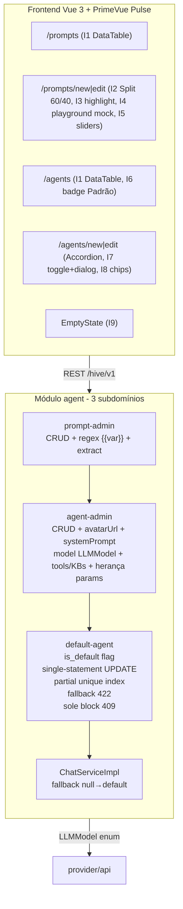

# PROPOSAL — admin-prompt-agent: Administração de Prompts e Agentes + Agente Padrão

## 1. Header

| Campo | Valor |
|-------|-------|
| **Feature** | `admin-prompt-agent` |
| **Módulos** | `agent` (`api` / `impl` / `dbupdate` / `web/internal/v1`) + `provider` (`api`) + `frontend` (`views` / `components/admin`) |
| **Tipo** | Feature composta — 3 subdomínios |
| **Prioridade** | P0 — must-have |
| **Status** | APROVADO COM RESSALVAS |
| **Fase SDD** | Fase 0 — Proposal (antecede SPEC) |
| **Data** | 2026-08-26 |
| **Autores** | `architect` + `product-manager` + `ux-designer` (parecer vinculante `UX-SPEC.md`) — compilado por `sdd-orquestrador` |
| **Context path** | `/hive` — todos os endpoints sob `/hive/v1` |
| **Dependência bloqueante** | V5 (`chat_session` + `chat_message` corretiva) já aplicada; V6/V7 propostas neste Proposal |
| **UX-SPEC vinculante** | `.spec/frontend/admin-prompt-agent/UX-SPEC.md` v1.0 — 5 telas, 8 inovações (I1-I8), grid responsivo, tokens Pulse |

> Fonte única da verdade: demanda descrita + parecer `architect` (3 subdomínios, riscos HIGH race/migração/fallback, ADRs 01-06) + parecer `product-manager` (P0 must-have, 8 Gherkin CA1-CA8, ambiguidades A1-A5 com assunções aprovadas) + parecer `ux-designer` vinculante. Nenhum requisito além dos aqui listados foi inventado; extrapolações marcadas como `ASSUNÇÃO` quando presentes.

---

## 2. Contexto

### 2.1 Estado atual (auditoria)

**Backend `agent` existente:**

- `AgentEntity` (`agent` table) possui: `name`, `description`, `promptTemplate (FK)`, `promptTemplateMetadata (jsonb)`, `llmModel (LLMModel)`, `providerType`, `temperature`, `active`. **Não possui** `is_default`, `avatar_url`, `system_prompt` dedicado, `tools`, `knowledge_bases`, `topP`, `maxTokens`.
- `PromptTemplateEntity` (`prompt_template` table) possui: `code`, `name`, `template (varchar 8000)`, `params (text[])`, `version`, `status`. **Não possui** `description`, `tags`, `inference_params` (temperature/topP/maxTokens por prompt).
- `AgentService` / `PromptTemplateService` já existem mas sem: exclusividade de padrão, fallback para `null` agent, listagem paginada com badge, validação regex `{{var}}`.
- `ChatServiceImpl` é stateless multi-turn via `chat_session`/`chat_message` (V5 recém aplicada); chamada `POST /v1/chat` exige `agentId` sempre — **sem fallback para agente padrão**.
- Não há admin UI: `router/index.ts` tem placeholders `HelloWorld.vue` para `/prompts` e `/agents`; `MainLayout` já expõe nav items mas sem views.

**Frontend existente (UX-SPEC §1):**

- `TheSidebar`, `TheTopbar`, `MainLayout`, `ChatSidebar`, `Chat.vue` bem estruturados; já suportam nav `/prompts`/`/agents` sem alteração.
- `AgentSelector` limitado (sem avatar/badge/modelo) — será estendido, não recriado.
- Tokens Pulse disponíveis: zinc `#18181b`, amber `#f97316`, cyan `#06b6d4`, surface `#ffffff`, etc. Linha de acento 2px âmbar, tipografia DM Sans / Inter.

### 2.2 Dor que motiva a feature

- **Sem admin UI:** criação/edição de prompts e agentes hoje exige acesso direto ao banco ou seed; não há CRUD via API nem tela.
- **Sem agente padrão:** toda chamada `POST /v1/chat` obriga `agentId`; se frontend envia `null` (ex: deep-link, teste), falha 400/404 em vez de usar fallback seguro. Conversas órfãs.
- **Sem fallback:** se nenhum agente estiver marcado como padrão, sistema fica sem comportamento definido — erro 500 em vez de 422 prescritivo.
- **Sem governança de padrão:** concorrência na troca de `is_default` pode gerar dois padrões por tenant (race), ou zero padrões (deleção do único).
- Consequências P0: operação manual, risco de inconsistência, onboarding sem agente "default" funcional.

---

## 3. Problema (Problem Statement)

Como **admin** do Hive, preciso **gerenciar prompts (CRUD + template com variáveis + params + playground mock) e agentes (CRUD + avatar URL + modelo + tools/KBs + toggle padrão)** via API e UI dedicadas, com **exatamente um agente padrão por tenant** garantido atomicamente, e **fallback determinístico** quando `agentId` não for informado na execução de chat.

Sem isso: (a) prompts/agentes não são governáveis; (b) chat sem `agentId` falha sem mensagem clara; (c) concorrência corrompe invariante de padrão.

---

## 4. Objetivos (Goals)

| ID | Objetivo | Mensurável em |
|----|----------|---------------|
| **O1** | CRUD completo de **Prompt Templates** com metadados, template `{{var}}`, `inferenceParams` (temperatura/topP/maxTokens) e extração + preview mock no playground | CA1, RF1 |
| **O2** | CRUD completo de **Agentes** com `avatar_url` (URL, não upload), `system_prompt`, `model (LLMModel)`, `inferenceParams` com herança/sobrescrita sobre prompt vinculado, `tools`/`knowledgeBases` como `string[]` placeholder, e flag `is_default` | CA2, RF2 |
| **O3** | **Exclusividade atômica**: no máximo um `is_default=true` por `tenant_id`, com troca em single-statement `UPDATE` + índice único parcial | CA3, RN1 |
| **O4** | **Fallback**: quando `agentId` é `null` na execução (`POST /v1/chat`), resolver para agente padrão do tenant; se ausente → `422 UNPROCESSABLE_ENTITY` com `code=DEFAULT_AGENT_NOT_FOUND` | CA4, RN2 |
| **O5** | **Bloqueio de desativação/exclusão** do único padrão: `409 CONFLICT` com `code=SOLE_DEFAULT_AGENT` | CA5, RN3 |
| **O6** | Listagens paginadas, isoladas por tenant, com badge "Padrão" no frontend (I6) | CA6, N2/N3 |
| **O7** | Validação prescritiva de `{{var}}` via regex `\{\{\s*[a-zA-Z_][a-zA-Z0-9_]*\s*\}\}` nos dois lados (server + client) | CA7, RN4 |

**Não-objetivos (Out — reafirmação, ver §6.2):** upload de avatar, execução real de LLM no playground, resolução dinâmica de tools/KBs, versionamento avançado de prompts, RBAC fino por prompt, soft-delete.

---

## 5. Escopo

### 5.1 In (P0 must-have — 8 itens do PM, sem adição)

| ID | Enunciado | Subdomínio |
|----|-----------|------------|
| **F1** | **Prompt CRUD**: `POST/GET/PUT/DELETE /v1/prompt-templates` com `name`, `code`, `description`, `tags`, `template`, `params` extraídos, `inferenceParams` (temperature/topP/maxTokens), `status`, `version`; paginado `page/size/sort` | prompt-admin |
| **F2** | **Agent CRUD**: `POST/GET/PUT/DELETE /v1/agents` com `name`, `avatarUrl`, `description`, `systemPrompt` (+ `promptId` opcional vinculado), `model (LLMModel)`, `providerType`, `temperature/topP/maxTokens` (com herança de prompt — sobrescreve), `tools: string[]`, `knowledgeBases: string[]`, `isDefault`, `active`; paginado | agent-admin |
| **F3** | **Toggle padrão**: `POST /v1/agents/{id}/default` (definir) + `GET /v1/agents/default` (resolver) + `DELETE /v1/agents/{id}/default` opcional; exclusividade atômica por tenant | default-agent |
| **F4** | **Exclusividade 1 default por tenant**: partial unique index `WHERE is_default = true`, `UPDATE agent SET is_default = (id=:id)` single-statement, proteção contra race | default-agent |
| **F5** | **Fallback**: resolver `null` agentId → default do tenant; erro `422` se nenhum default | default-agent |
| **F6** | **Bloqueio sole default**: `PUT /agents/{id}` com `active=false` ou `DELETE /agents/{id}` quando alvo é único `is_default=true` → `409` | default-agent |
| **F7** | **Validação template**: regex `\{\{\s*[a-zA-Z_][a-zA-Z0-9_]*\s*\}\}`; extração de `params` server-side; 400 se sintaxe inválida | prompt-admin |
| **F8** | **Frontend admin**: 5 telas vinculantes (UX-SPEC §4: listagem prompts, editor prompts split 60/40 + playground mock, listagem agentes, editor agentes accordion, empty states) + 8 inovações (I1 DataTable, I2 Split, I3 highlight, I4 playground, I5 sliders, I6 badge, I7 toggle+dialog, I8 multi-select) + grid responsivo | frontend |

### 5.2 Out (explicitamente NÃO incluído — P1/P2 deferred)

- Upload de avatar (usa `avatarUrl` string validada como URL — assunção A1).
- Playground com chamada LLM real (MVP é mock render local — assunção A2).
- Modelo livre string (MVP enum fixo `LLMModel` via `provider` — assunção A3).
- Resolução/validação de `tools`/`knowledgeBases` contra catálogo real (MVP `string[]` placeholder sem FK — assunção A4).
- Herança reativa de `inferenceParams` após edição do prompt (snapshot na criação/edição do agente; sobrescrita explícita — assunção A5).
- Prompt versioning avançado / diff / rollback (existe `version`/`status` básico, não histórico completo).
- RBAC fino por prompt individual (usa `@HasPermission` por recurso agregado).
- Soft-delete / lixeira / auditoria completa.

### 5.3 EXTRA (não-MUST, não bloqueia aceite — se entregue, seguir contrato espec)

- `PATCH /v1/prompt-templates/{id}` para rename parcial.
- `POST /v1/prompt-templates/{id}/duplicate` para clonar template.
- Se implementados, devem respeitar tenant filter, `@HasPermission`, validação e paginação do SPEC.

---

## 6. Alternativas Consideradas

| Alternativa | Descrição | Por que rejeitada |
|-------------|-----------|-------------------|
| **A — Tabela `default_agent` separada** (1 linha por tenant com `agent_id`) | Isola exclusividade em tabela dedicada com `UNIQUE(tenant_id)` | Rejeitada: adiciona JOIN em toda resolução de fallback (hot path `POST /chat`), duplica fonte de verdade, exige TX distribuída entre `agent` e `default_agent`. ADR-02 escolhe `is_default` na própria `agent`. |
| **B — Exclusividade via application lock (`SELECT FOR UPDATE`)** | Lock pessimista na troca de padrão | Rejeitada: lock amplia janela de contenção sob concorrência; perde atomicidade se instância cair entre `SELECT` e `UPDATE`. ADR-03 escolhe `UPDATE ... SET is_default = (id=:id)` single-statement + partial index como barreira DB. |
| **C — Fallback via `Optional<Agent>` + 404 genérico** | Retornar 404 quando `agentId` null e sem default | Rejeitada: 404 mascara causa (não é recurso ausente, é estado de configuração ausente). ADR-04 escolhe `422 UNPROCESSABLE_ENTITY` com `code=DEFAULT_AGENT_NOT_FOUND` para semântica correta e UX acionável. |
| **D — Avatar como `bytea` / S3 upload** | Upload binário com storage | Rejeitada no MVP (A1): exige bucket, multipart, validação de imagem, GC — fora do escopo P0. URL string cobre 95% dos casos admin. |
| **E — Playground com chamada LLM real** | `POST /prompt-templates/{id}/preview` chama provider | Rejeitada no MVP (A2): custo, latência, necessidade de provider mock em testes. Mock local com substituição `{{var}}` entrega valor imediato. |

---

## 7. Riscos (parecer `architect` — HIGH, com mitigação)

| ID | Risco | Probabilidade | Impacto | Classificação | Mitigação prescrita | ADR |
|----|-------|---------------|---------|---------------|---------------------|-----|
| **R1** | **Race na troca de `is_default`** — dois admins marcam padrão simultaneamente → dois `true` por tenant | Alta | Alto (corrupção de invariante) | **HIGH** | `UPDATE agent SET is_default = (id = :targetId) WHERE tenant_id=:tid` single-statement atômico + partial unique index `uniq_agent_default_per_tenant WHERE is_default=true` como barreira; IT de concorrência com 2 threads + `CountDownLatch` | ADR-03 |
| **R2** | **Migração V6/V7 não-idempotente ou com lock longo** — `ADD COLUMN is_default` + `CREATE UNIQUE INDEX` trava tabela `agent` em tenant com volume | Média | Alto (downtime, Flyway falha) | **HIGH** | Migrations idempotentes com `IF NOT EXISTS` / `DO $$ IF NOT EXISTS`, `CREATE INDEX CONCURRENTLY` evitado (Flyway não suporta fora de TX — usar `CREATE INDEX IF NOT EXISTS` + `ALTER TABLE ... ADD COLUMN IF NOT EXISTS DEFAULT false`); backfill `is_default=false` onde null; testar contra PostgreSQL 16 real (não H2) | ADR-01 |
| **R3** | **Fallback sem default → 500 em vez de 422** — `POST /chat` com `agentId=null` e nenhum padrão retorna NPE/500 | Média | Alto (UX quebrada) | **HIGH** | Resolver via `findByTenantIdAndIsDefaultTrue` dedicado; se `Optional.empty()` → lançar `DefaultAgentNotFoundException` mapeada para `422` com `code=DEFAULT_AGENT_NOT_FOUND` no `ControllerExceptionHandler`; nunca `500` | ADR-04 |
| **R4** | **Tenant filter esquecido em query de `is_default`** — resolver default de outro tenant vazando | Alta | Crítico (A01) | HIGH | Toda query de `AgentRepository` filtra `tenantId` (`findByTenantIdAndIsDefaultTrue`, `findByIdAndTenantId`); `AbstractEntity` + `@Filter`; IT de isolamento `T1 vs T2` | — |
| **R5** | **Validação `{{var}}` divergente front/back** — regex diferente gera preview ok mas 400 no server | Média | Médio | MEDIUM | Regex única canônica `\{\{\s*[a-zA-Z_][a-zA-Z0-9_]*\s*\}\}` em ambos; extração server-side autoritativa; teste de contrato com strings `{{nome}}`, `{{_x1}}`, `{{1bad}}`, `{{ com espaço }}` | ADR-06 |
| **R6** | **Deleção/desativação do único padrão sem bloqueio** — zero defaults após operação | Média | Alto | MEDIUM | `DELETE`/`PUT active=false` valida `countByTenantIdAndIsDefaultTrue ==1 && target.isDefault` → `409 SOLE_DEFAULT_AGENT`; frontend desabilita botão com tooltip vinculante (UX-SPEC §4.3/4.4) | ADR-05 |
| **R7** | **Herança de `inferenceParams` confusa** — agente herda de prompt mas sobrescrita não documentada | Média | Médio | MEDIUM | Regra prescritiva: snapshot na criação/edição do agente; se `agent.inferenceParams == null` → herda do `promptTemplate`; se não-null → sobrescreve prompt por campo; SPEC RN6 documenta matriz; PLAN deve mapear com MapStruct `ignore` + manual merge | — |
| **R8** | **Tools/KBs placeholder vaza para camadas futuras** — `string[]` sem validação aceita payload gigante | Baixa | Médio | LOW | Validar `@Size(max=20)` por array + `@Size(max=100)` por item + sanitizar; índice `GIN` não necessário no MVP; documentar `P1` para catálogo real | — |

---

## 8. Stakeholders

| Papel | Responsabilidade na feature |
|-------|-----------------------------|
| **Admin** (usuário final) | CRUD prompts/agentes, define padrão, usa playground mock, espera fallback funcional |
| **Architect** | Parecer técnico, ADRs 01-06, modelo de dados, exclusividade atômica, migrações V6/V7 |
| **Product-Manager** | Priorização P0, 8 Gherkin CA1-CA8, ambiguidades A1-A5 com assunções aprovadas |
| **UX-Designer** | Parecer vinculante `UX-SPEC.md` — 5 telas, 8 inovações, grid responsivo, tokens Pulse, acessibilidade WCAG 2.1 AA |
| **Developer-Engineer** | Implementação BE+FE TDD, testes unitários/it, MapStruct, Flyway |
| **Security-Engineer** | Gate `security-review` (OWASP A01/A03/A05, API1/API5) — `@HasPermission` em todo endpoint, 401/403/404/422 corretos |
| **QA-Engineer** | Cobertura 80% service / 90% domain, IT com Testcontainers, Verificação 3 dimensões |

---

## 9. Métricas de Sucesso (pós-entrega)

| Métrica | Alvo | Como medir |
|---------|------|------------|
| **Adoção admin** | 100% dos tenants com ≥1 prompt e ≥1 agente criados via UI em 2 semanas | `SELECT tenant_id, COUNT(*) FROM prompt_template / agent GROUP BY tenant_id` |
| **Exclusividade** | 0 tenants com 0 ou 2+ `is_default=true` | Query de auditoria `SELECT tenant_id, SUM(is_default::int) FROM agent GROUP BY tenant_id HAVING SUM(...) !=1` → deve retornar 0 |
| **Fallback sucesso** | 100% de `POST /chat` com `agentId=null` resolvem para default quando existe | Log `agent.fallback.resolved` contador |
| **Fallback erro claro** | 100% de `POST /chat` com `agentId=null` e sem default retornam `422 DEFAULT_AGENT_NOT_FOUND` (zero `500`) | Monitoramento `500` em `/chat` = 0; `422` com `code` correto |
| **Bloqueio sole default** | 0 deleções/desativações do único padrão bem-sucedidas (100% `409`) | Teste de auditoria + logs `sole_default_blocked` |
| **Validação `{{var}}`** | 0 divergências front/back em extração | Teste de contrato com 20 casos de regex |
| **Performance** | `GET /agents`, `GET /prompt-templates` p95 < 200ms com `size=20`; fallback p95 < 50ms | `EXPLAIN` Index Scan + métricas APM |
| **UX** | Zero `console.error`/`network 4xx` em fluxo completo list→create→edit→toggle→delete (Chrome DevTools) | Harness R1/R2 |

---

## 10. Assunções (A1-A10 — A1-A5 aprovadas, A6-A10 de Proposal)

| ID | Enunciado | Origem | Status | Impacto se mudar |
|----|-----------|--------|--------|------------------|
| **A1** | **Avatar é URL, não upload**: `avatarUrl` é `VARCHAR(2048)` com `@URL`/`@Size`; sem `multipart`, sem S3, sem `bytea` | PM/UX | **APROVADA MVP** | Upload exigiria `provider` de storage, `V8` com `avatar_blob`, e componente `FileUpload` PrimeVue |
| **A2** | **Playground mock local sem LLM**: preview substitui `{{var}}` por valores de inputs localmente; `Testar no Chat →` apenas navega para `/chat?promptId=` | PM/UX §4.2 | **APROVADA MVP** | Chamada LLM exigiria `POST /prompt-templates/{id}/preview` + rate limiting + provider mock |
| **A3** | **Modelo enum fixo via provider (`LLMModel`)**: `OLLHAMA/OPENAI/OPENCODE/GEMINI` — não `String` livre | Architect | **APROVADA MVP** | String livre exigiria validação dinâmica + catálogo de modelos versionado |
| **A4** | **Tools/KBs `string[]` placeholder**: `tools: text[]`, `knowledge_bases: text[]` sem FK/catálogo; `@Size(max=20)` por array | PM | **APROVADA MVP** | Catálogo real exigiria tabelas `tool`/`knowledge_base` + `agent_tools` M:N + `GIN` |
| **A5** | **Params duplicados — herança com sobrescrita**: `agent.inferenceParams` snapshot do prompt no momento da vinculação; se agente define campo → sobrescreve prompt; senão herda | Architect+PM | **APROVADA MVP** | Herança reativa exigiria trigger/observer em `prompt_template` update propagando para `agent`s |
| **A6** | **Tenant isolamento via `AbstractEntity` + `tenantId` obrigatório**: toda query filtra `tenantId`; sem `tenantId` → 401 | Regra global | Assunção base | Sem isolamento → vazamento cross-tenant (A01) |
| **A7** | **Padrão por tenant, não global**: exclusividade é `(tenant_id) WHERE is_default=true`, não global único | Architect ADR-02 | Assunção base | Global único quebraria multi-tenant |
| **A8** | **Hard delete no MVP**: `DELETE /agents/{id}` e `/prompt-templates/{id}` são hard delete; sem soft-delete/lixeira | PM | Assunção MVP | Soft-delete exigiria `deleted_at` + filtro + restauração |
| **A9** | **Paginação obrigatória**: `GET /agents` e `/prompt-templates` sempre paginados `Pageable` com `size` default 20, max 50; `page` 0-indexed | NFR | Assunção base | Sem paginação → `API4` Unrestricted Resource Consumption |
| **A10** | **Extração de `{{var}}` autoritativa é server-side**: frontend extrai para preview, mas `params` persistidos vêm do server via regex canônica | Architect ADR-06 | Assunção base | Sem autoritativa → divergência e 400 inesperado |

---

## 11. Proposta Arquitetural — 3 Subdomínios com Dependências

```
┌─────────────────────────────────────────────────────────────────────┐
│                        Módulo `agent`                               │
│  ┌──────────────────┐  ┌──────────────────┐  ┌──────────────────┐  │
│  │  prompt-admin    │  │   agent-admin    │  │  default-agent   │  │
│  │  (subdomínio 1)  │  │  (subdomínio 2)  │  │ (subdomínio 3)   │  │
│  │                  │  │                  │  │                  │  │
│  │ PromptTemplate   │◄─┤ Agent            │◄─┤ DefaultAgent     │  │
│  │  CRUD +          │  │  CRUD +          │  │  Service         │  │
│  │  validate {{}}   │  │  avatarUrl       │  │  (exclusividade, │  │
│  │  extract params  │  │  systemPrompt    │  │   fallback,      │  │
│  │  inferenceParams │  │  model/provider  │  │   bloqueio sole) │  │
│  │  playground mock │  │  tools/KBs       │  │                  │  │
│  │  (FE)            │  │  inferenceParams │  │  dependências:   │  │
│  └────────┬─────────┘  │  (herança)       │  │   AgentRepo      │  │
│           │            └────────┬─────────┘  └────────┬─────────┘  │
│           │                     │                     │            │
│           └─────────────────────┼─────────────────────┘            │
│                                 ▼                                  │
│                    ┌─────────────────────┐                         │
│                    │   ChatServiceImpl   │  (usa fallback)         │
│                    │   POST /v1/chat     │                         │
│                    └─────────────────────┘                         │
└─────────────────────────────────────────────────────────────────────┘
         │
         ▼
┌──────────────────┐
│ provider/api     │  LLMModel (enum fixo A3)
│  LLMModel        │
│  AiProviderType  │
└──────────────────┘
```

### 11.1 Dependências entre subdomínios

| De | Para | Tipo | Descrição |
|----|------|------|-----------|
| **agent-admin** | **prompt-admin** | `agent.prompt_template_id FK → prompt_template(id)` opcional | Agente pode vincular `promptId`; ao vincular, snapshot de `inferenceParams` do prompt é copiado; `systemPrompt` do agente sobrescreve `template` do prompt quando presente |
| **default-agent** | **agent-admin** | `AgentRepository` + `AgentEntity.isDefault` | `DefaultAgentService` opera sobre `agent` table; não cria tabela nova (ADR-02) |
| **chat (existente)** | **default-agent** | `DefaultAgentService.resolve(tenantId)` | `ChatServiceImpl.chat()` com `agentId==null` chama `defaultAgentService.findDefaultOrThrow(tenantId)` → `422` se ausente |
| **prompt-admin** | **provider** | `—` (nenhuma direta) | Prompt não conhece provider; `inferenceParams` são dados, não execução |
| **agent-admin** | **provider** | `LLMModel` + `AiProviderType` enums | Validação de `model` contra `LLMModel.values()` |

### 11.2 Componentes novos por subdomínio (prescritivo para SPEC §modelo e PLAN)

**prompt-admin:**

- `PromptTemplateEntity` estendido: `description TEXT`, `tags text[]`, `inference_params jsonb`, `template TEXT` (de 8000 para TEXT), `params text[]` (extraído)
- `PromptTemplateRepository extends JpaRepository<PromptTemplateEntity, UUID>` com `findByTenantIdAndCode`, `findByTenantId(Pageable)`, `findByIdAndTenantId`
- `PromptTemplateService` com `extractParams(String template) -> Set<String>` via regex canônica
- `PromptTemplateControllerV1 @RequestMapping(RestPath.V1 + "/prompt-templates")` 5 endpoints
- DTOs `PromptTemplateSaveRequestDTO` / `PromptTemplateResponseDTO` / `PromptTemplatePage`
- MapStruct `PromptTemplateDomainMapper` + `PromptTemplateDTOMapper`

**agent-admin:**

- `AgentEntity` estendido: `is_default BOOLEAN DEFAULT false`, `avatar_url VARCHAR(2048)`, `system_prompt TEXT`, `tools text[]`, `knowledge_bases text[]`, `top_p DOUBLE`, `max_tokens INT`, `prompt_template_id FK` já existe
- `AgentRepository` estendido: `findByTenantId(Pageable)`, `findByIdAndTenantId`, `findByTenantIdAndIsDefaultTrue`, `countByTenantIdAndIsDefaultTrue`, `@Modifying @Query("UPDATE AgentEntity a SET a.isDefault = (a.id = :id) WHERE a.tenantId = :tid") int updateDefaultFlag(...)`
- `AgentService` + `DefaultAgentService` (ou métodos em `AgentService` — decisão SPEC)
- `AgentControllerV1 @RequestMapping(RestPath.V1 + "/agents")` 7+ endpoints
- DTOs `AgentSaveRequestDTO` / `AgentResponseDTO`
- MapStruct `AgentDomainMapper` + `AgentDTOMapper`

**default-agent (lógica transversal):**

- `AgentEntity.isDefault` + partial unique index (V6)
- `DefaultAgentService { setDefault(UUID tenantId, UUID agentId), getDefault(UUID tenantId) -> Optional, requireDefault(UUID tenantId) -> Agent or 422 }`
- `DefaultAgentNotFoundException → 422` + `SoleDefaultAgentException → 409` no `ControllerExceptionHandler`
- Integração `ChatControllerV1`/`ChatServiceImpl`: `agentId` nullable → fallback

### 11.3 Diagrama de entrega (mermaid)



---

## 12. Cronograma — Fases SDD

| Fase | Artefato | Responsável | Critério de saída |
|------|----------|-------------|-------------------|
| **Fase 0 — Proposal** | `PROPOSAL.md` (este arquivo) | `sdd-orquestrador` | Este Proposal aprovado via `gate_P0_P1` + `ask_user` |
| **Fase 1 — SPEC** | `SPEC.md` 800+ linhas (RF1-RF8+, RNF, contratos 10+ endpoints, modelo ER + V6/V7 DDL, RN1-RN10+, FU1-FU5 mermaid, CA1-CA8 Gherkin + extras, Delta Specs, asserts) | `sdd-orquestrador` + `spec-review` skill | `spec-review` sem 🔴/🟠 + aprovação explícita `ask_user` |
| **Fase 2 — PLAN** | `PLAN.md` com batches `prompt-admin` → `agent-admin` → `default-agent` → `frontend`, ordem de entrega, matriz de testes | `sdd-orquestrador` via `sdd-compiler generate-plan` | PLAN sem novo requisito além do SPEC |
| **Fase 3 — TASKS** | `TASKS.md` TDD-ready (1 task por RF/RN/CA, com `file:line` alvo, Given/When/Then) | `sdd-orquestrador` via `sdd-compiler generate-tasks` | TASKS cobrem 100% dos RF/RN/CA |
| **Fase 4 — Execution** | `developer-engineer` implementa BE + FE em batches, `fullstack-code-reviewer` após cada batch, `mvn clean install` + `npm run build` | `developer-engineer` | Zero 🔴, builds verdes, ITs com Testcontainers |
| **Fase 5 — Verify** | `VERIFY.md` 3 dimensões (Completeness, Correctness, Coherence) + Chrome DevTools Network/Console zero erros | `sdd-orquestrador` via `sdd-compiler verify` | 3 dimensões ✅ ou débito documentado |
| **Fase 6 — Archive** | `Delta Specs` mesclados em `docs/product/SYSTEM_SPECIFICATION.md` §4.x + `docs/adr` ADR-01..06 + `spec-developed.md` + `workflow-state.json` `Completed` | `sdd-orquestrador` via `sdd-compiler archive` | `.spec/archive/{data}-admin-prompt-agent/` |

**Ordem de implementação prescritiva (para PLAN):** `prompt-admin` (independente) → `agent-admin` (depende de prompt FK) → `default-agent` (depende de agent.is_default) → `frontend` (depende de todos os contratos BE).

---

## 13. Gate `proposal-gate` (asserts — sdd-compiler)

> Bloqueia avanço para SPEC se qualquer assert falhar com 🔴.

- [ ] **Header completo**: feature, status `APROVADO COM RESSALVAS`, fase, data, autores `architect+pm+ux`, UX-SPEC vinculante referenciado
- [ ] **Contexto**: auditoria do estado atual (agent/prompt entities, placeholders, tokens Pulse)
- [ ] **Problema**: sem admin UI, sem default, sem fallback — com consequências P0
- [ ] **Objetivos O1-O7** mapeados para RF e CA futuros
- [ ] **Escopo In 8 itens P0** correspondem aos 8 Gherkin do PM sem adição; Out/P1/P2 e EXTRA listados sem ambiguidade
- [ ] **Alternativas**: 5 alternativas com motivo de rejeição (ADR-02/03/04)
- [ ] **Riscos R1-R8** com probabilidade/impacto/classificação HIGH + mitigação prescrita + ADR vinculados; R1 race, R2 migração, R3 fallback são HIGH
- [ ] **Stakeholders** listados (admin, architect, pm, ux, developer, security, qa)
- [ ] **Métricas**: 8 métricas quantitativas pós-entrega (adoção, exclusividade, fallback, sole block, validação, performance, harness)
- [ ] **Assunções A1-A10**: A1-A5 aprovadas MVP com impacto se mudar; A6-A10 base documentadas
- [ ] **Proposta arquitetural 3 subdomínios** com dependências, diagrama `flowchart`, e lista prescritiva de componentes novos por subdomínio
- [ ] **Cronograma Fases 0-6** com responsáveis e critérios de saída; ordem `prompt → agent → default → frontend`
- [ ] **Gate proposal-gate** presente (esta seção)
- [ ] Sem requisito fora de `F1-F8` inventado — todo P0 rastreável ao parecer PM

**Critério de rejeição:** falha em qualquer item 🔴 bloqueia `generate-spec` até correção; 🟠 alta prioridade deve ser endereçada ou justificada com `related_notes`.

---

## Apêndice — ADRs 01-06 (resumo para SPEC Delta)

| ADR | Título | Decisão |
|-----|--------|---------|
| **ADR-01** | Migração V6/V7 idempotente para `is_default` e `TEXT` | `V6` adiciona `is_default BOOLEAN DEFAULT false` + partial unique index `WHERE is_default=true`; `V7` converte `agent.system_prompt TEXT`, `prompt_template.template TEXT`, `prompt_template.description TEXT`, `tags text[]`, `inference_params jsonb` — ambas idempotentes com `IF NOT EXISTS`/`DO $$` |
| **ADR-02** | `is_default` na tabela `agent` vs. tabela `default_agent` separada | Coluna `is_default` na própria `agent` (rejeita tabela separada — JOIN em hot path) |
| **ADR-03** | Exclusividade via single-statement `UPDATE` + partial index vs. `SELECT FOR UPDATE` | `UPDATE agent SET is_default = (id=:id) WHERE tenant_id=:tid` atômico + `CREATE UNIQUE INDEX ... WHERE is_default=true` como barreira DB |
| **ADR-04** | Fallback `null→default` retorna `422` vs. `404` | `422 UNPROCESSABLE_ENTITY` com `code=DEFAULT_AGENT_NOT_FOUND` quando `agentId==null` e sem default (semântica de configuração, não recurso) |
| **ADR-05** | Bloqueio sole default retorna `409` vs. permitir zero defaults | `409 CONFLICT` com `code=SOLE_DEFAULT_AGENT` quando deleção/desativação deixaria `COUNT is_default==0` |
| **ADR-06** | Regex canônica `{{var}}` | `\{\{\s*[a-zA-Z_][a-zA-Z0-9_]*\s*\}\}` única em BE e FE; extração autoritativa server-side; `params` persistidos são `Set<String>` extraído, não enviado pelo client |

---

## Referências

- `architect` parecer: feature composta 3 subdomínios, riscos HIGH race/migração/fallback, ADRs 01-06.
- `product-manager` parecer: P0 must-have, 8 Gherkin CA1-CA8, ambiguidades A1-A5 com assunções MVP aprovadas.
- `ux-designer` vinculante: `.spec/frontend/admin-prompt-agent/UX-SPEC.md` v1.0 — 5 telas (§4.1-4.5), 8 inovações I1-I8, grid responsivo §5, tokens Pulse §7, tipos `PromptDTO`/`AgentAdminDTO` §12, serviços/rotas §13-14.
- `docs/product/SYSTEM_SPECIFICATION.md` §4.1 (Chat persistente) — base para Delta Specs §4.2 neste Proposal.
- Regras: `.agents/rules/backend-coding-standards.md`, `db-migration-flyway.md`, `security-standard.md`, `sdd-workflow-standard.md`, `brain-context.md`.

