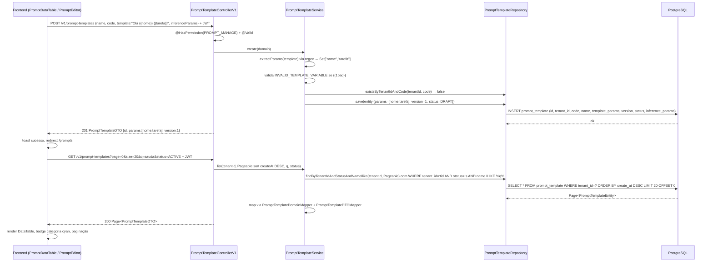
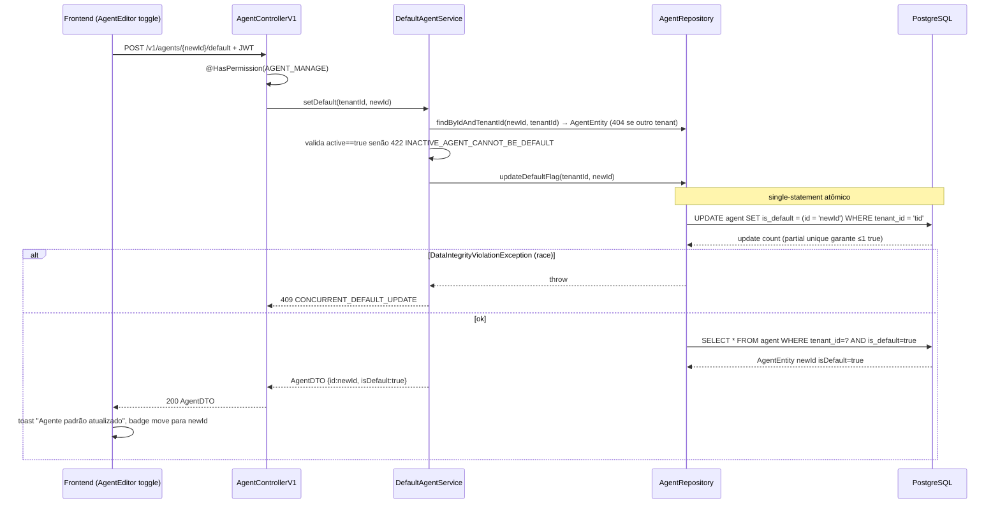
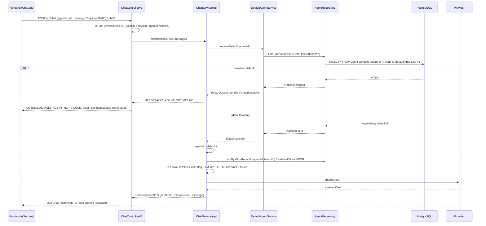
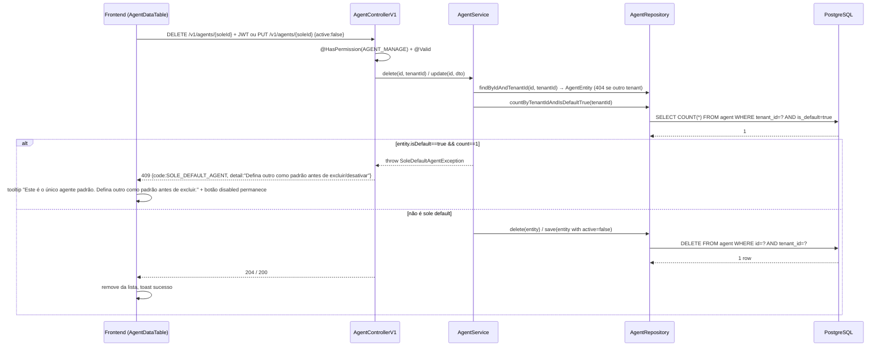

# SPEC — admin-prompt-agent: Administração de Prompts e Agentes + Agente Padrão

## 1. Header

| Campo | Valor |
|-------|-------|
| **Feature** | `admin-prompt-agent` |
| **Módulo** | `agent` (`api` / `impl` / `dbupdate` / `web/internal/v1`) + `provider` (`api`) + `frontend` (`views` / `components/admin`) |
| **Tipo** | Feature composta — 3 subdomínios (`prompt-admin`, `agent-admin`, `default-agent`) |
| **Prioridade** | P0 — must-have |
| **Status** | **APROVADO COM RESSALVAS** |
| **Fase SDD** | Fase 1 — SPEC (Proposal aprovado, sem PLAN/TASKS ainda) |
| **Data** | 2026-08-26 |
| **Autores** | `architect` + `product-manager` + `ux-designer` (parecer vinculante) — compilado por `sdd-orquestrador` via `sdd-compiler generate-spec` |
| **Dependência bloqueante** | V5 (`chat_session` + `chat_message` corretiva) aplicada; V6/V7/V8 propostas aqui (C1 split) |
| **Context path** | `/hive` — todos os endpoints sob `/hive/v1` |
| **UX-SPEC vinculante** | `.spec/frontend/admin-prompt-agent/UX-SPEC.md` v1.0 — 5 telas, 8 inovações I1-I8, grid responsivo, tokens Pulse |
| **Proposal** | `.spec/backend/admin-prompt-agent/PROPOSAL.md` |

> Fonte única da verdade: demanda descrita + parecer `architect` (3 subdomínios, riscos HIGH race/migração/fallback, ADRs 01-06) + parecer `product-manager` (P0 must-have, 8 Gherkin CA1-CA8, ambiguidades A1-A5 com assunções aprovadas) + parecer `ux-designer` vinculante. Nenhum requisito além de `F1-F8` / `RF1-RF8` / `RN1-RN10` / `CA1-CA8` foi adicionado; extrapolações marcadas como `EXTRA` quando presentes. Assunções MVP A1-A5 aprovadas: avatar URL não upload, playground mock local sem LLM, modelo enum fixo `LLMModel`, tools/KBs `string[]` placeholder, herança `inferenceParams` com sobrescrita do agente sobre prompt, extração `{{var}}` via regex `\{\{\s*[a-zA-Z_][a-zA-Z0-9_]*\s*\}\}`.

---

## 2. Objetivo & Contexto

### 2.1 Problema atual

- **Sem admin UI:** `router/index.ts` tem `HelloWorld.vue` como placeholder para `/prompts` e `/agents`; `MainLayout` já expõe nav items mas sem views. Criação/edição de prompts e agentes hoje exige seed ou acesso direto ao DB.
- **Sem agente padrão:** `POST /v1/chat` exige `agentId` sempre; se `null` (deep-link, teste, integração), falha 400/404 em vez de fallback determinístico. Sistema sem comportamento padrão por tenant.
- **Sem fallback:** quando nenhum agente está marcado como padrão, chamadas sem `agentId` retornam 500 (NPE) em vez de `422` prescritivo com `code=DEFAULT_AGENT_NOT_FOUND`.
- **Sem governança de padrão:** troca de `is_default` sem exclusividade atômica pode gerar 0 ou 2+ padrões por tenant sob concorrência (race).
- **Prompt limitado:** `PromptTemplateEntity` sem `description`, `tags`, `inference_params`; `template` ainda `VARCHAR(8000)` em vez de `TEXT`; sem validação de `{{var}}`; `params` não é extraído autoritativamente.
- **Agente limitado:** `AgentEntity` sem `is_default`, `avatar_url`, `system_prompt` dedicado, `topP`, `maxTokens`, `tools`, `knowledge_bases` M:N placeholder.

Consequências P0: operação manual, inconsistência entre tenants, onboarding sem "agente default", onboarding de chat órfão, divergência front/back na validação de `{{var}}`.

### 2.2 Objetivo

Entregar **CRUD admin de Prompt Templates e Agentes com agente padrão exclusivo por tenant e fallback determinístico**, isolado por `tenantId`, autenticado/autorizado, paginado, com validação prescritiva de `{{var}}`, e frontend vinculante em 5 telas (Pulse), reaproveitando `agent`/`prompt_template` e corrigindo-os com **V6/V7 idempotentes**.

### 2.3 Definição de pronto (DoD)

- `POST/GET/PUT/DELETE /v1/prompt-templates` e `/v1/agents` completos, paginados, com `@HasPermission`, `@Valid`, tenant filter, e MapStruct DTO↔domain↔entity.
- `POST /v1/agents/{id}/default` marca padrão com exclusividade atômica (single-statement + partial unique index); `GET /v1/agents/default` resolve padrão; `DELETE /agents/{id}` e `PUT` com `active=false` bloqueiam sole default com `409`.
- `POST /v1/chat` com `agentId=null` faz fallback para padrão do tenant; sem padrão → `422 DEFAULT_AGENT_NOT_FOUND`.
- `PromptTemplate.extractParams(template)` via regex canônica; playground mock renderiza substituição local sem LLM.
- Frontend: 5 telas + 9 componentes admin + 2 services + rotas, com DataTable paginado, Split 60/40, highlight `{{var}}` cyan, sliders, badge "⭐ Padrão", toggle com dialog, chips tools/KBs, empty states — zero `console.error` / `network 4xx` no fluxo completo.
- V6/V7 aplicadas; `mvn clean install` passa; `workflow-state.json` em `Completed` após Verify.

### 2.4 Fora de objetivo (reafirmação)

Ver §3.2. Qualquer item fora do escopo exige novo SPEC.

---

## 3. Escopo

### 3.1 In (MUST — MoSCoW P0, 8 itens nucleares + detalhamento)

| ID | Enunciado |
|----|-----------|
| **F1** | **Prompt CRUD + metadados + template + params + playground mock**: `name`, `code` (único por tenant, **imutável após criação**), `description` (opcional `TEXT`), `tags` (`text[]`), `template` (`TEXT` com `{{var}}`), `params` (`text[]` extraído server-side), `inferenceParams` (`temperature 0.0-2.0`, `topP 0.0-1.0`, `maxTokens 256-4096` em `jsonb`), `status` (`ACTIVE/DRAFT/ARCHIVED`), `version` (auto-increment em `PUT`), `tenantId`, `createAt`, `updateAt` |
| **F2** | **Agent CRUD + toggle default + badge**: `name`, `avatarUrl` (`VARCHAR(2048)` URL), `description`, `systemPrompt` (`TEXT`), `promptId` (FK opcional → `prompt_template`), `model` (`LLMModel` enum), `providerType` (`AiProviderType`), `temperature/topP/maxTokens` (herança: se `null` no agente → herda do `promptTemplate.inferenceParams`; se não-null → sobrescreve), `tools: string[]` (`text[]`, max 20 itens), `knowledgeBases: string[]` (`text[]`, max 20), `isDefault` (`boolean`), `active` (`boolean`) |
| **F3** | **Exclusividade atômica 1 default por tenant**: `UPDATE agent SET is_default = (id = :targetId) WHERE tenant_id=:tid` single-statement + partial unique index `uniq_agent_default_per_tenant WHERE is_default=true` |
| **F4** | **Fallback null→default**: `POST /v1/chat {agentId:null}` resolve para `findByTenantIdAndIsDefaultTrue`; se ausente → `422` com `code=DEFAULT_AGENT_NOT_FOUND` (nunca 500) |
| **F5** | **Bloqueio desativação/exclusão do único padrão**: `DELETE /agents/{id}` ou `PUT /agents/{id} {active:false}` quando `isDefault=true` e `countByTenantIdAndIsDefaultTrue==1` → `409 CONFLICT` com `code=SOLE_DEFAULT_AGENT` |
| **F6** | **Listagens paginadas com badge**: `GET /prompt-templates` e `GET /agents` paginados (`Pageable`, `size` default 20 max 50), ordenados (`updateAt DESC` para agents, `createAt DESC` para prompts), com `isDefault` no DTO para badge |
| **F7** | **Validação `{{var}}` prescritiva**: regex canônica `\{\{\s*[a-zA-Z_][a-zA-Z0-9_]*\s*\}\}`; extração server-side autoritativa; 400 se `{{1bad}}`, `{{}}`, `{{var com espaço}}` fora do padrão |
| **F8** | **Frontend admin vinculante**: 5 telas (UX-SPEC §4: listagem prompts, editor prompts split 60/40 + playground mock, listagem agentes, editor agentes accordion, empty states) + 8 inovações I1-I8 + grid responsivo §5 + tokens Pulse §7 |

Contratos §6, modelos §7, regras §8, fluxos §9 e critérios §10 são parte do In.

### 3.2 Out (explicitamente NÃO incluído — P1/P2 deferred)

- Upload de avatar (usa `avatarUrl` URL — assunção A1).
- Playground com chamada LLM real (mock local — assunção A2).
- Modelo `String` livre (usa `LLMModel` enum fixo — assunção A3).
- Resolução/validação de `tools`/`knowledgeBases` contra catálogo real (placeholder — assunção A4).
- Herança reativa de `inferenceParams` após edição do prompt (snapshot — assunção A5).
- Prompt versioning avançado / diff / rollback / histórico (existe `version` básico incrementado em `PUT`).
- RBAC fino por prompt/agente individual (usa `@HasPermission` agregado).
- Soft-delete / lixeira / restauração (MVP hard delete).
- Streaming SSE / WebSocket de preview.
- Rate limiting dedicado de admin (NÃO usa global existente — corrigido G3: adicionar task Bucket4j+Redis por tenant/IP em POST/PUT /prompt-templates e /agents, ou registrar bugfix separado; marcar A04 como débito até entrega).
- Paginação cursor-based (MVP `Pageable` offset).

### 3.3 EXTRA (não-MUST, não bloqueia aceite)

- `PATCH /v1/prompt-templates/{id}` `{name|description|tags}` → rename parcial. Se entregue, deve respeitar `@HasPermission`, tenant filter e validar `{{var}}` se `template` for alterado.
- `POST /v1/prompt-templates/{id}/duplicate` → clona template com `code` novo (`code + "-copy"`).
- Se implementados, seguir contratos §6 e regras §8; não bloqueiam aceite do MVP.

---

## 4. Requisitos Funcionais

| ID | Nome | Prioridade | Descrição prescritiva | Critérios vinculados |
|----|------|------------|-----------------------|----------------------|
| **RF1** | Prompt CRUD metadados+template+params+playground | MUST P0 | `PromptTemplate` CRUD completo. `POST /v1/prompt-templates` cria com `code` único por `tenantId` (409 se duplicado), `name` 1..200, `description` 0..2000, `tags` 0..20 itens cada 1..50, `template` 1..20000 `TEXT` com validação `{{var}}`, `inferenceParams` com `temperature 0.0-2.0`, `topP 0.0-1.0`, `maxTokens 256-4096`, `status` (`DRAFT` default ou `ACTIVE`). `code` é **imutável após criação** — `PUT /{id}` não aceita `code` (se enviado, ignorado / 400 `CODE_IMMUTABLE`). `params` é **extraído server-side** via regex canônica, não enviado pelo client (se enviado, ignorado). `GET /v1/prompt-templates?page&size&sort&q&status` paginado (`size` default 20 max 50), filtrado `tenantId`, `q` busca `ilike` em `name/code/description`, `status` opcional. `GET /{id}` 200/404 anti-IDOR. `PUT /{id}` incrementa `version` (`version = old + 1`), re-extrai `params`, **sem revalidação de `code`**. `DELETE /{id}` hard delete; se `prompt` vinculado a `agent.prompt_template_id` → 409 com `code=PROMPT_IN_USE` (`ON DELETE RESTRICT`, ver RN8). Entidade `PromptTemplateEntity extends AbstractEntity`. Valores `tenantId` nunca do body. | CA1, CA8 |
| **RF2** | Agent CRUD + avatarUrl + systemPrompt + tools/KBs | MUST P0 | `Agent` CRUD completo. `POST /v1/agents` cria com `name` 1..200, `avatarUrl` opcional `VARCHAR(2048)` validada `@Pattern(regexp="^https?://.*")` + `@Size(max=2048)` (A6: @URL removido), `description` 0..2000, `systemPrompt` 0..20000 `TEXT` (se `promptId` presente e `systemPrompt` vazio → `systemPrompt` herda `promptTemplate.template` como snapshot), `promptId` opcional `UUID` (validado `existsByIdAndTenantId`, 404 se não pertencer ao tenant), `model` `LLMModel` obrigatório, `providerType` opcional default `OPENAI`, `temperature/topP/maxTokens` opcionais (herança RN6), `tools` 0..20 `string` cada 1..100, `knowledgeBases` 0..20 cada 1..100 (sem FK, sem validação de existência — A4), `isDefault` opcional (se `true` na criação → dispara exclusividade RN1), `active` default `true`. `GET /v1/agents?page&size&sort&q` paginado filtrado `tenantId`, `q` ilike `name/description`. `GET /{id}` 200/404. `PUT /{id}` atualiza todos os campos; se `isDefault` muda → exclusividade; se `active` vira `false` e é sole default → 409. `DELETE /{id}` hard delete com sole check. Entidade `AgentEntity extends AbstractEntity` com `isDefault` + `avatarUrl` + `systemPrompt` + `tools`/`knowledgeBases` + `topP`/`maxTokens`. | CA2, CA5 |
| **RF3** | Toggle padrão — definir padrão | MUST P0 | `POST /v1/agents/{id}/default` define agente como padrão do tenant. Pré-condições: `agent` existe e `tenantId` confere (404 se não), `active=true` (se `active=false` → 422 `INACTIVE_AGENT_CANNOT_BE_DEFAULT`). Efeito: `UPDATE agent SET is_default = (id = :id) WHERE tenant_id=:tid` single-statement atômico. Resposta 200 com `AgentDTO` atualizado (`isDefault=true`). Idempotente: chamar novamente com mesmo `id` já padrão → 200 sem efeito colateral. Concorrência: garantido por partial unique index (R1). `@HasPermission(AGENT_MANAGE)` | CA3 |
| **RF4** | Resolver padrão — fallback | MUST P0 | `GET /v1/agents/default` retorna agente padrão do tenant (200 com `AgentDTO` ou 404 com `code=DEFAULT_AGENT_NOT_FOUND` se nenhum). `POST /v1/chat` com `agentId==null` chama internamente `DefaultAgentService.requireDefault(tenantId)` → se presente usa `agentId` do default; se ausente lança `DefaultAgentNotFoundException` → `422 UNPROCESSABLE_ENTITY` com `code=DEFAULT_AGENT_NOT_FOUND` (nunca 500). `agentId` não-null tem precedência (sem fallback). Chat com `agentId` inexistente no tenant → 404 anti-IDOR (não 422). `@HasPermission` conforme §6 (chat usa `CHAT_SEND`/`CHAT_SESSION_MANAGE`). | CA4 |
| **RF5** | Bloqueio sole default — desativação/exclusão | MUST P0 | `PUT /v1/agents/{id}` com `active=false` ou `DELETE /v1/agents/{id}` quando alvo tem `isDefault=true` e `countByTenantIdAndIsDefaultTrue(tenantId)==1` → `409 CONFLICT` com `code=SOLE_DEFAULT_AGENT` e `detail="Defina outro agente como padrão antes de desativar/excluir o único padrão."` Antes de `DELETE`, verificar contagem em TX. Frontend desabilita botão + tooltip (UX-SPEC §4.3/4.4) é complementar, não substitui validação server-side. `@HasPermission(AGENT_MANAGE)` | CA5 |
| **RF6** | Listagens paginadas com badge | MUST P0 | `GET /prompt-templates` e `GET /agents` sempre paginados (`Pageable`, `page` 0-indexed, `size` default 20 max 50 → 400 se >50, `sort` permitido `createAt,updateAt,name`). Ordenação default: prompts `createAt DESC`, agents `updateAt DESC`. Resposta `Page<DTO>` envelope do projeto (`content`, `totalElements`, `totalPages`, `number`, `size`). `isDefault` presente em `AgentDTO` para badge "⭐ Padrão". Isolamento tenant via `AbstractEntity` + `findByTenantId(...)`. `@HasPermission(PROMPT_MANAGE)` e `AGENT_MANAGE` também em `GET` (API5). | CA6 |
| **RF7** | Validação `{{var}}` prescritiva | MUST P0 | Regex canônica única: `\{\{\s*[a-zA-Z_][a-zA-Z0-9_]*\s*\}\}` (captura grupo 1 = nome var). Regras: nome deve iniciar com letra ou `_`, seguido de letras/dígitos/`_`, com espaços opcionais dentro das chaves. `extractParams(template)` → `Set<String>` com nomes únicos (trim). Validação: se template contém `{{` mas não casa com regex → 400 `INVALID_TEMPLATE_VARIABLE` com `detail` indicando token inválido (ex: `{{1bad}}`, `{{}}`, `{{var com espaço}}`). `params` persistidos são sempre o `Set` extraído; `inferenceParams` validados por ranges. Frontend usa mesma regex para highlight cyan e preview mock. | CA7 |
| **RF8** | Auth & Autorização | MUST P0 | Todo endpoint `/v1/prompt-templates/**` e `/v1/agents/**` anotado com `@HasPermission("PROMPT_MANAGE")` e `AGENT_MANAGE` respectivamente (constantes centralizadas em `security/SecurityConstants.java`). `GET /v1/agents/default` também exige `AGENT_MANAGE` (leitura de padrão é admin). **G1 — RBAC bypass fix bloqueante:** remover `if (authorities.isEmpty()) return pjp.proceed()` em `HasPermissionAspect.java:XX` (vulnerabilidade HIGH), popular `authorities` reais via `User.getAuthorities()` ou JWT `claims["permissions"]` em `SecurityFilter`, criar `PROMPT_MANAGE`/`AGENT_MANAGE`/`CHAT_SEND`, IT 403 para todos 12 endpoints (CA8) — sem JWT → 401, JWT sem permissão → 403 (não 404). `@Valid` em todo DTO. DTOs com projeção explícita (API3). | CA8 |

> Permissões nominais: usar `PROMPT_MANAGE` e `AGENT_MANAGE` conforme §6. Se o projeto expõe `AGENT_MANAGE` única ou `CHAT_MANAGE`, mapear ambas para ela e registrar em Delta Specs. Manter constante centralizada em `security` ou `commons`.

---

## 5. Requisitos Não-Funcionais

### 5.1 Segurança

- **N1.1** JWT validado via Auth0 `java-jwt` (assinatura, `iss`, `aud`, `exp`). `alg` nunca `none`.
- **N1.2** `@HasPermission` em **todos** os endpoints — inclusive `GET` de lista (OWASP API5 / A01). Sem endpoint público sem justificativa (health apenas). **G1:** fix bloqueante `HasPermissionAspect` bypass `authorities.isEmpty() → proceed` removido, `PROMPT_MANAGE`/`AGENT_MANAGE` constantes criadas, `SecurityFilter` popula `authorities` de JWT; IT 403 para 12 endpoints.
- **N1.3** Bean Validation `@Valid` em todo DTO de entrada; 400 com `application/problem+json` **RFC 7807** via `ControllerExceptionHandler` (`type`, `title`, `status`, `detail`, `instance`, `code` custom — G4: reformular `StandardError.java` de `{success, error}` para `type/title/status/detail/instance/code`). **G4 tasks:** handlers para `422 DefaultAgentNotFoundException` (distinguir 404 vs 422 via `isCommand`) e branch `DataIntegrityViolationException` → `409 CONCURRENT_DEFAULT_UPDATE` vs `409 PROMPT_IN_USE` vs `409 SOLE_DEFAULT_AGENT`.
- **N1.4** DTOs de resposta com projeção explícita — nunca serializar entidade JPA direta (OWASP API3).
- **N1.5** `{{var}}` e `systemPrompt` sanitizados: sem execução; `template` nunca `v-html` sem sanitização (DOMPurify se necessário no FE).
- **N1.6** Sem segredos em logs; `template`/`systemPrompt` não logados em INFO em produção.
- **N1.7** `ddl-auto=none`; Flyway única fonte de schema.
- **N1.8** Ver OWASP Top 10 A01/A03/A05/A07: controle de acesso server-side, JPQL parametrizado, sem verbose errors em prod (`server.error.include-stacktrace=never`), rate limiting **dedicado Bucket4j+Redis** para admin (G3 — não "usa global existente").

### 5.2 Multi-tenant & Isolamento

- **N2.1** `PromptTemplateEntity` e `AgentEntity` estendem `AbstractEntity` (`UUID id`, `createAt`, `updateAt`, `tenantId` + `@Filter(name="tenantFilter")`). `isDefault` é coluna adicional, não parte do filtro.
- **N2.2** Todo `Repository` expõe métodos com `tenantId` (`findByIdAndTenantId`, `findByTenantId(Pageable)`, `findByTenantIdAndIsDefaultTrue`, `existsByTenantIdAndCode`, `existsByPromptTemplateIdAndTenantId`). **Regra dura G6/G7:** nenhuma query sem `tenantId` explícito; `TenantAspect` nunca faz `skip` silencioso — se `tenantId` null → 400/401, não `findAll`. IT cross-tenant para todos `GET/PUT/DELETE` (CA8 anti-IDOR).
- **N2.3** `GET /{id}` com `id` de outro tenant → 404 anti-IDOR (não 403). Mensagem uniforme, sem vazar existência.
- **N2.4** `code` de prompt é único por `tenantId` (`UNIQUE(tenant_id, code)` + índice parcial onde aplicável).

### 5.3 Performance & Paginação

- **N3.1** `GET` paginados obrigatórios (`Pageable`, `size` default 20 max 50 → 400 se >50). Sem paginação → fail no `spec-review` (API4).
- **N3.2** Índices V6/V7/V8 obrigatórios (ver §7.3-7.5): `uniq_agent_default_per_tenant` (partial unique, único índice para fallback — `idx_agent_tenant_default` removido por redundância, EXPLAIN usa uniq), `idx_prompt_template_tenant_code`, `idx_prompt_template_tenant_status`, `idx_agent_tenant_update_at`, `idx_prompt_template_tenant_create_at`.
- **N3.3** Fallback `GET /agents/default` p95 < 50ms (Index Scan em partial index); listagens p95 < 200ms `size=20` (EXPLAIN deve mostrar Index Scan).
- **N3.4** `FetchType.LAZY` em `AgentEntity.promptTemplate` (`@ManyToOne`). Evitar `EntityGraph` em lista paginada; usar `JOIN FETCH` apenas em `findByIdAndTenantId` quando `promptId` é expandido.
- **N3.5** `template` e `systemPrompt` são `TEXT` — sem `VARCHAR` limitante; mas DTO `message` de chat permanece 1..4000, enquanto `template` permite até 20000.

### 5.4 Confiabilidade & Concorrência

- **N4.1** Exclusividade atômica via single-statement `UPDATE` (ver RN1). Sem `SELECT FOR UPDATE`; sem `synchronized` em app (não escala multi-instância).
- **N4.2** Partial unique index como barreira DB: concorrência que escapar do `UPDATE` atomico falha com `DataIntegrityViolationException` → mapeada para `409 CONFLICT` com `code=CONCURRENT_DEFAULT_UPDATE`.
- **N4.3** Hard delete (MVP) com `ON DELETE RESTRICT` (prescritivo) — `409 PROMPT_IN_USE` preserva integridade; `agent.prompt_template_id` nullable com `ON DELETE RESTRICT`; service verifica `existsByPromptTemplateIdAndTenantId` antes do `DELETE` na mesma `@Transactional`, e `DataIntegrityViolationException` do FK também mapeada para `409 PROMPT_IN_USE` (sem órfão silencioso). Removido "PLAN deve escolher".
- **N4.4** `DefaultAgentNotFoundException` mapeada para `422`, não `404`/`500`.

### 5.5 Observabilidade

- **N5.1** Logar `promptId`, `agentId`, `tenantId`, `isDefault` em operações de admin (sem `template`/`systemPrompt`).
- **N5.2** Métricas opcionais: `admin.prompts.created`, `admin.agents.created`, `admin.agents.default_switched` por `tenantId`.

### 5.6 Frontend Performance & Acessibilidade

- **N6.1** `DataTable` com `lazy` load, `rows=10`, skeleton rows 3-5 (I1).
- **N6.2** `SplitView` 60/40 desktop, stacked mobile (UX-SPEC §5).
- **N6.3** Sliders com `InputNumber` editável + tooltip (I5); highlight `{{var}}` via overlay regex sem `v-html` não sanitizado.
- **N6.4** WCAG 2.1 AA: contraste `#18181b`/`#ffffff` 16.75:1, `label+for` em todos os inputs, `aria-live` para toast, headings h1→h2→h3, touch target ≥44px.

---

## 6. Contratos de API

Base: `RestPath.V1 = "/v1"` sob context path `/hive`. URL efetiva `/hive/v1/...`. `api.ts` `baseURL /hive/v1`. Autenticação `Authorization: Bearer <JWT>` + `X-Tenant-ID` quando exigido pelo gateway.

### 6.1 Permissões

| Endpoint | Permissão |
|----------|-----------|
| `POST /v1/prompt-templates` | `PROMPT_MANAGE` |
| `GET /v1/prompt-templates` | `PROMPT_MANAGE` |
| `GET /v1/prompt-templates/{id}` | `PROMPT_MANAGE` |
| `PUT /v1/prompt-templates/{id}` | `PROMPT_MANAGE` |
| `DELETE /v1/prompt-templates/{id}` | `PROMPT_MANAGE` |
| `POST /v1/agents` | `AGENT_MANAGE` |
| `GET /v1/agents` | `AGENT_MANAGE` *ou* `anyOf={"CHAT_SEND","AGENT_MANAGE"}` se o projeto reutiliza listagem para chat (decisão G2: manter `/v1/agents` com `anyOf`, documentado; alternativa `GET /v1/admin/agents` separada se RBAC exigir separação) |
| `GET /v1/agents/default` | `AGENT_MANAGE` |
| `GET /v1/agents/{id}` | `AGENT_MANAGE` |
| `PUT /v1/agents/{id}` | `AGENT_MANAGE` |
| `DELETE /v1/agents/{id}` | `AGENT_MANAGE` |
| `POST /v1/agents/{id}/default` | `AGENT_MANAGE` |
| `DELETE /v1/agents/{id}/default` (opcional) | `AGENT_MANAGE` |
| `POST /v1/chat` (fallback) | `CHAT_SEND` (existente) |

> **G2 — Decisão `GET /v1/agents`:** manter `GET /v1/agents` com `@HasPermission(anyOf={"CHAT_SEND","AGENT_MANAGE"})` — permite chat listar agentes para seleção sem expor admin completo; `POST/PUT/DELETE` e `POST /{id}/default` continuam `AGENT_MANAGE` estrito. Alternativa `GET /v1/admin/agents` documentada como evolução se RBAC fino exigir separação. Delta Specs registra escolha.

> Se `AGENT_MANAGE`/`PROMPT_MANAGE` não existirem no RBAC atual, mapear para `AGENT_MANAGE` única ou `CHAT_MANAGE` e registrar em Delta Specs.

### 6.2 Tabela de endpoints (12 endpoints)

| # | Método | Path | Auth | Request DTO | Response | Status |
|---|--------|------|------|-------------|----------|--------|
| 1 | POST | `/v1/prompt-templates` | `PROMPT_MANAGE` + `@Valid` | `PromptTemplateCreateDTO {name, code, description?, tags?, template, inferenceParams?, status?}` | `PromptTemplateDTO` | 201 / 400 / 401 / 403 / 409 (code dup) |
| 2 | GET | `/v1/prompt-templates?page&size&sort&q&status` | `PROMPT_MANAGE` | `Pageable` + query `q`, `status` | `Page<PromptTemplateDTO>` | 200 / 401 / 403 / 400 (size>50) |
| 3 | GET | `/v1/prompt-templates/{id}` | `PROMPT_MANAGE` | — | `PromptTemplateDTO` | 200 / 401 / 403 / 404 anti-IDOR |
| 4 | PUT | `/v1/prompt-templates/{id}` | `PROMPT_MANAGE` + `@Valid` | `PromptTemplateUpdateDTO {name, description?, tags?, template, inferenceParams?, status?}` // `code` imutável — sem campo `code` | `PromptTemplateDTO` (version+1, params re-extraídos) | 200 / 400 (CODE_IMMUTABLE se `code` enviado) / 401 / 403 / 404 |
| 5 | DELETE | `/v1/prompt-templates/{id}` | `PROMPT_MANAGE` | — | — | 204 / 401 / 403 / 404 / 409 (in use) |
| 6 | POST | `/v1/agents` | `AGENT_MANAGE` + `@Valid` | `AgentCreateDTO {name, avatarUrl?, description?, systemPrompt?, promptId?, model, providerType?, temperature?, topP?, maxTokens?, tools?, knowledgeBases?, isDefault?, active?}` | `AgentDTO` | 201 / 400 / 401 / 403 / 404 (promptId) / 422 (inactive+default) |
| 7 | GET | `/v1/agents?page&size&sort&q` | `AGENT_MANAGE` | `Pageable` + `q` | `Page<AgentDTO>` | 200 / 401 / 403 / 400 |
| 8 | GET | `/v1/agents/default` | `AGENT_MANAGE` | — | `AgentDTO` | 200 / 401 / 403 / 404 (`DEFAULT_AGENT_NOT_FOUND` — query, ver A4) |
| 9 | GET | `/v1/agents/{id}` | `AGENT_MANAGE` | — | `AgentDTO` | 200 / 401 / 403 / 404 |
| 10 | PUT | `/v1/agents/{id}` | `AGENT_MANAGE` + `@Valid` | `AgentUpdateDTO {name, avatarUrl?, description?, systemPrompt?, promptId?, model, providerType?, temperature?, topP?, maxTokens?, tools?, knowledgeBases?, isDefault?, active?}` | `AgentDTO` | 200 / 400 / 401 / 403 / 404 / 409 (sole default) / 422 |
| 11 | DELETE | `/v1/agents/{id}` | `AGENT_MANAGE` | — | — | 204 / 401 / 403 / 404 / 409 (sole default) |
| 12 | POST | `/v1/agents/{id}/default` | `AGENT_MANAGE` | — | `AgentDTO` (`isDefault=true`) | 200 / 401 / 403 / 404 / 422 (inactive) / 409 (concurrent) |
| — | POST | `/v1/chat` com `agentId=null` sem padrão | `CHAT_SEND` | `ChatRequestDTO` | — | 422 (`DEFAULT_AGENT_NOT_FOUND` — command, ver A4) |

**Opcional:**

| 13 | DELETE | `/v1/agents/{id}/default` | `AGENT_MANAGE` | — | `AgentDTO` (`isDefault=false`) | 200 / 401 / 403 / 404 / 409 (sole) |

> **Fallback em `POST /v1/chat`**: não é novo endpoint; é comportamento interno quando `ChatRequestDTO.agentId == null`. Documentado em RN2 e FU4. `GET /v1/agents/default` é o endpoint observável do fallback.

> **Nota A4 — Status divergente mesmo `code` (query vs command):** `GET /v1/agents/default` sem padrão → **404** com `code=DEFAULT_AGENT_NOT_FOUND` (query: recurso não encontrado). `POST /v1/chat` com `agentId=null` sem padrão → **422** com `code=DEFAULT_AGENT_NOT_FOUND` (command: entidade não processável — falta pré-condição para criar chat). Mesmo `code`, status distinto. `ControllerExceptionHandler` deve distinguir via parâmetro `isCommand` (ou dois handlers: `DefaultAgentNotFoundException` mapeada para 404 quando `isCommand=false` e 422 quando `isCommand=true`; ou handler único que inspeciona `request.getRequestURI().contains("/chat")`). IT deve cobrir ambos (CA4).

### 6.3 DTOs (Bean Validation prescritiva)

```java
// Prompt — Request
record PromptTemplateCreateDTO(
  @NotBlank @Size(max=200) String name,
  @NotBlank @Size(max=100) @Pattern(regexp="^[a-zA-Z0-9_-]+$") String code, // slug
  @Size(max=2000) String description,                    // nullable
  @Size(max=20) List<@NotBlank @Size(max=50) String> tags, // nullable
  @NotBlank @Size(max=20000) String template,            // validado RN4
  InferenceParamsDTO inferenceParams,                    // nullable
  PromptStatus status                                    // nullable, default DRAFT
) {}

record PromptTemplateUpdateDTO(
  @NotBlank @Size(max=200) String name,
  // code imutável após criação — não presente em UpdateDTO (se enviado, 400 CODE_IMMUTABLE)
  @Size(max=2000) String description,
  @Size(max=20) List<@NotBlank @Size(max=50) String> tags,
  @NotBlank @Size(max=20000) String template,
  InferenceParamsDTO inferenceParams,
  PromptStatus status
) {}

record InferenceParamsDTO(
  @DecimalMin("0.0") @DecimalMax("2.0") Double temperature, // 0.0-2.0
  @DecimalMin("0.0") @DecimalMax("1.0") Double topP,        // 0.0-1.0
  @Min(256) @Max(4096) Integer maxTokens                    // 256-4096
) {}

// Prompt — Response
record PromptTemplateDTO(
  UUID id,
  String name,
  String code,
  String description,
  List<String> tags,
  String template,
  Set<String> params,                // extraído
  InferenceParamsDTO inferenceParams,
  PromptStatus status,
  Integer version,
  Instant createAt,
  Instant updateAt
) {}

// Agent — Request
record AgentCreateDTO(
  @NotBlank @Size(max=200) String name,
  @Pattern(regexp="^https?://.*") @Size(max=2048) String avatarUrl, // nullable, assunção A1 — @URL removido (sem dependência hibernate-validator extra), fallback nota: URL inválida → iniciais
  @Size(max=2000) String description,
  @Size(max=20000) String systemPrompt,                   // nullable
  UUID promptId,                                           // nullable, FK opcional
  @NotNull LLMModel model,                                  // enum fixo A3
  AiProviderType providerType,                             // nullable, default OPENAI
  @DecimalMin("0.0") @DecimalMax("2.0") Double temperature,
  @DecimalMin("0.0") @DecimalMax("1.0") Double topP,
  @Min(256) @Max(4096) Integer maxTokens,
  @Size(max=20) List<@NotBlank @Size(max=100) String> tools,           // A4
  @Size(max=20) List<@NotBlank @Size(max=100) String> knowledgeBases,  // A4
  Boolean isDefault,                                       // nullable, default false
  Boolean active                                           // nullable, default true
) {}

record AgentUpdateDTO(
  @NotBlank @Size(max=200) String name,
  @Pattern(regexp="^https?://.*") @Size(max=2048) String avatarUrl,
  @Size(max=2000) String description,
  @Size(max=20000) String systemPrompt,
  UUID promptId,
  @NotNull LLMModel model,
  AiProviderType providerType,
  @DecimalMin("0.0") @DecimalMax("2.0") Double temperature,
  @DecimalMin("0.0") @DecimalMax("1.0") Double topP,
  @Min(256) @Max(4096) Integer maxTokens,
  @Size(max=20) List<@NotBlank @Size(max=100) String> tools,
  @Size(max=20) List<@NotBlank @Size(max=100) String> knowledgeBases,
  Boolean isDefault,
  Boolean active
) {}

// Agent — Response
record AgentDTO(
  UUID id,
  String name,
  String avatarUrl,
  String description,
  String systemPrompt,
  UUID promptId,                       // ou PromptTemplateDTO expandido quando ?expand=prompt
  LLMModel model,
  AiProviderType providerType,
  Double temperature,
  Double topP,
  Integer maxTokens,
  List<String> tools,
  List<String> knowledgeBases,
  boolean isDefault,
  boolean active,
  Instant createAt,
  Instant updateAt
) {}

// Chat — ajuste para fallback (existente)
record ChatRequestDTO(
  UUID agentId,                        // nullable agora (fallback) — antes @NotNull, agora opcional
  UUID sessionId,                      // nullable
  @NotBlank @Size(max=4000) String message
) {}
```

`Page<DTO>` segue envelope do projeto (`content`, `totalElements`, `totalPages`, `number`, `size`). Se o projeto usa `RestControllerTool.of().buildSuccessResponse(Page)` / `buildPaginatedResponse` / `buildSuccessResponse(DTO)` manter padrão; nunca `new ResponseEntity` manual.

### 6.4 Exemplos JSON

**POST /v1/prompt-templates — 201**

Request:
```json
{
  "name": "Saudação",
  "code": "greeting-v1",
  "description": "Prompt para saudar o usuário",
  "tags": ["geral", "onboarding"],
  "template": "Olá {{nome}}, sua tarefa é: {{tarefa}}",
  "inferenceParams": { "temperature": 0.7, "topP": 0.9, "maxTokens": 2048 },
  "status": "ACTIVE"
}
```
Response 201:
```json
{
  "success": true,
  "data": {
    "id": "3fa85f64-5717-4562-b3fc-2c963f66afa6",
    "name": "Saudação",
    "code": "greeting-v1",
    "description": "Prompt para saudar o usuário",
    "tags": ["geral", "onboarding"],
    "template": "Olá {{nome}}, sua tarefa é: {{tarefa}}",
    "params": ["nome", "tarefa"],
    "inferenceParams": { "temperature": 0.7, "topP": 0.9, "maxTokens": 2048 },
    "status": "ACTIVE",
    "version": 1,
    "createAt": "2026-08-26T12:00:00Z",
    "updateAt": "2026-08-26T12:00:00Z"
  }
}
```

**POST /v1/prompt-templates — 400 regex inválida**
```json
{
  "type": "about:blank",
  "title": "Bad Request",
  "status": 400,
  "detail": "INVALID_TEMPLATE_VARIABLE: token '{{1bad}}' na posição 4 não casa com regex \\{\\{\\s*[a-zA-Z_][a-zA-Z0-9_]*\\s*\\}\\}",
  "instance": "/hive/v1/prompt-templates",
  "code": "INVALID_TEMPLATE_VARIABLE"
}
```

**POST /v1/prompt-templates — 409 code duplicado**
```json
{
  "type": "about:blank",
  "title": "Conflict",
  "status": 409,
  "detail": "Prompt code 'greeting-v1' já existe no tenant",
  "code": "PROMPT_CODE_DUPLICATE"
}
```

**GET /v1/prompt-templates?page=0&size=2&q=sauda&status=ACTIVE**
```json
{
  "success": true,
  "data": {
    "content": [
      { "id": "3fa...", "name": "Saudação", "code": "greeting-v1", "params": ["nome","tarefa"], "status": "ACTIVE", "version": 1, "createAt": "2026-08-26T12:00:00Z" }
    ],
    "totalElements": 1,
    "totalPages": 1,
    "number": 0,
    "size": 20
  }
}
```

**POST /v1/agents — 201 com herança de prompt**
```json
{
  "name": "Assistente Padrão",
  "avatarUrl": "https://cdn.example.com/avatar.png",
  "description": "Agente de onboarding",
  "systemPrompt": "Você é um assistente especializado em {{tarefa}}",
  "promptId": "3fa85f64-5717-4562-b3fc-2c963f66afa6",
  "model": "OPENAI",
  "providerType": "OPENAI",
  "temperature": 0.8,
  "topP": null,
  "maxTokens": null,
  "tools": ["web_search", "code_exec"],
  "knowledgeBases": ["docs-api"],
  "isDefault": true,
  "active": true
}
```
Response 201 (herança: `topP`/`maxTokens` herdados do prompt `0.9`/`2048`, `temperature` sobrescrito `0.8`):
```json
{
  "success": true,
  "data": {
    "id": "9e2c9a1e-7f9e-4b0a-9c1a-1a2b3c4d5e6f",
    "name": "Assistente Padrão",
    "avatarUrl": "https://cdn.example.com/avatar.png",
    "description": "Agente de onboarding",
    "systemPrompt": "Você é um assistente especializado em {{tarefa}}",
    "promptId": "3fa85f64-5717-4562-b3fc-2c963f66afa6",
    "model": "OPENAI",
    "providerType": "OPENAI",
    "temperature": 0.8,
    "topP": 0.9,
    "maxTokens": 2048,
    "tools": ["web_search", "code_exec"],
    "knowledgeBases": ["docs-api"],
    "isDefault": true,
    "active": true,
    "createAt": "2026-08-26T12:10:00Z",
    "updateAt": "2026-08-26T12:10:00Z"
  }
}
```

**GET /v1/agents?page=0&size=20**
```json
{
  "success": true,
  "data": {
    "content": [
      { "id": "9e2...", "name": "Assistente Padrão", "model": "OPENAI", "isDefault": true, "active": true, "avatarUrl": "https://..." },
      { "id": "aaa...", "name": "Code Bot", "model": "OPENCODE", "isDefault": false, "active": true }
    ],
    "totalElements": 2,
    "totalPages": 1,
    "number": 0,
    "size": 20
  }
}
```

**POST /v1/agents/{id}/default — 200 troca atômica**
```json
{
  "success": true,
  "data": {
    "id": "aaa...",
    "name": "Code Bot",
    "isDefault": true,
    "active": true
  }
}
```
Efeito: `Assistente Padrão` perde `is_default=true` no mesmo `UPDATE`.

**GET /v1/agents/default — 200**
```json
{
  "success": true,
  "data": {
    "id": "aaa...",
    "name": "Code Bot",
    "isDefault": true,
    "model": "OPENCODE"
  }
}
```

**GET /v1/agents/default — 404 sem padrão**
```json
{
  "type": "about:blank",
  "title": "Not Found",
  "status": 404,
  "detail": "Nenhum agente padrão configurado para o tenant",
  "code": "DEFAULT_AGENT_NOT_FOUND"
}
```

**POST /v1/chat com fallback — 200 (agentId null resolve para default)**
```json
{
  "sessionId": "0c9a1e1e-7f9e-4b0a-9c1a-1a2b3c4d5e6f",
  "role": "assistant",
  "message": "RAG combina recuperação vetorial com geração LLM...",
  "timestamp": "2026-08-26T12:34:56.123Z"
}
```

**POST /v1/chat com fallback — 422 sem padrão**
```json
{
  "type": "about:blank",
  "title": "Unprocessable Entity",
  "status": 422,
  "detail": "Nenhum agente padrão configurado; informe agentId ou defina um padrão",
  "code": "DEFAULT_AGENT_NOT_FOUND",
  "instance": "/hive/v1/chat"
}
```

**PUT /v1/agents/{id} desativando sole default — 409**
```json
{
  "type": "about:blank",
  "title": "Conflict",
  "status": 409,
  "detail": "Defina outro agente como padrão antes de desativar/excluir o único padrão.",
  "code": "SOLE_DEFAULT_AGENT"
}
```

**DELETE /v1/agents/{id} sole default — 409 idem**

**Erros RFC 7807 (ControllerExceptionHandler)**

- 400 validação: `{ "type":"about:blank","title":"Bad Request","status":400,"detail":"avatarUrl: must be a valid URL","instance":"/hive/v1/agents" }`
- 401 sem JWT: `{ "status":401,"detail":"Unauthorized" }`
- 403 sem permissão: `{ "status":403,"detail":"Forbidden: missing AGENT_MANAGE" }`
- 404 anti-IDOR: `{ "status":404,"detail":"Agent not found","code":"AGENT_NOT_FOUND" }` (mesmo quando existe em outro tenant)
- 422 inactive+default: `{ "status":422,"detail":"Agente inativo não pode ser padrão","code":"INACTIVE_AGENT_CANNOT_BE_DEFAULT" }`

---

## 7. Modelo de Dados

### 7.1 ER textual

```
[tenant] 1--* [prompt_template] 1--* [agent] (FK prompt_template_id nullable)
[tenant] 1--* [agent] 1--* [chat_session] (existente, agent_id FK)
[tenant] 1--* [prompt_template]
[tenant] 1--* [agent] : is_default flag por tenant (partial unique)

prompt_template --(FK nullable ON DELETE RESTRICT → 409 PROMPT_IN_USE em service, dentro da mesma TX + DataIntegrityViolation → 409)--> agent.prompt_template_id
agent.is_default : BOOLEAN — exclusividade via partial unique index (tenant_id) WHERE is_default=true
agent.tenant_id = prompt_template.tenant_id  (invariante quando vinculado)
```

### 7.2 Tabelas existentes (baseline — não recriar, estender via V6/V7)

**`prompt_template` (baseline V3 — `V3__prompt_template_versioning.sql` + V5)**

| Coluna | Tipo | Constraints | Notas |
|--------|------|-------------|-------|
| `id` | `UUID NOT NULL DEFAULT uuid_generate_v4()` | `PK prompt_template` | `AbstractEntity` |
| `tenant_id` | `UUID NOT NULL` | | tenant filter |
| `code` | `VARCHAR(100) NOT NULL` | `UNIQUE(tenant_id, code)` | slug |
| `name` | `VARCHAR(200) NOT NULL` | | |
| `template` | `VARCHAR(8000) NOT NULL` (V7 → `TEXT`) | | com `{{var}}` |
| `params` | `TEXT[]` | | extraído |
| `version` | `INT NOT NULL` | | auto-increment em PUT |
| `status` | `VARCHAR(20) NOT NULL` | `CHECK IN ('DRAFT','ACTIVE','ARCHIVED')` | `EnumType.STRING` |
| `create_at` | `TIMESTAMP WITHOUT TIME ZONE NOT NULL DEFAULT now()` | | |
| `update_at` | `TIMESTAMP WITHOUT TIME ZONE NOT NULL DEFAULT now()` | | |

**`agent` (baseline V2 — `V2__create_agent_tables.sql` + V5)**

| Coluna | Tipo | Constraints | Notas |
|--------|------|-------------|-------|
| `id` | `UUID NOT NULL DEFAULT uuid_generate_v4()` | `PK agent` | |
| `tenant_id` | `UUID NOT NULL` | | tenant filter |
| `name` | `VARCHAR(200) NOT NULL` | | |
| `description` | `VARCHAR(2000)` | | nullable |
| `prompt_template_id` | `UUID` | `FK → prompt_template(id)` nullable | existente |
| `prompt_template_metadata` | `JSONB` | | existente, manter |
| `llm_model` | `VARCHAR(50) NOT NULL` | `EnumType.STRING LLMModel` | |
| `provider_type` | `VARCHAR(50) NOT NULL` | `EnumType.STRING AiProviderType` | |
| `temperature` | `DOUBLE PRECISION` | | nullable |
| `active` | `BOOLEAN NOT NULL DEFAULT true` | | |

> Confirmar via `V2__*.sql` / `V3__*.sql` antes de implementar; se divergir, V6/V7 devem ser idempotentes com `IF NOT EXISTS` / `IF EXISTS`.

### 7.3 V6 migration — `is_default` + `avatar_url` + `system_prompt` + partial unique index (idempotente, C1)

Arquivo: `agent/dbupdate/src/main/resources/db/migration/agent/V6__add_is_default_avatar_systemprompt_to_agent.sql`

```sql
CREATE EXTENSION IF NOT EXISTS "uuid-ossp";

-- Coluna is_default: BOOLEAN NOT NULL DEFAULT false, idempotente
DO $$
BEGIN
    IF NOT EXISTS (
        SELECT 1 FROM information_schema.columns
        WHERE table_name='agent' AND column_name='is_default'
    ) THEN
        ALTER TABLE agent ADD COLUMN is_default BOOLEAN NOT NULL DEFAULT false;
    END IF;
END $$;

DO $$
BEGIN
    IF NOT EXISTS (SELECT 1 FROM information_schema.columns WHERE table_name='agent' AND column_name='avatar_url') THEN
        ALTER TABLE agent ADD COLUMN avatar_url VARCHAR(2048);
    END IF;
    IF NOT EXISTS (SELECT 1 FROM information_schema.columns WHERE table_name='agent' AND column_name='system_prompt') THEN
        ALTER TABLE agent ADD COLUMN system_prompt TEXT;
    END IF;
END $$;

-- C1: V6 contém is_default + avatar_url + system_prompt (agent core, sem prompt_template para reduzir lock)
-- Cada DDL idempotente via DO $$ IF NOT EXISTS + CREATE INDEX IF NOT EXISTS (evita lock longo)

-- Partial unique index: 1 default por tenant — barreira DB contra race
CREATE UNIQUE INDEX IF NOT EXISTS uniq_agent_default_per_tenant
    ON agent(tenant_id) WHERE is_default = true;

-- Índice auxiliar idx_agent_tenant_default REMOVIDO (redundante): uniq_agent_default_per_tenant já é partial unique index em (tenant_id) WHERE is_default=true e serve para Index Scan em findByTenantIdAndIsDefaultTrue (EXPLAIN usa uniq). Evita lock duplo e custo de manutenção.

-- Índice para listagem por tenant ordenada
CREATE INDEX IF NOT EXISTS idx_agent_tenant_update_at
    ON agent(tenant_id, update_at DESC);

-- C2: tenant_id null check — NÃO usar uuid_generate_v4() random (corrompe isolamento). Fail fast.
DO $$
BEGIN
    IF EXISTS (SELECT 1 FROM agent WHERE tenant_id IS NULL) THEN
        RAISE EXCEPTION 'tenant_id null found in agent, manual migration required for tenant=default (lookup SELECT id FROM tenant WHERE code=''default'')';
    END IF;
END $$;
-- Alternativa se existir tenant default:
-- DO $$ DECLARE default_tenant UUID; BEGIN SELECT id INTO default_tenant FROM tenant WHERE code='default' LIMIT 1; IF default_tenant IS NOT NULL THEN UPDATE agent SET tenant_id = default_tenant WHERE tenant_id IS NULL; END IF; END $$;
```

Histórico Flyway: `flyway_schema_history_agent`, `locations = classpath:/db/migration/agent`, `baselineOnMigrate=true`.

> **C1 related_notes:** V6 dividida para `One migration per logical change` — V6=agent core is_default/avatar/system_prompt, V7=prompt_template metadados, V8=FK. Cada arquivo idempotente `CREATE ... IF NOT EXISTS` + `DO $$` justifica lock mínimo (partial index `WHERE is_default=true` locka apenas subset; `IF NOT EXISTS` evita recriação em re-run). Se manter V7 único fosse aceitável por lock curto em janela de manutenção, documentar em `related_notes` com `CREATE INDEX IF NOT EXISTS` para evitar lock longo.

### 7.4 V7 migration — estender `prompt_template` + `agent` (`top_p`/`max_tokens`/`tools`/`KBs`) (idempotente, C1)

Arquivo: `agent/dbupdate/src/main/resources/db/migration/agent/V7__extend_prompt_template.sql`

```sql
CREATE EXTENSION IF NOT EXISTS "uuid-ossp";

-- prompt_template: description TEXT, tags text[], inference_params jsonb, template TEXT
DO $$
BEGIN
    IF NOT EXISTS (SELECT 1 FROM information_schema.columns WHERE table_name='prompt_template' AND column_name='description') THEN
        ALTER TABLE prompt_template ADD COLUMN description TEXT;
    END IF;
    IF NOT EXISTS (SELECT 1 FROM information_schema.columns WHERE table_name='prompt_template' AND column_name='tags') THEN
        ALTER TABLE prompt_template ADD COLUMN tags TEXT[];
    END IF;
    IF NOT EXISTS (SELECT 1 FROM information_schema.columns WHERE table_name='prompt_template' AND column_name='inference_params') THEN
        ALTER TABLE prompt_template ADD COLUMN inference_params JSONB;
    END IF;
END $$;

-- template VARCHAR(8000) -> TEXT (sem perda)
DO $$
BEGIN
    IF EXISTS (
        SELECT 1 FROM information_schema.columns
        WHERE table_name='prompt_template' AND column_name='template' AND data_type='character varying'
    ) THEN
        ALTER TABLE prompt_template ALTER COLUMN template TYPE TEXT;
    END IF;
END $$;

-- prompt_template: garantir tenant_id NOT NULL (se V3 deixou nullable)
DO $$
BEGIN
    IF EXISTS (SELECT 1 FROM prompt_template WHERE tenant_id IS NULL) THEN
        RAISE EXCEPTION 'tenant_id null found in prompt_template, manual migration required for tenant=default (lookup SELECT id FROM tenant WHERE code=''default'')';
    END IF;
    BEGIN
        ALTER TABLE prompt_template ALTER COLUMN tenant_id SET NOT NULL;
    EXCEPTION WHEN others THEN
        RAISE WARNING 'prompt_template tenant_id still has nulls, skipping SET NOT NULL';
    END;
END $$;

-- G5: NÃO criar UNIQUE(tenant_id, code) plain — conflita com versionamento V3
-- V3 já tem UNIQUE(tenant_id, code, version) + partial WHERE status='ACTIVE' (se existir).
-- Removido uniq_prompt_template_tenant_code plain. Manter versioning existente.
-- Se V3 não tiver partial, criar:
DO $$
BEGIN
    IF NOT EXISTS (SELECT 1 FROM pg_constraint WHERE conname='uniq_prompt_template_tenant_code_version') THEN
        -- Verifica se já existe UNIQUE(tenant_id, code, version)
        IF NOT EXISTS (SELECT 1 FROM pg_constraint WHERE conname LIKE '%tenant%code%version%') THEN
            ALTER TABLE prompt_template ADD CONSTRAINT uniq_prompt_template_tenant_code_version UNIQUE (tenant_id, code, version);
        END IF;
    END IF;
EXCEPTION WHEN duplicate_table THEN NULL;
END $$;
-- Partial unique para code ativo (se não existir)
CREATE UNIQUE INDEX IF NOT EXISTS uniq_prompt_active_code_per_tenant
    ON prompt_template(tenant_id, code) WHERE status = 'ACTIVE';

CREATE INDEX IF NOT EXISTS idx_prompt_template_tenant_code ON prompt_template(tenant_id, code);
CREATE INDEX IF NOT EXISTS idx_prompt_template_tenant_status ON prompt_template(tenant_id, status);
CREATE INDEX IF NOT EXISTS idx_prompt_template_tenant_create_at ON prompt_template(tenant_id, create_at DESC);

-- agent: avatar_url, system_prompt, top_p, max_tokens, tools, knowledge_bases
DO $$
BEGIN
    IF NOT EXISTS (SELECT 1 FROM information_schema.columns WHERE table_name='agent' AND column_name='avatar_url') THEN
        ALTER TABLE agent ADD COLUMN avatar_url VARCHAR(2048);
    END IF;
    IF NOT EXISTS (SELECT 1 FROM information_schema.columns WHERE table_name='agent' AND column_name='system_prompt') THEN
        ALTER TABLE agent ADD COLUMN system_prompt TEXT;
    END IF;
    IF NOT EXISTS (SELECT 1 FROM information_schema.columns WHERE table_name='agent' AND column_name='top_p') THEN
        ALTER TABLE agent ADD COLUMN top_p DOUBLE PRECISION;
    END IF;
    IF NOT EXISTS (SELECT 1 FROM information_schema.columns WHERE table_name='agent' AND column_name='max_tokens') THEN
        ALTER TABLE agent ADD COLUMN max_tokens INT;
    END IF;
    IF NOT EXISTS (SELECT 1 FROM information_schema.columns WHERE table_name='agent' AND column_name='tools') THEN
        ALTER TABLE agent ADD COLUMN tools TEXT[];
    END IF;
    IF NOT EXISTS (SELECT 1 FROM information_schema.columns WHERE table_name='agent' AND column_name='knowledge_bases') THEN
        ALTER TABLE agent ADD COLUMN knowledge_bases TEXT[];
    END IF;
END $$;

-- Garantir prompt_template_id FK idempotente com ON DELETE RESTRICT (prescritivo, resolve contradição A1)
-- Decisão: ON DELETE RESTRICT (ou NO ACTION) + service 409 via existsByPromptTemplateIdAndTenantId antes do delete na mesma TX
-- + handler DataIntegrityViolationException → 409 PROMPT_IN_USE. REMOVIDO "PLAN deve escolher".
DO $$
BEGIN
    IF NOT EXISTS (SELECT 1 FROM pg_constraint WHERE conname='fk_agent_prompt_template') THEN
        ALTER TABLE agent ADD CONSTRAINT fk_agent_prompt_template
            FOREIGN KEY (prompt_template_id) REFERENCES prompt_template(id) ON DELETE RESTRICT;
    END IF;
EXCEPTION WHEN duplicate_object THEN NULL;
END $$;

-- Se FK já existe como SET NULL (V2), corrigir para RESTRICT:
DO $$
BEGIN
    IF EXISTS (SELECT 1 FROM pg_constraint WHERE conname='fk_agent_prompt_template') THEN
        -- Verifica se é SET NULL e corrige
        IF EXISTS (SELECT 1 FROM information_schema.referential_constraints WHERE constraint_name='fk_agent_prompt_template' AND delete_rule='SET NULL') THEN
            ALTER TABLE agent DROP CONSTRAINT fk_agent_prompt_template;
            ALTER TABLE agent ADD CONSTRAINT fk_agent_prompt_template
                FOREIGN KEY (prompt_template_id) REFERENCES prompt_template(id) ON DELETE RESTRICT;
        END IF;
    END IF;
EXCEPTION WHEN others THEN
    RAISE WARNING 'fk_agent_prompt_template correction skipped: %', SQLERRM;
END $$;
```

> `inference_params` JSONB estrutura: `{ "temperature": 0.7, "topP": 0.9, "maxTokens": 2048 }` (keys camelCase para mapear DTO; chaves snake_case também aceitas em leitura com normalização).

### 7.4.1 V8 migration — FK `agent.prompt_template_id` com `ON DELETE RESTRICT` (idempotente, C1)

Arquivo: `agent/dbupdate/src/main/resources/db/migration/agent/V8__add_prompt_template_fk.sql`

```sql
CREATE EXTENSION IF NOT EXISTS "uuid-ossp";

-- Garantir FK com ON DELETE RESTRICT (prescritivo A1/G7) — se já existe como SET NULL, corrige
DO $$
BEGIN
    IF NOT EXISTS (SELECT 1 FROM pg_constraint WHERE conname='fk_agent_prompt_template') THEN
        ALTER TABLE agent ADD CONSTRAINT fk_agent_prompt_template
            FOREIGN KEY (prompt_template_id) REFERENCES prompt_template(id) ON DELETE RESTRICT;
    ELSE
        IF EXISTS (SELECT 1 FROM information_schema.referential_constraints WHERE constraint_name='fk_agent_prompt_template' AND delete_rule='SET NULL') THEN
            ALTER TABLE agent DROP CONSTRAINT fk_agent_prompt_template;
            ALTER TABLE agent ADD CONSTRAINT fk_agent_prompt_template
                FOREIGN KEY (prompt_template_id) REFERENCES prompt_template(id) ON DELETE RESTRICT;
        END IF;
    END IF;
EXCEPTION WHEN duplicate_object THEN NULL;
WHEN others THEN
    RAISE WARNING 'fk_agent_prompt_template V8 skipped: %', SQLERRM;
END $$;
-- Se FK já existe como RESTRICT/NO ACTION, nada a fazer. Documentar que FK já existe NO ACTION é aceitável (C1: documentar que FK já existe NO ACTION).
```

> **C1 justificação lock:** 3 migrações separam `agent` core (V6), `prompt_template` (V7), FK (V8) para `One migration per logical change`; cada `CREATE INDEX IF NOT EXISTS` evita recriação e lock longo; partial index `WHERE is_default=true` locka apenas subset.

### 7.5 Índices e constraints (resumo)

| Tabela | Constraint/Índice | Tipo | Propósito |
|--------|-------------------|------|-----------|
| `agent` | `uniq_agent_default_per_tenant ON (tenant_id) WHERE is_default=true` | Partial unique index | Exclusividade 1 default por tenant (barreira DB) |
| `agent` | ~~`idx_agent_tenant_default`~~ removido | — | Redundante com `uniq_agent_default_per_tenant`; EXPLAIN usa uniq para fallback p95 <50ms |
| `agent` | `idx_agent_tenant_update_at ON (tenant_id, update_at DESC)` | Index | Listagem paginada |
| `prompt_template` | `uniq_prompt_template_tenant_code_version UNIQUE(tenant_id, code, version)` + `uniq_prompt_active_code_per_tenant WHERE status='ACTIVE'` | Unique constraint + Partial unique | Code único por tenant com versioning (G5 — removido UNIQUE plain) |
| `prompt_template` | `idx_prompt_template_tenant_code ON (tenant_id, code)` | Index | Lookup por code |
| `prompt_template` | `idx_prompt_template_tenant_status ON (tenant_id, status)` | Index | Filtro status |
| `prompt_template` | `idx_prompt_template_tenant_create_at ON (tenant_id, createAt DESC)` | Index | Ordenação default |

### 7.6 Invariantes de Entidade (A7)

| Entidade | Invariante | Validação |
|----------|------------|-----------|
| `AgentEntity` | `COUNT(is_default=true) per tenant <=1` | Partial unique `uniq_agent_default_per_tenant WHERE is_default=true` + single-statement `UPDATE ... CASE WHEN` |
| `PromptTemplateEntity` | `code` único por `tenant` com versioning | `UNIQUE(tenant_id,code,version)` + partial `WHERE status='ACTIVE'` (`uniq_prompt_active_code_per_tenant`) — `code` imutável após criação (A2) |
| `PromptTemplateEntity` | `params = extract(template)` | `extractParams(template)` server-side autoritativo; `params` nunca do client; validado em `@PrePersist/@PreUpdate` e service |
| `AgentEntity` | `tenantId` nunca null, `prompt_template_id` nullable com `ON DELETE RESTRICT` | FK `RESTRICT` + service `409 PROMPT_IN_USE` antes de delete na mesma TX |
| `AgentEntity` | `avatarUrl` se não-null casa `^https?://.*` + `max 2048` | `@Pattern` + `@Size` |
| `PromptTemplateEntity` | `template` 1..20000 `TEXT`, `inferenceParams` ranges | Bean Validation + `CHECK`/`jsonb` ranges |

### 7.7 Invariantes de Workflow (A7)

- **Sole default never 0 sem outro default:** `DELETE /agents/{id}` ou `PUT {active:false}` quando `isDefault=true && countByTenantIdAndIsDefaultTrue==1` → `409 SOLE_DEFAULT_AGENT`; `DELETE /{id}/default` também bloqueia sole; transação garante que nunca fica 0 padrões se havia 1.
- **Exclusividade atômica:** `setDefault` single-statement `CASE WHEN` + partial unique garante `COUNT==1` após sucesso; concorrência → `409 CONCURRENT_DEFAULT_UPDATE`.
- **Fallback determinístico:** `GET /default` sem padrão → `404` (query); `POST /chat agentId=null` sem padrão → `422` (command) — mesmo `code` `DEFAULT_AGENT_NOT_FOUND` (A4).
- **Herança snapshot:** edição de `prompt_template` não propaga para `agent`s já criados (RN6).

### 7.8 Test Strategy (A7)

| Camada | Coverage | Ferramentas | Critérios |
|--------|----------|-------------|-----------|
| **Unit service** | 80% `PromptTemplateServiceImpl`, `AgentServiceImpl`, `DefaultAgentServiceImpl` | JUnit5 + Mockito (`@ExtendWith(MockitoExtension.class)`, `@Mock`/`@InjectMocks`), AssertJ, `Mappers.getMapper()` para MapStruct (nunca mock) | Happy path + 404 anti-IDOR + 409/422 + concorrência `CountDownLatch` + `extractParams` 20 casos |
| **MapStruct** | 100% campos | `Mappers.getMapper(PromptTemplateDomainMapper.class)` | `code` imutável ignore, `params` via `extract`, herança `inferenceParams` manual |
| **IT** | Todos 12+1 endpoints | Testcontainers `pgvector/pg16` (não H2), `WebIntegrationTest` / `WebOnPremiseIntegrationTest`, `DatabaseCleaner.reset()` `TRUNCATE ... CASCADE`, `JwtTestHelper.loginAndGetToken()`, `TestTenantFactory`/`TestUserFactory` | `*IT.java` em `integration-test/`, 401/403 RBAC (G1), cross-tenant 404, paginação, FK 409, fallback 404/422, concorrência default |
| **Frontend** | 70% `PromptDataTable`, `AgentDataTable`, `PlaygroundPanel` | Vitest + vue-test-utils, `happy-dom` | Split 60/40, highlight `{{var}}`, badge ⭐ |

### 7.9 Event Registry (A7)

**`Event Registry: N/A — sem eventos async`**. Esta feature não publica/consome eventos RabbitMQ. `inferenceParams` e `is_default` são síncronos via REST + DB. Se futuro precisar de `AgentDefaultChangedEvent`, registrar em `agent/api` com `outbox`.

### 7.10 ADRs formais 01-06 (extraídos para §7, conforme A7)

| ADR | Decisão | Alternativa rejeitada | Motivo |
|-----|---------|----------------------|--------|
| **ADR-01** | V6/V7/V8 idempotentes com `DO $$ IF NOT EXISTS` + `CREATE INDEX IF NOT EXISTS` | Migração monolítica V7 única | `One migration per logical change`, lock mínimo, re-run seguro |
| **ADR-02** | `is_default` coluna em `agent` vs. tabela separada `agent_default` | Tabela `agent_default(tenant_id PK, agent_id FK)` | Simplicidade, parcial index, single-statement UPDATE |
| **ADR-03** | Exclusividade via `UPDATE ... CASE WHEN ... WHERE tenant_id=:tid` single-statement + partial unique | `SELECT FOR UPDATE` / `synchronized` | Escala multi-instância, atômico sem lock explícito |
| **ADR-04** | Fallback `422` para `POST /chat agentId=null` sem padrão, `404` para `GET /default` | Ambos 404 ou ambos 422 | Semântica: query 404 vs command 422 (A4) |
| **ADR-05** | Sole default bloqueado `409 SOLE_DEFAULT_AGENT` | Permitir zero defaults | UX + integridade: sempre ≥1 padrão se já existia |
| **ADR-06** | Regex canônica `\{\{\s*([a-zA-Z_][a-zA-Z0-9_]*)\s*\}\}` única | Regex por camada / lib de template | Consistência front/back, extração autoritativa BE |

---


## 8. Regras de Negócio

| ID | Regra | Especificação prescritiva |
|----|-------|---------------------------|
| **RN1** | Exclusividade 1 default por tenant atômica | `POST /agents/{id}/default` e `PUT /agents/{id} {isDefault:true}` executam **single-statement** `UPDATE agent SET is_default = (id = :targetId) WHERE tenant_id = :tid` (JPQL: `UPDATE AgentEntity a SET a.isDefault = CASE WHEN a.id = :targetId THEN true ELSE false END WHERE a.tenantId = :tenantId`). Um `UPDATE` torna antigo `false` e novo `true` atomicamente. Partial unique index `uniq_agent_default_per_tenant` garante que concorrência que escapar do `UPDATE` falha com `DataIntegrityViolationException` → `409 CONCURRENT_DEFAULT_UPDATE`. Sem `SELECT FOR UPDATE`. Sem `synchronized`. Teste com 2 threads + `CountDownLatch`. |
| **RN2** | Fallback null→default com 422 se ausente | `ChatServiceImpl.chat()` / `ChatSessionService.create()` / `ChatControllerV1` quando `request.agentId == null` chamam `defaultAgentService.findByTenantIdAndIsDefaultTrue(tenantId)` → se `Optional.empty()` lançam `DefaultAgentNotFoundException` → `ControllerExceptionHandler` mapeia para `422 UNPROCESSABLE_ENTITY` com `code=DEFAULT_AGENT_NOT_FOUND` e `detail="Nenhum agente padrão configurado; informe agentId ou defina um padrão"`. Nunca 500. `agentId` não-null tem precedência; `agentId` inexistente no tenant → 404 anti-IDOR (não 422). |
| **RN3** | Bloqueio sole default 409 | Antes de `DELETE /agents/{id}` ou `PUT /agents/{id} {active:false}`, verificar `countByTenantIdAndIsDefaultTrue(tenantId) == 1 && entity.isDefault == true` → lançar `SoleDefaultAgentException` → `409 CONFLICT` com `code=SOLE_DEFAULT_AGENT`. `DELETE /agents/{id}/default` (se implementado) também bloqueia quando `count==1` e `id` é o sole. Frontend desabilita botão + tooltip é complementar. |
| **RN4** | Validação `{{var}}` regex canônica | Regex única: `\{\{\s*[a-zA-Z_][a-zA-Z0-9_]*\s*\}\}`. `PromptTemplateServiceImpl.extractParams(String template)` compila `Pattern.compile("\\{\\{\\s*([a-zA-Z_][a-zA-Z0-9_]*)\\s*\\}\\}")`, itera `Matcher.find()`, coleta `group(1).trim()` em `LinkedHashSet`. Se `template.contains("{{")` e nenhuma ocorrência casa → 400 `INVALID_TEMPLATE_VARIABLE` com `detail` do token (extrair `{{[^}]*}}` bruto para mensagem). Se `{{1bad}}`, `{{}}`, `{{var com espaço}}` → 400. Espaços internos `{{ nome }}` válidos (trim). |
| **RN5** | Avatar URL validada (A1) | `avatarUrl` validada `@Pattern(regexp="^https?://.*")` + `@Size(max=2048)` (proibido `@URL` — evita dependência `hibernate-validator` estendida). `null`/vazia permitida (sem avatar → fallback iniciais). Sem upload, sem multipart, sem S3. Frontend preview circular 32x32; URL inválida → fallback iniciais (mesma regex no FE). |
| **RN6** | Herança `inferenceParams` com sobrescrita (A5) | `Agent.inferenceParams` snapshot do prompt no momento de `POST/PUT` com `promptId`. Regra campo-a-campo: para cada `temperature/topP/maxTokens`, se `agentDto` tem não-null → usar `agentDto`; se `agentDto` é null e `promptTemplate.inferenceParams` tem não-null → herdar do prompt; se ambos null → null (ou default `temperature=0.7, topP=0.9, maxTokens=2048` — PLAN deve escolher e documentar; SPEC prescreve **herança apenas, sem defaults mágicos** — manter null e deixar provider usar default). Edição posterior do `prompt_template` **não** propaga para `agent`s já criados (snapshot). |
| **RN7** | Playground mock local sem LLM (A2) | Frontend `PlaygroundPanel` extrai `{{var}}` da prop `template` via mesma regex, gera inputs dinâmicos `label=varName`, preview reativo `template.replaceAll(regex, valueMap[var])`. Sem chamada BE. `Testar no Chat →` navega para `/chat?promptId=...&agentId=...` sem executar LLM no playground. BE não expõe `POST /prompt-templates/{id}/preview`. |
| **RN8** | `prompt` em uso bloqueia delete 409 | `DELETE /prompt-templates/{id}` **dentro da mesma `@Transactional`** verifica `agentRepository.existsByPromptTemplateIdAndTenantId(id, tenantId)` → se `true` → `409 CONFLICT` com `code=PROMPT_IN_USE` e `detail="Prompt vinculado a agente(s); desvincule antes de excluir"`. FK `agent.prompt_template_id` é `ON DELETE RESTRICT` (prescritivo); `DataIntegrityViolationException` do FK também mapeada para `409 PROMPT_IN_USE` no `ControllerExceptionHandler`. `ON DELETE SET NULL` rejeitado (gera órfão). |
| **RN9** | `code` único por tenant, `version` auto-increment | `POST` valida `existsByTenantIdAndCode(tenantId, code)` + partial `WHERE status='ACTIVE'` → 409 se duplicado ativo. `code` é **imutável** (A2), sem revalidação em `PUT`. `version` incrementa `old+1` em cada `PUT` bem-sucedido (optimistic locking opcional com `@Version` — PLAN decide; SPEC exige apenas incremento monotônico). **G5:** manter V3 `UNIQUE(tenant_id,code,version)` + `uniq_prompt_active_code_per_tenant WHERE status='ACTIVE'`; **removido** `UNIQUE(tenant_id,code)` plain que conflitaria com versionamento. |
| **RN10** | Tools/KBs `string[]` placeholder sem FK (A4) | `tools` e `knowledgeBases` são `List<String>` com `@Size(max=20)` por lista + `@Size(max=100)` por item + `@Pattern` opcional `^[a-zA-Z0-9_-]+$` (ou alfanumérico com hífen). Sem validação contra catálogo, sem tabela `tool`. `null` → persistido `null` ou `[]` (PLAN deve normalizar para `[]`). `GIN` index não necessário no MVP. |
| **RN11** | Inactive agent não pode ser padrão | `POST /agents/{id}/default` ou `PUT {isDefault:true}` quando `entity.active==false` → `422 UNPROCESSABLE_ENTITY` com `code=INACTIVE_AGENT_CANNOT_BE_DEFAULT`. Ao desativar sole default → 409 tem precedência sobre 422 (409 primeiro). |
| **RN12** | Tenant filter em toda query | Nenhum `Repository` expõe `findAll()` sem `tenantId`. `findById` sempre `findByIdAndTenantId`. `findByTenantIdAndIsDefaultTrue` sempre filtra `tenantId`. Auditoria via code review (R4). |

---

## 9. Fluxos de Sequência

### FU1 — CRUD Prompt (criação com extração `{{var}}` + listagem paginada)



### FU2 — CRUD Agente (criação com FK prompt + herança params + avatar URL)

```mermaid
sequenceDiagram
  participant FE as Frontend (AgentEditor)
  participant BE as AgentControllerV1
  participant AS as AgentService
  participant AR as AgentRepository
  participant PR as PromptTemplateRepository
  participant DB as PostgreSQL

  FE->>BE: POST /v1/agents {name, avatarUrl:"https://...", systemPrompt, promptId, model:OPENAI, temperature:0.8, tools:[web_search]} + JWT
  BE->>BE: @HasPermission(AGENT_MANAGE) + @Valid (@Pattern avatarUrl, @Size) // A6
  BE->>AS: create(domain)
  AS->>PR: findByIdAndTenantId(promptId, tenantId) → PromptTemplateEntity (ou 404 anti-IDOR)
  AS->>AS: herança inferenceParams: agent.temperature(0.8) sobrescreve; agent.topP null → herda prompt.topP 0.9
  AS->>AR: save(AgentEntity {promptTemplate, llmModel=OPENAI, temperature=0.8, topP=0.9, maxTokens=2048, tools, isDefault=false})
  AR->>DB: INSERT agent (id, tenant_id, name, avatar_url, system_prompt, prompt_template_id, llm_model, top_p, max_tokens, tools text[], is_default false)
  DB-->>AR: ok
  alt request.isDefault == true
    AS->>AR: updateDefaultFlag(tenantId, newId) // UPDATE agent SET is_default=(id=:id) WHERE tenant_id=:tid
    AR->>DB: UPDATE agent SET is_default = (id='newId') WHERE tenant_id=?
    DB-->>AR: 1 row updated (antigo perde padrão)
  end
  BE-->>FE: 201 AgentDTO {id, isDefault: true/false, topP:0.9 herdado}
  FE->>FE: badge "⭐ Padrão" se isDefault, avatar preview 32x32
```

### FU3 — Troca padrão atômica (exclusividade single-statement)



### FU4 — Fallback execução (null agentId → default, 422 se ausente)



### FU5 — Bloqueio desativação/exclusão do único padrão (409)



---

## 10. Critérios de Aceite (Gherkin — CA1-CA8 must + extras)

### CA1 — Prompt CRUD com extração `{{var}}` e validação

```gherkin
Funcionalidade: Prompt CRUD com extração de variáveis
  Cenário: criar prompt com variáveis válidas
    Dado admin autenticado com tenant T1 e permissão PROMPT_MANAGE
    Quando POST /v1/prompt-templates {name:"Saudação", code:"greeting-v1", template:"Olá {{nome}}, sua tarefa é: {{tarefa}}", inferenceParams:{temperature:0.7}}
    Então status 201
    E response contém id UUID, params ["nome","tarefa"] extraídos server-side, version 1, status DRAFT
    E GET /v1/prompt-templates/{id} retorna mesmo template e params
    E GET /v1/prompt-templates?page=0&size=20 contém o novo prompt com totalElements 1

  Cenário: template com variável inválida retorna 400
    Quando POST /v1/prompt-templates {template:"{{1bad}}"} 
    Então status 400 com code INVALID_TEMPLATE_VARIABLE e detail menciona "{{1bad}}"
    Quando POST /v1/prompt-templates {template:"{{}}"} 
    Então status 400
    Quando POST /v1/prompt-templates {template:"{{var com espaço}}"} 
    Então status 400

  Cenário: espaços internos válidos com trim
    Quando POST /v1/prompt-templates {template:"{{ nome }} e {{  _var1  }}"}
    Então status 201 com params ["nome","_var1"]

  Cenário: code duplicado por tenant retorna 409
    Dado prompt com code "greeting-v1" existe em T1
    Quando POST /v1/prompt-templates {code:"greeting-v1"} com JWT T1
    Então status 409 com code PROMPT_CODE_DUPLICATE
    Quando POST /v1/prompt-templates {code:"greeting-v1"} com JWT T2
    Então status 201 (isolado)

  Cenário: PUT incrementa version e re-extrai params
    Quando PUT /v1/prompt-templates/{id} {template:"Olá {{novaVar}}"}
    Então status 200 com version 2 e params ["novaVar"]

  Cenário: isolamento tenant anti-IDOR
    Quando GET /v1/prompt-templates/{idDeT1} com JWT T2
    Então status 404 (não 403)
```

### CA2 — Agent CRUD com avatar URL, prompt FK e herança params

```gherkin
Funcionalidade: Agent CRUD com avatar, prompt vinculado e herança
  Cenário: criar agente vinculado a prompt com herança de inferenceParams
    Dado prompt P1 existe em T1 com inferenceParams {temperature:0.5, topP:0.9, maxTokens:2048}
    Quando POST /v1/agents {name:"Assistente", avatarUrl:"https://cdn.example.com/a.png", promptId:P1, model:OPENAI, temperature:0.8, topP:null}
    Então status 201
    E response contém avatarUrl "https://cdn.example.com/a.png", promptId P1, model OPENAI
    E temperature 0.8 (sobrescrito), topP 0.9 (herdado), maxTokens 2048 (herdado)
    E isDefault false por padrão

  Cenário: avatarUrl inválida retorna 400
    Quando POST /v1/agents {avatarUrl:"not-a-url"}
    Então status 400 com detail menciona avatarUrl

  Cenário: promptId de outro tenant retorna 404
    Dado prompt P1 pertence a T1
    Quando POST /v1/agents {promptId:P1} com JWT T2
    Então status 404

  Cenário: tools/KBs placeholder validam tamanho
    Quando POST /v1/agents {tools:["web_search","code_exec"]} size 2
    Então status 201
    Quando POST /v1/agents {tools: array de 21 itens}
    Então status 400

  Cenário: criar agente sem prompt com params próprios
    Quando POST /v1/agents {name:"Code Bot", model:OPENCODE, temperature:0.9, topP:0.8, maxTokens:4096}
    Então status 201 com inferenceParams idênticos aos enviados (sem herança)
```

### CA3 — Exclusividade atômica 1 default por tenant

```gherkin
Funcionalidade: Exclusividade atômica de agente padrão
  Cenário: definir padrão pela primeira vez
    Dado tenant T1 com agentes A1(isDefault:false) e A2(isDefault:false)
    Quando POST /v1/agents/{A1}/default
    Então status 200 com A1.isDefault true
    E GET /v1/agents/default retorna A1

  Cenário: trocar padrão atomically
    Dado A1 é padrão (isDefault:true)
    Quando POST /v1/agents/{A2}/default
    Então status 200 com A2.isDefault true
    E GET /v1/agents/{A1} retorna isDefault false (antigo perdeu)
    E SELECT COUNT(*) FROM agent WHERE tenant_id=T1 AND is_default=true = 1

  Cenário: PUT com isDefault true também garante exclusividade
    Quando PUT /v1/agents/{A2} {isDefault:true}
    Então status 200 e A1 perde padrão

  Cenário: concorrência dois admins trocam simultaneamente
    Dado A1 e A2 não são padrão
    Quando Thread1 POST /v1/agents/{A1}/default e Thread2 POST /v1/agents/{A2}/default simultaneamente (CountDownLatch)
    Então um retorna 200 e o outro 200 ou 409 CONCURRENT_DEFAULT_UPDATE
    E COUNT is_default=true = 1 (nunca 2)

  Cenário: isolamento tenant — padrão de T1 não afeta T2
    Dado T1 padrão é A1, T2 sem padrão
    Quando T2 POST /v1/agents/{B1}/default
    Então T1 GET /v1/agents/default ainda retorna A1

  Cenário: agente inativo não pode ser padrão
    Dado A1 active false
    Quando POST /v1/agents/{A1}/default
    Então status 422 com code INACTIVE_AGENT_CANNOT_BE_DEFAULT
```

### CA4 — Fallback null→default e 422 se ausente

```gherkin
Funcionalidade: Fallback de chat para agente padrão
  Cenário: POST /chat com agentId null resolve para padrão
    Dado tenant T1 padrão é A1 (OPENAI)
    Quando POST /v1/chat {agentId:null, message:"Explique RAG"} com JWT T1
    Então status 200
    E session criada com agentId = A1.id (não null)
    E provider chamado com model de A1

  Cenário: POST /chat com agentId null sem padrão retorna 422
    Dado tenant T2 sem nenhum is_default=true
    Quando POST /v1/chat {agentId:null, message:"oi"}
    Então status 422 com code DEFAULT_AGENT_NOT_FOUND
    E detail "Nenhum agente padrão configurado; informe agentId ou defina um padrão"
    E nunca 500

  Cenário: POST /chat com agentId não-null tem precedência (sem fallback)
    Dado T1 padrão é A1
    Quando POST /v1/chat {agentId:A2, message:"oi"}
    Então session.agentId = A2 (não A1)

  Cenário: GET /agents/default sem padrão retorna 404
    Dado T2 sem padrão
    Quando GET /v1/agents/default
    Então status 404 com code DEFAULT_AGENT_NOT_FOUND

  Cenário: GET /agents/default com padrão retorna 200
    Quando GET /v1/agents/default com JWT T1
    Então status 200 com AgentDTO do padrão e isDefault true
```

### CA5 — Bloqueio sole default 409

```gherkin
Funcionalidade: Bloqueio de desativação/exclusão do único padrão
  Cenário: deletar único padrão bloqueado
    Dado tenant T1 com 1 agente A1 isDefault true e count is_default=1
    Quando DELETE /v1/agents/{A1}
    Então status 409 com code SOLE_DEFAULT_AGENT
    E agent A1 ainda existe

  Cenário: desativar único padrão bloqueado
    Quando PUT /v1/agents/{A1} {active:false}
    Então status 409 com code SOLE_DEFAULT_AGENT

  Cenário: deletar padrão com outro padrão disponível sucede
    Dado T1 com A1 isDefault true e A2 isDefault false
    Quando POST /v1/agents/{A2}/default → A2 vira padrão
    Quando DELETE /v1/agents/{A1}
    Então status 204

  Cenário: desativar não-padrão sempre sucede
    Dado A2 isDefault false
    Quando PUT /v1/agents/{A2} {active:false}
    Então status 200 com active false

  Cenário: DELETE /agents/{id}/default do sole também bloqueado (se endpoint existir)
    Quando DELETE /v1/agents/{A1}/default e A1 é sole
    Então status 409

  Cenário: frontend botão desabilitado (complementar, não substitui BE)
    Dado A1 é sole default
    Então GET /v1/agents page contém A1 com isDefault true
    E frontend renderiza botão excluir disabled com tooltip "Defina outro como padrão antes de excluir."
```

### CA6 — Listagens paginadas com badge

```gherkin
Funcionalidade: Listagens paginadas com badge padrão
  Cenário: paginação determinística de prompts
    Dado T1 com 3 prompts P1,P2,P3
    Quando GET /v1/prompt-templates?page=0&size=2
    Então status 200 com content size 2, totalElements 3, totalPages 2, number 0
    E header Content-Type contém application/json
    Quando GET /v1/prompt-templates?page=1&size=2
    Então content size 1

  Cenário: size >50 retorna 400
    Quando GET /v1/prompt-templates?size=51
    Então status 400

  Cenário: filtro q e status
    Quando GET /v1/prompt-templates?q=sauda&status=ACTIVE
    Então apenas prompts com name/code/description ilike "sauda" e status ACTIVE

  Cenário: badge padrão em agentes
    Dado A1 isDefault true
    Quando GET /v1/agents?page=0&size=20
    Então content contém A1 com isDefault true
    E frontend renderiza Tag âmbar "⭐ Padrão"

  Cenário: paginação também isolada por tenant
    Dado T1 com 2 agents, T2 com 1
    Quando GET /v1/agents com JWT T1
    Então totalElements 2
```

### CA7 — Validação `{{var}}` prescritiva e extração autoritativa

```gherkin
Funcionalidade: Validação de variáveis de template
  Cenário: template sem variáveis tem params vazio
    Quando POST /v1/prompt-templates {template:"Olá mundo"}
    Então status 201 com params []

  Cenário: extração dedup e ordenada por aparição
    Quando POST /v1/prompt-templates {template:"{{a}} {{b}} {{a}}"}
    Então params ["a","b"] (sem duplicata)

  Cenário: atualização re-extrai
    Quando PUT /v1/prompt-templates/{id} {template:"{{nova}}"}
    Então params ["nova"] (antigos descartados)

  Cenário: playground mock renderiza localmente
    Dado prompt com template "Olá {{nome}}, tarefa {{tarefa}}"
    Quando frontend preenche nome=João, tarefa="Criar relatório"
    Então preview renderiza "Olá João, tarefa Criar relatório" sem chamada BE

  Cenário: BE ignora params enviados pelo client
    Quando POST /v1/prompt-templates {template:"{{nome}}", params:["injected"]}
    Então params persistidos são ["nome"] (não ["injected"])
```

### CA8 — Auth e isolamento (A01/API5)

```gherkin
Funcionalidade: Auth e isolamento tenant
  Cenário: sem JWT retorna 401
    Quando GET /v1/prompt-templates sem Authorization
    Então status 401
    Quando GET /v1/agents sem Authorization
    Então status 401

  Cenário: JWT sem permissão retorna 403
    Dado JWT válido de T1 sem PROMPT_MANAGE
    Quando GET /v1/prompt-templates
    Então status 403 com detail missing PROMPT_MANAGE

  Cenário: anti-IDOR 404 em get por id de outro tenant
    Dado prompt P1 pertence a T1
    Quando GET /v1/prompt-templates/{P1} com JWT T2
    Então status 404 (não 403, não vaza existência)
    Quando GET /v1/agents/{A1DeT1} com JWT T2
    Então status 404

  Cenário: validação 400 RFC7807
    Quando POST /v1/prompt-templates {name:""} (blank)
    Então status 400 com Content-Type application/problem+json e code PROMPT_VALIDATION
    Quando POST /v1/agents {name:""} 
    Então status 400
```

### CA extras (cobertura de borda para Verify)

```gherkin
Funcionalidade: Transições e estados adicionais
  Cenário: criar agente com isDefault true quando já existe padrão → troca atômica
    Dado A1 isDefault true
    Quando POST /v1/agents {name:"Novo", isDefault:true}
    Então A1 perde padrão, novo ganha, count 1

  Cenário: chat com agentId inexistente no tenant retorna 404 anti-IDOR (não 422)
    Quando POST /v1/chat {agentId:UUID_de_T2, message:"oi"} com JWT T1
    Então status 404 AGENT_NOT_FOUND
```

---

## 11. Dependências & Riscos

### 11.1 Dependências

| ID | Dependência | Tipo | Impacto se falhar |
|----|-------------|------|-------------------|
| D1 | `agent` module + V5 (`chat_session`/`chat_message` com índices) | Interna | Base para `prompt_template` FK; sem V5, `V6`/`V7` adicionam colunas mas `chat` pode já funcionar |
| D2 | `identity` + `tenant` (JWT, `tenantId`, `@Filter`) | Interna | Sem `tenantId` no contexto, isolamento R4 falha; todo `GET/POST` retorna 401/404 incorreto |
| D3 | `provider` (`LLMModel`, `AiProviderType`) | Interna | `model` enum fixo A3; sem provider, `Agent.llmModel` não valida |
| D4 | PostgreSQL 16 + `uuid-ossp` + `pgvector` (existente) | Infra | `uuid_generate_v4()` falha sem extensão; `text[]`/`jsonb` exigem PG 14+ |
| D5 | `security` (`@HasPermission`, `ControllerExceptionHandler` com RFC7807) — **BLOQUEANTE G1** | Interna | **Débito HIGH:** `HasPermissionAspect` atual tem bypass `authorities.isEmpty() → proceed` (RBAC bypass). **Tarefa bloqueante pré-requisito:** remover bypass, popular `authorities` reais via `User.getAuthorities()` ou JWT claims em `SecurityFilter`, criar constantes `PROMPT_MANAGE`/`AGENT_MANAGE` (`permissions.properties` ou `SecurityConstants`), IT 403 para todos 12 endpoints (CA8). Sem correção, N1.2 falha; sem handler, 422/409 caem como 500 |
| D6 | `frontend` `agentService.listAgents()` existente + `MainLayout` nav | Frontend | Reuso de `TheSidebar`/`TheTopbar`; sem `agent-admin.service.ts` novo, prompts não listam |
| D7 | `UX-SPEC` vinculante para FE | Processo | Sem seguir I1-I8, Verify falha (Coherence) |

### 11.2 Riscos (R1-R8 — 3 HIGH do Proposal mantidos)

| ID | Risco | Prob. | Impacto | Mitigação prescrita | ADR |
|----|-------|-------|---------|---------------------|-----|
| **R1** | Race na troca de `is_default` → dois `true` por tenant | Alta | Alto | `UPDATE ... SET is_default=(id=:id) WHERE tenant_id=:tid` single-statement + partial unique `WHERE is_default=true` + IT concorrência | ADR-03 |
| **R2** | Migração V6/V7 lock longo ou não-idempotente | Média | Alto | `IF NOT EXISTS`/`DO $$`, `CREATE INDEX IF NOT EXISTS`, `ADD COLUMN IF NOT EXISTS DEFAULT false`, testar em PG16 real, sem H2 | ADR-01 |
| **R3** | Fallback sem default → 500 em vez de 422 | Média | Alto | `findByTenantIdAndIsDefaultTrue` + `DefaultAgentNotFoundException` → `422` no handler; teste CA4 sem padrão | ADR-04 |
| **R4** | Tenant filter esquecido em query de default | Alta | Crítico | `AbstractEntity` + `findByTenantId...` sempre; IT `T1 vs T2` em todos os `GET` | — |
| **R5** | Divergência regex front/back `{{var}}` | Média | Médio | Regex canônica única + extração autoritativa BE + teste contrato 20 casos | ADR-06 |
| **R6** | Sole default deletado → zero padrões | Média | Alto | `count==1 && isDefault` → `409 SOLE_DEFAULT_AGENT` em `DELETE`/`PUT` + frontend disabled + IT | ADR-05 |
| **R7** | Herança `inferenceParams` confusa | Média | Médio | Regra RN6 campo-a-campo documentada + MapStruct `ignore` + merge manual + teste paramétrico | — |
| **R8** | `tools`/`knowledgeBases` sem validação aceita payload gigante | Baixa | Médio | `@Size(max=20)` + `@Size(max=100)` por item + não persistir se >limite; documentar P1 catálogo | — |

### 11.3 Riscos de produto (PM)

| Risco produto | Mitigação |
|---------------|-----------|
| Admin sem CRUD | F1/F2 + CA1/CA2 + frontend I1-I8 |
| Sem padrão definido | F3 + CA3 + fallback R3 |
| Chat órfão sem `agentId` | F4 + CA4 + 422 |
| Exclusão acidental do padrão | F5 + CA5 + 409 + UX disabled |
| Template com `{{var}}` quebrada | F7 + CA7 + regex + playground mock |

---

## 12. Delta Specs (impacto em `.doc/` e `docs/adr` — mesclar no Archive)

> SPEC inclui Delta Specs por obrigação SDD Fase 1. Alterações devem ser mescladas em `.doc/` no `sdd-compiler archive`.

| Documento alvo | Tipo | Conteúdo a mesclar |
|---------------|------|-------------------|
| `docs/product/SYSTEM_SPECIFICATION.md` §4.2 (novo) | **Update** | Seção `4.2 Administração de Prompts e Agentes (ADR 01-06 — 2026-08-26)`: contratos `prompt-templates`/`agents` §6, `is_default` exclusividade RN1, fallback RN2 com 422, sole block RN3 com 409, validação `{{var}}` RN4, herança RN6, avatar URL RN5, paginação N3. Acrescentar ao §4.1 existente sem sobrescrever Chat. |
| `docs/adr/ADR_008_Admin_Prompt_Agent.md` (novo, cobre 01-06) | **Novo ADR** | ADRs 01–06 consolidados: 01 migração V6/V7 idempotente, 02 `is_default` em `agent` vs. tabela separada, 03 exclusividade single-statement + partial index vs. `SELECT FOR UPDATE`, 04 fallback 422 vs. 404, 05 sole block 409 vs. zero defaults, 06 regex canônica. Incluir alternativas rejeitadas do Proposal §6. |
| `docs/adr/ADR_003_Chat_API.md` (se existir) | **Update** | Anotar que `POST /v1/chat` agora tem `agentId` nullable com fallback para default (antes obrigatório). |
| `docs/design/DESIGN_SYSTEM.md` | **No-op** | Tokens Pulse já cobrem admin (zinc/amber/cyan, DataTable, Splitter, Slider, Tag). Sem novo token. |
| `.doc/arquitetura-backend.md` (ou equivalente) | **Update** | Módulo `agent`: adicionar `PromptTemplateEntity` estendido (`description`, `tags`, `inference_params`), `AgentEntity` estendido (`is_default`, `avatar_url`, `system_prompt`, `top_p`, `max_tokens`, `tools`, `knowledge_bases`), `AgentRepository.updateDefaultFlag`, `DefaultAgentService`, `PromptTemplateService.extractParams`. |
| `docs/api/openapi.yaml` (se existir) | **Update** | Adicionar 12+1 endpoints §6.2 (incl. `POST /chat` fallback 422) com schemas `PromptTemplateDTO`, `AgentDTO`, `InferenceParamsDTO` e errors RFC7807 400/404/409/422 (G4) + `anyOf` permissão `GET /agents` (G2). |
| `backend/security` | **Update G1** | `HasPermissionAspect.java` remover bypass `authorities.isEmpty()→proceed`, `SecurityFilter.java` popular `authorities` de JWT, `SecurityConstants.java` `PROMPT_MANAGE`/`AGENT_MANAGE`, `ControllerExceptionHandler.java` RFC7807 `type/title/status/detail/instance/code` + `DefaultAgentNotFoundException` 422/404 (A4/G4) + `DataIntegrityViolation` branch (G4). |
| `backend/commons` | **Update G3/G4** | `StandardError` → RFC7807, `Bucket4j`+`Redis` rate limiting para admin (G3) ou bugfix separado registrado. |
| `frontend/src/services/api.ts` | **Update** | `baseURL /hive/v1` já cobre `/prompt-templates` e `/agents`; documentar `prompt.service.ts` e `agent-admin.service.ts`. |

---

## 13. Checklist de Validação (Asserts — sdd-compiler + spec-review)

### 13.1 SPEC gate (antes de PLAN)

- [ ] Header completo (feature `admin-prompt-agent`, status `APROVADO COM RESSALVAS`, fase, data, autores `architect+pm+ux`)
- [ ] Objetivo & Contexto descreve estado atual sem admin UI / sem default / sem fallback + DoD
- [ ] Escopo In 8 itens P0 rastreáveis a F1-F8 sem adição; Out/P1/P2 e EXTRA listados sem ambiguidade; assunções A1-A5 citadas
- [ ] RF1-RF8 mapeados para F1-F8 MUST com prioridade P0, com Bean Validation e paginação
- [ ] RNF cobre segurança (`@HasPermission`, `@Valid`, RFC7807), multi-tenant (`AbstractEntity` + tenantId), paginação (default 20 max 50), concorrência (partial index), validação `{{var}}`, performance (índices, fallback p95), observabilidade
- [ ] Contratos API tabela 12+ endpoints (prompt 5 + agent 7+1 opcional + fallback implícito) + DTOs com Bean Validation + exemplos JSON 200/201/204/400/409/422 + permissões
- [ ] Modelo de Dados: baseline `agent`/`prompt_template` + V6 `is_default`+`avatar_url`+`system_prompt` + partial unique (sem `idx_agent_tenant_default` redundante A3) + V7 `TEXT`/`jsonb`/`text[]` + V8 FK `ON DELETE RESTRICT` (A1/G7) idempotentes + ER textual + constraints/índices nomeados; `tenant_id` null → `RAISE EXCEPTION` (C2) não `uuid_generate_v4`
- [ ] Regras de Negócio RN1-RN12 (exclusividade `CASE WHEN` JPQL C3 + single-statement, fallback 422/404 divergente A4 + 422 handler G4, sole block 409, regex `{{var}}`, avatar `@Pattern` não `@URL` A6, herança params snapshot, playground mock, prompt in use `RESTRICT`+409 mesma TX A1 + `DataIntegrityViolation`→409 G4, code imutável A2 + `UNIQUE(tenant,code,version)` G5, tools placeholder, inactive block, tenant filter hard G6)
- [ ] Fluxos FU1-FU5 em mermaid `sequenceDiagram` cobrindo CRUD prompt, CRUD agente, troca padrão atômica, fallback, bloqueio sole
- [ ] Critérios CA1-CA8 em Gherkin testáveis (Given/When/Then) sem contradição com RF/RN + 2 extras
- [ ] Dependências D1-D7 + Riscos R1-R8 com probabilidade/impacto/mitigação + ADR 01-06 formalizados em §7.10; 3 HIGH com barreira DB e IT; **G1** RBAC bypass HIGH documentado em D5/RF8/N1.2 com task bloqueante `HasPermissionAspect` + IT 403; **G3** rate limiting Bucket4j+Redis (não "usa global")
- [ ] §7.6 Invariantes de Entidade + §7.7 Invariantes de Workflow + §7.8 Test Strategy (80% unit Mockito, MapStruct via `Mappers.getMapper`, IT Testcontainers pg16 + `DatabaseCleaner` + `JwtTestHelper`) + §7.9 Event Registry N/A + §7.10 ADRs 01-06 formais (A7)
- [ ] Delta Specs lista `docs/product/SYSTEM_SPECIFICATION.md` §4.2 + `docs/adr` ADR-01..06 + OpenAPI + `SecurityConstants` G1 + `StandardError` RFC7807 G4 + `G2` `anyOf` permissão `GET /agents`
- [ ] UX-SPEC vinculante referenciado (5 telas, 8 inovações, grid responsivo, tokens Pulse) sem contradizer FE
- [ ] Checklist de asserts presente (esta seção)

### 13.2 Gates seguintes (PLAN → TASKS → Verify)

- [ ] PLAN derivado deste SPEC sem novo requisito (sdd-compiler `generate-plan`) — ordem `prompt-admin` → `agent-admin` → `default-agent` → `frontend`
- [ ] TASKS TDD-ready (1 task por RF/RN/CA, com `file:line` alvo, Given/When/Then, `mvn compile -pl` verificável)
- [ ] Code review `fullstack-code-reviewer` com zero 🔴 antes de Verify
- [ ] Verify 3 dimensões: Completeness (TASKS checkboxes), Correctness (`mvn clean install` + ITs Testcontainers + FE `npm run build` + `vitest run`), Coherence (ADRs refletidos, sem vazamento de camada, `prompt` não conhece `provider` execução)
- [ ] Chrome DevTools harness: `Network` URLs sem `/api/api/`, `Authorization` Bearer presente, status 2xx, `Console` zero `[ERROR]`/`[WARN]`, UI DataTable/badge/playground renderizados

### 13.3 Critérios de rejeição do SPEC

Falha em qualquer item 13.1 com 🔴 bloqueia avanço para PLAN. Corrigir gaps 🔴 e 🟠 antes de `ask_user` aprovação. SPEC com <800 linhas ou sem 10+ endpoints ou sem V6/V7 DDL ou sem FU1-FU5 mermaid ou sem CA1-CA8 Gherkin é rejeitado automaticamente.

---

## Apêndice A — Mapa de arquivos (prescritivo para PLAN)

```
agent/
├── api/src/main/java/br/com/systec/hive/agent/api/
│   ├── domain/
│   │   ├── PromptTemplate.java              # estendido: description, tags, inferenceParams (InferenceParams VO), version, status, tenantId
│   │   ├── Agent.java                       # estendido: avatarUrl, systemPrompt, promptTemplate, llmModel, providerType, temperature/topP/maxTokens, tools, knowledgeBases, isDefault, active, version
│   │   └── InferenceParams.java             # VO novo: temperature, topP, maxTokens
│   ├── service/
│   │   ├── PromptTemplateService.java       # + extractParams(String)->Set<String>, findByTenant(Pageable), findByIdAndTenant
│   │   ├── AgentService.java                # + findByTenant(Pageable), updateDefaultFlag, findDefault, requireDefault
│   │   └── DefaultAgentService.java         # (ou métodos em AgentService) setDefault, getDefault, requireDefault
│   └── exceptions/
│       ├── DefaultAgentNotFoundException.java    # → 422
│       ├── SoleDefaultAgentException.java         # → 409
│       ├── PromptInUseException.java              # → 409
│       ├── ConcurrentDefaultUpdateException.java  # → 409
│       └── InvalidTemplateVariableException.java  # → 400

├── impl/src/main/java/br/com/systec/hive/agent/impl/
│   ├── entity/
│   │   ├── PromptTemplateEntity.java        # estendido: description TEXT, tags text[], inferenceParams JSONB, template TEXT, params text[]
│   │   └── AgentEntity.java                 # estendido: isDefault boolean, avatarUrl VARCHAR(2048), systemPrompt TEXT, topP, maxTokens, tools text[], knowledgeBases text[]
│   ├── mapper/
│   │   ├── PromptTemplateDomainMapper.java  # MapStruct spring, ignore createAt/updateAt/tenantId, params via extract
│   │   └── AgentDomainMapper.java           # MapStruct spring, ignore createAt/updateAt/tenantId, herança inferenceParams manual
│   ├── repository/
│   │   ├── PromptTemplateRepository.java    # JpaRepository<PromptTemplateEntity,UUID> + existsByTenantIdAndCode, findByTenantId(Pageable), findByIdAndTenantId
│   │   └── AgentRepository.java             # + findByTenantId(Pageable), findByIdAndTenantId, findByTenantIdAndIsDefaultTrue, countByTenantIdAndIsDefaultTrue, @Modifying (sem @Transactional, C3) CASE WHEN JPQL
│   └── service/
│       ├── PromptTemplateServiceImpl.java   # @Service @Transactional, extractParams, code unique, version++
│       ├── AgentServiceImpl.java            # @Service, herança RN6, avatar URL, sole check, PROMPT_IN_USE
│       └── DefaultAgentServiceImpl.java     # @Service, single-statement UPDATE, fallback 422

├── dbupdate/src/main/resources/db/migration/agent/
│   ├── V6__add_is_default_avatar_systemprompt_to_agent.sql  # C1: is_default+avatar+system_prompt
│   ├── V7__extend_prompt_template.sql                        # C1: prompt_template + agent top_p/tools/KBs
│   └── V8__add_prompt_template_fk.sql                        # C1: FK RESTRICT (G7)

└── web/internal/v1/src/main/java/br/com/systec/hive/agent/web/internal/v1/
    ├── controller/
    │   ├── PromptTemplateControllerV1.java  # @RequestMapping(RestPath.V1 + "/prompt-templates")
    │   ├── AgentControllerV1.java           # @RequestMapping(RestPath.V1 + "/agents")
    │   └── DefaultAgentControllerV1.java    # (ou métodos em AgentControllerV1) /default
    ├── dto/
    │   ├── PromptTemplateCreateDTO.java / PromptTemplateUpdateDTO.java / PromptTemplateDTO.java
    │   ├── AgentCreateDTO.java / AgentUpdateDTO.java / AgentDTO.java
    │   └── InferenceParamsDTO.java
    └── mapper/
        ├── PromptTemplateDTOMapper.java     # MapStruct spring
        └── AgentDTOMapper.java

provider/api/src/main/java/br/com/systec/hive/provider/api/
└── LLMModel.java                            # já existe: OLLHAMA, OPENAI, OPENCODE, GEMINI — sem alteração no MVP (A3)

frontend/src/
├── views/
│   ├── PromptsView.vue                      # /prompts listagem I1 DataTable
│   ├── PromptEditorView.vue                 # /prompts/new | /prompts/:id/edit I2 Split 60/40 I3 highlight I4 playground I5 sliders
│   ├── AgentsView.vue                       # /agents listagem I1 DataTable I6 badge
│   └── AgentEditorView.vue                  # /agents/new | /agents/:id/edit Accordion I7 toggle I8 chips
├── components/admin/
│   ├── PromptDataTable.vue                  # I1
│   ├── PromptEditor.vue
│   ├── TemplateEditor.vue                   # I3 highlight cyan
│   ├── InferenceParams.vue                  # I5 sliders
│   ├── PlaygroundPanel.vue                  # I4 mock
│   ├── AgentDataTable.vue                   # I1 + I6 badge
│   ├── AgentEditor.vue                      # Accordion
│   ├── DefaultAgentToggle.vue               # I7 toggle+dialog
│   └── AdminEmptyState.vue                  # empty states
├── services/
│   ├── prompt.service.ts                    # CRUD /v1/prompt-templates
│   └── agent-admin.service.ts               # CRUD /v1/agents + /default
└── types/
    ├── prompt.ts                            # PromptDTO, PromptPage, InferenceParams
    └── agent-admin.ts                       # AgentAdminDTO, AgentAdminPage
```

## Apêndice B — Convenções de código aplicáveis

- Entidades: `extends AbstractEntity`, manual getters/setters, sem Lombok, `@Enumerated(EnumType.STRING)` para enums, `@JdbcTypeCode(SqlTypes.JSON)` para `inference_params` JSONB, `@JdbcTypeCode(SqlTypes.ARRAY)` para `text[]` (ou `@Column(columnDefinition="text[]")` conforme projeto), `FetchType.LAZY` em `@ManyToOne promptTemplate`.
- Repositories: `extends JpaRepository<Entity,UUID>` direto, `@Repository`, **`@Modifying` sem `@Transactional`** em `updateDefaultFlag` (TX no service). `@Transactional` movido para `AgentServiceImpl.setDefault()` / `DefaultAgentServiceImpl.setDefault()` / `requireDefault()` (ver A5).
- Mappers: `@Mapper(componentModel="spring")`, dois níveis (domain↔entity, DTO↔domain), `@Mapping(target="createAt", ignore=true)` etc., `InferenceParams` mapeado manualmente se JSONB.
- Controllers: constructor injection, `RestControllerTool.of().buildSuccessResponse()` / `buildPaginatedResponse` / `buildCreatedResponse`, `@Valid`, `@HasPermission`, `@RequestMapping(RestPath.V1 + "/...")`.
- Services: interfaces em `api`, impl em `impl` com `@Service`, `@Transactional` em writes, domínio VO não entidade, `tenantId` via `TenantContext`/`SecurityContext`.
- Testes: `when_{action}_with_{scenario}_then_{result}` com `@ExtendWith(MockitoExtension.class)`, `@Mock`+`@InjectMocks`, AssertJ, `Mappers.getMapper()` para MapStruct sem mock.

## Apêndice C — Regex e extração (canônica)

```java
public static final Pattern VAR_PATTERN =
    Pattern.compile("\\{\\{\\s*([a-zA-Z_][a-zA-Z0-9_]*)\\s*\\}\\}");

public static Set<String> extractParams(String template) {
    if (template == null || !template.contains("{{")) return Set.of();
    Matcher m = VAR_PATTERN.matcher(template);
    Set<String> vars = new LinkedHashSet<>();
    while (m.find()) vars.add(m.group(1));
    // Se template contém "{{" mas vars vazio → inválido (será validado como 400 no service)
    return Collections.unmodifiableSet(vars);
}

// Frontend equivalente (TS)
const VAR_RE = /\{\{\s*([a-zA-Z_][a-zA-Z0-9_]*)\s*\}\}/g;
function extractVars(template: string): string[] {
  const vars = new Set<string>();
  let m: RegExpExecArray | null;
  while ((m = VAR_RE.exec(template)) !== null) vars.add(m[1]);
  return [...vars];
}
```

Casos de teste prescritivos: `{{nome}}` ✅, `{{ _var1 }}` ✅, `{{a}} {{b}} {{a}}` dedup ✅, `{{1bad}}` ❌ 400, `{{}}` ❌ 400, `{{var com espaço}}` ❌ 400, `"sem var"` → `[]`, `"{{incompleto"` sem fechar → não casa (se `contains("{{")` mas `vars` vazio + tem `{{` → validar como 400 se desejado — SPEC prescreve 400 apenas quando `{{` existe mas nenhuma var válida; `{{incompleto` sem `}}` cai em `vars` vazio mas contém `{{` → 400 `INVALID_TEMPLATE_VARIABLE`).

## Apêndice D — Matriz herança `inferenceParams` (RN6)

| `agentDto` campo | `prompt.inferenceParams` campo | Resultado persistido |
|------------------|-------------------------------|----------------------|
| não-null | qualquer | `agentDto` (sobrescreve) |
| null | não-null | herda do prompt |
| null | null | null (sem default mágico) |

Exemplo: prompt `{temperature:0.5, topP:0.9, maxTokens:2048}`, request `POST /agents {temperature:0.8, topP:null, maxTokens:null}` → persistido `{0.8, 0.9, 2048}`.

## Apêndice E — Referências

- Proposal `.spec/backend/admin-prompt-agent/PROPOSAL.md` (3 subdomínios, R1-R8 HIGH, A1-A10).
- UX-SPEC vinculante `.spec/frontend/admin-prompt-agent/UX-SPEC.md` v1.0 — 5 telas §4, 8 inovações I1-I8, grid §5, tokens §7, tipos §12, serviços §13, rotas §14.
- Architect parecer: ADRs 01-06, riscos HIGH race/migração/fallback.
- PM parecer: P0 must-have, 8 Gherkin CA1-CA8, A1-A5 aprovadas.
- Código: `AgentEntity.java:21`, `PromptTemplateEntity.java:22`, `LLMModel.java:3`, `Agent.java:11` (baseline auditado).
- Regras: `.agents/rules/backend-coding-standards.md`, `db-migration-flyway.md`, `security-standard.md`, `sdd-workflow-standard.md`, `backend-unit-tests.md`, `frontend-coding-standards.md`, `brain-context.md`.

