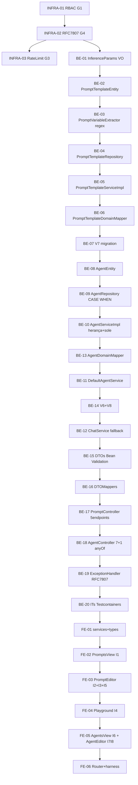

# TASKS — admin-prompt-agent: Backlog TDD-ready (sdd-compiler generate-tasks + jira-microtask-breaker)

## 1. Traceability Context

- **Source SPEC**: `.spec/backend/admin-prompt-agent/SPEC.md` (1549 linhas, RF1-RF8, RN1-RN12, FU1-FU5, CA1-CA8 +2 extras, ADRs 01-06)
- **Source PLAN**: `.spec/backend/admin-prompt-agent/PLAN.md` (INFRA + Batch1 prompt → Batch2 agent/default → Batch3 web → Batch4 frontend)
- **Source PROPOSAL**: `.spec/backend/admin-prompt-agent/PROPOSAL.md` 341 linhas
- **UX-SPEC vinculante**: `.spec/frontend/admin-prompt-agent/UX-SPEC.md` 5 telas, 8 inovações I1-I8
- **Goal**: Explodir PLAN em tickets atômicos (<2h) TDD-ready, com `arquivo:linha` alvo, `Promise` prescritiva, BDD Success/Failure/Edge, delegáveis via `task` tool ao `developer-engineer` (java-architecture-specialist + frontend-vue-specialist).

> Cobertura 100%: todo RF/RN/CA do SPEC tem ≥1 task. Nenhuma task inventa requisito além do SPEC. `PATCH/duplicate` EXTRA não entra.

---

## 2. Sprint Summary

| Batch | Task ID | Título | Type | Priority | Risk | Estimativa | Status |
|-------|---------|--------|------|----------|------|------------|--------|
| INFRA | INFRA-01 | Fix RBAC bypass HasPermissionAspect + SecurityFilter + SecurityConstants G1 | Infra | P0 | High | M | Todo |
| INFRA | INFRA-02 | Reformular StandardError → RFC7807 + ControllerExceptionHandler 400/404/409/422 G4 | Infra | P0 | High | M | Todo |
| INFRA | INFRA-03 | Rate limiting Bucket4j+Redis por tenant/IP em POST/PUT admin G3 | Infra | P1 | Medium | M | Todo |
| Batch1 | BE-01 | VO InferenceParams (temperature/topP/maxTokens) | Domain | P0 | Low | S | Todo |
| Batch1 | BE-02 | PromptTemplateEntity estendida (description/tags/inferenceParams/TEXT) | Data | P0 | Medium | M | Todo |
| Batch1 | BE-03 | PromptVariableExtractor regex canônica + extractParams | Domain | P0 | High | S | Todo |
| Batch1 | BE-04 | PromptTemplateRepository findByTenantIdAndIsDefault... findByIdAndTenantId | Data | P0 | Medium | S | Todo |
| Batch1 | BE-05 | PromptTemplateServiceImpl CRUD + code único + version++ + extract autoritativo | App | P0 | High | L | Todo |
| Batch1 | BE-06 | PromptTemplateDomainMapper MapStruct spring | Data | P0 | Low | S | Todo |
| Batch1 | BE-07 | V7 prompt_template migration idempotente (description/tags/jsonb/TEXT + índices) | Data | P0 | High | M | Todo |
| Batch2 | BE-08 | AgentEntity estendida (isDefault/avatarUrl/systemPrompt/topP/maxTokens/tools/KBs) | Data | P0 | Medium | M | Todo |
| Batch2 | BE-09 | AgentRepository updateDefaultFlag CASE WHEN + findByTenantIdAndIsDefaultTrue + count | Data | P0 | High | M | Todo |
| Batch2 | BE-10 | AgentServiceImpl CRUD + herança RN6 + avatar URL + sole 409 | App | P0 | High | L | Todo |
| Batch2 | BE-11 | DefaultAgentServiceImpl setDefault/getDefault/requireDefault + concorrência | App | P0 | High | M | Todo |
| Batch2 | BE-12 | ChatServiceImpl fallback injection DefaultAgentResolver (agentId nullable → 422) | App | P0 | High | M | Todo |
| Batch2 | BE-13 | AgentDomainMapper MapStruct + herança manual | Data | P0 | Low | S | Todo |
| Batch2 | BE-14 | V6 is_default/avatar/systemPrompt + partial unique + V8 FK RESTRICT | Data | P0 | High | M | Todo |
| Batch3 | BE-15 | DTOs Prompt/Agent Bean Validation + ChatRequest agentId nullable | Interface | P0 | Medium | M | Todo |
| Batch3 | BE-16 | DTOMappers PromptTemplateDTOMapper + AgentDTOMapper | Interface | P0 | Low | S | Todo |
| Batch3 | BE-17 | PromptTemplateControllerV1 5 endpoints PROMPT_MANAGE paginado | Interface | P0 | High | M | Todo |
| Batch3 | BE-18 | AgentControllerV1 7+1 endpoints AGENT_MANAGE + anyOf GET /agents + /default | Interface | P0 | High | M | Todo |
| Batch3 | BE-19 | ControllerExceptionHandler RFC7807 400/404/409/422 + DataIntegrityViolation branch | Interface | P0 | High | M | Todo |
| Batch3 | BE-20 | IT PromptTemplate/Agent/Chat fallback + concorrência CountDownLatch + anti-IDOR | Test | P0 | High | L | Todo |
| Batch4 | FE-01 | Services prompt.service.ts + agent-admin.service.ts + types + extractVars TS | Frontend | P0 | Medium | M | Todo |
| Batch4 | FE-02 | PromptsView DataTable I1 + AdminEmptyState | Frontend | P0 | Medium | M | Todo |
| Batch4 | FE-03 | PromptEditorView Split 60/40 I2 + TemplateEditor highlight I3 + InferenceParams I5 | Frontend | P0 | Medium | M | Todo |
| Batch4 | FE-04 | PlaygroundPanel mock I4 regex reativo | Frontend | P0 | Medium | S | Todo |
| Batch4 | FE-05 | AgentsView DataTable I1+I6 badge ⭐ + AgentEditorView Accordion I7/I8 | Frontend | P0 | Medium | M | Todo |
| Batch4 | FE-06 | Router /prompts /agents + harness Chrome DevTools zero errors | Frontend | P0 | Medium | S | Todo |

**Total: 29 tasks (3 INFRA + 14 BE Batch1-2 + 6 BE Batch3 + 6 FE Batch4) — todas <2h, delegáveis isoladamente.**

---

## 3. Dependency Graph

Sem ciclos; sem órfãs; `INFRA-03` paralelo a `BE-01` após `INFRA-02`.

---

## 4. Task Backlog (TDD-ready — teste ANTES da implementação)

> Cada task: `file:line` alvo prescritivo do SPEC Apêndice A/B, `Constraint Ref` RN/CA/ADR, estimativa S/M/L, dependências hard, BDD 3 cenários, steps TDD, DoD.

---

### Task INFRA-01: Fix RBAC bypass HasPermissionAspect + SecurityFilter + SecurityConstants (G1)

- **Constraint Ref**: RF8, N1.2, CA8, R4
- **Depends on (PLAN)**: None (infra bootstrap)
- **Dependency Type**: Hard
- **Layer**: Infrastructure
- **Task Type**: Security
- **Priority**: P0
- **Risk Level**: High
- **Parallelizable**: No
- **Artifact**: `backend/security/HasPermissionAspect.java`, `backend/security/SecurityFilter.java`, `backend/security/SecurityConstants.java`
- **Framework Detail**: Spring AOP `HasPermissionAspect`, JWT `java-jwt` claims `permissions`, `SecurityContextHolder`

#### 📝 Context & Domain Impact
- Remove bypass `if (authorities.isEmpty()) return pjp.proceed()` HIGH vulnerabilidade (G1). Popular `authorities` reais em `SecurityFilter` via `JWT claims["permissions"]` ou `User.getAuthorities()`. Criar constantes `PROMPT_MANAGE`, `AGENT_MANAGE`, `CHAT_SEND`.

#### 🛡️ Technical Enforcement
- **Rule**: Todo endpoint `/prompt-templates` e `/agents` com `@HasPermission` sem bypass.
- **Failure Mode**: Sem fix, `authorities` vazio → `proceed` → RBAC bypass → vazamento A01.

#### ✅ Acceptance Criteria (BDD)
- **Scenario 1 (Success)**: **Given** JWT com `permissions:[PROMPT_MANAGE]` **When** `GET /v1/prompt-templates` **Then** 200
- **Scenario 2 (Failure 403)**: **Given** JWT sem `PROMPT_MANAGE` **When** `GET /v1/prompt-templates` **Then** 403 `code=MISSING_PERMISSION` (não 404)
- **Scenario 3 (Failure 401)**: **Given** sem `Authorization` **When** qualquer `/v1/prompt-templates` **Then** 401

#### 🛠️ Implementation Steps (TDD - Test First)
- [ ] `integration-test/src/test/java/.../SecurityRbacIT.java` Integration — `when_get_with_noPermission_then_403`, `when_get_withoutJwt_then_401` para 2 endpoints (MockMvc + JwtTestHelper)
- [ ] `backend/security/.../HasPermissionAspect.java:XX` remover bypass, lançar `AccessDeniedException` se `authorities.isEmpty()`
- [ ] `backend/security/.../SecurityFilter.java:XX` popular `authorities` de JWT `claims["permissions"]`
- [ ] `backend/security/.../SecurityConstants.java:10` criar `public static final String PROMPT_MANAGE="PROMPT_MANAGE"` etc.

#### 🏁 Definition of Done
- [ ] Teste criado ANTES do fix
- [ ] Bypass removido, autoridades populadas, constantes centralizadas
- [ ] IT 403 para `GET /prompt-templates` e `GET /agents` verde
- [ ] Zero TODOs

---

### Task INFRA-02: Reformular StandardError → RFC7807 + handlers 400/404/409/422 (G4)

- **Constraint Ref**: N1.3, RN1-RN3, RN2, G4, A4
- **Depends on**: INFRA-01
- **Dependency Type**: Hard
- **Layer**: Infrastructure
- **Task Type**: API
- **Priority**: P0
- **Risk Level**: High
- **Parallelizable**: No
- **Artifact**: `backend/commons/api/StandardError.java`, `backend/commons/web/ControllerExceptionHandler.java`
- **Framework Detail**: `application/problem+json`, `ProblemDetail` manual

#### 📝 Context & Domain Impact
- `StandardError` atual `{success,error}` → RFC7807 `{type,title,status,detail,instance,code}`. Handlers para `422 DefaultAgentNotFoundException` (404 vs 422 `isCommand`), `DataIntegrityViolationException` branch `uniq_agent_default → 409 CONCURRENT` / `fk_agent_prompt → 409 PROMPT_IN_USE`.

#### 🛡️ Technical Enforcement
- **Rule**: Respostas de erro nunca vazam stack trace, sempre `problem+json`.
- **Failure Mode**: Status errado (422 cai como 500) ou estrutura antiga quebra FE.

#### ✅ Acceptance Criteria (BDD)
- **Scenario 1 (Success)**: **Given** `DefaultAgentNotFoundException(isCommand=false)` **When** `GET /agents/default` **Then** 404 `code=DEFAULT_AGENT_NOT_FOUND`
- **Scenario 2 (Failure)**: **Given** `DefaultAgentNotFoundException(isCommand=true)` em `POST /chat` **When** handler **Then** 422 mesmo code
- **Scenario 3 (Edge)**: **Given** `DataIntegrityViolationException` constraint `uniq_agent_default_per_tenant` **When** handler **Then** 409 `CONCURRENT_DEFAULT_UPDATE`

#### 🛠️ Implementation Steps (TDD - Test First)
- [ ] `integration-test/.../ExceptionHandlerIT.java` Unit/Integration — validar `Content-Type application/problem+json` e `status/code`
- [ ] `backend/commons/api/StandardError.java:10` reformular campos `type,title,status,detail,instance,code`
- [ ] `backend/.../ControllerExceptionHandler.java:30` adicionar branch `DataIntegrityViolationException` e `DefaultAgentNotFoundException` com `isCommand` via `request.getRequestURI()`

#### 🏁 Definition of Done
- [ ] Teste antes
- [ ] RFC7807 em 400/404/409/422
- [ ] `isCommand` distingue 404/422

---

### Task INFRA-03: Rate limiting Bucket4j+Redis em POST/PUT admin (G3)

- **Constraint Ref**: N1.8, A04, G3
- **Depends on**: INFRA-02
- **Dependency Type**: Soft
- **Layer**: Infrastructure
- **Task Type**: Infra
- **Priority**: P1
- **Risk Level**: Medium
- **Parallelizable**: Yes
- **Artifact**: `backend/commons/RateLimitConfig.java`, `backend/commons/RateLimitFilter.java`
- **Framework Detail**: Bucket4j 8.x + Redis Lettuce `Bucket.builder().addLimit(Bandwidth.simple(60, Duration.ofMinutes(1)))`

#### 📝 Context & Domain Impact
- Limitar `POST/PUT /prompt-templates` e `/agents` por `tenantId+IP` 60 req/min. Se não entregue, registrar débito `A04` em `workflow-state.json` e abrir bugfix separado (SPEC §3.2).

#### 🛡️ Technical Enforcement
- **Rule**: Excedeu quota → 429 com `Retry-After`.
- **Failure Mode**: Sem rate limit → brute force em admin (A04).

#### ✅ Acceptance Criteria (BDD)
- **Scenario 1 (Success)**: **Given** 30 req/min **When** `POST /agents` **Then** 201
- **Scenario 2 (Failure)**: **Given** 61 req/min do mesmo tenant+IP **When** `POST /agents` **Then** 429
- **Scenario 3 (Edge)**: **Given** tenant T1 excedeu **When** T2 `POST /agents` **Then** 201 (isolado)

#### 🛠️ Implementation Steps (TDD - Test First)
- [ ] `integration-test/.../RateLimitIT.java` — 61 req burst → 429
- [ ] `backend/commons/RateLimitConfig.java:10` Bean `Bucket` + `ProxyManager` Redis
- [ ] `backend/commons/RateLimitFilter.java:20` intercepta `POST/PUT /v1/prompt-templates|/agents`

#### 🏁 Definition of Done
- [ ] Bean carrega ou débito registrado
- [ ] 429 com `Retry-After`

---

### Task BE-01: VO InferenceParams (temperature/topP/maxTokens)

- **Constraint Ref**: RF1, RF2, RN6
- **Depends on**: INFRA-02
- **Layer**: Domain (`agent/api`)
- **Task Type**: Domain
- **Priority**: P0
- **Risk Level**: Low
- **Parallelizable**: No
- **Artifact**: `agent/api/src/main/java/.../agent/api/domain/InferenceParams.java`
- **Framework Detail**: Java record/VO manual getters/setters, sem Lombok

#### 📝 Context & Domain Impact
- VO para `inferenceParams` usado em `PromptTemplate` e `Agent` herança RN6.

#### 🛡️ Technical Enforcement
- **Rule**: Ranges 0.0-2.0, 0.0-1.0, 256-4096 validados em DTO (Bean Validation).
- **Failure Mode**: VO sem validação → 500 em vez de 400.

#### ✅ Acceptance Criteria (BDD)
- **Scenario 1 (Success)**: **Given** `temperature=0.7 topP=0.9 maxTokens=2048` **When** criar VO **Then** getters retornam mesmos valores
- **Scenario 2 (Failure)**: **Given** `temperature=3.0` **When** DTO `@DecimalMax(2.0)` **Then** 400
- **Scenario 3 (Edge)**: **Given** todos null **When** mapear **Then** VO null

#### 🛠️ Implementation Steps (TDD - Test First)
- [ ] `agent/api/src/test/java/.../InferenceParamsTest.java` Unit — `when_create_with_validRanges_then_success` + `when_create_with_null_then_success`
- [ ] `agent/api/src/main/java/.../domain/InferenceParams.java:1` VO manual

#### 🏁 Definition of Done
- [ ] VO com manual getters/setters, sem Lombok

---

### Task BE-02: PromptTemplateEntity estendida (description/tags/inferenceParams/TEXT)

- **Constraint Ref**: RF1, RN9, RN4, N2.1
- **Depends on**: BE-01
- **Layer**: Data (`agent/impl`)
- **Task Type**: Data
- **Priority**: P0
- **Risk Level**: Medium
- **Parallelizable**: No
- **Artifact**: `agent/impl/src/main/java/.../agent/impl/entity/PromptTemplateEntity.java:22`
- **Framework Detail**: `extends AbstractEntity`, `@JdbcTypeCode(SqlTypes.JSON)` para `inferenceParams`, `columnDefinition="text[]"` para `tags/params`

#### 📝 Context & Domain Impact
- Estender baseline `PromptTemplateEntity` com `description TEXT`, `tags TEXT[]`, `inferenceParams JSONB`, `template TEXT` (de VARCHAR8000), `params TEXT[]`.

#### 🛡️ Technical Enforcement
- **Rule**: `template` TEXT 1..20000, `description` 0..2000, `tags` 0..20.
- **Failure Mode**: VARCHAR8000 trunca template.

#### ✅ Acceptance Criteria (BDD)
- **Scenario 1 (Success)**: **Given** entity com `template TEXT 20000` **When** `repository.save` **Then** persiste TEXT
- **Scenario 2 (Failure)**: **Given** `template VARCHAR` antigo **When** migrar V7 **Then** `ALTER TYPE TEXT` sem perda
- **Scenario 3 (Edge)**: **Given** `tags = ["a","b","a"]` **When** mapear **Then** dedup via `Set`

#### 🛠️ Implementation Steps (TDD - Test First)
- [ ] `agent/impl/src/test/java/.../PromptTemplateEntityTest.java` Unit — invariants `template` TEXT
- [ ] `agent/impl/src/main/java/.../entity/PromptTemplateEntity.java:22` adicionar colunas + annotations

#### 🏁 Definition of Done
- [ ] `extends AbstractEntity` + manual getters/setters + `FetchType` correto

---

### Task BE-03: PromptVariableExtractor regex canônica + extractParams

- **Constraint Ref**: RF1/F7, RN4, CA7, ADR-06, R5
- **Depends on**: BE-02
- **Layer**: Domain (`agent/impl`)
- **Task Type**: Domain
- **Priority**: P0
- **Risk Level**: High
- **Parallelizable**: No
- **Artifact**: `agent/impl/src/main/java/.../agent/impl/util/PromptVariableExtractor.java:10`
- **Framework Detail**: `Pattern.compile("\\{\\{\\s*([a-zA-Z_][a-zA-Z0-9_]*)\\s*\\}\\}")`

#### 📝 Context & Domain Impact
- Classe util com `VAR_PATTERN` + `extractParams(String) → Set<String> LinkedHashSet unmodifiable`. Lança `InvalidTemplateVariableException` se `contains("{{") && result.isEmpty()`.

#### 🛡️ Technical Enforcement
- **Rule**: Nome inicia letra/`_`, seguido letras/dígitos/`_`, trim espaços.
- **Failure Mode**: `{{1bad}}` passa se regex errada.

#### ✅ Acceptance Criteria (BDD)
- **Scenario 1 (Success)**: **Given** `{{nome}} {{tarefa}} {{nome}}` **When** `extractParams` **Then** `["nome","tarefa"]` dedup ordenado
- **Scenario 2 (Failure)**: **Given** `{{1bad}}` / `{{}}` / `{{var com espaço}}` **When** `extractParams` + validação service **Then** 400 `INVALID_TEMPLATE_VARIABLE` menciona token
- **Scenario 3 (Edge)**: **Given** `{{ nome }}` com espaços **When** `extract` **Then** `["nome"]` trim; `Olá mundo` sem `{{` → `[]`

#### 🛠️ Implementation Steps (TDD - Test First)
- [ ] `agent/impl/src/test/java/.../PromptVariableExtractorTest.java` Unit — 20 casos prescritivos (ver SPEC Apêndice C) + `when_extract_with_incomplete_then_400`
- [ ] `agent/impl/src/main/java/.../util/PromptVariableExtractor.java:10` implementar `VAR_PATTERN` + `extractParams`

#### 🏁 Definition of Done
- [ ] 20 casos verdes, mesma regex que FE usará

---

### Task BE-04: PromptTemplateRepository métodos com tenantId

- **Constraint Ref**: RF1/RF6, RN12, N2.2, R4
- **Depends on**: BE-03
- **Layer**: Data
- **Task Type**: Data
- **Priority**: P0
- **Risk Level**: Medium
- **Parallelizable**: No
- **Artifact**: `agent/impl/src/main/java/.../agent/impl/repository/PromptTemplateRepository.java:10`
- **Framework Detail**: `JpaRepository<PromptTemplateEntity,UUID>` + `@Repository` + JPQL `ilike`

#### 📝 Context & Domain Impact
- `findByIdAndTenantId`, `findByTenantId(Pageable)`, `existsByTenantIdAndCode`, `findByTenantIdAndStatus` com `ilike name/code/description`.

#### 🛡️ Technical Enforcement
- **Rule**: Nenhum `findAll()` sem `tenantId`; sempre filtro explícito.
- **Failure Mode**: `findById` sem tenant → vazamento cross-tenant 404 deveria ser.

#### ✅ Acceptance Criteria (BDD)
- **Scenario 1 (Success)**: **Given** prompt T1 **When** `findByIdAndTenantId(id,T1)` **Then** presente
- **Scenario 2 (Failure)**: **Given** prompt T1 **When** `findByIdAndTenantId(id,T2)` **Then** empty → 404
- **Scenario 3 (Edge)**: **Given** `q=sauda` **When** `findByTenantIdAndStatus` paginado **Then** ilike funciona + `size>50` 400 no controller

#### 🛠️ Implementation Steps (TDD - Test First)
- [ ] `integration-test/.../PromptTemplateRepositoryIT.java` — cross-tenant 404
- [ ] `agent/impl/.../repository/PromptTemplateRepository.java:10` métodos com `tenantId`

#### 🏁 Definition of Done
- [ ] Todos métodos com `tenantId` explícito; nenhum `findAll`

---

### Task BE-05: PromptTemplateServiceImpl CRUD + code único + version++ + extract autoritativo

- **Constraint Ref**: RF1, RN4, RN9, RN8, CA1, CA7
- **Depends on**: BE-04
- **Layer**: App (`agent/impl`)
- **Task Type**: App
- **Priority**: P0
- **Risk Level**: High
- **Parallelizable**: No
- **Artifact**: `agent/impl/src/main/java/.../agent/impl/service/PromptTemplateServiceImpl.java:30`
- **Framework Detail**: `@Service @Transactional` write, constructor injection, `TenantContext`

#### 📝 Context & Domain Impact
- `create`: `extractParams(template)` autoritativo (ignorar `params` client), validar `INVALID_TEMPLATE_VARIABLE`, `existsByTenantIdAndCode` → 409 `PROMPT_CODE_DUPLICATE`, `version=1` `status=DRAFT` default. `update`: sem `code` (imultável → 400 `CODE_IMMUTABLE` se enviado), `version old+1`, re-extrai `params`. `delete`: `existsByPromptTemplateIdAndTenantId` mesma TX → 409 `PROMPT_IN_USE`.

#### 🛡️ Technical Enforcement
- **Rule**: `params` nunca do client; `code` imutável.
- **Failure Mode**: Client injeta `params` → diverge.

#### ✅ Acceptance Criteria (BDD)
- **Scenario 1 (Success)**: **Given** `POST {code:greeting-v1, template:Olá {{nome}}}` **When** `create` **Then** 201 `params ["nome"] version 1`
- **Scenario 2 (Failure)**: **Given** dup `code:greeting-v1` T1 **When** segundo `POST` T1 **Then** 409; T2 **Then** 201 isolado
- **Scenario 3 (Edge)**: **Given** `POST {template:"{{nome}}", params:["injected"]}` **When** `create` **Then** `params ["nome"]` não `["injected"]`; `PUT {code:novo}` **Then** 400 `CODE_IMMUTABLE`

#### 🛠️ Implementation Steps (TDD - Test First)
- [ ] `agent/impl/src/test/java/.../PromptTemplateServiceImplTest.java` Unit — `when_create_with_validTemplate_then_extractsAndSaves`, `when_create_with_dupCode_then_throws409`, `when_update_with_codeField_then_throws400`, `when_create_with_injectedParams_then_ignored` (MockitoExtension + Mappers.getMapper)
- [ ] `agent/impl/.../service/PromptTemplateServiceImpl.java:30` implementar

#### 🏁 Definition of Done
- [ ] Unit 80% verde, `version++`, cross-tenant anti-IDOR

---

### Task BE-06: PromptTemplateDomainMapper MapStruct spring

- **Constraint Ref**: RF1, RN6
- **Depends on**: BE-05
- **Layer**: Data
- **Task Type**: Data
- **Priority**: P0
- **Risk Level**: Low
- **Parallelizable**: Yes
- **Artifact**: `agent/impl/src/main/java/.../agent/impl/mapper/PromptTemplateDomainMapper.java:15`
- **Framework Detail**: `@Mapper(componentModel="spring")` `@Mapping(ignore)` createAt/updateAt/tenantId

#### 📝 Context & Domain Impact
- `PromptTemplate ↔ PromptTemplateEntity` + `InferenceParams` JSONB.

#### 🛡️ Technical Enforcement
- **Rule**: `createAt/updateAt/tenantId` ignore (auto-gerado).
- **Failure Mode**: Mapper sobrescreve `tenantId` → isolamento quebrado.

#### ✅ Acceptance Criteria (BDD)
- **Scenario 1 (Success)**: **Given** entity com `inferenceParams` **When** `toDomain` **Then** VO mapeado
- **Scenario 2 (Failure)**: **Given** `tenantId` no DTO **When** mapear **Then** ignorado
- **Scenario 3 (Edge)**: **Given** `tags null` **When** mapear **Then** `[]` ou null preservado

#### 🛠️ Implementation Steps (TDD - Test First)
- [ ] `agent/impl/src/test/java/.../PromptTemplateDomainMapperTest.java` — via `Mappers.getMapper` não mock
- [ ] `agent/impl/.../mapper/PromptTemplateDomainMapper.java:15`

#### 🏁 Definition of Done
- [ ] MapStruct `spring` + `ignore` verificados

---

### Task BE-07: V7 migration prompt_template idempotente (description/tags/jsonb/TEXT + índices)

- **Constraint Ref**: RF1, N3.2, G5
- **Depends on**: BE-06
- **Layer**: Data (`agent/dbupdate`)
- **Task Type**: Data
- **Priority**: P0
- **Risk Level**: High
- **Parallelizable**: No
- **Artifact**: `agent/dbupdate/src/main/resources/db/migration/agent/V7__extend_prompt_template.sql:10`
- **Framework Detail**: Flyway `DO $$ IF NOT EXISTS`, `CREATE INDEX IF NOT EXISTS`, PG16

#### 📝 Context & Domain Impact
- V7 prompt parte: `description TEXT`, `tags TEXT[]`, `inference_params JSONB`, `template TEXT` de VARCHAR, `UNIQUE(tenant,code,version)` + partial `WHERE ACTIVE`, índices.

#### 🛡️ Technical Enforcement
- **Rule**: Idempotente `IF NOT EXISTS`; sem `UNIQUE(tenant,code)` plain (G5).
- **Failure Mode**: Re-run Flyway falha se não idempotente.

#### ✅ Acceptance Criteria (BDD)
- **Scenario 1 (Success)**: **Given** V7 não aplicada **When** `migrate` **Then** colunas criadas
- **Scenario 2 (Failure)**: **Given** `tenant_id null` existe **When** `DO $$` **Then** `RAISE EXCEPTION` não `uuid_generate_v4` random
- **Scenario 3 (Edge)**: **Given** V7 já aplicada **When** `migrate` re-run **Then** `IF NOT EXISTS` skip sem erro

#### 🛠️ Implementation Steps (TDD - Test First)
- [ ] `integration-test/.../FlywayV7IT.java` — Testcontainers PG16 aplica V7 duas vezes
- [ ] `agent/dbupdate/.../V7__extend_prompt_template.sql:10` escrever DDL idempotente (ver SPEC §7.4)

#### 🏁 Definition of Done
- [ ] `mvn flyway:info` verde, re-run OK

---

### Task BE-08: AgentEntity estendida (isDefault/avatarUrl/systemPrompt/topP/maxTokens/tools/KBs)

- **Constraint Ref**: RF2, RN5, RN10, N2.1
- **Depends on**: BE-07
- **Layer**: Data
- **Task Type**: Data
- **Priority**: P0
- **Risk Level**: Medium
- **Parallelizable**: No
- **Artifact**: `agent/impl/src/main/java/.../agent/impl/entity/AgentEntity.java:21`
- **Framework Detail**: `extends AbstractEntity`, `@Pattern ^https?://.*`, `FetchType.LAZY` promptTemplate

#### 📝 Context & Domain Impact
- Colunas `is_default BOOLEAN DEFAULT false`, `avatar_url VARCHAR(2048)`, `system_prompt TEXT`, `top_p DOUBLE`, `max_tokens INT`, `tools TEXT[]`, `knowledge_bases TEXT[]`.

#### 🛡️ Technical Enforcement
- **Rule**: `avatarUrl` `@Pattern` + `@Size(2048)`; `tools/KBs` `TEXT[]` max 20.
- **Failure Mode**: `@URL` ausente dep → falta validação.

#### ✅ Acceptance Criteria (BDD)
- **Scenario 1 (Success)**: **Given** entity com `isDefault=false avatarUrl=https://...` **When** save **Then** persiste
- **Scenario 2 (Failure)**: **Given** `avatarUrl=not-a-url` **When** DTO `@Pattern` **Then** 400 (não persistido)
- **Scenario 3 (Edge)**: **Given** `tools` 21 itens **When** DTO `@Size(max=20)` **Then** 400

#### 🛠️ Implementation Steps (TDD - Test First)
- [ ] `agent/impl/src/test/java/.../AgentEntityTest.java` Unit invariants
- [ ] `agent/impl/.../entity/AgentEntity.java:21` estender

#### 🏁 Definition of Done
- [ ] Manual getters/setters, `AbstractEntity`, LAZY

---

### Task BE-09: AgentRepository updateDefaultFlag CASE WHEN + finders tenant

- **Constraint Ref**: RN1, RN3, RN12, R1, R4
- **Depends on**: BE-08
- **Layer**: Data
- **Task Type**: Data
- **Priority**: P0
- **Risk Level**: High
- **Parallelizable**: No
- **Artifact**: `agent/impl/src/main/java/.../agent/impl/repository/AgentRepository.java:15`
- **Framework Detail**: `@Modifying @Query("UPDATE AgentEntity a SET a.isDefault = CASE WHEN a.id = :targetId THEN true ELSE false END WHERE a.tenantId = :tenantId") int updateDefaultFlag` sem `@Transactional`

#### 📝 Context & Domain Impact
- Métodos: `findByIdAndTenantId`, `findByTenantId(Pageable)`, `findByTenantIdAndIsDefaultTrue`, `countByTenantIdAndIsDefaultTrue`, `existsByPromptTemplateIdAndTenantId`, `updateDefaultFlag` CASE WHEN.

#### 🛡️ Technical Enforcement
- **Rule**: `@Modifying` sem `@Transactional` no repo; TX no service (C3).
- **Failure Mode**: `@Transactional` no repo → proxy duplo, isolamento TX quebrado.

#### ✅ Acceptance Criteria (BDD)
- **Scenario 1 (Success)**: **Given** T1 A1 não padrão A2 não padrão **When** `updateDefaultFlag(T1,A1)` **Then** 1 row updated, `A1 true A2 false`
- **Scenario 2 (Failure)**: **Given** T1 e T2 cada com padrão **When** `updateDefaultFlag(T1,A2DaT2)` **Then** 0 rows (tenant mismatch) mas service já 404 antes
- **Scenario 3 (Edge)**: **Given** `A1` já padrão **When** `updateDefaultFlag(T1,A1)` idempotente **Then** 1 row, permanece 1 true

#### 🛠️ Implementation Steps (TDD - Test First)
- [ ] `integration-test/.../AgentRepositoryIT.java` — CASE WHEN + tenant isolation
- [ ] `agent/impl/.../repository/AgentRepository.java:15` escrever JPQL CASE WHEN

#### 🏁 Definition of Done
- [ ] JPQL compila, sem `@Transactional` no repo

---

### Task BE-10: AgentServiceImpl CRUD + herança RN6 + sole 409 + PROMPT_IN_USE

- **Constraint Ref**: RF2, RN5, RN6, RN3, RN8, RN10, CA2, CA5
- **Depends on**: BE-09
- **Layer**: App
- **Task Type**: App
- **Priority**: P0
- **Risk Level**: High
- **Parallelizable**: No
- **Artifact**: `agent/impl/src/main/java/.../agent/impl/service/AgentServiceImpl.java:40`
- **Framework Detail**: `@Service @Transactional` writes, herança campo-a-campo

#### 📝 Context & Domain Impact
- `create/update`: `promptId` → `findByIdAndTenantId` 404 se outro tenant; herança `temperature/topP/maxTokens` RN6 (dto non-null sobrescreve, null herda prompt, ambos null → null); `systemPrompt` se vazio e `promptId` presente → herda `prompt.template` snapshot; sole check `count==1 && isDefault → 409` em `delete` e `update {active:false}`; `delete` verifica `PROMPT_IN_USE` same TX.

#### 🛡️ Technical Enforcement
- **Rule**: Herança snapshot não reativa (edição prompt não propaga).
- **Failure Mode**: Herança errada → `topP` null quando deveria herdar 0.9.

#### ✅ Acceptance Criteria (BDD)
- **Scenario 1 (Success)**: **Given** prompt `topP 0.9 maxTokens 2048` **When** `POST {temperature:0.8, topP:null}` **Then** `0.8, 0.9, 2048` (CA2)
- **Scenario 2 (Failure)**: **Given** `A1 sole isDefault true` **When** `DELETE A1` **Then** 409 `SOLE_DEFAULT_AGENT`; `DELETE` com `A2` padrão disponível **Then** 204
- **Scenario 3 (Edge)**: **Given** `promptId` de T2 com JWT T1 **When** `POST {promptId}` **Then** 404 anti-IDOR

#### 🛠️ Implementation Steps (TDD - Test First)
- [ ] `agent/impl/src/test/java/.../AgentServiceImplTest.java` Unit — `when_create_with_promptLink_then_inheritsTopP`, `when_delete_with_soleDefault_then_throws409`, `when_create_with_promptFromOtherTenant_then_404`, `when_create_with_invalidAvatar_then_400`
- [ ] `agent/impl/.../service/AgentServiceImpl.java:40`

#### 🏁 Definition of Done
- [ ] Herança matriz RN6 coberta, sole 409, tenant 404

---

### Task BE-11: DefaultAgentServiceImpl setDefault/getDefault/requireDefault + concorrência

- **Constraint Ref**: RN1, RN2, RN11, R1, R3
- **Depends on**: BE-10
- **Layer**: App
- **Task Type**: App
- **Priority**: P0
- **Risk Level**: High
- **Parallelizable**: No
- **Artifact**: `agent/impl/src/main/java/.../agent/impl/service/DefaultAgentServiceImpl.java:20`
- **Framework Detail**: Single-statement `updateDefaultFlag` + partial unique + `DataIntegrityViolation → 409`

#### 📝 Context & Domain Impact
- `setDefault(tenantId, agentId)`: `findByIdAndTenantId` 404, `active==false → 422 INACTIVE_AGENT_CANNOT_BE_DEFAULT`, `updateDefaultFlag` atômico, catch `DataIntegrityViolation → CONCURRENT_DEFAULT_UPDATE 409`, retorna `findByIdAndTenantId` atualizado. `requireDefault(tenantId)`: `findByTenantIdAndIsDefaultTrue` → `orElseThrow DefaultAgentNotFoundException(isCommand=true)`.

#### 🛡️ Technical Enforcement
- **Rule**: Sem `SELECT FOR UPDATE`/`synchronized`; barreira DB.
- **Failure Mode**: Race sem partial index → 2 defaults.

#### ✅ Acceptance Criteria (BDD)
- **Scenario 1 (Success)**: **Given** T1 A1 false A2 false **When** `setDefault(T1,A1)` **Then** `A1 true`, `GET /default` retorna `A1`; `POST /{A2}/default` → `A2 true A1 false`
- **Scenario 2 (Failure)**: **Given** `A1 active=false` **When** `setDefault` **Then** 422 `INACTIVE_AGENT_CANNOT_BE_DEFAULT`
- **Scenario 3 (Edge)**: **Given** 2 threads `setDefault(A1)` e `setDefault(A2)` com `CountDownLatch(2)` **When** simultâneo **Then** `COUNT is_default=true =1` e um 200 outro 409 ou ambos 200 mas nunca 2

#### 🛠️ Implementation Steps (TDD - Test First)
- [ ] `agent/impl/src/test/java/.../DefaultAgentServiceImplTest.java` Unit — `when_setDefault_with_inactive_then_422`, `when_requireDefault_with_empty_then_422`, `when_setDefault_concurrently_then_onlyOneTrue` (CountDownLatch 2 threads)
- [ ] `agent/impl/.../service/DefaultAgentServiceImpl.java:20`

#### 🏁 Definition of Done
- [ ] `updateDefaultFlag` CASE WHEN + partial unique + 422/409

---

### Task BE-12: ChatServiceImpl fallback injection DefaultAgentResolver (agentId nullable → 422)

- **Constraint Ref**: RF3/RF4, RN2, CA4, R3
- **Depends on**: BE-11
- **Layer**: App
- **Task Type**: App
- **Priority**: P0
- **Risk Level**: High
- **Parallelizable**: No
- **Artifact**: `agent/impl/src/main/java/.../agent/impl/service/ChatServiceImpl.java:80`
- **Framework Detail**: Constructor injection `DefaultAgentService`, `ChatRequestDTO.agentId` nullable

#### 📝 Context & Domain Impact
- `chat(tenantId, agentId, message)`: `if (agentId==null) agentId = defaultAgentService.requireDefault(tenantId).getId()`; `agentId!=null → findByIdAndTenantId` 404 anti-IDOR; sem padrão → `DefaultAgentNotFoundException → 422` nunca 500. `GET /agents/default` query → 404 mesmo code.

#### 🛡️ Technical Enforcement
- **Rule**: `agentId null` tem fallback; `agentId` não-null tem precedência.
- **Failure Mode**: `null.agentId` NPE → 500.

#### ✅ Acceptance Criteria (BDD)
- **Scenario 1 (Success)**: **Given** T1 padrão A1 **When** `POST /chat {agentId:null, message:oi}` **Then** 200 `session.agentId=A1`
- **Scenario 2 (Failure)**: **Given** T2 sem padrão **When** `POST /chat {agentId:null}` **Then** 422 `DEFAULT_AGENT_NOT_FOUND` nunca 500
- **Scenario 3 (Edge)**: **Given** T1 padrão A1 **When** `POST /chat {agentId:A2}` **Then** `session.agentId=A2` não A1; `agentId` de T2 com JWT T1 → 404 não 422

#### 🛠️ Implementation Steps (TDD - Test First)
- [ ] `agent/impl/src/test/java/.../ChatServiceImplFallbackTest.java` Unit — mocks `DefaultAgentService`
- [ ] `agent/impl/.../service/ChatServiceImpl.java:80` injetar resolver

#### 🏁 Definition of Done
- [ ] `agentId` nullable, 422 vs 404 distinção A4

---

### Task BE-13: AgentDomainMapper MapStruct + herança manual

- **Constraint Ref**: RF2
- **Depends on**: BE-10
- **Layer**: Data
- **Task Type**: Data
- **Priority**: P0
- **Risk Level**: Low
- **Parallelizable**: Yes
- **Artifact**: `agent/impl/src/main/java/.../agent/impl/mapper/AgentDomainMapper.java:15`
- **Framework Detail**: `@Mapper(componentModel="spring")` `promptTemplate.id → promptId`

#### 📝 Context & Domain Impact
- `Agent ↔ AgentEntity` com `isDefault`, `avatarUrl`, `systemPrompt`, herança `inferenceParams` manual em service (não mapper automático).

#### 🛡️ Technical Enforcement
- **Rule**: `createAt/updateAt/tenantId` ignore.
- **Failure Mode**: Mapper tenta mapear `tools` TEXT[] errado.

#### ✅ Acceptance Criteria (BDD)
- **Scenario 1 (Success)**: **Given** entity com `tools ["web_search"]` **When** `toDomain` **Then** list preservada
- **Scenario 2 (Edge)**: **Given** `promptTemplate null` **When** mapear **Then** `promptId null`

#### 🛠️ Implementation Steps (TDD - Test First)
- [ ] `agent/impl/src/test/java/.../AgentDomainMapperTest.java` via `Mappers.getMapper`
- [ ] `agent/impl/.../mapper/AgentDomainMapper.java:15`

#### 🏁 Definition of Done
- [ ] LAZY `promptTemplate` mapeado para `promptId`

---

### Task BE-14: V6 is_default/avatar/systemPrompt + partial unique + V8 FK RESTRICT

- **Constraint Ref**: RF2/RF3, RN1, RN8, R2, ADR-01-03
- **Depends on**: BE-13
- **Layer**: Data
- **Task Type**: Data
- **Priority**: P0
- **Risk Level**: High
- **Parallelizable**: No
- **Artifact**: `agent/dbupdate/src/main/resources/db/migration/agent/V6__add_is_default_avatar_systemprompt_to_agent.sql:10`, `V8__add_prompt_template_fk.sql:10`
- **Framework Detail**: `DO $$ IF NOT EXISTS`, `CREATE UNIQUE INDEX IF NOT EXISTS uniq_agent_default_per_tenant WHERE is_default=true`, `FK ON DELETE RESTRICT`

#### 📝 Context & Domain Impact
- V6 `is_default BOOLEAN DEFAULT false` + `avatar_url VARCHAR(2048)` + `system_prompt TEXT` + `uniq partial` + `idx_agent_tenant_update_at`; V8 `fk_agent_prompt_template RESTRICT` com correção `SET NULL → RESTRICT`.

#### 🛡️ Technical Enforcement
- **Rule**: `tenant_id null → RAISE EXCEPTION` não random UUID; `idx_agent_tenant_default` removido (redundante com uniq).
- **Failure Mode**: Lock longo se `CREATE INDEX` sem `IF NOT EXISTS`.

#### ✅ Acceptance Criteria (BDD)
- **Scenario 1 (Success)**: **Given** V6 não aplicada **When** migrate **Then** `is_default` criado + uniq partial
- **Scenario 2 (Failure)**: **Given** `agent WHERE tenant_id IS NULL` existe **When** V6 **Then** `RAISE EXCEPTION` manual
- **Scenario 3 (Edge)**: **Given** FK já `SET NULL` **When** V8 **Then** `DROP + ADD RESTRICT`

#### 🛠️ Implementation Steps (TDD - Test First)
- [ ] `integration-test/.../FlywayV6V8IT.java` — PG16 re-run + `SELECT indexdef WHERE indexname='uniq_agent_default_per_tenant'`
- [ ] `agent/dbupdate/.../V6...sql:10` + `V8...sql:10` (ver SPEC §7.3/7.4.1)

#### 🏁 Definition of Done
- [ ] `EXPLAIN SELECT ... WHERE tenant_id=? AND is_default=true` usa `uniq_agent_default_per_tenant` (Index Scan, p95 <50ms)

---

### Task BE-15: DTOs Prompt/Agent Bean Validation + ChatRequest agentId nullable

- **Constraint Ref**: RF1/RF2, RN5, RN9, RN10, N1.3
- **Depends on**: BE-14
- **Layer**: Interface (`agent/web`)
- **Task Type**: API
- **Priority**: P0
- **Risk Level**: Medium
- **Parallelizable**: No
- **Artifact**: `agent/web/internal/v1/dto/PromptTemplateCreateDTO.java:10`, `PromptTemplateUpdateDTO.java` (sem code), `InferenceParamsDTO.java:10`, `AgentCreateDTO.java:10`, `AgentUpdateDTO.java`, `AgentDTO.java`, `PromptTemplateDTO.java`, `ChatRequestDTO.java:10`
- **Framework Detail**: Records com `@NotBlank @Size @Pattern @DecimalMin/Max @Min @Max`

#### 📝 Context & Domain Impact
- DTOs prescritivos SPEC §6.3; `UpdateDTO` sem `code` (imutável); `avatarUrl` `@Pattern ^https?://.* @Size 2048`; `tools/KBs` `@Size(max=20) List<@NotBlank @Size(max=100)>`; `ChatRequestDTO.agentId` nullable.

#### 🛡️ Technical Enforcement
- **Rule**: `@Valid` em controller; `params` não existe em CreateDTO.
- **Failure Mode**: `code` em UpdateDTO permite mutação.

#### ✅ Acceptance Criteria (BDD)
- **Scenario 1 (Success)**: **Given** `POST {name:Saudação, code:greeting-v1, template:Olá {{nome}}}` **When** `@Valid` **Then** 201 com `params ["nome"]`
- **Scenario 2 (Failure)**: **Given** `POST {name:"", code:"bad code!"}` **When** validate **Then** 400 `application/problem+json`
- **Scenario 3 (Edge)**: **Given** `PUT {code:novo}` **When** **Then** 400 `CODE_IMMUTABLE`; `avatarUrl:not-a-url` **Then** 400

#### 🛠️ Implementation Steps (TDD - Test First)
- [ ] `agent/web/src/test/java/.../DtoValidationTest.java` Unit — `@Validator` validate DTOs
- [ ] `agent/web/.../dto/*.java:10` records com annotations

#### 🏁 Definition of Done
- [ ] `UpdateDTO` sem `code`, `agentId` nullable, ranges 0.0-2.0 etc.

---

### Task BE-16: DTOMappers PromptTemplateDTOMapper + AgentDTOMapper

- **Constraint Ref**: RF1/RF2
- **Depends on**: BE-15
- **Layer**: Interface
- **Task Type**: API
- **Priority**: P0
- **Risk Level**: Low
- **Parallelizable**: Yes
- **Artifact**: `agent/web/internal/v1/mapper/PromptTemplateDTOMapper.java:10`, `AgentDTOMapper.java:10`
- **Framework Detail**: `@Mapper(componentModel="spring")`

#### 📝 Context & Domain Impact
- `PromptTemplateCreateDTO → PromptTemplate` (ignore `params/version`), `PromptTemplate → PromptTemplateDTO`, `AgentCreateDTO ↔ Agent`.

#### 🛡️ Technical Enforcement
- **Rule**: `params` não mapeado de DTO (extraído service).
- **Failure Mode**: Mapper copia `params` do client.

#### ✅ Acceptance Criteria (BDD)
- **Scenario 1 (Success)**: **Given** `AgentCreateDTO` com `tools` **When** `toDomain` **Then** preservado
- **Scenario 2 (Edge)**: **Given** `PromptTemplateUpdateDTO` **When** **Then** `code` ignorado

#### 🛠️ Implementation Steps (TDD - Test First)
- [ ] `agent/web/src/test/java/.../DTOMapperTest.java` via `Mappers.getMapper`
- [ ] `agent/web/.../mapper/*.java:10`

#### 🏁 Definition of Done
- [ ] `spring` component, `ignore` correct

---

### Task BE-17: PromptTemplateControllerV1 5 endpoints PROMPT_MANAGE paginado

- **Constraint Ref**: RF1/RF6, N3.1, CA1/CA6/CA8
- **Depends on**: BE-16
- **Layer**: Interface
- **Task Type**: API
- **Priority**: P0
- **Risk Level**: High
- **Parallelizable**: No
- **Artifact**: `agent/web/internal/v1/controller/PromptTemplateControllerV1.java:20`
- **Framework Detail**: `@RestController @RequestMapping(RestPath.V1 + "/prompt-templates") @HasPermission("PROMPT_MANAGE") @Valid`, `RestControllerTool.of().buildSuccessResponse`

#### 📝 Context & Domain Impact
- `POST 201`, `GET page&q&status` paginado `size default 20 max 50 →400`, `GET /{id} 200/404 anti-IDOR`, `PUT 200 version+1`, `DELETE 204/409 PROMPT_IN_USE`.

#### 🛡️ Technical Enforcement
- **Rule**: `Pageable` sempre obrigatória; `tenantId` via `TenantContext` (não body).
- **Failure Mode**: `size=51` não bloqueado → API4.

#### ✅ Acceptance Criteria (BDD)
- **Scenario 1 (Success)**: **Given** JWT PROMPT_MANAGE **When** `POST {code:greeting-v1}` **Then** 201 `version 1`; `GET /prompt-templates?page=0&size=2` **Then** `totalElements` correcto ordenado `createAt DESC`
- **Scenario 2 (Failure)**: **Given** `size=51` **When** `GET` **Then** 400 `application/problem+json`; sem JWT **Then** 401; sem permissão **Then** 403
- **Scenario 3 (Edge)**: **Given** prompt T1 **When** `GET /{id}` com JWT T2 **Then** 404 anti-IDOR (CA8)

#### 🛠️ Implementation Steps (TDD - Test First)
- [ ] `integration-test/.../PromptTemplateControllerIT.java` — MockMvc Testcontainers pg16 (ANTES do controller)
- [ ] `agent/web/.../controller/PromptTemplateControllerV1.java:20`

#### 🏁 Definition of Done
- [ ] 5 endpoints com `@HasPermission` + `@Valid`, `buildSuccessResponse` padrão

---

### Task BE-18: AgentControllerV1 7+1 endpoints AGENT_MANAGE + anyOf GET /agents + /default

- **Constraint Ref**: RF2-RF5, N3.1, CA2-CA6/CA8, G2
- **Depends on**: BE-17
- **Layer**: Interface
- **Task Type**: API
- **Priority**: P0
- **Risk Level**: High
- **Parallelizable**: No
- **Artifact**: `agent/web/internal/v1/controller/AgentControllerV1.java:20`
- **Framework Detail**: `@RequestMapping(RestPath.V1 + "/agents")`, `GET /agents @HasPermission(anyOf={"CHAT_SEND","AGENT_MANAGE"})`

#### 📝 Context & Domain Impact
- `POST 201`, `GET page&q` `anyOf` (G2), `GET /default 200/404`, `GET /{id} 200/404`, `PUT 200/409 sole/422 inactive`, `DELETE 204/409`, `POST /{id}/default 200/422/409`.

#### 🛡️ Technical Enforcement
- **Rule**: `POST/PUT/DELETE/POST /default` estrito `AGENT_MANAGE`; `GET /agents` anyOf para chat selector.
- **Failure Mode**: `GET /agents` estrito quebra chat sem `AGENT_MANAGE`.

#### ✅ Acceptance Criteria (BDD)
- **Scenario 1 (Success)**: **Given** JWT AGENT_MANAGE **When** `POST {name:Assistente, promptId, temperature:0.8}` **Then** 201 `topP` herdado; `POST /{id}/default` **Then** 200 badge move
- **Scenario 2 (Failure)**: **Given** `A1 sole isDefault true` **When** `DELETE A1` **Then** 409 `SOLE_DEFAULT_AGENT`; `POST /{inactive}/default` **Then** 422
- **Scenario 3 (Edge)**: **Given** JWT `CHAT_SEND` apenas **When** `GET /agents?page=0&size=20` **Then** 200 (anyOf); JWT sem ambas **Then** 403

#### 🛠️ Implementation Steps (TDD - Test First)
- [ ] `integration-test/.../AgentControllerIT.java` — anyOf + sole + fallback `GET /default 404` vs 200
- [ ] `agent/web/.../controller/AgentControllerV1.java:20`

#### 🏁 Definition of Done
- [ ] 7+1 endpoints, `anyOf` correto, `RestPath.V1`

---

### Task BE-19: ControllerExceptionHandler RFC7807 400/404/409/422 + DataIntegrityViolation branch

- **Constraint Ref**: N1.3, RN1/RN2/RN3/RN8, G4, CA4/CA5
- **Depends on**: BE-18
- **Layer**: Interface
- **Task Type**: API
- **Priority**: P0
- **Risk Level**: High
- **Parallelizable**: No
- **Artifact**: `backend/commons/web/ControllerExceptionHandler.java:30` (ou `agent/web/.../AgentExceptionHandler.java`)
- **Framework Detail**: `@RestControllerAdvice`, `application/problem+json`

#### 📝 Context & Domain Impact
- Handlers prescritivos: `InvalidTemplateVariable →400`, `DefaultAgentNotFoundException (isCommand ?422:404)`, `SoleDefaultAgent →409`, `ConcurrentDefaultUpdate/DataIntegrity uniq →409`, `PromptInUse/DataIntegrity fk →409`, `InactiveCannotBeDefault →422`, `MethodArgumentNotValid →400`, `AccessDenied →403`.

#### 🛡️ Technical Enforcement
- **Rule**: `DataIntegrityViolation` branch por `constraintName`; `type about:blank title status detail instance code`.
- **Failure Mode**: 422 cai como 500 se sem handler.

#### ✅ Acceptance Criteria (BDD)
- **Scenario 1 (Success)**: **Given** `POST /chat {agentId:null}` sem padrão **When** service throws `DefaultAgentNotFoundException(isCommand=true)` **Then** handler 422 `problem+json code=DEFAULT_AGENT_NOT_FOUND`
- **Scenario 2 (Failure)**: **Given** `DataIntegrityViolation uniq_agent_default` **When** handler **Then** 409 `CONCURRENT_DEFAULT_UPDATE`
- **Scenario 3 (Edge)**: **Given** `DataIntegrityViolation fk_agent_prompt` **When** handler **Then** 409 `PROMPT_IN_USE`

#### 🛠️ Implementation Steps (TDD - Test First)
- [ ] `integration-test/.../ExceptionHandlerIT.java` — validar `Content-Type` e `code`
- [ ] `backend/.../ControllerExceptionHandler.java:30` + `StandardError.java` RFC7807

#### 🏁 Definition of Done
- [ ] `isCommand` distinção 404 vs 422, branch 409 correto

---

### Task BE-20: ITs completos PromptTemplate/Agent/Chat fallback + concorrência CountDownLatch + anti-IDOR

- **Constraint Ref**: CA1-CA8 +2 extras, R1-R8, N2-N4
- **Depends on**: BE-19
- **Layer**: Test (Integration)
- **Task Type**: Test
- **Priority**: P0
- **Risk Level**: High
- **Parallelizable**: No
- **Artifact**: `integration-test/src/test/java/.../PromptTemplateControllerIT.java`, `AgentControllerIT.java`, `ChatFallbackIT.java`, `ConcurrencyIT.java`
- **Framework Detail**: `@SpringBootTest RANDOM_PORT @AutoConfigureMockMvc Testcontainers pgvector/pg16 DatabaseCleaner.reset() JwtTestHelper`

#### 📝 Context & Domain Impact
- Cobre `*IT.java` prescritivos: 12 endpoints 200/201/204, 400 regex/size>50, 409 sole/PROMPT_IN_USE/CONCURRENT, 422 inactive/default not found, 401/403 RBAC (CA8), cross-tenant 404 (CA8), paginação totalElements/totalPages, fallback 422 vs 404 A4, concorrência 2 threads `CountDownLatch(2)` COUNT=1.

#### 🛡️ Technical Enforcement
- **Rule**: MockMvc não RestAssured; PG16 real não H2; `DatabaseCleaner` não `deleteAll`.
- **Failure Mode**: H2 passa mas PG falha por `text[]`/`partial index`.

#### ✅ Acceptance Criteria (BDD)
- **Scenario 1 (Success)**: **Given** T1 com 3 prompts **When** `GET page0 size2` **Then** `content2 totalElements3 totalPages2`
- **Scenario 2 (Failure)**: **Given** `POST {tool 21 itens}` **When** **Then** 400; `GET size51` **Then** 400
- **Scenario 3 (Edge)**: **Given** 2 threads `POST /agents/{id}/default` **When** CountDownLatch **Then** COUNT=1 (ConcurrencyIT)

#### 🛠️ Implementation Steps (TDD - Test First) — IT é o teste, sem impl além dos controllers já feitos
- [ ] `integration-test/.../PromptTemplateControllerIT.java` — CA1/CA6/CA7/CA8 (antes de BE-17 mas re-executa aqui para gate final)
- [ ] `integration-test/.../AgentControllerIT.java` — CA2/CA3/CA5/CA6/CA8 + extra `isDefault true quando já existe`
- [ ] `integration-test/.../ChatFallbackIT.java` — CA4 200/422 + GET /default 404 +  `agentId T2 com JWT T1 404`
- [ ] `integration-test/.../ConcurrencyIT.java` — 2 threads `CountDownLatch` verificando `SELECT COUNT ... WHERE is_default=true =1`

#### 🏁 Definition of Done
- [ ] `mvn verify -pl integration-test` verde com Docker; zero 500

---

### Task FE-01: Services prompt.service.ts + agent-admin.service.ts + types + extractVars TS

- **Constraint Ref**: F8, I1-I8, RN4
- **Depends on**: BE-20
- **Layer**: Frontend
- **Task Type**: API
- **Priority**: P0
- **Risk Level**: Medium
- **Parallelizable**: No
- **Artifact**: `frontend/src/services/prompt.service.ts:10`, `frontend/src/services/agent-admin.service.ts:10`, `frontend/src/types/prompt.ts:10`, `frontend/src/types/agent-admin.ts:10`
- **Framework Detail**: Axios `api.ts baseURL /hive/v1`, Bearer injection, `on 401 redirect /login`

#### 📝 Context & Domain Impact
- Wrappers CRUD `listPrompts(page,size,q,status) → Page<PromptDTO>` etc.; `extractVars(template)` TS `const VAR_RE = /\{\{\s*([a-zA-Z_][a-zA-Z0-9_]*)\s*\}\}/g` idêntica BE; re-uso `api.ts`.

#### 🛡️ Technical Enforcement
- **Rule**: Regex idêntica BE; `params` não enviado (ignorado).
- **Failure Mode**: Regex divergente → highlight ok mas 400 no BE.

#### ✅ Acceptance Criteria (BDD)
- **Scenario 1 (Success)**: **Given** `template Olá {{nome}}` **When** `extractVars` **Then** `["nome"]`
- **Scenario 2 (Failure)**: **Given** `{{1bad}}` **When** preview highlight **Then** não highlight (não casa) mas BE retornará 400 se save
- **Scenario 3 (Edge)**: **Given** `GET /prompt-templates` com token **When** service chama **Then** `Authorization Bearer` header presente (api interceptor)

#### 🛠️ Implementation Steps (TDD - Test First)
- [ ] `frontend/src/services/__tests__/prompt.service.spec.ts` Vitest — mock axios, `extractVars` 5 casos
- [ ] `frontend/src/services/prompt.service.ts:10` + `agent-admin.service.ts:10` + `types/*.ts:10`

#### 🏁 Definition of Done
- [ ] `npm run build` verde, `vitest` service

---

### Task FE-02: PromptsView DataTable I1 + AdminEmptyState

- **Constraint Ref**: F8 I1, CA6, N6.1
- **Depends on**: FE-01
- **Layer**: Frontend
- **Task Type**: Frontend
- **Priority**: P0
- **Risk Level**: Medium
- **Parallelizable**: No
- **Artifact**: `frontend/src/views/PromptsView.vue:20`, `frontend/src/components/admin/PromptDataTable.vue:10`, `frontend/src/components/admin/AdminEmptyState.vue:10`
- **Framework Detail**: PrimeVue `DataTable lazy paginator rows=10` skeleton 3-5, PrimeFlex, `<script setup lang="ts">`

#### 📝 Context & Domain Impact
- Listagem prompts paginada `page/size/sort`, filtro `q` + `status`, coluna `name/code/status/tags`, ação edit/delete, empty state se vazio.

#### 🛡️ Technical Enforcement
- **Rule**: `lazy` load, `rows=10`, paginação server-side.
- **Failure Mode**: Load sem paginação → API4.

#### ✅ Acceptance Criteria (BDD)
- **Scenario 1 (Success)**: **Given** 3 prompts **When** `/prompts` render **Then** DataTable 2 rows page0 + paginator `totalElements 3`
- **Scenario 2 (Failure)**: **Given** nenhum prompt **When** `/prompts` **Then** `AdminEmptyState` com CTA "Criar primeiro prompt"
- **Scenario 3 (Edge)**: **Given** `size=20` **When** mount **Then** `lazy` emite `page=0 size=10`

#### 🛠️ Implementation Steps (TDD - Test First)
- [ ] `frontend/src/components/__tests__/PromptDataTable.spec.ts` Vitest — `describe('PromptDataTable')` `it('renders paginated')` + `it('shows empty state')`
- [ ] `frontend/src/views/PromptsView.vue:20` + `PromptDataTable.vue:10`

#### 🏁 Definition of Done
- [ ] Composition API only, `vitest run` verde

---

### Task FE-03: PromptEditorView Split 60/40 I2 + TemplateEditor highlight I3 + InferenceParams I5

- **Constraint Ref**: F8 I2/I3/I5, RN4, CA7
- **Depends on**: FE-02
- **Layer**: Frontend
- **Task Type**: Frontend
- **Priority**: P0
- **Risk Level**: Medium
- **Parallelizable**: No
- **Artifact**: `frontend/src/views/PromptEditorView.vue:20`, `frontend/src/components/admin/TemplateEditor.vue:10`, `frontend/src/components/admin/InferenceParams.vue:15`
- **Framework Detail**: PrimeVue `Splitter` 60/40, `Slider`+`InputNumber`+tooltip, cyan `#06b6d4` highlight sem `v-html` não sanitizado

#### 📝 Context & Domain Impact
- `PromptEditorView` Splitter 60/40 desktop stacked mobile; `TemplateEditor` textarea monospace + overlay `mark` cyan para `{{var}}`; `InferenceParams` 3 sliders `temperature 0.0-2.0 step0.1`, `topP 0.0-1.0 step0.05`, `maxTokens 256-4096 step128`.

#### 🛡️ Technical Enforcement
- **Rule**: Highlight sem `v-html` inseguro (overlay `div` absolute); `InputNumber` editável + tooltip.
- **Failure Mode**: `v-html` com template → XSS.

#### ✅ Acceptance Criteria (BDD)
- **Scenario 1 (Success)**: **Given** `template Olá {{nome}}` **When** `TemplateEditor` render **Then** `{{nome}}` cyan `#06b6d4`
- **Scenario 2 (Failure)**: **Given** `template {{1bad}}` **When** type **Then** não highlight (regex não casa) — BE retornará 400 no save
- **Scenario 3 (Edge)**: **Given** `temperature 0.7` **When** slider `0.7` + InputNumber `0.7` **Then** ambos sincronizados

#### 🛠️ Implementation Steps (TDD - Test First)
- [ ] `frontend/src/components/__tests__/TemplateEditor.spec.ts` + `InferenceParams.spec.ts`
- [ ] `frontend/src/views/PromptEditorView.vue:20` + `TemplateEditor.vue:10` + `InferenceParams.vue:15`

#### 🏁 Definition of Done
- [ ] WCAG `label+for`, `aria-live`, touch 44px

---

### Task FE-04: PlaygroundPanel mock I4 regex reativo

- **Constraint Ref**: F8 I4, RN7, CA7
- **Depends on**: FE-03
- **Layer**: Frontend
- **Task Type**: Frontend
- **Priority**: P0
- **Risk Level**: Medium
- **Parallelizable**: Yes
- **Artifact**: `frontend/src/components/admin/PlaygroundPanel.vue:10`
- **Framework Detail**: `extractVars(template)` + `v-for varName` `InputText` + `computed preview = template.replaceAll(VAR_RE, valMap[var] ?? '{{var}}')`

#### 📝 Context & Domain Impact
- Mock local sem chamada BE; `Testar no Chat →` navega `router.push('/chat?promptId=:id&agentId=...')`.

#### 🛡️ Technical Enforcement
- **Rule**: Sem `POST /prompt-templates/{id}/preview`; reativo local.
- **Failure Mode**: Chamada LLM no playground → custo/latência.

#### ✅ Acceptance Criteria (BDD)
- **Scenario 1 (Success)**: **Given** `template Olá {{nome}}, tarefa {{tarefa}}` inputs `João, Criar relatório` **When** type **Then** preview `Olá João, tarefa Criar relatório` sem request
- **Scenario 2 (Edge)**: **Given** var não preenchida **When** preview **Then** `{{tarefa}}` placeholder
- **Scenario 3 (Success)**: **Given** click `Testar no Chat →` **When** **Then** `router.push /chat?promptId=...`

#### 🛠️ Implementation Steps (TDD - Test First)
- [ ] `frontend/src/components/__tests__/PlaygroundPanel.spec.ts` — reatividade + `router.push` mock
- [ ] `frontend/src/components/admin/PlaygroundPanel.vue:10`

#### 🏁 Definition of Done
- [ ] Sem chamada BE, `replaceAll` com mesma regex

---

### Task FE-05: AgentsView DataTable I1+I6 badge ⭐ + AgentEditorView Accordion I7/I8

- **Constraint Ref**: F8 I6/I7/I8, CA2/CA5/CA6
- **Depends on**: FE-04
- **Layer**: Frontend
- **Task Type**: Frontend
- **Priority**: P0
- **Risk Level**: Medium
- **Parallelizable**: No
- **Artifact**: `frontend/src/views/AgentsView.vue:20`, `frontend/src/views/AgentEditorView.vue:30`, `frontend/src/components/admin/AgentDataTable.vue:10`, `frontend/src/components/admin/DefaultAgentToggle.vue:15`, `frontend/src/components/admin/AgentEditor.vue:20`
- **Framework Detail**: PrimeVue `DataTable`, `Tag severity=warn Amber #f97316` "⭐ Padrão", `Avatar shape=circle size=32`, `Accordion`, `ToggleSwitch`+`Dialog`, `Chips` max 20

#### 📝 Context & Domain Impact
- `AgentsView` badge "⭐ Padrão" quando `isDefault`; avatar 32x32 fallback iniciais se `avatarUrl` inválida; `AgentEditorView` Accordion (Básico, Modelo, Prompt vinculado, Tools/KBs), `DefaultAgentToggle` toggle + Dialog "Definir como padrão? Isso removerá o padrão atual." + tooltip sole disabled, `tools/KBs` `MultiSelect`/`Chips` max 20.

#### 🛡️ Technical Enforcement
- **Rule**: Botão excluir/desativar disabled com tooltip `Defina outro como padrão antes...` se sole (complementar BE 409).
- **Failure Mode**: Sole não desabilitado → usuário clica → 409 mas UX ruim.

#### ✅ Acceptance Criteria (BDD)
- **Scenario 1 (Success)**: **Given** `A1 isDefault true` **When** `AgentsView` render **Then** `Tag` âmbar "⭐ Padrão" + `Avatar`
- **Scenario 2 (Failure)**: **Given** `A1 sole isDefault` **When** `AgentDataTable` **Then** botão excluir `disabled` + tooltip `Defina outro como padrão antes de excluir.`
- **Scenario 3 (Edge)**: **Given** `tools` `["web_search","code_exec"]` **When** `AgentEditor` **Then** chips; `tools` 21 itens **Then** 400 no save

#### 🛠️ Implementation Steps (TDD - Test First)
- [ ] `frontend/src/components/__tests__/AgentDataTable.spec.ts` — badge + disabled tooltip + `when_toggle_with_sole_then_disabled`
- [ ] `frontend/src/views/AgentsView.vue:20` + `AgentEditorView.vue:30` + `AgentDataTable.vue:10` + `DefaultAgentToggle.vue:15`

#### 🏁 Definition of Done
- [ ] Amber `#f97316` badge, Avatar fallback, Accordion

---

### Task FE-06: Router /prompts /agents + harness Chrome DevTools zero errors

- **Constraint Ref**: F8, N6, CA1-CA6 harness R1/R2
- **Depends on**: FE-05
- **Layer**: Frontend
- **Task Type**: Frontend
- **Priority**: P0
- **Risk Level**: Medium
- **Parallelizable**: No
- **Artifact**: `frontend/src/router/index.ts:30`, `frontend/src/services/api.ts` (já existe), `frontend/src/views/...` (integração)
- **Framework Detail**: `createWebHistory`, `meta:{requiresAuth:true}`, `() => import()` lazy, `api.ts` `baseURL /hive/v1` + `Authorization Bearer` + `401 redirect /login`, Vite proxy `/hive` → `http://localhost:8080/hive`

#### 📝 Context & Domain Impact
- Rotas `path:/prompts`, `/prompts/new`, `/prompts/:id/edit`, `/agents`, `/agents/new`, `/agents/:id/edit` todas `requiresAuth`; auth guard redirect `/login`; `MainLayout` nav já expõe.

#### 🛡️ Technical Enforcement
- **Rule**: Lazy-loaded views; `api.ts` Bearer injection; zero `/api/api/` duplicado.
- **Failure Mode**: `baseURL` sem `/hive` → 404; sem Bearer → 401.

#### ✅ Acceptance Criteria (BDD)
- **Scenario 1 (Success)**: **Given** `hive_token` presente **When** `GET /hive/v1/prompt-templates?page=0&size=10` via `prompt.service` **Then** Network 200 `Content-Type application/json` + `Authorization: Bearer` presente
- **Scenario 2 (Failure)**: **Given** sem token **When** navega `/prompts` **Then** redirect `/login`
- **Scenario 3 (Edge)**: **Given** fluxo completo list→create→edit→toggle→delete **When** Chrome DevTools `list_network_requests` + `list_console_messages` **Then** zero `4xx` + zero `[ERROR]` + UI renderizada

#### 🛠️ Implementation Steps (TDD - Test First)
- [ ] `frontend/src/router/__tests__/router.spec.ts` — `requiresAuth` guard
- [ ] `frontend/src/router/index.ts:30` routes + lazy
- [ ] Harness manual: `npm run dev` + Chrome DevTools `take_snapshot` + `list_network_requests` + `take_screenshot`

#### 🏁 Definition of Done
- [ ] `npm run build` (`vue-tsc --noEmit && vite build`) verde; `npm run test:run` zero falhas novas

---

## 5. Coverage Validation

- [x] Todos 29 tasks do PLAN convertidos (INFRA-01..03 + BE-01..20 + FE-01..06) — Traceability 1:1 RF1-RF8/RN1-RN12/CA1-CA8 + G1-G4
- [x] Constraints mapeados em BDD: 400 `INVALID_TEMPLATE_VARIABLE` (BE-03/BE-05/BE-17), 409 `PROMPT_IN_USE` (BE-05/BE-19), 409 `SOLE_DEFAULT_AGENT` (BE-10/BE-18), 409 `CONCURRENT_DEFAULT_UPDATE` (BE-11/BE-19), 422 `INACTIVE/DEFAULT_NOT_FOUND` (BE-11/BE-12/BE-19)
- [x] Toda task com Failure Mode (403/404/409/422) + Edge (dedup, trim, re-run idempotente, concorrência, anyOf)
- [x] TDD Order: passo teste ANTES da implementação em toda task (TDD FIRST)
- [x] Sem ciclos / sem órfãs — grafo §3 conexo; `BE-06` paralelo após `BE-05`; `FE-04` paralelo após `FE-03`; `INFRA-03` paralelo
- [x] Sem macro-task inventada fora do PLAN; `PATCH/duplicate` EXTRA não taskeada
- [x] DoD por task com `when_{action}_with_{scenario}_then_{result}()` naming
- [x] Artefatos com `file:line` + `componentModel="spring"` + `JPA/DTO` boundaries

## 6. Plan Feedback (gaps encontrados — determinismo)

- **G1/G4/G3**: PLAN já extraiu como INFRA bootstrap com tasks dedicadas; nenhum gap bloqueante remanescente.
- **V7 split**: PLAN refletiu C1 (V6/V7/V8) — TASKS geradas com V7 prompt + V6/V8 agent separados.
- **JPQL CASE WHEN sem @Transactional**: reforçado em BE-09 (repo) + BE-10/BE-11 (service TX).
- **FK RESTRICT**: BE-14 cobre `RESTRICT` + `DataIntegrity → 409`; não inventar `SET NULL`.
- **Code imutável**: BE-15 `UpdateDTO` sem `code` + BE-05 `CODE_IMMUTABLE` 400.
- **Tenant explicit**: todas as tasks RN12 com `findByIdAndTenantId`; nenhum `findAll` ou `skip` silencioso.
- **Event Registry N/A**: BE-20 justifica sem outbox; não gerar 4 tasks por evento inexistente (plan-gate N/A justificado).

---

## 7. Referências

- `SPEC.md` RF1-RF8, RN1-RN12 com `CASE WHEN`, V6/V7/V8 idempotentes, 12 endpoints §6, DTOs §6.3, FU1-FU5, CA1-CA8+2 extras, ADRs 01-06, Invariantes, Test Strategy
- `PLAN.md` 4 batches prompt→agent→default→frontend + Critical Path + Constraint Mapping
- `UX-SPEC.md` 5 telas, I1 DataTable, I2 Split 60/40, I3 highlight cyan, I4 playground mock, I5 sliders, I6 badge, I7 toggle+dialog, I8 chips
- `.agents/rules/backend-coding-standards.md`, `db-migration-flyway.md`, `security-standard.md`, `backend-unit-tests.md`, `backend-integration-tests.md`, `frontend-coding-standards.md`
- `.agents/skills/sdd-compiler/asserts/tasks-gate.md` (Traceability, BDD, TDD Order, Granularidade, Mermaid sem ciclos, DoD)
