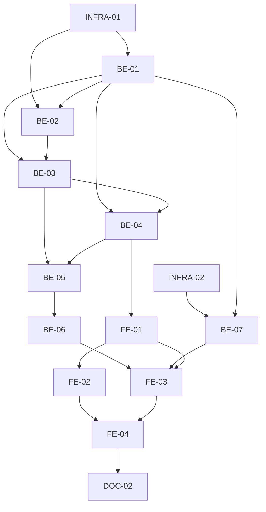

# Execution Backlog: knowledge-base

## 1. Traceability
- **SPEC**: `.spec/backend/knowledge-base/SPEC.md` · **PLAN**: `.spec/backend/knowledge-base/PLAN.md`
- Cobertura: CA1-CA6, RN-KB1-RN-KB7, R1-R18.

## 2. Sprint Summary
| Batch | Task | Type | Priority | Risk | Pts | Status |
|---|---|---|---|---|---|---|
| 1 | INFRA-01 | Infra | P0 | Low | 1 | Todo |
| 1 | INFRA-02 | Infra | P0 | Low | 1 | Todo |
| 1 | BE-01 | Domain/Data | P0 | High | 5 | Todo |
| 1 | BE-02 | Domain | P0 | High | 8 | Todo |
| 1 | BE-03 | Domain/App | P0 | High | 8 | Todo |
| 1 | BE-04 | API | P0 | High | 5 | Todo |
| 1 | BE-05 | Test | P0 | High | 5 | Todo |
| 1 | BE-06 | Domain | P1 | Med | 2 | Todo |
| 1 | BE-07 | Data | P0 | Med | 3 | Todo |
| 2 | FE-01 | Frontend | P1 | Low | 2 | Todo |
| 2 | FE-02 | Frontend | P0 | Med | 8 | Todo |
| 2 | FE-03 | Frontend | P0 | Med | 5 | Todo |
| 2 | FE-04 | Frontend | P0 | Med | 3 | Todo |
| 2 | DOC-02 | Docs | P1 | Low | 1 | Todo |

## 3. Dependency Graph

## 4. Backlog (resumo BDD+TDD por task; detalhe completo segue padrão `when_*_then_*`, teste antes)

### INFRA-01 — Deps BOM + multipart props
BDD: S1 BOM resolve `pgvector`+`tika` 1.19.0; S2 `max-file-size=10MB/max-request-size=12MB` em dev+prod; S3 upload 11MB → 413. DoD: builds verdes.

### INFRA-02 — Audit `TEXT[]` existentes
BDD: S1 query cobre 100% linhas; S2 strings duplicadas por tenant mapeadas; S3 tabela publicada p/ BE-07. DoD: evidência anexada.

### BE-01 — Entities + V11 + repos
`KnowledgeBase`, `KbDocument`, `AgentKb` (`AbstractEntity`, `tenant_id NOT NULL`, UNIQUEs, índices) + `V11__rag_kb_core.sql` (extension vector + 3 tabelas) + units. BDD: S1 persistência com filtro tenant; S2 `UNIQUE(tenant,slug)` viola → 409; S3 `tenant_id` null → constraint. DoD: Flyway aplica em PG real (IT infra).

### BE-02 — Ingestão (upload/URL/async)
Tika (magic-bytes, limite texto, timeout), UUID storage fora webroot, `KbUrlGuard` (R1-R4), `@Async` executor + `runWithTenant`, status + erro sem stacktrace, rate limit ingestão. BDD: S1 PDF→READY + chunks; S2 URL loopback → 400; S3 redirect p/ privado → 400; S4 Tika bomb → FAILED sem 500. TDD: units guard/executor + IT upload. DoD: R1-R4,R11-R13,R17 cobertos.

### BE-03 — Store V12 + retrieval + chat wiring
`V12` (`_1536`,`_768` JSONB + índices), store `createTable=false` + Hikari datasource, `KbRetrievalService` (tenant+kb_ids server-side, top5, 0.7, timeout 2s), `ChatServiceImpl` (+SystemMessage, `rag_used`/citations; vazio=zero retrieval), `POST .../search`. BDD: S1 pergunta→chunks citados; S2 sem threshold→`rag_used:false` sem citação; S3 timeout vendor→segue sem contexto. TDD: units + IT search. DoD: R5-R9,R14-R16.

### BE-04 — CRUD + vínculo + permissões
CRUD KB/docs, reindex idempotente (`removeAll`+reingest), vínculo max 5, delete 409/`?force`, `KNOWLEDGE_*` em `SecurityConstants`+token+seed, `@HasPermission` em tudo. BDD: S1 CRUD tenant-isolado; S2 6ª KB no agente → 400; S3 delete vinculado → 409 + lista / force → 204 + cascade. TDD: units + IT. DoD: R9-R10.

### BE-05 — ITs segurança/migração
`KnowledgeBaseIT`, `KnowledgeIsolationIT` (cross-tenant CRUD+retrieval), `KnowledgeSsrfIT` (loopback/redirect/metadata), upload 413/400. BDD = CA4/CA6 + R-gates. DoD: gate de qualidade (sem eles, feature não é segura).

### BE-06 — Compat `TEXT[]` (leitura legada)
Popular `Agent.knowledgeBases` a partir da junção (nomes); escrita só via vínculo. BDD: S1 agente legado lê nomes; S2 escrita legada ignorada com warning. DoD: 1 release convivência.

### BE-07 — Backfill `TEXT[]` (V13 dados)
Strings→KBs placeholder (`ON CONFLICT DO NOTHING`) + junção; idempotente. BDD: S1 seed legado→KBs+jUNÇÃO exatas; S2 re-run no-op. DoD: audit INFRA-02 100%.

### FE-01 — Types + service + specs
`types/knowledge.ts`, `knowledge.service.ts` (CRUD/upload/search/vínculo), specs 401/403/404. DoD: `npm run test` verde.

### FE-02 — List/Detail + menu + specs
Cards, tabs, drag-drop, URL, reindex, rotas, navItem `pi pi-book` + breadcrumb, specs. BDD: S1 CRUD visual; S2 FAILED com erro+retry; S3 upload >10MB bloqueia client. DoD: UX-SPEC 1-4 + build verde + copy: "URL é snapshot único (sem recrawl)" e "PDF escaneado (imagem) não suportado".

### FE-03 — Playground + picker + specs
Tab Testar (slider topK, chunk cards), picker max 5 + contador, specs. BDD: S1 pergunta→chunks; S2 vazio→mensagem; S3 6ª KB bloqueada. S4 mix de dimensões (1536+768) bloqueado no picker com mensagem PT-BR. DoD: UX-SPEC 5-7.

### FE-04 — Harness E2E
Upload→index→pergunta citada + desvinculada sem contaminação; 1280+375; PT-BR; console/network; screenshots. DoD: Anexo B completo.

### DOC-02 — Delta docs
Seção Knowledge em `SYSTEM_SPECIFICATION.md` + `AGENTS.md` + ADR-010 → Aceito. DoD: grep zero conceito antigo em docs.

## 5. Coverage
- [x] 14/14 PLAN→TASKS; CA1-CA6→tasks; RN + R1-R18→BDD; grafo sem ciclos/órfãs; TDD-first; <2h (BE-02/BE-03 quebráveis em code-review se estourar).
