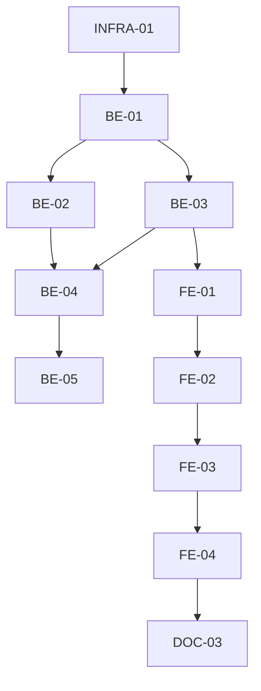

# Execution Backlog: opencode-go-zen

## 1. Traceability
- **SPEC**: `.spec/backend/opencode-go-zen/SPEC.md` · **PLAN**: `.../PLAN.md` · CA1-CA4, R1-R12.

## 2. Sprint Summary
| Batch | Task | Type | Pri | Risk | Pts | Status |
|---|---|---|---|---|---|---|
| 1 | INFRA-01 | Infra | P0 | Low | 1 | Todo |
| 1 | BE-01 | Domain | P0 | Med | 3 | Todo |
| 1 | BE-02 | Domain | P0 | Med | 3 | Todo |
| 1 | BE-03 | Domain/API | P0 | High | 5 | Todo |
| 1 | BE-04 | Domain/API | P0 | High | 5 | Todo |
| 1 | BE-05 | Test | P0 | High | 5 | Todo |
| 2 | FE-01 | Frontend | P1 | Low | 2 | Todo |
| 2 | FE-02 | Frontend | P0 | Med | 3 | Todo |
| 2 | FE-03 | Frontend | P0 | Med | 5 | Todo |
| 2 | FE-04 | Frontend | P0 | Med | 3 | Todo |
| 2 | DOC-03 | Docs | P1 | Low | 1 | Todo |

## 3. Dependency Graph

## 4. Backlog (BDD+TDD+DoD por task, padrão `when_*_then_*`, teste antes)

### INFRA-01 — Confirmar defaults/denylist vivos (GATE: bloqueia BE-01)
BDD: S1 fetch GO/Zen lists; S2 defaults (`mimo-v2.5`, `muse-spark-1.3-contributor`) existem; S3 denylist cobre responses/messages. DoD: evidência datada anexada; default morto → BE-01 atualiza sem re-PLAN.

### BE-01 — Enum + catalog + policy/resolver
`AiProvider` +2; `VendorCatalog` presets/denylist/defaults; `CredentialPolicy` skip prefix GO/ZEN; env names; units (validate, defaults, denylist). BDD: S1 GO/ZEN válidos; S2 denylist filtra; S3 prefix skip. DoD: zero DDL (VARCHAR comporta).

### BE-02 — Factory baseUrl/headers/UA
Branches GO/ZEN (OpenAi + baseUrl fixa + `customHeaders` session server-set + UA interceptor `hive/x.y` só `opencode.ai`); units (headers presentes, UA, só GO/ZEN recebem). BDD: S1 session injetada; S2 custom/OpenAI sem headers Go; S3 UA correto. DoD: session nunca do client/log.

### BE-03 — Discovery + endpoint + evict
`OpencodeDiscoveryService` (pinned, 5s, 512KB, schema `[A-Za-z0-9._:-]{1,128}`, cap 300, denylist); `GET /v1/providers/{go,zen}/models` (AGENT_MANAGE + rate-limit + cache 10min + refresh); evict em MODEL_UNAVAILABLE; units. BDD: S1 lista filtrada + cachedAt; S2 falha remota → 422; S3 refresh força. DoD: nada persiste.

### BE-04 — Custom + validate + rate-limit + 422
`hiddenFromCreate` removido (label Custom); CGNAT + https + pin (estender guard); validate mandatório GO/ZEN/custom; rate limit chat/tenant + log tokens; `key_version++`; 422 `MODEL_UNAVAILABLE`; units. BDD: S1 custom responde; S2 CGNAT → 400; S3 http remoto → 400; S4 removido → 422 + evict; S5 11ª msg/min → 429. DoD: R1-R9.

### BE-05 — ITs
Discovery (mock HTTP), IDOR credencial, SSRF custom, stale 422, sem regressão. DoD: gate segurança.

### FE-01 — Types + service + specs
`AiProvider` + metadata + `VENDOR_ORDER` + service (discovery/validate/credentials) + specs. DoD: verde.

### FE-02 — Select + metadata
`ProviderSelect` 7 itens + costHint + readOnlyBaseUrl; specs. BDD: ordem, labels, COMPATIBLE visível. DoD: UX 1-2.

### FE-03 — Editor + credenciais + LGPD
Dropdown remoto (loading/empty/error/stale+refresh) + badge stale + banners LGPD + CredentialsView GO/ZEN/custom + specs. BDD: S1 fluxo GO; S2 erro+retry; S3 stale badge; S4 LGPD visível. DoD: UX 3-8.

### FE-04 — Harness GO+custom (+CA-Zen)
Cadastro GO + **evidência Zen (1 screenshot/chat — CA-Zen)** + custom + chat; sem chave → validar 422 + dropdown; screenshots; PT-BR; 375px. DoD: Anexo B.

### LGPD_COPY (final PM — usar em FE-03 e mensagens BE)
- Banner/dialog: "🔒 Privacidade — Seus prompts e dados de conversa trafegam pela API da OpenCode. Consulte a política de privacidade: https://opencode.ai/privacy"
- 422 modelo: "Modelo {m} indisponível no provedor {p}. Escolha outro modelo ou atualize a lista."
- (Revisão jurídica recomendada antes do release.)

### DOC-03 — Delta
SPEC §4.3 + ADR-011 Aceito. DoD: grep zero conceito antigo.

## 5. Coverage
- [x] 11/11 PLAN→TASKS; CA/R→BDD; grafo sem ciclos/órfãs; TDD-first; <2h destrinchável.
