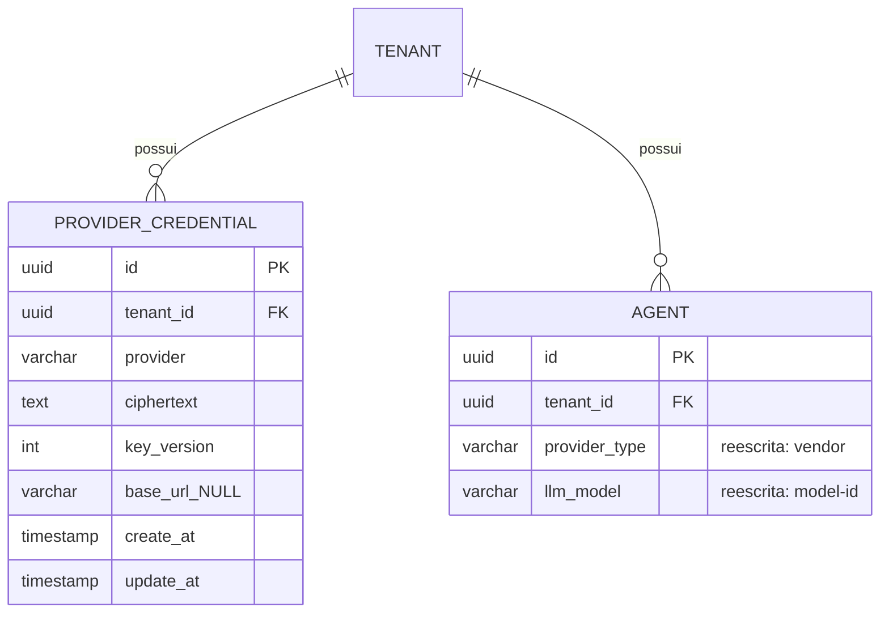

# SPEC — Provider como Vendor Real (LangChain4j único)

> **ID**: `provider-vendor` · **Tipo**: Refactor (breaking) · **Status**: `Under Review`
> **Fonte**: PROPOSAL + triagem Fase 0 (architect/product-manager) + decisões do usuário (1a/2a/3b/4a) + parecer vinculante do `ux-designer`
> **Domínios**: `provider` (api/langchain4j, remoção spring-ai) + `agent` (api/impl/dbupdate/web) + `commons/api-tools` (handler) + `frontend` (admin)

---

## 1. ADRs

- **ADR-009** (`docs/adr/ADR_009_LangChain4j_Vendor_Provider.md`): framework único LangChain4j; provider = vendor; credencial por tenant; V9 por `llm_model`; `OPENCODE` → `OPENAI_COMPATIBLE`.
- **ADR-008** (herdado): `temperature/topP/maxTokens` nullable + herança de prompt-template — **preservado** (PM regra 1).
- Tenant strategy (herdada): row-level isolation via `AbstractEntity.tenantId` + Hibernate `@Filter` (sem mudança).

## 2. Contexto de Domínio

- **Bounded contexts**: `provider` (construção de clients LLM — sem endpoints próprios) × `agent` (CRUD + chat + validate) × nova credencial de tenant (dono do módulo: **definir na Fase 2** — `agent/dbupdate` vs `provider/*`; não espalhar Flyway history — ressalva architect 1).
- **Multi-tenancy**: `provider_credential` isolada por `(tenant_id, provider)` com `UNIQUE` + `FK tenant ON DELETE CASCADE`; todo acesso filtra por tenant do chamador (teste IDOR obrigatório).

## 3. IAM / RBAC

| Endpoint | Permissão | Justificativa |
|---|---|---|
| `GET /v1/provider-credentials` | `AGENT_MANAGE` | Lista mascarada do tenant |
| `PUT /v1/provider-credentials/{provider}` | `AGENT_MANAGE` | Upsert de chave (cria ou rotaciona) |
| `DELETE /v1/provider-credentials/{provider}` | `AGENT_MANAGE` | Remove chave |
| `POST /v1/agents/validate` | `AGENT_MANAGE` | Teste de conexão (sem persistir) |
| `GET /v1/agents*` (existentes) | inalterado | DTO sem `providerType`; sem apiKey em nenhum GET |

## 4. Segurança (requisitos — ver Security Assessment §11)

- AES-256-GCM via `AttributeConverter` (`ciphertext TEXT`, `key_version INT DEFAULT 1`); IV/nonce random por linha; chave mestra em env (`PROVIDER_MASTER_KEY`, 256-bit base64) — nunca no repo.
- GET mascarado: `{provider, configured: bool, last4, updatedAt}` — nunca ciphertext.
- `PUT` valida formato por prefixo (`sk-` OPENAI, `AIza` GEMINI, `sk-ant-` ANTHROPIC) → 400 se inválido; `DELETE` sem corpo.
- Auditoria (A09): logar `PUT/DELETE` credential (sem valor) + `validate` throttled; sem segredo em log/erro/response.
- `validate` **NÃO aceita `apiKey` no body** (usa a do tenant; ressalva architect 4 — evita oráculo de chave); falha do vendor → `200 {ok:false, reason}` (não repassa status do vendor); timeout 5s via executor limitado.
- `baseUrl`: allowlist + bloqueio de IP privado/RFC1918 + metadata IP (SSRF); Ollama default `http://localhost:11434` (editável por tenant via `base_url`).
- Precedência de chave: `credential(tenant) → env fallback → 422 CONFIG_MISSING` (Ollama: sem chave).

## 5. Modelo de Dados



- **Zero DDL estrutural em `agent`**: reaproveitar `provider_type` (vendor) + `llm_model` (model-id string). Rename adiado (trade-off aprovado).
- **V9 migração de dados** (`UPDATE` por `llm_model`, idempotente):
  `OLLHAMA→provider OLLAMA`; `OPENAI→OPENAI`; `GEMINI→GEMINI`; `OPENCODE→OPENAI_COMPATIBLE` (+ `base_url` default gateway por tenant/env). `llm_model` normalizado p/ model-id real.
- **Pré-requisito**: audit `SELECT provider_type, llm_model, count(*) FROM agent` antes da implementação (banco dev/prod); estratégia dual-read ou janela + rollback (ressalva architect 3).

## 6. Contratos de API

### 6.1 `AiProvider` (novo enum, `provider/api`)
`OPENAI, GEMINI, ANTHROPIC, OLLAMA, OPENAI_COMPATIBLE`. `AiProviderType` **removido** (sem alias — breaking explícito). `AiProviderFactory` removida ou re-keyada por vendor (Fase 2 decide; SPEC recomenda remover + `LangChain4jVendorRouter` único).

### 6.2 `Agent` / DTOs
- `Agent.provider: AiProvider` + `Agent.model: String` (remove `providerType: AiProviderType`, `llmModel: LLMModel`).
- `AgentCreateDTO/AgentUpdateDTO/AgentDTO`: mesmos campos; Bean Validation (`@NotNull provider`, `@NotBlank model` + validador de catálogo → 400 `MODEL_NOT_SUPPORTED_FOR_PROVIDER`).
- Mappers (`AgentMapperDomain`, `AgentDTOMapper`): `model ↔ llmModel` (coluna reaproveitada).

### 6.3 `LlmClientFactory.createClient(AiProvider, String model, Double temp, String apiKey, String baseUrl)`
`LangChain4jClientFactory` único builder: `OPENAI→OpenAiChatModel`, `OLLAMA→OllamaChatModel`, `GEMINI→langchain4j-google-ai-gemini` (dep nova), `ANTHROPIC→langchain4j-anthropic` (dep nova), `OPENAI_COMPATIBLE→OpenAiChatModel+baseUrl`. `ChatRequestProvider.model: String`.

### 6.4 Endpoints novos
- `PUT /v1/provider-credentials/{provider}` `{apiKey, baseUrl?}` → `200 {provider, configured:true, last4}`; formato inválido → 400; `@Valid`.
- `GET /v1/provider-credentials` → `[{provider, configured, last4, updatedAt}]`.
- `DELETE /v1/provider-credentials/{provider}` → 204.
- `POST /v1/agents/validate` `{provider, model, baseUrl?}` → `200 {ok, provider, model, latencyMs, reason?}`; caller sem auth → 401/403 padrão; rota literal antes de `/{id}` (teste de ordenação obrigatório).

## 7. Catálogo MVP (vendor × modelos × Maven)

| Vendor | Modelos sugeridos (default *) | Artifact 1.19.0 | Chave |
|---|---|---|---|
| OPENAI | `gpt-4o-mini`*, `gpt-4o`, `gpt-3.5-turbo` (+ livre) | `langchain4j-open-ai` (existe) | `sk-…` obrigatória |
| GEMINI | `gemini-2.0-flash`*, + livres | `langchain4j-google-ai-gemini` (**nova**) | `AIza…` obrigatória |
| ANTHROPIC | `claude-3-5-haiku-latest`*, + livres | `langchain4j-anthropic` (**nova**) | `sk-ant-…` obrigatória |
| OLLAMA | `llama3.2`*, + livres | `langchain4j-ollama` (existe) | proibida (oculta na UI) |
| OPENAI_COMPATIBLE | livre (migração: `mimo-v2.5`) | `langchain4j-open-ai` + baseUrl | obrigatória; **não ofertado na UI de criação** (só migração) |

Só declarar vendor com artifact correspondente no BOM (regra architect 7). FE espelha catálogo só p/ UX — **BE é autoridade** (400 se fora do catálogo, exceto `OPENAI_COMPATIBLE` que valida só conectividade).

## 8. Frontend (decisões vinculantes do ux-designer — detalhe em `.spec/frontend/provider-vendor/UX-SPEC.md`)

- Seção "Provedor de IA" (2ª, accordion; demais fechadas); `ProviderSelect` (logo+descrição+custo) + `AutoComplete` de modelo (sugestões+livre+chips) + `ApiKeyInput` removido do editor (sem apiKey por agente — decisão 3b) → **badge status da chave do tenant** (`configurada ✅` / `faltante ⚠️` + link p/ credenciais); `ConnectionTester` (idle|testing|ok|fail, `POST /v1/agents/validate`, timeout 5s); save com warning (não bloqueio) se teste falha; validação inline no blur; PT-BR; dark mode; aria.
- **Nova tela `CredentialsView`** (`/settings/providers`, sob `MainLayout`, gate `AGENT_MANAGE`): tabela de providers × status + diálogo de upsert (password show/hide, validação prefixo, `PUT`, mascaramento, `DELETE` com confirmação).
- `types/agent-admin.ts` + `agent-admin.service.ts` (`validate()`, `credentials()` CRUD) + specs atualizadas (`AdminViews.spec.ts:140-175` trocam asserts p/ novo enum).

## 9. Invariantes

| Entidade | Propriedade | Descrição |
|---|---|---|
| `provider_credential` | `(tenant_id, provider)` único | UNIQUE + FK CASCADE |
| `provider_credential` | ciphertext nunca legível via API | GET retorna só `configured/last4` (IT anti-exposição) |
| `agent` | `provider` ∈ catálogo MVP | 400 fora do catálogo |
| `agent` | `model` não-vazio | `@NotBlank` |
| Chat | chave ausente ⇒ 422, nunca 500 | `CONFIG_MISSING` |
| Validate | nunca persiste | sem escrita em DB (IT verifica) |

## 10. Requisitos Funcionais / Jornadas

- **User stories (BDD)**:
  - *Como admin, quero escolher um vendor real + modelo com default, para criar um agente que funciona na primeira tentativa.* `Dado` a tela de novo agente, `quando` seleciono OpenAI e testo a conexão com sucesso, `então` salvo e o 1º chat responde sem 502.
  - *Como admin, quero salvar a chave do tenant com validação e teste, para não quebrar o chat.* `Dado` a tela de credenciais, `quando` salvo chave com prefixo válido e `PUT` retorna `configured:true`, `então` nenhum GET expõe o valor.
  - *Como dono do tenant, quero agentes legados migrados sem downtime.* `Dado` agentes `SPRING_AI/OPENAI`, `quando` a V9 roda, `então` o chat continua funcionando e `temperature/topP/maxTokens` estão intactos.

- **RF1**: CRUD de agentes com `provider` vendor + `model` livre catalogado.
- **RF2**: CRUD mascarado de credenciais por tenant.
- **RF3**: `POST /validate` testa conexão sem persistir.
- **RF4**: Migração V9 preserva chat de agentes legados (zero `temperature/topP/maxTokens/tools/KB/isDefault` perdidos).
- **RF5**: `spring-ai` 100% removido (nenhuma referência em poms/factory/FE).
- **RN1**: mensagem 401/vendor sempre genérica (anti-enumeração).
- **RN2**: chave nunca em log/response/erro.
- **CA1**: agente OPENAI/GEMINI criado na UI chama provider real (zero 502). **CA2**: `GET credentials` sem ciphertext (audit). **CA3**: cadastro→teste→1º chat < 3min (harness).

## 10.5. Performance
- Resolução de credencial = 1 query por `(tenant, provider)` no chat (sem N+1); sem cache por padrão (builder barato) + evict documentado (ressalva architect 7).
- `validate`: timeout 5s via executor limitado + throttling por tenant (task Fase 2).

## 11. Security Assessment — Fase 1 (skill `security-review`)

### Threat Model (STRIDE)
| Threat | Fluxo | Risco | Mitigação (SPEC) |
|---|---|---|---|
| Elevation (IDOR) | `GET/PUT/DELETE /v1/provider-credentials` | Alta | `@HasPermission(AGENT_MANAGE)` + filtro tenant em service + IT cross-tenant |
| Info Disclosure | GET credentials / logs / erros | Alta | Máscara (`configured/last4`); sem segredo em log; erro genérico |
| Tampering (at rest) | `ciphertext` no banco | Média | AES-256-GCM + IV random + `key_version`; chave em env |
| Spoofing | `validate` como oráculo | Média | Sem `apiKey` no body; throttling; timeout 5s |
| DoS | `validate` (chamada vendor síncrona) | Média | Timeout 5s executor limitado; throttling por tenant |
| SSRF | `baseUrl` (Ollama/compatible) | Alta | Allowlist + bloqueio IP privado/metadata (H7) |
| Repudiation | troca de chave | Baixa | Auditoria PUT/DELETE (sem valor) |

### Requirements Coverage
- [x] AuthN (JWT) e AuthZ (`@HasPermission` nos 4 endpoints novos)
- [x] `@Valid` nos DTOs (chave, baseUrl, validate)
- [x] Sem serialização de entidade (DTOs mascarados)
- [x] Sem segredo hardcoded (removido 2026-09-25; **rotação no provedor pendente — usuário**)
- [ ] Rate limiting em `validate` — **GAP: definir na Fase 2** (throttling por tenant)
- [x] Erros genéricos (RFC 7807)

### Gaps
- 🟠 Alta: SSRF em `baseUrl` exige allowlist + testes (cobrir na Fase 2/PLAN).
- 🟡 Média: throttling de `validate` (definir limites na Fase 2).

### Verdict
- **partial** (gaps documentados, nenhum 🔴 bloqueante) — pode avançar p/ Planejamento com os 2 gaps como tasks.

## 12. Estratégia de Testes

- **Unitários**: `LangChain4jClientFactory` por vendor (mock builders), `CredentialResolver` (precedência), validador de catálogo/prefixo, converter AES (round-trip + `key_version`); padrão `when_*_then_*`.
- **Integração** (`backend/integration-test/`): `AgentProviderIT` (CRUD + 400 catálogo), `CredentialIT` (mascaramento, IDOR cross-tenant, PUT/DELETE), `ValidateIT` (mock vendor? timeout; `ok:false` sem persistir), V9 em PG real (seed legado → valores novos).
- **Frontend**: `ProviderSelect/ApiKeyInput→(credenciais)/ConnectionTester` specs + `AdminViews`/`AgentEditorDialog` atualizados + `agent-admin.service.spec`.
- **Cobertura**: 80% service / 90% domain (BE), 70% (FE).

## 13. Plano de Migração / Rollback

1. Audit `SELECT provider_type, llm_model, count(*)` (dev + prod) — **pré-requisito da Fase 2**.
2. Deploy janela: V9 `UPDATE` + código novo (release único BE+FE).
3. Rollback: V9 é `UPDATE` de strings — rollback = restore locker + código anterior (documentar valores originais por `id` em tabela auxiliar? Fase 2 decide).
4. Pós: deletar chave vazada do histórico? Fora do repo (rotação no provedor basta).

## 14. Delta Specs

### Delta: `docs/product/SYSTEM_SPECIFICATION.md`
### MODIFIED
> **Seção alvo**: `§4.2` (admin prompts/agents)
```
Substituir enum de provider (framework) por vendor real (OPENAI/GEMINI/ANTHROPIC/OLLAMA/OPENAI_COMPATIBLE), model string catalogado, credenciais por tenant (mascaradas), endpoint POST /v1/agents/validate, remoção do Spring AI, migração V9 — conforme SPEC provider-vendor.
```

### Delta: `docs/adr/`
### ADDED
```
ADR_009_LangChain4j_Vendor_Provider.md (criado nesta Fase 1)
```

### Delta: `AGENTS.md`
### MODIFIED (se aplicável na Fase 2)
> **Seção alvo**: menções a `provider/spring-ai` ou `AiProviderType`, se existirem
```
Atualizar para framework único LangChain4j + vendor real.
```

### Resumo do Impacto

| Documento | ADDED | MODIFIED | REMOVED |
|---|---|---|---|
| `docs/product/SYSTEM_SPECIFICATION.md` | 0 | 1 (§4.2) | 0 |
| `docs/adr/` | 1 (ADR-009) | 0 | 0 |
| `AGENTS.md` | 0 | 0-1 | 0 |
