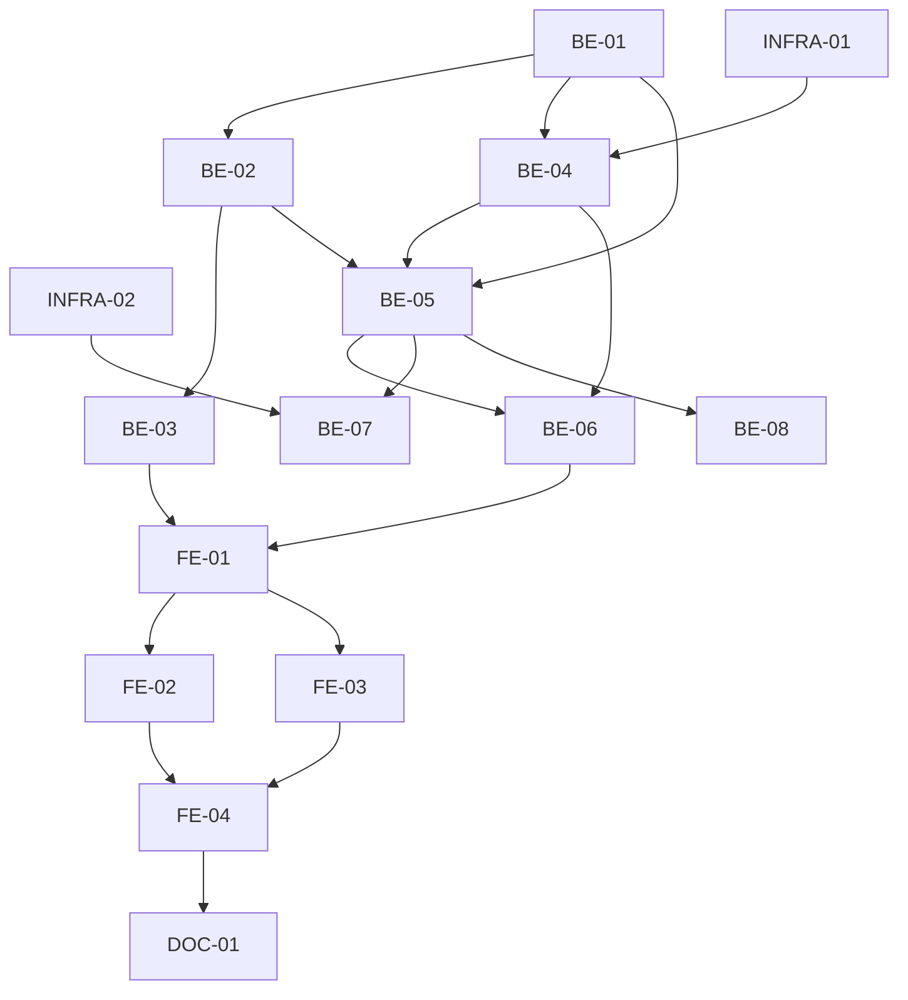

# Execution Backlog: provider-vendor

## 1. Traceability Context
- **Source SPEC**: `.spec/backend/provider-vendor/SPEC.md`
- **Source PLAN**: `.spec/backend/provider-vendor/PLAN.md`
- **Goal**: refactor provider-framework → vendor real (LangChain4j único), TDD-first, 3 batches.

## 2. Sprint Summary
| Batch | Task ID | Type | Priority | Risk | Complexity | Status |
|---|---|---|---|---|---|---|
| 1 | INFRA-01 | Infra | P0 | Low | 1 | Todo |
| 1 | INFRA-02 | Infra | P0 | Low | 1 | Todo |
| 1 | BE-01 | Domain | P0 | Med | 2 | Todo |
| 1 | BE-02 | Domain/Data | P0 | High | 5 | Todo |
| 1 | BE-03 | API/Test | P0 | High | 5 | Todo |
| 2 | BE-04 | Domain | P0 | Med | 3 | Todo |
| 2 | BE-05 | Domain/App | P0 | High | 5 | Todo |
| 2 | BE-06 | API/Test | P0 | High | 5 | Todo |
| 2 | BE-07 | Data/Test | P0 | High | 3 | Todo |
| 2 | BE-08 | Infra | P0 | Med | 3 | Todo |
| 3 | FE-01 | Frontend | P1 | Low | 2 | Todo |
| 3 | FE-02 | Frontend | P0 | Med | 5 | Todo |
| 3 | FE-03 | Frontend | P0 | Med | 5 | Todo |
| 3 | DOC-01 | Docs | P1 | Low | 1 | Todo |
| 3 | FE-04 | Frontend | P0 | Med | 3 | Todo |

## 3. Dependency Graph

---

## 4. Task Backlog

### Task INFRA-01: Deps LangChain4j Gemini + Anthropic no BOM
- **Constraint Ref**: SPEC §7 · **Depends on**: None (Hard) · **Layer**: Infra · **Task Type**: Infra · **Priority**: P0 · **Risk**: Low · **Parallelizable**: Yes (com INFRA-02) · **Artifact**: `backend/dependencies/pom.xml` · **Framework Detail**: Maven BOM, `langchain4j-google-ai-gemini` + `langchain4j-anthropic` 1.19.0
- **Description**: declarar artifacts dos vendors MVP. **Domain Impact**: sem eles, GEMINI/ANTHROPIC repetem a promessa quebrada.
- **Rule**: só vendor com artifact no BOM pode entrar no catálogo. **Failure Mode**: `ClassNotFoundException` em runtime.
- **BDD**: S1 compilação resolve os 2 artifacts (`mvn dependency:resolve` ok). S2 versão ≠ 1.19.0 → build falha (BOM fixa). S3 módulos `provider/langchain4j` compilam importando builders.
- **TDD**: [ ] teste N/A (infra — validação = build). [ ] `dependencies/pom.xml`: 2 managed deps.
- **DoD**: `mvn validate` verde; `BE-04` desbloqueado.

### Task INFRA-02: Auditar dados legados provider/model
- **Constraint Ref**: SPEC §5 · **Depends on**: None · **Layer**: Infra · **Task Type**: Infra · **Priority**: P0 · **Risk**: Low · **Parallelizable**: Yes · **Artifact**: evidência (tabela counts) anexada à SPEC/BE-07
- **Description**: `SELECT provider_type, llm_model, count(*) FROM agent GROUP BY 1,2` (dev e prod se acesso). **Domain Impact**: fecha tabela-verdade da V9 (destino OPENCODE, valores nulos).
- **Rule**: V9 só com mapeamento 100% fechado. **Failure Mode**: linha sem mapeamento → agente quebrado pós-deploy.
- **BDD**: S1 query executa e cobre 100% das linhas. S2 valor inesperado (ex.: null) → registrado como caso explícito. S3 counts de prod divergem de dev → decisão documentada.
- **DoD**: tabela publicada; BE-07 desbloqueado.

### Task BE-01: Enum `AiProvider` + catálogo por vendor
- **Constraint Ref**: ADR-009 §2 · **Depends on**: None · **Layer**: Domain (`provider/api`) · **Task Type**: Domain · **Priority**: P0 · **Risk**: Medium · **Parallelizable**: No · **Artifact**: `AiProvider.java`, `VendorCatalog.java`
- **Description**: `OPENAI, GEMINI, ANTHROPIC, OLLAMA, OPENAI_COMPATIBLE` + `Map<vendor, {models[], default}>` + `validate(vendor, model)` → 400 `MODEL_NOT_SUPPORTED_FOR_PROVIDER`. **Domain Impact**: base de todo o refactor.
- **Rule**: BE é autoridade do catálogo (FE só espelha). **Failure Mode**: modelo inválido persiste → 502 em runtime.
- **BDD**: S1 `(OPENAI, gpt-4o-mini)` válido. S2 `(OPENAI, llama3.2)` → exceção de catálogo. S3 `(OPENAI_COMPATIBLE, qualquer-string)` válido.
- **TDD**: [ ] `AiProviderCatalogTest` (unit, S1-S3). [ ] `AiProvider.java` + `VendorCatalog.java`.
- **DoD**: teste antes; 100% branches do catálogo.

### Task BE-02: Credential entity + AES converter + resolver
- **Constraint Ref**: SPEC §4 · **Depends on**: BE-01 · **Layer**: Data/Domain (`agent/impl`+api) · **Task Type**: Domain · **Priority**: P0 · **Risk**: High · **Parallelizable**: No · **Artifact**: `ProviderCredentialEntity`, `ProviderCredentialRepository`, `AesGcmAttributeConverter`, `CredentialResolver`
- **Description**: tabela `(tenant_id, provider)` UNIQUE + FK CASCADE; converter AES-256-GCM (IV random, `key_version`, chave `PROVIDER_MASTER_KEY` env); resolver: credential → env fallback → 422 `CONFIG_MISSING` (Ollama sem chave). **Domain Impact**: segredo fora do código e do banco em claro.
- **Rule**: nunca logar/persistir valor; chave só via env. **Failure Mode**: vazamento / 500 em vez de 422.
- **BDD**: S1 round-trip criptografado (ciphertext ≠ plain, decrypt ok). S2 tenant sem credential + sem env → 422. S3 Ollama resolve sem chave.
- **TDD**: [ ] `CredentialResolverTest` + `AesGcmConverterTest` (unit). [ ] entity/repo/converter/resolver.
- **DoD**: JaCoCo paths do resolver; sem segredo em teste (valores fake).

### Task BE-03: CRUD mascarado de credenciais + ITs
- **Constraint Ref**: SPEC §3/§6.4 · **Depends on**: BE-02 · **Layer**: Interface/Integration · **Task Type**: API · **Priority**: P0 · **Risk**: High · **Parallelizable**: No · **Artifact**: `CredentialControllerV1`, DTOs, `CredentialIT`
- **Description**: `GET` mascarado, `PUT` (prefixo+`@Valid`), `DELETE` 204, `@HasPermission(AGENT_MANAGE)`. **Domain Impact**: superfície de segredo — IDOR = vazamento cross-tenant.
- **Rule**: GET nunca retorna ciphertext; auditoria PUT/DELETE sem valor. **Failure Mode**: IDOR / exposição / SSRF via baseUrl.
- **BDD**: S1 PUT válido → `configured:true, last4`. S2 tenant B lê credencial do A → 403/404 (sem vazar existência). S3 prefixo errado → 400; baseUrl com IP privado → 400.
- **TDD**: [ ] `CredentialIT` (S1-S3, `WebIntegrationTest`+`DatabaseCleaner`). [ ] controller/service/DTOs.
- **DoD**: IT anti-exposição (assert ausência de ciphertext no JSON).

### Task BE-04: Factory por vendor + unitários
- **Constraint Ref**: SPEC §6.3 · **Depends on**: INFRA-01, BE-01 · **Layer**: Domain · **Task Type**: Domain · **Priority**: P0 · **Risk**: Medium · **Parallelizable**: No · **Artifact**: `LangChain4jClientFactory` (switch vendor)
- **Description**: builders por vendor; COMPATIBLE/XAI via `OpenAiChatModel`+baseUrl. **Domain Impact**: elimina 502 de vendor não suportado.
- **Rule**: vendor sem artifact não entra no switch. **Failure Mode**: `UnsupportedOperationException` em runtime.
- **BDD**: S1 cada vendor MVP constrói client. S2 vendor desconhecido → exceção explícita (não NPE). S3 baseUrl ausente p/ COMPATIBLE → erro de validação.
- **TDD**: [ ] `LangChain4jClientFactoryTest` (mock builders). [ ] factory.
- **DoD**: cobertura total dos branches.

### Task BE-05: Remodelar `Agent` + `ChatServiceImpl` via resolver (INCLUI ponte credential→chat adiada do Batch 1 — C1 review)
- **Constraint Ref**: SPEC §6.2 · **Depends on**: BE-01, BE-02, BE-04 · **Layer**: Domain/App · **Task Type**: Domain · **Priority**: P0 · **Risk**: High · **Parallelizable**: No · **Artifact**: `Agent`, `AgentEntity`, DTOs, mappers, `ChatServiceImpl`, `LlmClientFactory`
- **Description**: `provider: AiProvider` + `model: String`; remover `providerType/llmModel`; chat resolve chave por tenant. **Domain Impact**: coração do breaking.
- **Rule**: MapStruct em mappers; catálogo valida no service. **Failure Mode**: contrato antigo vaza (400 em clients) — release único mitiga.
- **BDD**: S1 chat OPENAI com chave → resposta. S2 model fora do catálogo → 400. S3 tenant sem chave → 422 `CONFIG_MISSING` (nunca 500).
- **TDD**: [ ] `ChatServiceImplTest` + `AgentServiceTest` atualizados/ampliados. [ ] remodelagem.
- **DoD**: testes legados atualizados (`setProviderType` removidos); `mvn test` verde.

### Task BE-06: `POST /v1/agents/validate` (+SSRF+throttle) + ITs
- **Constraint Ref**: SPEC §4/§6.4 · **Depends on**: BE-04, BE-05 · **Layer**: Interface/Integration · **Task Type**: API · **Priority**: P0 · **Risk**: High · **Parallelizable**: No · **Artifact**: `ValidateService/ControllerV1`, `ValidateRateLimiter`, SSRF guard, `ValidateIT`
- **Description**: `{provider, model, baseUrl?}` → `200 {ok, latencyMs, reason?}`; sem `apiKey` no body; timeout 5s executor; throttle 10/min/tenant; ordenação de rota vs `/{id}`. **Domain Impact**: teste de conexão da UI.
- **Rule**: nunca persistir; falha vendor ⇒ `ok:false`. **Failure Mode**: oráculo de chave / SSRF / DoS.
- **BDD**: S1 vendor ok → `ok:true`. S2 vendor down/timeout → `ok:false` + sem escrita no DB. S3 11ª chamada no minuto → 429. S4 baseUrl `http://169.254.169.254` → 400.
- **TDD**: [ ] `ValidateIT` (S1-S4) + unit SSRF/throttle. [ ] endpoint+service.
- **DoD**: IT prova zero escrita; timeout real < 6s.

### Task BE-07: Flyway V9 dados + IT
- **Constraint Ref**: SPEC §5 · **Depends on**: INFRA-02, BE-05 · **Layer**: Data · **Task Type**: Infra · **Priority**: P0 · **Risk**: High · **Parallelizable**: No · **Artifact**: `V9__migrate_provider_to_vendor.sql` (+ IT PG real com seed legado)
- **Description**: `UPDATE` por `llm_model` (tabela §5); idempotente. **Domain Impact**: preserva agentes legados.
- **Rule**: nunca mapear por `provider_type`. **Failure Mode**: agente órfão → 422/502.
- **BDD**: S1 seed legado (4 combos + OPENCODE) → valores novos exatos. S2 re-execução → no-op. S3 `temperature/topP/maxTokens/tools` intactos.
- **TDD**: [ ] `ProviderMigrationIT` (PG real). [ ] V9.
- **DoD**: audit INFRA-02 100% coberto.

### Task BE-08: Remover `provider/spring-ai`
- **Constraint Ref**: ADR-009 §2 · **Depends on**: BE-05 · **Layer**: Infra · **Task Type**: Infra · **Priority**: P0 · **Risk**: Medium · **Parallelizable**: No · **Artifact**: remoção poms + código + testes afetados
- **Description**: remover de `provider/pom`, `dependencies/pom`, `bootstrap/pom`, `agent/impl/pom`; apagar módulo; atualizar `AgentDataFactory`, `ChatServiceImplTest`, `DtoValidationTest`, `AgentControllerV1Test`. **Domain Impact**: fim do stub fake.
- **Rule**: grep zero `SPRING_AI|AiProviderType|LLMModel|SpringAiProvider`. **Failure Mode**: bean fantasma / teste legado quebrando build.
- **BDD**: S1 `mvn clean install` verde sem o módulo. S2 grep zero ocorrências. S3 chat de um agente smoke continua ok.
- **DoD**: diretório `provider/spring-ai` deletado.

### Task FE-01: Types + service + specs
- **Constraint Ref**: SPEC §8 · **Depends on**: BE-03, BE-06 · **Layer**: Frontend · **Task Type**: API · **Priority**: P1 · **Risk**: Low · **Parallelizable**: No · **Artifact**: `types/agent-admin.ts`, `agent-admin.service.ts` (+specs)
- **Description**: enum vendor, `validate()`, `credentials()` CRUD, tipos mascarados. **Domain Impact**: contratos FE↔BE.
- **Rule**: tipos espelham DTOs (sem `any` solto). **Failure Mode**: drift de contrato → 400/422 na UI.
- **BDD**: S1 service monta payloads corretos (mock axios). S2 erro 422 → erro propagado tipado. S3 máscara (`last4`) renderizável.
- **TDD**: [ ] `agent-admin.service.spec.ts` primeiro. [ ] service/types.
- **DoD**: `npm run test` verde.

### Task FE-02: `ProviderSelect` + modelo + seção editor
- **Constraint Ref**: UX-SPEC §1-5 · **Depends on**: FE-01 · **Layer**: Frontend · **Task Type**: Domain · **Priority**: P0 · **Risk**: Medium · **Parallelizable**: No · **Artifact**: `ProviderSelect.vue`, `ConnectionTester.vue`, seção "Provedor de IA"
- **Description**: select com logo/descrição/custo + combobox modelo + badge chave + teste (idle|testing|ok|fail). **Domain Impact**: tela central do refactor.
- **Rule**: PT-BR, aria, blur-validation, save com warning. **Failure Mode**: usuário salva config inválida sem aviso.
- **BDD**: S1 troca provider reseta modelo p/ default. S2 teste ok → badge verde; fail → warning + save liberado. S3 Ollama oculta chave + banner. S4 agente `OPENAI_COMPATIBLE` existente (migrado OPENCODE) abre com banner read-only "migrado OPENCODE → Compatible" + modelo visível, sem select quebrado.
- **TDD**: [ ] specs dos 2 componentes primeiro. [ ] componentes + seção.
- **DoD**: cobertura ≥70% nos novos.

### Task DOC-01: Aplicar Delta (docs de produto)
- **Constraint Ref**: SPEC §14 · **Depends on**: FE-04 · **Layer**: Docs · **Task Type**: Docs · **Priority**: P1 · **Risk**: Low · **Parallelizable**: No · **Artifact**: `docs/product/SYSTEM_SPECIFICATION.md` §4.2, `AGENTS.md` (menções spring-ai), ADR-009 (fechar status)
- **Description**: aplicar Delta Specs (MODIFIED §4.2 + ADDED ADR-009 + MODIFIED AGENTS.md se aplicável). **Domain Impact**: SSoT de produto.
- **Rule**: espelhar SPEC aprovada (enum, credenciais, validate, migração, blast radius chave global, sem cotas = P2 roadmap). **Failure Mode**: doc desatualizada → suporte/usuário com conceito antigo.
- **BDD**: S1 §4.2 descreve vendor + máscara + validate. S2 zero menções `SPRING_AI/AiProviderType` em docs. S3 ADR-009 `Aceito`.
- **DoD**: diff revisado; sem código.

### Task FE-03: `CredentialsView` + rota + specs
- **Constraint Ref**: UX-SPEC §6 · **Depends on**: FE-01 · **Layer**: Frontend · **Task Type**: Domain · **Priority**: P0 · **Risk**: Medium · **Parallelizable**: Yes (com FE-02) · **Artifact**: `CredentialsView.vue` (`/settings/providers`), diálogo upsert
- **Description**: tabela status + PUT mascarado + DELETE com confirmação. **Domain Impact**: gestão das chaves do tenant.
- **Rule**: `sk-••••` nunca exibe valor; vazio = mantém. **Failure Mode**: exposição de chave na tela.
- **BDD**: S1 lista mostra `configured/last4` sem valor. S2 salvar vazio mantém. S3 DELETE pede confirmação.
- **TDD**: [ ] specs primeiro. [ ] view + rota (gate `AGENT_MANAGE`).
- **DoD**: `AdminViews.spec` atualizado.

### Task FE-04: Harness E2E provider-vendor
- **Constraint Ref**: CA3 · **Depends on**: FE-02, FE-03 · **Layer**: Frontend · **Task Type**: Test · **Priority**: P0 · **Risk**: Medium · **Parallelizable**: No · **Artifact**: evidências (screenshots, console/network)
- **Description**: cadastro → credencial → teste conexão → 1º chat < 3min; 1280 + 375px; PT-BR. **Domain Impact**: prova ponta-a-ponta.
- **Rule**: H1-H5 (zero console error, 2xx, processos encerrados). **Failure Mode**: regressão visual/funcional não pega por testes.
- **BDD**: S1 fluxo feliz < 3min **nos 4 vendors MVP** (pior caso medido). S2 chave ausente → badge ⚠️ + chat 422 amigável. S3 responsive sem quebra.
- **DoD**: relatório Anexo B completo.

## 5. Coverage Validation
- [x] 15/15 tasks (INFRA-01/02, BE-01..08, FE-01..04, DOC-01) — DOC-01 adicionada pós-validação PM (Delta §14).
- [x] Constraints → BDD (catálogo, AES, IDOR, SSRF, throttle, V9, máscara).
- [x] Failure modes em todas (S2/S3).
- [x] Grafo sem ciclos/órfãs (ver §3).
- [x] Sem macro-tarefas inventadas.

## 6. Plan Feedback
- Módulo Flyway da `provider_credential` assumido como `agent/dbupdate` (validar na Fase 2 antes de BE-02; se for `provider/*`, ajustar BE-02/BE-07 sem impacto no grafo).
