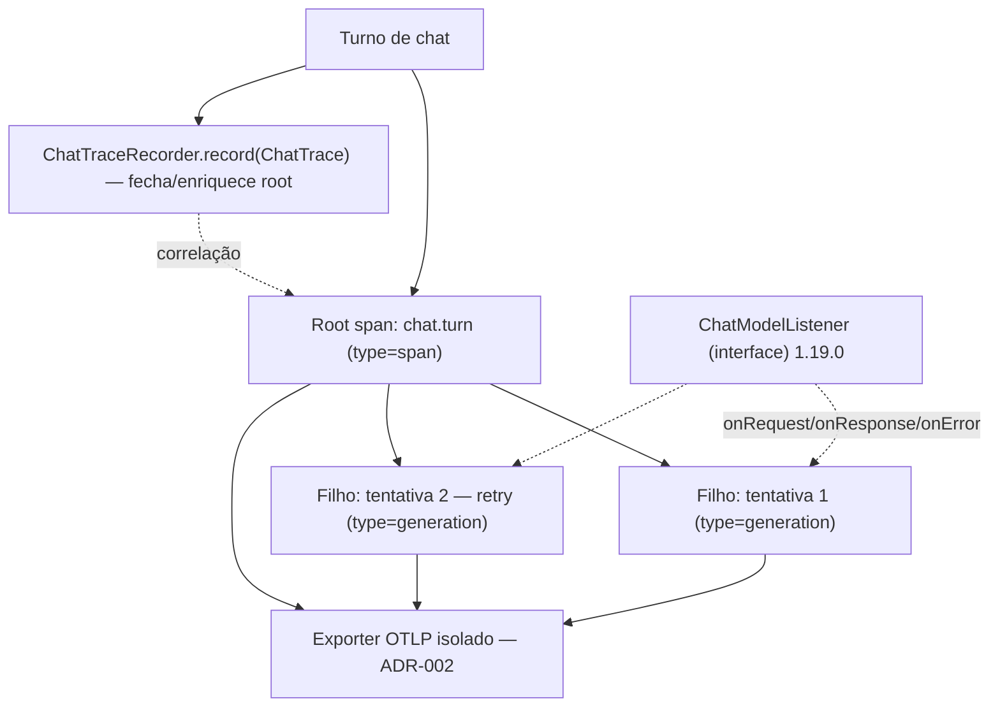

# ADR-001 — Contrato de telemetria: modelo de spans turno/provider

- **Data:** 2026-11-25
- **Status:** Proposto — decisão de arquitetura congelada pelo operador; ADR ainda sem merge (`ADR-INDEX.md`: `todo`).
- **depende-de:** —
- **RFs atendidos:** RF1 (1 root por turno), RF2 (1 filho por tentativa ao provider).
- **Origem:** PRD §5/§11/§16 (APROVADO 2026-11-25) + RESEARCH eixo D2.

## Contexto

`ChatTraceRecorder.record(ChatTrace)` (`backend/assistant/api/.../diagnostics/ChatTraceRecorder.java:7`) é a porta de saída já existente; `ChatTrace` (`:15,45-64`) carrega IDs de correlação, parâmetros, usage e falha, mas **nenhum texto** e nenhuma hierarquia. O provider é chamado em `AssistantTurnGateway.java:131`, com retry policy em `:117`, e o `ChatTrace` é fechado em `TurnOutcomeMapper.java:188` — depois das tentativas. Hoje não é possível responder "qual turno gerou esta resposta, em qual tentativa e com qual modelo" em uma consulta.

## Decisão

1. **Dois níveis de span, e só dois.** Um span raiz por turno (`chat.turn`) e um span filho por chamada ao provider, **inclusive cada retry** (`chat.provider.call`). Nenhum span de HTTP, SQL, JVM ou infraestrutura entra nesta fatia (RB6).
2. **Raiz = turno.** O root é aberto na entrada do turno e **fechado/enriquecido no ponto `ChatTraceRecorder.record(ChatTrace)`**, sem alterar a assinatura da porta nem os campos do `ChatTrace`. Correlação vive em escopo de turno e é replicada em todos os spans: o Langfuse filtra/agrega por observation, não apenas por trace.
3. **Filho = tentativa.** A captura usa a **interface** `ChatModelListener` do LangChain4j 1.19.0 (`onRequest`/`onResponse`/`onError`). Cada callback de tentativa produz 1 filho com `provider`, `model`, usage e falha classificada; `attempt` distingue retries. `ObservationChatModelListener` é uma implementação `@Experimental` no tag 1.19.0: **não é o contrato de spans** e não é adotado como fonte de métricas nesta fatia (ver ADR-005).
4. **Texto não entra em `ChatTrace`.** Prompt/resposta redigidos seguem por portador interno de turno definido no ADR-003 e são anexados ao filho `generation` — o record permanece textualmente limpo e o contrato público do chat não muda (RB2).
5. **Timestamps sempre nos dois extremos.** Langfuse reescreve spans sem `startTime`/`endTime`; o exporter emite ambos (ADR-002).

### Diagrama de componentes (blueprint)

## Interface congelada

Downstream (implementação, SPEC/TASKS, testes e consumidores) **não pode renomear, remover ou mudar o valor semântico** destes itens:

| Item congelado | Valor / origem obrigatória |
|---|---|
| Nome do root | `chat.turn`; `langfuse.observation.type=span`; root físico sem parent (`isRootObservation=true`) |
| Nome do filho | `chat.provider.call`; `langfuse.observation.type=generation`; 1 por tentativa |
| `langfuse.trace.name` | `chat.turn`, presente em root e filhos |
| `langfuse.session.id` | `ChatTrace.sessionId`, replicado em root e filhos quando não nulo |
| `langfuse.user.id` | `ChatTrace.clientId`, replicado quando não nulo; ausente no fluxo humano ⇒ omitir, nunca inventar |
| `langfuse.trace.metadata.tenant_id` | `ChatTrace.tenantId` quando presente |
| `langfuse.trace.metadata.turn_id` | `ChatTrace.turnId` quando presente |
| `langfuse.trace.metadata.prompt_template_id` | `ChatTrace.promptTemplateId` quando presente |
| `langfuse.observation.metadata.attempt` | Inteiro ≥1, somente no filho; conta tentativas da retry policy |
| `langfuse.observation.level` / `status_message` | `ERROR` + rótulo classificado de falha no filho falho; `DEFAULT` nos demais; sem stack trace e sem texto bruto |
| Timestamps OTLP | `startTimeUnixNano` e `endTimeUnixNano` preenchidos em root e filhos |
| Porta existente | `ChatTraceRecorder.record(ChatTrace)` inalterado; `ChatTrace` continua sem prompt/resposta |
| Profundidade | Exatamente 2 níveis; nenhum span de infraestrutura |

> **Inferência a validar (não é fato):** a mecânica exata de propagação do contexto entre o callback do listener (que corre antes do `record`) e o root (fechado depois) depende do escopo de turno. Critério de prova = IT com provider fake que falha na 1ª tentativa e responde na 2ª: 2 filhos, o 1º com `level=ERROR`, 1 root, 0 órfãos (RF2). Se o IT falhar, a correção é no mecanismo de escopo — nunca duplicando root por tentativa.

## Alternativas descartadas

| Alternativa | Motivo do descarte |
|---|---|
| `ObservationChatModelListener` como contrato de spans | Implementação `@Experimental` no tag 1.19.0; por si só não entrega hierarquia turno→provider nem `type=generation`. Fonte: tag 1.19.0 (2026-11-25). |
| `MicrometerMetricsChatModelListener` como instrumentação de trace | `onError` é no-op e não há span/hierarquia; útil no máximo para métrica. Fonte: tag 1.19.0 (2026-11-25). |
| Root por chamada ao provider (sem root de turno) | Perde a correlação exigida por RF1 e transforma retry em trace órfão. |
| Instrumentação automática OTel (HTTP/SQL/JVM) | Viola RB6 (só 2 níveis) e cria ruído/custo de observação. |
| Incluir prompt/resposta em `ChatTrace` | Mudaria o record usado por logs e testes e ampliaria a superfície de vazamento; ADR-003 usa portador separado. |

## Consequências

**Positivas**
- RF1/RF2 mensuráveis com provider fake e Observations API v2 (`traceId`, `isRootObservation`, contagem de filhos).
- Reusa a porta existente; nenhuma mudança de contrato público do chat.
- Atributos explícitos e propagados tornam filtro/agregação por `tenantId`/`turnId` confiáveis no Langfuse.

**Negativas**
- Mapeamento manual de atributos `langfuse.*` precisa de manutenção quando o contrato de correlação mudar.
- Propagação de contexto entre listener e `record` é inferência; só o IT de 2 tentativas a confirma.
- Contexto de turno é thread-local por construção; se o fluxo virar reativo, a estratégia de escopo precisa de novo ADR.

## Fontes

- PRD aprovado — `.spec/prd/telemetria-ia-langfuse/PRD.md` §5 (RF1/RF2), §11 (RB2/RB6), §16 — 2026-11-25.
- RESEARCH — eixo D2 e §6 — https://langfuse.com/integrations/native/opentelemetry × consulta em 2026-11-25; https://raw.githubusercontent.com/langchain4j/langchain4j/1.19.0/langchain4j-core/src/main/java/dev/langchain4j/model/chat/listener/ChatModelListener.java — 2026-11-25.
- Implementação `@Experimental` — https://raw.githubusercontent.com/langchain4j/langchain4j/1.19.0/langchain4j-observation/src/main/java/dev/langchain4j/observation/listener/ObservationChatModelListener.java — 2026-11-25.
- Regra de propagação de atributos para todos os spans — https://langfuse.com/integrations/native/opentelemetry — 2026-11-25.
- Fatos locais: `backend/assistant/api/src/main/java/br/com/systec/hive/assistant/api/diagnostics/ChatTraceRecorder.java:7`, `ChatTrace.java:15,45-64`, `backend/assistant/impl/src/main/java/br/com/systec/hive/assistant/impl/service/TurnOutcomeMapper.java:188`, `AssistantTurnGateway.java:117,131` — leitura em 2026-11-25.
