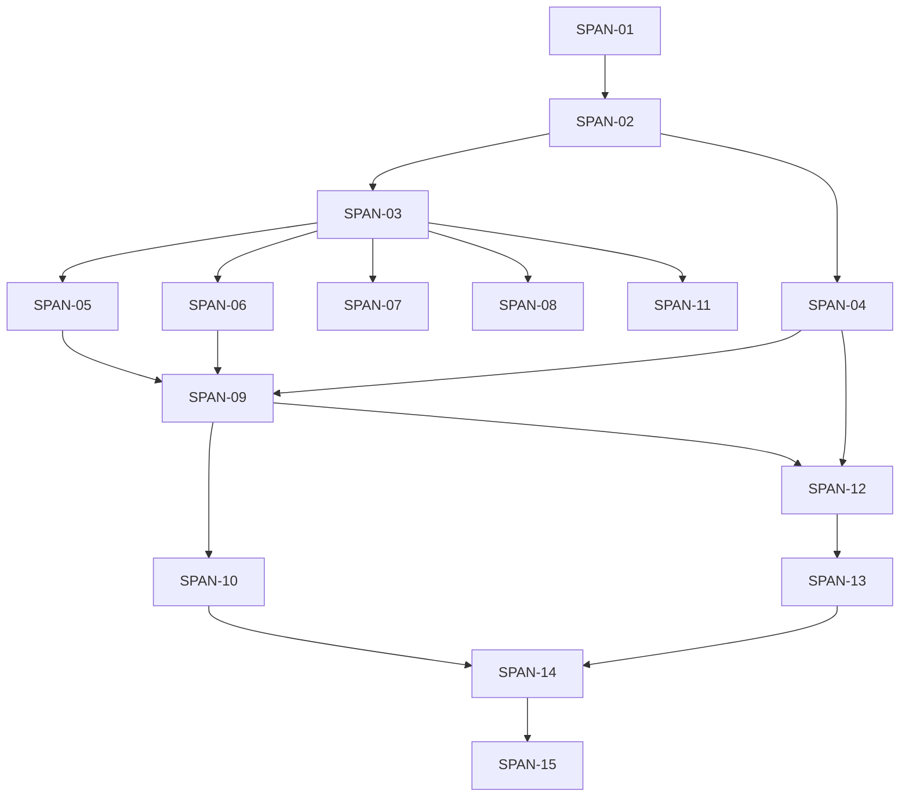

<!-- scope: adr/ADR-001 -->
# TASKS — ADR-001: Contrato de spans turno/provider

> Backlog TDD-ready derivado 1:1 da `SPEC.md` deste ADR. Teste escrito **antes** da implementação em toda tarefa. Nenhuma tarefa implementa transporte OTLP (ADR-002), redação (ADR-003), RBAC/retention (ADR-004) ou métricas (ADR-005).
>
> **Atalhos de caminho:** `API` = `backend/assistant/api/src/main/java/br/com/systec/hive/assistant/api/diagnostics/` · `IMPL` = `backend/assistant/impl/src/main/java/br/com/systec/hive/assistant/impl/` · `TEST` = `backend/assistant/impl/src/test/java/br/com/systec/hive/assistant/impl/diagnostics/`.

## 1. Traceability Context

- **Source:** `.spec/prd/telemetria-ia-langfuse/ADRs/ADR-001-contrato-spans/ADR.md` (decisão + Interface congelada) + `SPEC.md` (RF-01..RF-08, NFR-01..NFR-07).
- **Goal:** cobrir cada RF/NFR com 1 ticket atômico, rastreável, com teste antes do código.

## 2. Sprint Summary

| Phase | Task ID | RF/NFR | Type | Priority | Risk | Depends on | Status |
|---|---|---|---|---|---|---|---|
| 1 — Porta | SPAN-01 | RF-06 | contrato | P0 | Médio | — | Todo |
| 2 — Root | SPAN-02 | RF-01 | domínio | P0 | Alto | SPAN-01 | Todo |
| 3 — Filho | SPAN-03 | RF-02 | instrumentação | P0 | Alto | SPAN-02 | Todo |
| 4 — Correlação | SPAN-04 | RF-03 | mapeamento | P0 | Alto | SPAN-02 | Todo |
| 5 — Attempt | SPAN-05 | RF-05 | instrumentação | P0 | Médio | SPAN-03 | Todo |
| 6 — Falha | SPAN-06 | RF-04 | mapeamento | P0 | Alto | SPAN-03 | Todo |
| 7 — Profundidade | SPAN-07 | NFR-01 | teste | P0 | Alto | SPAN-03 | Todo |
| 8 — Timestamps | SPAN-08 | NFR-02 | mapeamento | P0 | Médio | SPAN-03 | Todo |
| 9 — Propagação | SPAN-09 | RF-08 | integração | P0 | Alto | SPAN-04, SPAN-05, SPAN-06 | Todo |
| 10 — Nomes | SPAN-10 | NFR-03 | teste | P1 | Médio | SPAN-09 | Todo |
| 11 — Listener | SPAN-11 | NFR-04 | contrato | P1 | Médio | SPAN-03 | Todo |
| 12 — Isolamento | SPAN-12 | NFR-07 | integração | P0 | Alto | SPAN-09, SPAN-04 | Todo |
| 13 — Texto | SPAN-13 | RF-07 | contrato | P0 | Alto | SPAN-12 | Todo |
| 14 — Regressão | SPAN-14 | NFR-06 | qualidade | P0 | Alto | SPAN-10, SPAN-13 | Todo |
| 15 — Rastreio | SPAN-15 | NFR-05 | documentação | P1 | Baixo | SPAN-14 | Todo |

## 3. Dependency Graph

---

## 4. Task Backlog

### SPAN-01 — Fechar root no `record` existente

- **RF/NFR:** RF-06 · **Prioridade:** P0 · **Risco:** Médio · **Tipo:** contrato · **Depende de:** — · **Dependency Type:** Hard · **Paralelizável:** Não
- **Arquivos:** `API/ChatTraceRecorder.java` (inalterado), `API/ChatTrace.java` (inalterado), `IMPL/service/LoggingChatTraceRecorder.java` (composição), `TEST/ChatTurnRecorderPortTest.java` (novo).
- **Contexto/Impacto:** garante que o ponto de fechamento do turno seja a porta existente; nenhuma assinatura ou campo muda.
- **Teste primeiro:**
  - [x] `TEST/ChatTurnRecorderPortTest.java`: asserção por reflection de `record(ChatTrace)` e captura do fechamento do root pelo fake recorder.
  - [x] `IMPL/diagnostics/ChatTurnSpanScope.java`: implementar o fechamento no ponto `record`, sem tocar a porta.
- **Cenários:**
  - Sucesso: `ChatTraceRecorder.class.getDeclaredMethod("record", ChatTrace.class)` existe; 1 chamada `record` ⇒ root emitido uma vez.
  - Falha: assinatura alterada (parâmetro novo) ⇒ teste de reflection quebra antes do review.
  - Borda: `record` chamado 2× no mesmo turno ⇒ ainda 1 root (idempotência por turno).
- **DoD:**
  - [x] Arquivo de teste criado antes do arquivo de implementação.
  - [x] `ChatTraceRecorder.java` e `ChatTrace.java` sem diff.
  - [x] `mvn -f backend/pom.xml test -Dtest=ChatTurnRecorderPortTest` verde.

### SPAN-02 — Root `chat.turn` por turno

- **RF/NFR:** RF-01 · **Prioridade:** P0 · **Risco:** Alto · **Tipo:** domínio · **Depende de:** SPAN-01 · **Dependency Type:** Hard · **Paralelizável:** Não
- **Arquivos:** `IMPL/diagnostics/ChatTurnSpanScope.java`, `TEST/ChatTurnSpanScopeTest.java`, `TEST/ChatSpanContractIT.java` (novo).
- **Contexto/Impacto:** cria exatamente 1 root por turno, sem parent, com `langfuse.trace.name=chat.turn` e `type=span`.
- **Teste primeiro:**
  - [x] `TEST/ChatTurnSpanScopeTest.java` e `TEST/ChatSpanContractIT.java`: 1 turno ⇒ 1 root; 2 turnos ⇒ 2 `traceId` distintos.
  - [x] `IMPL/diagnostics/ChatTurnSpanScope.java`: abrir o root na entrada do turno.
- **Cenários:**
  - Sucesso: payload contém 1 span `name=chat.turn`, `langfuse.observation.type=span`, sem `parentSpanId`, `isRootObservation=true`.
  - Falha: 2 roots para o mesmo turno ⇒ ajustar escopo; nunca aceitar root duplicado.
  - Borda: 2 turnos sequenciais ⇒ `traceId`s distintos e sem atributo cruzado.
- **DoD:**
  - [x] Teste escrito antes da implementação.
  - [x] IT de contrato verde com o assert de root único.
  - [x] Nenhum root criado por tentativa ao provider.

### SPAN-03 — Filho `chat.provider.call` por tentativa

- **RF/NFR:** RF-02 · **Prioridade:** P0 · **Risco:** Alto · **Tipo:** instrumentação · **Depende de:** SPAN-02 · **Dependency Type:** Hard · **Paralelizável:** Não
- **Arquivos:** `IMPL/diagnostics/ProviderCallSpanListener.java` (novo), `IMPL/service/AssistantTurnGateway.java:117,131` (registro do listener), `TEST/ProviderCallSpanListenerTest.java` (novo).
- **Contexto/Impacto:** each `onRequest`/`onResponse`/`onError` de tentativa produz 1 filho com provider, model, usage e duração.
- **Teste primeiro:**
  - [x] `TEST/ProviderCallSpanListenerTest.java`: provider fake com 2 tentativas ⇒ 2 filhos `type=generation`.
  - [x] `IMPL/diagnostics/ProviderCallSpanListener.java` + registro no gateway: implementar captura.
- **Cenários:**
  - Sucesso: 2 filhos com `provider`, `model`, `usage.input/output/total` quando reportados e duração preenchida.
  - Falha: callback sem modelo/usage ⇒ filho ainda existe; campos ausentes, nunca valor inventado.
  - Borda: retry policy com 1 tentativa ⇒ exatamente 1 filho.
- **DoD:**
  - [x] Teste escrito antes da implementação.
  - [x] `count(filhos) == count(tentativas)` no IT.
  - [x] Root permanece único.

### SPAN-04 — Replicar atributos de correlação

- **RF/NFR:** RF-03 · **Prioridade:** P0 · **Risco:** Alto · **Tipo:** mapeamento · **Depende de:** SPAN-02 · **Dependency Type:** Hard · **Paralelizável:** Sim (após SPAN-02)
- **Arquivos:** `IMPL/diagnostics/SpanAttributeMapper.java` (novo), `TEST/SpanAttributeMapperTest.java` (novo).
- **Contexto/Impacto:** mapeia os 5 IDs do `ChatTrace` para as chaves `langfuse.*` congeladas em root e filhos.
- **Teste primeiro:**
  - [x] `TEST/SpanAttributeMapperTest.java`: 5 IDs não nulos ⇒ 5 chaves presentes em root e filhos.
  - [x] `IMPL/diagnostics/SpanAttributeMapper.java`: mapear sem gerar valor para campo nulo.
- **Cenários:**
  - Sucesso: `session.id`, `user.id`, `metadata.tenant_id`, `metadata.turn_id`, `metadata.prompt_template_id` com os valores exatos do turno.
  - Falha: `clientId` nulo virando string "null" ⇒ teste quebra; `user.id` deve ser omitido.
  - Borda: `tenantId`, `turnId` ou `promptTemplateId` nulos ⇒ chave correspondente ausente.
- **DoD:**
  - [x] Teste escrito antes da implementação.
  - [x] Chaves presentes em root **e** filhos.
  - [x] Fluxo humano sem `clientId` sem `langfuse.user.id`.

### SPAN-05 — `attempt` por tentativa

- **RF/NFR:** RF-05 · **Prioridade:** P0 · **Risco:** Médio · **Tipo:** instrumentação · **Depende de:** SPAN-03 · **Dependency Type:** Hard · **Paralelizável:** Sim (após SPAN-03)
- **Arquivos:** `IMPL/diagnostics/ProviderCallSpanListener.java`, `TEST/AttemptCounterTest.java` (novo).
- **Contexto/Impacto:** distingue retries sem criar span extra.
- **Teste primeiro:**
  - [x] `TEST/AttemptCounterTest.java`: 2 tentativas ⇒ `attempt=1` e `attempt=2`; root sem a chave.
  - [x] `IMPL/diagnostics/ProviderCallSpanListener.java`: incrementar contador por callback de tentativa.
- **Cenários:**
  - Sucesso: inteiro ≥ 1 no filho, sequência 1..N.
  - Falha: contador global entre turnos ⇒ valor ≥2 no 1º filho; isolar por turno.
  - Borda: 3 tentativas ⇒ `attempt=3` no último filho; root sem `attempt`.
- **DoD:**
  - [x] Teste escrito antes da implementação.
  - [x] Chave `attempt` ausente no root.
  - [x] Nenhum retry sem filho correspondente.

### SPAN-06 — Falha classificada no filho

- **RF/NFR:** RF-04 · **Prioridade:** P0 · **Risco:** Alto · **Tipo:** mapeamento · **Depende de:** SPAN-03 · **Dependency Type:** Hard · **Paralelizável:** Sim (após SPAN-03)
- **Arquivos:** `IMPL/diagnostics/FailureClassifier.java` (reuso, `causeOf` em `:42`), `IMPL/diagnostics/SpanAttributeMapper.java`, `TEST/FailureSpanMappingTest.java` (novo), teste existente `backend/assistant/impl/src/test/java/br/com/systec/hive/assistant/impl/diagnostics/FailureClassifierTest.java`.
- **Contexto/Impacto:** rótulo de falha log-safe, sem stack trace e sem texto bruto.
- **Teste primeiro:**
  - [x] `TEST/FailureSpanMappingTest.java`: filho falho ⇒ `level=ERROR` + `status_message` = rótulo classificado; demais `DEFAULT`.
  - [x] `IMPL/diagnostics/SpanAttributeMapper.java`: mapear rótulo sem interpolação de mensagem.
- **Cenários:**
  - Sucesso: exceção de timeout ⇒ `status_message` igual a `FailureClassifier.causeOf`.
  - Falha: mensagem crua vazando para `status_message` ⇒ quebrar teste; nunca usar `getMessage()`.
  - Borda: exceção com mensagem contendo literal sensível ⇒ rótulo classificado, sem o literal.
- **DoD:**
  - [x] Teste escrito antes da implementação.
  - [x] Zero `at br.com` e zero texto de prompt no payload.
  - [x] `FailureClassifierTest` existente continua verde.

### SPAN-07 — Profundidade fixa em 2 níveis

- **RF/NFR:** NFR-01 · **Prioridade:** P0 · **Risco:** Alto · **Tipo:** teste · **Depende de:** SPAN-03 · **Dependency Type:** Hard · **Paralelizável:** Sim (após SPAN-03)
- **Arquivos:** `TEST/ChatSpanContractIT.java` (varredura do payload publicado); nenhuma mudança de produto prevista. Não há `SpanDepthIT.java`: a prova vive no IT de contrato existente, e a varredura de spans de infra (HTTP/SQL/JVM) fica no ADR-002, onde o exporter OTLP entra — esta fatia não tem OTLP nem auto-instrumentação.
- **Contexto/Impacto:** impede spans de HTTP/SQL/JVM na fatia (RB6); NFR-01 é provado pela forma do payload caracterizado em SPAN-09, não por IT separado.
- **Teste primeiro:**
  - [x] `TEST/ChatSpanContractIT.java`: varrer payload e afirmar `max(depth) == 2` e `total_spans == 1 + tentativas` (`when_providerFailsFirstAttempt_then_oneRootTwoChildrenAndNoOrphansArePublished`: 1 root + 2 filhos).
  - [x] Ajustar implementação somente se o teste falhar; nenhuma auto-instrumentação nova.
- **Cenários:**
  - Sucesso: 1 root + N filhos, nenhum outro span.
  - Falha: span de HTTP ou SQL aparece ⇒ registrar no ADR-002 (varredura de infra); não filtrar depois nesta fatia.
  - Borda: turno sem provider chamado ⇒ 1 root, 0 filhos, ainda 2 níveis no máximo.
- **DoD:**
  - [x] Teste escrito antes de qualquer ajuste.
  - [x] Zero span de infraestrutura no payload caracterizado; cobertura de infra registrada no ADR-002.

### SPAN-08 — Timestamps OTLP nos dois extremos

- **RF/NFR:** NFR-02 · **Prioridade:** P0 · **Risco:** Médio · **Tipo:** mapeamento · **Depende de:** SPAN-03 · **Dependency Type:** Hard · **Paralelizável:** Sim (após SPAN-03)
- **Arquivos:** `IMPL/diagnostics/ChatTurnSpanScope.java` (`nowNanos()` com `Instant.now()`), `TEST/ChatSpanContractIT.java`, `TEST/ChatTurnSpanScopeTest.java`. Não há `SpanTimestampIT.java`: NFR-02 é provado nos testes existentes, sem IT novo.
- **Contexto/Impacto:** Langfuse reescreve span sem `startTime`/`endTime`; ambos devem ser emitidos em nanosegundos reais (`epochSecond * 1e9 + nano`), nunca `currentTimeMillis() * 1e6`.
- **Teste primeiro:**
  - [x] `TEST/ChatSpanContractIT.java`: para todo span, `startTimeUnixNano > 0`, `endTimeUnixNano ≥ startTimeUnixNano`.
  - [x] `TEST/ChatTurnSpanScopeTest.java`: pelo menos um span com sub-milissegundo real (`startTimeUnixNano % 1_000_000 != 0`).
  - [x] `IMPL/diagnostics/ChatTurnSpanScope.java`: preencher extremos em root e filhos.
- **Cenários:**
  - Sucesso: ambos os campos presentes, coerentes e com precisão de nanosegundo.
  - Falha: `endTime` ausente ou timestamp com passo de milissegundo ⇒ teste quebra antes do export.
  - Borda: falha muito rápida (`start == end`) ⇒ `end ≥ start` ainda verdadeiro.
- **DoD:**
  - [x] Teste escrito antes da implementação.
  - [x] 100% dos spans do payload com os dois timestamps e nanosegundos reais.

### SPAN-09 — Provar propagação listener→root com 2 tentativas

- **RF/NFR:** RF-08 · **Prioridade:** P0 · **Risco:** Alto · **Tipo:** integração · **Depende de:** SPAN-04, SPAN-05, SPAN-06 · **Dependency Type:** Hard · **Paralelizável:** Não
- **Arquivos:** `TEST/ChatSpanContractIT.java`, `IMPL/service/AssistantTurnGateway.java:117,131`, `IMPL/service/TurnOutcomeMapper.java:188`.
- **Contexto/Impacto:** esta é a prova da inferência registrada no ADR — se falhar, corrige-se o escopo, nunca duplicando root.
- **Teste primeiro:**
  - [x] `TEST/ChatSpanContractIT.java`: provider fake falha na 1ª e responde na 2ª ⇒ `roots==1`, `filhos==2`, `órfãos==0`, 1º filho `level=ERROR`.
  - [x] Ajustar mecanismo de escopo em `AssistantTurnGateway`/`TurnOutcomeMapper` somente após o teste existir.
- **Cenários:**
  - Sucesso: todos os spans com o mesmo `traceId` e correlação do turno.
  - Falha: órfão ou root duplicado ⇒ corrigir escopo de turno; nunca criar root por tentativa.
  - Borda: 2ª tentativa também falha ⇒ 2 filhos `ERROR`, ainda 1 root.
- **DoD:**
  - [x] Teste escrito antes de qualquer ajuste de escopo.
  - [x] `mvn -f backend/pom.xml -Pintegration verify -Dtest=ChatSpanContractIT` verde.
  - [x] Inferência do ADR confirmada por evidência; divergência volta ao `architect`.

### SPAN-10 — Characterização da nomenclatura congelada

- **RF/NFR:** NFR-03 · **Prioridade:** P1 · **Risco:** Médio · **Tipo:** teste · **Depende de:** SPAN-09 · **Dependency Type:** Soft · **Paralelizável:** Sim (após SPAN-09)
- **Arquivos:** `TEST/FrozenNamingTest.java` (constantes + varredura do payload publicado).
- **Contexto/Impacto:** congela os nomes exatos da "Interface congelada" do ADR para os ADRs downstream; a varredura cobre as chaves efetivamente emitidas, não só as constantes do mapper.
- **Teste primeiro:**
  - [x] `TEST/FrozenNamingTest.java`: chaves `langfuse.*` emitidas ⊆ `SpanAttributeMapper.FROZEN_LANGFUSE_KEYS`, que por sua vez é igual à tabela literal do ADR.
  - [x] Nenhuma implementação nova; se chave divergir, corrigir o mapper.
- **Cenários:**
  - Sucesso: `chat.turn`, `chat.provider.call`, `langfuse.trace.name` e todas as chaves de correlação com os nomes exatos.
  - Falha: rename/remoção ⇒ teste quebra e corrige no mapper.
  - Borda: chave opcional ausente (campo nulo) não conta como rename.
- **DoD:**
  - [x] Teste escrito antes de qualquer ajuste.
  - [x] Zero chave `langfuse.*` fora da tabela do ADR.

### SPAN-11 — Usar a interface `ChatModelListener`

- **RF/NFR:** NFR-04 · **Prioridade:** P1 · **Risco:** Médio · **Tipo:** contrato · **Depende de:** SPAN-03 · **Dependency Type:** Hard · **Paralelizável:** Sim (após SPAN-03)
- **Arquivos:** `IMPL/service/AssistantTurnGateway.java:131`, `IMPL/diagnostics/ProviderCallSpanListener.java`; dependência `langchain4j-core` 1.19.0 já declarada (`backend/dependencies/pom.xml:37`) — nenhuma dependência nova.
- **Contexto/Impacto:** a interface é o contrato; `ObservationChatModelListener` é `@Experimental` no tag 1.19.0 e fica fora.
- **Teste primeiro:**
  - [x] Verificação estática: `grep -rn "ObservationChatModelListener" backend/assistant/ backend/provider/` ⇒ 0; presença de `dev.langchain4j.model.chat.listener.ChatModelListener` na instrumentação.
  - [x] Registrar o listener na construção do `AiServices` sem trocar a dependência.
- **Cenários:**
  - Sucesso: callbacks `onRequest`/`onResponse`/`onError` da interface alimentam o filho.
  - Falha: implementação experimental introduzida ⇒ grep acusa e reverte.
  - Borda: upgrade de versão muda assinatura ⇒ fonte do tag 1.19.0 é a SSoT; divergência volta ao `architect`.
- **DoD:**
  - [x] Teste estático escrito antes do registro do listener.
  - [x] Nenhuma dependency, branch ou código fora deste ADR.

### SPAN-12 — Isolar correlação por turno

- **RF/NFR:** NFR-07 · **Prioridade:** P0 · **Risco:** Alto · **Tipo:** integração · **Depende de:** SPAN-09, SPAN-04 · **Dependency Type:** Hard · **Paralelizável:** Não
- **Arquivos:** `TEST/TurnScopeIsolationIT.java` (novo), `IMPL/diagnostics/ChatTurnSpanScope.java`.
- **Contexto/Impacto:** correlação thread-local por turno; nenhum vazamento entre tenants.
- **Teste primeiro:**
  - [x] `TEST/TurnScopeIsolationIT.java`: 2 turnos concorrentes de tenants distintos ⇒ cada span só com os atributos do seu turno.
  - [x] Ajustar escopo somente se o teste acusar mistura.
- **Cenários:**
  - Sucesso: `tenant_id`/`turn_id` corretos em cada span.
  - Falha: atributo do turno A no span B ⇒ corrigir escopo, não mascarar no mapper.
  - Borda: fluxo humano sem `clientId` concorrente com fluxo com `clientId` ⇒ nenhum `user.id` inventado.
- **DoD:**
  - [x] Teste escrito antes do ajuste de escopo.
  - [x] Zero vazamento cross-tenant/cross-turn.

### SPAN-13 — Manter texto fora do `ChatTrace`

- **RF/NFR:** RF-07 · **Prioridade:** P0 · **Risco:** Alto · **Tipo:** contrato · **Depende de:** SPAN-12 · **Dependency Type:** Hard · **Paralelizável:** Não
- **Arquivos:** `API/ChatTrace.java` (inalterado), `TEST/ChatTraceShapeTest.java` (novo).
- **Contexto/Impacto:** esta ADR não introduz `langfuse.observation.input/output`; portador de texto é o ADR-003.
- **Teste primeiro:**
  - [x] `TEST/ChatTraceShapeTest.java`: `ChatTrace.class.getRecordComponents()` não contém `prompt`/`response`; nenhuma chave de texto no payload desta fatia.
  - [x] Nenhuma implementação de texto neste ADR.
- **Cenários:**
  - Sucesso: `git diff --name-only` sem `ChatTrace.java`; `grep` sem chaves de texto.
  - Falha: campo de texto adicionado ao record ⇒ reverter; mudança exige ADR-003.
  - Borda: payload de falha com `status_message` classificado não conta como texto de prompt.
- **DoD:**
  - [x] Teste escrito antes de qualquer código.
  - [x] `ChatTrace` e contrato público do chat inalterados.

### SPAN-14 — Não regressão do contrato do chat

- **RF/NFR:** NFR-06 · **Prioridade:** P0 · **Risco:** Alto · **Tipo:** qualidade · **Depende de:** SPAN-10, SPAN-13 · **Dependency Type:** Hard · **Paralelizável:** Não
- **Arquivos:** nenhum de produto neste passo; suíte e `git diff --name-only`.
- **Contexto/Impacto:** telemetria não altera resposta, cota, limites ou autenticação.
- **Teste primeiro:**
  - [x] Characterização da resposta de chat com e sem instrumentação + `git diff --name-only` antes do review.
  - [x] Corrigir somente o que o teste acusar; nenhuma mudança de contrato.
- **Cenários:**
  - Sucesso: `npm test` 0 falhas; resposta idêntica; diff sem tocar contrato/cota/RBAC/autenticação.
  - Falha: divergência de resposta ⇒ parar e corrigir causa raiz.
  - Borda: nenhuma UI nova nesta fatia (H3/frontend N/A).
- **DoD:**
  - [x] Teste/caracterização executados antes do fechamento.
  - [x] 0 falhas na suíte completa; 0 diff em arquivos proibidos.

### SPAN-15 — Auditar rastreabilidade e fontes

- **RF/NFR:** NFR-05 · **Prioridade:** P1 · **Risco:** Baixo · **Tipo:** documentação · **Depende de:** SPAN-14 · **Dependency Type:** Soft · **Paralelizável:** Não
- **Arquivos:** `SPEC.md` e `TASKS.md` deste diretório (somente leitura/ajuste documental); `ADR.md` §Fontes.
- **Contexto/Impacto:** garante que os 15 requisitos da SPEC tenham 1 task cada e que fontes de terceiro tragam URL + data.
- **Teste primeiro:**
  - [x] Auditoria determinística: `grep -c '^### SPAN-' TASKS.md` ⇒ 15; comparar com RF-01..RF-08 + NFR-01..NFR-07 da SPEC; nenhum RF/NFR órfão.
  - [x] Nenhuma implementação; corrigir documentação se houver órfão.
- **Cenários:**
  - Sucesso: 15 seções ↔ 15 requisitos; toda URL de terceiro com data (2026-11-25).
  - Falha: task sem RF/NFR ou RF/NFR sem task ⇒ corrigir antes do `VERIFY.md`.
  - Borda: nenhuma macro-tarefa inventada fora da SPEC; marcador `<!-- scope: adr/ADR-001 -->` na 1ª linha.
- **DoD:**
  - [x] Auditoria executada antes do fechamento do ADR.
  - [x] 0 órfãos; 0 referência a task inexistente.
  - [x] Nenhum artefato fora de `.spec/prd/telemetria-ia-langfuse/ADRs/ADR-001-contrato-spans/`.

---

## 5. Coverage Validation

- [x] 15 tasks SPAN-01..SPAN-15 ↔ 15 RF/NFR da SPEC (8 RF + 7 NFR), 1:1 sem órfão.
- [x] Toda constraint da Interface congelada mapeada para BDD (nome do root/filho, 5 chaves de correlação, `attempt`, `level`, timestamps, porta inalterada, profundidade). NFR-01/02 provados por `ChatSpanContractIT` + varredura em `ChatTurnSpanScopeTest`/`FrozenNamingTest`; varredura de spans de infra fica no ADR-002.
- [x] Toda task tem cenário de Falha e de Borda/Idempotência.
- [x] Toda task lista arquivo de teste antes do arquivo de implementação.
- [x] Grafo Mermaid sem ciclo e sem órfã (SPAN-01 é raiz, SPAN-15 é folha).
- [x] Sprint Summary 1:1 com as 15 seções (sem ID órfão na tabela).
- [x] Nenhuma macro-tarefa inventada fora da SPEC.
- [x] Nenhuma task introduz decisão de ADR-002/003/004/005.

## 6. Plan Feedback (não bloqueante para este ADR)

- **Inferência do ADR confirmada só no SPAN-09:** mecânica de propagação listener→root é thread-local; se o IT falhar, a correção é no escopo e volta ao `architect` — nunca duplicando root.
- **Portador de texto (ADR-003) fora desta fatia:** SPAN-13 apenas congela a ausência de texto no `ChatTrace`; `langfuse.observation.input/output` não entra aqui.
- **Exporter/credencial (ADR-002) e RBAC/retention (ADR-004) fora:** nenhuma task desta lista toca endpoint, `pk:sk`, proxy ou job de 30 dias.
- **Item do PRD §16 ainda não marcado:** `prd_version: 2` confirmado no ato — `unit: adr` com SPEC/TASKS; este backlog materializa `SPEC.md` + `TASKS.md`; o `VERIFY.md` só nasce após merge (fora do escopo deste subagent).
