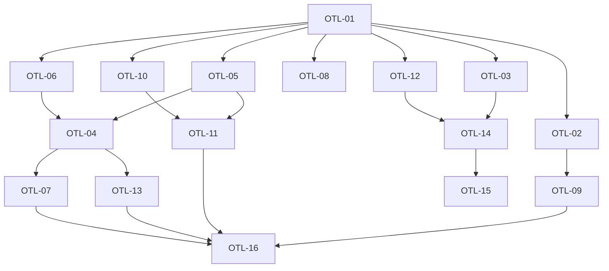

<!-- scope: adr/ADR-002 -->
# TASKS — ADR-002: Ingestão OTLP/HTTP no Langfuse self-host v4

> Backlog TDD-ready derivado 1:1 da `SPEC.md` deste ADR (7 RF + 9 NFR = 16 requisitos → 16 tickets). Teste escrito **antes** da implementação em toda tarefa. Nenhuma tarefa altera o contrato de spans/correlação (ADR-001), a redação (ADR-003), proxy/RBAC/retention (ADR-004) ou a definição/exposição de métricas de negócio (ADR-005).
>
> **Atalhos de caminho:** `API` = `backend/assistant/api/src/main/java/br/com/systec/hive/assistant/api/diagnostics/` (porta inalterada) · `IMPL` = `backend/assistant/impl/src/main/java/br/com/systec/hive/assistant/impl/diagnostics/` (contrato do ADR-001, somente leitura) · `CFG` = `backend/bootstrap/src/main/java/br/com/systec/hive/config/` · `RES` = `backend/bootstrap/src/main/resources/` · `CFGTEST` = `backend/bootstrap/src/test/java/br/com/systec/hive/config/` · `IT` = `backend/integration-test/src/test/java/br/com/systec/hive/integrationtest/` · `POM` = `backend/dependencies/pom.xml`.
>
> ✅ **Encoding resolvido (decisão architect 2026-11-25):** `application/x-protobuf`, não JSON. OTL-01/OTL-12 afirmam protobuf e decodificam `resourceSpans`; nenhuma task configura `otel.exporter.otlp.protocol=http/json` (opção inexistente no SDK Java — issue #5598, 2023-07-06, consultado 2026-11-25). Impacto downstream `RED-11` (ADR-003) fica no ciclo daquele ADR, fora deste backlog.

## 1. Traceability Context

- **Source:** `.spec/prd/telemetria-ia-langfuse/ADRs/ADR-002-ingestao-otlp/ADR.md` (decisão + Interface congelada + Ajustes de 2026-11-25) + `SPEC.md` (RF-01..RF-07, NFR-01..NFR-09).
- **Goal:** cobrir cada RF/NFR com 1 ticket atômico, rastreável, com teste antes do código e aceite executável.
- **Layout:** `unit: adr` — `ADR.md` + `SPEC.md` + `TASKS.md`; `VERIFY.md` só após merge (fora deste subagent).

## 2. Sprint Summary

| Phase | Task ID | RF/NFR | Type | Priority | Risk | Depends on | Status |
|---|---|---|---|---|---|---|---|
| 1 — Endpoint | OTL-01 | RF-01 | integração | P0 | Alto (protobuf) | — | Todo |
| 2 — Auth | OTL-02 | RF-02 | configuração | P0 | Alto | OTL-01 | Todo |
| 3 — Header v4 | OTL-03 | RF-03 | configuração | P0 | Médio | OTL-01 | Todo |
| 4 — Isolamento | OTL-04 | RF-04 | infraestrutura | P0 | Alto | OTL-05, OTL-06 | Todo |
| 5 — Root por lote | OTL-05 | RF-05 | integração | P0 | Alto | OTL-01 | Todo |
| 6 — Flag (default false) | OTL-06 | RF-06 | configuração | P0 | Alto | OTL-01 | Todo |
| 7 — Falha | OTL-07 | RF-07 | observabilidade | P0 | Alto | OTL-04 | Todo |
| 8 — TLS | OTL-08 | NFR-01 | configuração | P0 | Alto | OTL-01 | Todo |
| 9 — Credencial | OTL-09 | NFR-02 | segurança | P0 | Alto | OTL-02 | Todo |
| 10 — Sinais | OTL-10 | NFR-03 | teste | P0 | Alto | OTL-01 | Todo |
| 11 — Alimentação | OTL-11 | NFR-04 | integração | P0 | Alto | OTL-05, OTL-10 | Todo |
| 12 — Encoding protobuf | OTL-12 | NFR-05 | integração | P0 | Médio | OTL-01 | Todo |
| 13 — Async | OTL-13 | NFR-06 | infraestrutura | P0 | Alto | OTL-04 | Todo |
| 14 — Nomenclatura | OTL-14 | NFR-07 | teste | P1 | Médio | OTL-03, OTL-12 | Todo |
| 15 — Rastreio | OTL-15 | NFR-08 | documentação | P1 | Baixo | OTL-14 | Todo |
| 16 — Regressão | OTL-16 | NFR-09 | qualidade | P0 | Alto | OTL-07, OTL-09, OTL-11, OTL-13 | Todo |

## 3. Dependency Graph

---

## 4. Task Backlog

### OTL-01 — Endpoint e transporte OTLP/HTTP protobuf

- **RF/NFR:** RF-01 · **Prioridade:** P0 · **Risco:** Alto · **Tipo:** integração · **Depende de:** — · **Dependency Type:** Hard · **Paralelizável:** Não
- **Arquivos:** `IT/LangfuseOtlpExportIT.java` (novo, com servidor OTLP fake que decodifica protobuf), `RES/application.properties`, `RES/application-prod.properties`, `POM` (declarar `spring-boot-starter-opentelemetry` se ausente — viabiliza a decisão congelada, não muda transporte), `CFG/LangfuseOtlpExporterConfig.java` (novo).
- **Contexto/Impacto:** materializa `POST /api/public/otel/v1/traces` por `management.opentelemetry.tracing.export.otlp.endpoint=${LANGFUSE_OTLP_TRACES_ENDPOINT}` com `transport=http`. O `OtlpHttpSpanExporter` emite protobuf (`Content-Type: application/x-protobuf`); é o encoding congelado, não JSON. Nenhuma alteração em `ChatTraceRecorder`/`ChatTrace`.
- **Teste primeiro:**
  - [x] `IT/LangfuseOtlpExportIT.java`: capturar toda requisição e afirmar `method=POST`, path exato, `Content-Type: application/x-protobuf`, e decodificar o corpo como `ExportTraceServiceRequest` com `resourceSpans`; 0 path legado e 0 gRPC.
  - [x] `CFG/LangfuseOtlpExporterConfig.java` + propriedades: configurar endpoint/transporte somente após o teste existir.
- **Cenários:**
  - Sucesso: servidor fake recebe 1 `POST /api/public/otel/v1/traces` com `Content-Type: application/x-protobuf` e corpo decodifica com `resourceSpans`.
  - Falha: path legado, gRPC ou `Content-Type` diferente de `application/x-protobuf` ⇒ teste quebra; corrigir configuração do exporter, nunca trocar encoding por conta própria.
  - Borda: URL com query/fragmento ou sem o path congelado ⇒ rejeitada pela configuração; 0 requisição malformada.
- **DoD:**
  - [x] Teste criado antes da implementação.
  - [x] `mvn -f backend/pom.xml -Pintegration verify -Dtest=LangfuseOtlpExportIT` verde.
  - [x] `git diff --name-only` sem `ChatTrace.java`/`ChatTraceRecorder.java`.

### OTL-02 — Autenticação Basic `pk:sk` (escopo `Application`)

- **RF/NFR:** RF-02 · **Prioridade:** P0 · **Risco:** Alto · **Tipo:** configuração · **Depende de:** OTL-01 · **Dependency Type:** Hard · **Paralelizável:** Não
- **Arquivos:** `CFG/LangfuseOtlpExporterConfig.java`, `RES/application.properties`, `CFGTEST/LangfuseOtlpHeadersTest.java` (novo), `IT/LangfuseOtlpExportIT.java`.
- **Contexto/Impacto:** `Authorization: Basic base64(pk:sk)` via `management.opentelemetry.tracing.export.otlp.headers.authorization` (chave verificada em doc oficial — SPEC §12), montado a partir das variáveis de secret; chave é `Application` (escrita), nunca de leitura.
- **Teste primeiro:**
  - [x] `CFGTEST/LangfuseOtlpHeadersTest.java` e IT: decode do header == `${LANGFUSE_INGESTION_PK}:${LANGFUSE_INGESTION_SK}`; 0 esquema diferente de `Basic`.
  - [x] Configurar o header somente após o teste; nenhum literal de credencial no código.
- **Cenários:**
  - Sucesso: header decodificado é exatamente `pk:sk` injetado pelo fake de secret.
  - Falha: `Bearer` ou credencial fixa no source ⇒ teste quebra antes do review.
  - Borda: `pk` ou `sk` vazio ⇒ não enviar requisição válida; falha registrada como export (OTL-07), nunca como erro de chat.
- **DoD:**
  - [x] Teste escrito antes da configuração.
  - [x] 0 literal de credencial em `CFG`/`RES`.
  - [x] IT com header correto verde.

### OTL-03 — Header `x-langfuse-ingestion-version: 4`

- **RF/NFR:** RF-03 · **Prioridade:** P0 · **Risco:** Médio · **Tipo:** configuração · **Depende de:** OTL-01 · **Dependency Type:** Hard · **Paralelizável:** Sim (após OTL-01)
- **Arquivos:** `CFG/LangfuseOtlpExporterConfig.java`, `RES/application.properties`, `CFGTEST/LangfuseOtlpHeadersTest.java`, `IT/LangfuseOtlpExportIT.java`.
- **Contexto/Impacto:** header v4 é condição de ingestão em tempo real no modelo v4 e nas APIs v2; ausência pode causar atraso de até 15 min (fonte na SPEC §12).
- **Teste primeiro:**
  - [x] Teste de config + IT: 100% das requisições capturadas com `x-langfuse-ingestion-version: 4`.
  - [x] Configurar `management.opentelemetry.tracing.export.otlp.headers.x-langfuse-ingestion-version=4` somente após o teste.
- **Cenários:**
  - Sucesso: toda requisição ao endpoint contém o header com valor `4`.
  - Falha: header ausente em 1 lote ⇒ teste quebra; corrigir configuração, não reenviar lote pelo chat.
  - Borda: valor `4.0` ou `v4` ⇒ rejeitado (string exata `4`).
- **DoD:**
  - [x] Teste escrito antes da configuração.
  - [x] 0 requisição sem o header no IT.

### OTL-04 — Exporter isolado e best-effort (RF9)

- **RF/NFR:** RF-04 · **Prioridade:** P0 · **Risco:** Alto · **Tipo:** infraestrutura · **Depende de:** OTL-05, OTL-06 · **Dependency Type:** Hard · **Paralelizável:** Não
- **Arquivos:** `IT/LangfuseOtlpBestEffortIT.java` (novo), `CFG/LangfuseOtlpExporterConfig.java`, `IMPL/` (somente leitura — confirma que só os 2 instrumentos alimentam o exporter).
- **Contexto/Impacto:** esta é a prova do RF9: exporter fora ⇒ chat continua 200 e contrato intacto. Nenhum retry do chat e nenhuma exceção de export na thread de resposta.
- **Teste primeiro:**
  - [x] `IT/LangfuseOtlpBestEffortIT.java`: servidor OTLP recusa conexão ⇒ resposta de chat idêntica ao baseline (status, corpo, headers, cota, `turnId`/`clientId`), contagem de provider calls inalterada.
  - [x] Ajustar apenas o caminho de export/configuração após o teste; nunca tocar o handler do chat.
- **Cenários:**
  - Sucesso: chat 200 com exporter down; 0 exceção de export propagada; contador de falha incrementa (OTL-07).
  - Falha: resposta 5xx ou retry do provider causado por telemetria ⇒ parar, corrigir isolamento.
  - Borda: exporter responde 401/413 em vez de recusar conexão ⇒ mesmo comportamento de chat.
- **DoD:**
  - [x] Teste escrito antes de qualquer ajuste.
  - [x] `mvn -f backend/pom.xml -Pintegration verify -Dtest=LangfuseOtlpBestEffortIT` verde.
  - [x] 0 diff em contrato público/cota/autenticação.

### OTL-05 — Root `chat.turn` obrigatório em cada lote

- **RF/NFR:** RF-05 · **Prioridade:** P0 · **Risco:** Alto · **Tipo:** integração · **Depende de:** OTL-01 · **Dependency Type:** Hard · **Paralelizável:** Não
- **Arquivos:** `IT/LangfuseOtlpExportIT.java`, `CFG/LangfuseOtlpExporterConfig.java`, `IMPL/` (somente leitura — origem dos spans do ADR-001).
- **Contexto/Impacto:** Langfuse exige root para criar o trace e filtra/agrega por observation; lote sem root é defeito do exporter, não do chat.
- **Teste primeiro:**
  - [x] IT: para cada lote capturado e decodificado, ≥1 span `name=chat.turn`, `isRootObservation=true`, com as chaves `langfuse.*` de correlação do ADR-001 quando presentes no turno.
  - [x] Ajustar composição/flush do lote somente se o teste acusar ausência de root.
- **Cenários:**
  - Sucesso: 1 turno ⇒ 1 lote com root e filhos do ADR-001.
  - Falha: lote só com filhos ⇒ corrigir o ponto de fechamento/flush; nunca criar root no handler do chat.
  - Borda: turno sem provider chamado ⇒ lote ainda com 1 root, 0 filhos.
- **DoD:**
  - [x] Teste escrito antes do ajuste.
  - [x] 0 lote sem root no IT.
  - [x] Nenhuma chave `langfuse.*` redefinida neste ADR.

### OTL-06 — Sampling por `HIVE_TELEMETRY_ENABLED` (default `false`)

- **RF/NFR:** RF-06 · **Prioridade:** P0 · **Risco:** Alto · **Tipo:** configuração · **Depende de:** OTL-01 · **Dependency Type:** Hard · **Paralelizável:** Não
- **Arquivos:** `RES/application.properties`, `RES/application-prod.properties`, `RES/application-dev.properties`, `CFG/LangfuseOtlpExporterConfig.java`, `IT/LangfuseOtlpSamplingIT.java` (novo).
- **Contexto/Impacto:** único botão da primeira fatia, **default `false` (opt-in)**. Variável ausente ou `false` ⇒ `always-off` ⇒ 0 span emitido e 0 export (sem exigir `pk`/`sk` em dev/test); `true` ⇒ `always-on` ⇒ 100% dos turnos. Sampler default do Spring Boot (10%, `parent-based-trace-id-ratio`) não pode ser usado — `management.opentelemetry.tracing.sampler` é mapeado explicitamente para `always-on`/`always-off` (doc oficial — SPEC §12). Sem taxa intermediária.
- **Teste primeiro:**
  - [x] `IT/LangfuseOtlpSamplingIT.java`: três perfis — default-ausente, `false`, `true`. Ausente/`false` ⇒ 0 span na instrumentação e 0 requisição capturada; `true` com N turnos ⇒ N lotes com root. Asserção adicional: 0 config do sampler 10% do Spring Boot.
  - [x] Mapear a variável para o sampler somente após o teste, com default `false` explícito na configuração do perfil.
- **Cenários:**
  - Sucesso: três perfis executados no IT com resultados determinísticos (0/0/100%).
  - Falha: `false` ou default-ausente ainda exporta ⇒ corrigir o gate na origem, não filtrar no destino.
  - Borda: variável ausente ⇒ `always-off` (default `false`), nunca "100% por default"; produção liga explicitamente com endpoint e credenciais de secret.
- **DoD:**
  - [x] Teste escrito antes da configuração.
  - [x] 0 span e 0 requisição com default-ausente e com `false`.
  - [x] 100% dos turnos exportados com `true`; 0 uso do sampler 10%.

### OTL-07 — Falha de export: contador e log seguros

- **RF/NFR:** RF-07 · **Prioridade:** P0 · **Risco:** Alto · **Tipo:** observabilidade · **Depende de:** OTL-04 · **Dependency Type:** Hard · **Paralelizável:** Não
- **Arquivos:** `CFG/LangfuseOtlpExporterConfig.java`, `IT/LangfuseOtlpBestEffortIT.java`, `RES/application.properties` (exposição Actuator já existente — verificar, não criar registry novo).
- **Contexto/Impacto:** ADR-002 garante o **incremento** do contador lógico `chat.telemetry.export.failures` (Micrometer), exposto como `chat_telemetry_export_failures_total` em Prometheus; definição/exposição completa é do ADR-005. Nome canônico decidido pelo architect em 2026-11-25 (ADR §Ajustes; Prometheus naming). Log de falha não contém texto bruto, `sk-` ou base64.
- **Teste primeiro:**
  - [x] IT: 1 lote falho ⇒ série Prometheus `chat_telemetry_export_failures_total` incrementa em 1 no scrape de `/actuator/prometheus`; captura de log sem literal sensível. Nenhuma task cria série nova de negócio nem usa o nome antigo `chat.telemetry.export.failures.total`.
  - [x] Implementar incremento/log somente após o teste.
- **Cenários:**
  - Sucesso: 3 falhas ⇒ +3; nome canônico `chat_telemetry_export_failures_total` presente no scrape.
  - Falha: exceção crua com mensagem do provider no log ⇒ trocar por rótulo classificado, sem `getMessage()`.
  - Borda: falha com credencial inválida (401) ⇒ contador +1, log sem `sk-` e sem base64.
- **DoD:**
  - [x] Teste escrito antes da implementação.
  - [x] 0 texto bruto/credencial no log capturado.
  - [x] Nenhuma série nova de métrica de negócio criada neste ADR.

### OTL-08 — TLS obrigatório fora de localhost

- **RF/NFR:** NFR-01 · **Prioridade:** P0 · **Risco:** Alto · **Tipo:** configuração · **Depende de:** OTL-01 · **Dependency Type:** Hard · **Paralelizável:** Sim (após OTL-01)
- **Arquivos:** `RES/application-prod.properties`, `RES/application-dev.properties`, `CFGTEST/LangfuseEndpointValidationTest.java` (novo).
- **Contexto/Impacto:** `LANGFUSE_OTLP_TRACES_ENDPOINT` é URL completa terminando no path congelado; `https` em produção, `http` só em localhost/teste.
- **Teste primeiro:**
  - [x] Teste de config: perfil prod com `http://host/...` ⇒ falha; `https://.../api/public/otel/v1/traces` ⇒ aceito; URL com query/fragmento ⇒ falha.
  - [x] Ajustar validação/propriedades somente após o teste.
- **Cenários:**
  - Sucesso: prod usa `https` e path exato.
  - Falha: `http` em prod passa ⇒ corrigir antes do deploy.
  - Borda: localhost com `http` aceito no perfil dev para o IT.
- **DoD:**
  - [x] Teste escrito antes da configuração.
  - [x] 0 endpoint `http` em `application-prod.properties`.

### OTL-09 — Credencial efêmera (fora de repo/log/payload/resposta)

- **RF/NFR:** NFR-02 · **Prioridade:** P0 · **Risco:** Alto · **Tipo:** segurança · **Depende de:** OTL-02 · **Dependency Type:** Hard · **Paralelizável:** Não
- **Arquivos:** `CFG/`, `RES/`, `IT/LangfuseOtlpBestEffortIT.java`, verificação estática via `grep`.
- **Contexto/Impacto:** `pk`/`sk` existem só como referência a secret; o Basic header é o único portador na wire; Actuator `env`/`configprops` com `show-values=never`.
- **Teste primeiro:**
  - [x] Verificação de segurança antes do código: `grep -rn` por valor de `sk` em `backend/` ⇒ 0; captura do IT ⇒ 0 valor em corpo/atributo/log/resposta; `curl /actuator/env` sem valor exposto.
  - [x] Corrigir apenas o que o teste acusar (nunca adicionar literal para "facilitar teste").
- **Cenários:**
  - Sucesso: credencial injetada por fake de secret e presente somente no header.
  - Falha: literal no repo ou valor no log ⇒ quebrar build, remover na origem.
  - Borda: falha de autenticação (401) não ecoa `sk` na resposta do chat.
- **DoD:**
  - [x] Verificação escrita/executada antes da implementação.
  - [x] 0 ocorrência de credencial fora do header.

### OTL-10 — Somente traces (sem metrics/logs OTLP, sem auto-instrumentação)

- **RF/NFR:** NFR-03 · **Prioridade:** P0 · **Risco:** Alto · **Tipo:** teste · **Depende de:** OTL-01 · **Dependency Type:** Hard · **Paralelizável:** Sim (após OTL-01)
- **Arquivos:** `IT/LangfuseOtlpExportIT.java`, `CFG/LangfuseOtlpExporterConfig.java` (somente se o teste revelar sinal extra).
- **Contexto/Impacto:** Langfuse ingere só traces; endpoint de metrics aceita e descarta (RF7 impossível); auto-instrumentação traz spans de HTTP/SQL (RB6).
- **Teste primeiro:**
  - [x] IT: varrer todas as requisições ⇒ 0 para `/v1/metrics`/`/v1/logs`; payload decodificado só com `resourceSpans`; inspeção de beans ⇒ 0 auto-instrumentação global.
  - [x] Ajustar configuração somente se o teste acusar sinal extra; nunca filtrar depois de enviar.
- **Cenários:**
  - Sucesso: apenas `POST /api/public/otel/v1/traces`.
  - Falha: requisição a `/v1/metrics` ⇒ remover exporter de metrics; não silenciar no destino.
  - Borda: dependência starters adicionais não registram logs automaticamente.
- **DoD:**
  - [x] Teste escrito antes de qualquer ajuste.
  - [x] 0 sinal que não seja trace.

### OTL-11 — Alimentação restrita aos dois instrumentos do ADR-001

- **RF/NFR:** NFR-04 · **Prioridade:** P0 · **Risco:** Alto · **Tipo:** integração · **Depende de:** OTL-05, OTL-10 · **Dependency Type:** Hard · **Paralelizável:** Não
- **Arquivos:** `IT/LangfuseOtlpExportIT.java`, `CFG/LangfuseOtlpExporterConfig.java`, `IMPL/` (somente leitura).
- **Contexto/Impacto:** exporter dedicado consome `chat.turn`/`chat.provider.call`; nenhum span de HTTP/SQL/JVM entra no payload.
- **Teste primeiro:**
  - [x] IT: conjunto de nomes de span no payload decodificado ⊆ `{chat.turn, chat.provider.call}`; 0 span de infra.
  - [x] Remover registro/processor extra somente se o teste acusar span fora do conjunto.
- **Cenários:**
  - Sucesso: 1 root + N filhos, exatamente os nomes congelados.
  - Falha: span de HTTP aparece ⇒ desregistrar auto-instrumentação, não renomear o span.
  - Borda: retry do provider produz filhos extras, ainda dentro do nome `chat.provider.call` (ADR-001).
- **DoD:**
  - [x] Teste escrito antes do ajuste.
  - [x] 0 span de infraestrutura no payload.

### OTL-12 — Encoding protobuf (não JSON cru)

- **RF/NFR:** NFR-05 · **Prioridade:** P0 · **Risco:** Médio · **Tipo:** integração · **Depende de:** OTL-01 · **Dependency Type:** Hard · **Paralelizável:** Sim (após OTL-01)
- **Arquivos:** `IT/LangfuseOtlpExportIT.java`, `CFG/LangfuseOtlpExporterConfig.java`.
- **Contexto/Impacto:** ADR congela OTLP/HTTP protobuf (`Content-Type: application/x-protobuf`) por decisão do architect de 2026-11-25: é o que o `OtlpHttpSpanExporter` do SDK Java emite e o Langfuse aceita; `http/json` não existe no SDK Java (issue #5598, 2023-07-06, consultado 2026-11-25). Verificação **não bloqueante**: confirmar o encoding, sem escalada e sem redecisão. Canário de redação do ADR-003 (`RED-11`) decodifica o payload ou usa Observations API v2 — fora deste backlog.
- **Teste primeiro:**
  - [x] IT: `Content-Type: application/x-protobuf`; corpo decodifica para `ExportTraceServiceRequest` com `resourceSpans`; `0` ocorrência de `application/json` no `Content-Type` capturado; `0` config `otel.exporter.otlp.protocol=http/json`.
  - [x] Ajustar somente o que o teste acusar, mantendo o encoding congelado do ADR.
- **Cenários:**
  - Sucesso: payload protobuf decodificável pelo IT, compatível com o Langfuse.
  - Falha: `Content-Type` diferente de `application/x-protobuf`, gRPC ou JSON cru ⇒ teste quebra; corrigir configuração do exporter. Nunca "resolver" com `otel.exporter.otlp.protocol=http/json` — opção inexistente.
  - Borda: corpo protobuf decodifica com 0 spans ⇒ já coberto por OTL-05, não reaproveitado aqui.
- **DoD:**
  - [x] Teste escrito antes de qualquer implementação.
  - [x] Encoding protobuf verificado no IT; 0 JSON cru e 0 config `http/json`.
  - [x] Nenhuma task reescreve o ADR.

### OTL-13 — Batch assíncrono, timeout e sem retry do chat

- **RF/NFR:** NFR-06 · **Prioridade:** P0 · **Risco:** Alto · **Tipo:** infraestrutura · **Depende de:** OTL-04 · **Dependency Type:** Hard · **Paralelizável:** Não
- **Arquivos:** `RES/application.properties`, `CFG/LangfuseOtlpExporterConfig.java`, `IT/LangfuseOtlpBestEffortIT.java`.
- **Contexto/Impacto:** `management.opentelemetry.tracing.export.otlp.timeout` (default `10s`) e `...export.timeout` limitam a chamada; envio não bloqueia a thread do chat e não aumenta contagem de provider calls.
- **Teste primeiro:**
  - [x] IT com servidor OTLP artificialmente lento: chat responde dentro da latência caracterizada; provider calls inalteradas; 0 exceção de export na thread do chat.
  - [x] Ajustar tempo de export/fila somente após o teste.
- **Cenários:**
  - Sucesso: atraso do destino não altera resposta nem contagem de tentativas.
  - Falha: chat espera o timeout do export ⇒ mover envio para fora do caminho de resposta.
  - Borda: lote grande estoura fila ⇒ span descartado com contador de falha (OTL-07), sem erro ao usuário.
- **DoD:**
  - [x] Teste escrito antes do ajuste.
  - [x] 0 exceção de export propagada; 0 retry do chat.

### OTL-14 — Caracterização da interface congelada

- **RF/NFR:** NFR-07 · **Prioridade:** P1 · **Risco:** Médio · **Tipo:** teste · **Depende de:** OTL-03, OTL-12 · **Dependency Type:** Soft · **Paralelizável:** Sim (após OTL-03/OTL-12)
- **Arquivos:** `CFGTEST/FrozenIngestionContractTest.java` (novo).
- **Contexto/Impacto:** congela path, header v4, esquema/escopo Basic, encoding `application/x-protobuf`, `HIVE_TELEMETRY_ENABLED` com default `false`/`always-on`/`always-off` e o nome canônico `chat_telemetry_export_failures_total` (lógico `chat.telemetry.export.failures`) para os ADRs downstream, conforme ADR §Ajustes de 2026-11-25.
- **Teste primeiro:**
  - [x] Teste de caracterização: conjunto exato de strings da "Interface congelada" do ADR já com os ajustes de 2026-11-25; 0 rename/remoção.
  - [x] Nenhuma implementação nova; se divergir, corrigir configuração na origem.
- **Cenários:**
  - Sucesso: todos os nomes e valores conferem com o ADR.
  - Falha: mudança de nome de env, do header, do encoding ou da série de métrica ⇒ teste quebra e volta ao `architect`.
  - Borda: nome lógico `chat.telemetry.export.failures` (Micrometer) e série `chat_telemetry_export_failures_total` (Prometheus) são o par canônico alinhado entre ADR-002 e ADR-005 — ausente o nome antigo `chat.telemetry.export.failures.total`.
- **DoD:**
  - [x] Teste escrito antes de qualquer ajuste.
  - [x] 0 divergência de nome; 0 uso do nome antigo da métrica.

### OTL-15 — Auditar rastreabilidade e fontes

- **RF/NFR:** NFR-08 · **Prioridade:** P1 · **Risco:** Baixo · **Tipo:** documentação · **Depende de:** OTL-14 · **Dependency Type:** Soft · **Paralelizável:** Não
- **Arquivos:** `SPEC.md` e `TASKS.md` deste diretório (somente leitura/ajuste documental); `ADR.md` §Fontes.
- **Contexto/Impacto:** garante 16 requisitos ↔ 16 tasks e fonte URL+data para afirmação de terceiro.
- **Teste primeiro:**
  - [x] Auditoria determinística: `grep -c '^### OTL-' TASKS.md` ⇒ 16; comparar com RF-01..RF-07 + NFR-01..NFR-09 da SPEC; 0 órfão; toda URL de terceiro com data.
  - [x] Nenhuma implementação; corrigir documentação se houver órfão.
- **Cenários:**
  - Sucesso: 16 seções ↔ 16 requisitos; marcador `<!-- scope: adr/ADR-002 -->` na 1ª linha.
  - Falha: task sem RF/NFR ou RF/NFR sem task ⇒ corrigir antes do `VERIFY.md`.
  - Borda: nenhuma macro-tarefa inventada fora da SPEC.
- **DoD:**
  - [x] Auditoria executada antes do fechamento do ADR.
  - [x] 0 órfão; 0 referência a task inexistente.
  - [x] Nenhum artefato fora de `.spec/prd/telemetria-ia-langfuse/ADRs/ADR-002-ingestao-otlp/`.

### OTL-16 — Não regressão do contrato do chat

- **RF/NFR:** NFR-09 · **Prioridade:** P0 · **Risco:** Alto · **Tipo:** qualidade · **Depende de:** OTL-07, OTL-09, OTL-11, OTL-13 · **Dependency Type:** Hard · **Paralelizável:** Não
- **Arquivos:** nenhum de produto neste passo; suíte e `git diff --name-only`.
- **Contexto/Impacto:** telemetria não altera resposta, cota, limites, `turnId`/`clientId`, autenticação ou headers de rate limit — com exporter up e down.
- **Teste primeiro:**
  - [x] Caracterização da resposta de chat com exporter disponível e indisponível + `npm test` + `mvn -f backend/pom.xml -Pintegration verify` + `git diff --name-only`.
  - [x] Corrigir somente o que o teste acusar; nenhuma mudança de contrato.
- **Cenários:**
  - Sucesso: 0 falhas na suíte; resposta idêntica nos dois estados do exporter; diff sem arquivos proibidos.
  - Falha: divergência de resposta ⇒ parar e corrigir causa raiz no isolamento (OTL-04), nunca no handler do chat.
  - Borda: nenhuma UI nova nesta fatia (H3/frontend N/A).
- **DoD:**
  - [x] Testes/caracterização executados antes do fechamento.
  - [x] 0 falhas; 0 diff em contrato/cota/RBAC/autenticação.

---

## 5. Coverage Validation

- [x] 16 tasks OTL-01..OTL-16 ↔ 16 RF/NFR da SPEC (7 RF + 9 NFR), 1:1 sem órfão.
- [x] Toda constraint da Interface congelada mapeada para BDD (path, header v4, Basic `pk:sk`/`Application`, encoding protobuf `application/x-protobuf`, flag default `false`/`always-on`/`always-off`, 3 variáveis de config, traces somente, nome canônico `chat_telemetry_export_failures_total`).
- [x] Toda task tem cenário de Sucesso, Falha (Failure Mode) e Borda/Idempotência.
- [x] Toda task lista arquivo de teste antes do arquivo de implementação/configuração.
- [x] Grafo Mermaid sem ciclo e sem órfã (OTL-01 é raiz; OTL-15/OTL-16 são folhas).
- [x] Sprint Summary 1:1 com as 16 seções (sem ID órfão na tabela).
- [x] Nenhuma macro-tarefa inventada fora da SPEC.
- [x] Nenhuma task introduz decisão de ADR-001/003/004/005 nem reescreve o encoding congelado do ADR-002 (protobuf).
- [x] Marcador `<!-- scope: adr/ADR-002 -->` na 1ª linha; IDs no regex `[A-Z]+(?:-[A-Z]+)*-\d+`.

## 6. Plan Feedback (não bloqueante para o backlog)

- ✅ **Encoding protobuf decidido pelo `architect` em 2026-11-25:** OTL-01/OTL-12 verificam `Content-Type: application/x-protobuf` e decodificam `resourceSpans`; nenhuma task configura `http/json` (issue #5598, 2023-07-06, consultado 2026-11-25). Sem escalada e sem bloqueio.
- **Ponto de prova do RF9:** OTL-04 é a única prova de que falha de exporter não altera o chat; se falhar, corrige-se o isolamento, nunca o handler.
- **Flag `false` (OTL-06):** default `false` (opt-in) decidido; ausente ou `false` ⇒ `always-off`, `true` ⇒ `always-on`; sampler 10% do Spring Boot não é usado (doc oficial — SPEC §12).
- **Métrica (OTL-07/OTL-14):** nome canônico alinhado entre ADR-002 e ADR-005 — lógico `chat.telemetry.export.failures`, série Prometheus `chat_telemetry_export_failures_total`; ADR-002 garante só o incremento, nenhuma task cria série de negócio nova nem usa o nome antigo `chat.telemetry.export.failures.total`.
- **Impacto downstream (fora deste backlog):** `RED-11` no ADR-003 precisa decodificar o protobuf ou validar via Observations API v2; nenhum arquivo do ADR-003 foi alterado aqui.
- **Dependências:** `spring-boot-starter-opentelemetry` e configurações OTLP são viabilização da decisão congelada, não nova decisão de arquitetura (fonte: doc oficial Spring Boot 4.1 — SPEC §12).
- **Fora deste subagent:** branch, código, `VERIFY.md`, merge e `workflow-state.json`.
