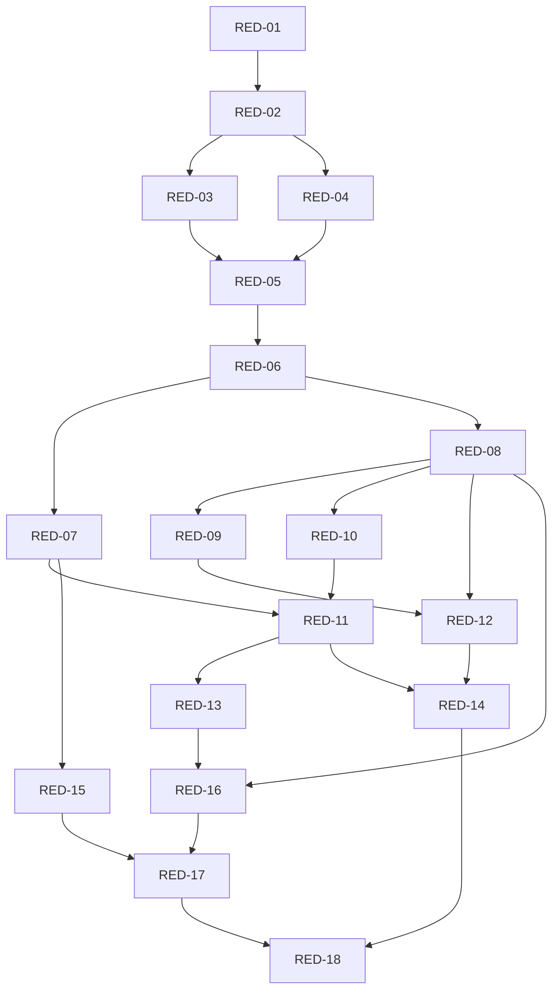

<!-- scope: adr/ADR-003 -->
# TASKS — ADR-003: Redação na origem e privacidade do texto de prompt/resposta

> Backlog TDD-ready derivado 1:1 da `SPEC.md` deste ADR (13 RF + 5 NFR = 18 tarefas). Teste escrito **antes** da implementação em toda tarefa. Nenhuma tarefa implementa contrato de spans (ADR-001), transporte OTLP/credencial (ADR-002), RBAC/retention (ADR-004) ou registro de métricas em Micrometer (ADR-005).
>
> **Atalhos de caminho:** `API` = `backend/assistant/api/src/main/java/br/com/systec/hive/assistant/api/diagnostics/` (somente leitura — inalterado) · `IMPL` = `backend/assistant/impl/src/main/java/br/com/systec/hive/assistant/impl/diagnostics/` · `TEST` = `backend/assistant/impl/src/test/java/br/com/systec/hive/assistant/impl/diagnostics/` · testes `IT` usam o mesmo diretório e `mvn -f backend/pom.xml -Pintegration verify`.
>
> **`SENSITIVE_FIXTURE`:** literal único reusado nos testes — `CPF 123.456.789-09; CNPJ 12.345.678/0001-90; CNPJ alfanumérico 12.ABC.345/01DE-35; email joao.silva@example.com; fone (11) 98765-4321; token sk-abcdef1234567890; senha=SuperSecret123`. Saída redigida esperada: `CPF [REDACTED:cpf]; CNPJ [REDACTED:cnpj]; CNPJ [REDACTED:cnpj]; email [REDACTED:email]; fone [REDACTED:phone]; token [REDACTED:secret]; senha [REDACTED:secret]`. O DV alfanumérico `35` é calculado pela tabela oficial (módulo 11, ASCII−48) — nunca aceitar regex só-números como prova.
>
> **Nomes de arquivo de implementação são propostos.** A emenda RED-01 registrou a decisão em 2026-11-25: regras próprias em JDK, **zero dependência nova**; CNPJ numérico e alfanumérico; `sk-` requisito local; entropia inferência sob teste. `RED-01` verifica o registro; nenhuma biblioteca/API de terceiro é nomeada aqui.

## 1. Traceability Context

- **Source:** `.spec/prd/telemetria-ia-langfuse/ADRs/ADR-003-redacao-origem/ADR.md` (decisão + Interface congelada) + `SPEC.md` (RF-01..RF-13, NFR-01..NFR-05).
- **Goal:** cobrir cada RF/NFR com 1 ticket atômico, rastreável, com teste antes do código e aceite executável (0 literal sensível no payload **protobuf decodificado**, 0 texto bruto em log).

## 2. Sprint Summary

| Phase | Task ID | RF/NFR | Type | Priority | Risk | Depends on | Status |
|---|---|---|---|---|---|---|---|
| 0 — Decisão do redator registrada | RED-01 | NFR-05 | documentação | P0 | Alto | — | Todo |
| 1 — Portador | RED-02 | RF-01 | instrumentação | P0 | Alto | RED-01 | Todo |
| 2 — PII | RED-03 | RF-04 | domínio | P0 | Alto | RED-02 | Todo |
| 3 — Segredos | RED-04 | RF-05 | domínio | P0 | Alto | RED-02 | Todo |
| 4 — Placeholder | RED-05 | RF-06 | contrato | P0 | Médio | RED-03, RED-04 | Todo |
| 5 — Pré-export | RED-06 | RF-02 | integração | P0 | Alto | RED-05 | Todo |
| 6 — Filho `generation` | RED-07 | RF-03 | mapeamento | P0 | Alto | RED-06 | Todo |
| 7 — Fail-closed | RED-08 | RF-07 | domínio | P0 | Alto | RED-06 | Todo |
| 8 — Métrica de falha | RED-09 | RF-09 | observabilidade | P1 | Médio | RED-08 | Todo |
| 9 — Superfícies | RED-10 | RF-08 | segurança | P0 | Alto | RED-08 | Todo |
| 10 — Canário protobuf | RED-11 | RF-10 | integração | P0 | Alto | RED-07, RED-10 | Todo |
| 11 — Canário falha | RED-12 | RF-11 | integração | P0 | Alto | RED-08, RED-09 | Todo |
| 12 — Sem EE/Collector | RED-13 | RF-12 | estático | P1 | Médio | RED-11 | Todo |
| 13 — Contrato do chat | RED-14 | RF-13 | qualidade | P0 | Alto | RED-11, RED-12 | Todo |
| 14 — Nomenclatura | RED-15 | NFR-01 | teste | P1 | Médio | RED-07 | Todo |
| 15 — Sem fail-open | RED-16 | NFR-02 | teste | P0 | Alto | RED-08, RED-13 | Todo |
| 16 — Rastreio | RED-17 | NFR-03 | documentação | P1 | Baixo | RED-14, RED-15, RED-16 | Todo |
| 17 — Não regressão | RED-18 | NFR-04 | qualidade | P0 | Alto | RED-14, RED-17 | Todo |

## 3. Dependency Graph

---

## 4. Task Backlog

### RED-01 — Registrar decisão do redator (emenda RED-01)

- **RF/NFR:** NFR-05 · **Prioridade:** P0 · **Risco:** Alto · **Tipo:** documentação · **Depende de:** — · **Dependency Type:** Hard · **Paralelizável:** Não
- **Arquivos:** `ADR.md` §"Emenda RED-01" e `SPEC.md` §12 (somente leitura/ajuste documental); `backend/pom.xml` (somente verificação de 0 diff).
- **Contexto/Impacto:** emenda RED-01 registra regras próprias em JDK (`Pattern.compile`/`Matcher.find` + dígitos verificadores), zero dependência nova, CNPJ numérico e alfanumérico, `sk-` requisito local e entropia inferência sob teste, com URL + data (2026-11-25). Nenhuma dependência entra sem nova emenda; `RED-03`/`RED-04` consomem a decisão registrada.
- **Teste primeiro:**
  - [x] `TEST/RedactorDecisionGateTest.java` (teste estático de documento): asserção de que `ADR.md` contém a emenda com URL + data e `SPEC.md` não nomeia biblioteca/SDK de máscara de terceiro; `git diff --name-only -- backend/pom.xml` ⇒ vazio.
  - [x] Nenhum código do redator antes do teste; entropia não é promovida a contrato.
- **Cenários:**
  - Sucesso: emenda rastreável com fontes datadas; 0 dependência nova; 0 assinatura de API de terceiro.
  - Falha: dependência adotada por palpite ou emenda ausente ⇒ teste estático quebra; volta ao `architect`.
  - Borda: regras próprias em Java também exigem registro — ausência de dependência não dispensa a emenda.
- **DoD:**
  - [x] Teste estático escrito antes de qualquer código do redator.
  - [x] 0 diff em `pom.xml`; 0 assinatura de API de terceiro nos artefatos deste ADR.
  - [x] Emenda registrada com URL + data 2026-11-25; entropia mantida como inferência.

### RED-02 — Portador de texto no callback do listener, fora da porta

- **RF/NFR:** RF-01 · **Prioridade:** P0 · **Risco:** Alto · **Tipo:** instrumentação · **Depende de:** RED-01 · **Dependency Type:** Hard · **Paralelizável:** Não
- **Arquivos:** `TEST/TextCarrierListenerTest.java` (novo), `IMPL/diagnostics/ProviderCallSpanListener.java` (escopo do ADR-001), `API/ChatTrace.java` e `API/ChatTraceRecorder.java` (inalterados).
- **Contexto/Impacto:** prompt/response capturados em `onRequest`/`onResponse` precisam de portador distinto de `ChatTrace`; a porta existente e o contrato do chat não mudam (RB2).
- **Teste primeiro:**
  - [x] `TEST/TextCarrierListenerTest.java`: callbacks com `SENSITIVE_FIXTURE` alimentam portador; `ChatTrace.class.getRecordComponents()` não contém `prompt`/`response`.
  - [x] `IMPL/diagnostics/ProviderCallSpanListener.java`: criar/extender o portador de texto no escopo de turno do ADR-001.
- **Cenários:**
  - Sucesso: 1 turno ⇒ 1 portador; `git diff --name-only -- backend/assistant/api/` vazio.
  - Falha: campo de texto adicionado ao `ChatTrace` ⇒ reflection quebra; reverter.
  - Borda: retry com 2 tentativas ⇒ 2 portadores distintos, sem mistura de texto entre tentativas.
- **DoD:**
  - [x] Teste escrito antes da implementação.
  - [x] `mvn -f backend/pom.xml test -Dtest=TextCarrierListenerTest` verde.
  - [x] 0 diff em `API/`.

### RED-03 — Regras obrigatórias de PII

- **RF/NFR:** RF-04 · **Prioridade:** P0 · **Risco:** Alto · **Tipo:** domínio · **Depende de:** RED-02 · **Dependency Type:** Hard · **Paralelizável:** Sim (após RED-02 e RED-01)
- **Arquivos:** `TEST/RedactionPolicyTest.java` (novo), `IMPL/diagnostics/RedactionPolicy.java` (novo; nome proposto).
- **Contexto/Impacto:** CPF, CNPJ, e-mail e telefone viram `[REDACTED:cpf|cnpj|email|phone]` antes de qualquer atributo. CNPJ cobre **numérico e alfanumérico** (`12.ABC.345/01DE-35`, DV calculado pela tabela oficial); regex só-números vazaria CNPJs emitidos desde jul/2026. Ordem de aplicação é risco de falso positivo (telefone dentro de CPF).
- **Teste primeiro:**
  - [x] `TEST/RedactionPolicyTest.java` com `SENSITIVE_FIXTURE`: asserção exata da saída redigida dos 4 tipos de PII, incluindo os **dois CNPJs** (`12.345.678/0001-90` e `12.ABC.345/01DE-35`); nenhum literal original sobrevive.
  - [x] `IMPL/diagnostics/RedactionPolicy.java`: implementar as 4 regras em JDK conforme emenda RED-01 (dígitos verificadores próprios).
- **Cenários:**
  - Sucesso: 4 placeholders corretos, 0 literal de PII na saída; CNPJ alfanumérico válido é redigido.
  - Falha: CPF/CNPJ parcialmente redigido ou alfanumérico não reconhecido ⇒ teste quebra; corrigir regra, nunca baixar a asserção.
  - Borda: e-mail e telefone na mesma frase; CPF com pontuação e sem pontuação; CNPJ numérico e alfanumérico na mesma frase ⇒ todos redigidos.
- **DoD:**
  - [x] Teste escrito antes da implementação.
  - [x] 0 `123.456.789-09`, `12.345.678/0001-90`, `12.ABC.345/01DE-35`, `joao.silva@example.com`, `(11) 98765-4321` na saída do teste.
  - [x] Nenhuma biblioteca de máscara introduzida; 0 diff em `pom.xml` (emenda RED-01).

### RED-04 — Regras obrigatórias de segredos

- **RF/NFR:** RF-05 · **Prioridade:** P0 · **Risco:** Alto · **Tipo:** domínio · **Depende de:** RED-02 · **Dependency Type:** Hard · **Paralelizável:** Sim (após RED-02 e RED-01)
- **Arquivos:** `TEST/RedactionPolicyTest.java` (caso `secret`), `IMPL/diagnostics/RedactionPolicy.java`.
- **Contexto/Impacto:** tokens, senhas e chaves de API — incluindo `sk-` — viram `[REDACTED:secret]`; `sk-` em log/payload é violação explícita do canário (PRD §9). `sk-` é **requisito local** (sem fonte externa); fallback por **entropia é inferência** — não implementar como contrato.
- **Teste primeiro:**
  - [x] `TEST/RedactionPolicyTest.java`: `sk-abcdef1234567890` e `senha=SuperSecret123` ⇒ `[REDACTED:secret]`; 0 `sk-` na saída.
  - [x] `IMPL/diagnostics/RedactionPolicy.java`: adicionar regra `secret` antes das demais quando houver sobreposição.
  - [x] Entropia só se teste dedicado demonstrar necessidade: nesse caso, registrar como inferência validada em **nova emenda** — nunca como contrato desta task.
- **Cenários:**
  - Sucesso: 2 ocorrências viram `[REDACTED:secret]`; `sk-` mantido como literal obrigatório do fixture.
  - Falha: token com prefixo `sk-` escapa ⇒ teste quebra; nunca mascarar só parte do literal.
  - Borda: chave de API em atribuição `key=...` e senha em texto corrido ⇒ ambas redigidas; token sem prefixo conhecido não é redigido por entropia nesta fatia.
- **DoD:**
  - [x] Teste escrito antes da implementação.
  - [x] `grep -c 'sk-' <saída do teste>` ⇒ 0.
  - [x] Regra `secret` no conjunto fechado de `RED-05`; 0 regra de entropia no contrato.

### RED-05 — Placeholder de conjunto fechado

- **RF/NFR:** RF-06 · **Prioridade:** P0 · **Risco:** Médio · **Tipo:** contrato · **Depende de:** RED-03, RED-04 · **Dependency Type:** Hard · **Paralelizável:** Não
- **Arquivos:** `TEST/PlaceholderContractTest.java` (novo), `IMPL/diagnostics/RedactionPolicy.java`.
- **Contexto/Impacto:** nenhum outro placeholder é aceito downstream; `***`, `[MASKED]`, `<redacted>` e variações são proibidos (ADR Interface congelada).
- **Teste primeiro:**
  - [x] `TEST/PlaceholderContractTest.java`: para cada regra obrigatória, placeholder exato; conjunto de saída ⊆ `{[REDACTED:cpf],[REDACTED:cnpj],[REDACTED:email],[REDACTED:phone],[REDACTED:secret]}`.
  - [x] `IMPL/diagnostics/RedactionPolicy.java`: centralizar a construção do placeholder; 0 formato alternativo.
- **Cenários:**
  - Sucesso: 5 placeholders exatos.
  - Falha: placeholder genérico `[REDACTED]` sem `<rule>` ⇒ teste quebra.
  - Borda: regra desconhecida ⇒ falha fechada (`RED-08`), nunca placeholder novo.
- **DoD:**
  - [x] Teste escrito antes da implementação.
  - [x] 0 placeholder fora do conjunto na suíte.
  - [x] Nomenclatura idêntica à Interface congelada.

### RED-06 — Redação antes da serialização OTLP

- **RF/NFR:** RF-02 · **Prioridade:** P0 · **Risco:** Alto · **Tipo:** integração · **Depende de:** RED-05 · **Dependency Type:** Hard · **Paralelizável:** Não
- **Arquivos:** `TEST/RedactionBeforeExportTest.java` (novo), `IMPL/diagnostics/ProviderCallSpanListener.java`, `IMPL/diagnostics/TextRedactor.java` (novo; nome proposto).
- **Contexto/Impacto:** o texto entra no portador já redigido; o exporter do ADR-002 recebe spans prontos. Esta é a barreira que torna RF3 verificável independentemente de licença EE.
- **Teste primeiro:**
  - [x] `TEST/RedactionBeforeExportTest.java`: capturar o objeto entregue ao exporter ⇒ 0 literal do `SENSITIVE_FIXTURE`, apenas placeholders.
  - [x] `IMPL/diagnostics/TextRedactor.java`: orquestrar callback → redator → portador, antes de qualquer serialização.
- **Cenários:**
  - Sucesso: exporter vê texto redigido.
  - Falha: redator aplicado depois de popular o atributo ⇒ teste acusa literal no objeto exportado.
  - Borda: resposta vazia/nula ⇒ nenhuma chave de texto inventada; metadados permanecem.
- **DoD:**
  - [x] Teste escrito antes da implementação.
  - [x] `mvn -f backend/pom.xml test -Dtest=RedactionBeforeExportTest` verde.
  - [x] 0 código de serialização OTLP nesta tarefa (ADR-002).

### RED-07 — Anexar texto somente ao filho `generation`

- **RF/NFR:** RF-03 · **Prioridade:** P0 · **Risco:** Alto · **Tipo:** mapeamento · **Depende de:** RED-06 · **Dependency Type:** Hard · **Paralelizável:** Não
- **Arquivos:** `TEST/GenerationChildTextIT.java` (novo), `IMPL/diagnostics/ProviderCallSpanListener.java`.
- **Contexto/Impacto:** `langfuse.observation.input`/`output` apenas na tentativa ao provider; root sem texto (menor superfície e payload).
- **Teste primeiro:**
  - [x] `TEST/GenerationChildTextIT.java`: varrer payload protobuf decodificado (`ExportTraceServiceRequest`/`resourceSpans`) ⇒ filho `type=generation` com ambas as chaves; root `chat.turn` sem ambas; `count(chaves de texto no root)==0`.
  - [x] `IMPL/diagnostics/ProviderCallSpanListener.java`: preencher as chaves no filho, nunca no root.
- **Cenários:**
  - Sucesso: 1 filho com `input`/`output`, root limpo.
  - Falha: atributo replicado no root ⇒ teste quebra; remover replicação.
  - Borda: 2 tentativas ⇒ cada filho com seu próprio texto redigido; nenhum vazamento entre eles.
- **DoD:**
  - [x] Teste escrito antes da implementação.
  - [x] `mvn -f backend/pom.xml -Pintegration verify -Dtest=GenerationChildTextIT` verde.
  - [x] Root sem chaves de texto em sucesso e em falha.

### RED-08 — Fail-closed atômico com metadados preservados

- **RF/NFR:** RF-07 · **Prioridade:** P0 · **Risco:** Alto · **Tipo:** domínio · **Depende de:** RED-06 · **Dependency Type:** Hard · **Paralelizável:** Não
- **Arquivos:** `TEST/FailClosedRedactorTest.java` (novo), `IMPL/diagnostics/TextRedactor.java`.
- **Contexto/Impacto:** exceção, timeout/expiração, indisponibilidade ou política incompleta ⇒ omitir **ambas** as chaves; metadados (`provider`, `model`, `usage_details`, `attempt`, `level`) permanecem; texto bruto nunca vira erro nem log.
- **Teste primeiro:**
  - [x] `TEST/FailClosedRedactorTest.java`: 3 modos forçados (lança, expira, política incompleta) ⇒ `input` e `output` ausentes; metadados presentes; 0 literal no log capturado.
  - [x] `IMPL/diagnostics/TextRedactor.java`: tratar toda falha como omissão do par, sem propagar exceção ao fluxo de chat.
- **Cenários:**
  - Sucesso: span útil com metadados e sem texto.
  - Falha: só `output` omitido ⇒ teste quebra (omissão deve ser atômica).
  - Borda: redator lança depois de já ter redigido `input` ⇒ descartar também o `input`.
- **DoD:**
  - [x] Teste escrito antes da implementação.
  - [x] `mvn -f backend/pom.xml test -Dtest=FailClosedRedactorTest` verde nos 3 modos.
  - [x] 0 exceção de redação na resposta do chat.

### RED-09 — Contador `chat.telemetry.redaction.failures.total`

- **RF/NFR:** RF-09 · **Prioridade:** P1 · **Risco:** Médio · **Tipo:** observabilidade · **Depende de:** RED-08 · **Dependency Type:** Hard · **Paralelizável:** Sim (após RED-08)
- **Arquivos:** `TEST/RedactionFailureMetricTest.java` (novo), `IMPL/diagnostics/TextRedactor.java`.
- **Contexto/Impacto:** 1 incremento por evento fail-closed; nome congelado no ADR. Registro/exportação em Micrometer pertence ao ADR-005 — aqui só a emissão do incremento, sem rótulo com texto.
- **Teste primeiro:**
  - [x] `TEST/RedactionFailureMetricTest.java`: 1 falha forçada ⇒ +1 no registry; 2 falhas ⇒ +2; rótulos sem `SENSITIVE_FIXTURE`.
  - [x] `IMPL/diagnostics/TextRedactor.java`: incrementar no ramo fail-closed.
- **Cenários:**
  - Sucesso: contador bate com número de eventos fail-closed.
  - Falha: decremento ou incremento em sucesso ⇒ teste quebra.
  - Borda: falha em 2 turnos distintos não se sobrescreve.
- **DoD:**
  - [x] Teste escrito antes da implementação.
  - [x] Nome exato `chat.telemetry.redaction.failures.total`.
  - [x] Nenhuma métrica OTLP introduzida (ADR-002/ADR-005).

### RED-10 — Nenhuma superfície para texto bruto

- **RF/NFR:** RF-08 · **Prioridade:** P0 · **Risco:** Alto · **Tipo:** segurança · **Depende de:** RED-08 · **Dependency Type:** Hard · **Paralelizável:** Sim (após RED-08)
- **Arquivos:** `TEST/NoRawTextSurfaceTest.java` (novo), `IMPL/diagnostics/TextRedactor.java`, `IMPL/diagnostics/ProviderCallSpanListener.java`.
- **Contexto/Impacto:** `ChatTrace`, log, rótulo de métrica, mensagem de erro e qualquer atributo OTLP fora do par redigido devem estar limpos; 0 `sk-` em log/payload. Payload é protobuf — inspeção só após decode (ou via Observations API v2), nunca `grep` em binário.
- **Teste primeiro:**
  - [x] `TEST/NoRawTextSurfaceTest.java`: capturar `$LOG` e `$PAYLOAD`; `grep -RInF 'sk-abcdef1234567890' $LOG` ⇒ 0; decodificar o protobuf e afirmar 0 literal nos atributos; nenhuma chave de texto fora do par.
  - [x] Ajustar apenas o que o teste acusar; nunca interpolação de mensagem de exceção no log.
- **Cenários:**
  - Sucesso: 0 literal em todas as superfícies.
  - Falha: `status_message` com mensagem do provider contendo o prompt ⇒ quebrar teste, classificar sem texto.
  - Borda: fail-closed com exceção cuja mensagem contém `sk-` ⇒ loga só classificação, nunca a mensagem.
- **DoD:**
  - [x] Teste escrito antes de qualquer ajuste.
  - [x] `grep -RInF 'sk-abcdef1234567890' $LOG` ⇒ 0 linhas; 0 literal nos atributos do payload protobuf decodificado.
  - [x] 0 atributo de texto novo fora do par congelado.

### RED-11 — Canário de redação sobre payload protobuf decodificado

- **RF/NFR:** RF-10 · **Prioridade:** P0 · **Risco:** Alto · **Tipo:** integração · **Depende de:** RED-07, RED-10 · **Dependency Type:** Hard · **Paralelizável:** Não
- **Arquivos:** `TEST/RedactionCanaryIT.java` (novo), captura do payload OTLP protobuf (fixture de teste). Nenhum código de decode em produção — a inspeção é responsabilidade do teste.
- **Contexto/Impacto:** prova de RF3 ponta a ponta — do callback do listener ao payload OTLP protobuf e ao trace na Observations API v2. ADR-002 congelou `Content-Type: application/x-protobuf` (SDK Java não emite `http/json`); o canário **não lê JSON cru**: decodifica `ExportTraceServiceRequest`/`resourceSpans` **ou** valida pela Observations API v2. ITs exigem `HIVE_TELEMETRY_ENABLED=true` (default `false`, opt-in — ADR-002).
- **Teste primeiro:**
  - [x] `TEST/RedactionCanaryIT.java` com `HIVE_TELEMETRY_ENABLED=true`: provider fake devolve `SENSITIVE_FIXTURE`; capturar o request e afirmar `Content-Type: application/x-protobuf`.
  - [x] No mesmo teste: **opção 1** — decodificar o corpo protobuf (`ExportTraceServiceRequest`/`resourceSpans`) e varrer os atributos ⇒ 0 literal do fixture; **opção 2** — consultar a Observations API v2 e afirmar só `[REDACTED:...]`. Uma das duas é suficiente; ambas proibem leitura de JSON cru.
  - [x] `grep -RInF 'sk-abcdef1234567890' $LOG` ⇒ 0 linhas.
  - [x] Corrigir apenas a etapa que o canário acusar; nenhuma dependência de licença EE e nenhuma troca de encoding no ADR-003.
- **Cenários:**
  - Sucesso: payload protobuf decodificado (ou trace via API v2) com placeholders, log limpo.
  - Falha: literal nos atributos decodificados ⇒ parar, corrigir a causa raiz na redação, re-rodar canário; nunca trocar protobuf por JSON para facilitar o teste.
  - Borda: texto com todos os 6 literais na mesma mensagem ⇒ todos redigidos, nenhum parcial; flag desligada (`false`) ⇒ nenhum payload para inspecionar e o teste deve falhar explicitamente, não passar por vacuidade.
- **DoD:**
  - [x] Teste escrito antes de qualquer ajuste de redação.
  - [x] `mvn -f backend/pom.xml -Pintegration verify -Dtest=RedactionCanaryIT` verde com `HIVE_TELEMETRY_ENABLED=true`.
  - [x] 0 literal do fixture nos atributos decodificados ou 0 texto bruto na Observations API v2; 0 `sk-` em `$LOG`.
  - [x] Nenhuma asserção do teste depende de payload JSON.

### RED-12 — Canário com redator forçado a falhar

- **RF/NFR:** RF-11 · **Prioridade:** P0 · **Risco:** Alto · **Tipo:** integração · **Depende de:** RED-08, RED-09 · **Dependency Type:** Hard · **Paralelizável:** Não
- **Arquivos:** `TEST/ForcedRedactorFailureIT.java` (novo), `IMPL/diagnostics/TextRedactor.java` (hook de falha apenas em teste).
- **Contexto/Impacto:** prova de RF4 — o span existe com metadados úteis e sem input/output; é o critério que separa esta decisão do masking EE fail-open. Verificação no payload protobuf decodificado ou via Observations API v2; nunca JSON cru.
- **Teste primeiro:**
  - [x] `TEST/ForcedRedactorFailureIT.java` com `HIVE_TELEMETRY_ENABLED=true`: redator forçado a falhar ⇒ no payload protobuf decodificado (ou na Observations API v2) o filho tem `provider`/`model`/usage/`attempt`/`level`, sem `langfuse.observation.input`/`output`; 0 texto bruto; contador +1.
  - [x] Ajustar o ramo fail-closed somente após o teste existir.
- **Cenários:**
  - Sucesso: span diagnósticável sem texto.
  - Falha: span vazio (metadados perdidos) ⇒ corrigir; fail-closed não é "descartar o span".
  - Borda: falha apenas no `output` ⇒ ambas as chaves ausentes (atomicidade).
- **DoD:**
  - [x] Teste escrito antes de qualquer ajuste.
  - [x] `mvn -f backend/pom.xml -Pintegration verify -Dtest=ForcedRedactorFailureIT` verde.
  - [x] Resposta do chat permanece 200.

### RED-13 — Nenhum masking EE/Collector nesta fatia

- **RF/NFR:** RF-12 · **Prioridade:** P1 · **Risco:** Médio · **Tipo:** estático · **Depende de:** RED-11 · **Dependency Type:** Soft · **Paralelizável:** Sim (após RED-11)
- **Arquivos:** nenhum de produto; varredura estática de `backend/`.
- **Contexto/Impacto:** Community congelado; masking EE exige licença e tem default fail-open; masking no Collector ocorre depois de o dado sair da aplicação. Defesa em profundidade fica para decisão posterior.
- **Teste primeiro:**
  - [x] `TEST/NoServerSideMaskingTest.java`: `grep -RIn 'LANGFUSE_INGESTION_MASKING_CALLBACK_FAIL_CLOSED\|mask_otel_spans\|LangfuseSpanProcessor\|opentelemetry-collector' backend/` ⇒ 0 ocorrências.
  - [x] Nenhuma implementação; se o grep acusar, remover configuração/componente.
- **Cenários:**
  - Sucesso: 0 config de masking fora da origem.
  - Falha: flag EE adicionada "por segurança" ⇒ remover; volta ao `architect` se desejar licença.
  - Borda: documentação pode mencionar EE como alternativa descartada; código/config não.
- **DoD:**
  - [x] Teste estático escrito antes de qualquer ajuste.
  - [x] 0 dependência/licença EE introduzida nesta fatia.

### RED-14 — Contrato público do chat inalterado

- **RF/NFR:** RF-13 · **Prioridade:** P0 · **Risco:** Alto · **Tipo:** qualidade · **Depende de:** RED-11, RED-12 · **Dependency Type:** Hard · **Paralelizável:** Não
- **Arquivos:** `TEST/ChatContractWithRedactionTest.java` (novo).
- **Contexto/Impacto:** telemetria — inclusive redator falhando — não pode alterar resposta, cota, limites, IDs ou headers (RB2/RF9).
- **Teste primeiro:**
  - [x] `TEST/ChatContractWithRedactionTest.java`: characterização da resposta com redator ativo, com redator forçado a falhar e sem telemetria ⇒ status, corpo, cota, `turnId`/`clientId` e headers idênticos.
  - [x] Corrigir somente o que o teste acusar; nenhuma mudança de contrato.
- **Cenários:**
  - Sucesso: respostas idênticas nos 3 modos.
  - Falha: exceção do redator vaza 500 ⇒ corrigir limite de responsabilidade.
  - Borda: texto vazio no prompt ⇒ resposta normal, sem chave de texto inventada.
- **DoD:**
  - [x] Teste escrito antes de qualquer ajuste de fluxo de chat.
  - [x] `mvn -f backend/pom.xml -Pintegration verify -Dtest=ChatContractWithRedactionTest` verde.
  - [x] 0 diff em contrato/cota/limites/autenticação.

### RED-15 — Characterização da nomenclatura congelada

- **RF/NFR:** NFR-01 · **Prioridade:** P1 · **Risco:** Médio · **Tipo:** teste · **Depende de:** RED-07 · **Dependency Type:** Soft · **Paralelizável:** Sim (após RED-07)
- **Arquivos:** `TEST/FrozenRedactionNamingTest.java` (novo).
- **Contexto/Impacto:** congela chaves e placeholder para os ADRs downstream; rename eventual exige novo ADR.
- **Teste primeiro:**
  - [x] `TEST/FrozenRedactionNamingTest.java`: payload protobuf decodificado (ou Observations API v2) ⇒ chaves exatas `langfuse.observation.input`/`output`, somente no filho; placeholders exatamente os 5 da Interface congelada.
  - [x] Nenhuma implementação nova; divergência corrige o mapper para o nome congelado.
- **Cenários:**
  - Sucesso: 2 chaves exatas, 5 placeholders exatos.
  - Falha: `input` renomeado para `prompt` ⇒ teste quebra.
  - Borda: chave opcional ausente (fail-closed) não conta como rename.
- **DoD:**
  - [x] Teste escrito antes de qualquer ajuste.
  - [x] 0 chave `langfuse.observation.*` fora da tabela do ADR.

### RED-16 — Ausência de fail-open por configuração

- **RF/NFR:** NFR-02 · **Prioridade:** P0 · **Risco:** Alto · **Tipo:** teste · **Depende de:** RED-08, RED-13 · **Dependency Type:** Hard · **Paralelizável:** Não
- **Arquivos:** `TEST/FailOpenConfigAbsenceTest.java` (novo), `IMPL/diagnostics/TextRedactor.java`.
- **Contexto/Impacto:** fail-closed é por construção; nenhuma env/var pode fazer o redator enviar o original quando falha. O default fail-open do mecanismo EE é o motivo do descarte.
- **Teste primeiro:**
  - [x] `TEST/FailOpenConfigAbsenceTest.java`: foreach de flag de config plausível no ambiente de teste ⇒ redator forçado a falhar ainda omite texto; `grep -RIn 'fail.open\|FAIL_OPEN' backend/assistant/` ⇒ 0.
  - [x] Nenhuma implementação de fallback; se o teste acusar caminho de envio do original, removê-lo.
- **Cenários:**
  - Sucesso: 0 config altera o comportamento fail-closed.
  - Falha: variável "redaction.best.effort" desliga a omissão ⇒ remover.
  - Borda: redator indisponível (não apenas exceção) ⇒ mesma omissão.
- **DoD:**
  - [x] Teste escrito antes de qualquer ajuste.
  - [x] 0 flag fail-open; 0 caminho que envia texto original.

### RED-17 — Auditar rastreabilidade e fontes

- **RF/NFR:** NFR-03 · **Prioridade:** P1 · **Risco:** Baixo · **Tipo:** documentação · **Depende de:** RED-14, RED-15, RED-16 · **Dependency Type:** Soft · **Paralelizável:** Não
- **Arquivos:** `SPEC.md` e `TASKS.md` deste diretório (somente leitura/ajuste documental).
- **Contexto/Impacto:** garante 1:1 entre os 18 requisitos da SPEC e as 18 seções, sem órfãos, com fonte de terceiro datada.
- **Teste primeiro:**
  - [x] Auditoria determinística: `grep -c '^### RED-' TASKS.md` ⇒ 18; comparar com RF-01..RF-13 + NFR-01..NFR-05; 0 órfão.
  - [x] Nenhuma implementação; corrigir documentação se houver divergência.
- **Cenários:**
  - Sucesso: 18 seções ↔ 18 requisitos; URL de terceiro com data (2026-11-25).
  - Falha: task sem RF/NFR ou RF/NFR sem task ⇒ corrigir antes do `VERIFY.md`.
  - Borda: nenhuma macro-tarefa inventada; marcador `<!-- scope: adr/ADR-003 -->` na 1ª linha.
- **DoD:**
  - [x] Auditoria executada antes do fechamento do ADR.
  - [x] 0 órfãos; 0 referência a task inexistente.
  - [x] Nenhum artefato fora de `.spec/prd/telemetria-ia-langfuse/ADRs/ADR-003-redacao-origem/`.

### RED-18 — Não regressão e suíte completa

- **RF/NFR:** NFR-04 · **Prioridade:** P0 · **Risco:** Alto · **Tipo:** qualidade · **Depende de:** RED-14, RED-17 · **Dependency Type:** Hard · **Paralelizável:** Não
- **Arquivos:** nenhum de produto neste passo; `npm test` + `git diff --name-only`.
- **Contexto/Impacto:** H1/H2/H6 — suíte cheia 0 falhas, 0 diff em arquivos proibidos; frontend N/A (nenhuma UI nova).
- **Teste primeiro:**
  - [x] Rodar `npm test` (suiteFull) + `mvn -f backend/pom.xml test` + `mvn -f backend/pom.xml -Pintegration verify`; capturar contagem de falhas antes do review.
  - [x] Corrigir somente o que a suíte acusar; nenhuma mudança de contrato.
- **Cenários:**
  - Sucesso: 0 falhas, 0 erros, 0 skips não autorizados; `git diff --name-only` sem `ChatTrace.java`/`ChatTraceRecorder.java`/cota/RBAC/autenticação.
  - Falha: qualquer falha pré-existente ⇒ parar, reportar, causa raiz, corrigir, re-rodar tudo (H1/H2).
  - Borda: nenhuma UI nova ⇒ H3/frontend N/A, sem evidência de front exigida.
- **DoD:**
  - [x] Suíte executada antes do fechamento; 0 falhas.
  - [x] 0 diff em arquivos proibidos.
  - [x] `VERIFY.md` (pós-merge, fora deste subagent) herda estas evidências.

---

## 5. Coverage Validation

- [x] 18 tasks RED-01..RED-18 ↔ 18 RF/NFR da SPEC (13 RF + 5 NFR), 1:1 sem órfão.
- [x] Interface congelada coberta: atributos só no filho, placeholder fechado, 7 regras obrigatórias, fail-closed atômico, superfícies proibidas, métrica de falha, root limpo.
- [x] Toda task tem cenário de Sucesso, Falha e Borda/Idempotência.
- [x] Toda task lista arquivo de teste antes do arquivo de implementação.
- [x] Grafo Mermaid sem ciclo e sem órfã (RED-01 é raiz; RED-18 é folha).
- [x] Sprint Summary 1:1 com as 18 seções (sem ID órfão na tabela).
- [x] `SENSITIVE_FIXTURE` com literal sensível aparece nos testes de redação (RED-03/04/10/11) e o redator forçado a falhar em RED-08/12/16.
- [x] Aceites executáveis: 0 literal no payload OTLP **protobuf decodificado** ou na Observations API v2 (RED-11), 0 texto bruto em log (RED-10); nenhuma asserção exige JSON cru.
- [x] Nenhuma macro-tarefa inventada fora da SPEC.
- [x] Nenhuma biblioteca/API de máscara de terceiro nomeada; emenda RED-01 registrada com URL + data e 0 diff em `pom.xml`.
- [x] `SENSITIVE_FIXTURE` cobre CNPJ numérico e alfanumérico (RED-03); `sk-` mantido e entropia fora do contrato (RED-04).
- [x] Nenhuma task introduz decisão de ADR-001/002/004/005.

## 6. Plan Feedback (não bloqueante para este ADR)

- **Decisão registrada:** `RED-01` verifica a emenda RED-01 (URL + data, 2026-11-25) — regras próprias em JDK, CNPJ alfanumérico, `sk-` local, entropia inferência; nenhuma dependência adicionada por este backlog.
- **Entropia:** se um teste dedicado demonstrar necessidade, vira contrato só com nova emenda; até lá RED-04 a mantém fora da regra `secret`.
- **Portador de texto ≠ `ChatTrace`:** `RED-02` usa o escopo de turno do ADR-001; `ChatTrace` permanece textualmente limpo (`ChatTrace.java:15`, RB1).
- **Métrica só referenciada:** `RED-09` emite o incremento de `chat.telemetry.redaction.failures.total`; registro/exportação em Micrometer é do ADR-005, sem OTLP metrics (ADR-002).
- **Canário é a prova:** `RED-11`/`RED-12` transformam RF3/RF4 em evidência sobre protobuf decodificado ou Observations API v2; se falharem, a correção é na redação, nunca em licença EE, Collector ou troca de encoding para JSON (ADR-002 congela `application/x-protobuf`).
- **`VERIFY.md` não nasce aqui:** pós-merge, fora do escopo md-only deste subagent.

## 7. Score do portão (tasks-gate)

Itens de `.agents/skills/sdd-compiler/asserts/tasks-gate.md` (9 itens):

| # | Item | Resultado |
|---|---|---|
| 1 | Traceability 1:1 (todos os IDs da SPEC presentes) | ✅ 18 RF/NFR ↔ 18 seções |
| 2 | Metadata Enrichment (prioridade, risco, tipo, dependência) | ✅ em toda task |
| 3 | Layer-to-Folder Mapping | ✅ `API`/`IMPL`/`TEST` declarados; `api` inalterada |
| 4 | BDD Scenarios (sucesso, falha, borda) | ✅ em toda task |
| 5 | TDD Order (teste antes da implementação) | ✅ em toda task |
| 6 | Granularidade (<2h) | ✅ tickets atômicos por requisito |
| 7 | Mermaid Graph sem ciclo/órfã | ✅ `RED-01` raiz, `RED-18` folha |
| 8 | Consistency Check (sem macro-tarefa inventada) | ✅ nenhuma fora da SPEC |
| 9 | DoD Per Task | ✅ em toda task |

`score = 9/9 = 100%`. Gaps `🔴`/`🟠`: nenhum.
