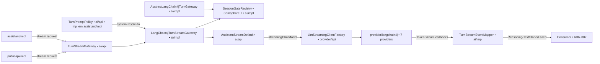

# ADR-001 — Provider de streaming e gateway de turno com thinking em `ai`

> Unidade de decisão: 1 ADR = 1 branch = 1 PR (merge humano). Este lote é **decision-only**: `status: todo`, `unit: legacy`; SPEC/TASKS nascem só no ciclo aprovado. Nenhum código, pom ou teste é criado aqui.
> Insumo: `PRD.md` §16 (`prd_version: 2`, aprovado em 2026-11-26), `RESEARCH.md` (S1..S16), parecer `product-manager` 2026-11-26 (Q1–Q3; Q4/Q5 ficaram com o architect).
> **Emenda 1 (2026-11-26)** — security review P1: achado F3 🟠, `passed_with_findings`, zero 🔴. Corrige D7/§6: cancel degradado **não** libera o gate; o restante do ADR permanece inalterado.
> **Emenda 2 (2026-11-27)** — code review `ses_de2f27ae5ffet5zG6pjzCIg7BZ` (2 🔴): CR-01 distingue cancel **suportado** (liberação imediata) de **degradado** (retenção até terminal/janela) — **não revoga a Emenda 1**; AT-02 resolve a paridade do prompt com porta em `ai/api` e política injetada pelo assistant. Reabre somente este ADR.md.

## 1. Decisão

| # | Decisão (inequívoca) |
|---|---|
| D1 | **Cliente de streaming por provider**: novo `LlmStreamingClientFactory<T> extends LlmClientFactory<T>` em `provider/api`, com `createStreamingClient(...)` assinatura espelho de `createClient(...)` (`backend/provider/api/.../LlmClientFactory.java:15`). Implementação em `provider/langchain4j` cobre os **7** `AiProvider`; thinking habilitado por provider: OpenAI `returnThinking(true)` + `sendThinking(true)` + `thinkingFieldName("reasoning_content")`, Anthropic `thinkingType`/`thinkingBudgetTokens`, Ollama `think(true)`, Gemini **`returnThinking(true)` apenas** (sem `thinkingConfig` confirmado na tag → degradação silenciosa); os demais providers sem knob conhecido seguem o padrão da biblioteca. |
| D2 | **Proxy de streaming em `ai/api`**: `AssistantStreamDefault`, mesmo `@SystemMessage("{{system}}")`/`@UserMessage("{{user}}")` no método e mesmo `@MemoryId = sessionId (UUID)` de `AssistantDefault` (`backend/ai/api/.../AssistantDefault.java:54-58`), com retorno `TokenStream` no lugar de `Result<String>`. Construído por `AiServices.builder(AssistantStreamDefault.class).streamingChatModel(...)` — **exclusivo** com `.chatModel(...)`. |
| D3 | **Mapper de callbacks tipados (B1)**: `onPartialThinking(PartialThinking)` → `Reasoning`, `onPartialResponse(String)` → `Text`, `onCompleteResponse(ChatResponse)` → `Done(finishReason, tokenUsage)`, `onError(Throwable)` → `Failed`. **Nenhum** parse de wire, nenhum `onUnmappedRawEvent`, nenhuma heurística sobre `content`. Tipos de evento em `ai/api`, serialização nos endpoints (ADR-002). |
| D4 | **Retry pré-primeiro-token (C1)**: reutilizar `LlmRetryPolicy` (`provider/langchain4j`); uma tentativa = registrar callbacks + `start()`. `onError`/falha síncrona de `start()` **antes** de qualquer `Reasoning`/`Text` → nova tentativa (nada foi ao cliente). Depois do primeiro token → **sem retry**: `Failed` + terminal. `TenantContext`/usuário/`turnId` capturados **antes** de `start()` (`ScopedValue` não propaga). Limite por cliente: 120 s. |
| D5 | **Porta de turno destacada**: `TurnStreamGateway.stream(TurnRequest, Consumer<TurnStreamEvent>): StreamingTurnHandle`; `ChatTurnGateway.execute(TurnRequest)` permanece com 1 método e 2 chamadores (ADR-021 §6.1 intacto). `StreamingTurnHandle.cancel()` é idempotente e é o único ponto que o transporte chama no disconnect. |
| D6 | **Concorrência (Q5)**: **rejeitar a mitigação `ReentrantLock` do PRD §10**. Adotar `SessionGateRegistry` em `ai/impl`: um `Semaphore(1, true)` por `@MemoryId`, adquirido **antes de `start()`** e liberado uma única vez no **terminal do provider** (`Done`/`Failed`) ou, no **cancel suportado**, imediatamente dentro de `cancel()` (D9/Emenda 2) — no cancel **degradado**, reter até terminal natural ou janela de 5 s (D7). `gateReleased` CAS absorve qualquer terminal tardio. O caminho síncrono troca `synchronized(lockFor(...))` (`backend/assistant/impl/.../AssistantTurnGateway.java:156`; `AbstractLangChain4jTurnGateway.java:75-77`) pelo **mesmo** semáforo. Ver §5. |
| D7 | **R1 (cancelamento degradado — emenda 1)**: `cancel()` chama `PartialResponseContext.streamingHandle().cancel()`; `UnsupportedFeatureException` é capturada e **nunca propagada ao cliente**: sem evento `Failed`, emitter fechado pelo transporte e sink silenciado, contador `stream.cancel.unsupported` sem conteúdo. Como `isCancelled() == false` (S6), o provider continua gerando: **o gate NÃO é liberado aqui**. Liberação só no terminal natural do provider ou, se ele não chegar, em janela curta explícita de `5_000 ms` (≤120 s), o que vier primeiro; `AtomicBoolean` dedicado guarda a idempotência do `release()`. Ver §6. |
| D8 (fechamento P2) | **RF-10 — (a) aceitar como extensão compatível**: acrescentar `default createStreamingClientWithSession(...)` em `LlmStreamingClientFactory`, espelho de `LlmClientFactory.createClientWithSession(...)` (`backend/provider/api/.../LlmClientFactory.java:23-26`). **Assinatura existente `createStreamingClient(...)` permanece intacta**; o `default` é aditivo e não exige emenda da interface congelada. Implementação em `provider/langchain4j` faz override para aplicar `opencodeHeaders(sessionId)`/guards (F4 🟡). Ver §4.1. |
| D9 (emenda 2 / CR-01 🔴) | **Cancel suportado**: se `streamingHandle().cancel()` retorna sem `UnsupportedFeatureException`, chamar `releaseGateOnce()` **imediatamente**. A biblioteca 1.19.0 **não** dispara `onCompleteResponse`/`onError` quando `isCancelled() == true` (S24); sem isso o semáforo fica em 0 e a sessão trava. **Compatível com a Emenda 1/F3**, que tratou somente o ramo degradado (`isCancelled() == false`, gate retido até terminal/janela de 5 s). CAS torna ambos os ramos idempotentes. Ver §6. |
| D10 (emenda 2 / AT-02 🔴) | **Paridade system/user (RF-02)**: adotar **(b) porta em `ai/api` com política injetada pelo assistant**. Nova `TurnPromptPolicy` em `ai/api`; implementação em `assistant/impl` reaproveita a regra existente `systemFor` e a constante `PROMPT` — **sem duplicar texto de prompt** e sem mover política para `ai/**`. `ai/**` continua folha; nenhuma aresta nova `impl → impl`. `TurnRequest` **não** muda. Ver §4.2. |

## 2. Motivo

- Hoje `ChatModel` + `Result<String>` descarta thinking e `PublicChatServiceImpl:71-225` rejeita `stream=true`. O mapper tipado é a única forma de separar pensamento de resposta sem tocar no wire de cada provider e sem persistir texto (RF3, PRD §2/§5).
- Normalizar 7 providers manualmente custaria um parser por vendor e ampliaria a superfície que toca texto de pensamento — risco de vazamento em log/trace (RESEARCH §4, B2/B3).
- `start()` é assíncrono (S2): um lock adquirido na thread do chamador não pode ser liberado por `ReentrantLock.unlock()` na thread do callback (S17). Semáforo é owner-free (S18) e resolve Q5 com uma linha de troca no caminho síncrono, sem thread extra nem latch.
- Sem retry pré-primeiro-token, um erro no token 1 duplicaria bytes no wire e reemitiria pensamento já entregue (S9/S14).

## 3. Fatos de API e versão (URL + consulta em 2026-11-26)

Fontes S1..S16 são reutilizadas do `RESEARCH.md` §2.1 (todas consultadas em 2026-11-26); S17–S19 foram abertas neste lote para responder Q5 e fixar assinaturas. Nenhuma assinatura foi aceita de memória.

| ID | Afirmação | URL | Consulta | Versão aplicável |
|---|---|---|---|---|
| S1 | `AiServices.Builder` expõe `streamingChatModel(...)`; exclusivo com `chatModel(...)`; sem retry no builder | `https://raw.githubusercontent.com/langchain4j/langchain4j/1.19.0/langchain4j/src/main/java/dev/langchain4j/service/AiServices.java` | 2026-11-26 | tag 1.19.0 |
| S2 | `TokenStream`: `onPartialResponse`, `onPartialThinking` (`@Experimental @since 1.2.0`), `onCompleteResponse(Consumer<ChatResponse>)`, `onError`, `start()` (assíncrono) | `https://raw.githubusercontent.com/langchain4j/langchain4j/1.19.0/langchain4j/src/main/java/dev/langchain4j/service/TokenStream.java` | 2026-11-26 | tag 1.19.0 |
| S3 | `PartialThinking.text()`; tipo `@Experimental @since 1.2.0` | `https://raw.githubusercontent.com/langchain4j/langchain4j/1.19.0/langchain4j-core/src/main/java/dev/langchain4j/model/chat/response/PartialThinking.java` | 2026-11-26 | tag 1.19.0 |
| S4 | `TokenUsage` só `inputTokenCount`/`outputTokenCount`/`totalTokenCount` — **sem `reasoning_tokens`** | `https://raw.githubusercontent.com/langchain4j/langchain4j/1.19.0/langchain4j-core/src/main/java/dev/langchain4j/model/output/TokenUsage.java` | 2026-11-26 | tag 1.19.0 |
| S5 | `PartialResponseContext.streamingHandle()`; `StreamingHandle.cancel()`/`isCancelled()` (`@Experimental @since 1.8.0`) | `https://raw.githubusercontent.com/langchain4j/langchain4j/1.19.0/langchain4j-core/src/main/java/dev/langchain4j/model/chat/response/PartialResponseContext.java` e `https://raw.githubusercontent.com/langchain4j/langchain4j/1.19.0/langchain4j-core/src/main/java/dev/langchain4j/model/chat/response/StreamingHandle.java` | 2026-11-26 | tag 1.19.0 |
| S6 | `CancellationUnsupportedStreamingHandle.cancel()` lança `UnsupportedFeatureException` quando o modelo não chama `onPartialResponse(PartialResponse, PartialResponseContext)`; `isCancelled()` = `false` | `https://raw.githubusercontent.com/langchain4j/langchain4j/1.19.0/langchain4j/src/main/java/dev/langchain4j/service/CancellationUnsupportedStreamingHandle.java` | 2026-11-26 | tag 1.19.0 |
| S7 | Knobs por provider: `returnThinking`/`sendThinking`/`thinkingFieldName` (default `reasoning_content`); `thinkingType`/`thinkingBudgetTokens`; `think(Boolean)`; thought parts → `AiMessage.thinking()` | `https://raw.githubusercontent.com/langchain4j/langchain4j/1.19.0/langchain4j-open-ai/src/main/java/dev/langchain4j/model/openai/OpenAiStreamingChatModel.java`, `https://raw.githubusercontent.com/langchain4j/langchain4j/1.19.0/langchain4j-anthropic/src/main/java/dev/langchain4j/model/anthropic/AnthropicStreamingChatModel.java`, `https://raw.githubusercontent.com/langchain4j/langchain4j/1.19.0/langchain4j-ollama/src/main/java/dev/langchain4j/model/ollama/OllamaChatRequestParameters.java`, `https://raw.githubusercontent.com/langchain4j/langchain4j/1.19.0/langchain4j-google-ai-gemini/src/main/java/dev/langchain4j/model/googleai/GeminiStreamingResponseBuilder.java` (paths confirmados na árvore oficial da tag, S8) | 2026-11-26 | tag 1.19.0 |
| S8 | Árvore recursiva da tag não contém `reactor` — `langchain4j-reactor` inexiste na 1.19.0 | `https://api.github.com/repos/langchain4j/langchain4j/git/trees/1.19.0?recursive=1` | 2026-11-26 | tag 1.19.0 (6233 entradas) |
| S10 | `GoogleAiGeminiChatRequestParameters` expõe `aspectRatio`/`imageSize`/`cachedContentName`; **nenhum `thinkingConfig` confirmado** | `https://raw.githubusercontent.com/langchain4j/langchain4j/1.19.0/langchain4j-google-ai-gemini/src/main/java/dev/langchain4j/model/googleai/GoogleAiGeminiChatRequestParameters.java` | 2026-11-26 | tag 1.19.0 |
| S17 **(novo)** | `ReentrantLock.unlock()`: "If the current thread is not the holder of this lock then `IllegalMonitorStateException` is thrown" — lock é **owner-bound** (`@since 1.5`) | `https://docs.oracle.com/en/java/javase/21/docs/api/java.base/java/util/concurrent/locks/ReentrantLock.html` | 2026-11-26 | javadoc JDK **21** (inferior ao alvo do projeto, JDK 25; contrato válido desde Java 1.5) |
| S18 **(novo)** | `Semaphore(1)` serve como mutex; pode ser liberado por thread diferente da que adquiriu ("semaphores have no notion of ownership"); `release()` sem exigência de posse; *happens-before* release→acquire (`@since 1.5`) | `https://docs.oracle.com/en/java/javase/21/docs/api/java.base/java/util/concurrent/Semaphore.html` | 2026-11-26 | javadoc JDK **21** (inferior ao alvo do projeto, JDK 25; contrato válido desde Java 1.5) |
| S19 **(novo)** | `ChatResponse.finishReason()` e `ChatResponse.tokenUsage()` existem e vêm de `metadata()` | `https://raw.githubusercontent.com/langchain4j/langchain4j/1.19.0/langchain4j-core/src/main/java/dev/langchain4j/model/chat/response/ChatResponse.java` | 2026-11-26 | tag 1.19.0 |
| S24 **(emenda 2)** | Cancelamento suprim callbacks terminais: `ResponsesApiEventListener` só chama `handler.onCompleteResponse(...)`/`onError(...)` dentro de `if (!isCancelled())`; `StreamingRequestExecutor.onClose()` só executa o completion callback se `!streamingHandle.isCancelled()` | `https://raw.githubusercontent.com/langchain4j/langchain4j/1.19.0/langchain4j-open-ai/src/main/java/dev/langchain4j/model/openai/OpenAiResponsesClient.java` e `https://raw.githubusercontent.com/langchain4j/langchain4j/1.19.0/langchain4j-open-ai/src/main/java/dev/langchain4j/model/openai/internal/StreamingRequestExecutor.java` | 2026-11-27 (confirmado também no sources jar local 1.19.0) | tag 1.19.0 |

Fatos **locais** (não externos): `langchain4j.version = 1.19.0` em `backend/dependencies/pom.xml:37`; `java.version = 25`, `maven.compiler.release = 25` em `backend/dependencies/pom.xml:21,24` (usado por `backend/pom.xml:94-95`) — **JDK 21 das fontes S17/S18 é versão inferior ao alvo 25**; ambas as classes são `@since 1.5`, logo o comportamento citado se aplica ao alvo sem inventar javadoc 25. `AiProvider`/`LlmClientFactory` em `backend/provider/api/src/main/java/br/com/systec/hive/provider/api/`; lock `synchronized` atual em `AbstractLangChain4jTurnGateway.java:75-77` e `AssistantTurnGateway.java:156-161`.

## 4. Interface congelada

Contrato consumido por ADR-002. Nomes e assinaturas abaixo são a fronteira; implementação é detail.

```java
// provider/api — aditivo; LlmClientFactory existente NÃO muda
public interface LlmStreamingClientFactory<T> extends LlmClientFactory<T> {
    T createStreamingClient(AiProvider provider, String model, Double temperature,
                            Integer maxTokens, Double topP, String apiKey, String baseUrl);

    // RF-10: aditivo; assinatura acima permanece intacta
    default T createStreamingClientWithSession(AiProvider provider, String model,
            Double temperature, Integer maxTokens, Double topP, String apiKey, String baseUrl,
            UUID sessionId) {
        return createStreamingClient(provider, model, temperature, maxTokens, topP, apiKey, baseUrl);
    }
}

// ai/api — espelho de AssistantDefault, retorno TokenStream
@SystemMessage("{{system}}") @UserMessage("{{user}}")
public interface AssistantStreamDefault {
    TokenStream chat(@MemoryId UUID sessionId,
                     @V("system") String system,
                     @V("user") String user);
}

// ai/api — evento único, sem texto persistido
public sealed interface TurnStreamEvent permits Reasoning, Text, Done, Failed {
    record Reasoning(String text) implements TurnStreamEvent {}          // texto nunca vazio
    record Text(String text) implements TurnStreamEvent {}               // texto nunca vazio
    record Done(FinishReason finishReason, TokenUsage usage) implements TurnStreamEvent {}
    record Failed(String code, Throwable cause) implements TurnStreamEvent {}
}

// ai/api — porta nova; ChatTurnGateway inalterado
public interface TurnStreamGateway {
    StreamingTurnHandle stream(TurnRequest request, java.util.function.Consumer<TurnStreamEvent> sink);
}
public interface StreamingTurnHandle {
    // idempotente: aborta provider se suportado -> releaseGateOnce() IMEDIATO (S24);
    // se degradado -> silencia o sink e retém o gate até terminal natural ou janela de 5 s
    void cancel();
}

// ai/api — AT-02: política resolvida fora de ai/** (implementação em assistant/impl)
public interface TurnPromptPolicy {
    String systemFor(String templateText);   // null/blank -> fallback da política do assistant
}

// ai/impl — único registry de exclusão mútua, compartilhado por sync e stream
final class SessionGateRegistry {
    java.util.concurrent.Semaphore gateFor(UUID sessionId);  // Semaphore(1, true)
}
```

Regras congeladas:

1. `ai/**` continua folha: só `provider/api` + langchain4j; **zero** tipo de `assistant/**`, `publicapi/**`, `history/**`.
2. `TurnReply` **sem texto** — nenhum evento vira `TurnReply.content`; métricas continuam iguais ao baseline.
3. Um `TurnStreamEvent` por callback; `Reasoning`/`Text` nunca carregam string vazia (Q3). Nenhum frame de thinking quando o provider não emite.
4. Chunk terminal carrega `finishReason` + `usage` de `ChatResponse` (S19); `reasoning_tokens` não existe na 1.19.0 (S4) — `Done` não o inventa.
5. Gate por `@MemoryId`: adquirido antes de `start()`; `releaseGateOnce()` no terminal do provider (`Done`/`Failed`), **imediatamente no cancel suportado** (S24: não há terminal depois do cancel), e — somente no cancel degradado — no que vier primeiro: terminal natural ou janela de `5_000 ms` (≤120 s). Dois `AtomicBoolean` separados: `sinkClosed` (silencia callbacks) e `gateReleased` (CAS, idempotência do `release()`). `Semaphore`, nunca `ReentrantLock`/`synchronized` neste caminho. `cancel()` degradado **nunca** chama `release()` diretamente.
6. Captura de `TenantContext`/usuário/`turnId` antes de `start()`; nenhum callback lê `ScopedValue`.
7. Retry: no máximo as tentativas já configuradas em `LlmRetryPolicy`; sem retry após `Reasoning`/`Text`.
8. Sem `Flux`, sem `langchain4j-reactor` (S8), sem bump, sem starter, sem persistência de thinking, sem moderação por chunk.
9. **Modelo de dados**: nenhuma tabela/coleção nova, nenhuma migration; eventos são efêmeros em memória, thinking medido por contagem de chars, nunca conteúdo.

### 4.1 RF-10 — decisão (a): extensão compatível, não emenda da interface

**Decisão:** aceitar `createStreamingClientWithSession(...)` como método `default`. A assinatura congelada `createStreamingClient(...)` **permanece intacta**; nenhum implementador existente é quebrado e nenhuma assinatura anterior é alterada — o `default` é **aditivo**, com o mesmo padrão de delegação já usado por `LlmClientFactory.createClientWithSession(...)` (`:23-26`, fonte local). Não é exigida emenda da interface congelada.

**Justificativa:** RF-10 pede propagar `sessionId` ao cliente de streaming para `opencodeHeaders(sessionId)` (GO/ZEN); o caminho síncrono já resolve isso com `default` em `LlmClientFactory` (`backend/assistant/impl/.../AssistantTurnGateway.java:144-146` chama `createClientWithSession`). Espelhar o mecanismo é a menor mudança que fecha F4 🟡 sem tocar no contrato existente, sem nova dependência e sem ramo novo em `ai/**`.

**Consequência se estiver errado:** se `provider/langchain4j` **não** fizer override do `default`, o `sessionId` é descartado e o binding de sessão GO/ZEN some no streaming (degradação funcional, não erro de compilação). Gate: IT de caracterização assere que o cliente de streaming recebe o mesmo `sessionId`/headers do chamador; `grep` deve achar o override no factory. Nenhuma consequência para ADR-002 (o contrato SSE não muda).

### 4.2 AT-02 — decisão (b): porta `TurnPromptPolicy`, política injetada pelo assistant

**Problema:** `LangChain4jTurnStreamGateway.java:99,119-122` usa `promptTemplate().text()` e `ProviderMessages.textOf(...)` crus; o caminho sync (`AssistantTurnGateway.java:107-119,135-137`) aplica `systemFor` (blank → `PROMPT`) e `userFor` (null → `""`). RF-02 exige paridade byte a byte. Copiar `PROMPT` para `ai/impl` é proibido (ADR-021, ajuste 2: política do assistant fica em `assistant/impl`).

**Decisão:** `(b)` — `TurnPromptPolicy` em `ai/api` (uma linha de contrato, acima); implementação `AssistantTurnPromptPolicy` em `assistant/impl` delegando à regra `systemFor` já existente e à constante `PROMPT` **já existente**, sem inventar texto. `LangChain4jTurnStreamGateway` recebe a porta por construtor e a usa para o `system`; `AssistantTurnGateway.systemFor` também a usa, eliminando as duas fontes de verdade do fallback. `user`/`prior` seguem regra genérica idêntica nos dois caminhos: última mensagem via `ProviderMessages.textOf`, `null → ""` (não `null`); histórico = todas menos a última. **`TurnRequest` não ganha campos `system`/`user`** — nenhum call site existing é reescrito.

**Alternativas descartadas:** `(a)` TurnRequest com system/user resolvidos pelos chamadores — `publicapi/impl` precisaria da política do assistant, o que exigiria duplicar `PROMPT` ou criar aresta `publicapi/impl → assistant/impl` (proibida por PRD §11), além de reescrever todos os construtores de `TurnRequest`; `(c)` duplicar fallback em `ai/impl` — viola folha e ADR-021.

**Módulos tocados pelo implementador (escopo):** `ai/api` (nova porta), `ai/impl` (construtor do gateway + uso da porta + `null→""` no user), `assistant/impl` (impl da política + delegação em `systemFor`), `bootstrap` (wire do bean), mais fixtures/testes que constroem `LangChain4jTurnStreamGateway`. **`publicapi/impl` inalterado**; zero aresta `impl → impl`; zero texto de prompt novo; zero mudança HTTP/SSE.

**Consequência se estiver errado:** se o bean não for injetado, falha rápido no bootstrap (construtor) — melhor que divergência silenciosa; se a regra `null→""` faltar, o `@UserMessage` recebe `null` no streaming e o prompt diverge do sync. Gate: IT de paridade compara `system`/`user`/`prior` sync × streaming byte a byte.

## 5. Q5 — o `ReentrantLock` do PRD §10 cobre callbacks assíncronos?

**Resposta: NÃO.** A mitigação escrita no PRD §10 (`ReentrantLock` adquirido antes de `start()` e liberado no terminal) **falharia em produção**.

- `start()` só agenda; `onCompleteResponse`/`onError` chegam depois, na thread do provider (S2).
- `ReentrantLock` é **owner-bound**: `unlock()` lança `IllegalMonitorStateException` se a thread liberadora não é a que adquiriu (S17, JDK 21). O callback roda em outra thread ⇒ exceção no terminal, gate nunca liberado, próximo turno da mesma sessão travado.
- `synchronized` é pior ainda: só libera na saída do bloco da thread que entrou; um terminal assíncrono não pode liberá-lo (e `AssistantTurnGateway.java:156` usa exatamente esse mecanismo hoje).

**Solução congelada (D6):** `Semaphore(1, true)` por `@MemoryId`. A JDK 21 afirma explicitamente que um semáforo binário pode ser liberado por thread diferente da que adquiriu, pois não há noção de propriedade, e que `release()` não exige posse prévia (S18). `acquire()` antes de `start()`; `releaseGateOnce()` em `Done`/`Failed`, **imediatamente no cancel suportado** (S24 — sem callbacks terminais após cancel) ou, só no degradado, na janela de fallback (D7/§6). `AtomicBoolean.compareAndSet(false, true)` torna idempotente qualquer combinação (terminal tardio, janela, cancel). Caminho síncrono usa o **mesmo** `Semaphore` em `try/finally` — RF8 passa a ser uma propriedade do registry, não de dois locks paralelos. Se `acquire()` for interrompido, restaurar o flag e terminar com `Failed`; nunca liberar um permit que não foi adquirido.

**Evidência de teste exigida antes do merge:** IT de concorrência com um turno sync e um streaming no mesmo `sessionId` (RF8); asserção de que o terminal em callback (thread do provider) chama `release()` sem `IllegalMonitorStateException`; `availablePermits()` = 1 após `Failed` e, no cancel **suportado**, **imediatamente após `cancel()` mesmo sem nenhum callback terminal** (S24); no cancel **degradado**, `availablePermits()` = 0 imediatamente após `cancel()` e = 1 após o terminal natural **ou** após a janela de 5 s, sem dupla liberação (§6).

## 6. R1 — cancelamento suportado × degradado — emendas 1 e 2

Dois ramos distintos, ambos idempotentes pelo mesmo `gateReleased` CAS:

- **Suportado** (`cancel()` retorna sem exceção; `isCancelled() == true`): a biblioteca 1.19.0 **não** chama `onCompleteResponse`/`onError` depois do cancel (S24). Portanto `releaseGateOnce()` é chamado **imediatamente dentro de `cancel()`**. Sem isso o permit fica em 0 e a sessão trava — CR-01 🔴. **Isso não contradiz a Emenda 1/F3**: F3 tratou o ramo degradado (`UnsupportedFeatureException`, `isCancelled()==false`, provider ainda ativo).
- **Degradado** (Emenda 1): `UnsupportedFeatureException` capturada, `sinkClosed`, contador sem conteúdo, gate **retido** até terminal natural ou janela de `5_000 ms` (≤120 s), o que vier primeiro.

```java
static final long CANCEL_DEGRADED_RELEASE_WINDOW_MS = 5_000L; // janela curta, <= 120 s

void cancel() {                                   // StreamingTurnHandle (ai/impl)
    if (!sinkClosed.compareAndSet(false, true)) return;   // idempotente: silencia o sink
    try {
        context.streamingHandle().cancel();               // suportado: provider aborta
        releaseGateOnce();                                // CR-01: sem terminal callback (S24)
    } catch (UnsupportedFeatureException ignored) {
        metrics.increment("stream.cancel.unsupported");   // sem conteúdo, sem stack de thinking
        // isCancelled()==false => provider segue gerando. NÃO chamar releaseGateOnce() aqui.
        scheduler.schedule(this::releaseGateOnce,
                CANCEL_DEGRADED_RELEASE_WINDOW_MS, TimeUnit.MILLISECONDS);
    }
}

void onTerminal(...) {                            // Done/Failed — qualquer thread do provider
    sinkClosed.set(true);
    releaseGateOnce();
}

private void releaseGateOnce() {
    if (gateReleased.compareAndSet(false, true)) gate.release();
}
```

Sequência comum: `onCompletion`/`onError`/`onTimeout` do transporte (ADR-002 E8) chama `handle.cancel()` → emitter já fechado pelo transporte → `sinkClosed` impede qualquer `sink.accept` posterior. Dali: **suportado** → `releaseGateOnce()` imediato, sem esperar callback que não virá (S24); **degradado** → `UnsupportedFeatureException` capturada e contada, gate **permanece ocupado** → liberação em (a) `Done`/`Failed` do provider ou (b) janela de `5_000 ms`, **o que vier primeiro**. `gateReleased` CAS garante uma única liberação mesmo se terminal, janela e cancel competirem. O gateway não conhece o emitter (`ai/**` folha): "fechar o emitter" é responsabilidade do transporte; aqui o fechamento é **lógico** (sink silenciado).

- **Nunca** vira `Failed`: o cliente já foi embora; emitir erro não tem destinatário e mascararia a conclusão normal.
- Janela de 5 s é parâmetro de projeto (inferência, sem fonte externa), bem abaixo do teto de 120 s do PRD §6; ela limita o custo extra do provider que não pode ser cancelado sem devolver o gate antes do término real.
- `isCancelled()` = `false` (S6) continua aceito **no ramo degradado**: "sem cancel do provider, sem erro, sem vazamento **e sem liberar a exclusão da sessão antes do terminal**". No ramo suportado, `isCancelled() == true` e a liberação é imediata.

**Evidência de teste (IT obrigatória):**
- **Suportado (CR-01):** fake modelo que entrega contexto com `isCancelled() == true` e **não** dispara `onCompleteResponse`/`onError` após o cancel (réplica de S24); `cancel()` → `StreamingHandle.cancel()` uma vez, zero `Failed`, `availablePermits() == 1` **imediatamente**, e segundo turno da mesma sessão entra sem travar.
- **Degradado (Emenda 1):** fake `StreamingChatModel` que só chama `onPartialResponse(String)` ⇒ `CancellationUnsupportedStreamingHandle`; `cancel()` → (a) nenhuma exceção, (b) zero `Failed`, (c) nenhum frame após o cancel, (d) `availablePermits() == 0` **imediatamente**, (e) `== 1` após terminal natural **ou** janela de 5 s (testar os dois), (f) nenhum segundo turno entra com `ChatMemory` em uso antes da liberação, (g) contador `stream.cancel.unsupported` sem texto de thinking em log/trace.

## 7. Diagrama de componentes



Sem aresta nova `impl → impl`; `ai/**` folha; nenhum tipo de web/publicapi entra em `ai/**`.

## 8. Alternativas descartadas

| Alternativa | Veredito | Motivo (fonte) |
|---|---|---|
| B2 — parse de `onUnmappedRawEvent`/wire por provider | Rejeitada | Um parser por vendor, duplica normalização já feita, amplia superfície que toca thinking (RESEARCH §4; S2/S14) |
| B3 — extrair thinking do `content` por marcador | Rejeitada | Vaza pensamento para histórico/trace; quebra RF3 (PRD §2; S9/S15) |
| C2 — capturar parcial + retomar | Rejeitada | Fora do escopo; provider-específica; parcial viraria prompt (RESEARCH §5; S14) |
| C3 — repetir turno inteiro após qualquer erro | Rejeitada | Duplica tokens no wire (PRD §10; S9) |
| `ReentrantLock` no terminal (PRD §10) | **Rejeitada com evidência** | `unlock()` owner-bound lança `IllegalMonitorStateException` na thread do callback (S17) |
| Liberar gate dentro de `cancel()` degradado (versão pré-emenda) | **Rejeitada por F3 🟠 (security P1)** | `isCancelled() == false` ⇒ provider segue gerando com `ChatMemory` em uso; próximo turno corrompe memória e paga custo extra (S6). Substituído por custódia até terminal/janela (§6) |
| `Flux` / `langchain4j-reactor` / upgrade 1.24-beta | Rejeitada | Módulo ausente na tag 1.19.0 (S8); beta em produção e fora do PICCO |
| Persistir thinking em banco/trace | Rejeitada | PRD §6/§7; espaço de decisão do ADR-002 também a exclui |
| Não liberar o gate no cancel suportado (pré-emenda 2) | **Rejeitada por CR-01 🔴** | 1.19.0 suprime callbacks terminais após cancel (S24) ⇒ permit preso, sessão travada; corrigido com `releaseGateOnce()` imediato |
| `(a)` `TurnRequest` com system/user resolvidos pelos chamadores | **Rejeitada por AT-02 🔴** | `publicapi/impl` precisaria da política do assistant ⇒ duplica `PROMPT` ou cria aresta `impl→impl` proibida; reescreve todos os construtores de `TurnRequest` |
| `(c)` fallback de system duplicado em `ai/impl` | Rejeitada | Viola ADR-021 ajuste 2 (política do assistant em `assistant/impl`) e folha `ai/**` |

## 9. Consequências se estiver errado

- **Mapper errado**: canais trocados ou thinking em `content` ⇒ vazamento em histórico/trace; reversibilidade baixa (exige migration de dados) — por isso IT RF3 é gate de saída.
- **Gate errado**: corrupção de `ChatMemory` (javadoc AiServices, ADR-020 A8) ou travamento de sessão. Três modos: liberar cedo no degradado (F3 — corrigido pela Emenda 1), não liberar no suportado (CR-01 — corrigido pela Emenda 2; permit preso), e perder permit. Todos detectáveis por `availablePermits()` no teste e por timeout; correção local no registry.
- **Prompt divergente (AT-02)**: sem `TurnPromptPolicy`, o streaming envia `system` em branco onde o sync usa `PROMPT` e pode enviar `user == null` — RF-02 quebrado com comportamento dependente do template. Reversível por injeção da porta; risco de falha rápida no bootstrap se o bean faltar (desejável).
- **Retry errado**: prefixo duplicado no cliente e re-cobrança; reversível por ajuste do booleano `emittedAnyToken`, mas com impacto imediato em produção.
- **Degradação R1 errada**: se `UnsupportedFeatureException` escapar, o connector fecha com erro e RF5 falha; se o gate for liberado junto, F3 corrompe `ChatMemory`. Captura/custódia são locais e baratas de corrigir.

## 10. Como verificar

1. `grep -r 'assistant\|publicapi\|history' backend/ai/**` → zero (folha preservada).
2. `grep -rl 'interface ChatTurnGateway' backend/**` → 1 arquivo; `execute(TurnRequest)` continua com 2 chamadores.
3. `grep -r 'ReentrantLock' backend/ai/** backend/assistant/impl/**` → zero; `grep -r 'Semaphore(1, true)' backend/ai/impl/**` → 1; `grep -n 'gate.release' backend/ai/impl/**` → só em `releaseGateOnce()`, chamado também no ramo suportado de `cancel()` (CR-01).
4. `grep -r 'onUnmappedRawEvent\|Flux\|langchain4j-reactor' backend/**` → zero.
5. Testes: paridade 1:1 do prompt síncrono × streaming (RF2/AT-02, comparando `system`/`user`/`prior` byte a byte); IT RF3; erro antes/depois do 1º token; concorrência sync×stream (RF8); IT de cancel suportado (`availablePermits() == 1` imediato, sem terminal callback) **e** degradado (`== 0` imediato, `== 1` só no terminal natural ou janela de 5 s).
6. RF-10: `grep -r 'createStreamingClientWithSession' backend/provider/**` → `default` na interface + override em `provider/langchain4j`; IT assere `sessionId`/headers do chamador no cliente de streaming (F4 🟡).
7. AT-02: `grep -rl 'interface TurnPromptPolicy' backend/**` → 1 em `ai/api`; `grep -r 'PROMPT' backend/ai/**` → zero (política não duplicada); `grep -r 'TurnPromptPolicy' backend/bootstrap/**` → wire presente; IT de paridade sync × streaming (§4.2).
8. `npm test` EXIT=0; `code-reviewer` sem 🔴 (CR-01/AT-02 fechados); `security-review` P4 sem F3 reaberto; zero diff MFA/contrato HTTP/migrations.

## 11. Fora desta decisão

Transporte SSE, status codes, shape de chunk JSON, `[DONE]`, eventos nomeados e erro in-stream (Q1–Q4 ⇒ ADR-002); branch/PR; `workflow-state.json`; UI frontend; bump de versão; SPEC/TASKS.

- **depende-de**: nenhuma.
- **Status**: todo (decision-only; `unit: legacy`).
