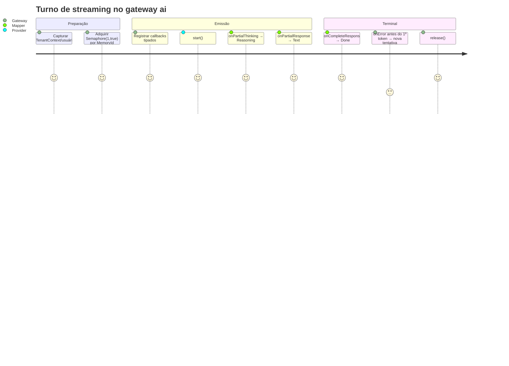

# SPEC — ADR-001 — Provider de streaming e gateway de turno com thinking em `ai`

> **Natureza.** Especificação **da decisão ADR-001**, não do produto inteiro. Todo `RF`/`NFR` abaixo
> declara a origem exata no ADR (decisão D#, regra congelada §4, Q5 §5, R1 §6 ou verificação §10).
> Critério de aceite é comando ou asserção — sem adjetivo sem medição. `PLAN.md` não existe neste ciclo.
>
> **Insumo P1 (security review — `passed_with_findings`, zero 🔴).** F1→RF-11/NFR-02, F3→RF-03/RF-07/WF1,
> F4→RF-10/NFR-06, F6→NFR-05. F5 e F7 são tratados em ADR-002. **Emenda 1 já aplicada no `ADR.md`**
> (2026-11-26: D7/§6 — gate retido no cancel degradado, janela de `5_000 ms`); esta SPEC está alinhada a ela.

---

## 1. Architecture Decision Records (ADRs)

| ID | Decisão (ADR) | Porquê verificável (fonte, consulta 2026-11-26) |
|---|---|---|
| D1 | `LlmStreamingClientFactory<T> extends LlmClientFactory<T>` em `provider/api`; impl em `provider/langchain4j` cobre 7 `AiProvider` | `AiServices.Builder.streamingChatModel(...)` existe (S1, tag 1.19.0); knobs por provider confirmados na tag (S7) |
| D2 | `AssistantStreamDefault` em `ai/api`, mesmo `@SystemMessage`/`@UserMessage`/`@MemoryId` de `AssistantDefault`, retorno `TokenStream`; builder usa `.streamingChatModel(...)`, exclusivo com `.chatModel(...)` | `TokenStream` disponível na 1.19.0 (S2); exclusividade no builder (S1) |
| D3 | Mapper B1: `onPartialThinking`→`Reasoning`, `onPartialResponse`→`Text`, `onCompleteResponse`→`Done`, `onError`→`Failed`; zero parse de wire | `PartialThinking.text()` (S3) e `ChatResponse.finishReason()/tokenUsage()` (S19) na tag; normalização dos 7 providers já feita pela lib (S7) |
| D4 | Retry C1 pré-primeiro-token via `LlmRetryPolicy`; captura de `TenantContext`/usuário/`turnId` antes de `start()`; 120 s por cliente | `start()` é assíncrono (S2); builder não tem retry (S1); `ScopedValue` não propaga para callback (ADR-001 §4 regra 6) |
| D5 | `TurnStreamGateway.stream(...)`; `ChatTurnGateway.execute(...)` inalterado (1 método, 2 chamadores); `StreamingTurnHandle.cancel()` idempotente | ADR-021 §6.1 intacta (ADR-001 D5) |
| D6 | `SessionGateRegistry` com `Semaphore(1, true)` por `@MemoryId`, compartilhado por sync e stream; `ReentrantLock` rejeitado | `ReentrantLock.unlock()` owner-bound lança `IllegalMonitorStateException` (S17, JDK 21); `Semaphore` não tem noção de dono (S18) |
| D7 | R1: `cancel()` capta `UnsupportedFeatureException`, degrada, sem `Failed`; contador `stream.cancel.unsupported` | `CancellationUnsupportedStreamingHandle.cancel()` lança quando o modelo não entrega overload com contexto (S6) |
| D7' (**Emenda 1 — segurança P1/F3, já no ADR**) | Em `UnsupportedFeatureException`: `sinkClosed` silencia callbacks, emitter fechado pelo transporte, `isCancelled()==false`; **gate não é liberado em `cancel()`**. `gateReleased` CAS libera no terminal natural (`Done`/`Failed`) ou na janela de `5_000 ms` (≤120 s), o que vier primeiro. Contador `stream.cancel.unsupported` sem conteúdo | Segurança P1 F3: provedor segue gerando com `ChatMemory` em uso; liberar cedo corrupe memória e cobra custo extra (S6) |

> Emenda 1 registrada em `ADR.md:16,28,107,154` — Dois `AtomicBoolean` separados: `sinkClosed` (silencia callbacks)
> e `gateReleased` (idempotência do `release()`). IT exige (a)-(g) de `ADR.md:160`, inclusive janela de 5 s e nenhum
> segundo turno com `ChatMemory` em uso antes da liberação.

## 2. Domain Context, Tenant Strategy & Provisioning

- **Bounded context**: turno de chat (`ai`) + cliente de modelo (`provider`). Fronteira: `ai/**` depende só de `provider/api` + langchain4j (ADR-001 §4 regra 1).
- **System type**: backend Java/Spring, módulo `ai` folha; nenhum tipo de `assistant/**`, `publicapi/**`, `history/**` entra em `ai/**`.
- **Tenant provisioning**: `N/A — nenhum tenant é criado, suspendido ou migrado neste ADR; `TenantContext` é capturado antes de `start()` e reusado no callback (ADR-001 §4 regra 6)`.
- **Tenant lifecycle**: `N/A — sem transição de tenant; unidade de isolamento é o `@MemoryId` (UUID) já existente, com `Semaphore(1, true)` por sessão (D6)`.

## 3. Identity & Access Management (IAM)

- **Identity Provider / protocolo / MFA / tokens**: inalterados. Nenhum endpoint HTTP e nenhuma autorização nova neste ADR; autoridade `CHAT_SEND` permanece e é consumida em ADR-002.
- **Sessão**: `@MemoryId = sessionId (UUID)`, igual a `AssistantDefault.java:54-58`.
- **RBAC**: nenhuma linha nova na matriz; nenhum `@HasPermission` novo.
- **Gate do portão (item IAM)**: `N/A — nenhuma fronteira HTTP/autorização criada neste ADR; CHAT_SEND inalterado e zero @HasPermission novo`.

## 4. Security, Key Management (KMS) & Disaster Recovery

- **Key Management / ciclo / rotação**: `N/A — nenhuma chave nova; `apiKey` de provider é reutilizada da configuração existente, sem novo cofre`.
- **Backup / DR / RTO / RPO**: `N/A — nenhum dado persistido neste ADR; `TurnStreamEvent` é efêmero em memória (ADR-001 §4 regra 9)`.
- **Segurança aplicável**: zero texto de pensamento em log/`ChatTrace`/JPA; pensamento medido por contagem de chars, nunca conteúdo; redator de spans continua valendo (PRD §6; ADR-001 §4 regras 2/9).

## 5. Data Model & Concurrency

**ERD**: `N/A — nenhuma tabela, coleção ou migration nova; eventos são efêmeros em memória (ADR-001 §4 regra 9; PRD §11)`.

### Concorrência e consistência

| Alvo | Operação | Estratégia | Rationale (mediável) |
|---|---|---|---|
| `SessionGateRegistry.gateFor(UUID)` | exclusão por `@MemoryId` | `Semaphore(1, true)` | `acquire()` antes de `start()`; `release()` no terminal por qualquer thread; owner-free (S18) |
| `StreamingTurnHandleImpl` | terminal | dois `AtomicBoolean`: `sinkClosed` e `gateReleased`, cada um com `compareAndSet(false, true)` | `sink.accept` ocorre uma única vez; `release()` no terminal natural (`Done`/`Failed`) ou em janela de `5_000 ms` (≤120 s), o que vier primeiro; com `UnsupportedFeatureException`, `availablePermits() == 0` após `cancel()` e `== 1` só no terminal/janela (D7'/F3) |
| `AbstractLangChain4jTurnGateway` (caminho sync) | exclusão por sessão | mesmo `Semaphore` do registry, em `try/finally` | `grep -r 'ReentrantLock\|synchronized(lockFor' backend/ai/** backend/assistant/impl/**` → 0; um registry compartilhado, não dois locks |
| `LlmRetryPolicy` | tentativa de `start()` | limite = configuração existente | erro antes de qualquer `Reasoning`/`Text` → nova tentativa; depois → terminal `Failed`, sem retry (D4) |

## 6. Event Model, Integrations & Messaging Isolation

- **Isolamento**: chave = `@MemoryId` (UUID). Nenhum evento cruza sessões; `TenantContext`/usuário/`turnId` capturados antes de `start()` (ADR-001 §4 regra 6).
- **Delivery guarantee**: `N/A — nenhum broker, nenhuma outbox e nenhum evento de domínio persistido; callbacks do `TokenStream` são in-process (S2)`.
- **Integrações**: `provider/langchain4j` → 7 `AiProvider`; `ai/api` consome `TokenStream`; `ai/impl` publica para `Consumer<TurnStreamEvent>` (ADR-002).

### Event Registry

| Evento | Produtor | Consumidor | Payload | Idempotência |
|---|---|---|---|---|
| `TurnStreamEvent.Reasoning` | `TurnStreamEventMapper` ← `onPartialThinking(PartialThinking)` (S3) | `Consumer<TurnStreamEvent>` (ADR-002) | `record Reasoning(String text)`, `text != null && !text.isEmpty()` | `N/A — efêmero; `AtomicBoolean terminal` descarta callback pós-terminal` |
| `TurnStreamEvent.Text` | `TurnStreamEventMapper` ← `onPartialResponse(String)` (S2) | idem | `record Text(String text)`, `text != null && !text.isEmpty()` | idem |
| `TurnStreamEvent.Done` | `TurnStreamEventMapper` ← `onCompleteResponse(ChatResponse)` (S19) | idem | `record Done(FinishReason finishReason, TokenUsage usage)`; só input/output/total (S4) | idem |
| `TurnStreamEvent.Failed` | `TurnStreamEventMapper` ← `onError(Throwable)` ou falha síncrona de `start()` | idem | `record Failed(String code, Throwable cause)`; `code` vem de conjunto fechado; `cause` nunca é convertido em texto (F1) | idem |

## 7. Invariants & Property-Based Testing (PBT)

### 7.1 Invariantes de entidade

`N/A — nenhuma entidade persistida neste ADR. Invariantes equivalentes sobre os eventos efêmeros:`

| Evento | Propriedade | Descrição mediável |
|---|---|---|
| `Reasoning` | I1 | `text() != null && !text().isEmpty()` (Q3; `PartialThinking` usa `ensureNotEmpty`, S3) |
| `Text` | I2 | `text() != null && !text().isEmpty()` (Q3) |
| `Done` | I3 | `usage()` expõe exatamente `inputTokenCount`/`outputTokenCount`/`totalTokenCount`; `reasoning_tokens` ausente (S4) |
| `Failed` | I4 | `code()` pertence ao conjunto fechado de `FailureClassifier.causeCode` (`timeout`, `rate_limited`, `server_error`, `http_<status>`, `cancelled`, `unexpected`, … — `FailureClassifier.java:26-29`); após `Reasoning`/`Text`, `Failed` é terminal e não gera nova tentativa (D4) |
| `TurnStreamEvent` | I5 | um evento por callback; nenhuma duplicação e nenhuma reordenação pelo mapper (Q4/E7 em ADR-002) |
| `Failed.cause` | I6 | `Throwable` permanece em memória; zero `getMessage()`, `printStackTrace()` ou concatenação com `Throwable` em frame/log/`ChatTrace`/spans/JPA (F1) |

### 7.2 Invariantes de workflow

- **WF1 (gate)**: `acquire()` antes de `start()`; `sinkClosed` e `gateReleased` são `AtomicBoolean` independentes, cada um com `compareAndSet(false, true)`. `release()` exatamente uma vez no terminal natural (`Done`/`Failed`) ou em janela de `5_000 ms` (≤120 s), o que vier primeiro. Com `UnsupportedFeatureException`, `cancel()` silencia o sink e completa o cliente **sem** liberar: `availablePermits() == 0` após `cancel()`, `== 1` só no terminal/janela (D7'/F3). Nenhum segundo turno da mesma sessão entra com `ChatMemory` em uso antes da liberação.
- **WF2 (retry)**: `emittedAnyToken == false` ⇒ nova tentativa até o limite de `LlmRetryPolicy`; `emittedAnyToken == true` ⇒ `Failed` terminal, zero retry.
- **WF3 (terminal)**: nenhum `sink.accept` depois de `terminal == true`.
- **WF4 (contexto)**: `TenantContext`/usuário/`turnId` lidos antes de `start()`; nenhum callback lê `ScopedValue`.
- **WF5 (sync×stream)**: o mesmo `Semaphore` por `@MemoryId` no caminho síncrono e no streaming; zero `ReentrantLock`/`synchronized(lockFor(...))` nesses caminhos.
- **WF6 (interrupção)**: se `acquire()` for interrompido, restaurar flag e terminar com `Failed`; nunca liberar permit não adquirido (ADR-001 §5).
- **WF7 (F1 — canário)**: um token único de thinking injetado no fake não aparece em log, `ChatTrace.failure`, spans OTLP nem JPA; asserção por substring exata, zero ocorrências.
- **WF8 (F4 — sessão)**: `createStreamingClientWithSession(..., UUID sessionId)` espelha `LlmClientFactory.createClientWithSession` (`LlmClientFactory.java:23-26`); `sessionId` não nulo alimenta `opencodeHeaders(sessionId)`, `requireApiKey`, `ProviderBaseUrlGuard`, `timeout=120s` e `maxRetries=0` (`LangChain4jClientFactory.java:33,41,53-61,196-211`).
- **WF9 (F6 — contadores)**: `stream.cancel.unsupported`/`stream.failed`/`stream.timeout`/`stream.client_abort` são `metrics.increment` sem conteúdo e ligados ao redator; nenhum rótulo carrega `Throwable` ou texto de thinking.

### 7.3 Gerador de dados de teste

| Campo | Tipo | Restrição | Objetivo PBT |
|---|---|---|---|
| `sessionId` | `UUID` | formato UUID — chave do `SessionGateRegistry` | WF5: sessões distintas não compartilham gate |
| `PartialThinking.text()` | `String` | `ensureNotEmpty` (S3) | I1 |
| `onPartialResponse(String)` | `String` | Não nulo, não vazio | I2 |
| `TokenUsage` | `int` × 3 | `inputTokenCount`/`outputTokenCount`/`totalTokenCount` ≥ 0 (S4) | I3 |
| `ChatResponse.finishReason()` | `FinishReason` | valor de `metadata()` (S19), propagado sem inventar | I3 |
| `emittedAnyToken` | `boolean` | `false` → retry permitido; `true` → terminal | WF2 |
| `Failed.code` | `String` | conjunto fechado de `FailureClassifier.causeCode` (F1) | I4 |
| `Throwable` | `Throwable` | origem de `code` apenas; nunca de texto | I6/WF7 |
| `sessionId` | `UUID` | não nulo; mesmo valor do sync em `opencodeHeaders(sessionId)` | WF8 |

## 8. Functional Requirements & Core Journeys

| ID | Requisito (mediável) | Origem ADR | Como medir |
|---|---|---|---|
| RF-01 | `LlmStreamingClientFactory<T> extends LlmClientFactory<T>` em `provider/api`; impl cobre 7 `AiProvider` com knobs: OpenAI `returnThinking(true)`+`sendThinking(true)`+`thinkingFieldName("reasoning_content")`, Anthropic `thinkingType`/`thinkingBudgetTokens`, Ollama `think(true)`, Gemini `returnThinking(true)` apenas, demais padrão da lib | D1; §4 interface | `LlmStreamingClientFactoryTest` com 7 cases parametrizados; `grep -r 'createStreamingClient' backend/provider/**` → 2 arquivos (api + impl) |
| RF-02 | `AssistantStreamDefault` com `@SystemMessage("{{system}}")`/`@UserMessage("{{user}}")`/`@MemoryId` idênticos a `AssistantDefault`, retorno `TokenStream`; `.streamingChatModel(...)` e zero `.chatModel(...)` no builder desse proxy | D2; §4 interface | `ChatStreamingPromptParityTest` compara anotações e argumentos 1:1 com `AssistantDefault.java:54-58`; `grep -r '\.chatModel(' <gateway de streaming>` → 0 |
| RF-03 | Mapper B1 converte 4 callbacks em 4 tipos; `Failed.code` vem do conjunto fechado de `FailureClassifier.causeCode`, sem texto de `Throwable`; nenhum parse de wire, nenhum `onUnmappedRawEvent`, nenhuma heurística sobre `content` | D3; §4 regra 3; F1 | `TurnStreamEventMapperTest` com fakes de `PartialThinking`/`String`/`ChatResponse`/`Throwable`; canário F1; `grep -r 'onUnmappedRawEvent\|getMessage()\|printStackTrace()' backend/ai/**` → 0 |
| RF-04 | Retry C1: uma tentativa = registrar callbacks + `start()`; erro antes de qualquer `Reasoning`/`Text` → nova tentativa até limite de `LlmRetryPolicy`; depois do 1º token → `Failed` terminal, sem retry; contexto capturado antes de `start()`; limite 120 s | D4; §4 regra 7 | `StreamingRetryTest`: erro antes do token → `tentativas == limite`; erro depois → `tentativas == 1`; asserção de `TenantContext` disponível no callback thread com `ScopedValue` vazio |
| RF-05 | `TurnStreamGateway.stream(TurnRequest, Consumer<TurnStreamEvent>): StreamingTurnHandle`; `ChatTurnGateway.execute` com 1 método e 2 chamadores; `cancel()` idempotente é o único ponto chamado pelo transporte | D5; §4 interface | `grep -rl 'interface ChatTurnGateway' backend/**` → 1 arquivo; `grep -r 'execute(' backend/**/ChatTurnGateway*` → 2 chamadores; `CancelIdempotencyTest`: 2 chamadas → 1 `release()` |
| RF-06 | `SessionGateRegistry` em `ai/impl` com `gateFor(UUID)` → `Semaphore(1, true)`; `acquire()` antes de `start()`, `release()` uma vez no terminal natural (qualquer thread) ou em janela de `5_000 ms` (≤120 s), o que vier primeiro; caminho sync usa o mesmo semáforo | D6; D7'; §4 regra 5; §5 | `SessionConcurrencyIT`: 1 turno sync + 1 streaming no mesmo `sessionId` sem sobreposição; `availablePermits() == 1` após `Failed`, `== 0` após `cancel()` com `UnsupportedFeatureException`; `grep -r 'ReentrantLock' backend/ai/** backend/assistant/impl/**` → 0; `grep -r 'Semaphore(1, true)' backend/ai/impl/**` → 1 |
| RF-07 | `cancel()` degrada `UnsupportedFeatureException`: sem exceção ao cliente, sem evento `Failed`, sem frame após cancel; **gate permanece adquirido** — `availablePermits() == 0` após cancel e `== 1` só no terminal natural ou em janela de `5_000 ms` (≤120 s), o que vier primeiro; contador `stream.cancel.unsupported` sem conteúdo | D7' (emenda F3); §6 | `CancelUnsupportedDegradationIT` com fake que só chama `onPartialResponse(String)`: asserções (a)..(g) de `ADR.md:160` — (d) `== 0` imediatamente após cancel, (e) `== 1` após terminal natural **ou** após janela de 5 s (testar os dois caminhos), (f) nenhum 2º turno entra com `ChatMemory` em uso antes da liberação, (g) contador sem texto; teste de controle com modelo que entrega contexto (cancel chamado 1 vez) |
| RF-08 | `ai/**` folha; `TurnReply` sem texto; `Reasoning`/`Text` nunca com string vazia; nenhum frame de thinking quando provider não emite; métricas iguais ao baseline | §4 regras 1/2/3 | `grep -r 'assistant\|publicapi\|history' backend/ai/**` → 0; `grep -r 'content' .../ai/api/domain/TurnReply.java` → 0; `git diff` de métricas → 0 linhas; `TurnStreamEventMapperTest` cobre I1/I2 |
| RF-09 | `Done` carrega `finishReason` + `usage` de `ChatResponse`; `reasoning_tokens` não inventado | §4 regra 4; S19; S4 | `DoneChunkTest` com fake `ChatResponse`: `finishReason` propagado, `usage` com 3 campos; `grep -r 'reasoning_tokens' backend/**` → 0 |
| RF-10 | Criação de streaming reusa `sessionId` não nulo via `opencodeHeaders(sessionId)` (mesmo mecanismo do sync) e reusa `requireApiKey`, `ProviderBaseUrlGuard`, `timeout=120s`, `maxRetries=0`; sem parâmetro novo na assinatura congelada de §4 | F4; `LlmClientFactory.java:23-26`; `LangChain4jClientFactory.java:33,41,53-61,196-211` | `StreamingSessionHeaderTest`: header `x-opencode-session` idêntico ao do sync; `grep -r 'apiKey\|Authorization' backend/**/logging/** backend/**/web/**` → 0; IT de header estável e zero apiKey em log/frame |
| RF-11 | Canário F1: token único de thinking nunca aparece em log, `ChatTrace.failure`, spans OTLP nem JPA; proibidos `getMessage()`/`printStackTrace()` no caminho SSE | F1; `FailureClassifier.java:18-23`; `TextRedactor.java:59-65`; `TurnOutcomeMapper.java:152-154` | `StreamingRedactionCanaryIT` com token único: zero ocorrências nos 4 destinos; `grep -r 'getMessage()\|printStackTrace()' backend/ai/** backend/provider/**` → 0 |

## 9. Non-Functional Requirements

| ID | Requisito (mediável) | Origem ADR | Como medir |
|---|---|---|---|
| NFR-01 | `langchain4j.version = 1.19.0` fixo; sem starter; sem bump; sem `Flux`; sem `langchain4j-reactor` | §4 regra 8; S8 | `git diff backend/dependencies/pom.xml` → 0 linhas; `grep -r 'Flux\|langchain4j-reactor' backend/**` → 0 |
| NFR-02 | Zero texto de pensamento em log, `ChatTrace.failure`, spans e JPA; redator de spans valendo; `Throwable` nunca vira texto | §4 regras 2/9; PRD §6; F1 | Canário F1 com token único → zero ocorrências nos 4 destinos; `grep -r 'getMessage()\|printStackTrace()' backend/ai/** backend/provider/**` → 0; `ChatSpanContractIT` verde; `code-reviewer` sem 🔴 |
| NFR-03 | Timeout de 120 s por cliente; retry limitado a `LlmRetryPolicy`; sem `pkill -f`; gate nunca vaza permit | D4; §5; PRD §6; F3 | `StreamingRetryTest` assere limites; `SessionConcurrencyIT` assere `availablePermits() == 1` no terminal e `== 0` após `cancel()` com `UnsupportedFeatureException`; `grep -r 'pkill -f' backend/**` → 0 |
| NFR-04 | Zero tabela/coleção/migration; eventos efêmeros; thinking medido por contagem de chars | §4 regra 9 | `find backend -path '*dbupdate*' -name 'V*'` → 0 arquivos novos; `git diff --stat` sem migration; revisão de `metrics.increment` sem conteúdo |
| NFR-05 | `TurnReply` sem texto; contadores sem conteúdo `stream.cancel.unsupported`/`stream.failed`/`stream.timeout`/`stream.client_abort`, ligados ao redator; nenhum rótulo com `Throwable` ou thinking | §4 regra 2; D7; F6 | `git diff` de `TurnReply.java` → 0 linhas; `ChatMetricsExposureIT` → 4 contadores sem conteúdo e redator acionado |
| NFR-06 | `sessionId` não nulo em toda criação de cliente de streaming; apiKey/baseUrl nunca em log/frame | F4 | `StreamingSessionHeaderTest` → header estável; `grep -r 'apiKey\|Authorization' backend/**/logging/** backend/**/web/**` → 0 |

## 10. Critérios de Aceite Executáveis

| AC | Comando / asserção | Esperado |
|---|---|---|
| AC-01 | `npm test` (canônico em `harness.config.json:14`) | `EXIT=0`, 0 falhas |
| AC-02 | `grep -r 'assistant\|publicapi\|history' backend/ai/**` | 0 linhas |
| AC-03 | `grep -rl 'interface ChatTurnGateway' backend/**` | 1 arquivo; `execute(TurnRequest)` com 2 chamadores |
| AC-04 | `grep -r 'ReentrantLock' backend/ai/** backend/assistant/impl/**` | 0 linhas |
| AC-05 | `grep -r 'Semaphore(1, true)' backend/ai/impl/**` | 1 arquivo |
| AC-06 | `grep -r 'onUnmappedRawEvent\|Flux\|langchain4j-reactor' backend/**` | 0 linhas |
| AC-07 | `git diff backend/dependencies/pom.xml` | 0 linhas (1.19.0 fixa) |
| AC-08 | `npm test -- LlmStreamingClientFactoryTest ChatStreamingPromptParityTest TurnStreamEventMapperTest StreamingRetryTest DoneChunkTest CancelIdempotencyTest` | 0 falhas |
| AC-09 | `npm test -- SessionConcurrencyIT CancelUnsupportedDegradationIT` (via módulo `integration-test`) | 0 falhas; `availablePermits() == 1` no terminal, `== 0` após `cancel()` com `UnsupportedFeatureException` |
| AC-10 | `git diff --stat` em handlers HTTP, MFA e `dbupdate/**` | 0 linhas |
| AC-11 | `code-reviewer` no diff do ADR-001 | 0 achados 🔴 |
| AC-12 (F1) | `npm test -- StreamingRedactionCanaryIT`; token único de thinking nos 4 destinos | 0 ocorrências em log/`ChatTrace.failure`/spans/JPA; `grep -r 'getMessage()\|printStackTrace()' backend/ai/** backend/provider/**` → 0 |
| AC-13 (F3) | `npm test -- CancelUnsupportedDegradationIT` | `availablePermits() == 0` imediatamente após `cancel()`, `== 1` após terminal natural **ou** janela de 5 s (ambos testados); zero 2º turno com `ChatMemory` em uso antes da liberação |
| AC-14 (F4) | `npm test -- StreamingSessionHeaderTest` | `x-opencode-session` estável e idêntico ao sync; `sessionId != null`; zero apiKey em log/frame |
| AC-15 (F6) | `npm test -- ChatMetricsExposureIT` | `stream.cancel.unsupported`/`stream.failed`/`stream.timeout`/`stream.client_abort` sem conteúdo; redator acionado |

## 11. Test Strategy

- **Unitário** (`provider/langchain4j/src/test`, `ai/impl/src/test`): callbacks tipados, triangulação de knobs por provider, retry pré/pós-primeiro-token, idempotência do `cancel()`, chunk `Done`.
- **Caracterização** (`ai/api` + `ai/impl`): paridade 1:1 do prompt síncrono × streaming (`@SystemMessage`/`@UserMessage`/`@MemoryId`).
- **Integração** (`backend/integration-test/src/test/java/br/com/systec/hive/integrationtest/`): `SessionConcurrencyIT` (sync×stream), `CancelUnsupportedDegradationIT` (fake `StreamingChatModel` sem overload com contexto; F3 troca a asserção de permits), `StreamingRedactionCanaryIT` (F1), `StreamingSessionHeaderTest` (F4), `ChatSpanContractIT`/`ChatMetricsExposureIT` (sem conteúdo de pensamento; F6).
- **Comando canônico**: `npm test` (`harness.config.json:14` → `commands.suiteFull`). Gate de saída: AC-01..AC-15 + `code-reviewer` sem 🔴.
- **Evidência proibida**: nenhuma asserção que leia texto de pensamento de logs/trace/JPA; apenas contagem de chars e contadores.

## 12. Delta Specs

`NENHUM delta aplicável — nenhum documento vivo (.agents/rules/**, AGENTS.md, DESIGN.md) é alterado por esta decisão.`

| Documento | ADDED | MODIFIED | REMOVED |
|---|---|---|---|
| `.agents/rules/**` | 0 | 0 | 0 |
| `AGENTS.md` | 0 | 0 | 0 |

> No archive, nada a mesclar desta seção. A DRY-run de versão/API permanece nos ADRs e no `RESEARCH.md`.

## 13. Rastreabilidade RF/NFR ↔ ADR ↔ TASKS

| Requisito | Origem no ADR | Ticket |
|---|---|---|
| RF-01 | D1, §4 interface | PS-01 |
| RF-02 | D2, §4 interface | PX-02 |
| RF-03 | D3, §4 regra 3 | MAP-03 |
| RF-04 | D4, §4 regra 7 | RT-04 |
| RF-05 | D5, §4 interface | GW-05 |
| RF-06 | D6, §4 regra 5, §5 | GATE-06 |
| RF-07 | D7' (emenda F3), §6 | CNC-07 |
| RF-08 | §4 regras 1/2/3 | LEAF-08 |
| RF-09 | §4 regra 4, S19/S4 | DON-09 |
| RF-10 | F4; `LlmClientFactory.java:23-26`; `LangChain4jClientFactory.java:33,41,53-61` | SHD-15 |
| RF-11 | F1; `FailureClassifier.java:18-23`; `TextRedactor.java:59-65` | SEC-16 |
| NFR-01 | §4 regra 8, S8 | NV-10 |
| NFR-02 | §4 regras 2/9, PRD §6, F1 | NS-11 + SEC-16 |
| NFR-03 | D4, §5, PRD §6, F3 | NR-12 + CNC-07 |
| NFR-04 | §4 regra 9 | ND-13 |
| NFR-05 | §4 regra 2, D7, F6 | NO-14 |
| NFR-06 | F4 | SHD-15 |

## 14. Auditoria do portão `spec-gate.md`

| Item | Resultado |
|---|---|
| ADRs (Porquê das escolhas) | ✅ — §1, 7 decisões + D7' (emenda P1/F3) com fonte e data |
| DDD Modular (api/impl/public) | ✅ — §2, §5, §6; `ai/**` folha, zero tipo de web/publicapi/assistant/history |
| Segurança/IAM | `N/A — nenhuma fronteira HTTP/autorização nova; CHAT_SEND inalterado, zero @HasPermission novo` |
| ERD | `N/A — nenhuma tabela/coleção nova; eventos efêmeros (ADR-001 §4 regra 9)` |
| Event Registry | ✅ — §6, 4 eventos com produtor, consumidor e payload |
| Migrations | `N/A — zero migration neste ADR (PRD §2/§11)` |
| Invariantes de entidade | `N/A — sem entidade persistida; invariantes de evento em §7.1` |
| Invariantes de workflow | ✅ — §7.2, WF1..WF9 |
| Test Strategy | ✅ — §11 |
| Single File | ✅ — este arquivo |
| Domínio claro | ✅ — §2, turno de chat (`ai`) + cliente de modelo (`provider`) |

`itens aplicáveis = 7` (11 − 4 N/A com motivo) · `atendidos = 7` · **score = 100%**.

Skipped: nenhum `PLAN.md`, nenhuma assinatura de API inventada (RF-10 espelha `createClientWithSession` existente). Risk: **(1)** Emenda 1 (F3) já no `ADR.md`, mas ADR-002 E8 ainda não foi alinhado — divergência ao orquestrador; **(2)** versão exata do JDK não verificada (S17/S18 são JDK 21); **(3)** `unit: adr`/`status` no ADR-INDEX permanece com o orchestrator.
