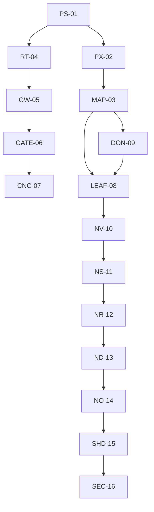

<!-- scope: adr/ADR-001 -->
# Execution Backlog — ADR-001 — Provider de streaming e gateway de turno com thinking em `ai`

## 1. Traceability Context

- **Source ADR/SPEC**: `.spec/prd/streaming-reasoning/ADRs/ADR-001-provider-streaming/ADR.md` + `SPEC.md`.
- **Goal**: explodir RF-01..RF-09 e NFR-01..NFR-05 da SPEC em tickets TDD-ready com arquivos físicos mapeados.
- **Regra de unidade**: 1 ADR = 1 branch = 1 PR. Nenhum ticket aqui altera `ADR.md`, `ADR-INDEX.md`, `PRD.md`, `RESEARCH.md`, código fora do escopo do ADR ou `workflow-state.json`.
- **Interface congelada** (ADR-001 §4): `LlmStreamingClientFactory<T>`, `AssistantStreamDefault`, `TurnStreamEvent` + 4 records, `TurnStreamGateway`, `StreamingTurnHandle`, `SessionGateRegistry.gateFor(UUID)`.

## 2. Sprint Summary

| Phase | Task ID | Type | Priority | Risk | Complexity | Status |
|---|---|---|---|---|---|---|
| P1 — Provider | PS-01 | API | P0 | Medium | 3 | Todo |
| P1 — Proxy | PX-02 | API | P0 | Medium | 2 | Todo |
| P1 — Mapper | MAP-03 | Domain | P0 | High | 3 | Todo |
| P1 — Retry | RT-04 | Domain | P0 | High | 3 | Todo |
| P2 — Porta | GW-05 | API | P0 | Medium | 2 | Todo |
| P2 — Gate | GATE-06 | Infra | P0 | High | 3 | Todo |
| P2 — Cancel | CNC-07 | Domain | P0 | High | 3 | Todo |
| P2 — Folha | LEAF-08 | Test | P1 | Medium | 2 | Todo |
| P2 — Done | DON-09 | Domain | P0 | Medium | 2 | Todo |
| P3 — Versão | NV-10 | Test | P1 | Low | 1 | Todo |
| P3 — Segurança | NS-11 | Test | P0 | High | 2 | Todo |
| P3 — Resiliência | NR-12 | Test | P0 | Medium | 2 | Todo |
| P3 — Dados | ND-13 | Test | P1 | Low | 1 | Todo |
| P3 — Observabilidade | NO-14 | Test | P1 | Low | 1 | Todo |
| P3 — Sessão (F4) | SHD-15 | API | P1 | Medium | 2 | Todo |
| P3 — Canário (F1) | SEC-16 | Test | P0 | High | 2 | Todo |

## 3. Dependency Graph

---

## 4. Task Backlog

### PS-01 — Cliente de streaming por provider (7 `AiProvider`)

- **RF/NFR**: RF-01 · **Origem ADR**: D1, §4 interface · **Tipo**: API · **Prioridade**: P0 · **Risco**: Medium · **Depende de**: — (Hard) · **Paralelo**: Não
- **Arquivos físicos**: `backend/provider/api/src/main/java/br/com/systec/hive/provider/api/LlmStreamingClientFactory.java` (novo); `backend/provider/langchain4j/src/main/java/br/com/systec/hive/provider/langchain4j/LangChain4jStreamingClientFactory.java` (novo); `backend/provider/langchain4j/src/test/java/br/com/systec/hive/provider/langchain4j/LlmStreamingClientFactoryTest.java` (novo); `backend/provider/api/src/main/java/br/com/systec/hive/provider/api/LlmClientFactory.java` (referência, não alterar).
- **Contexto/Impacto**: adiciona `createStreamingClient(provider, model, temperature, maxTokens, topP, apiKey, baseUrl)` sem mudar `createClient(...)`; `LlmClientFactory` existente permanece intacto.
- **Enforcement**: knobs por provider = OpenAI `returnThinking(true)`+`sendThinking(true)`+`thinkingFieldName("reasoning_content")`, Anthropic `thinkingType`/`thinkingBudgetTokens`, Ollama `think(true)`, Gemini `returnThinking(true)` **apenas**, demais padrão da lib (S7/S10). **Failure Mode**: thinking vaza para `content` ou provider sem knob gera exceção em vez de degradação → RF1/RF3 quebram.
- **BDD**:
  - Sucesso: Dado cada um dos 7 `AiProvider`, Quando `createStreamingClient(...)` é chamado, Então retorna cliente `TokenStream` com os knobs do provider; asserção: 7 cases parametrizados verdes.
  - Falha (`modelo desconhecido`): Dado `AiProvider` fora dos 7, Quando criar cliente, Então exceção de configuração existente é propagada — nenhum fallback silencioso.
  - Borda: Dado Gemini, Quando criar cliente, Então só `returnThinking(true)` é aplicado; nenhum `thinkingConfig` inventado (S10).
- **TDD (teste primeiro)**:
  - [x] `backend/provider/langchain4j/src/test/java/br/com/systec/hive/provider/langchain4j/LlmStreamingClientFactoryTest.java`: escrever 7 cases + case Gemini ANTES da implementação.
  - [x] `backend/provider/api/src/main/java/br/com/systec/hive/provider/api/LlmStreamingClientFactory.java`: declarar interface congelada.
  - [x] `backend/provider/langchain4j/src/main/java/br/com/systec/hive/provider/langchain4j/LangChain4jStreamingClientFactory.java`: implementar criação por provider.
- **DoD**: [ ] teste criado antes da impl · [ ] `npm test -- LlmStreamingClientFactoryTest` EXIT=0 · [ ] `grep -r 'createStreamingClient' backend/provider/**` → 2 arquivos · [ ] zero TODO.

### PX-02 — Proxy `AssistantStreamDefault` com paridade de prompt

- **RF/NFR**: RF-02 · **Origem ADR**: D2, §4 interface · **Tipo**: API · **Prioridade**: P0 · **Risco**: Medium · **Depende de**: PS-01 (Hard) · **Paralelo**: Não
- **Arquivos físicos**: `backend/ai/api/src/main/java/br/com/systec/hive/ai/api/AssistantStreamDefault.java` (novo); `backend/ai/api/src/test/java/br/com/systec/hive/ai/api/AssistantStreamDefaultParityTest.java` (novo); `backend/ai/api/src/main/java/br/com/systec/hive/ai/api/AssistantDefault.java` (referência, não alterar).
- **Contexto/Impacto**: proxy com `@SystemMessage("{{system}}")`/`@UserMessage("{{user}}")` e `@MemoryId` idênticos a `AssistantDefault.java:54-58`, retorno `TokenStream` no lugar de `Result<String>`.
- **Enforcement**: construção por `AiServices.builder(AssistantStreamDefault.class).streamingChatModel(...)`; **zero** `.chatModel(...)` nesse builder (S1). **Failure Mode**: prompt divergente do síncrono muda resposta e quebra paridade RF2.
- **BDD**:
  - Sucesso: Dado mesmo `sessionId`/`system`/`user`, Quando comparar anotações e argumentos dos dois proxies, Então são idênticos e o retorno é `TokenStream`.
  - Falha (`builder misto`): Dado builder com `.chatModel(...)`, Quando compilar/testar, Então falha — asserção de ausência no gateway de streaming.
  - Borda: Dado `@MemoryId` nulo, Então validação existente do AiServices é preservada, sem novo comportamento.
- **TDD (teste primeiro)**:
  - [x] `backend/ai/api/src/test/java/br/com/systec/hive/ai/api/AssistantStreamDefaultParityTest.java`: escrever paridade 1:1 e checagem de builder ANTES da impl.
  - [x] `backend/ai/api/src/main/java/br/com/systec/hive/ai/api/AssistantStreamDefault.java`: declarar interface congelada.
- **DoD**: [ ] teste antes da impl · [ ] `npm test -- AssistantStreamDefaultParityTest` EXIT=0 · [ ] `grep -r '\.chatModel(' backend/ai/impl/**/LangChain4jTurnStreamGateway.java` → 0 · [ ] zero TODO.

### MAP-03 — Mapper de callbacks tipados (B1)

- **RF/NFR**: RF-03 · **Origem ADR**: D3, §4 regra 3 · **Tipo**: Domain · **Prioridade**: P0 · **Risco**: High · **Depende de**: PX-02 (Hard) · **Paralelo**: Não
- **Arquivos físicos**: `backend/ai/api/src/main/java/br/com/systec/hive/ai/api/domain/TurnStreamEvent.java` (novo, sealed interface + 4 records); `backend/ai/impl/src/main/java/br/com/systec/hive/ai/impl/TurnStreamEventMapper.java` (novo); `backend/ai/impl/src/test/java/br/com/systec/hive/ai/impl/TurnStreamEventMapperTest.java` (novo).
- **Contexto/Impacto**: converte `onPartialThinking`→`Reasoning`, `onPartialResponse`→`Text`, `onCompleteResponse`→`Done`, `onError`→`Failed` — um evento por callback, na ordem de chegada (Q4).
- **Enforcement**: nenhum `onUnmappedRawEvent`, nenhum parse de wire, nenhuma heurística sobre `content`; `Reasoning`/`Text` jamais com string vazia (I1/I2); `Failed.code` = `FailureClassifier.causeCode(cause)` (conjunto fechado) e `Throwable` nunca é convertido em texto (F1/I6). **Failure Mode**: canal trocado, thinking em `content` ou `getMessage()` no frame → vazamento em histórico/trace (RF3).
- **BDD**:
  - Sucesso: Dado fake `PartialThinking.text()="p"`, `onPartialResponse("a")`, `ChatResponse` com finishReason e usage, `Throwable` com mensagem sensível, Quando registrar callbacks, Então emitter 4 eventos na ordem exata e `Failed.code` pertence ao conjunto fechado, sem trecho da mensagem.
  - Falha (`provider sem thinking`): Dado nenhum `onPartialThinking`, Então zero eventos `Reasoning` — sem frame vazio.
  - Borda: Dado `PartialThinking` com texto vazio (violação de `ensureNotEmpty`, S3), Então mapper descarta o evento e não emite `Reasoning("")`.
- **TDD (teste primeiro)**:
  - [x] `backend/ai/impl/src/test/java/br/com/systec/hive/ai/impl/TurnStreamEventMapperTest.java`: escrever os 3 cenários ANTES da impl.
  - [x] `backend/ai/api/src/main/java/br/com/systec/hive/ai/api/domain/TurnStreamEvent.java`: declarar sealed interface e records congelados.
  - [x] `backend/ai/impl/src/main/java/br/com/systec/hive/ai/impl/TurnStreamEventMapper.java`: implementar 4 callbacks.
- **DoD**: [ ] teste antes da impl · [ ] `npm test -- TurnStreamEventMapperTest` EXIT=0 · [ ] `grep -r 'onUnmappedRawEvent' backend/**` → 0 · [ ] zero TODO.

### RT-04 — Retry pré-primeiro-token e captura de contexto

- **RF/NFR**: RF-04 · **Origem ADR**: D4, §4 regra 7 · **Tipo**: Domain · **Prioridade**: P0 · **Risco**: High · **Depende de**: PS-01 (Hard) · **Paralelo**: Não
- **Arquivos físicos**: `backend/ai/impl/src/main/java/br/com/systec/hive/ai/impl/StreamingRetryPolicy.java` (novo); `backend/ai/impl/src/test/java/br/com/systec/hive/ai/impl/StreamingRetryTest.java` (novo); `backend/provider/langchain4j/src/main/java/br/com/systec/hive/provider/langchain4j/LlmRetryPolicy.java` (referência, não alterar).
- **Contexto/Impacto**: uma tentativa = registrar callbacks + `start()`; `emittedAnyToken` controla retry; `TenantContext`/usuário/`turnId` capturados antes de `start()`; limite de 120 s.
- **Enforcement**: retry **nunca** após `Reasoning`/`Text` (evita duplicar bytes, S9/S14). **Failure Mode**: retry pós-token duplica prefixo no cliente e re-cobra turno.
- **BDD**:
  - Sucesso: Dado `onError` antes de qualquer token, Quando executar turno, Então nova tentativa até limite de `LlmRetryPolicy`.
  - Falha (`erro após 1º token`): Dado `Reasoning` já emitido e `onError`, Então zero novas tentativas e `Failed` terminal.
  - Borda: Dado callback em thread do provider com `ScopedValue` vazio, Então `TenantContext`/`turnId` capturados permanecem disponíveis; timeout = 120 s.
- **TDD (teste primeiro)**:
  - [x] `backend/ai/impl/src/test/java/br/com/systec/hive/ai/impl/StreamingRetryTest.java`: escrever os 3 cenários ANTES da impl.
  - [x] `backend/ai/impl/src/main/java/br/com/systec/hive/ai/impl/StreamingRetryPolicy.java`: implementar `emittedAnyToken` e captura de contexto.
- **DoD**: [ ] teste antes da impl · [ ] `npm test -- StreamingRetryTest` EXIT=0 · [ ] tentativas ≤ limite de `LlmRetryPolicy` · [ ] zero TODO.

### GW-05 — Porta `TurnStreamGateway` e `StreamingTurnHandle`

- **RF/NFR**: RF-05 · **Origem ADR**: D5, §4 interface · **Tipo**: API · **Prioridade**: P0 · **Risco**: Medium · **Depende de**: RT-04 (Hard) · **Paralelo**: Não
- **Arquivos físicos**: `backend/ai/api/src/main/java/br/com/systec/hive/ai/api/port/TurnStreamGateway.java` (novo); `backend/ai/api/src/main/java/br/com/systec/hive/ai/api/port/StreamingTurnHandle.java` (novo); `backend/ai/api/src/main/java/br/com/systec/hive/ai/api/port/ChatTurnGateway.java` (referência, não alterar); `backend/ai/impl/src/main/java/br/com/systec/hive/ai/impl/LangChain4jTurnStreamGateway.java` (novo); `backend/ai/impl/src/test/java/br/com/systec/hive/ai/impl/CancelIdempotencyTest.java` (novo).
- **Contexto/Impacto**: `stream(TurnRequest, Consumer<TurnStreamEvent>)`; `ChatTurnGateway.execute(TurnRequest)` permanece com 1 método e 2 chamadores; `cancel()` é único ponto do transporte.
- **Enforcement**: nenhuma aresta `impl → impl` nova; `ai/**` folha. **Failure Mode**: mudar `ChatTurnGateway` quebra ADR-021 §6.1 e os 2 chamadores.
- **BDD**:
  - Sucesso: Dado `TurnRequest` válido, Quando `stream(...)` com sink tipado, Então retorna `StreamingTurnHandle` e eventos chegam ao sink.
  - Falha (`transporte chama cancel duas vezes`): Dado 2 chamadas a `cancel()`, Então `gate.release()` ocorre 1 vez e nenhuma exceção.
  - Borda: Dado `execute(...)` síncrono existente, Então assinatura e 2 chamadores permanecem idênticos ao baseline.
- **TDD (teste primeiro)**:
  - [x] `backend/ai/impl/src/test/java/br/com/systec/hive/ai/impl/CancelIdempotencyTest.java`: escrever os 3 cenários ANTES da impl.
  - [x] `backend/ai/api/src/main/java/br/com/systec/hive/ai/api/port/TurnStreamGateway.java`: declarar interface congelada.
  - [x] `backend/ai/api/src/main/java/br/com/systec/hive/ai/api/port/StreamingTurnHandle.java`: declarar `cancel()`.
  - [x] `backend/ai/impl/src/main/java/br/com/systec/hive/ai/impl/LangChain4jTurnStreamGateway.java`: implementar `stream(...)`.
- **DoD**: [ ] teste antes da impl · [ ] `npm test -- CancelIdempotencyTest` EXIT=0 · [ ] `grep -rl 'interface ChatTurnGateway' backend/**` → 1 arquivo · [ ] zero TODO.

### GATE-06 — `SessionGateRegistry` owner-free compartilhado sync×stream

- **RF/NFR**: RF-06 · **Origem ADR**: D6, §4 regra 5, §5 (Q5) · **Tipo**: Infra · **Prioridade**: P0 · **Risco**: High · **Depende de**: GW-05 (Hard) · **Paralelo**: Não
- **Arquivos físicos**: `backend/ai/impl/src/main/java/br/com/systec/hive/ai/impl/SessionGateRegistry.java` (novo); `backend/ai/impl/src/test/java/br/com/systec/hive/ai/impl/SessionGateRegistryTest.java` (novo); `backend/integration-test/src/test/java/br/com/systec/hive/integrationtest/SessionConcurrencyIT.java` (novo); `backend/assistant/impl/src/main/java/br/com/systec/hive/assistant/impl/service/AssistantTurnGateway.java` (ajuste do caminho sync); `backend/ai/impl/src/main/java/br/com/systec/hive/ai/impl/AbstractLangChain4jTurnGateway.java` (ajuste do caminho sync).
- **Contexto/Impacto**: `gateFor(UUID)` devolve `Semaphore(1, true)`; `acquire()` antes de `start()`; `release()` no terminal por qualquer thread; sync troca `synchronized(lockFor(...))` pelo **mesmo** semáforo.
- **Enforcement**: `Semaphore`, nunca `ReentrantLock`/`synchronized` neste caminho (S17/S18). **Failure Mode**: `ReentrantLock.unlock()` na thread do callback lança `IllegalMonitorStateException`, gate nunca liberado, próximo turno travado.
- **BDD**:
  - Sucesso: Dado 1 turno sync e 1 streaming no mesmo `sessionId`, Quando executados, Então não se sobrepõem e `availablePermits() == 1` no terminal natural.
  - Falha (`terminal em callback`): Dado terminal na thread do provider, Então `release()` executa sem `IllegalMonitorStateException`; dado `UnsupportedFeatureException`, Então `availablePermits() == 0` até o terminal/janela de `5_000 ms` (≤120 s) (F3).
  - Borda: Dado `acquire()` interrompido, Então flag restaurada, `Failed` terminal e nenhum permit liberado sem aquisição (WF6).
- **TDD (teste primeiro)**:
  - [x] `backend/ai/impl/src/test/java/br/com/systec/hive/ai/impl/SessionGateRegistryTest.java` e `backend/integration-test/src/test/java/br/com/systec/hive/integrationtest/SessionConcurrencyIT.java`: escrever os 3 cenários ANTES da impl.
  - [x] `backend/ai/impl/src/main/java/br/com/systec/hive/ai/impl/SessionGateRegistry.java`: implementar registry e `AtomicBoolean` de terminal.
  - [x] `backend/assistant/impl/src/main/java/br/com/systec/hive/assistant/impl/service/AssistantTurnGateway.java` + `backend/ai/impl/src/main/java/br/com/systec/hive/ai/impl/AbstractLangChain4jTurnGateway.java`: trocar lock por `gateFor(...)` em `try/finally`.
- **DoD**: [ ] testes antes da impl · [ ] `npm test -- SessionConcurrencyIT` EXIT=0 · [ ] `grep -r 'ReentrantLock' backend/ai/** backend/assistant/impl/**` → 0 · [ ] `grep -r 'Semaphore(1, true)' backend/ai/impl/**` → 1 · [ ] zero TODO.

### CNC-07 — Degradação R1 no cancelamento

- **RF/NFR**: RF-07 · **Origem ADR**: D7' (Emenda 1 já no ADR, segurança P1/F3), §6 (R1) · **Tipo**: Domain · **Prioridade**: P0 · **Risco**: High · **Depende de**: GATE-06 (Hard) · **Paralelo**: Não
- **Arquivos físicos**: `backend/ai/impl/src/main/java/br/com/systec/hive/ai/impl/StreamingTurnHandleImpl.java` (novo); `backend/integration-test/src/test/java/br/com/systec/hive/integrationtest/CancelUnsupportedDegradationIT.java` (novo).
- **Contexto/Impacto**: `cancel()` captura `UnsupportedFeatureException`, incrementa `stream.cancel.unsupported`, `sinkClosed` silencia callbacks e o emitter é fechado pelo transporte; **gate permanece adquirido** (F3/Emenda 1). `gateReleased` CAS libera no terminal natural do provider ou na janela de `5_000 ms` (≤120 s), o que vier primeiro — sem `Failed` e sem conteúdo no contador. `isCancelled()==false` (S6): provider segue gerando.
- **Enforcement**: callback pós-cancel é descartado por `AtomicBoolean` — nenhum `sink.accept` após terminal (S6). **Failure Mode**: exceção escapa (connector fecha com erro, RF5 falha) **ou** gate liberado no cancel (novo turno sobrepõe provider ainda ativo — F3).
- **BDD**:
  - Sucesso (controle): Dado modelo que entrega `onPartialResponse(PartialResponse, PartialResponseContext)`, Quando `cancel()`, Então `StreamingHandle.cancel()` é chamado 1 vez e gate liberado.
  - Falha (`cancel não suportado`): Dado fake que só chama `onPartialResponse(String)`, Quando `cancel()`, Então (a) zero exceção, (b) zero `Failed`, (c) zero frame após cancel, (d) `availablePermits() == 0` **imediatamente**, (e) `== 1` após terminal natural **ou** janela de 5 s (testar os dois caminhos), (f) nenhum 2º turno da mesma sessão entra com `ChatMemory` em uso antes da liberação, (g) contador incrementado sem texto de thinking em log/trace.
  - Borda: Dado `cancel()` repetido, Então segunda chamada é no-op, contador `stream.cancel.unsupported` incrementa no máximo 1 vez e nenhum permit é liberado a mais.
- **TDD (teste primeiro)**:
  - [x] `backend/integration-test/src/test/java/br/com/systec/hive/integrationtest/CancelUnsupportedDegradationIT.java`: escrever os 3 cenários ANTES da impl.
  - [x] `backend/ai/impl/src/main/java/br/com/systec/hive/ai/impl/StreamingTurnHandleImpl.java`: implementar `sinkClosed` e `gateReleased` como `AtomicBoolean` separados (ambos `compareAndSet(false, true)`); `cancel()` **nunca** chama `gate.release()`; `release()` no terminal natural e na janela de `5_000 ms` (≤120 s), protegido por `gateReleased`.
- **DoD**: [ ] teste antes da impl · [ ] `npm test -- CancelUnsupportedDegradationIT` EXIT=0 · [ ] asserções (a)..(g) de `ADR.md:160`, incluindo janela de 5 s · [ ] `availablePermits() == 0` imediatamente após cancel e `== 1` só no terminal/janela · [ ] contador sem conteúdo · [ ] zero TODO.

### LEAF-08 — Folha `ai/**`, `TurnReply` sem texto, eventos não vazios

- **RF/NFR**: RF-08 · **Origem ADR**: §4 regras 1/2/3 · **Tipo**: Test · **Prioridade**: P1 · **Risco**: Medium · **Depende de**: MAP-03, DON-09 (Hard) · **Paralelo**: Não
- **Arquivos físicos**: `backend/ai/api/src/main/java/br/com/systec/hive/ai/api/domain/TurnReply.java` (verificação, não alterar); `backend/ai/impl/src/test/java/br/com/systec/hive/ai/impl/AiLeafGuardTest.java` (novo).
- **Contexto/Impacto**: garante que nova funcionalidade não trouxe dependência de `assistant/**`, `publicapi/**`, `history/**` para `ai/**`, não pôs texto em `TurnReply` e não alterou métricas.
- **Enforcement**: `ai/**` só `provider/api` + langchain4j. **Failure Mode**: thinking em `TurnReply.content` vaza para histórico/trace.
- **BDD**:
  - Sucesso: Dado diff do ADR-001, Quando rodar guard, Então `grep -r 'assistant\|publicapi\|history' backend/ai/**` → 0 linhas.
  - Falha (`texto em TurnReply`): Dado campo de texto adicionado a `TurnReply`, Então guard falha com diff apontando o arquivo.
  - Borda: Dado provider sem thinking, Então nenhum evento `Reasoning` emitido e nenhuma métrica nova além de `stream.cancel.unsupported`.
- **TDD (teste primeiro)**:
  - [x] `backend/ai/impl/src/test/java/br/com/systec/hive/ai/impl/AiLeafGuardTest.java`: escrever asserções de fronteira, `TurnReply` e métricas ANTES de qualquer ajuste.
- **DoD**: [ ] teste antes de ajustes · [ ] `npm test -- AiLeafGuardTest` EXIT=0 · [ ] `git diff` de `TurnReply.java` e métricas → 0 linhas · [ ] zero TODO.

### DON-09 — Terminal `Done` com `finishReason` e usage sem `reasoning_tokens`

- **RF/NFR**: RF-09 · **Origem ADR**: §4 regra 4; S19/S4 · **Tipo**: Domain · **Prioridade**: P0 · **Risco**: Medium · **Depende de**: MAP-03 (Hard) · **Paralelo**: Não
- **Arquivos físicos**: `backend/ai/impl/src/test/java/br/com/systec/hive/ai/impl/DoneChunkTest.java` (novo); `backend/ai/api/src/main/java/br/com/systec/hive/ai/api/domain/TurnStreamEvent.java` (ajuste do record `Done` se necessário); `backend/ai/impl/src/main/java/br/com/systec/hive/ai/impl/TurnStreamEventMapper.java` (ajuste do `onCompleteResponse`).
- **Contexto/Impacto**: `Done` carrega `ChatResponse.finishReason()` e `tokenUsage()`; `TokenUsage` 1.19.0 expõe só input/output/total (S4).
- **Enforcement**: nenhum campo `reasoning_tokens` inventado. **Failure Mode**: usage com chave inexistente quebra clientes OpenAI-compatible.
- **BDD**:
  - Sucesso: Dado fake `ChatResponse` com `finishReason=stop` e `TokenUsage(12,34,46)`, Quando `onCompleteResponse`, Então `Done(stop, usage)` com 3 campos.
  - Falha (`usage ausente`): Dado `ChatResponse` sem `tokenUsage`, Então `Done` é emitido com finishReason e usage nulo — sem exceção.
  - Borda: Dado busca por `reasoning_tokens` no código, Então zero ocorrências em `backend/**`.
- **TDD (teste primeiro)**:
  - [x] `backend/ai/impl/src/test/java/br/com/systec/hive/ai/impl/DoneChunkTest.java`: escrever os 3 cenários ANTES da impl.
  - [x] `backend/ai/api/src/main/java/br/com/systec/hive/ai/api/domain/TurnStreamEvent.java` + `backend/ai/impl/src/main/java/br/com/systec/hive/ai/impl/TurnStreamEventMapper.java`: ajustar mapeamento.
- **DoD**: [ ] teste antes da impl · [ ] `npm test -- DoneChunkTest` EXIT=0 · [ ] `grep -r 'reasoning_tokens' backend/**` → 0 · [ ] zero TODO.

### NV-10 — Pin de versão: sem starter, sem bump, sem Flux/reactor

- **RF/NFR**: NFR-01 · **Origem ADR**: §4 regra 8; S8 · **Tipo**: Test · **Prioridade**: P1 · **Risco**: Low · **Depende de**: LEAF-08 (Hard) · **Paralelo**: Não
- **Arquivos físicos**: `backend/dependencies/pom.xml` (verificação, não alterar); `backend/integration-test/src/test/java/br/com/systec/hive/integrationtest/StreamingVersionGuardIT.java` (novo).
- **Contexto/Impacto**: congela `langchain4j.version = 1.19.0` e Spring Boot 4.1.0; impede dependência `langchain4j-reactor` e uso de `Flux`.
- **Enforcement**: nenhuma dependência nova. **Failure Mode**: bump silencioso muda assinaturas `@Experimental` e invalida S1..S7/S19.
- **BDD**:
  - Sucesso: Dado diff do ADR-001, Quando ler `backend/dependencies/pom.xml`, Então `langchain4j.version` = `1.19.0` e `spring.boot.version` = `4.1.0`.
  - Falha (`dependência proibida`): Dado `langchain4j-reactor` no pom, Então guard falha.
  - Borda: Dado ocorrência de `Flux` em código (não em doc de decisão), Então guard falha.
- **TDD (teste primeiro)**:
  - [x] `backend/integration-test/src/test/java/br/com/systec/hive/integrationtest/StreamingVersionGuardIT.java`: escrever asserções ANTES de qualquer ajuste de pom.
- **DoD**: [ ] teste antes de ajustes · [ ] `git diff backend/dependencies/pom.xml` → 0 linhas · [ ] `grep -r 'Flux\|langchain4j-reactor' backend/**` → 0 · [ ] zero TODO.

### NS-11 — Segurança: zero conteúdo de pensamento em log/trace/JPA

- **RF/NFR**: NFR-02 · **Origem ADR**: §4 regras 2/9; PRD §6 · **Tipo**: Test · **Prioridade**: P0 · **Risco**: High · **Depende de**: NV-10 (Hard) · **Paralelo**: Não
- **Arquivos físicos**: `backend/integration-test/src/test/java/br/com/systec/hive/integrationtest/ChatSpanContractIT.java` (existente, ampliar); `backend/integration-test/src/test/java/br/com/systec/hive/integrationtest/RedactionCanaryIT.java` (existente, ampliar); `backend/assistant/api/src/main/java/br/com/systec/hive/assistant/api/diagnostics/ChatTrace.java` (verificação, não alterar).
- **Contexto/Impacto**: pensamento trafega apenas no payload do evento; métricas contam chars, nunca conteúdo; redator de spans continua valendo.
- **Enforcement**: nenhum `System.out`/log com `Reasoning.text()`/`PartialThinking.text()`; zero `getMessage()`/`printStackTrace()` no caminho SSE (F1). **Failure Mode**: vazamento de pensamento em trace persistido — reversibilidade baixa (exige limpeza de dados).
- **BDD**:
  - Sucesso: Dado turno com thinking, Quando executar, Então spans e logs contêm contagem de chars e zero trecho do texto.
  - Falha (`log de thinking`): Dado token único de thinking, Quando executar turno com `Throwable` sensível, Então zero ocorrências em log, `ChatTrace.failure`, spans OTLP e JPA (`StreamingRedactionCanaryIT`); qualquer ocorrência falha o teste.
  - Borda: Dado redator existente, Então ele continua aplicado a todos os spans do turno de streaming e `grep -r 'getMessage()\|printStackTrace()' backend/ai/** backend/provider/**` → 0.
- **TDD (teste primeiro)**:
  - [x] `backend/integration-test/src/test/java/br/com/systec/hive/integrationtest/ChatSpanContractIT.java` e `RedactionCanaryIT.java`: escrever cenários de streaming ANTES de qualquer ajuste de código.
- **DoD**: [ ] testes antes de ajustes · [ ] `npm test -- ChatSpanContractIT RedactionCanaryIT` EXIT=0 · [ ] `code-reviewer` sem 🔴 · [ ] zero TODO.

### NR-12 — Resiliência: timeout 120 s, retry limitado, sem vazamento de permit

- **RF/NFR**: NFR-03 · **Origem ADR**: D4, §5; PRD §6 · **Tipo**: Test · **Prioridade**: P0 · **Risco**: Medium · **Depende de**: NS-11 (Hard) · **Paralelo**: Não
- **Arquivos físicos**: `backend/ai/impl/src/test/java/br/com/systec/hive/ai/impl/StreamingRetryTest.java` (ampliar); `backend/integration-test/src/test/java/br/com/systec/hive/integrationtest/SessionConcurrencyIT.java` (ampliar).
- **Contexto/Impacto**: valida limites de tentativa, timeout de 120 s por cliente, `availablePermits() == 1` no terminal e `== 0` após `cancel()` com `UnsupportedFeatureException` (F3), além dos contadores sem conteúdo `stream.cancel.unsupported`/`stream.failed`/`stream.timeout`/`stream.client_abort` (F6).
- **Enforcement**: sem `pkill -f`. **Failure Mode**: sessão travada por permit perdido ou re-cobrança por retry fora do limite.
- **BDD**:
  - Sucesso: Dado fluxo com erro antes do 1º token, Então tentativas = limite de `LlmRetryPolicy` e timeout = 120 s.
  - Falha (`permit perdido`): Dado terminal `Failed`, Então `availablePermits() != 1` → teste falha.
  - Borda: Dado 10 cancelamentos consecutivos, Então nenhum permit é liberado a mais (`availablePermits() == 0` até o terminal) e contadores F6 incrementam sem conteúdo e com redator acionado.
- **TDD (teste primeiro)**:
  - [x] `backend/ai/impl/src/test/java/br/com/systec/hive/ai/impl/StreamingRetryTest.java` e `backend/integration-test/src/test/java/br/com/systec/hive/integrationtest/SessionConcurrencyIT.java`: escrever cenários ANTES de ajustes.
- **DoD**: [ ] testes antes de ajustes · [ ] `npm test -- StreamingRetryTest SessionConcurrencyIT` EXIT=0 · [ ] `grep -r 'pkill -f' backend/**` → 0 · [ ] zero TODO.

### ND-13 — Modelo de dados: zero migration, eventos efêmeros

- **RF/NFR**: NFR-04 · **Origem ADR**: §4 regra 9 · **Tipo**: Test · **Prioridade**: P1 · **Risco**: Low · **Depende de**: NR-12 (Hard) · **Paralelo**: Não
- **Arquivos físicos**: `backend/integration-test/src/test/java/br/com/systec/hive/integrationtest/StreamingDataModelGuardIT.java` (novo); `backend/ai/api/src/main/java/br/com/systec/hive/ai/api/domain/TurnStreamEvent.java` (verificação, não alterar).
- **Contexto/Impacto**: nenhuma tabela/coleção/migration; estado do turno em memória; pensamento medido por contagem de chars.
- **Enforcement**: nenhuma anotação JPA em tipos de streaming. **Failure Mode**: persistência de thinking viola PRD §2/§6.
- **BDD**:
  - Sucesso: Dado diff do ADR-001, Quando listar `backend/**/dbupdate/**`, Então zero arquivos `V{YYYYMMDD}{NNN}` novos.
  - Falha (`entidade nova`): Dado `@Entity` em `TurnStreamEvent` ou em mapper, Então guard falha.
  - Borda: Dado contador de chars, Então valor é `int` e não há campo de texto no emit.
- **TDD (teste primeiro)**:
  - [x] `backend/integration-test/src/test/java/br/com/systec/hive/integrationtest/StreamingDataModelGuardIT.java`: escrever asserções ANTES de ajustes.
- **DoD**: [ ] teste antes de ajustes · [ ] `npm test -- StreamingDataModelGuardIT` EXIT=0 · [ ] `git diff --stat` sem migration · [ ] zero TODO.

### NO-14 — Observabilidade: `TurnReply` sem texto e métricas estáveis

- **RF/NFR**: NFR-05 · **Origem ADR**: §4 regra 2; D7 · **Tipo**: Test · **Prioridade**: P1 · **Risco**: Low · **Depende de**: ND-13 (Hard) · **Paralelo**: Não
- **Arquivos físicos**: `backend/integration-test/src/test/java/br/com/systec/hive/integrationtest/ChatMetricsExposureIT.java` (existente, ampliar); `backend/ai/api/src/main/java/br/com/systec/hive/ai/api/domain/TurnReply.java` (verificação, não alterar).
- **Contexto/Impacto**: `TurnReply` continua sem texto; acréscimos permitidos são os contadores sem conteúdo `stream.cancel.unsupported`/`stream.failed`/`stream.timeout`/`stream.client_abort`, ligados ao redator (F6).
- **Enforcement**: diff de métricas = 1 contador novo, 0 campos novos. **Failure Mode**: exposição de thinking via métrica ou `TurnReply`.
- **BDD**:
  - Sucesso: Dado turno de streaming, Quando consultar métricas, Então nomes = baseline + `stream.cancel.unsupported`.
  - Falha (`métrica com texto`): Dado rótulo de métrica contendo `Reasoning.text()`, Então teste falha.
  - Borda: Dado caminho síncrono, Então nenhuma métrica de streaming é incrementada.
- **TDD (teste primeiro)**:
  - [x] `backend/integration-test/src/test/java/br/com/systec/hive/integrationtest/ChatMetricsExposureIT.java`: escrever cenários ANTES de ajustes.
- **DoD**: [ ] teste antes de ajustes · [ ] `npm test -- ChatMetricsExposureIT` EXIT=0 · [ ] `git diff` de `TurnReply.java` → 0 linhas · [ ] zero TODO.

### SHD-15 — Reuso de `sessionId`, headers e guardas do caminho sync (F4)

- **RF/NFR**: RF-10, NFR-06 · **Origem**: security F4; `LlmClientFactory.java:23-26`; `LangChain4jClientFactory.java:33,41,53-61,196-211` · **Tipo**: API · **Prioridade**: P1 · **Risco**: Medium · **Depende de**: NO-14 (Hard) · **Paralelo**: Não
- **Arquivos físicos**: `backend/provider/api/src/main/java/br/com/systec/hive/provider/api/LlmStreamingClientFactory.java` (ajuste); `backend/provider/langchain4j/src/main/java/br/com/systec/hive/provider/langchain4j/LangChain4jStreamingClientFactory.java` (ajuste); `backend/ai/impl/src/test/java/br/com/systec/hive/ai/impl/StreamingSessionHeaderTest.java` (novo).
- **Contexto/Impacto**: `createStreamingClientWithSession(..., UUID sessionId)` espelha `createClientWithSession` (default delegando a `createStreamingClient`); `sessionId` não nulo alimenta `opencodeHeaders(sessionId)` (header `x-opencode-session` estável). Reusa `requireApiKey`, `ProviderBaseUrlGuard`, `CLIENT_TIMEOUT=120s`, `MAX_RETRIES=0`.
- **Enforcement**: nenhum parâmetro novo na assinatura congelada de ADR-001 §4; nenhuma apiKey em log/frame. **Failure Mode**: header `null`/aleatório quebra afinidade de sessão GO/ZEN; apiKey em log é vazamento irreversível.
- **BDD**:
  - Sucesso: Dado mesmo `sessionId` no sync e no streaming, Quando criar ambos os clientes, Então `x-opencode-session` é idêntico nos dois e `timeout=120s`/`maxRetries=0` presentes.
  - Falha (`sessionId nulo`): Dado `sessionId == null`, Então `IllegalArgumentException` como no caminho sync (`LangChain4jClientFactory.java:90-92`), sem cliente criado.
  - Borda: Dado provider sem conceito de sessão, Então default method delega a `createStreamingClient` — mesmo comportamento do sync (`LlmClientFactory.java:23-26`); zero apiKey em log/frame.
- **TDD (teste primeiro)**:
  - [x] `backend/ai/impl/src/test/java/br/com/systec/hive/ai/impl/StreamingSessionHeaderTest.java`: escrever os 3 cenários ANTES do ajuste.
  - [x] `backend/provider/api/.../LlmStreamingClientFactory.java` + `backend/provider/langchain4j/.../LangChain4jStreamingClientFactory.java`: aplicar reuso de sessão e guardas.
- **DoD**: [ ] teste antes do ajuste · [ ] `npm test -- StreamingSessionHeaderTest` EXIT=0 · [ ] assinatura de §4 inalterada · [ ] zero TODO.

### SEC-16 — Canário F1: `Throwable` nunca vira texto

- **RF/NFR**: RF-11, NFR-02 · **Origem**: security F1; `FailureClassifier.java:18-23`; `TextRedactor.java:59-65`; `TurnOutcomeMapper.java:152-154` · **Tipo**: Test · **Prioridade**: P0 · **Risco**: High · **Depende de**: SHD-15 (Hard) · **Paralelo**: Não
- **Arquivos físicos**: `backend/integration-test/src/test/java/br/com/systec/hive/integrationtest/StreamingRedactionCanaryIT.java` (novo); `backend/ai/impl/src/main/java/br/com/systec/hive/ai/impl/TurnStreamEventMapper.java` (ajuste, se necessário).
- **Contexto/Impacto**: token único de thinking e mensagem sensível de `Throwable` injetados; nenhum dos dois aparece em log, `ChatTrace.failure`, spans OTLP ou JPA.
- **Enforcement**: `Failed.code` = conjunto fechado de `FailureClassifier.causeCode`; proibidos `getMessage()`/`printStackTrace()` no caminho SSE. **Failure Mode**: mensagem de driver interpolada com valor sensível vaza para log (bug já sofrido no projeto, `FailureClassifier.java:20-23`).
- **BDD**:
  - Sucesso: Dado token único + `Throwable` com segredo, Quando o turno falha, Então `Failed.code` é um rótulo do conjunto fechado e zero ocorrências do token/secret nos 4 destinos.
  - Falha (`vazamento`): Dado `getMessage()` no serializador de erro, Então canário falha apontando o destino.
  - Borda: Dado redator existente, Então `TextRedactor` continua fail-closed e nenhuma exceção dele carrega texto bruto (`TextRedactor.java:59-65`).
- **TDD (teste primeiro)**:
  - [x] `backend/integration-test/src/test/java/br/com/systec/hive/integrationtest/StreamingRedactionCanaryIT.java`: escrever os 3 cenários ANTES de qualquer ajuste.
- **DoD**: [ ] teste antes de ajustes · [ ] `npm test -- StreamingRedactionCanaryIT` EXIT=0 · [ ] `grep -r 'getMessage()\|printStackTrace()' backend/ai/** backend/provider/**` → 0 · [ ] zero TODO.

---

## 5. Coverage Validation

- [x] RF-01..RF-11 e NFR-01..NFR-06 da SPEC cobertos por 16 tickets (rastreabilidade em §13 da SPEC; alguns tickets cobrem 2 requisitos).
- [x] Toda seção `### <ID> —` casa com a Sprint Summary (sem órfãos).
- [x] Todo ticket tem risco, prioridade, tipo, arquivos físicos, BDD (sucesso/falha/borda) e teste antes da impl.
- [x] Grafo sem ciclos e sem órfãs; nenhuma macro-tarefa inventada fora da SPEC.
- [x] DoD por ticket presente.

Skipped: nenhum `PLAN.md`, nenhum ticket de UI/frontend, nenhum ticket de persistência. F7 (frontend usar `fetch` com `Authorization`, não `EventSource` com token na query) é débito fora deste lote — registrar no handoff, sem ticket aqui. Risk: **(1)** GATE-06 toca o caminho síncrono (`AssistantTurnGateway`, `AbstractLangChain4jTurnGateway`) — IT de concorrência é gate de saída; **(2)** Emenda 1 (F3) já no `ADR.md`, ADR-002 E8 ainda pendente de alinhamento.
