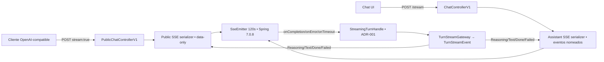

# ADR-002 — Endpoints SSE público e assistant com `reasoning_content` separado

> Unidade de decisão: 1 ADR = 1 branch = 1 PR (merge humano). Decision-only: `status: todo`, `unit: legacy`; sem SPEC/TASKS/código neste lote.
> Depende de ADR-001 (evento `TurnStreamEvent`, `TurnStreamGateway`, `StreamingTurnHandle`, gate por `@MemoryId`). Insumos: `PRD.md` §16 (`prd_version: 2`), `RESEARCH.md` (S1..S16), parecer `product-manager` 2026-11-26 (Q1–Q3). Q4/Q4 respondidos aqui.
> **Emenda 3 (2026-11-27)** — BugReview `chat-sse-consumer` (1 🔴): evento `done` do assistant passa a incluir `"sessionId"` quando não nulo, para vincular o primeiro turno na sidebar. Contrato do endpoint público inalterado; não revoga Emenda 1/ADR-001 nem E8′.

## 1. Decisão

| # | Decisão (inequívoca) |
|---|---|
| E1 | **Transporte A1 — `SseEmitter` do Spring MVC** (Spring Framework 7.0.8, via Spring Boot 4.1.0). `produces = "text/event-stream"`; `send(Object)` para chunks data-only do público; `send(event().name(...).data(...))` para os eventos nomeados do assistant; `complete()` como terminal. **A2 (`StreamingResponseBody`) fica como fallback declarado**, com critério de disparo em §7. `Flux`/WebFlux/`langchain4j-reactor` permanecem descartados (ADR-001 §8; S8). |
| E2 | **Handlers HTTP inalterados**: preflight (validação, allowlist, cota, prompt, resolve, `CHAT_SEND`) continua 400/403/404/409/429/500 em `application/json` **antes** de abrir o stream. Depois do 200 SSE, erro é **in-band** — status nunca muda (Q1). |
| E3 | **Público (Q2)**: `POST /v1/public/v1/chat/completions` (duplo `/v1` preservado) aceita `stream:true` e `stream_options`. Valida-se só `include_usage`; campos desconhecidos dentro de `stream_options` são ignorados (`unknown=false` do DTO não gera 400). Ordem do wire: chunks `delta.reasoning_content`, chunks `delta.content`, chunk de `finish_reason` com `delta:{}`, chunk terminal `choices: []` + `usage`, `data: [DONE]`, `emitter.complete()`. `completion_tokens_details.reasoning_tokens` **omitido** (S4). |
| E4 | **Assistant**: `POST /v1/chat/stream`, mesma autoridade `CHAT_SEND`, requisição `application/json`, resposta `text/event-stream`, eventos nomeados `thinking` / `text` / `done` / `error` a partir do **mesmo** `TurnStreamEvent` de ADR-001 (dois serializadores finos, nenhum mapper duplicado). |
| E5 | **Q1 — erro in-stream**: **`completeWithError(Throwable)` rejeitado**. No público: frame tipado `OpenAiError` (`{error:{code,type,param,message}}`) via `send(Object)` → `data: [DONE]` → `complete()`. No assistant: evento `error` nomeado → evento `done` → `complete()`. Nenhum handler HTTP é reexecutado após o stream abrir. |
| E6 | **Q3 — degradação**: sem thinking ⇒ **omitir** chunks/eventos de thinking; nunca frame vazio, nunca `reasoning_content: ""`, nunca evento `thinking` com texto nulo. `done`/`[DONE]` é o único sinal de conclusão (presente também no erro). Se o provider cancelar, não há usage nem `[DONE]` observáveis — cliente já foi embora (R6). |
| E7 | **Q4 — ordem**: o mapper **não ordena por tipo**; emite na ordem de chegada dos callbacks `onPartialThinking`/`onPartialResponse` (S2). Sem buffer, sem reordenação, sem garantia cross-provider de "thinking sempre antes de texto". A separação em canais é a garantia; a ordem relativa é a do provider normalizado (S14). |
| E8′ (alinhada à Emenda 1/ADR-001) | **timeout/cancel**: `new SseEmitter(120_000L)`; `onCompletion`, `onError` e `onTimeout` chamam `handle.cancel()` de ADR-001 (idempotente, degrada `UnsupportedFeatureException` — R1). `sink` não emite após terminal; emitter fechado pelo transporte. **No cancel degradado o gate NÃO é liberado**: `availablePermits() == 0` imediatamente após `cancel()`; `== 1` somente no terminal natural do provider ou após a janela de `5_000 ms` (≤120 s), o que vier primeiro (ADR-001 D7′/§6). |
| E9 (emenda 3 / BugReview 🔴) | **`done` do assistant com `sessionId` opcional**: `AssistantSseSerializer.done(...)` inclui `"sessionId"` no payload quando `TurnStreamEvent.Done.sessionId() != null` (valor vindo de `AssistantStreamServiceImpl.java:65`, `prepared.sessionId()`). Quando nulo, o campo é **omitido** — clients antigos e o terminal `doneWithoutUsage()` seguem válidos. `POST /v1/public/v1/chat/completions` **não** ganha campo novo: `sessionId` é consumo exclusivo do serializador assistant (ADR-001 §4.3). |

## 2. Motivo

- Um único tipo `SseEmitter` cobre os dois formatos exigidos pelo PRD (data-only compatível OpenAI e eventos nomeados), sem dependência nova e sem aresta `impl → impl` (RESEARCH §3, A1).
- Formato de erro, duplo `/v1` e `TurnReply` sem texto são fronteiras congeladas (PRD §6/§7; parecer Q1). `completeWithError` faria o Spring disparar resolução de exceção com response já comitada (S22) — incompatível com "formato de erro OpenAI inalterado" e com um terminal previsível para o cliente.
- Reordenar thinking/texto exigiria buffer de eventos e aumentaria a latência — e nenhum requisito do PRD pede precedência, só separação (RF3) e conclusão (RF4/RF7).

## 3. Fatos de API e versão (URL + consulta em 2026-11-26)

| ID | Afirmação | URL | Consulta | Versão aplicável |
|---|---|---|---|---|
| S9 | Schema OpenAI: `chat.completion.chunk`; `choices` pode ser vazio no último chunk com `stream_options.include_usage`; `usage` só no último chunk; `completion_tokens_details.reasoning_tokens` existe no schema upstream | `https://developers.openai.com/api/reference/resources/chat/subresources/completions/streaming-events/` | 2026-11-26 | doc atual, não versionada |
| S12 | `SseEmitter.send(Object)` = uma linha `data` sem nome; `send(event().name(...).data(...))` = evento nomeado; herdados `complete()`, `completeWithError`, `onCompletion`, `onError`, `onTimeout`; `SseEmitter(Long timeout)` | `https://docs.spring.io/spring-framework/docs/current/javadoc-api/org/springframework/web/servlet/mvc/method/annotation/SseEmitter.html` | 2026-11-26 | javadoc **current = 7.1.0** (não é a versão do projeto — ver R7) |
| S13 | `StreamingResponseBody.writeTo(OutputStream)` escreve direto sem prender thread do container; recomenda configurar `TaskExecutor` | `https://docs.spring.io/spring-framework/docs/current/javadoc-api/org/springframework/web/servlet/mvc/method/annotation/StreamingResponseBody.html` | 2026-11-26 | javadoc **current = 7.1.0** |
| S14 | Anthropic SSE nomeado: `thinking_delta` e `text_delta` distintos; `message_delta` com `usage` cumulativo; evento `error` pode vir dentro do stream | `https://platform.claude.com/docs/en/build-with-claude/streaming` | 2026-11-26 | doc oficial (`anthropic-version: 2026-10-21`) |
| S15 | DeepSeek: `stream:true` → data-only terminado por `data: [DONE]`; `stream_options` sem `stream:true` → `400`; campo `reasoning_content` existe | `https://api-docs.deepseek.com/api/create-chat-completion` | 2026-11-26 | doc oficial atual |
| S16 | MIME `text/event-stream`; `event:` nomeia; linhas `data:` consecutivas concatenadas com `\n`; `:` = comentário; `EventSource.close()` | `https://developer.mozilla.org/en-US/docs/Web/API/Server-sent_events/Using_server-sent_events` | 2026-11-26 | MDN, página alterada em 2026-09-03 |
| S20 **(novo)** | Spring Boot **4.1.0** traz **Spring Framework 7.0.8** (não 7.1.0) | `https://github.com/spring-projects/spring-boot/wiki/Spring-Boot-4.1-Release-Notes` | 2026-11-26 | Spring Boot 4.1.0 (notas editadas em 2026-11-20) |
| S21 **(novo)** | Na javadoc **7.0.8**: `send(Object)` = `data` line; `send(SseEventBuilder)`; `event()`; herdados `complete`/`completeWithError`/`onCompletion`/`onError`/`onTimeout` — assinaturas idênticas às de S12 | `https://docs.spring.io/spring-framework/docs/7.0.8/javadoc-api/org/springframework/web/servlet/mvc/method/annotation/SseEmitter.html` | 2026-11-26 | Spring Framework 7.0.8 |
| S22 **(novo)** | Na javadoc **7.0.8**: `complete()` completa o ciclo da requisição; `completeWithError(Throwable)` com response já comitada não pode mudar status; `onCompletion` dispara "for any reason including timeout and network error" | `https://docs.spring.io/spring-framework/docs/7.0.8/javadoc-api/org/springframework/web/servlet/mvc/method/annotation/ResponseBodyEmitter.html` | 2026-11-26 | Spring Framework 7.0.8 |
| S23 **(novo)** | Na javadoc **7.0.8**: `StreamingResponseBody.writeTo(OutputStream)` + recomendação explícita de configurar `TaskExecutor` | `https://docs.spring.io/spring-framework/docs/7.0.8/javadoc-api/org/springframework/web/servlet/mvc/method/annotation/StreamingResponseBody.html` | 2026-11-26 | Spring Framework 7.0.8 |

Fato local: `spring.boot.version = 4.1.0` em `backend/dependencies/pom.xml:25`. Controllers atuais só `application/json`: `PublicChatControllerV1.java:66-68`, `ChatControllerV1.java:41-52` (PRD §3).

### R7 resolvido

`RESEARCH.md` registrou a javadoc `current = 7.1.0` (S12/S13) e pediu checagem contra o projeto. O projeto fixa Spring Boot 4.1.0 (`pom.xml:25`); as notas oficiais indicam que essa versão traz Spring Framework **7.0.8** (S20). As assinaturas usadas neste ADR foram **reabertas na javadoc versionada 7.0.8** (S21/S22/S23) e são as mesmas. Nenhuma decisão depende do javadoc `current`.

## 4. Interface congelada — contratos dos endpoints

### 4.1 `POST /v1/public/v1/chat/completions` (público, OpenAI-compatible)

Request: corpo atual acrescido de `stream: true` e `stream_options: {"include_usage": true}`; desconhecidos dentro de `stream_options` ignorados. Preflight inalterado.

Response: `200 text/event-stream`. Sequência exata:

```json
// 1..N — thinking (omitido se o provider não emitir)
{"id":"chatcmpl-x","object":"chat.completion.chunk","created":1764153600,"model":"<model>",
 "choices":[{"index":0,"delta":{"reasoning_content":"..."},"finish_reason":null}],"usage":null}
// 1..N — texto (canal distinto)
{"id":"chatcmpl-x","object":"chat.completion.chunk","created":1764153600,"model":"<model>",
 "choices":[{"index":0,"delta":{"content":"..."},"finish_reason":null}],"usage":null}
// penúltimo — finish_reason sem conteúdo
{"id":"chatcmpl-x","object":"chat.completion.chunk","created":1764153600,"model":"<model>",
 "choices":[{"index":0,"delta":{},"finish_reason":"stop"}],"usage":null}
// último chunk — choices vazios + usage (Q2 / S9)
{"id":"chatcmpl-x","object":"chat.completion.chunk","created":1764153600,"model":"<model>",
 "choices":[],"usage":{"prompt_tokens":12,"completion_tokens":34,"total_tokens":46}}
```

```
data: [DONE]
```

Regras: zero `content` em chunk de thinking e zero `reasoning_content` em chunk de texto (RF3); `finish_reason` vem do `Done` de ADR-001 (S19); `usage` = `inputTokenCount`/`outputTokenCount`/`totalTokenCount` (S4), **`completion_tokens_details` ausente**. Penúltimo/último chunk emitidos mesmo sem thinking. `data: [DONE]` é literal, via `send("[DONE]")` — ver IT em §7.

Erro in-stream (Q1), mesmo formato dos handlers atuais:

```json
{"error":{"code":"stream_failed","type":"server_error","param":null,"message":"..."}}
```

seguido de `data: [DONE]` e `complete()`. `message` é texto de erro do sistema, **nunca** conteúdo de thinking. Status permanece 200.

### 4.2 `POST /v1/chat/stream` (assistant)

Request: mesmo payload do turno atual do assistant; autorização `CHAT_SEND`. Response: `200 text/event-stream`.

```
event: thinking
data: {"type":"thinking","text":"..."}

event: text
data: {"type":"text","text":"..."}

event: done
data: {"type":"done","finish_reason":"stop","usage":{"prompt_tokens":12,"completion_tokens":34,"total_tokens":46},"sessionId":"<uuid do turno>"}

event: error
data: {"type":"error","error":{"code":"stream_failed","message":"..."}}
```

`thinking` e `text` omitidos quando vazios (Q3). No erro: `error` → `done` → `complete()`; `done` sem `usage` se o provider não entregou (R6). Sem `completeWithError`. **Emenda 3:** `"sessionId"` aparece no `done` somente quando `Done.sessionId()` não é nulo; o exemplo acima mostra o caso do primeiro turno assistant, em que o frontend precisa do UUID para vincular a conversa na sidebar. `doneWithoutUsage()` (terminal de erro) segue sem o campo — não cria conversa nova. O contrato público (§4.1) permanece exatamente como escrito: nenhum `sessionId` no chunk final OpenAI-compatible.

### 4.3 Regras comuns congeladas

1. `TurnStreamEvent` de ADR-001 é a **única** fonte; serializadores são funções puras `Reasoning|Text|Done|Failed → frame`. Nenhum acesso a `ScopedValue` no callback; tenant/usuário/turnId vêm do request capturado.
2. Ordem = chegada de callback (Q4/E7). Nenhum buffer, nenhuma ordenação por tipo.
3. `handle.cancel()` em `onCompletion`/`onError`/`onTimeout`; `sink` mudo após terminal; degradação R1 sem `Failed`. Custódia do gate segue ADR-001 D7′/§6 — o transporte não libera permit: `availablePermits() == 0` no cancel degradado e `== 1` só no terminal natural ou na janela de 5 s.
4. Nenhum log/trace/JPA com texto de pensamento; redator dos spans continua valendo.
5. Duplo `/v1`, formato de erro, cotas, MFA, `TurnReply` sem texto: inalterados.
6. **Modelo de dados**: zero tabela/coleção/migration nova. Estado do stream é `SseEmitter` + `AtomicBoolean` efêmeros; usage lido de `TokenUsage`; pensamento nunca persistido.
7. Mesmo contrato de turno para público e assistant: o que muda é o serializador, não o domínio.

## 5. Q4 — ordem thinking → texto

**Resposta: não há ordenação pelo mapper.** A ordem de emissão é a ordem dos callbacks do `TokenStream` (S2), preservada pelo `sink` até o serializador. Anthropic separa `thinking_delta` de `text_delta` e usa blocos com `index` (S14), mas essa é uma assertiva sobre o provider; o contrato do hive não promete precedência de thinking em nenhum provider (Gemini pode não emitir — S10/ADR-001).

Garantias congeladas: (a) canais distintos sempre; (b) nenhum frame vazio; (c) `done`/`[DONE]` após qualquer conteúdo que tenha chegado; (d) se o provider emitir texto antes de thinking, o cliente vê texto antes de thinking — e isso **não** é bug. Reordenar exigiria reter eventos (latência + memória de texto de pensamento), o que o PRD exclui.

## 6. Diagrama de componentes



## 7. Fallback A2 e critério de disparo

`StreamingResponseBody` (S13/S23) é **reserva**, não escolha. Critérios de disparo — todos verificáveis por IT, nenhum por preferência:

1. IT de `[DONE]` literal falha: o `HttpMessageConverter` não entrega `data: [DONE]` para `send("[DONE]")`; **ou**
2. IT de disconnect real falha: `onCompletion` não dispara quando o cliente fecha a conexão (browser/proxy), apenas em `complete()`; **ou**
3. `complete()` não encerra o stream sem recorrer a `completeWithError` (S22).

Se qualquer critério acionar: **abrir ADR-003 (ou emenda deste) antes de trocar** — framing manual muda o contrato de wire e exige `TaskExecutor` explícito (S23). Troca silenciosa é proibida. Custo estimado do fallback: médio (framing/flush/escape manuais, menos ergonômico em `MockMvc`), sem ganho sobre A1 quando os critérios não acionam.

## 8. Alternativas descartadas

| Alternativa | Veredito | Motivo |
|---|---|---|
| A2 `StreamingResponseBody` como escolha principal | Reserva (§7) | Reimplementa framing que `SseEmitter` já faz (S21/S16); mais superfície para bug de wire |
| A3 `Flux<ServerSentEvent>` / WebFlux / `langchain4j-reactor` | Rejeitada | Módulo inexistente na tag 1.19.0 (S8); fora do PICCO (PRD §2/§7) |
| `completeWithError(Throwable)` como terminal | **Rejeitada por Q1** | Response comitada, status imutável (S22); quebra formato de erro OpenAI (PRD §6) |
| Reordenar thinking antes de texto no mapper | Rejeitada (Q4) | Buffer de texto de pensamento + latência; sem requisito no PRD |
| `choices` com 1 item no último chunk (variant DeepSeek) | Rejeitada | Contrato do hive é OpenAI-compatible (PRD §9; Q2/S9); R5 resolvido por IT de paridade |
| `completion_tokens_details.reasoning_tokens` no usage | Rejeitada | `TokenUsage` 1.19.0 não expõe (S4); omitir e documentar (Q2) |
| Frame vazio quando não há thinking | Rejeitada | Q3: degradação silenciosa por omissão, nunca frame vazio |

## 9. Consequências se estiver errado

- **`[DONE]` não literal**: clientes OpenAI-compatible não encerram e ficam presos até o timeout — IT §7.1 é gate de saída; fallback A2 é local ao controller.
- **`onCompletion` não disparar no disconnect**: provider não é cancelado (RF5 falha) e sessão fica com o gate ocupado até o terminal natural ou a janela de 5 s de ADR-001 §6 (teto 120 s) — IT §7.2 + `availablePermits()` do ADR-001.
- **Ordem reordenada**: latência e risco de reter pensamento em memória; reversível (remover buffer).
- **Erro em `completeWithError`**: muda o formato de erro para o cliente e pode gerar 500 após 200; reversível mas com impacto imediato — por isso proibido.
- **Versão Spring**: se o projeto de fato resolver 7.1.x em vez de 7.0.8, S21/S22/S23 precisam ser reabertos; as assinaturas usadas são idênticas nas duas versões consultadas, logo o risco é baixo.

## 10. Como verificar

1. ITs `MockMvc` async: `MockMvc` com `asyncStarted` + asserção de chunks; `Content-Type: text/event-stream`; `data: [DONE]` literal; zero `content` em `reasoning_content` e vice-versa (RF3).
2. IT de cancel real: fechar o cliente e asserir `StreamingHandle.cancel()` (ou a degradação R1). **E8′**: `availablePermits() == 0` imediatamente após o cancel degradado; `== 1` somente no terminal natural do provider ou após a janela de 5 s (testar os dois caminhos), sem dupla liberação (ADR-001 §6).
3. IT de erro in-stream: frame `OpenAiError` → `[DONE]` → `complete()`; `completeWithError` ausente no código (`grep -r 'completeWithError' backend/**/web/**` → zero).
4. IT de `stream_options`: `{"include_usage":true,"future_flag":1}` → 200, sem 400; `unknown=false` preservado.
5. IT de concorrência sync×stream (RF8, ADR-001 §5); IT de degradação R1 (ADR-001 §6).
6. `grep -r 'Flux\|reactor\|reasoning_tokens' backend/**/web/** backend/**/publicapi/**` → zero (exceto documento de decisão).
7. Emenda 3: IT `MockMvc` do assistant assere `done.sessionId == prepared.sessionId()` quando o gateway emite o UUID; IT de `Done` com `sessionId == null` assere campo **ausente**; IT do endpoint público assere nenhum `"sessionId"` no chunk final. `grep -n 'sessionId' backend/assistant/web/internal/v1/**/AssistantSseSerializer.java` → presente somente em `done(...)`.
8. `npm test` EXIT=0; H3 quando aplicável; `code-reviewer` sem 🔴 (Emenda 3 fechada); zero diff de handlers HTTP, MFA e migrations.

## 11. Fora desta decisão

Cliente/provider e mapper (ADR-001); UI frontend (outra sessão); mudança de status codes; `TurnReply` com texto; persistência de thinking; moderação por chunk; bump/upgrade; troca para A2 sem ADR; branch/PR; `workflow-state.json`; SPEC/TASKS.

- **depende-de**: ADR-001 (evento `TurnStreamEvent`, `TurnStreamGateway`, `StreamingTurnHandle`, gate owner-free por `@MemoryId`).
- **Status**: todo (decision-only; `unit: legacy`).
