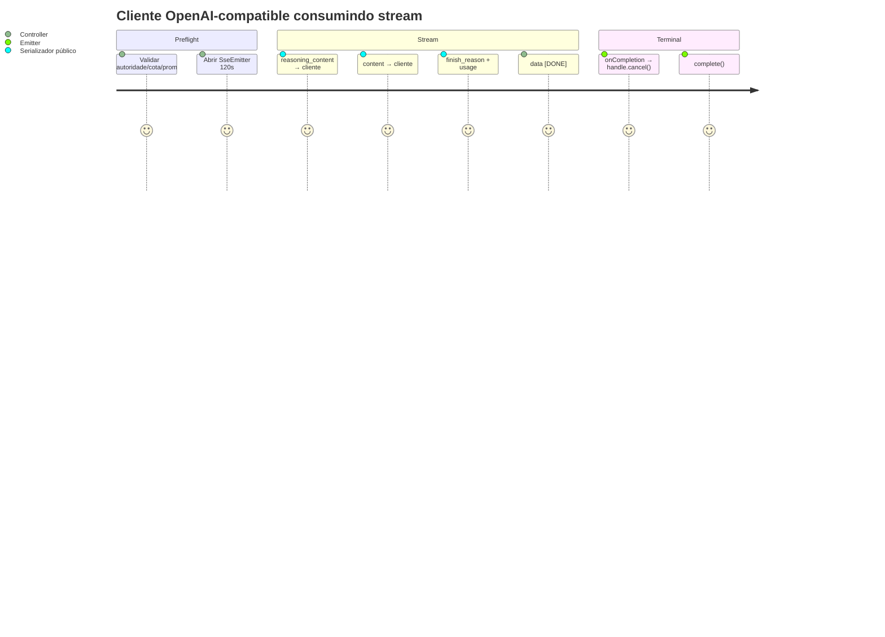

# SPEC — ADR-002 — Endpoints SSE público e assistant com `reasoning_content` separado

> **Natureza.** Especificação **da decisão ADR-002**. `TurnStreamEvent` de ADR-001 é a única fonte; este ADR
> só serializa. Todo `RF`/`NFR` declara origem exata (decisão E#, regra comum §4.3, Q1/Q3/Q4 §5/§6 ou verificação §10).
> Critério de aceite é comando ou asserção — sem adjetivo sem medição. `PLAN.md` não existe neste ciclo.
>
> **Insumo P1 (security review — `passed_with_findings`, zero 🔴).** F1→RF-10/NFR-02, F2→RF-09,
> F3→RF-08/WF6 (emenda de D7'), F5→RF-03/RF-11, F6→NFR-06. F7 (frontend: `fetch` com `Authorization`,
> não `EventSource` com token na query) é débito fora do lote — §15; sem task. **Emenda 1 já no ADR-001**
> (D7/§6: gate retido, janela de 5 s, `sinkClosed`/`gateReleased`); ADR-002 E8 ainda não foi alinhado —
> esta SPEC antecipa E8'; divergência ao orquestrador.

---

## 1. Architecture Decision Records (ADRs)

| ID | Decisão (ADR) | Porquê verificável (fonte, consulta 2026-11-26) |
|---|---|---|
| E1 | `SseEmitter` Spring MVC: `produces="text/event-stream"`, `send(Object)` data-only, `send(event().name(...).data(...))` nomeado, `complete()` terminal, `new SseEmitter(120_000L)`; A2 `StreamingResponseBody` fica como fallback declarado | Assinaturas idênticas na javadoc 7.0.8 (S21) e 7.1.0 (S12); Boot 4.1.0 ⇒ Framework 7.0.8 (S20) |
| E2 | Preflight inalterado (400/403/404/409/429/500 em `application/json`) **antes** de abrir stream; após 200 SSE, erro é in-band e status nunca muda | Handlers atuais `PublicChatControllerV1.java:66-68`, `ChatControllerV1.java:41-52`; Q1 (erro in-stream) |
| E3 | Público `POST /v1/public/v1/chat/completions` (duplo `/v1`): `stream:true` + `stream_options`; validar só `include_usage`, desconhecidos ignorados; ordem do wire = thinking → texto → finish_reason → `choices:[]`+usage → `[DONE]` → `complete()`; `reasoning_tokens` omitido | Schema OpenAI (S9), DeepSeek (S15), gap `TokenUsage` (S4, ADR-001) |
| E4 | Assistant `POST /v1/chat/stream`, autoridade `CHAT_SEND`, request `application/json`, response `text/event-stream`; eventos `thinking`/`text`/`done`/`error` do **mesmo** `TurnStreamEvent` | S12/S16; nenhum mapper duplicado (ADR-002 §4.3 regra 1) |
| E5 | Q1: `completeWithError(Throwable)` rejeitado. Público: `OpenAiError` → `[DONE]` → `complete()`; assistant: `error` → `done` → `complete()`. Nenhum handler reexecutado após abertura | Response comitada, status imutável (S22); formato de erro OpenAI inalterado (PRD §6) |
| E6 | Q3: sem thinking ⇒ omitir chunks/eventos; nunca frame vazio, nunca `reasoning_content: ""`, nunca `thinking` com texto nulo; `done`/`[DONE]` único sinal de conclusão; cancel sem usage/`[DONE]` observáveis (R6) | Degradação silenciosa (RESEARCH R3); S9 (usage pode não chegar) |
| E7 | Q4: mapper **não** ordena por tipo; ordem = chegada dos callbacks `onPartialThinking`/`onPartialResponse`; sem buffer, sem reordenação | `TokenStream` callbacks (S2, ADR-001); `thinking_delta`/`text_delta` separados (S14) |
| E8 | `onCompletion`/`onError`/`onTimeout` chamam `handle.cancel()` (idempotente, degrada R1); `sink` mudo após terminal | `SseEmitter` herdados (S21); `StreamingTurnHandle` (ADR-001 §4/§6) |
| E8' (**emenda P1/F3 pendente no ADR-002**) | Em `UnsupportedFeatureException`: emitter fechado pelo transporte, `sinkClosed` silencia callbacks, **sem liberar o gate**; `gateReleased` CAS libera no terminal natural ou janela de `5_000 ms` (≤120 s), o que vier primeiro; `availablePermits() == 0` imediatamente após cancel e `== 1` só no terminal/janela; contador `stream.cancel.unsupported` | Segurança P1 F3 — cliente foi embora, mas provider segue gerando com `ChatMemory` em uso (S6); gate livre corrompe memória e cobra custo extra |

> ADR-001 D7 já foi emendado (Emenda 1, 2026-11-26); ADR-002 E8/`§10` ainda reflete a regra pré-emenda
> (`availablePermits() == 1` no cancel). E8' alinha o transporte ao D7' vigente; divergência ao orquestrador.

## 2. Domain Context, Tenant Strategy & Provisioning

- **Bounded context**: transporte HTTP/SSE nos módulos `publicapi/web/internal/v1` e `assistant/web/internal/v1`; domínio de turno permanece em `ai/api` (ADR-001). Serializadores são funções puras de `TurnStreamEvent → frame`.
- **System type**: controllers Spring MVC (`SseEmitter`) + serializadores finos; nenhum tipo de `ai/**` é alterado.
- **Tenant provisioning**: `N/A — nenhum tenant criado; tenant/usuário/turnId vêm do request capturado antes do stream, não de `ScopedValue` no callback (ADR-002 §4.3 regra 1)`.
- **Tenant lifecycle**: `N/A — sem transição de tenant; isolamento por `@MemoryId`/gate de ADR-001, inalterado aqui`.

## 3. Identity & Access Management (IAM)

- **IdP/protocolo/MFA/tokens**: inalterados. Override H3 registrado permanece fora deste ADR (PRD §14).
- **Autoridade**: `CHAT_SEND` nos dois endpoints (público via chave de API existente + preflight; assistant via autoridade existente). Nenhuma permissão nova.
- **RBAC**: nenhuma linha nova na matriz; nenhum `@HasPermission` novo.
- **Gate do portão (item IAM)**: ✅ — modelo de autenticação do destino = `CHAT_SEND`, definido e inalterado; preflight 400/403/404/409/429/500 preservado antes do `text/event-stream`.

## 4. Security, Key Management (KMS) & Disaster Recovery

- **Key Management / ciclo / rotação / BDR**: `N/A — nenhuma chave, backup, RTO ou RPO novo neste ADR; estado do stream é `SseEmitter` + `AtomicBoolean` efêmeros`.
- **Segurança aplicável**: nenhum log/trace/JPA com texto de pensamento; redator de spans continua valendo; `TurnReply` sem texto; duplo `/v1`, cotas e MFA inalterados (ADR-002 §4.3 regras 4/5).

## 5. Data Model & Concurrency

**ERD**: `N/A — zero tabela/coleção/migration nova; estado do stream é `SseEmitter` + `AtomicBoolean` em memória (ADR-002 §4.3 regra 6)`.

### Concorrência e consistência

| Alvo | Operação | Estratégia | Rationale (mediável) |
|---|---|---|---|
| `SseEmitter` | emissão | `send(Object)` / `send(event()...)`; um `sink` por request | Serializadores puros; nenhum acesso a `ScopedValue` no callback |
| `AtomicBoolean terminal` | disconnect/erro/timeout | `compareAndSet(false, true)` | `handle.cancel()` chamado uma vez; nenhum `send` após `complete()` |
| `StreamingTurnHandle` (ADR-001) | cancelamento | idempotente, degrada `UnsupportedFeatureException` | `availablePermits() == 0` após `cancel()` e `== 1` só no terminal natural ou janela de `5_000 ms` (≤120 s), o que vier primeiro (D7'/E8', F3) |
| `tenantId+clientId` + `ChatRateLimiter` (F2) | admissão antes de abrir emitter | cota por request existente + concorrência por par + `MAX_CALLS=10`/60 s no assistant (`ChatRateLimiter.java:17-25`) | IT N streams paralelos → 429 em JSON; zero emitter aberto quando 429 |

## 6. Event Model, Integrations & Messaging Isolation

- **Isolamento**: cada request tem seu `SseEmitter` e seu `sink`; chave de exclusão é o `@MemoryId` de ADR-001. Nenhum frame cruza requests.
- **Delivery guarantee**: `N/A — nenhum broker/outbox; `TurnStreamEvent` é entregue por `Consumer` in-process (ADR-001 §4)`.
- **Integrações**: `TurnStreamGateway.stream(...)` → `TurnStreamEvent` → serializador público (data-only) ou assistant (nomeado) → `SseEmitter` → `handle.cancel()` nos gatilhos terminais.

### Event Registry (frames do wire)

| Evento de origem | Produtor | Consumidor | Payload do frame | Idempotência |
|---|---|---|---|---|
| `TurnStreamEvent.Reasoning` | `PublicSseSerializer` / `AssistantSseSerializer` | cliente HTTP | público: `chat.completion.chunk` com `delta.reasoning_content`, `finish_reason:null`, `usage:null`; assistant: `event: thinking` + `{"type":"thinking","text":"..."}` | omitido se texto vazio (E6) |
| `TurnStreamEvent.Text` | idem | idem | público: `delta.content`; assistant: `event: text` | omitido se texto vazio (E6) |
| `TurnStreamEvent.Done` | idem | idem | público: chunk `delta:{}` + `finish_reason`, depois chunk `choices:[]`+`usage`, depois `data: [DONE]`; assistant: `event: done` | `AtomicBoolean` impede frame após terminal |
| `TurnStreamEvent.Failed` | idem | idem | público: `OpenAiError` com `code` de conjunto fechado, `type="server_error"`, `param=null`, `message` = código fixo → `[DONE]`; assistant: `event: error` → `event: done` | `message` nunca derivado de `Throwable.getMessage()`/`printStackTrace()`, nunca pensamento (F1/F5) |
| Sentinela | controller | cliente HTTP | `data: [DONE]` via `send("[DONE]")` | literal; IT de paridade (ADR-002 §7.1) |

## 7. Invariants & Property-Based Testing (PBT)

### 7.1 Invariantes de entidade

`N/A — nenhuma entidade persistida neste ADR. Invariantes equivalentes sobre os frames:`

| Frame | Propriedade | Descrição mediável |
|---|---|---|
| Chunk de thinking | F1 | `delta.reasoning_content` não nulo/não vazio **e** `delta.content` ausente (zero `content` em thinking) |
| Chunk de texto | F2 | `delta.content` não nulo/não vazio **e** `delta.reasoning_content` ausente |
| Chunk de usage | F3 | `choices: []`; `usage` = `prompt_tokens`/`completion_tokens`/`total_tokens`; `completion_tokens_details` ausente (S4) |
| Chunk de erro | F4 | `error.code` ∈ conjunto fechado de `FailureClassifier.causeCode`, `error.type="server_error"`, `error.param=null`, `error.message` = código fixo (nunca `Throwable.getMessage()`); token único de thinking ausente nos 4 destinos (F1/F5) |
| Evento nomeado | F5 | campo `event:` ∈ {`thinking`,`text`,`done`,`error`}; `data` é JSON com `type` igual ao nome |

### 7.2 Invariantes de workflow

- **WF1 (preflight)**: nenhum `SseEmitter` é criado antes de 400/403/404/409/429/500; erros de preflight saem em `application/json`.
- **WF2 (status)**: depois de `200 text/event-stream`, nenhum handler HTTP é reexecutado e status permanece 200 (E2/E5).
- **WF3 (ordem)**: emissão na ordem de chegada dos callbacks; zero buffer, zero ordenação por tipo (E7/Q4).
- **WF4 (degradação)**: zero frame vazio; sem thinking ⇒ zero chunks `reasoning_content` e zero eventos `thinking` (E6/Q3).
- **WF5 (terminal)**: `done`/`[DONE]` presente após qualquer conteúdo que chegou e também no erro; `complete()` é o último ato; zero `send` após `complete()` (E5/E8).
- **WF6 (cancel — F3)**: `onCompletion`/`onError`/`onTimeout` ⇒ `handle.cancel()` uma vez; `UnsupportedFeatureException` degradada sem `Failed`; `availablePermits() == 0` após `cancel()`, `== 1` só no terminal natural ou janela de `5_000 ms` (≤120 s), o que vier primeiro (D7'/E8').
- **WF7 (fallback)**: troca para A2 `StreamingResponseBody` exige ADR-003 ou emenda; nenhuma troca silenciosa (ADR-002 §7).
- **WF8 (F2 — admissão)**: cota por request preservada **e** concorrência por `tenantId+clientId` antes de abrir o emitter; assistant reusa `ChatRateLimiter` (`MAX_CALLS=10`/60 s); teto server-side de `maxTokens`/frames; headers de cota presentes no 200; N streams paralelos → 429 em JSON com zero emitter aberto.
- **WF9 (F5 — erro/stream_options)**: `OpenAiError` reusado, `message` = código fixo, `type=server_error`, `param=null`; `stream_options` aceita `ignoreUnknown=true` aninhado; IT com SDK OpenAI real.
- **WF10 (F6 — contadores)**: `stream.failed`/`stream.timeout`/`stream.client_abort` sem conteúdo, ligados ao redator; nenhum rótulo com `Throwable` ou thinking.
- **WF11 (F7 — débito)**: frontend deve usar `fetch` com `Authorization`; `EventSource` com token na query é proibido. Fora do lote — §15; nenhuma task aqui.

### 7.3 Gerador de dados de teste

| Campo | Tipo | Restrição | Objetivo PBT |
|---|---|---|---|
| `stream` | `boolean` | `true` habilita SSE; sem `stream:true`, comportamento atual preservado | WF1 |
| `stream_options` | objeto | validar só `include_usage`; `future_flag` arbitrário é ignorado (`unknown=false`) | WF1 |
| `delta.reasoning_content` | `String` | `ensureNotEmpty` (S3, ADR-001); ausente quando provider não emite | F1/WF4 |
| `delta.content` | `String` | não vazio; ausente em chunk de thinking | F2/WF4 |
| `usage` | `int` × 3 | `prompt_tokens`/`completion_tokens`/`total_tokens` (S4) | F3 |
| `finish_reason` | `String` | de `ChatResponse` (S19); propagado no penúltimo chunk | F3 |
| sentinela | `String` | literal `[DONE]`, via `send("[DONE]")` | WF5 |
| `error.code` | `String` | conjunto fechado de `FailureClassifier.causeCode`; `message` = código fixo | F1/WF9 |
| `tenantId+clientId` | par de `UUID` | chave de concorrência antes de abrir emitter | WF8 |
| `stream_options.ignoreUnknown` | `boolean` | `true` aninhado; desconhecidos não geram 400 | WF9 |

## 8. Functional Requirements & Core Journeys

| ID | Requisito (mediável) | Origem ADR | Como medir |
|---|---|---|---|
| RF-01 | Transporte A1: `SseEmitter` nos dois controllers, `produces="text/event-stream"`, `new SseEmitter(120_000L)`; `send(Object)` data-only no público, `send(event().name(...).data(...))` no assistant, `complete()` terminal | E1; §4 | IT `MockMvc` async: `asyncStarted == true`, `Content-Type: text/event-stream`; `grep -r 'SseEmitter' backend/**/web/**` → 2 controllers |
| RF-02 | Preflight inalterado: 400/403/404/409/429/500 em `application/json` antes de abrir stream; depois do 200, erro in-band e status nunca muda; headers de cota presentes no 200 | E2; F2 | IT `PublicApiErrorContractIT`/`ChatContractIT`: 5 códigos com `Content-Type: application/json`; IT de erro in-stream com status 200 e headers de cota |
| RF-03 | Público `POST /v1/public/v1/chat/completions`: `stream:true` aceito; `stream_options` valida só `include_usage`, desconhecidos ignorados com `ignoreUnknown=true` aninhado; ordem: thinking → texto → `delta:{}`+finish_reason → `choices:[]`+usage → `[DONE]` → `complete()`; `reasoning_tokens` omitido | E3; §4.1; F5 | IT com `{"include_usage":true,"future_flag":1}` e `ignoreUnknown=true` → 200 sem 400; asserção da sequência de chunks; `grep -r 'reasoning_tokens' backend/**/web/** backend/**/publicapi/**` → 0 |
| RF-04 | Assistant `POST /v1/chat/stream`: autoridade `CHAT_SEND`, request `application/json`, response `text/event-stream`, eventos `thinking`/`text`/`done`/`error` gerados pelo mesmo `TurnStreamEvent`; serializadores são funções puras, nenhum mapper duplicado | E4; §4.2 | IT com `CHAT_SEND`; `grep -r 'TurnStreamEventMapper' backend/**/web/**` → 0; `grep -r 'event:' backend/**/web/**/serializer/**` → 4 nomes |
| RF-05 | Q1: `completeWithError` rejeitado. Público: `OpenAiError` reusado → `[DONE]` → `complete()`, `type=server_error`, `param=null`, `message` = código fixo do conjunto fechado; assistant: `error` → `done` → `complete()`; nenhum texto de `Throwable` ou thinking em frame/log/trace | E5; §4.1/§4.2; F1/F5 | IT de erro in-stream (status 200, ordem dos frames, `message` igual ao código); `grep -r 'completeWithError\|getMessage()\|printStackTrace()' backend/**/web/**` → 0 |
| RF-06 | Q3: sem thinking ⇒ omitir chunks/eventos; zero frame vazio, zero `reasoning_content: ""`, zero `thinking` com texto nulo; `done`/`[DONE]` é o único sinal de conclusão; cancel sem usage/`[DONE]` observáveis (R6) | E6; §4.3 regra 4 | IT com fake sem `PartialThinking`: zero chunks de thinking; zero frames com `""`; asserção de que `done`/`[DONE]` é o último sinal |
| RF-07 | Q4: ordem = chegada dos callbacks; nenhum buffer, nenhuma ordenação por tipo, nenhuma promessa cross-provider de precedência | E7; §5 | IT com fake que emite texto antes de thinking: cliente vê `content` antes de `reasoning_content`; `grep -r 'sort\|buffer' backend/**/web/**/serializer/**` → 0 |
| RF-08 | `onCompletion`/`onError`/`onTimeout` ⇒ `handle.cancel()` idempotente; `sink` mudo após terminal; degradação R1 sem `Failed`; gate **não** liberado no cancel — `availablePermits() == 0` após `cancel()`, `== 1` só no terminal natural ou janela de `5_000 ms` (≤120 s), o que vier primeiro | E8' (emenda F3); §4.3 regra 3 | IT de disconnect real: `cancel()` chamado 1 vez (ou degradação) e `availablePermits() == 0`; `== 1` só no terminal; nenhum `send` após `complete()` |
| RF-09 | F2: cota por request mantida + concorrência por `tenantId+clientId` antes de abrir emitter; `ChatRateLimiter` reutilizado no assistant; teto server-side de `maxTokens`/frames; headers de cota no 200 | F2; `ChatRateLimiter.java:17-25` | IT com N streams paralelos → 429 em `application/json` e zero emitter aberto; IT disconnect → `availablePermits() == 1` no terminal |
| RF-10 | Canário F1: token único de thinking e segredo em `Throwable` não aparecem em log, `ChatTrace.failure`, spans OTLP nem JPA; serializador de erro deriva `code` de conjunto fechado | F1; `FailureClassifier.java:18-23`; `TextRedactor.java:59-65` | `StreamingSseRedactionIT`: zero ocorrências nos 4 destinos; `grep -r 'getMessage()\|printStackTrace()' backend/**/web/**` → 0 |
| RF-11 | F5: erro in-stream usa `OpenAiError` reusado com `message` = código fixo; `stream_options` com `ignoreUnknown=true` aninhado; compatibilidade validada com SDK OpenAI real | F5 | IT com SDK OpenAI real: stream com erro e com opções desconhecidas → 200, sem exceção de parsing |

## 9. Non-Functional Requirements

| ID | Requisito (mediável) | Origem ADR | Como medir |
|---|---|---|---|
| NFR-01 | Compatibilidade: formato de erro OpenAI inalterado; duplo `/v1` preservado; `choices:[]` + usage sem `completion_tokens_details.reasoning_tokens` | E3/E5; §4.3 regra 5; S9/S15 | IT de paridade de contrato: caminho exato `/v1/public/v1/chat/completions`; frame `OpenAiError` idêntico ao handler atual; `grep -r 'completion_tokens_details' backend/**` → 0 |
| NFR-02 | Segurança: zero log/`ChatTrace.failure`/spans/JPA com texto de pensamento ou `Throwable.getMessage()`; redator nos spans; `CHAT_SEND` e MFA inalterados; apiKey nunca em frame/log (F1/F4) | §4.3 regras 4/5; F1 | `StreamingSseRedactionIT` com token único → zero ocorrências nos 4 destinos; `grep -r 'getMessage()\|printStackTrace()\|apiKey' backend/**/web/**` → 0; `git diff` de handlers HTTP/MFA → 0; `code-reviewer` sem 🔴 |
| NFR-03 | Versão/stack: Spring Framework 7.0.8 via Boot 4.1.0; zero `Flux`/WebFlux/`langchain4j-reactor`; A2 apenas via ADR-003 | E1; §7; S8/S20/S21/S23 | `git diff backend/dependencies/pom.xml` → 0 linhas; `grep -r 'Flux\|reactor' backend/**/web/** backend/**/publicapi/**` → 0; `grep -r 'StreamingResponseBody' backend/**` → 0 |
| NFR-04 | Modelo de dados: zero tabela/coleção/migration; estado em `SseEmitter` + `AtomicBoolean`; usage lido de `TokenUsage` | §4.3 regra 6 | `find backend -path '*dbupdate*' -name 'V*'` → 0 novos; zero `@Entity` em serializadores/controllers |
| NFR-05 | Observabilidade/paridade: `TurnReply` sem texto; mesmo contrato de turno para público e assistant — só muda o serializador | §4.3 regra 7; PRD §6 | `git diff` de `TurnReply.java` → 0 linhas; IT de paridade usa o mesmo `TurnStreamEvent` nos dois endpoints |
| NFR-06 | Contadores sem conteúdo `stream.failed`/`stream.timeout`/`stream.client_abort`, ligados ao redator; nenhum rótulo com thinking ou `Throwable` | F6 | `ChatMetricsExposureIT`: 3 contadores sem conteúdo e redator acionado; `grep -r 'Reasoning\|getMessage()' backend/**/web/**` → 0 em rótulos |

## 10. Critérios de Aceite Executáveis

| AC | Comando / asserção | Esperado |
|---|---|---|
| AC-01 | `npm test` (canônico em `harness.config.json:14`) | `EXIT=0`, 0 falhas |
| AC-02 | IT `MockMvc` async nos 2 controllers | `asyncStarted == true`; `Content-Type: text/event-stream` |
| AC-03 | IT `data: [DONE]` literal | linha exata `data: [DONE]`; nenhum escape extra |
| AC-04 | IT de canais | zero `content` em chunk de thinking e zero `reasoning_content` em chunk de texto |
| AC-05 | IT de erro in-stream | frame `OpenAiError` → `[DONE]` → `complete()`; status 200; `type=server_error`, `param=null`, `message` = código fixo; `grep -r 'completeWithError' backend/**/web/**` → 0 |
| AC-06 | IT de `stream_options` | `{"include_usage":true,"future_flag":1}` + `ignoreUnknown=true` → 200; SDK OpenAI real sem erro de parsing |
| AC-07 | IT de cancel real | `handle.cancel()` 1 vez (ou degradação R1); `availablePermits() == 0` após cancel, `== 1` só no terminal/janela de `5_000 ms` (≤120 s), o que vier primeiro (F3) |
| AC-08 | IT de degradação sem thinking | zero chunks/eventos vazios; `done`/`[DONE]` presente |
| AC-09 | `grep -r 'Flux\|reactor\|reasoning_tokens' backend/**/web/** backend/**/publicapi/**` | 0 linhas |
| AC-10 | `git diff --stat` em handlers HTTP, MFA, `pom.xml` e `dbupdate/**` | 0 linhas |
| AC-11 | `code-reviewer` no diff do ADR-002 | 0 achados 🔴 |
| AC-12 (F1) | `npm test -- StreamingSseRedactionIT`; token único + `Throwable` sensível | zero ocorrências em log/`ChatTrace.failure`/spans/JPA; `grep -r 'getMessage()\|printStackTrace()' backend/**/web/**` → 0 |
| AC-13 (F2) | IT com N streams paralelos por `tenantId+clientId` | N-1 retornam 429 em `application/json`; zero emitter aberto nos 429; headers de cota no 200; IT disconnect → `availablePermits() == 1` no terminal |
| AC-14 (F5) | IT com SDK OpenAI real | `OpenAiError` com `message` = código fixo, `stream_options` aninhado aceito, sem exceção de parsing |
| AC-15 (F6) | `npm test -- ChatMetricsExposureIT` | `stream.failed`/`stream.timeout`/`stream.client_abort` sem conteúdo; redator acionado |

## 11. Test Strategy

- **Integração assíncrona** (`backend/integration-test/src/test/java/br/com/systec/hive/integrationtest/`): `MockMvc` com `asyncStarted` + asserção de chunks/eventos; `Content-Type`, `[DONE]` literal, canais separados, ordem de callback, degradação sem thinking.
- **Cancel/disconnect**: IT fecha conexão e assere `StreamingHandle.cancel()` (ou R1) e `availablePermits() == 0` após cancel, `== 1` só no terminal — reusa `SessionConcurrencyIT`/`CancelUnsupportedDegradationIT` de ADR-001 com a asserção F3.
- **Erro in-stream**: IT de frame `OpenAiError` → `[DONE]` → `complete()` e de evento `error` → `done` → `complete()`; `message` = código fixo; checagem estática de ausência de `completeWithError`/`getMessage()`.
- **Canário (F1)**: `StreamingSseRedactionIT` com token único nos 4 destinos; `Throwable` sensível usado apenas para derivar `code`.
- **Cota/concorrência (F2)**: IT com N streams paralelos por `tenantId+clientId`, 429 em JSON, headers de cota no 200, teto de `maxTokens`/frames.
- **SDK real (F5)**: IT de compatibilidade com cliente OpenAI real para erro in-stream e `stream_options` aninhado.
- **Paridade de contrato**: `PublicApiErrorContractIT`, `ChatSpanContractIT`, `ChatMetricsExposureIT` (F6), `RedactionCanaryIT`.
- **Comando canônico**: `npm test` (`harness.config.json:14` → `commands.suiteFull`). Gate de saída: AC-01..AC-15 + `code-reviewer` sem 🔴.
- **Evidência proibida**: nenhuma asserção que leia texto de pensamento de log/trace/JPA; somente Ausência/contagem de frames.

## 12. Delta Specs

`NENHUM delta aplicável — nenhum documento vivo (.agents/rules/**, AGENTS.md, DESIGN.md) é alterado por esta decisão.`

| Documento | ADDED | MODIFIED | REMOVED |
|---|---|---|---|
| `.agents/rules/**` | 0 | 0 | 0 |
| `AGENTS.md` | 0 | 0 | 0 |

> No archive, nada a mesclar desta seção. Contrato dos endpoints permanece documentado no ADR-002 §4.

## 13. Rastreabilidade RF/NFR ↔ ADR ↔ TASKS

| Requisito | Origem no ADR | Ticket |
|---|---|---|
| RF-01 | E1, §4 | SSE-01 |
| RF-02 | E2 | PRE-02 |
| RF-03 | E3, §4.1 | PUB-03 |
| RF-04 | E4, §4.2 | AST-04 |
| RF-05 | E5, §4.1/§4.2 | ERR-05 |
| RF-06 | E6, §4.3 regra 4 | OMIT-06 |
| RF-07 | E7, §5 | ORD-07 |
| RF-08 | E8' (emenda F3), §4.3 regra 3 | CAN-08 |
| RF-09 | F2; `ChatRateLimiter.java:17-25` | QOT-14 |
| RF-10 | F1; `FailureClassifier.java:18-23`; `TextRedactor.java:59-65` | ES-15 |
| RF-11 | F5 | PUB-03 + CMP-09 |
| NFR-01 | E3/E5, §4.3 regra 5 | CMP-09 |
| NFR-02 | §4.3 regras 4/5, F1 | SEC-10 + ES-15 |
| NFR-03 | E1, §7, S8/S20/S21/S23 | VER-11 |
| NFR-04 | §4.3 regra 6 | DAT-12 |
| NFR-05 | §4.3 regra 7, F6 | OBS-13 |
| NFR-06 | F6 | CNT-16 |

## 14. Auditoria do portão `spec-gate.md`

| Item | Resultado |
|---|---|
| ADRs (Porquê das escolhas) | ✅ — §1, 8 decisões + E8' (emenda P1/F3) com fonte e data |
| DDD Modular (api/impl/public) | ✅ — §2, §5, §6; serializadores em web, domínio em `ai/api`, zero aresta `impl → impl` |
| Segurança/IAM | ✅ — §3, `CHAT_SEND` definido nos 2 endpoints, preflight preservado, zero `@HasPermission` novo |
| ERD | `N/A — zero tabela/coleção/migration; estado em SseEmitter + AtomicBoolean (ADR-002 §4.3 regra 6)` |
| Event Registry | ✅ — §6, 5 entradas (4 eventos + sentinela) com produtor, consumidor e payload |
| Migrations | `N/A — zero migration neste ADR (PRD §2/§11)` |
| Invariantes de entidade | `N/A — sem entidade persistida; invariantes de frame em §7.1` |
| Invariantes de workflow | ✅ — §7.2, WF1..WF11 |
| Test Strategy | ✅ — §11 |
| Single File | ✅ — este arquivo |
| Domínio claro | ✅ — §2, transporte SSE (`publicapi/web`, `assistant/web`) sobre contrato de ADR-001 |

`itens aplicáveis = 8` (11 − 3 N/A com motivo) · `atendidos = 8` · **score = 100%**.

Skipped: nenhum `PLAN.md`, nenhuma assinatura de API inventada. Risk: **(1)** E8' alinha ADR-002 ao D7' já emendado em ADR-001 — E8 e `§10` do ADR-002 seguem pendentes; **(2)** premissas S12/S15 (`[DONE]` literal via converter; `onCompletion` no disconnect real) verificáveis só por IT — fallback A2 em §7; **(3)** `unit: adr`/`status` no ADR-INDEX permanece com o orchestrator.

## 15. Débito F7 — fora do escopo deste lote

Item | Registro
---|---
F7 🔵 | Frontend deve consumir SSE com `fetch` + header `Authorization`; `EventSource` com token na query string é proibido.
Dono | Sessão de UI/frontend (fora do PRD `streaming-reasoning`; `PRD.md` §2).
Ação neste lote | Nenhuma — nenhuma task, nenhum arquivo de frontend, nenhuma assinatura de API. Registrado apenas para não ser perdido no handoff.
