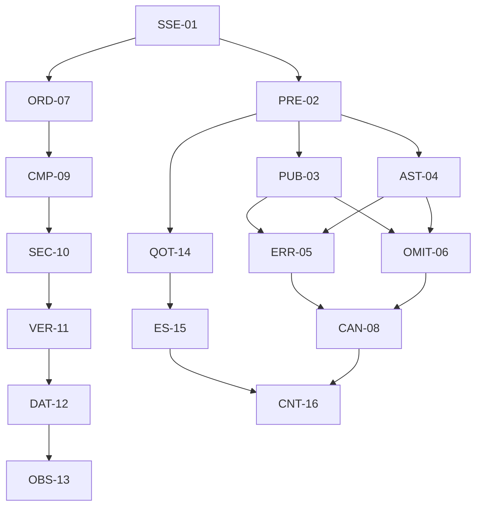

<!-- scope: adr/ADR-002 -->
# Execution Backlog — ADR-002 — Endpoints SSE público e assistant com `reasoning_content` separado

## 1. Traceability Context

- **Source ADR/SPEC**: `.spec/prd/streaming-reasoning/ADRs/ADR-002-sse-endpoints/ADR.md` + `SPEC.md`.
- **Goal**: explodir RF-01..RF-11 e NFR-01..NFR-06 da SPEC em tickets TDD-ready com arquivos físicos mapeados.
- **Regra de unidade**: 1 ADR = 1 branch = 1 PR. Depende da interface congelada de ADR-001. Nenhum ticket altera `ADR.md`, `ADR-INDEX.md`, `PRD.md`, `RESEARCH.md`, `workflow-state.json` ou código de frontend.
- **Insumo P1 (security, zero 🔴)**: F1→ES-15/SEC-10, F2→QOT-14/PRE-02, F3→CAN-08 (emenda D7'/E8'), F5→PUB-03/CMP-09/ERR-05, F6→CNT-16/OBS-13. **F7🔵 é débito de frontend**, registrado na SPEC §15 — sem ticket neste lote.
- **Interface congelada** (ADR-001 §4 + ADR-002 §4): `TurnStreamEvent`, `TurnStreamGateway`, `StreamingTurnHandle`, `SseEmitter`, `OpenAiError`.

## 2. Sprint Summary

| Phase | Task ID | Type | Priority | Risk | Complexity | Status |
|---|---|---|---|---|---|---|
| P1 — Transporte | SSE-01 | API | P0 | Medium | 2 | Todo |
| P1 — Preflight | PRE-02 | API | P0 | High | 2 | Todo |
| P1 — Público | PUB-03 | API | P0 | High | 3 | Todo |
| P1 — Assistant | AST-04 | API | P0 | Medium | 2 | Todo |
| P2 — Erro | ERR-05 | Domain | P0 | High | 3 | Todo |
| P2 — Degradação | OMIT-06 | Domain | P0 | Medium | 2 | Todo |
| P2 — Ordem | ORD-07 | Test | P1 | Medium | 2 | Todo |
| P2 — Cancel | CAN-08 | API | P0 | High | 3 | Todo |
| P3 — Compat | CMP-09 | Test | P0 | Medium | 2 | Todo |
| P3 — Segurança | SEC-10 | Test | P0 | High | 2 | Todo |
| P3 — Versão | VER-11 | Test | P1 | Low | 1 | Todo |
| P3 — Dados | DAT-12 | Test | P1 | Low | 1 | Todo |
| P3 — Observabilidade | OBS-13 | Test | P1 | Low | 1 | Todo |
| P2 — Cota (F2) | QOT-14 | Infra | P0 | High | 3 | Todo |
| P3 — Canário (F1) | ES-15 | Test | P0 | High | 2 | Todo |
| P3 — Contadores (F6) | CNT-16 | Test | P1 | Low | 1 | Todo |

## 3. Dependency Graph

---

## 4. Task Backlog

### SSE-01 — Transporte `SseEmitter` nos dois controllers

- **RF/NFR**: RF-01 · **Origem ADR**: E1, §4 · **Tipo**: API · **Prioridade**: P0 · **Risco**: Medium · **Depende de**: — (Hard) · **Paralelo**: Não
- **Arquivos físicos**: `backend/publicapi/web/internal/v1/src/main/java/br/com/systec/hive/publicapi/web/internal/v1/controller/PublicChatControllerV1.java` (ajuste); `backend/assistant/web/internal/v1/src/main/java/br/com/systec/hive/assistant/web/internal/v1/controller/ChatControllerV1.java` (ajuste); `backend/integration-test/src/test/java/br/com/systec/hive/integrationtest/StreamingTransportIT.java` (novo).
- **Contexto/Impacto**: `produces="text/event-stream"`, `new SseEmitter(120_000L)`; `send(Object)` data-only no público e `send(event().name(...).data(...))` no assistant; `complete()` terminal (S21).
- **Enforcement**: zero `completeWithError`, zero `Flux`/WebFlux. **Failure Mode**: evento nomeado enviado como `send(Object)` quebra RF7; sem `complete()` o cliente fica preso até timeout.
- **BDD**:
  - Sucesso: Dado `POST` com `stream:true`, Quando o handler responde, Então `asyncStarted == true` e `Content-Type: text/event-stream`.
  - Falha (`método errado`): Dado chamada sem `stream:true`, Então comportamento `application/json` atual permanece — nenhum emitter aberto.
  - Borda: Dado timeout de 120 s, Então `onTimeout` dispara e o terminal é emitido sem exceção.
- **TDD (teste primeiro)**:
  - [x] `backend/integration-test/src/test/java/br/com/systec/hive/integrationtest/StreamingTransportIT.java`: escrever os 3 cenários ANTES do ajuste nos controllers.
- **DoD**: [ ] teste antes do ajuste · [ ] `npm test -- StreamingTransportIT` EXIT=0 · [ ] `grep -r 'SseEmitter' backend/**/web/**` → 2 controllers · [ ] zero TODO.

### PRE-02 — Preflight inalterado e headers de cota no 200 (F2)

- **RF/NFR**: RF-02 · **Origem ADR**: E2; F2 · **Tipo**: API · **Prioridade**: P0 · **Risco**: High · **Depende de**: SSE-01 (Hard) · **Paralelo**: Não
- **Arquivos físicos**: `backend/publicapi/web/internal/v1/src/main/java/br/com/systec/hive/publicapi/web/internal/v1/controller/PublicChatControllerV1.java` (ajuste); `backend/assistant/web/internal/v1/src/main/java/br/com/systec/hive/assistant/web/internal/v1/controller/ChatControllerV1.java` (ajuste); `backend/integration-test/src/test/java/br/com/systec/hive/integrationtest/PublicApiErrorContractIT.java` (ampliar).
- **Contexto/Impacto**: validação/allowlist/cota/prompt/resolve/`CHAT_SEND` continuam 400/403/404/409/429/500 em `application/json` antes de abrir o stream; 200 SSE inclui headers de cota.
- **Enforcement**: nenhum handler HTTP reexecutado após abertura do stream. **Failure Mode**: erro de preflight em `text/event-stream` muda o contrato congelado; ausência de headers de cota quebra F2.
- **BDD**:
  - Sucesso: Dado request válido, Quando preflight passa, Então 200 `text/event-stream` com headers de cota.
  - Falha (cada código): Dado request inválido/não autorizado/sem cota, Então 400/403/404/409/429/500 em `application/json` e zero emitter aberto.
  - Borda: Dado erro do provider após o 200, Então status permanece 200 e o erro vai in-band.
- **TDD (teste primeiro)**:
  - [x] `backend/integration-test/src/test/java/br/com/systec/hive/integrationtest/PublicApiErrorContractIT.java`: escrever os 3 cenários ANTES do ajuste.
- **DoD**: [ ] teste antes do ajuste · [ ] `npm test -- PublicApiErrorContractIT` EXIT=0 · [ ] zero diff de handlers HTTP/MFA · [ ] zero TODO.

### PUB-03 — Serializador público data-only e `stream_options` (F5)

- **RF/NFR**: RF-03, RF-11 · **Origem ADR**: E3, §4.1; F5 · **Tipo**: API · **Prioridade**: P0 · **Risco**: High · **Depende de**: PRE-02 (Hard) · **Paralelo**: Não
- **Arquivos físicos**: `backend/publicapi/api/src/main/java/br/com/systec/hive/publicapi/api/dto/StreamOptionsDTO.java` (novo); `backend/publicapi/api/src/main/java/br/com/systec/hive/publicapi/api/dto/ChatCompletionChunkDTO.java` (novo); `backend/publicapi/api/src/main/java/br/com/systec/hive/publicapi/api/dto/ChatCompletionRequestDTO.java` (ajuste — `stream`/`stream_options`); `backend/publicapi/web/internal/v1/src/main/java/br/com/systec/hive/publicapi/web/internal/v1/serializer/PublicSseSerializer.java` (novo); `backend/integration-test/src/test/java/br/com/systec/hive/integrationtest/PublicStreamingContractIT.java` (novo).
- **Contexto/Impacto**: ordem do wire = thinking → texto → `delta:{}`+finish_reason → `choices:[]`+usage → `data: [DONE]` → `complete()`; `stream_options` valida só `include_usage` com `ignoreUnknown=true` aninhado; `reasoning_tokens` omitido (S4).
- **Enforcement**: zero `content` em chunk de thinking e vice-versa (RF3); `choices:[]` no último chunk (S9). **Failure Mode**: `choices` com 1 item no último chunk quebra paridade OpenAI; campo desconhecido gerando 400 quebra F5.
- **BDD**:
  - Sucesso: Dado `{"stream":true,"stream_options":{"include_usage":true,"future_flag":1,"ignoreUnknown":true}}`, Quando stream termina, Então 200 com sequência exata de chunks e `[DONE]` literal.
  - Falha (`campo desconhecido`): Dado `future_flag` sem `ignoreUnknown`, Então DTO preserva `unknown=false` e nenhum 400 é gerado por causa dele.
  - Borda: Dado fake sem `PartialThinking`, Então zero chunks `reasoning_content`, mas `finish_reason`/usage/`[DONE]` presentes.
- **TDD (teste primeiro)**:
  - [x] `backend/integration-test/src/test/java/br/com/systec/hive/integrationtest/PublicStreamingContractIT.java`: escrever os 3 cenários ANTES dos DTOs e do serializador.
  - [x] `backend/publicapi/api/.../dto/StreamOptionsDTO.java` + `ChatCompletionChunkDTO.java` + `ChatCompletionRequestDTO.java`: acrescentar campos com `ignoreUnknown=true`.
  - [x] `backend/publicapi/web/internal/v1/.../serializer/PublicSseSerializer.java`: implementar funções puras de `TurnStreamEvent`.
- **DoD**: [ ] teste antes da impl · [ ] `npm test -- PublicStreamingContractIT` EXIT=0 · [ ] `grep -r 'reasoning_tokens' backend/**/web/** backend/**/publicapi/**` → 0 · [ ] zero TODO.

### AST-04 — Serializador assistant com eventos nomeados

- **RF/NFR**: RF-04 · **Origem ADR**: E4, §4.2 · **Tipo**: API · **Prioridade**: P0 · **Risco**: Medium · **Depende de**: PRE-02 (Hard) · **Paralelo**: Não
- **Arquivos físicos**: `backend/assistant/web/internal/v1/src/main/java/br/com/systec/hive/assistant/web/internal/v1/controller/ChatControllerV1.java` (ajuste); `backend/assistant/web/internal/v1/src/main/java/br/com/systec/hive/assistant/web/internal/v1/serializer/AssistantSseSerializer.java` (novo); `backend/integration-test/src/test/java/br/com/systec/hive/integrationtest/AssistantStreamingContractIT.java` (novo).
- **Contexto/Impacto**: `POST /v1/chat/stream`, autoridade `CHAT_SEND`, request `application/json`, response `text/event-stream`; eventos `thinking`/`text`/`done`/`error` do **mesmo** `TurnStreamEvent`.
- **Enforcement**: serializadores são funções puras; nenhum `TurnStreamEventMapper` em `web/**` (mapper duplicado proibido). **Failure Mode**: evento nomeado enviado via `send(Object)` perde `event:` e quebra RF7.
- **BDD**:
  - Sucesso: Dado `Reasoning`/`Text`/`Done`, Quando serializar, Então linhas `event: thinking|text|done` com `data` JSON de tipo igual ao nome.
  - Falha (`sem CHAT_SEND`): Dado requisição sem autoridade, Então 403 em JSON antes do emitter.
  - Borda: Dado `Done` sem usage (R6), Então evento `done` é emitido sem campo `usage`, sem exceção.
- **TDD (teste primeiro)**:
  - [x] `backend/integration-test/src/test/java/br/com/systec/hive/integrationtest/AssistantStreamingContractIT.java`: escrever os 3 cenários ANTES do serializador.
  - [x] `backend/assistant/web/internal/v1/.../serializer/AssistantSseSerializer.java` + `ChatControllerV1.java`: implementar evento nomeado.
- **DoD**: [ ] teste antes da impl · [ ] `npm test -- AssistantStreamingContractIT` EXIT=0 · [ ] `grep -r 'TurnStreamEventMapper' backend/**/web/**` → 0 · [ ] zero TODO.

### ERR-05 — Erro in-stream tipado, sem `completeWithError` (F1/F5)

- **RF/NFR**: RF-05 · **Origem ADR**: E5, §4.1/§4.2; F1/F5 · **Tipo**: Domain · **Prioridade**: P0 · **Risco**: High · **Depende de**: PUB-03, AST-04 (Hard) · **Paralelo**: Não
- **Arquivos físicos**: `backend/publicapi/web/internal/v1/src/main/java/br/com/systec/hive/publicapi/web/internal/v1/serializer/PublicSseSerializer.java` (ajuste); `backend/assistant/web/internal/v1/src/main/java/br/com/systec/hive/assistant/web/internal/v1/serializer/AssistantSseSerializer.java` (ajuste); `backend/publicapi/api/src/main/java/br/com/systec/hive/publicapi/api/dto/OpenAiError.java` (reuso — não alterar); `backend/integration-test/src/test/java/br/com/systec/hive/integrationtest/StreamingErrorFrameIT.java` (novo).
- **Contexto/Impacto**: público = `OpenAiError` (`code` de conjunto fechado, `type=server_error`, `param=null`, `message` = código fixo) → `[DONE]` → `complete()`; assistant = `error` → `done` → `complete()`. Status permanece 200.
- **Enforcement**: `message` nunca `Throwable.getMessage()`/`printStackTrace()` e nunca pensamento; nenhum handler reexecutado. **Failure Mode**: `completeWithError` gera resolução de exceção com response comitada (S22) e muda formato de erro.
- **BDD**:
  - Sucesso: Dado `Failed` com `code` classificado, Quando serializar, Então frame de erro com `message` igual ao `code`, seguido de `[DONE]`/`done` e `complete()`, status 200.
  - Falha (`completeWithError`): Dado implementação que usa `completeWithError`, Então checagem estática falha (`grep ...` → 0).
  - Borda: Dado `Throwable` com mensagem sensível, Então nenhum trecho aparece no frame, em log ou em `ChatTrace.failure` (F1).
- **TDD (teste primeiro)**:
  - [x] `backend/integration-test/src/test/java/br/com/systec/hive/integrationtest/StreamingErrorFrameIT.java`: escrever os 3 cenários ANTES do ajuste dos serializadores.
- **DoD**: [ ] teste antes do ajuste · [ ] `npm test -- StreamingErrorFrameIT` EXIT=0 · [ ] `grep -r 'completeWithError\|getMessage()\|printStackTrace()' backend/**/web/**` → 0 · [ ] zero TODO.

### OMIT-06 — Degradação silenciosa quando não há thinking

- **RF/NFR**: RF-06 · **Origem ADR**: E6, §4.3 regra 4 · **Tipo**: Domain · **Prioridade**: P0 · **Risco**: Medium · **Depende de**: PUB-03, AST-04 (Hard) · **Paralelo**: Não
- **Arquivos físicos**: `backend/publicapi/web/internal/v1/.../serializer/PublicSseSerializer.java` (ajuste); `backend/assistant/web/internal/v1/.../serializer/AssistantSseSerializer.java` (ajuste); `backend/integration-test/src/test/java/br/com/systec/hive/integrationtest/NoThinkingStreamIT.java` (novo).
- **Contexto/Impacto**: sem `PartialThinking` ⇒ zero chunks `reasoning_content` e zero eventos `thinking`; nunca frame vazio; `done`/`[DONE]` é o único sinal de conclusão.
- **Enforcement**: nenhum `reasoning_content: ""` e nenhum `thinking` com texto nulo. **Failure Mode**: frame vazio confunde cliente e viola Q3.
- **BDD**:
  - Sucesso: Dado fake que só emite `onPartialResponse`, Quando stream fecha, Então apenas chunks `content` e terminais aparecem.
  - Falha (`frame vazio`): Dado serializador que emite `reasoning_content: ""`, Então teste falha.
  - Borda (R6): Dado cliente cancelou, Então nenhum chunk de usage/`[DONE]` é observável — cliente já foi embora.
- **TDD (teste primeiro)**:
  - [x] `backend/integration-test/src/test/java/br/com/systec/hive/integrationtest/NoThinkingStreamIT.java`: escrever os 3 cenários ANTES do ajuste.
- **DoD**: [ ] teste antes do ajuste · [ ] `npm test -- NoThinkingStreamIT` EXIT=0 · [ ] zero frames vazios · [ ] zero TODO.

### ORD-07 — Ordem = chegada dos callbacks (sem buffer)

- **RF/NFR**: RF-07 · **Origem ADR**: E7, §5 (Q4) · **Tipo**: Test · **Prioridade**: P1 · **Risco**: Medium · **Depende de**: SSE-01 (Hard) · **Paralelo**: Não
- **Arquivos físicos**: `backend/integration-test/src/test/java/br/com/systec/hive/integrationtest/CallbackOrderIT.java` (novo).
- **Contexto/Impacto**: serializadores emitem na ordem dos callbacks `onPartialThinking`/`onPartialResponse`; sem reordenação e sem buffer de texto de pensamento.
- **Enforcement**: nenhuma `sort`/reordenação no caminho de serialização. **Failure Mode**: reordenar exige reter pensamento em memória e aumenta latência — PRD exclui.
- **BDD**:
  - Sucesso: Dado provider que emitiu `Reasoning` antes de `Text`, Então cliente vê `reasoning_content` antes de `content`.
  - Falha (`reordenação`): Dado serializador com `sort` por tipo, Então teste falha.
  - Borda: Dado provider que emite texto antes de thinking, Então cliente vê texto antes de thinking — **não é bug** (E7/§5).
- **TDD (teste primeiro)**:
  - [x] `backend/integration-test/src/test/java/br/com/systec/hive/integrationtest/CallbackOrderIT.java`: escrever os 3 cenários ANTES de qualquer ajuste.
- **DoD**: [ ] teste antes de ajustes · [ ] `npm test -- CallbackOrderIT` EXIT=0 · [ ] `grep -r 'sort\|buffer' backend/**/web/**/serializer/**` → 0 · [ ] zero TODO.

### CAN-08 — Cancel no disconnect com gate retido (F3)

- **RF/NFR**: RF-08 · **Origem ADR**: E8' (emenda P1/F3), §4.3 regra 3 · **Tipo**: API · **Prioridade**: P0 · **Risco**: High · **Depende de**: ERR-05, OMIT-06 (Hard) · **Paralelo**: Não
- **Arquivos físicos**: `backend/publicapi/web/internal/v1/.../controller/PublicChatControllerV1.java` (ajuste); `backend/assistant/web/internal/v1/.../controller/ChatControllerV1.java` (ajuste); `backend/integration-test/src/test/java/br/com/systec/hive/integrationtest/SseDisconnectIT.java` (novo).
- **Contexto/Impacto**: `onCompletion`/`onError`/`onTimeout` ⇒ `handle.cancel()` idempotente; `sinkClosed` silencia callbacks e o emitter é fechado pelo transporte; com `UnsupportedFeatureException`, **gate não liberado em `cancel()`** — `availablePermits() == 0` imediatamente e `== 1` só no terminal natural ou janela de `5_000 ms` (≤120 s), o que vier primeiro (D7'/E8').
- **Enforcement**: nenhum `send` após `complete()`; F3 prevalece sobre a asserção antiga de `availablePermits() == 1` após cancel. **Failure Mode**: gate liberado no cancel permite novo turno sobrepor provider ainda ativo.
- **BDD**:
  - Sucesso: Dado disconnect real, Quando `onCompletion` dispara, Então `handle.cancel()` é chamado 1 vez e nenhum frame é enviado depois.
  - Falha (`cancel não suportado`): Dado provider que lança `UnsupportedFeatureException`, Então zero exceção ao cliente, zero `Failed`, `availablePermits() == 0` imediatamente; `== 1` após terminal natural **ou** janela de 5 s (testar os dois caminhos); nenhum 2º turno entra com `ChatMemory` em uso antes da liberação.
  - Borda: Dado `complete()` seguido de callback tardio, Então `sink` já está mudo e nenhum `send` pós-terminal; contador `stream.cancel.unsupported` incrementa sem conteúdo.
- **TDD (teste primeiro)**:
  - [x] `backend/integration-test/src/test/java/br/com/systec/hive/integrationtest/SseDisconnectIT.java`: escrever os 3 cenários ANTES do ajuste nos controllers.
- **DoD**: [ ] teste antes do ajuste · [ ] `npm test -- SseDisconnectIT` EXIT=0 · [ ] `availablePermits() == 0` imediatamente após cancel e `== 1` só no terminal/janela de 5 s · [ ] contador sem conteúdo · [ ] zero TODO.

### CMP-09 — Compatibilidade OpenAI e SDK real (F5)

- **RF/NFR**: RF-11, NFR-01 · **Origem ADR**: E3/E5, §4.3 regra 5; F5 · **Tipo**: Test · **Prioridade**: P0 · **Risco**: Medium · **Depende de**: ORD-07 (Hard) · **Paralelo**: Não
- **Arquivos físicos**: `backend/integration-test/src/test/java/br/com/systec/hive/integrationtest/OpenAiSdkStreamingCompatIT.java` (novo); `backend/publicapi/api/src/main/java/br/com/systec/hive/publicapi/api/dto/OpenAiError.java` (reuso, não alterar).
- **Contexto/Impacto**: duplo `/v1` preservado; frame de erro idêntico ao handler atual; SDK OpenAI real consome stream normal, stream com erro e `stream_options` aninhado sem exceção de parsing.
- **Enforcement**: `OpenAiError` reusado sem alteração; `message` = código fixo. **Failure Mode**: frame de erro divergente quebra clientes OpenAI-compatible.
- **BDD**:
  - Sucesso: Dado SDK OpenAI real, Quando consumir stream, Então chunks, `[DONE]` e erro in-stream são interpretados sem exceção.
  - Falha (`frame divergente`): Dado `message` derivado de `Throwable.getMessage()`, Então teste falha por conteúdo inesperado.
  - Borda: Dado `stream_options` com `ignoreUnknown=true` e campo futuro, Então SDK não lança e status é 200.
- **TDD (teste primeiro)**:
  - [x] `backend/integration-test/src/test/java/br/com/systec/hive/integrationtest/OpenAiSdkStreamingCompatIT.java`: escrever os 3 cenários ANTES de qualquer ajuste.
- **DoD**: [ ] teste antes de ajustes · [ ] `npm test -- OpenAiSdkStreamingCompatIT` EXIT=0 · [ ] `grep -r 'completion_tokens_details' backend/**` → 0 · [ ] zero TODO.

### SEC-10 — Segurança: redator, canário e fronteiras inalteradas

- **RF/NFR**: NFR-02 · **Origem ADR**: §4.3 regras 4/5; F1 · **Tipo**: Test · **Prioridade**: P0 · **Risco**: High · **Depende de**: CMP-09 (Hard) · **Paralelo**: Não
- **Arquivos físicos**: `backend/integration-test/src/test/java/br/com/systec/hive/integrationtest/ChatSpanContractIT.java` (ampliar); `backend/integration-test/src/test/java/br/com/systec/hive/integrationtest/RedactionCanaryIT.java` (ampliar); `backend/assistant/api/src/main/java/br/com/systec/hive/assistant/api/diagnostics/ChatTrace.java` (verificação, não alterar).
- **Contexto/Impacto**: nenhum log/`ChatTrace.failure`/span/JPA contém pensamento ou `Throwable.getMessage()`; redator continua valendo; `CHAT_SEND` e MFA inalterados; apiKey nunca em frame/log.
- **Enforcement**: zero `getMessage()`/`printStackTrace()` no caminho SSE. **Failure Mode**: vazamento de pensamento em artefato persistido — irreversível sem limpeza de dados.
- **BDD**:
  - Sucesso: Dado turno com thinking, Quando executar, Então token único não aparece em log, `ChatTrace.failure`, spans nem JPA.
  - Falha (`vazamento`): Dado `getMessage()` no serializador de erro, Então canário falha apontando o destino.
  - Borda: Dado redator fail-closed, Então nenhuma exceção dele carrega texto bruto (`TextRedactor.java:59-65`).
- **TDD (teste primeiro)**:
  - [x] `backend/integration-test/src/test/java/br/com/systec/hive/integrationtest/ChatSpanContractIT.java` e `RedactionCanaryIT.java`: escrever cenários de streaming ANTES de ajustes.
- **DoD**: [ ] testes antes de ajustes · [ ] `npm test -- ChatSpanContractIT RedactionCanaryIT` EXIT=0 · [ ] `git diff` de handlers HTTP/MFA → 0 · [ ] zero TODO.

### VER-11 — Stack fixo: Spring 7.0.8, sem Flux/reactor/A2 silenciosa

- **RF/NFR**: NFR-03 · **Origem ADR**: E1, §7, S8/S20/S21/S23 · **Tipo**: Test · **Prioridade**: P1 · **Risco**: Low · **Depende de**: SEC-10 (Hard) · **Paralelo**: Não
- **Arquivos físicos**: `backend/dependencies/pom.xml` (verificação, não alterar); `backend/integration-test/src/test/java/br/com/systec/hive/integrationtest/SseVersionGuardIT.java` (novo).
- **Contexto/Impacto**: Spring Boot 4.1.0 → Framework 7.0.8; nenhum `Flux`/WebFlux/`langchain4j-reactor`; nenhum `StreamingResponseBody` em produção (A2 só via ADR-003).
- **Enforcement**: nenhuma dependência nova. **Failure Mode**: troca silenciosa para A2 muda o wire e exige `TaskExecutor` explícito (S23).
- **BDD**:
  - Sucesso: Dado pom do projeto, Quando lido, Então `spring.boot.version=4.1.0` e zero módulo `reactor`.
  - Falha (`dependência proibida`): Dado `reactor` ou `StreamingResponseBody` em código, Então guard falha.
  - Borda: Dado javadoc `current=7.1.0`, Então nenhuma decisão depende dele — assinaturas reabertas em 7.0.8 (S21/S22/S23).
- **TDD (teste primeiro)**:
  - [x] `backend/integration-test/src/test/java/br/com/systec/hive/integrationtest/SseVersionGuardIT.java`: escrever asserções ANTES de ajustes.
- **DoD**: [ ] teste antes de ajustes · [ ] `git diff backend/dependencies/pom.xml` → 0 · [ ] `grep -r 'Flux\|reactor\|StreamingResponseBody' backend/**` → 0 · [ ] zero TODO.

### DAT-12 — Zero migration e estado efêmero do stream

- **RF/NFR**: NFR-04 · **Origem ADR**: §4.3 regra 6 · **Tipo**: Test · **Prioridade**: P1 · **Risco**: Low · **Depende de**: VER-11 (Hard) · **Paralelo**: Não
- **Arquivos físicos**: `backend/integration-test/src/test/java/br/com/systec/hive/integrationtest/SseDataModelGuardIT.java` (novo).
- **Contexto/Impacto**: nenhuma tabela/coleção/migration; estado em `SseEmitter` + `AtomicBoolean`; usage lido de `TokenUsage`.
- **Enforcement**: nenhuma anotação JPA em serializador/controller. **Failure Mode**: persistência de thinking viola PRD §2/§6.
- **BDD**:
  - Sucesso: Dado diff do ADR-002, Quando listar `backend/**/dbupdate/**`, Então zero arquivos `V{YYYYMMDD}{NNN}` novos.
  - Falha (`@Entity novo`): Dado entidade em serializador, Então guard falha.
  - Borda: Dado `Done` sem usage (cancel), Então nenhum valor default inventado.
- **TDD (teste primeiro)**:
  - [x] `backend/integration-test/src/test/java/br/com/systec/hive/integrationtest/SseDataModelGuardIT.java`: escrever asserções ANTES de ajustes.
- **DoD**: [ ] teste antes de ajustes · [ ] `npm test -- SseDataModelGuardIT` EXIT=0 · [ ] `git diff --stat` sem migration · [ ] zero TODO.

### OBS-13 — Paridade de contrato de turno (F6 parcial)

- **RF/NFR**: NFR-05 · **Origem ADR**: §4.3 regra 7; F6 · **Tipo**: Test · **Prioridade**: P1 · **Risco**: Low · **Depende de**: DAT-12 (Hard) · **Paralelo**: Não
- **Arquivos físicos**: `backend/ai/api/src/main/java/br/com/systec/hive/ai/api/domain/TurnReply.java` (verificação, não alterar); `backend/integration-test/src/test/java/br/com/systec/hive/integrationtest/StreamTurnParityIT.java` (novo).
- **Contexto/Impacto**: mesmo `TurnStreamEvent` alimenta público e assistant; só o serializador muda; `TurnReply` sem texto.
- **Enforcement**: nenhum mapper duplicado em `web/**` e nenhum texto de pensamento em `TurnReply`. **Failure Mode**: contratos divergentes entre os dois endpoints.
- **BDD**:
  - Sucesso: Dado o mesmo `Reasoning`/`Text`/`Done`, Quando serializar nos dois formatos, Então canais e terminais correspondem 1:1.
  - Falha (`TurnReply com texto`): Dado campo de texto em `TurnReply`, Então guard falha.
  - Borda: Dado erro, Então público vê `OpenAiError` e assistant vê `event: error`, ambos terminando em `done`/`[DONE]`.
- **TDD (teste primeiro)**:
  - [x] `backend/integration-test/src/test/java/br/com/systec/hive/integrationtest/StreamTurnParityIT.java`: escrever cenários ANTES de ajustes.
- **DoD**: [ ] teste antes de ajustes · [ ] `npm test -- StreamTurnParityIT` EXIT=0 · [ ] `git diff` de `TurnReply.java` → 0 · [ ] zero TODO.

### QOT-14 — Cota e concorrência por `tenantId+clientId` (F2)

- **RF/NFR**: RF-09 · **Origem**: security F2; `ChatRateLimiter.java:17-25` · **Tipo**: Infra · **Prioridade**: P0 · **Risco**: High · **Depende de**: PRE-02 (Hard) · **Paralelo**: Não
- **Arquivos físicos**: `backend/publicapi/web/internal/v1/.../controller/PublicChatControllerV1.java` (ajuste); `backend/assistant/web/internal/v1/.../controller/ChatControllerV1.java` (ajuste); `backend/assistant/impl/src/main/java/br/com/systec/hive/assistant/impl/service/ChatRateLimiter.java` (reuso — não alterar limites); `backend/integration-test/src/test/java/br/com/systec/hive/integrationtest/StreamingConcurrencyQuotaIT.java` (novo).
- **Contexto/Impacto**: cota por request preservada + concorrência por `tenantId+clientId` **antes** de abrir o emitter; `ChatRateLimiter` reutilizado no assistant (`MAX_CALLS=10`/60 s); teto server-side de `maxTokens`/frames; headers de cota no 200.
- **Enforcement**: nenhum emitter aberto quando a admissão falha. **Failure Mode**: N streams paralelos esgotam o provider e o gate por `@MemoryId` sem 429.
- **BDD**:
  - Sucesso: Dado N requests sequenciais dentro da cota, Quando abrir streams, Então 200 com headers de cota.
  - Falha (`N streams paralelos`): Dado N requisições concorrentes para o mesmo `tenantId+clientId`, Então as excedentes retornam 429 em `application/json` e zero emitter é aberto para elas.
  - Borda: Dado disconnect em um stream admitido, Então `availablePermits() == 1` no terminal natural; com `UnsupportedFeatureException`, `== 0` até o terminal (F3).
- **TDD (teste primeiro)**:
  - [x] `backend/integration-test/src/test/java/br/com/systec/hive/integrationtest/StreamingConcurrencyQuotaIT.java`: escrever os 3 cenários ANTES do ajuste nos controllers.
- **DoD**: [ ] teste antes do ajuste · [ ] `npm test -- StreamingConcurrencyQuotaIT` EXIT=0 · [ ] `ChatRateLimiter` sem alteração de limites · [ ] zero TODO.

### ES-15 — Canário F1 no caminho SSE

- **RF/NFR**: RF-10, NFR-02 · **Origem**: security F1; `FailureClassifier.java:18-23`; `TextRedactor.java:59-65` · **Tipo**: Test · **Prioridade**: P0 · **Risco**: High · **Depende de**: QOT-14 (Hard) · **Paralelo**: Não
- **Arquivos físicos**: `backend/integration-test/src/test/java/br/com/systec/hive/integrationtest/StreamingSseRedactionIT.java` (novo).
- **Contexto/Impacto**: token único de thinking e segredo em `Throwable` injetados; zero ocorrências em log, `ChatTrace.failure`, spans OTLP e JPA; `Failed.code` derivado de conjunto fechado.
- **Enforcement**: `message` = código fixo; proibidos `getMessage()`/`printStackTrace()` no caminho SSE. **Failure Mode**: mensagem de driver interpolada com valor sensível vaza para log (bug já sofrido, `FailureClassifier.java:20-23`).
- **BDD**:
  - Sucesso: Dado token único + `Throwable` com segredo, Quando stream falha, Então frame de erro traz só o código e zero ocorrências nos 4 destinos.
  - Falha (`vazamento`): Dado `getMessage()` no serializador, Então canário falha apontando log/`ChatTrace`/span/JPA.
  - Borda: Dado redator fail-closed, Então nenhuma exceção dele carrega texto bruto.
- **TDD (teste primeiro)**:
  - [x] `backend/integration-test/src/test/java/br/com/systec/hive/integrationtest/StreamingSseRedactionIT.java`: escrever os 3 cenários ANTES de qualquer ajuste.
- **DoD**: [ ] teste antes de ajustes · [ ] `npm test -- StreamingSseRedactionIT` EXIT=0 · [ ] `grep -r 'getMessage()\|printStackTrace()' backend/**/web/**` → 0 · [ ] zero TODO.

### CNT-16 — Contadores sem conteúdo (F6)

- **RF/NFR**: NFR-06 · **Origem**: security F6 · **Tipo**: Test · **Prioridade**: P1 · **Risco**: Low · **Depende de**: ES-15, CAN-08 (Hard) · **Paralelo**: Não
- **Arquivos físicos**: `backend/integration-test/src/test/java/br/com/systec/hive/integrationtest/ChatMetricsExposureIT.java` (ampliar).
- **Contexto/Impacto**: `stream.failed`/`stream.timeout`/`stream.client_abort` são contadores sem conteúdo, ligados ao redator; nenhum rótulo com thinking ou `Throwable`.
- **Enforcement**: `metrics.increment` só com chave fixa. **Failure Mode**: rótulo de métrica com texto de pensamento vaza em observabilidade.
- **BDD**:
  - Sucesso: Dado falha/timeout/abort, Quando consultar métricas, Então 3 contadores incrementam com rótulos fixos e redator acionado.
  - Falha (`rótulo com texto`): Dado `Reasoning.text()` em rótulo, Então teste falha.
  - Borda: Dado cancel não suportado, Então `stream.cancel.unsupported` incrementa junto; `availablePermits() == 0` até o terminal (F3).
- **TDD (teste primeiro)**:
  - [x] `backend/integration-test/src/test/java/br/com/systec/hive/integrationtest/ChatMetricsExposureIT.java`: escrever cenários ANTES de ajustes.
- **DoD**: [ ] teste antes de ajustes · [ ] `npm test -- ChatMetricsExposureIT` EXIT=0 · [ ] zero conteúdo em rótulos · [ ] zero TODO.

---

## 5. Coverage Validation

- [x] RF-01..RF-11 e NFR-01..NFR-06 da SPEC cobertos por 16 tickets (rastreabilidade em §13 da SPEC; alguns tickets cobrem 2 requisitos).
- [x] Toda seção `### <ID> —` casa com a Sprint Summary (sem órfãos).
- [x] Todo ticket tem risco, prioridade, tipo, arquivos físicos, BDD (sucesso/falha/borda) e teste antes da impl.
- [x] Grafo sem ciclos e sem órfãs; nenhuma macro-tarefa inventada fora da SPEC.
- [x] DoD por ticket presente.
- [x] F1–F6 rastreados: F1→ES-15/SEC-10/ERR-05, F2→QOT-14/PRE-02, F3→CAN-08, F4→ADR-001 SHD-15, F5→PUB-03/CMP-09/ERR-05, F6→CNT-16/OBS-13.

Skipped: nenhum `PLAN.md`, nenhum ticket de frontend — F7🔵 (`fetch` com `Authorization`, nunca `EventSource` com token na query) é débito registrado na SPEC §15, fora do escopo. Risk: **(1)** E8' alinha o transporte ao D7' já emendado em ADR-001 — E8/`§10` do ADR-002 ainda pendentes; **(2)** ITs de `[DONE]` literal e disconnect real são gate de saída — critérios de fallback A2 em ADR-002 §7.
