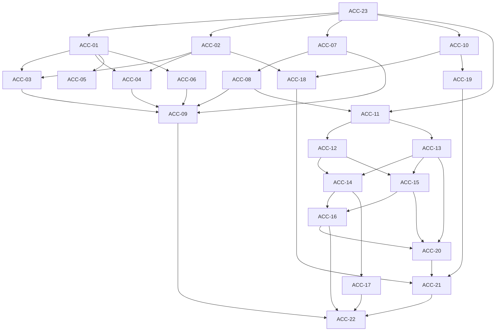

<!-- scope: adr/ADR-004 -->
# TASKS — ADR-004: Controle de acesso no reverse proxy e retenção externa de 30 dias

> Backlog TDD-ready derivado 1:1 da `SPEC.md` deste ADR (17 RF + 6 NFR = 23 tarefas). Teste escrito **antes** da implementação em toda tarefa. Nenhuma tarefa implementa contrato de spans (ADR-001), transporte OTLP/credencial de ingestão (ADR-002), redação (ADR-003) nem métricas/custo (ADR-005).
>
> **Atalhos de caminho:** `PROXY` = configuração do reverse proxy (fornecida pelo operador) · `JOB` = configuração do job externo (CLI Java standalone, cron do host via Docker Compose — emenda `ACC-23`, 2026-11-25) · `ACC_TEST` = `.spec/prd/telemetria-ia-langfuse/ADRs/ADR-004-acesso-retencao/tests/` (diretório proposto de testes/IT deste ADR). `$PROXY`, `$LANGFUSE`, `$INGESTION_KEY`, `$VIEWER_KEY`, `$DELETE_KEY`, `$CUTOFF`, `$AUDIT_LOG`, `$JOB_RUNNER` vêm da `SPEC.md` §10 — assinatura de `$JOB_RUNNER` **não** é definida aqui.
>
> **Nomes de arquivo são propostos.** Executor, plataforma e destino da auditoria estão registrados (CLI Java, cron do host/Compose, stdout → agregador — decisões operacionais de 2026-11-25). Nenhum outro scheduler, linguagem, storage ou destino é inventado; o IT 403 da chave de delete segue pendente como inferência.

## 1. Traceability Context

- **Source:** `.spec/prd/telemetria-ia-langfuse/ADRs/ADR-004-acesso-retencao/ADR.md` (decisão + Interface congelada + decisão operacional) + `SPEC.md` (`RF-01`..`RF-17`, `NFR-01`..`NFR-06`).
- **Goal:** cobrir cada RF/NFR com 1 ticket atômico, rastreável, com teste antes do código, aceite executável (403 observado, trace 29 presente/31 ausente, auditoria com 6 campos).
- **Status do ADR:** Proposto; sem merge, branch, código, dependency ou `workflow-state.json`.

## 2. Sprint Summary

| Phase | Task ID | RF/NFR | Type | Priority | Risk | Depends on | Status |
|---|---|---|---|---|---|---|---|
| 0 — Decisão do job registrada | ACC-23 | NFR-06 | documentação | P0 | Alto | — | Todo |
| 1 — Negação 403 | ACC-01 | RF-01 | contrato | P0 | Alto | ACC-23 | Todo |
| 2 — Capacidades | ACC-02 | RF-02 | contrato | P0 | Alto | ACC-23 | Todo |
| 3 — Leitura | ACC-03 | RF-03 | integração | P0 | Alto | ACC-01, ACC-02 | Todo |
| 4 — Administração | ACC-04 | RF-04 | integração | P0 | Alto | ACC-01, ACC-02 | Todo |
| 5 — Hardening | ACC-05 | RF-05 | configuração | P1 | Médio | ACC-01 | Todo |
| 6 — TLS | ACC-06 | RF-06 | configuração | P0 | Alto | ACC-01 | Todo |
| 7 — Chave de ingestão + IT 403 | ACC-07 | RF-07 | segurança | P0 | Alto | ACC-23 | Todo |
| 8 — Chave de leitura | ACC-08 | RF-08 | segurança | P0 | Alto | ACC-07 | Todo |
| 9 — Superfícies limpas | ACC-09 | RF-09 | segurança | P0 | Alto | ACC-03, ACC-04, ACC-06, ACC-07, ACC-08 | Todo |
| 10 — Proxy ≠ RBAC | ACC-10 | RF-10 | documentação | P0 | Alto | ACC-23 | Todo |
| 11 — Seleção de roots | ACC-11 | RF-11 | integração | P0 | Alto | ACC-23, ACC-08 | Todo |
| 12 — Exclusão em lote | ACC-12 | RF-12 | integração | P0 | Alto | ACC-11 | Todo |
| 13 — Janela auditável | ACC-13 | RF-13 | configuração | P0 | Alto | ACC-11 | Todo |
| 14 — Fronteira 29/31 | ACC-14 | RF-14 | integração | P0 | Alto | ACC-12, ACC-13 | Todo |
| 15 — Auditoria | ACC-15 | RF-15 | observabilidade | P0 | Alto | ACC-12, ACC-13 | Todo |
| 16 — Trava de produção | ACC-16 | RF-16 | deploy | P0 | Alto | ACC-14, ACC-15 | Todo |
| 17 — Irreversibilidade | ACC-17 | RF-17 | integração | P1 | Médio | ACC-14 | Todo |
| 18 — Nomenclatura | ACC-18 | NFR-01 | teste | P1 | Médio | ACC-02, ACC-10, ACC-15 | Todo |
| 19 — Sem EE | ACC-19 | NFR-02 | estático | P0 | Alto | ACC-10 | Todo |
| 20 — Premissas operacionais | ACC-20 | NFR-03 | documentação | P1 | Médio | ACC-13, ACC-15, ACC-16 | Todo |
| 21 — Rastreabilidade | ACC-21 | NFR-04 | documentação | P1 | Baixo | ACC-18, ACC-19, ACC-20 | Todo |
| 22 — Não regressão | ACC-22 | NFR-05 | qualidade | P0 | Alto | ACC-09, ACC-16, ACC-17, ACC-21 | Todo |

## 3. Dependency Graph

---

## 4. Task Backlog

### ACC-23 — Registrar decisão do executor e as 4 decisões operacionais

- **RF/NFR:** NFR-06 · **Prioridade:** P0 · **Risco:** Alto · **Tipo:** documentação · **Depende de:** — · **Dependency Type:** Hard · **Paralelizável:** Não
- **Arquivos:** `ADR.md` §"Emenda ACC-23"/§"Decisões operacionais registradas" e `SPEC.md` §12 (somente leitura/ajuste documental); nenhum arquivo de produto.
- **Contexto/Impacto:** emenda ACC-23 registra CLI Java standalone (JDK `HttpClient` + Jackson), cron do host via Docker Compose, fora do backend/proxy, com URL + data (2026-11-25). Operador respondeu em 2026-11-25: plataforma Compose+cron; auditoria stdout → agregador (JSON por linha); cutoff = `startTime` do root; contagem = `submitted`. Permanece **inferência + IT pendente** o escopo da chave de delete (`Full access`, confirmar por 403 em `ACC-07`).
- **Teste primeiro:**
  - [ ] `ACC_TEST/JobDecisionGateTest.java` (teste estático de documento): asserção de que `ADR.md` contém a emenda com URL + data e as 4 decisões com data 2026-11-25; `SPEC.md`/`TASKS.md` não nomeiam scheduler/storage/destino além dos registrados.
  - [ ] Nenhuma config de job antes do teste; a inferência da chave de delete não é promovida a contrato sem o IT de 403 de `ACC-07`.
- **Cenários:**
  - Sucesso: emenda + 4 decisões rastreáveis e datadas; 0 scheduler/storage/destino inventado.
  - Falha: `CronJob`/Quartz adotado por palpite ou decisão respondida ausente ⇒ teste estático quebra; volta ao `architect`.
  - Borda: "job externo" é obrigatório; só o escopo da chave de delete fica pendente de IT.
- **DoD:**
  - [ ] Teste estático escrito antes de qualquer config de job.
  - [ ] 0 dependência, 0 assinatura de API de terceiro além da emenda com URL + data.
  - [ ] 4 decisões registradas com data; IT 403 da chave de delete mantido como inferência pendente.

### ACC-01 — Negação 403 no proxy para ausência de capacidade

- **RF/NFR:** RF-01 · **Prioridade:** P0 · **Risco:** Alto · **Tipo:** contrato · **Depende de:** ACC-23 · **Dependency Type:** Hard · **Paralelizável:** Não
- **Arquivos:** `ACC_TEST/Proxy403ContractTest.java` (novo), `PROXY` (regra de negação).
- **Contexto/Impacto:** capacidade ausente ⇒ 403 na UI e na API, sem vazar corpo com trace. É a prova observável de RF5. O job externo **não é usuário do proxy**: roda por cron do host via Docker Compose, **fora do proxy e do backend**, sem capacidade `telemetry.*`.
- **Teste primeiro:**
  - [ ] `ACC_TEST/Proxy403ContractTest.java`: `curl -sS -o /dev/null -w '%{http_code}' "$PROXY/api/public/v2/observations"` e o mesmo na UI ⇒ `403` em ambas.
  - [ ] `PROXY`: adicionar regra de negação padrão somente após o teste existir.
- **Cenários:**
  - Sucesso: 403 nas duas superfícies; 0 traceId no corpo.
  - Falha: API responde 200 sem capacidade ⇒ corrigir regra padrão.
  - Borda: rota inexistente também cai na negação padrão (não vira 404 informativo).
- **DoD:**
  - [ ] Teste escrito antes da regra.
  - [ ] Status 403 observado na UI e na API.
  - [ ] 0 corpo com dado de trace na negação.
  - [ ] Invocação do job inspecionada: cron do host via Compose, fora do proxy/backend, 0 capacidade `telemetry.*` na CLI.

### ACC-02 — Capacidades com grafia congelada

- **RF/NFR:** RF-02 · **Prioridade:** P0 · **Risco:** Alto · **Tipo:** contrato · **Depende de:** ACC-23 · **Dependency Type:** Hard · **Paralelizável:** Não
- **Arquivos:** `ACC_TEST/CapabilityNamesTest.java` (novo), `PROXY`.
- **Contexto/Impacto:** somente `telemetry.read` e `telemetry.admin` existem; sinônimo inventado não pode autorizar. Nomenclatura é interface congelada.
- **Teste primeiro:**
  - [ ] `ACC_TEST/CapabilityNamesTest.java`: `grep -RIn 'telemetry.read\|telemetry.admin' PROXY` ⇒ exatamente as 2 capacidades; request com capacidade inventada ⇒ 403.
  - [ ] `PROXY`: renomear qualquer capacidade divergente para o nome congelado.
- **Cenários:**
  - Sucesso: 2 nomes exatos aceitos.
  - Falha: `telemetry_read` aceito ⇒ remover e quebrar o teste de negação.
  - Borda: capacidade com case diferente ⇒ 403 (grafia exata).
- **DoD:**
  - [ ] Teste escrito antes da config.
  - [ ] 0 sinônimo aceito.
  - [ ] Nomes idênticos à Interface congelada.

### ACC-03 — Leitura autorizada por Admin Hive e Suporte

- **RF/NFR:** RF-03 · **Prioridade:** P0 · **Risco:** Alto · **Tipo:** integração · **Depende de:** ACC-01, ACC-02 · **Dependency Type:** Hard · **Paralelizável:** Não
- **Arquivos:** `ACC_TEST/TelemetryReadIT.java` (novo), `PROXY`.
- **Contexto/Impacto:** Admin Hive e Suporte leem o trace de teste com `telemetry.read`; o mesmo papel não administra (ver `ACC-04`).
- **Teste primeiro:**
  - [ ] `ACC_TEST/TelemetryReadIT.java`: `curl -sS -H "Authorization: Bearer $READ_TOKEN" "$PROXY/api/public/v2/observations?isRootObservation=true"` ⇒ 200 com o trace semeado; mesmo token em rota admin ⇒ 403.
  - [ ] `PROXY`: liberar leitura somente após o teste.
- **Cenários:**
  - Sucesso: trace de teste visível para os 2 perfis de leitura.
  - Falha: leitura vazia ⇒ verificar capacidade e seed, nunca relaxar a negação.
  - Borda: trace com texto redigido (ADR-003) é lido como está; nenhuma redação nova aqui.
- **DoD:**
  - [ ] Teste escrito antes da liberação.
  - [ ] 200 na leitura, 403 em admin.
  - [ ] 0 alteração no contrato do chat.

### ACC-04 — Administração restrita ao time de IA

- **RF/NFR:** RF-04 · **Prioridade:** P0 · **Risco:** Alto · **Tipo:** integração · **Depende de:** ACC-01, ACC-02 · **Dependency Type:** Hard · **Paralelizável:** Não
- **Arquivos:** `ACC_TEST/TelemetryAdminIT.java` (novo), `PROXY`.
- **Contexto/Impacto:** separação de duties — só `telemetry.admin` (time de IA) administra; leitura não basta.
- **Teste primeiro:**
  - [ ] `ACC_TEST/TelemetryAdminIT.java`: ação de administração com `$READ_TOKEN` ⇒ 403; com `$ADMIN_TOKEN` ⇒ 2xx.
  - [ ] `PROXY`: mapear `telemetry.admin` somente após o teste.
- **Cenários:**
  - Sucesso: admin passa, leitor é negado.
  - Falha: leitor administra ⇒ revogar capacidade, não adicionar exceção.
  - Borda: token sem capacidade alguma ⇒ 403 (herda `ACC-01`).
- **DoD:**
  - [ ] Teste escrito antes do mapeamento.
  - [ ] 403 para read, 2xx para admin.
  - [ ] 0 papel de admin fora do time de IA.

### ACC-05 — Hardening: signup/login e rede administrativa

- **RF/NFR:** RF-05 · **Prioridade:** P1 · **Risco:** Médio · **Tipo:** configuração · **Depende de:** ACC-01 · **Dependency Type:** Soft · **Paralelizável:** Sim (após ACC-01)
- **Arquivos:** `ACC_TEST/ProxyHardeningTest.java` (novo), `PROXY`.
- **Contexto/Impacto:** autenticação por usuário/senha desabilitada; administração só na rede interna do proxy (fonte hardening — §12 do SPEC).
- **Teste primeiro:**
  - [ ] `ACC_TEST/ProxyHardeningTest.java`: `curl` em signup/login ⇒ desabilitado; rota admin a partir de rede externa ⇒ 403.
  - [ ] `PROXY`: aplicar restrição de rede somente após o teste.
- **Cenários:**
  - Sucesso: 0 cadastro/login por senha; 0 admin externo.
  - Falha: signup aberto ⇒ fechar; nunca compensar com "RBAC por projeto".
  - Borda: a capacidade `telemetry.admin` continua necessária mesmo na rede interna.
- **DoD:**
  - [ ] Teste escrito antes da config.
  - [ ] 0 signup/login por senha; admin só na rede interna.
  - [ ] Nenhuma licença EE introduzida.

### ACC-06 — TLS obrigatório na frente da UI/API

- **RF/NFR:** RF-06 · **Prioridade:** P0 · **Risco:** Alto · **Tipo:** configuração · **Depende de:** ACC-01 · **Dependency Type:** Hard · **Paralelizável:** Não
- **Arquivos:** `ACC_TEST/ProxyTlsTest.java` (novo), `PROXY`.
- **Contexto/Impacto:** HTTP simples recusado; todo acesso passa por TLS.
- **Teste primeiro:**
  - [ ] `ACC_TEST/ProxyTlsTest.java`: `curl -sS -o /dev/null -w '%{http_code}' "http://$PROXY/..."` ⇒ recusa/redirect forçado; `https://` ⇒ 403 ou 200 conforme capacidade.
  - [ ] `PROXY`: desabilitar plain HTTP somente após o teste.
- **Cenários:**
  - Sucesso: 0 resposta de dado em HTTP simples.
  - Falha: API responde 200 em HTTP ⇒ corrigir listener.
  - Borda: negação 403 também é transmitida via TLS.
- **DoD:**
  - [ ] Teste escrito antes da config.
  - [ ] 0 dado de trace em HTTP simples.
  - [ ] `ACC-09` herda o log TLS sem credencial.

### ACC-07 — Chave de ingestão não lê nem deleta (IT 403 com `Application`/`Viewer`)

- **RF/NFR:** RF-07 · **Prioridade:** P0 · **Risco:** Alto · **Tipo:** segurança · **Depende de:** ACC-23 · **Dependency Type:** Hard · **Paralelizável:** Não
- **Arquivos:** `ACC_TEST/IngestionKeyCannotReadOrDeleteIT.java` (novo), `PROXY`/config da API (somente verificação).
- **Contexto/Impacto:** `Application` é escrita de traces (ADR-002) e nunca leitura nem exclusão. O **IT de 403** com `Application` e com `Viewer` na rota de delete valida/invalida a inferência de que a terceira chave exige `Full access` — até lá, inferência não é contrato. Nenhuma chave de delete no backend.
- **Teste primeiro:**
  - [ ] `ACC_TEST/IngestionKeyCannotReadOrDeleteIT.java`: `curl -sS -H "Authorization: Basic $INGESTION_KEY" "$LANGFUSE/api/public/v2/observations?isRootObservation=true"` ⇒ negação; 0 observation e 0 traceId no corpo.
  - [ ] Mesmo IT: `curl -X DELETE` em `/api/public/traces` com `$INGESTION_KEY` ⇒ **403**; com `$VIEWER_KEY` ⇒ **403**; 0 exclusão observada.
  - [ ] Nenhuma implementação nova: a separação já é contrato congelado; ajustar apenas config que aceite `Application` para GET/DELETE.
- **Cenários:**
  - Sucesso: GET e DELETE com `Application` negados; DELETE com `Viewer` negado; POST OTLP continua funcionando (ADR-002).
  - Falha: GET retorna trace ou DELETE com `Application`/`Viewer` retorna 2xx ⇒ revogar permissão, não relaxar o teste; reabrir a inferência da chave de delete.
  - Borda: erro de negação não imprime a chave (vide `ACC-09`).
- **DoD:**
  - [ ] Teste escrito antes de qualquer ajuste.
  - [ ] 0 leitura e 0 delete com `Application`; 403 no delete com `Viewer`.
  - [ ] 0 alteração no exporter do ADR-002; 0 chave de delete no backend.
  - [ ] Resultado do IT registrado: confirma ou revisa a inferência `Full access`.

### ACC-08 — Chave `Viewer` separada, em cofre e fora do backend

- **RF/NFR:** RF-08 · **Prioridade:** P0 · **Risco:** Alto · **Tipo:** segurança · **Depende de:** ACC-07 · **Dependency Type:** Hard · **Paralelizável:** Não
- **Arquivos:** `ACC_TEST/ReaderKeyIT.java` (novo), `PROXY`, verificação de config do backend (somente leitura).
- **Contexto/Impacto:** leitura programática usa `Viewer`, distinta de ingestão e de delete, guardada em cofre e não entregue ao backend.
- **Teste primeiro:**
  - [ ] `ACC_TEST/ReaderKeyIT.java`: GET com `$VIEWER_KEY` ⇒ 200 com trace; `grep -RIn "$VIEWER_KEY" backend/` ⇒ 0 ocorrência; chave presente no cofre (verificação documental da config).
  - [ ] `PROXY`/config: liberar leitura programática somente após o teste.
- **Cenários:**
  - Sucesso: leitura 200, backend sem a chave.
  - Falha: `Viewer` em variável do backend ⇒ remover e rodar `ACC-09`.
  - Borda: troca de chave exige revogar antiga + criar nova (permissão imutável).
- **DoD:**
  - [ ] Teste escrito antes da config.
  - [ ] 3 finalidades distintas (write/read/delete).
  - [ ] 0 chave de leitura no backend.

### ACC-09 — Nenhuma credencial em log, trace, payload ou resposta

- **RF/NFR:** RF-09 · **Prioridade:** P0 · **Risco:** Alto · **Tipo:** segurança · **Depende de:** ACC-03, ACC-04, ACC-06, ACC-07, ACC-08 · **Dependency Type:** Hard · **Paralelizável:** Não
- **Arquivos:** `ACC_TEST/NoCredentialSurfaceTest.java` (novo), superfícies de log/auditoria/resposta.
- **Contexto/Impacto:** varredura transversal — inclusive mensagem de erro 403 e log de auditoria não podem imprimir chaves (RB3).
- **Teste primeiro:**
  - [ ] `ACC_TEST/NoCredentialSurfaceTest.java`: `grep -RInE "$INGESTION_KEY|$VIEWER_KEY|$DELETE_KEY" $AUDIT_LOG $PAYLOAD $LOG` ⇒ 0; corpo de erro 403 ⇒ 0 chave.
  - [ ] Corrigir apenas o que o teste acusar; nunca interpolando exceção com credencial.
- **Cenários:**
  - Sucesso: 0 ocorrência em todas as superfícies.
  - Falha: auditoria loga header Authorization ⇒ mascarar antes de escrever.
  - Borda: chave em query string de URL de erro ⇒ redigir toda a URL.
- **DoD:**
  - [ ] Teste escrito antes de qualquer ajuste.
  - [ ] `grep` ⇒ 0 linhas.
  - [ ] 0 credencial em 403.

### ACC-10 — Proxy nunca descrito como RBAC por projeto

- **RF/NFR:** RF-10 · **Prioridade:** P0 · **Risco:** Alto · **Tipo:** documentação · **Depende de:** ACC-23 · **Dependency Type:** Hard · **Paralelizável:** Não
- **Arquivos:** `SPEC.md` §1/§3/§12, `TASKS.md` (somente leitura/ajuste documental), `PROXY` (inspeção de ausência de papéis por projeto).
- **Contexto/Impacto:** falsidade documentada custa caro: papéis por projeto são EE; o proxy não conhece projetos do Langfuse. Um projeto, nenhuma promessa de isolamento.
- **Teste primeiro:**
  - [ ] `ACC_TEST/NoProjectRbacTest.java`: `grep -RInE 'auth no proxy.*RBAC por projeto|RBAC por projeto.*(implementad|habilitad|ativad)' <dir do ADR 004>` ⇒ 0 uso afirmativo (o termo é permitido só em contexto de proibição/descarte); inspeção do `PROXY` ⇒ 0 papel por projeto.
  - [ ] Nenhuma implementação; corrigir redação/config se houver asserção de isolamento.
- **Cenários:**
  - Sucesso: 0 afirmação de RBAC por projeto; controle descrito como "capacidade no proxy".
  - Falha: doc diz "RBAC por projeto" como sinônimo ⇒ corrigir e re-auditar.
  - Borda: necessidade futura de isolamento reabre licença/edição — registrar, não implementar.
- **DoD:**
  - [ ] Teste escrito antes de qualquer ajuste de arquitetura.
  - [ ] 0 papel por projeto; 1 projeto declarado.
  - [ ] Nenhuma feature EE adotada por aqui.

### ACC-11 — Seleção de roots expirados via Observations API v2

- **RF/NFR:** RF-11 · **Prioridade:** P0 · **Risco:** Alto · **Tipo:** integração · **Depende de:** ACC-23, ACC-08 · **Dependency Type:** Hard · **Paralelizável:** Não
- **Arquivos:** `ACC_TEST/ExpiredRootSelectionIT.java` (novo), `JOB` (config de seleção).
- **Contexto/Impacto:** `isRootObservation=true`, `fields=core,basic` (`isRootObservation` está em `basic`), paginação por `meta.cursor` até cursor ausente (`limit` ≤ 1000) e `startTime < cutoff`; **cutoff = `startTime` do root** (`now - retention_days`, determinístico/reexecutável, `toStartTime` exclusivo). É a meia-vida da retenção — cutoff errado apaga trace válido.
- **Teste primeiro:**
  - [ ] `ACC_TEST/ExpiredRootSelectionIT.java`: capturar a query do job ⇒ `isRootObservation=true`, `fields=core,basic`, `toStartTime=$CUTOFF` com cutoff derivado do `startTime` do root; percorrer `meta.cursor` até ausência (mesmo com `data` vazio).
  - [ ] `GET .../observations?isRootObservation=true&fields=core,basic&toStartTime=$CUTOFF` ⇒ 0 root com `startTime >= cutoff` selecionado; observation não-root nunca selecionada.
  - [ ] `JOB`: ajustar filtro somente após o teste.
- **Cenários:**
  - Sucesso: só roots com `startTime < cutoff` entram; paginação por cursor cobre todas as páginas.
  - Falha: root de 29 dias selecionado ou `fields=core` sem `basic` ⇒ corrigir cutoff/campos, nunca baixar asserção.
  - Borda: `fromStartTime` como limite inferior inclusivo opcional; ausência não deve selecionar tudo; reexecução com mesmo cutoff é determinística.
- **DoD:**
  - [ ] Teste escrito antes da config de seleção.
  - [ ] Query capturada com `isRootObservation`, `fields=core,basic`, `toStartTime=$CUTOFF` e cursor percorrido.
  - [ ] 0 observation não-root no conjunto candidato.

### ACC-12 — Exclusão em lote por `DELETE /api/public/traces`

- **RF/NFR:** RF-12 · **Prioridade:** P0 · **Risco:** Alto · **Tipo:** integração · **Depende de:** ACC-11 · **Dependency Type:** Hard · **Paralelizável:** Não
- **Arquivos:** `ACC_TEST/BatchDeleteIT.java` (novo), `JOB` (config de exclusão).
- **Contexto/Impacto:** agrupar por `traceId` e enviar um lote `{"traceIds":[…]}` com chave de delete; resposta `{"message":…}`. Contrato vem do OpenAPI — §12 do SPEC.
- **Teste primeiro:**
  - [ ] `ACC_TEST/BatchDeleteIT.java`: capturar requisição ⇒ método `DELETE`, path `/api/public/traces`, corpo `{"traceIds":[…]}` com ids do conjunto candidato, resposta contém `message`.
  - [ ] `JOB`: ajustar agrupamento/lote somente após o teste.
- **Cenários:**
  - Sucesso: 1 lote com N traceIds, resposta com `message`.
  - Falha: delete por observation (não por trace) ⇒ corrigir agrupamento.
  - Borda: lote vazio ⇒ nenhuma chamada DELETE (evita corpo `{"traceIds":[]}` inútil).
- **DoD:**
  - [ ] Teste escrito antes da config de exclusão.
  - [ ] Corpo e resposta exatamente como no contrato congelado.
  - [ ] 0 chamada de delete com chave de ingestão.

### ACC-13 — `retention_days=30` como parâmetro auditável

- **RF/NFR:** RF-13 · **Prioridade:** P0 · **Risco:** Alto · **Tipo:** configuração · **Depende de:** ACC-11 · **Dependency Type:** Hard · **Paralelizável:** Sim (após ACC-11)
- **Arquivos:** `ACC_TEST/RetentionDaysParamTest.java` (novo), `JOB`.
- **Contexto/Impacto:** janela nunca implícita — valor `30` aparece na config e no log; mínimo nativo EE (3) é irrelevante porque Community usa job externo.
- **Teste primeiro:**
  - [ ] `ACC_TEST/RetentionDaysParamTest.java`: `grep -RIn 'retention_days' JOB` ⇒ valor `30`; asserção no `$AUDIT_LOG` ⇒ `retention_days == 30`.
  - [ ] `JOB`: explicitar o parâmetro somente após o teste.
- **Cenários:**
  - Sucesso: `30` em config e log.
  - Falha: valor default escondido no código ⇒ explicitar; nunca aceitar 3 ou 7.
  - Borda: mudança de janela exige novo ADR, não edição silenciosa.
- **DoD:**
  - [ ] Teste escrito antes da config.
  - [ ] 0 janela implícita.
  - [ ] Valor idêntico ao congelado no ADR.

### ACC-14 — Fronteira observável 29 dias presente / 31 ausente

- **RF/NFR:** RF-14 · **Prioridade:** P0 · **Risco:** Alto · **Tipo:** integração · **Depende de:** ACC-12, ACC-13 · **Dependency Type:** Hard · **Paralelizável:** Não
- **Arquivos:** `ACC_TEST/RetentionBoundaryIT.java` (novo), seed temporal via ADR-002 (exporter).
- **Contexto/Impacto:** prova direta de RF6 — semear `T29`/`T31`, executar `$JOB_RUNNER`, consultar janelas `28d..30d` e `30d..32d` pela Observations API v2.
- **Teste primeiro:**
  - [ ] `ACC_TEST/RetentionBoundaryIT.java`: seed `T31`/`T29` com chave de ingestão (ADR-002) → `$JOB_RUNNER` → `GET .../observations?isRootObservation=true&fromStartTime=<28d>&toStartTime=<30d>` contém `T29`; `GET ...&fromStartTime=<30d>&toStartTime=<32d>` ⇒ 0 resultado (`T31` ausente).
  - [ ] Corrigir seleção/cutoff somente após o teste.
- **Cenários:**
  - Sucesso: `T29` presente, `T31` ausente.
  - Falha: `T29` removido ⇒ parar, corrigir cutoff, re-executar seed e job.
  - Borda: trace exatamente em 30 dias — fronteira definida por `startTime < cutoff` (estritamente anterior).
- **DoD:**
  - [ ] Teste escrito antes de qualquer ajuste de janela.
  - [ ] `mvn -f backend/pom.xml -Pintegration verify -Dtest=RetentionBoundaryIT` verde.
  - [ ] 0 trace além da retenção após o job.

### ACC-15 — Auditoria estruturada da execução do job

- **RF/NFR:** RF-15 · **Prioridade:** P0 · **Risco:** Alto · **Tipo:** observabilidade · **Depende de:** ACC-12, ACC-13 · **Dependency Type:** Hard · **Paralelizável:** Não
- **Arquivos:** `ACC_TEST/RetentionAuditIT.java` (novo), `$AUDIT_LOG` (destino configurado na implantação — não inventado).
- **Contexto/Impacto:** campos congelados (`run_id`, `executed_at`, `retention_days`, `candidates`, `submitted`, `errors`) + `traceIds`, `window` e `timestamp`, em **JSON por linha no stdout → agregador** (decisão do operador 2026-11-25). `submitted` conta IDs enviados; detecta limpeza parcial só com re-leitura v2.
- **Teste primeiro:**
  - [ ] `ACC_TEST/RetentionAuditIT.java`: `jq -e '.run_id and .executed_at and .retention_days==30 and (.candidates|type=="number") and (.submitted|type=="number") and (.errors|type=="array") and (.traceIds|type=="array") and .window and .timestamp' $AUDIT_LOG` ⇒ 0; `submitted` = nº de ids enviados no `DELETE`.
  - [ ] Verificar 1 linha JSON por evento (sem CR/LF injetados) e consumo pelo agregador.
  - [ ] Ajustar emissão do log somente após o teste.
- **Cenários:**
  - Sucesso: registro por execução com todos os campos, uma linha por evento.
  - Falha: `errors` vazio quando houve falha parcial ⇒ corrigir, nunca silenciar.
  - Borda: reexecução com mesmo cutoff gera novo `run_id` sem duplicar `submitted`.
- **DoD:**
  - [ ] Teste escrito antes da emissão do log.
  - [ ] 6 campos congelados + 3 campos operacionais presentes, JSON por linha.
  - [ ] 0 credencial no log (herda `ACC-09`).

### ACC-16 — Trava de produção sem job ativo

- **RF/NFR:** RF-16 · **Prioridade:** P0 · **Risco:** Alto · **Tipo:** deploy · **Depende de:** ACC-14, ACC-15 · **Dependency Type:** Hard · **Paralelizável:** Não
- **Arquivos:** `ACC_TEST/NoJobProductionGateTest.java` (novo), config de deploy (somente leitura/ajuste de gate).
- **Contexto/Impacto:** ausência de job não é default aceito; implantação em produção bloqueada até cadência/dono/log verificáveis (PRD §6/RB4).
- **Teste primeiro:**
  - [ ] `ACC_TEST/NoJobProductionGateTest.java`: simular job desativado ⇒ gate de deploy nega; com job ativo + auditoria (`ACC-15`) ⇒ libera.
  - [ ] Ajustar gate somente após o teste.
- **Cenários:**
  - Sucesso: 0 deploy sem job ativo.
  - Falha: deploy segue com job parado ⇒ reforçar gate, não relaxar.
  - Borda: dry-run do job não conta como job ativo.
- **DoD:**
  - [ ] Teste escrito antes do ajuste de gate.
  - [ ] Negação observada sem job.
  - [ ] 0 default implícito de retenção.

### ACC-17 — Irreversibilidade da exclusão

- **RF/NFR:** RF-17 · **Prioridade:** P1 · **Risco:** Médio · **Tipo:** integração · **Depende de:** ACC-14 · **Dependency Type:** Soft · **Paralelizável:** Sim (após ACC-14)
- **Arquivos:** `ACC_TEST/NoRestoreIT.java` (novo).
- **Contexto/Impacto:** exclusão não tem volta; nenhum soft-delete/restore reintroduz `T31` na primeira fatia.
- **Teste primeiro:**
  - [ ] `ACC_TEST/NoRestoreIT.java`: após `ACC-14`, tentar restorative/soft-delete e consultar `T31` ⇒ permanece ausente; varredura estática ⇒ 0 mecanismo de restore.
  - [ ] Nenhuma implementação; se houver restore, removê-lo.
- **Cenários:**
  - Sucesso: `T31` ausente de forma estável.
  - Falha: trace reaparece ⇒ remover caminho de restore.
  - Borda: nova ingestão com mesmo `traceId` é assunto do ADR-001/002, não restore.
- **DoD:**
  - [ ] Teste escrito antes de qualquer ajuste.
  - [ ] 0 restore; 0 soft-delete reintroduzindo trace.

### ACC-18 — Characterização da nomenclatura congelada

- **RF/NFR:** NFR-01 · **Prioridade:** P1 · **Risco:** Médio · **Tipo:** teste · **Depende de:** ACC-02, ACC-10, ACC-15 · **Dependency Type:** Soft · **Paralelizável:** Sim (após ACC-15)
- **Arquivos:** `ACC_TEST/FrozenAccessRetentionNamingIT.java` (novo).
- **Contexto/Impacto:** congela capacidades, escopo das chaves, `retention_days=30`, endpoints e campos de auditoria para ADRs downstream; rename exige novo ADR.
- **Teste primeiro:**
  - [ ] `ACC_TEST/FrozenAccessRetentionNamingIT.java`: config + log + requisições capturadas ⇒ nomes/endpoints/campos exatamente como na Interface congelada; 0 rename.
  - [ ] Nenhuma implementação nova; divergência corrige para o nome congelado.
- **Cenários:**
  - Sucesso: tudo idêntico ao ADR.
  - Falha: `telemetry.admin` renomeado ⇒ teste quebra.
  - Borda: campo de auditoria ausente em execução com erro não conta como rename (`ACC-15`).
- **DoD:**
  - [ ] Teste escrito antes de qualquer ajuste.
  - [ ] 0 nome fora da tabela do ADR.

### ACC-19 — Nenhum recurso Enterprise Edition

- **RF/NFR:** NFR-02 · **Prioridade:** P0 · **Risco:** Alto · **Tipo:** estático · **Depende de:** ACC-10 · **Dependency Type:** Soft · **Paralelizável:** Sim (após ACC-10)
- **Arquivos:** nenhum de produto; varredura estática de `PROXY` e `JOB`.
- **Contexto/Impacto:** Community congelado; RBAC por projeto, Data Retention nativa e masking EE exigem licença e foram descartados.
- **Teste primeiro:**
  - [ ] `ACC_TEST/NoEnterpriseFeatureTest.java`: `grep -RIn 'enterprise\|EE\|masking\|project.role' PROXY JOB` ⇒ 0 ocorrência; 0 chave de licença EE.
  - [ ] Nenhuma implementação; se o grep acusar, remover config.
- **Cenários:**
  - Sucesso: 0 recurso EE.
  - Falha: flag EE adicionada "por segurança" ⇒ remover; volta ao `architect` se desejar licença.
  - Borda: documentação pode citar EE como alternativa descartada; config não.
- **DoD:**
  - [ ] Teste escrito antes de qualquer ajuste.
  - [ ] 0 dependência/licença EE nesta fatia.

### ACC-20 — Premissas operacionais registradas sem invenção

- **RF/NFR:** NFR-03 · **Prioridade:** P1 · **Risco:** Médio · **Tipo:** documentação · **Depende de:** ACC-13, ACC-15, ACC-16 · **Dependency Type:** Soft · **Paralelizável:** Não
- **Arquivos:** `ADR.md` §"Decisões operacionais registradas" e `SPEC.md` §12 (somente leitura/ajuste documental), config de cadência.
- **Contexto/Impacto:** dono = time de IA, cadência = diário 03:00, plataforma = Compose + cron do host, auditoria = stdout → agregador (JSON por linha) com `traceIds`/`window`/`timestamp`, cutoff = `startTime` do root, contagem = `submitted`. Nenhum outro scheduler/destino é inventado.
- **Teste primeiro:**
  - [ ] `ACC_TEST/OperationalAssumptionsTest.java`: asserção documental das 4 decisões com data 2026-11-25, dono/cadência/campos de auditoria; `grep -n 'Decisões operacionais registradas' ADR.md` ⇒ 1; 0 destino/implementação além dos registrados nomeado.
  - [ ] Nenhuma implementação; corrigir documento se houver valor inventado.
- **Cenários:**
  - Sucesso: 4 decisões datadas + premissas presentes; 0 invenção.
  - Falha: cadência divergente (ex.: horário diferente) ou campo de contagem trocado ⇒ corrigir para 03:00/`submitted`.
  - Borda: destino do log é o agregador; detalhes de retenção do coletor ficam na implantação, não neste artefato.
- **DoD:**
  - [ ] Teste escrito antes do fechamento do ADR.
  - [ ] dono/cadência/plataforma/campos/cutoff idênticos ao ADR.
  - [ ] 0 destino de log adicional escolhido neste artefato.

### ACC-21 — Auditoria de rastreabilidade 1:1 e fontes

- **RF/NFR:** NFR-04 · **Prioridade:** P1 · **Risco:** Baixo · **Tipo:** documentação · **Depende de:** ACC-18, ACC-19, ACC-20 · **Dependency Type:** Soft · **Paralelizável:** Não
- **Arquivos:** `SPEC.md` e `TASKS.md` deste diretório (somente leitura/ajuste documental).
- **Contexto/Impacto:** garante 1:1 entre 17 RF + 6 NFR da SPEC e 23 seções, sem órfão, com URL + data nas fontes de terceiro e nenhuma assinatura inventada.
- **Teste primeiro:**
  - [ ] Auditoria determinística: `grep -c '^### ACC-' TASKS.md` ⇒ 23; comparar com `RF-01`..`RF-17` + `NFR-01`..`NFR-06`; 0 órfão; toda URL de API Langfuse com data 2026-11-25.
  - [ ] Nenhuma implementação; corrigir documentação se houver divergência.
- **Cenários:**
  - Sucesso: 23 seções ↔ 23 requisitos; Sprint Summary 1:1 com as seções.
  - Falha: task sem RF/NFR ou RF/NFR sem task ⇒ corrigir antes do `VERIFY.md`.
  - Borda: marcador `<!-- scope: adr/ADR-004 -->` na 1ª linha dos dois arquivos.
- **DoD:**
  - [ ] Auditoria executada antes do fechamento.
  - [ ] 0 órfãos; 0 referência a task inexistente.
  - [ ] Nenhum artefato fora de `.spec/prd/telemetria-ia-langfuse/ADRs/ADR-004-acesso-retencao/`.

### ACC-22 — Não regressão e suíte completa

- **RF/NFR:** NFR-05 · **Prioridade:** P0 · **Risco:** Alto · **Tipo:** qualidade · **Depende de:** ACC-09, ACC-16, ACC-17, ACC-21 · **Dependency Type:** Hard · **Paralelizável:** Não
- **Arquivos:** nenhum de produto neste passo; `npm test` + `mvn -f backend/pom.xml -Pintegration verify` + `git diff --name-only`.
- **Contexto/Impacto:** H1/H2/H6 — suíte cheia 0 falhas; 0 credencial; contrato do chat, cota, `turnId`/`clientId` e headers intactos; frontend N/A (UI Langfuse é produto terceiro).
- **Teste primeiro:**
  - [ ] Rodar `npm test` + `mvn -f backend/pom.xml test` + `mvn -f backend/pom.xml -Pintegration verify`; capturar contagem de falhas antes do review; `grep` de credencial nos artefatos de teste.
  - [ ] Corrigir somente o que a suíte acusar; nenhuma mudança de contrato.
- **Cenários:**
  - Sucesso: 0 falhas, 0 erros, 0 skips não autorizados; `git diff --name-only` sem contrato/cota/RBAC/autenticação do chat.
  - Falha: falha pré-existente ⇒ parar, reportar, causa raiz, corrigir, re-rodar tudo (H1/H2).
  - Borda: nenhuma UI nova da aplicação ⇒ H3/frontend N/A, sem evidência de front exigida.
- **DoD:**
  - [ ] Suíte executada antes do fechamento; 0 falhas.
  - [ ] 0 credencial em log/payload/resposta.
  - [ ] `VERIFY.md` (pós-merge, fora deste subagent) herda estas evidências.

---

## 5. Coverage Validation

- [ ] 23 tasks `ACC-01`..`ACC-23` ↔ 23 requisitos da SPEC (17 RF + 6 NFR), 1:1 sem órfão.
- [ ] Interface congelada coberta: capacidades exatas, 403, escopo `Application`/`Viewer`/delete, `retention_days=30`, `isRootObservation=true` + `fields=core,basic` + `meta.cursor` + cutoff `startTime` do root, `DELETE /api/public/traces`, campos de auditoria com `submitted`, equivalência proibida.
- [ ] Decisão operacional coberta: 4 respostas de 2026-11-25 (Compose+cron, stdout→agregador, cutoff `startTime`, `submitted`) + dono time de IA, cadência 03:00 (`ACC-20`); job fora do proxy (`ACC-01`), IT 403 com `Application`/`Viewer` (`ACC-07`).
- [ ] Toda task tem cenário de Sucesso, Falha e Borda/Idempotência.
- [ ] Toda task lista arquivo de teste antes de configuração/implementação.
- [ ] Grafo Mermaid sem ciclo e sem órfã (`ACC-23` é raiz; `ACC-22` é folha).
- [ ] Sprint Summary 1:1 com as 23 seções (sem ID órfão na tabela).
- [ ] Aceites executáveis: 403 observado (`ACC-01`), `T29` presente/`T31` ausente (`ACC-14`), auditoria com 6 campos (`ACC-15`).
- [ ] Nenhuma macro-tarefa inventada; só o executor registrado (CLI Java, cron do host/Compose, agregador) é nomeado (`ACC-23`); nenhum outro scheduler/destino.
- [ ] Proxy nunca tratado como RBAC por projeto (`ACC-10`); 0 recurso EE (`ACC-19`).
- [ ] Nenhuma task introduz decisão de ADR-001/002/003/005.

## 6. Score do portão (tasks-gate)

Itens de `.agents/skills/sdd-compiler/asserts/tasks-gate.md` (9 itens):

| # | Item | Resultado |
|---|---|---|
| 1 | Traceability 1:1 (todos os IDs da SPEC presentes) | ✅ 23 RF/NFR ↔ 23 seções |
| 2 | Metadata Enrichment (prioridade, risco, tipo, dependência) | ✅ em toda task |
| 3 | Layer-to-Folder Mapping | ✅ `PROXY`/`JOB`/`ACC_TEST` declarados; nenhum módulo Java alterado |
| 4 | BDD Scenarios (sucesso, falha, borda) | ✅ em toda task |
| 5 | TDD Order (teste antes da implementação) | ✅ em toda task |
| 6 | Granularidade (<2h) | ✅ tickets atômicos por requisito |
| 7 | Mermaid Graph sem ciclo/órfã | ✅ `ACC-23` raiz, `ACC-22` folha |
| 8 | Consistency Check (sem macro-tarefa inventada) | ✅ nenhuma fora da SPEC |
| 9 | DoD Per Task | ✅ em toda task |

`score = 9/9 = 100%`. Gaps `🔴`/`🟠`: nenhum.

## 7. Plan Feedback (não bloqueante para este ADR)

- **Decisão registrada:** `ACC-23` registra a emenda do `architect` (URL + data, 2026-11-25) e as 4 decisões operacionais; nenhum scheduler/storage/destino além dos registrados é inventado neste backlog.
- **Credenciais:** `ACC-07`/`ACC-08` separam escrita e leitura; a chave de delete é a terceira finalidade — nenhuma é reutilizada. O IT de 403 com `Application`/`Viewer` decide se `Full access` é realmente necessário; até lá é inferência.
- **Fronteira é a prova:** `ACC-14` é a tarefa que transforma RF6 em evidência; se falhar, corrige-se cutoff/seleção, nunca janela EE nativa.
- **Trava de produção:** `ACC-16` implementa PRD §6 — sem job ativo não há deploy; não é default implícito.
- **`VERIFY.md` não nasce aqui:** pós-merge, fora do escopo md-only deste subagent.
