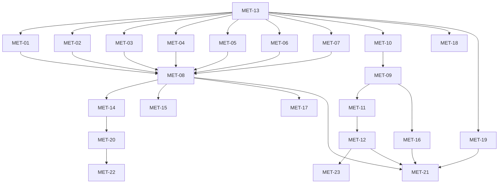

<!-- scope: adr/ADR-005 -->
# TASKS — ADR-005: Métricas operacionais Micrometer/Prometheus e custo derivado no Langfuse

> Backlog TDD-ready derivado 1:1 da `SPEC.md` deste ADR (13 RF + 10 NFR = 23 requisitos → 23 tickets `MET-01..MET-23`). Teste escrito **antes** da implementação em toda tarefa. Nenhuma tarefa redefine spans/correlação (ADR-001), transporte/header/exporter/flag (ADR-002), redação (ADR-003) ou proxy/RBAC/retention (ADR-004). Emenda de exposição (2026-11-25): decisão B é coberta dentro de MET-08, sem ticket novo.
>
> **Atalhos de caminho:** `API` = `backend/assistant/api/src/main/java/br/com/systec/hive/assistant/api/diagnostics/` · `IMPL` = `backend/assistant/impl/src/main/java/br/com/systec/hive/assistant/impl/diagnostics/` · `IMPLTEST` = `backend/assistant/impl/src/test/java/br/com/systec/hive/assistant/impl/diagnostics/` · `CFG` = `backend/bootstrap/src/main/java/br/com/systec/hive/config/` · `RES` = `backend/bootstrap/src/main/resources/` · `CFGTEST` = `backend/bootstrap/src/test/java/br/com/systec/hive/config/` · `IT` = `backend/integration-test/src/test/java/br/com/systec/hive/integrationtest/` · `POM` = `backend/dependencies/pom.xml` · `SECCFG` = `backend/security/impl/src/main/java/br/com/systec/hive/security/impl/config/` · `SECCFGTEST` = `backend/security/impl/src/test/java/br/com/systec/hive/security/impl/config/`.
>
> **Congelado (não renegociar):** 7 séries e seus nomes de exposição; `chat.telemetry.export.failures` → `chat_telemetry_export_failures_total` (grafia `.total` retirada); `token_type ∈ {input,output,total}` (3 valores — cache não é 4º rótulo); `usage_details` com buckets excludentes e `input_cached_tokens` separado; zero custo enviado pelo backend; `query` como parâmetro JSON único da Metrics API v2; scrape somente loopback (`127.0.0.1`/`::1`), 403 fora, health/health/**/info `permitAll`, `/actuator/**` fora do `permitAll` e `application.properties` inalterado (emenda 2026-11-25). Fontes em `SPEC.md` §12.

## 1. Traceability Context

- **Source:** `.spec/prd/telemetria-ia-langfuse/ADRs/ADR-005-metricas-custo/ADR.md` (decisão + Interface congelada + decisão do operador 2026-11-25) + `SPEC.md` (RF-01..RF-13, NFR-01..NFR-10).
- **Goal:** 1 ticket atômico por RF/NFR, com teste antes do código e aceite executável por comando/asserção.
- **Layout:** `unit: adr` — `ADR.md` + `SPEC.md` + `TASKS.md`; `VERIFY.md` só após merge (fora deste subagent). Marcador na 1ª linha: `<!-- scope: adr/ADR-005 -->`.

## 2. Sprint Summary

| Phase | Task ID | RF/NFR | Type | Priority | Risk | Depends on | Status |
|---|---|---|---|---|---|---|---|
| 0 — Pontos | MET-13 | RF-13 | integração | P0 | Alto | — | Todo |
| 1 — Volume | MET-01 | RF-01 | observabilidade | P0 | Médio | MET-13 | Todo |
| 2 — Chamadas | MET-02 | RF-02 | observabilidade | P0 | Médio | MET-13 | Todo |
| 3 — Falhas provider | MET-03 | RF-03 | observabilidade | P0 | Médio | MET-13 | Todo |
| 4 — Latência | MET-04 | RF-04 | observabilidade | P0 | Médio | MET-13 | Todo |
| 5 — Falha export | MET-05 | RF-05 | observabilidade | P0 | Alto | MET-13 | Todo |
| 6 — Falha redator | MET-06 | RF-06 | observabilidade | P0 | Médio | MET-13 | Todo |
| 7 — Tokens | MET-07 | RF-07 | observabilidade | P0 | Médio | MET-13 | Todo |
| 8 — Exposição | MET-08 | RF-08 | integração | P0 | Alto | MET-01, MET-02, MET-03, MET-04, MET-05, MET-06, MET-07 | Todo |
| 9 — Normalização | MET-10 | RF-10 | transformação | P0 | Alto | MET-13 | Todo |
| 10 — Custo inferido | MET-09 | RF-09 | integração | P0 | Alto | MET-10 | Todo |
| 11 — Consulta v2 | MET-11 | RF-11 | integração | P0 | Alto | MET-09 | Todo |
| 12 — Definition | MET-12 | RF-12 | configuração | P0 | Alto | MET-11 | Todo |
| 13 — Nomes | MET-14 | NFR-01 | teste | P1 | Médio | MET-08 | Todo |
| 14 — Cardinalidade | MET-15 | NFR-02 | segurança | P0 | Alto | MET-08 | Todo |
| 15 — Zero custo | MET-16 | NFR-03 | segurança | P0 | Alto | MET-09 | Todo |
| 16 — Sem OTLP metrics | MET-17 | NFR-04 | teste | P0 | Alto | MET-08 | Todo |
| 17 — Sem listener experimental | MET-18 | NFR-05 | teste | P1 | Médio | MET-13 | Todo |
| 18 — Flag herdada | MET-19 | NFR-06 | configuração | P1 | Médio | MET-13 | Todo |
| 19 — Rastreio | MET-20 | NFR-07 | documentação | P1 | Baixo | MET-14 | Todo |
| 20 — Regressão | MET-21 | NFR-08 | qualidade | P0 | Alto | MET-08, MET-12, MET-16, MET-19 | Todo |
| 21 — Delta/escopo | MET-22 | NFR-09 | documentação | P1 | Baixo | MET-20 | Todo |
| 22 — Custo zero | MET-23 | NFR-10 | teste | P1 | Médio | MET-12 | Todo |

## 3. Dependency Graph

---

## 4. Task Backlog

### MET-13 — Pontos de instrumentação já congelados (fundação)

- **RF/NFR:** RF-13 · **Prioridade:** P0 · **Risco:** Alto · **Tipo:** integração · **Depende de:** — · **Dependency Type:** Hard · **Paralelizável:** Não
- **Arquivos:** `IMPL/ChatMetricsRecorder.java` (novo — único ponto de registro das séries), `IMPLTEST/ChatMetricsRecorderTest.java` (novo), `IMPL/` e `API/` (somente leitura — pontos do ADR-001/002/003), `POM` (verificar `spring-boot-starter-actuator` já presente em `:114`, não adicionar dependência nova).
- **Contexto/Impacto:** concentra o registro nos mesmos pontos instrumentados: turno e callbacks do provider (ADR-001), exporter (ADR-002), redator (ADR-003). Sem abrir span, sem alterar `ChatTrace`/`ChatTraceRecorder`, sem série semconv duplicada.
- **Teste primeiro:**
  - [ ] `IMPLTEST/ChatMetricsRecorderTest.java`: afirmar que o recorder é chamado exatamente nos 4 pontos (turno, callback, exporter, redator) e que não cria spans nem chaves `langfuse.*` novas.
  - [ ] Criar `IMPL/ChatMetricsRecorder.java` somente depois que o teste existir.
- **Cenários:**
  - Sucesso: 1 turno + 2 tentativas + 1 falha de export + 1 falha de redator ⇒ 4 chamadas ao recorder, nenhuma alteração de span.
  - Falha: recorder chamado no handler do chat ou durante serialização OTLP ⇒ parar; mover para o ponto congelado.
  - Borda: telemetria desligada (ADR-002 flag `false`) ⇒ nenhum span/export; nenhum registro de série é duplicado.
- **DoD:**
  - [ ] Teste escrito antes da implementação.
  - [ ] `mvn -f backend/pom.xml test -Dtest=ChatMetricsRecorderTest` verde.
  - [ ] `git diff --name-only` sem `ChatTrace.java`, `ChatTraceRecorder.java`, ADR-001/002/003/004.

### MET-01 — `chat.turns` (volume por turno)

- **RF/NFR:** RF-01 · **Prioridade:** P0 · **Risco:** Médio · **Tipo:** observabilidade · **Depende de:** MET-13 · **Dependency Type:** Hard · **Paralelizável:** Sim
- **Arquivos:** `IMPL/ChatMetricsRecorder.java`, `IT/ChatMetricsExposureIT.java` (novo), `IMPLTEST/ChatMetricsRecorderTest.java`.
- **Contexto/Impacto:** Counter lógico `chat.turns`, exposição `chat_turns_total`, **sem tags**, +1 por turno no fechamento do ADR-001.
- **Teste primeiro:**
  - [ ] IT: 1 turno com provider fake de 2 tentativas ⇒ `chat_turns_total` incrementa exatamente +1; 0 tag; 0 incremento por retry.
  - [ ] Registrar o contador somente após o teste.
- **Cenários:**
  - Sucesso: N turnos ⇒ +N.
  - Falha: +2 no turno com retry ⇒ corrigir ponto de incremento (deve ser o turno, não a tentativa).
  - Borda: turno que falha antes do provider ainda conta +1.
- **DoD:**
  - [ ] Teste escrito antes do código.
  - [ ] `mvn -f backend/pom.xml -Pintegration verify -Dtest=ChatMetricsExposureIT` verde.
  - [ ] `curl -s localhost:8080/actuator/prometheus | grep '^chat_turns_total'` apresenta a série.

### MET-02 — `chat.provider.calls` (inclui retries)

- **RF/NFR:** RF-02 · **Prioridade:** P0 · **Risco:** Médio · **Tipo:** observabilidade · **Depende de:** MET-13 · **Dependency Type:** Hard · **Paralelizável:** Sim
- **Arquivos:** `IMPL/ChatMetricsRecorder.java`, `IT/ChatMetricsExposureIT.java`, `IMPLTEST/ChatMetricsRecorderTest.java`.
- **Contexto/Impacto:** Counter `chat.provider.calls` → `chat_provider_calls_total`, tags `provider`, `model`, `attempt`; `attempt ≥ 1` herda ADR-001.
- **Teste primeiro:**
  - [ ] IT com 2 tentativas: `chat_provider_calls_total{provider=…,model=…,attempt="1"}` e `attempt="2"` presentes; soma = 2.
  - [ ] Incrementar somente após o teste.
- **Cenários:**
  - Sucesso: 2 tentativas ⇒ 2 incrementos com `attempt` distinto.
  - Falha: `attempt="0"` ou ausente ⇒ corrigir leitura do atributo do ADR-001.
  - Borda: modelo efetivo após fallback ⇒ tag `model` é o modelo efetivo de `ChatTrace`.
- **DoD:**
  - [ ] Teste escrito antes do código.
  - [ ] IT verde; 0 valor de `attempt` fora de `≥1`.

### MET-03 — `chat.provider.failures` (reason classificado)

- **RF/NFR:** RF-03 · **Prioridade:** P0 · **Risco:** Médio · **Tipo:** observabilidade · **Depende de:** MET-13 · **Dependency Type:** Hard · **Paralelizável:** Sim
- **Arquivos:** `IMPL/ChatMetricsRecorder.java`, `IT/ChatMetricsExposureIT.java`, `IMPLTEST/ChatMetricsRecorderTest.java`, `IMPL/FailureClassifier.java` (somente leitura).
- **Contexto/Impacto:** Counter `chat.provider.failures` → `chat_provider_failures_total`, tags `provider`, `model`, `reason`; `reason` vem do conjunto fechado do classificador do ADR-001, sem texto.
- **Teste primeiro:**
  - [ ] IT com 1ª tentativa falha: contador incrementa só no filho falho; `reason` ∈ rótulos do classificador; `grep` no scrape por `at br.com` e por texto do prompt ⇒ 0.
  - [ ] Implementar somente após o teste.
- **Cenários:**
  - Sucesso: 1 falha ⇒ +1 com `reason` classificado.
  - Falha: `reason` com stack trace ou prompt ⇒ trocar pelo rótulo do classificador, nunca `getMessage()`.
  - Borda: duas falhas com mesmo `reason` ⇒ +2 (agregação por rótulo).
- **DoD:**
  - [ ] Teste escrito antes do código.
  - [ ] IT verde; 0 texto bruto em rótulo.

### MET-04 — `chat.provider.latency` (Timer)

- **RF/NFR:** RF-04 · **Prioridade:** P0 · **Risco:** Médio · **Tipo:** observabilidade · **Depende de:** MET-13 · **Dependency Type:** Hard · **Paralelizável:** Sim
- **Arquivos:** `IMPL/ChatMetricsRecorder.java`, `IT/ChatMetricsExposureIT.java`, `IMPLTEST/ChatMetricsRecorderTest.java`.
- **Contexto/Impacto:** Timer `chat.provider.latency` → família `chat_provider_latency_seconds`, tags `provider`, `model`; mede a chamada ao provider, não o turno inteiro.
- **Teste primeiro:**
  - [ ] IT com provider fake de latência conhecida: família `chat_provider_latency_seconds` presente; duração > 0 e dentro do orçamento caracterizado; 0 medição cobrindo o turno completo.
  - [ ] Registrar o timer somente após o teste.
- **Cenários:**
  - Sucesso: 2 tentativas ⇒ 2 observações de latência.
  - Falha: latência 0 ou negativa ⇒ corrigir origem do timestamp; nunca inventar valor default.
  - Borda: timeout do provider ⇒ latência registrada na falha, sem alterar resposta do chat.
- **DoD:**
  - [ ] Teste escrito antes do código.
  - [ ] IT verde; nome exato da família no scrape.

### MET-05 — `chat.telemetry.export.failures` (nome canônico, RF9)

- **RF/NFR:** RF-05 · **Prioridade:** P0 · **Risco:** Alto · **Tipo:** observabilidade · **Depende de:** MET-13 · **Dependency Type:** Hard · **Paralelizável:** Não
- **Arquivos:** `IMPL/ChatMetricsRecorder.java`, `CFG/LangfuseOtlpExporterConfig.java` (somente leitura — incremento existe no ADR-002), `IT/LangfuseOtlpBestEffortIT.java` (reuso do IT do ADR-002), `IT/ChatMetricsExposureIT.java`.
- **Contexto/Impacto:** Counter lógico `chat.telemetry.export.failures`, tag `sink=langfuse`, exposição `chat_telemetry_export_failures_total`. ADR-002 garante o incremento; ADR-005 fixa nome/tipo/tag/exposição. Grafia antiga `chat.telemetry.export.failures.total` está **retirada**.
- **Teste primeiro:**
  - [ ] IT com exporter recusando conexão: `chat_telemetry_export_failures_total{sink="langfuse"}` +1 por lote falho; resposta de chat 200/contrato inalterado; `grep -rn "chat.telemetry.export.failures.total" backend/*/src/main/` ⇒ 0.
  - [ ] Registrar a série somente após o teste.
- **Cenários:**
  - Sucesso: 3 falhas ⇒ +3; nome canônico presente no scrape.
  - Falha: nome antigo pontuado reaparece ⇒ corrigir e voltar ao architect (não renomear por conta própria).
  - Borda: falha 401 com credencial inválida ⇒ +1 e log sem `sk-`/base64 (ADR-002/RB3).
- **DoD:**
  - [ ] Teste escrito antes do código.
  - [ ] IT verde; 0 uso da grafia retirada; 0 série de negócio nova além das 7.

### MET-06 — `chat.telemetry.redaction.failures` (fail-closed)

- **RF/NFR:** RF-06 · **Prioridade:** P0 · **Risco:** Médio · **Tipo:** observabilidade · **Depende de:** MET-13 · **Dependency Type:** Hard · **Paralelizável:** Sim
- **Arquivos:** `IMPL/ChatMetricsRecorder.java`, `IT/ChatMetricsExposureIT.java`, `IMPLTEST/ChatMetricsRecorderTest.java`; ponto do redator do ADR-003 é somente leitura.
- **Contexto/Impacto:** Counter sem tags `chat.telemetry.redaction.failures` → `chat_telemetry_redaction_failures_total`; incremento quando o redator falha fechado (ADR-003/RF4).
- **Teste primeiro:**
  - [ ] IT com redator forçado a falhar: contador +1; payload OTLP sem `langfuse.observation.input`/`output`; metadados `provider`/`model`/usage preservados; 0 texto bruto no log.
  - [ ] Registrar somente após o teste.
- **Cenários:**
  - Sucesso: falha do redator ⇒ +1 e span sem texto.
  - Falha: contador incrementa em redação bem-sucedida ⇒ corrigir ponto de incremento.
  - Borda: redator falha em output mas não em input ⇒ ainda +1 e ambas as chaves de texto omitidas (fail-closed do ADR-003).
- **DoD:**
  - [ ] Teste escrito antes do código.
  - [ ] IT verde; nenhuma chave de texto no payload; nenhuma alteração no ADR-003.

### MET-07 — `chat.provider.tokens` (DistributionSummary)

- **RF/NFR:** RF-07 · **Prioridade:** P0 · **Risco:** Médio · **Tipo:** observabilidade · **Depende de:** MET-13 · **Dependency Type:** Hard · **Paralelizável:** Sim
- **Arquivos:** `IMPL/ChatMetricsRecorder.java`, `IT/ChatMetricsExposureIT.java`, `IMPLTEST/ChatMetricsRecorderTest.java`.
- **Contexto/Impacto:** `chat.provider.tokens` → `chat_provider_tokens_sum`, tags `provider`, `model`, `token_type ∈ {input,output,total}`. Base para cálculo independente de custo (US-02). `input_cached_tokens` **não** é rótulo desta série.
- **Teste primeiro:**
  - [ ] IT com usage conhecido: `chat_provider_tokens_sum{...,token_type="input"}`, `="output"`, `="total"` presentes com os valores do provider; conjunto de `token_type` ⊆ 3 valores.
  - [ ] Registrar somente após o teste.
- **Cenários:**
  - Sucesso: `input=10`, `output=5`, `total=15` no scrape.
  - Falha: 4º valor de `token_type` (ex.: `input_cached_tokens`) ⇒ corrigir; cache só existe em `usage_details` (MET-10).
  - Borda: provider sem usage ⇒ 0 observação, nunca valor 0 inventado.
- **DoD:**
  - [ ] Teste escrito antes do código.
  - [ ] IT verde; 0 rótulo fora do conjunto fechado de 3.

### MET-08 — Exposição exclusiva e restrita em `/actuator/prometheus`

- **RF/NFR:** RF-08 · **Prioridade:** P0 · **Risco:** Alto · **Tipo:** integração · **Depende de:** MET-01, MET-02, MET-03, MET-04, MET-05, MET-06, MET-07 · **Dependency Type:** Hard · **Paralelizável:** Não
- **Arquivos:** `SECCFG/SecurityConfig.java` (único arquivo de código autorizado — chain `@Order(2)`), `RES/application.properties` (verificar `management.endpoints.web.exposure.include=health,info,prometheus` e `show-values=never` — **sem edição**), `IT/ChatMetricsExposureIT.java` (acesso loopback/remoto, health/info/env e scrape positivo).
- **Registro de implementação (revisão 2026-11-26):** `SECCFGTEST/ActuatorExposureAccessTest.java` foi substituído por `IT/ChatMetricsExposureIT.java`: o módulo `security/impl` não tem `spring-boot-webmvc-test`, e o IT exercita a cadeia Spring real com `context-path=/hive` sem dependência nova. `ADR.md`/`SPEC.md` não foram alterados por esta substituição.
- **Contexto/Impacto:** as sete séries são consultáveis por `curl`/MockMvc no endpoint do Actuator; nenhum endpoint próprio de métricas é adicionado. Decisão B (emenda 2026-11-25): só `GET /actuator/prometheus` passa a exigir `remoteAddr` ∈ {`127.0.0.1`, `::1`} via `WebExpressionAuthorizationManager("hasIpAddress('127.0.0.1') or hasIpAddress('::1')")` na chain `@Order(2)`, antes de `anyRequest()`; fora ⇒ 403 com `{"error": "Acesso negado"}` do `accessDeniedHandler` existente. `/actuator/health`, `/actuator/health/**` e `/actuator/info` seguem `permitAll`; `/actuator/**` sai da lista `permitAll` e demais caminhos caem em `authenticated()` (404 pela exposure list após autenticação; 401/403 sem credencial). Sem credencial, dependência ou rota nova; proxy `auth_request` do ADR-004 não é reutilizado (cobre só Langfuse).
- **Teste primeiro:**
  - [ ] `IT/ChatMetricsExposureIT.java`: MockMvc com `remoteAddr` `127.0.0.1` e `::1` ⇒ 200 no scrape; com `203.0.113.10` ⇒ 403 e corpo `{"error": "Acesso negado"}` — inclusive com `get("/hive/actuator/prometheus").contextPath("/hive")`, pois a produção usa `context-path=/hive` e o entry point deve comparar o path sem o prefixo do contexto.
  - [ ] Mesmo IT: `/actuator/health`, `/actuator/health/**` e `/actuator/info` ⇒ 200 sem credencial; `/actuator/env` ⇒ 404 com usuário autenticado (e 401/403 sem credencial, pela cadeia atual).
  - [ ] `IT/ChatMetricsExposureIT.java`: `curl -s localhost:8080/actuator/prometheus` contém os 14 nomes congelados (7 lógicos caracterizados em MET-14, 7 exposição); nenhum outro path de métrica responde 200.
  - [ ] Ajustar `SecurityConfig.java` somente depois que os testes existirem; não criar controller, credencial ou registry novo; não editar `application.properties`.
- **Cenários:**
  - Sucesso: scrape 200 em loopback com as 7 séries; health/info 200 sem credencial; env 404 com usuário autenticado.
  - Falha: série ausente ⇒ corrigir registro no ponto de origem, não no endpoint; IP externo com 200 ⇒ corrigir a expressão na chain `@Order(2)`, nunca no proxy do ADR-004.
  - Borda: IPv6 `::1` permitido e `203.0.113.10` negado; `/actuator/env` sem credencial ⇒ 401/403 pela cadeia atual, com credencial ⇒ 404 pela `exposure.include` (sem `show-values` novo); registry Prometheus ausente ⇒ falha no teste (`POM:114` já traz Actuator).
- **DoD:**
  - [ ] Testes escritos antes da edição de `SecurityConfig.java`.
  - [ ] `mvn -f backend/pom.xml -Pintegration verify -Dit.test=ChatMetricsExposureIT` verde (loopback, remoto, `context-path=/hive`, health/info/env).
  - [ ] `git diff --name-only` ⇒ 0 alteração em `RES/application.properties`, 0 controller/endpoint de métricas novo, único arquivo de código alterado é `SecurityConfig.java` na chain `@Order(2)`.

### MET-10 — Normalização de buckets de usage (decisão do operador)

- **RF/NFR:** RF-10 · **Prioridade:** P0 · **Risco:** Alto · **Tipo:** transformação · **Depende de:** MET-13 · **Dependency Type:** Hard · **Paralelizável:** Não
- **Arquivos:** `IMPL/UsageBucketsNormalizer.java` (novo), `IMPLTEST/UsageBucketsNormalizerTest.java` (novo), `API/ChatTrace.java` (somente leitura — origem de promptTokens/cachedTokens/completionTokens).
- **Contexto/Impacto:** `langfuse.observation.usage_details` é armazenado **flat/sem normalização** pelo Langfuse; backend converte contagem inclusiva do provider em buckets excludentes. Regra: `input = promptTokens - cachedTokens`, `input_cached_tokens = cachedTokens`, `output = completionTokens`, `total = soma dos buckets`. Sem cache: `input = promptTokens`, sem chave de cache. Nenhum preço é calculado aqui.
- **Teste primeiro:**
  - [ ] `IMPLTEST/UsageBucketsNormalizerTest.java`: fixture doc oficial `17903/17817/188/18091` ⇒ `{"input":86,"output":188,"input_cached_tokens":17817,"total":18091}`;
  - [ ] segundo caso sem cache `p=10,c=5` ⇒ `{"input":10,"output":5,"total":15}` sem chave `input_cached_tokens`;
  - [ ] terceiro caso: nenhum token em 2 buckets (`input + input_cached_tokens + output == total`).
  - [ ] Implementar o normalizador somente após os testes.
- **Cenários:**
  - Sucesso: contagem inclusiva convertida; `total` bate com `total_tokens` do provider.
  - Falha: `cachedTokens > promptTokens` ⇒ rejeitar/zerar cache na origem, nunca produzir `input` negativo.
  - Borda: `cachedTokens = 0` ⇒ tratar como sem cache; 0 chave `input_cached_tokens` ou chave explícita `0` conforme a regra do provider — teste fixa um único comportamento e o congelado é "sem cache ⇒ chave ausente".
- **DoD:**
  - [ ] Testes escritos antes da implementação.
  - [ ] `mvn -f backend/pom.xml test -Dtest=UsageBucketsNormalizerTest` verde.
  - [ ] 0 campo de custo no normalizador; 0 novo rótulo `token_type`.

### MET-09 — Observation `generation` com usage e zero custo enviado

- **RF/NFR:** RF-09 · **Prioridade:** P0 · **Risco:** Alto · **Tipo:** integração · **Depende de:** MET-10 · **Dependency Type:** Hard · **Paralelizável:** Não
- **Arquivos:** `IMPL/` (montagem dos atributos `langfuse.*` do filho — ADR-001, somente leitura salvo o atributo de usage), `IMPL/UsageBucketsNormalizer.java`, `IT/LangfuseCostDerivationIT.java` (novo, com servidor OTLP fake que decodifica protobuf).
- **Contexto/Impacto:** filho `generation` leva `langfuse.observation.type=generation`, `langfuse.observation.model.name` (modelo efetivo) e `langfuse.observation.usage_details` normalizado (MET-10); nenhum campo de custo calculado pelo backend. `costDetails`/`totalCost` pertencem ao Langfuse.
- **Teste primeiro:**
  - [ ] IT: decode do payload ⇒ `type=generation`, `model.name` = modelo efetivo, `usage_details` com buckets excludentes; 0 `langfuse.observation.cost_details`, 0 `gen_ai.usage.cost`, 0 `costDetails` (MET-16 aprofunda o grep).
  - [ ] Ajustar somente a montagem do atributo de usage após o teste.
- **Cenários:**
  - Sucesso: 1 filho `generation` com usage correto e nenhum custo.
  - Falha: campo de custo aparece no payload ⇒ remover na origem; nunca "apagar no exporter" depois de enviar.
  - Borda: provider sem usage ⇒ `usage_details` ausente; `sum_totalCost` será 0 (MET-23), sem erro de chat.
- **DoD:**
  - [ ] Teste escrito antes da implementação.
  - [ ] `mvn -f backend/pom.xml -Pintegration verify -Dtest=LangfuseCostDerivationIT` verde.
  - [ ] 0 custo no payload decodificado.

### MET-11 — Consulta `sum_totalCost` na Metrics API v2

- **RF/NFR:** RF-11 · **Prioridade:** P0 · **Risco:** Alto · **Tipo:** integração · **Depende de:** MET-09 · **Dependency Type:** Hard · **Paralelizável:** Não
- **Arquivos:** `IT/LangfuseCostDerivationIT.java`, `RES/application-dev.properties` (URL base de consulta como referência a secret — sem valor de credencial), `IT/` fixture de query JSON.
- **Contexto/Impacto:** `GET /api/public/v2/metrics?query=<JSON>` com `view=observations`, `metrics:[{measure:"totalCost",aggregation:"sum"}]`, `dimensions:[{field:"providedModelName"}]`, `filters:[]`, `orderBy:[{field:"sum_totalCost",direction:"desc"}]`. `measure`/`aggregation` dentro do JSON, nunca query params soltos. Header v4 do ADR-002 garante tempo real.
- **Teste primeiro:**
  - [ ] IT com `curl -G --data-urlencode 'query=<JSON>'` e Basic de leitura vindo de env: resposta `data[]` com `sum_totalCost > 0` para modelo/preço de referência; `orderBy[0].field=sum_totalCost`; 0 `?measure=`/`?aggregation=`; header v4 presente no OTLP.
  - [ ] Implementar a fixture/consulta somente após o teste.
- **Cenários:**
  - Sucesso: `sum_totalCost` igual à derivação esperada (preço do operador × usage).
  - Falha: query com `measure` como query param ⇒ teste quebra; corrigir para JSON dentro de `query`.
  - Borda: `row_limit` padrão 100 — consulta com >100 modelos usa `config.row_limit` explícito (verificado na doc oficial), sem inventar outro parâmetro.
- **DoD:**
  - [ ] Teste escrito antes da implementação.
  - [ ] IT verde; 0 literal de credencial no comando/repo.
  - [ ] Campo de resposta é exatamente `sum_totalCost`.

### MET-12 — Model definition: default, custom e vigência

- **RF/NFR:** RF-12 · **Prioridade:** P0 · **Risco:** Alto · **Tipo:** configuração · **Depende de:** MET-11 · **Dependency Type:** Hard · **Paralelizável:** Não
- **Arquivos:** `IT/LangfuseCostDerivationIT.java`, `IT/` fixture de preço do operador (`LANGFUSE_TEST_MODEL_PRICE`, fornecido pelo operador — 0 literal inventado no código).
- **Contexto/Impacto:** modelo casando com definition default da versão instalada ⇒ custo inferido; sem match ⇒ operador cadastra `POST /api/public/models` com match_pattern/preço por ele fornecidos; definição nova só afeta generations posteriores. Backend não cadastra definition nem calcula preço.
- **Teste primeiro:**
  - [ ] IT 1: modelo sem definition ⇒ `sum_totalCost=0` com usage correto;
  - [ ] IT 2: `POST /api/public/models` com preço da variável do operador + nova generation ⇒ `sum_totalCost > 0` igual ao preço × usage;
  - [ ] IT 3: generation anterior ao cadastro permanece com custo 0.
  - [ ] Configurar a fixture somente após os testes.
- **Cenários:**
  - Sucesso: custo aparece somente para generation posterior ao cadastro.
  - Falha: custo calculado pelo backend ⇒ remover (RF-09/NFR-03).
  - Borda: definition custom tem prioridade sobre default do Langfuse (conforme doc oficial) — teste com mesmo modelo antes/depois do cadastro.
- **DoD:**
  - [ ] Testes escritos antes da configuração.
  - [ ] IT verde; 0 preço literal no código; 0 `POST /api/public/models` no backend de produção.

### MET-14 — Caracterização da nomenclatura congelada

- **RF/NFR:** NFR-01 · **Prioridade:** P1 · **Risco:** Médio · **Tipo:** teste · **Depende de:** MET-08 · **Dependency Type:** Soft · **Paralelizável:** Sim
- **Arquivos:** `CFGTEST/FrozenMetricsContractTest.java` (novo).
- **Contexto/Impacto:** congela os 14 nomes (7 lógicos + 7 exposição), os tipos (Counter/Timer/DistributionSummary) e os sufixos (`_total`, `_seconds`, `_sum`) conforme ADR e Prometheus naming.
- **Teste primeiro:**
  - [ ] Teste de caracterização: conjuntos exatos; 0 grafia antiga `chat.telemetry.export.failures.total`; 0 rename/remoção.
  - [ ] Nenhuma implementação nova; divergência ⇒ corrigir na origem e voltar ao architect.
- **Cenários:**
  - Sucesso: todos os nomes e tipos conferem com a tabela do ADR.
  - Falha: mudança de nome de série ou sufixo ⇒ teste quebra.
  - Borda: nomes lógicos Micrometer e exposição Prometheus são pares distintos — teste afirma o par, não um nome só.
- **DoD:**
  - [ ] Teste escrito antes de qualquer ajuste.
  - [ ] 0 divergência; 0 grafia retirada.

### MET-15 — Cardinalidade: rótulos fechados, sem ID/texto

- **RF/NFR:** NFR-02 · **Prioridade:** P0 · **Risco:** Alto · **Tipo:** segurança · **Depende de:** MET-08 · **Dependency Type:** Hard · **Paralelizável:** Sim
- **Arquivos:** `CFGTEST/FrozenMetricsContractTest.java`, `IT/ChatMetricsExposureIT.java`, `IMPL/ChatMetricsRecorder.java` (somente leitura após o teste).
- **Contexto/Impacto:** `reason`/`token_type` conjuntos fechados; `sink=langfuse`; proibidos `sessionId`, `tenantId`, `turnId`, `clientId`, `promptTemplateId`, texto, prompt, resposta, stack trace e `sk-` como rótulo.
- **Teste primeiro:**
  - [ ] Varredura de todas as séries no scrape: conjunto de tags por série idêntico ao ADR; 0 rótulo com UUID, `at br.com`, literal de prompt ou `sk-`.
  - [ ] Ajustar somente o que a varredura acusar.
- **Cenários:**
  - Sucesso: tags ⊆ conjuntos congelados.
  - Falha: `tenantId` vira tag ⇒ remover na origem; nunca mascarar no scrape.
  - Borda: dois turnos de tenants distintos ⇒ mesmo conjunto de tags, nenhum valor de tenant.
- **DoD:**
  - [ ] Teste escrito antes do ajuste.
  - [ ] 0 dado identificável em rótulo.

### MET-16 — Zero campo de custo calculado pelo backend

- **RF/NFR:** NFR-03 · **Prioridade:** P0 · **Risco:** Alto · **Tipo:** segurança · **Depende de:** MET-09 · **Dependency Type:** Hard · **Paralelizável:** Não
- **Arquivos:** `IT/LangfuseCostDerivationIT.java`, verificação estática em `backend/*/src/main/`.
- **Contexto/Impacto:** proibidos `langfuse.observation.cost_details`, `gen_ai.usage.cost`, `costDetails` e literal de preço em código de produção. Custo é inferido no Langfuse (RF8/RB3).
- **Teste primeiro:**
  - [ ] `grep -rn "cost_details\|gen_ai.usage.cost\|costDetails" backend/*/src/main/` ⇒ 0; decode do payload no IT ⇒ 0 chave de custo; 0 literal de preço.
  - [ ] Remover occurrence acusada na origem; nunca adicionar exceção "só para teste".
- **Cenários:**
  - Sucesso: payload só com usage/modelo/identificação de hierarquia.
  - Falha: chave de custo aparece ⇒ parar e corrigir montagem do atributo.
  - Borda: gateway que devolve preço no response — preço é descartado, não repassado ao OTLP.
- **DoD:**
  - [ ] Verificação escrita/executada antes da implementação de MET-09.
  - [ ] 0 campo de custo em `src/main/` e no payload.

### MET-17 — Nenhum OTLP metrics/logs ao Langfuse

- **RF/NFR:** NFR-04 · **Prioridade:** P0 · **Risco:** Alto · **Tipo:** teste · **Depende de:** MET-08 · **Dependency Type:** Hard · **Paralelizável:** Sim
- **Arquivos:** `IT/ChatMetricsExposureIT.java`, `CFG/LangfuseOtlpExporterConfig.java` (somente leitura), `POM` (verificar nenhum starter de metrics OTLP).
- **Contexto/Impacto:** Langfuse ingere só traces; endpoint de metrics aceita e descarta (RF7 seria impossível). Nenhum exporter de metrics, nenhum log OTLP, nenhuma auto-instrumentação global.
- **Teste primeiro:**
  - [ ] Varredura de todas as requisições do IT: 0 `/api/public/otel/v1/metrics`, 0 `/v1/logs`; inspeção de beans: 0 exporter de metrics e 0 auto-instrumentação.
  - [ ] Ajustar configuração somente se o teste acusar sinal extra; nunca filtrar depois de enviar.
- **Cenários:**
  - Sucesso: apenas `POST /api/public/otel/v1/traces` (ADR-002).
  - Falha: requisição a `/v1/metrics` ⇒ remover exporter, não silenciar no destino.
  - Borda: starter adicional não registra metrics implicitamente.
- **DoD:**
  - [ ] Teste escrito antes de qualquer ajuste.
  - [ ] 0 sinal que não seja trace.

### MET-18 — Não adotar `ObservationChatModelListener`

- **RF/NFR:** NFR-05 · **Prioridade:** P1 · **Risco:** Médio · **Tipo:** teste · **Depende de:** MET-13 · **Dependency Type:** Soft · **Paralelizável:** Sim
- **Arquivos:** `CFGTEST/FrozenMetricsContractTest.java`, verificação estática em `backend/*/src/main/`, `POM`.
- **Contexto/Impacto:** implementação `@Experimental` do tag 1.19.0 não é contrato de métrica; adotá-la criaria série semconv duplicada e risco de API em upgrade (ADR Decisão 6).
- **Teste primeiro:**
  - [ ] `grep -rn "ObservationChatModelListener" backend/*/src/main/` ⇒ 0; 0 série `gen_ai.client.token.usage` duplicada no scrape.
  - [ ] Nenhuma implementação; se houver ocorrência, remover e voltar ao ADR.
- **Cenários:**
  - Sucesso: métricas vêm somente do recorder do ADR-005.
  - Falha: listener experimental reintroduzido ⇒ teste quebra.
  - Borda: `ChatModelListener` (interface do ADR-001) permanece — proibição é da implementação de observação, não da interface.
- **DoD:**
  - [ ] Teste escrito antes do fechamento.
  - [ ] 0 ocorrência da classe experimental; 0 série semconv duplicada.

### MET-19 — Flag herdada (`HIVE_TELEMETRY_ENABLED`, sem novo botão)

- **RF/NFR:** NFR-06 · **Prioridade:** P1 · **Risco:** Médio · **Tipo:** configuração · **Depende de:** MET-13 · **Dependency Type:** Soft · **Paralelizável:** Sim
- **Arquivos:** `RES/application.properties`, `RES/application-dev.properties`, `RES/application-prod.properties`, `CFGTEST/FrozenMetricsContractTest.java`.
- **Contexto/Impacto:** ADR-002 congela default `false` (opt-in), `true`=100% (`always-on`), `false`=0% (`always-off`). Este ADR não cria env de métrica, taxa intermediária ou segundo botão; não reabre ADR-002.
- **Teste primeiro:**
  - [ ] Auditoria de config + caracterização: `HIVE_TELEMETRY_ENABLED` default `false`; 0 nova variável de sampling de métrica; 0 taxa intermediária.
  - [ ] Nenhuma configuração nova; divergência ⇒ corrigir para o valor congelado no ADR-002.
- **Cenários:**
  - Sucesso: três estados (ausente/`false`/`true`) com o comportamento do ADR-002.
  - Falha: default `true` ou nova env `METRICS_ENABLED` ⇒ teste quebra.
  - Borda: produção liga explicitamente com endpoint/credenciais de secret — nenhuma alteração aqui.
- **DoD:**
  - [ ] Teste escrito antes de qualquer ajuste.
  - [ ] 0 decisão nova sobre sampling.

### MET-20 — Auditar rastreabilidade e fontes

- **RF/NFR:** NFR-07 · **Prioridade:** P1 · **Risco:** Baixo · **Tipo:** documentação · **Depende de:** MET-14 · **Dependency Type:** Soft · **Paralelizável:** Não
- **Arquivos:** `SPEC.md` e `TASKS.md` deste diretório (somente leitura/ajuste documental); `ADR.md` §Fontes.
- **Contexto/Impacto:** garante 23 requisitos ↔ 23 tickets e URL+data em toda afirmação sobre API de terceiro.
- **Teste primeiro:**
  - [ ] Auditoria determinística: `grep -c '^### MET-' TASKS.md` ⇒ 23; comparar com RF-01..RF-13 + NFR-01..NFR-10; 0 órfão; toda URL de terceiro com data.
  - [ ] Nenhuma implementação; corrigir documentação se houver órfão.
- **Cenários:**
  - Sucesso: 23 seções ↔ 23 requisitos; marcador `<!-- scope: adr/ADR-005 -->` na 1ª linha.
  - Falha: task sem RF/NFR ou RF/NFR sem task ⇒ corrigir antes do `VERIFY.md`.
  - Borda: nenhuma macro-tarefa inventada fora da SPEC; IDs casam `[A-Z]+(?:-[A-Z]+)*-\d+`.
- **DoD:**
  - [ ] Auditoria executada antes do fechamento do ADR.
  - [ ] 0 órfão; 0 referência a task inexistente.

### MET-21 — Não regressão do contrato do chat

- **RF/NFR:** NFR-08 · **Prioridade:** P0 · **Risco:** Alto · **Tipo:** qualidade · **Depende de:** MET-08, MET-12, MET-16, MET-19 · **Dependency Type:** Hard · **Paralelizável:** Não
- **Arquivos:** nenhum de produto neste passo; suíte canônica e `git diff --name-only`.
- **Contexto/Impacto:** métricas e custo não alteram resposta, cota, limites `m/c/t`, `turnId`/`clientId`, autenticação ou headers de rate limit — com exporter up/down e com/sem model definition. Única exceção de diff autorizada é a chain `@Order(2)` de `SecurityConfig.java` para o scrape (MET-08); regras de autenticação do chat permanecem intactas.
- **Teste primeiro:**
  - [ ] Caracterização da resposta de chat nos estados (exporter up/down, definition presente/ausente) + `npm test` + `mvn -f backend/pom.xml -Pintegration verify` + `git diff --name-only`.
  - [ ] Corrigir somente o que o teste acusar; nenhuma mudança de contrato.
- **Cenários:**
  - Sucesso: 0 falhas; resposta idêntica nos estados; diff sem arquivos proibidos.
  - Falha: divergência de resposta ⇒ parar e corrigir causa raiz no isolamento (ADR-002/ADR-005), nunca no handler do chat.
  - Borda: nenhuma UI nova nesta fatia ⇒ H3/frontend N/A.
- **DoD:**
  - [ ] Testes/caracterização executados antes do fechamento.
  - [ ] 0 falhas; 0 diff em contrato/cota/RBAC/regras de autenticação do chat; diff em `SecurityConfig.java` restrito ao scrape.

### MET-22 — Delta Specs e escopo de escrita

- **RF/NFR:** NFR-09 · **Prioridade:** P1 · **Risco:** Baixo · **Tipo:** documentação · **Depende de:** MET-20 · **Dependency Type:** Soft · **Paralelizável:** Não
- **Arquivos:** somente `SPEC.md`/`TASKS.md` deste diretório; verificação de `git status --short` e `.agents/rules/`.
- **Contexto/Impacto:** nenhum doc vivo alterado (PRD RB7); Delta Specs = nenhuma. Neste ciclo só os 2 artefatos do ADR-005 são criados — sem código, branch, `VERIFY.md`, sem tocar ADR-001/002/003/004/PRD/RESEARCH/ADR-INDEX.
- **Teste primeiro:**
  - [ ] Verificação documental: `git status --short` ⇒ só os 2 arquivos deste diretório; `grep` em `.agents/rules/` ⇒ 0 diff; 0 diff em PRD/RESEARCH/ADR-INDEX e ADRs 001–004.
  - [ ] Nenhuma implementação; remover qualquer artefato fora do escopo.
- **Cenários:**
  - Sucesso: escopo restrito aos 2 arquivos; Delta Specs = nenhuma registrada na SPEC.
  - Falha: arquivo de código/branch/`VERIFY.md` criado ⇒ remover e reportar ao orquestrador.
  - Borda: configuração da aplicação é código/config do ADR na implementação futura, não doc vivo agora.
- **DoD:**
  - [ ] Verificação executada antes do fechamento.
  - [ ] 0 artefato fora de `.spec/prd/telemetria-ia-langfuse/ADRs/ADR-005-metricas-custo/`.

### MET-23 — Custo zero sem model definition é esperado

- **RF/NFR:** NFR-10 · **Prioridade:** P1 · **Risco:** Médio · **Tipo:** teste · **Depende de:** MET-12 · **Dependency Type:** Soft · **Paralelizável:** Sim
- **Arquivos:** `IT/LangfuseCostDerivationIT.java`.
- **Contexto/Impacto:** sem definition que case com `langfuse.observation.model.name`, `sum_totalCost` é 0 mesmo com usage correto; não é defeito e não dispara cálculo pelo backend. Preços default atualizam com a versão instalada; definitions custom valem para generations posteriores.
- **Teste primeiro:**
  - [ ] IT: modelo sem definition + usage correto ⇒ `sum_totalCost=0`; 0 chamada ao backend para calcular preço; generation anterior ao cadastro (MET-12) permanece 0.
  - [ ] Nenhuma implementação; se o backend tentar preencher custo, corrigir em MET-09/MET-16.
- **Cenários:**
  - Sucesso: custo 0 reportado sem erro de instrumentação.
  - Falha: erro/5xx no chat por ausência de preço ⇒ parar; custo é best-effort de análise, não contrato do chat.
  - Borda: modelo casando com definition default da versão instalada ⇒ custo > 0 sem cadastro custom (MET-12 IT 1 complementar).
- **DoD:**
  - [ ] Teste escrito antes do fechamento.
  - [ ] 0 cálculo de preço no backend; 0 regressão de resposta.

---

## 5. Coverage Validation

- [ ] 23 tasks MET-01..MET-23 ↔ 23 RF/NFR da SPEC (13 RF + 10 NFR), 1:1 sem órfão.
- [ ] Toda constraint da Interface congelada mapeada para BDD: 7 séries e 7 exposições, tipos, tags, nome canônico `chat_telemetry_export_failures_total`, `token_type` de 3 valores, `usage_details` excludente com `input_cached_tokens`, zero custo, `query` JSON com `sum_totalCost`, sem OTLP metrics, flag herdada.
- [ ] Decisão B de exposição coberta 1:1 em MET-08: scrape loopback 200 (IPv4/IPv6), IP externo 403, health/health/**/info 200 sem credencial, env 404 com credencial, `application.properties` inalterado; nenhum ticket novo criado.
- [ ] Toda task tem cenário de Sucesso, Falha (Failure Mode) e Borda/Idempotência.
- [ ] Toda task lista arquivo de teste antes do arquivo de implementação/configuração.
- [ ] Grafo Mermaid sem ciclo e sem órfã (MET-13 é raiz; MET-21/MET-22 são folhas).
- [ ] Sprint Summary 1:1 com as 23 seções (sem ID órfão na tabela).
- [ ] Nenhuma macro-tarefa inventada fora da SPEC.
- [ ] Nenhuma task introduz decisão de ADR-001/002/003/004 nem reescreve o nome canônico ou os buckets congelados.
- [ ] Marcador `<!-- scope: adr/ADR-005 -->` na 1ª linha; IDs no regex `[A-Z]+(?:-[A-Z]+)*-\d+`.
- [ ] Comando de auditoria: `grep -c '^### MET-' TASKS.md` ⇒ 23; `grep -c '^### MET-' TASKS.md` casando com `grep -c '^- \*\*RF-\|^- \*\*NFR-' SPEC.md` ⇒ 23.

## 6. Plan Feedback (não bloqueante para o backlog)

- **Normalização (MET-10):** decisão do operador de 2026-11-25; `input_cached_tokens` existe **somente** em `usage_details`, nunca como 4º valor de `token_type` em `chat.provider.tokens` (RF-07 × RF-10). Exemplo executável 17903/17817/188/18091 vem da doc oficial (§12), não é número inventado.
- **Ponto de prova do RF8:** MET-09 (payload sem custo) + MET-11 (`sum_totalCost`) + MET-12 (definition) formam a cadeia; MET-23 cobre o caso "sem definition = 0".
- **Nome canônico (MET-05/MET-14):** par único `chat.telemetry.export.failures` → `chat_telemetry_export_failures_total`; ADR-002 garante o incremento, ADR-005 a definição/exposição; grafia antiga proibida.
- **Exposição (MET-08, emenda 2026-11-25):** decisão B do architect é aplicada na chain `@Order(2)` de `SecurityConfig.java` (único arquivo de código autorizado). Proxy `auth_request` do ADR-004 (só Langfuse), Basic auth e porta de management separada foram descartados no ADR — não reabrir aqui; coletor em outro host exige nova decisão.
- **Fora deste backlog:** código, branch, `VERIFY.md`, merge, `workflow-state.json`; nenhum arquivo de ADR-001/002/003/004, PRD, RESEARCH ou ADR-INDEX foi alterado.
- **Gap de check (encaminhar ao orquestrador, não resolvido aqui):** `runPrdChecks('.')` reporta `PRD-01 FAIL` pelo órfão pré-existente `.spec/prd/chat-model-override/PROPOSAL.md` (sem `PRD.md`); `ADR-01`/`ADR-02` seguem `PASS` após a emenda. Órfão fora da autoridade deste subagent (constraint: só os 2 arquivos do ADR-005). Requer decisão do orquestrador/dono do `chat-model-override`; nenhum check foi criado, alterado ou burlado.
