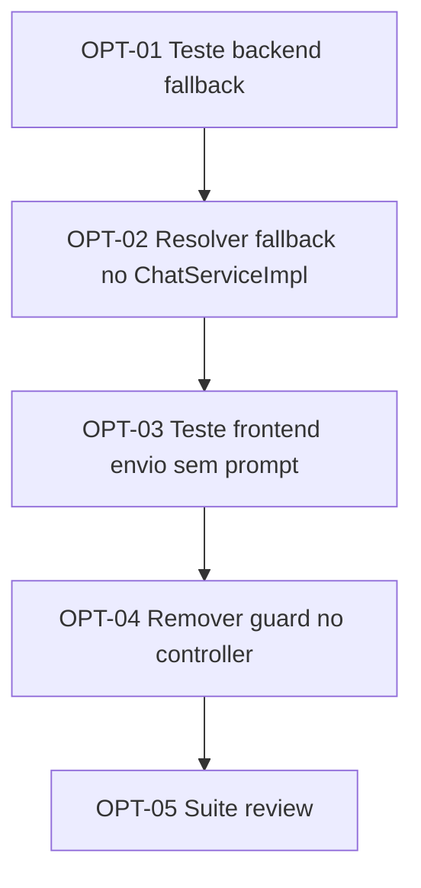

<!-- scope: prompt-opcional-chat -->
# TASKS — Prompt opcional no chat

> Backlog TDD-ready derivado 1:1 da `SPEC.md`. Teste **antes** da implementação em toda tarefa.

| ID | RF/NFR | Prioridade | Risco | Tipo | Depende de |
|---|---|---|---|---|---|
| OPT-01 | AC-01, AC-03 | P0 | Alto | teste | — |
| OPT-02 | RF-01, RF-02, AC-02 | P0 | Alto | backend | OPT-01 |
| OPT-03 | AC-05 | P0 | Médio | teste | — |
| OPT-04 | RF-03, RF-04, AC-05 | P0 | Médio | frontend | OPT-03 |
| OPT-05 | AC-06, AC-07 | P0 | Alto | qualidade | OPT-02, OPT-04 |

---

### OPT-01 — Teste backend: sem prompt e sem fallback (CORRIGIDO)

- **RF/NFR**: AC-01, AC-03 · **Prioridade**: P0 · **Risco**: Alto · **Tipo**: teste
- **Arquivos**: `ChatServiceImplTest` + `ChatFallbackIT` (Postgres/Redis).
- **Teste primeiro**:
  - (a) `chat` com `promptTemplateId=null` e `system_fallback` existente → `create` com id do fallback, resposta normal;
  - (b) tenant sem `system_fallback` ativo → backend **cria** registro técnico (idempotente), sessão criada, **nenhuma** `PromptTemplateNotFoundException` de fallback; system efetivo = `AssistantTurnGateway.PROMPT`;
  - (c) prompt **selecionado** inexistente → continua lançando `PromptTemplateNotFoundException` (erro legítimo do cliente).
- **DoD**: testes RED antes da implementação; nenhum guard apagado; teste antigo "sem fallback → falha" reescrito para "sem fallback → cria registro técnico".

### OPT-02 — Fallback técnico sem exigir prompt de banco (CORRIGIDO)

- **RF/NFR**: RF-01, RF-02, AC-02, AC-03 · **Prioridade**: P0 · **Risco**: Alto · **Tipo**: backend
- **Arquivos**: `ChatServiceImpl.java:153-178`.
- **Cenários**:
  - Sucesso (fallback existe): `findActiveByCode("system_fallback")` → id em `chatSessionService.create(...)`.
  - Sucesso (fallback AUSENTE): capturar `PromptTemplateNotFoundException` de `findActiveByCode` (`PromptTemplateServiceImpl.java:150`) e **garantir** o registro técnico `system_fallback` — criar via repository/service tenant-scoped (code `system_fallback`, status ACTIVE, version 1, texto `AssistantTurnGateway.PROMPT`), idempotente (reusar se já existe em outra versão/status, sem violar índice parcial V2:92-94). Usar o id em `create`. NUNCA re-lançar exceção de fallback.
  - Borda: `promptTemplateId` presente → código atual intacto; sessão existente autoritativa (`:182-204`); `resolvePromptTemplate` (`:206-210`) continua lançando para prompt **selecionado** inexistente (erro do cliente, distinto do fallback).
- **DoD**: AC-01..03 verdes; **zero** exceção de "fallback não encontrado"; seleção manual inalterada.

### OPT-03 — Teste frontend: envio sem prompt

- **RF/NFR**: AC-05 · **Prioridade**: P0 · **Risco**: Médio · **Tipo**: teste
- **Arquivos**: `use-chat-controller.test.ts` (ou novo teste do hook).
- **Teste primeiro**: sem `selectedPromptTemplateId` → `send` dispara request **sem** a chave `promptTemplateId`, sem `notice` de "escolha um prompt"; com prompt selecionado → request com a chave (comportamento atual).
- **DoD**: teste RED antes da implementação.

### OPT-04 — Remover guard no controller

- **RF/NFR**: RF-03, RF-04, AC-05 · **Prioridade**: P0 · **Risco**: Médio · **Tipo**: frontend
- **Arquivos**: `use-chat-controller.ts:243-246` (guard) e `:270` (montagem do request).
- **Cenários**:
  - Sucesso: remover o early-return do guard; quando vazio, não incluir `promptTemplateId` no request.
  - Falha: request ainda contendo `promptTemplateId: undefined` — corrigir para omitir a chave.
  - Borda: chave i18n `chat.warn.selectPrompt` — manter se usada alhures, remover se órfã (decisão do implementador).
- **DoD**: AC-05 verde; fluxo com prompt selecionado inalterado.

### OPT-05 — Suíte, review, evidência

- **RF/NFR**: AC-06, AC-07 · **Prioridade**: P0 · **Risco**: Alto · **Tipo**: qualidade
- **Teste primeiro**: `mvn -f backend/pom.xml -q clean && npm test` (376/376 + 66/516) e `mvn -Pintegration verify` (101 IT).
- **Cenários**:
  - Sucesso: AC-01..06 verdes; `code-reviewer` sem 🔴.
  - Falha: 🔴 → loop de correção (máx. 3 iterações).
  - Borda: zero diff de DTO HTTP, schema, migration, MFA.
- **DoD**: `code_review_status: passed`; `harness_status: passed`; **PARAR e pedir "Posso avançar?"** antes de commit/PR.
